# Claude Duet 完全ガイド（初学者向け・ステップバイステップ・ベストプラクティス）

> **一言でいうと**: Claude Duet は「あなたが開いたときだけ働く Claude」ではなく、「あなたに先に話しかけ、離れている間も働き、大事な場面では必ず確認を取る Claude」です。このガイドは、初めて触る人が **安全に・無駄なく・失敗しにくく** 使い始めるための手順とコツをまとめたものです。

| 項目 | 内容 |
|---|---|
| 作成日 | 2026-10-25（この日までに確認できた情報に基づく） |
| 対象読者 | 初学者（AI エージェントを初めて業務に使う人）〜 開発者・小規模事業者 |
| 製品の状態 | **リサーチプレビュー**（機能・上限・挙動は今後変わる可能性が大きい） |
| 起点となる公式ページ | <https://claude.com/product/claude-duet> |
| 想定する利用環境 | iOS / Android アプリ、または claude.ai（Web） |
| 執筆の立場 | AI エンジニア／Claude Code 実務者の視点で、手順を「なぜそうするか」まで説明 |

## 目次

| 章 | タイトル |
|---|---|
| 0 | [このガイドの読み方](#0-このガイドの読み方) |
| 1 | [Claude Duet とは](#1-claude-duet-とは) |
| 2 | [全体像を図で理解する](#2-全体像を図で理解する) |
| 3 | [用語集（初学者向け）](#3-用語集初学者向け) |
| 4 | [参加までのステップ（ステップバイステップ）](#4-参加までのステップステップバイステップ) |
| 5 | [初期設定のベストプラクティス](#5-初期設定のベストプラクティス) |
| 6 | [画面と基本操作](#6-画面と基本操作) |
| 7 | [依頼の書き方（ステップバイステップ）](#7-依頼の書き方ステップバイステップ) |
| 8 | [承認カードの読み方（最重要）](#8-承認カードの読み方最重要) |
| 9 | [ユースケース別レシピ](#9-ユースケース別レシピ) |
| 10 | [セキュリティの考え方](#10-セキュリティの考え方) |
| 11 | [使用量とコストの管理](#11-使用量とコストの管理) |
| 12 | [4週間導入ロードマップ（初学者向け）](#12-4週間導入ロードマップ初学者向け) |
| 13 | [限界と既知の制約](#13-限界と既知の制約) |
| 14 | [トラブルシューティング](#14-トラブルシューティング) |
| 15 | [運用の振り返り（週1回・15分）【分析】](#15-運用の振り返り週1回15分分析) |
| 16 | [開発者向け補足：Claude Code との関係と学べる設計思想](#16-開発者向け補足claude-code-との関係と学べる設計思想) |
| 17 | [チェックリスト総まとめ](#17-チェックリスト総まとめ) |
| 18 | [FAQ](#18-faq) |
| 19 | [補足ベストプラクティスと根拠ソース](#19-補足ベストプラクティスと根拠ソース) |
| 20 | [調査メモ（確認できたこと・できなかったこと）](#20-調査メモ確認できたことできなかったこと) |

---

## 0. このガイドの読み方

### 0-1. 情報の確度ラベル

本文の各所に、情報の出どころを示すラベルを付けています。**ラベルを見れば「公式が言っていること」と「筆者の推奨」を区別できます。**

| ラベル | 意味 | 例 |
|---|---|---|
| 【公式】 | Anthropic の公式ページ・ヘルプ・発表記事で確認できた事実 | 承認なしに送信・支払い・署名・削除は行わない |
| 【開発者】 | 著名な国際的開発者・評論家などの公開発信 | Simon Willison の安全性に関する見解 |
| 【分析】 | 上記の事実をもとにした筆者の整理・推奨（公式の約束ではない） | 最初の1週間は下書きだけにする |
| 【未確認】 | 調査時点で確認できなかった事項 | 確認の正確な間隔 |

### 0-2. 読み進め方（おすすめ順）

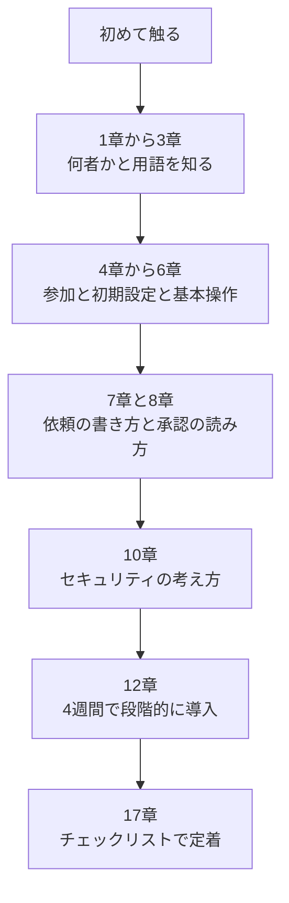

> **注意（同名の別製品）**: 「Duet」は他にも存在します。たとえば Decagon 社の AI エージェント改善ツール「Decagon Duet」、Claude Code 向けのコミュニティ製プラグイン「duet」（GitHub）などは **Claude Duet とは別物**です。検索するときは必ず「Claude Duet」＋「Anthropic」で調べてください（出典は19章）。

---

## 1. Claude Duet とは

### 1-1. 3行で理解する

1. **メッセージで仕事を任せる AI エージェント**です。文字でも音声でも依頼できます。【公式】
2. **クラウド上に自分専用のコンピューター**を持ち、アプリを閉じてもスマホや PC の電源が切れていても作業を続けます。【公式】
3. **送信・支払い・署名・削除の前には必ずあなたの承認を待ちます。**【公式】

### 1-2. 普段の Claude との違い

| 観点 | Claude（いつものアプリ） | Claude Duet |
|---|---|---|
| 主導権 | あなたがチャットを開いて始める | **Duet の側から**朝のブリーフや確認依頼を届ける |
| 作業の場所 | 会話の中、あなたと並走 | クラウド上の専用 PC で**バックグラウンド作業** |
| 仕事の単位 | 1回の会話 | 1本のスレッド＋タスク一覧＋成果物 |
| 引き継ぐもの | — | Claude アカウントの**メモリ・スキル・接続済みアプリ** |
| 想定ユーザー | 幅広い | 仕事を多数抱える専門職・小規模事業者 |
| 提供形態 | 各アプリ | **独立したアプリ**（iOS / Android）。PC では claude.ai |

【公式】出典: 製品ページ FAQ・発表記事

### 1-3. いまの提供状況（2026-10-25 時点）

| 項目 | 状況 |
|---|---|
| 公開日 | 2026-10-21（リサーチプレビュー） |
| 入手方法 | **ウェイトリスト**（順次招待） |
| 対象プラン | **Pro / Max / Ultra**（Team / Enterprise は未対応） |
| 対象地域 | **米国のみ**（米国の Claude アカウントが必要） |
| 搭載モデル | Claude Opus 5.5（**モデルの選択は不可**。作業量は Duet が判断） |
| 料金 | 研究プレビュー中は Pro / Max / Ultra に追加料金なし。**使用上限は他の Claude と共有** |
| 接続できるもの | 6,000 以上のコネクタとプラグイン（Gmail・Google Calendar・Slack・QuickBooks・Stripe・HubSpot・Docusign・Gusto・Notion・Canva など） |

【公式】出典: 製品ページ、発表記事、ヘルプセンター「Claude Duet を始める」

---

## 2. 全体像を図で理解する

### 2-1. 仕組みの地図

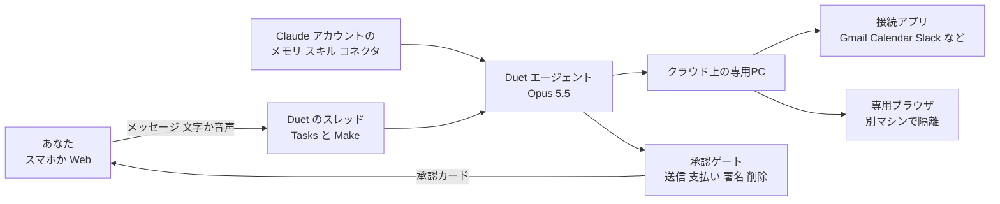

**読み方**: あなたは「スレッド」に話しかけるだけです。Duet は Claude アカウントの記憶と接続アプリを使い、クラウド上の専用 PC で作業します。**送信・支払い・署名・削除といった操作の前には、あなたに承認を求めるよう設計されています。**

### 2-2. 1日の流れ（典型例）

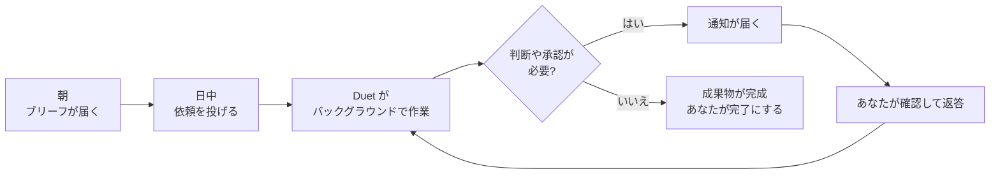

---

## 3. 用語集（初学者向け）

| 用語 | やさしい説明 | 本ガイドでの注意点 |
|---|---|---|
| **エージェント** | 指示を受けて、自分で手順を考えて道具（アプリ）を使い、作業を進める AI | 「答えるだけ」の AI と違い、**実際に行動する**ため権限管理が重要 |
| **プロアクティブ** | 頼まれる前に、必要そうなことを見つけて先に動くこと | 便利な反面、**通知が多すぎたり少なすぎたり**する調整が要る |
| **コネクタ** | Duet が外部アプリ（Gmail など）を使えるようにする接続 | つなぐほど便利だが、**つなぐほど守るものが増える** |
| **承認（Approval）** | Duet が行動の前に「これをやります」と見せ、あなたの OK を待つ仕組み | 一番大切な安全装置。**中身を読んで押す**ことが肝心 |
| **プロンプトインジェクション** | メールや Web ページに紛れ込んだ「AI への悪意ある指示」 | Duet はメールや Web を読むため、**避けて通れないリスク** |
| **リサーチプレビュー** | 完成品ではなく、利用者の声で改善している段階 | 重要業務に全面依存せず、**小さく試す** |
| **ウェイトリスト** | 順番待ちの登録リスト | 登録しても日付は保証されない |
| **使用上限（5時間・週間）** | プランごとに決まった利用量の枠 | Duet の**裏の確認作業もこの枠を消費**する |

---

## 4. 参加までのステップ（ステップバイステップ）

### 4-1. 参加できるかの判定

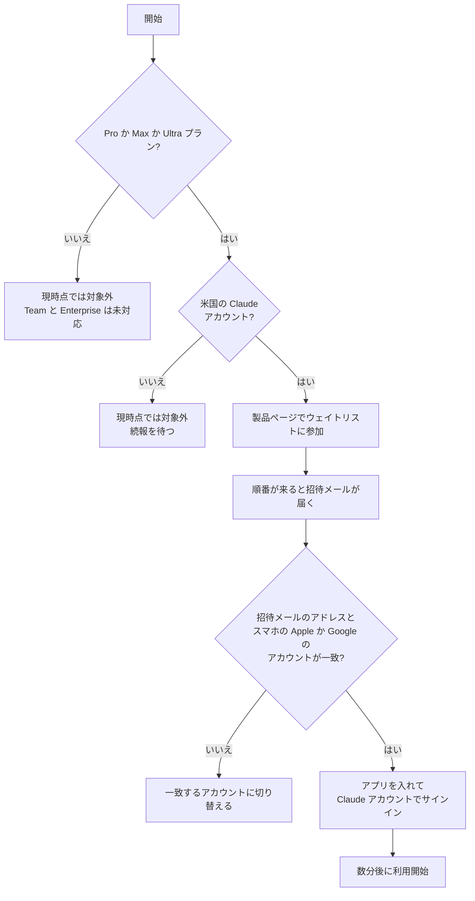

### 4-2. 手順

**Step 1　製品ページを開く**
<https://claude.com/product/claude-duet> で「ウェイトリストに参加」を選びます。

**Step 2　情報を入力する**
名前とメールアドレスを入れます。すでに Claude を使っているなら、**Claude アカウントと同じメールアドレス**にします（アクセスはそのアドレスに紐づくため）。

**Step 3　プランと端末を選び、最初に任せたいことを書く**
Claude のプラン、iPhone か Android か、何をしているか、Duet に最初に任せたいことを書く欄があります。**具体的に書くほど、プレビューの改善に役立ちます。**

**Step 4　招待を待つ**
招待は段階的に届きます。登録しても日付の保証はありません。

**Step 5　招待メールをスマホで開く**
提供したメールアドレスに紐づく Apple / Google アカウントで、案内に従ってアプリを入れます。

**Step 6　サインインする**
Claude アカウントでサインインします。招待の承認後、使えるようになるまで数分かかることがあります。

【公式】出典: ヘルプセンター「Claude Duet を始める」

### 4-3. 「まだ使えない」ときの原因

| 原因 | 対処 |
|---|---|
| 招待がまだ来ていない | 順次送付のため待つ。日付の保証はない |
| 米国外のアカウント | 現時点では対象外 |
| Team / Enterprise プラン | 現時点では対象外（今後対応予定とされている） |
| 登録メールとアカウントが不一致 | 登録メールに紐づく Apple / Google アカウントで入る |

### 4-4. 招待が来るまでにやっておくこと【分析】

待ち時間を使って、次の準備をしておくとスムーズです。

1. **接続したいアプリの棚卸し**（本当に最初の2週間で必要なものだけに絞る）
2. **Claude 側のメモリを見直す**（Duet は Claude のメモリを引き継ぐため、誤った記憶があれば直す）
3. **「任せたいこと」「任せたくないこと」を3つずつ書く**（8章の承認ルールの下書きになる）
4. **同名の別製品と混同しない**（0章の注意参照）

---

## 5. 初期設定のベストプラクティス

### 5-1. 最初の原則：「つなぐ範囲は最小から」【分析】

Duet は接続したアプリの中身を読み、メッセージを送れます。つまり、**「私的なデータを読める」×「外部の文章を読む」×「外へ送れる」**がそろいます（10章で詳しく説明）。だからこそ、最初は接続を絞るのが安全で、使用量の節約にもなります。

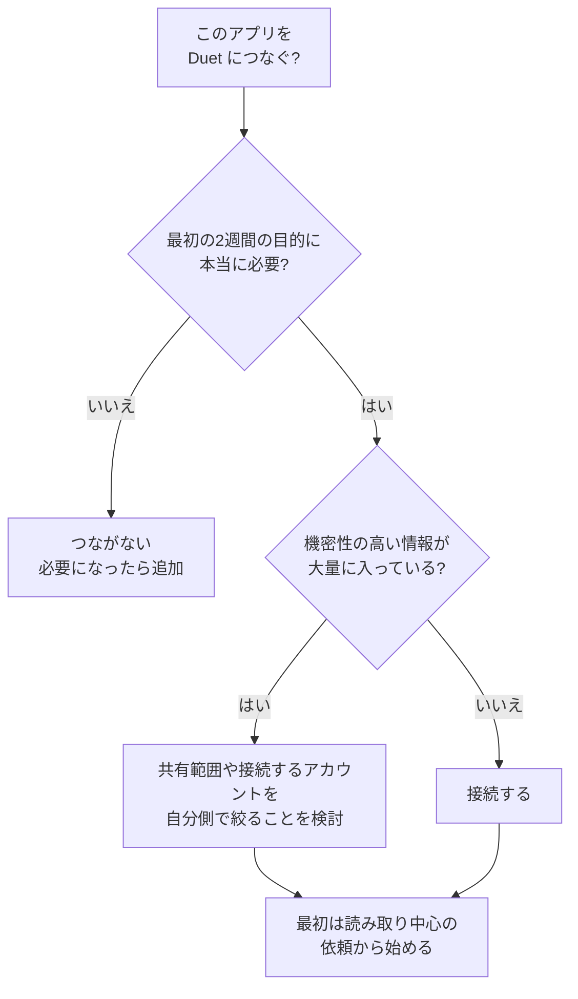

### 5-2. 推奨する接続の順序【分析】

| 順番 | 接続するもの | 理由 |
|---|---|---|
| 1 | メール（Gmail）＋カレンダー | 朝のブリーフの中心。下書き中心で安全に試せる |
| 2 | ドキュメント／ストレージ（Google Drive など） | 資料・要約・準備作業で効果が出やすい |
| 3 | チャット（Slack） | 公式に「制限付きで動作」とあるため、挙動を見ながら |
| 4 | 業務システム（QuickBooks・Stripe・HubSpot など） | 金銭や顧客情報に関わるため、慣れてから |
| 5 | 決済（Link・Shop Pay） | 承認の読み方に慣れてから最後に。Link・Shop Pay はコネクタのディレクトリではなく **Claude Duet 内で接続**する |

【公式】接続は自分で開始し、いつでも切断できます。切断すると**その時点から新たなアクセスは止まります**が、**すでにメモリに保持された情報は切断しても消えません**。不要な記憶は**個別に確認して削除**でき、**すべての記憶を消したい場合にだけメモリのリセット**を使います。

### 5-3. 設定の確認ポイント

| 設定 | 確認すること | 公式の根拠 |
|---|---|---|
| 接続アプリ | 不要なものが接続されていないか。Claude 側で切ると Duet 側も切れる | 安全性の記事 |
| メモリ | 古い情報・誤った情報が残っていないか（Duet は Claude のメモリを使う） | 発表記事・安全性の記事 |
| 過去チャットの検索 | 使いたくなければ、設定の「チャットを検索して参照」をオフにする | ヘルプセンター |
| 通知の頻度 | 「何を・どのくらいの頻度で知らせてほしいか」を言葉で伝えられる | 発表記事 |
| メモリのリセット | アプリの設定からいつでも実行できる | 安全性の記事 |

### 5-4. 最初に送る「自己紹介メッセージ」テンプレート【分析】

最初の一通で、**あなたの仕事の優先順位と、Duet の動き方のルール**を伝えておくと、その後の判断精度が上がります。

```markdown
はじめまして。次の前提で動いてください。

## 私の仕事
- 役割: （例）ECショップの運営者。従業員10人
- 毎日いちばん大事にしたいこと: （例）顧客対応の遅れをなくす、資金繰りを把握する

## 知らせてほしいこと
- すぐ知らせる: 顧客からのクレーム、支払い期限が24時間以内のもの
- 朝のブリーフにまとめる: 返信が必要なメール、今日の会議の準備
- 知らせなくてよい: メルマガ、自動通知

## ルール
- 外部に送る前は、必ず私の承認を取ってください。
- 数字や要約を出すときは、元のメール・ファイル名を添えてください。
- 迷ったら、実行せず先に質問してください。
```

---

## 6. 画面と基本操作

### 6-1. 3つの場所を覚える

| 場所 | 役割 | 使いどころ |
|---|---|---|
| **メインスレッド** | 1本の会話。中断したところから再開できる | 軽い依頼、雑談、方針の相談 |
| **Tasks（タスク）** | Duet が取り組んでいる作業の一覧。入力が必要なものが目立つ | 進捗確認、**割り込みで方向修正** |
| **Make** | 完成した成果物（資料・表・ダッシュボードなど）が並ぶ | レビューして編集・利用 |

【公式】Tasks タブでは入力が必要なタスクが強調され、メインスレッドは静かに保たれます。Duet は「完了」を提案できますが、**完了にできるのはあなただけ**です。

### 6-2. チャネルで話題を分ける【公式】

トピックごとに別のチャネルを作れます。**メモリは共有**されるので、話題を混ぜずに文脈だけ引き継げます。

| チャネル例 | 用途 |
|---|---|
| 採用 | 候補者との日程調整、求人文の下書き |
| 経理 | 未払い請求書の確認、督促の下書き |
| 資金調達 | 資料の更新、想定問答 |

### 6-3. 依頼のライフサイクル

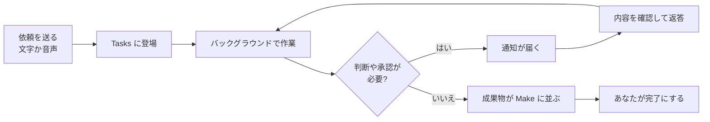

### 6-4. 中断・修正の基本【公式＋分析】

- 作業中でも、Duet が何をしているかを見て、**途中で方向を修正（steer）**できます。
- すぐに承認できないときは、**Duet が残りを進めて、後で承認を再提示**します。
- 画面の「今はしない」を選ぶのは、**不安があるときの正しい選択**です。承認は後に回せますが、**影響がないとは限りません**。締め切りのある作業や、保留によって生じる副作用（返信や支払いの遅れなど）がないかを確認してください。

---

## 7. 依頼の書き方（ステップバイステップ）

### 7-1. 基本の型：5つの要素【分析】

Claude Code の開発者 Boris Cherny は、Claude への指示について「同僚に話すように、**何をしたいか・どれだけ力を入れるか・どう検証するか**を伝えればよい」という趣旨を述べています【開発者・二次報道】。この考え方は Duet にもそのまま使えます。

| 要素 | 書くこと | 悪い例 → 良い例 |
|---|---|---|
| ① ゴール | 最終的に何がほしいか | 「請求書どうなってる？」→「**未払い請求書を一覧にして、期限が近い順に並べて**」 |
| ② 完了条件 | どうなったら終わりか | 「資料を作って」→「**12枚以内で、数字は第3四半期の最新値**」 |
| ③ 制約 | 触ってはいけないもの・守る線 | 「連絡して」→「**社外には送らず、下書きまでで止めて**」 |
| ④ 承認の境界 | どこで必ず確認を取るか | 「全部やっておいて」→「**送信と支払いの前は必ず確認**」 |
| ⑤ 根拠の提示 | 数字や要約の出どころ | 「売上は？」→「**どのファイル・メール由来か添えて**」 |

> 【公式】Duet は、数字や要約を出すときに**どのメール・ファイル・スプレッドシート由来かを伝える**ように設計されています。⑤はその挙動を強めるだけなので、毎回の依頼で添える習慣にしておくと、後の**検証**がとても楽になります。

### 7-2. 依頼テンプレート（コピーして使う）

**テンプレート A：調べて下書きまで（安全な基本形）**

```markdown
# 依頼
未払い請求書を確認して、督促メールの下書きを作ってください。

# 完了条件
- 期限超過の請求書を、金額の大きい順に一覧にする
- 各社への督促メールを下書きにする（丁寧な文面、3文以内）

# 制約
- 送信はしない。下書きだけ作る
- 取引先の機密情報は文面に入れない

# 根拠
- 一覧には、請求書番号と元データの場所を添える
```

**テンプレート B：会議の準備**

```markdown
# 依頼
今日14時の打ち合わせに向けて、相手企業の簡単なブリーフを作ってください。

# 完了条件
- 相手企業の概要、直近のニュース、過去のやり取りの要約
- 2分で読める分量
- 私が確認すべき論点を3つ

# 根拠
- 出典URLを必ず添える。確認できなかった点は「未確認」と書く
```

**テンプレート C：大きな成果物（資料・分析）**

```markdown
# 依頼
第3四半期の実績を反映した投資家向け資料を更新してください。

# 完了条件
- 12枚以内
- 数字は最新の会計データと一致させる
- 私の確認が必要なスライドには印を付ける

# 承認の境界
- 外部へ共有する前に、必ず私に見せる
- 数字が元データと合わない箇所は、推測で埋めず質問する
```

### 7-3. 音声で依頼するときのコツ【分析】

公式の利用例には、**歩きながら頭の中の to-do を話す**という使い方があります（Anthropic の社内利用）。音声はテキストよりも曖昧になりやすいので、次の順で話すと伝わります。

1. 「**ゴールは〜**」（何がほしいか）
2. 「**今日中に**／**明日の朝までに**」（期限）
3. 「**送る前に確認して**」（承認の境界）

### 7-4. 「いい依頼」の自己チェック

| チェック | はい/いいえ |
|---|---|
| 完了の状態が一文で言える | □ |
| 「送る・払う・消す」を含むなら、承認を取るよう書いた | □ |
| 数字や要約には出どころを添えるよう頼んだ | □ |
| 1つの依頼に詰め込みすぎていない（大きければ分割した） | □ |
| 緊急のものは、Duet の確認間隔に頼らず**自分でも見る**前提にした | □ |

---

## 8. 承認カードの読み方（最重要）

### 8-1. 承認の流れ

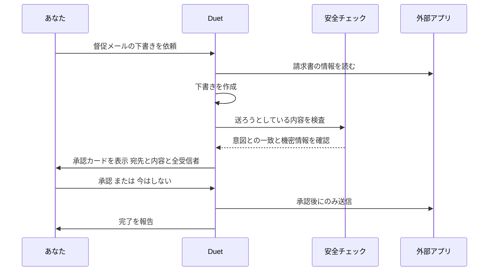

【公式】承認カードには、**操作の内容・宛先・本文・全受信者**が表示されます。また、モデルとは別の自動チェックが各操作の横で動き、**意図に合っているかを評価**します。このチェックはモデルの外側で動くため、Web ページに仕込まれた指示では結果を左右できません。

### 8-2. 承認が必要な操作・禁止されている操作

| 区分 | 操作 | 扱い |
|---|---|---|
| 承認が必要 | メッセージ（メール）の送信 | 承認カードで確認 |
| 承認が必要 | 支払い | 承認カード＋決済アプリ側の承認（Link など） |
| 承認が必要 | 文書への署名 | 承認カードで確認 |
| 承認が必要 | 何かの削除 | 承認カードで確認 |
| 「今後は聞かないで」が**使えない** | 支払い・送金、注文の削除、アカウントの新規作成 | 何度承認しても毎回確認 |
| 承認しても**禁止** | 有価証券の取引、口座間の資金移動、他人のアカウントへのアクセス | 実行されない |

【公式】出典: 発表記事、安全性の記事、ヘルプセンター

### 8-3. 承認カードは「コードレビュー」と同じ目で見る【分析】

承認を機械的に押す習慣は、**承認疲れ（approval fatigue）**を招きます。公式の安全性の記事も、承認の頻度の調整が難しい課題であることを認めています。Simon Willison も、確認を求め続けるだけでは人が安全に動かなくなる、という趣旨を指摘しています【開発者】。次の4点だけは、毎回目で確認してください。

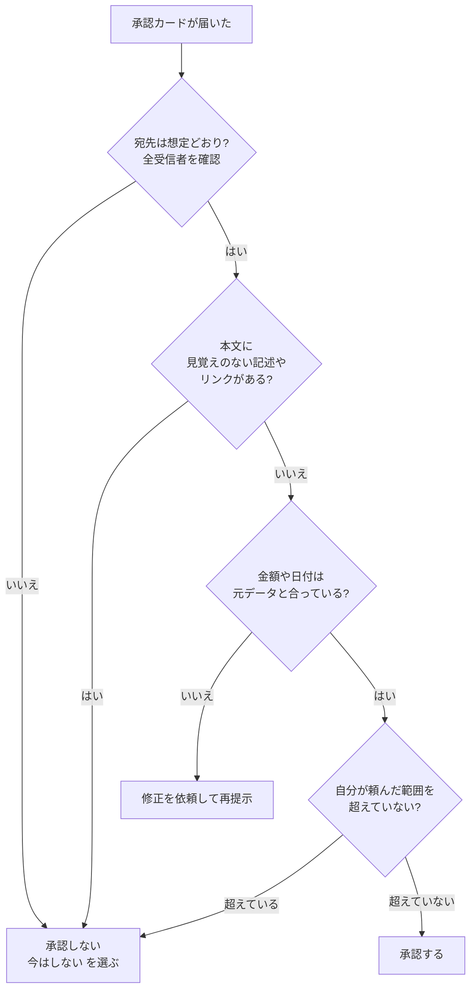

| 見るポイント | 具体的に何を見るか |
|---|---|
| 宛先 | 全員が想定どおりか。**CC や BCC に見知らぬアドレスがないか** |
| 本文 | 頼んでいない内容、不自然なリンク、急かす文面がないか |
| 数字 | 金額・日付が、元のメールやファイルと一致しているか |
| 範囲 | 「下書きまで」と頼んだのに、送信や支払いに進んでいないか |

### 8-4. 不安なときの動き方

1. **「今はしない」を押す。**
2. チャットで「**なぜこの宛先・この内容にしたのか、根拠を示して**」と聞く。
3. 納得できなければ、**接続を一時的に切る**ことも選べる（切るとその時点から新規アクセスが止まる）。
4. 異常だと感じたら、チャットで状況を平易な言葉で伝え、**報告**する（公式の機能）。

---

## 9. ユースケース別レシピ

> 以下の例は、公式の利用例や発表記事の内容をもとに、**初学者がそのまま試せる形**に整えたものです【公式＋分析】。最初は「下書きまで」で止めて、結果を見てから承認に進みましょう。

### 9-1. 朝のブリーフを使いこなす

【公式】毎朝、接続アプリを確認して最重要事項を選び、返信の下書きなど**最初の一歩**を進めたうえで要点を届けます。

| ステップ | やること |
|---|---|
| 1 | 最初の1週間は、ブリーフの**項目の並び順と粒度**だけを観察する |
| 2 | 「多すぎる」「足りない」を言葉で伝える（例：「採用と資金繰り以外は不要」） |
| 3 | 良かった項目には「これは今後も」、不要な項目には「これは次から不要」と明示する |
| 4 | 1週間後、ブリーフの内容が**自分の優先順位と一致**しているか見直す |

### 9-2. 未払い請求書の確認と督促

```markdown
Stripe（または QuickBooks）で未払いの請求書を確認し、
期限超過のものを一覧にしてください。
各取引先への督促メールを下書きにして、私の承認待ちにしてください。
送信はしないでください。
```

【公式】Duet は、請求書の確認とリマインダーの下書きを行い、**送信前に承認を求めます**。

### 9-3. 会議前のブリーフ

```markdown
午後2時の会議の前に、相手企業についてのブリーフを作ってください。
過去のメールのやり取りと、直近のニュースを入れてください。
確認できなかった点は「未確認」と書いてください。
```

【公式】発表記事の事例では、会議の予定を見つけてブリーフを準備し、**フライト直前だと気づいて予定の移動を提案**した例が紹介されています。

### 9-4. カレンダーの矛盾チェック

【公式】事例：内見の予定が**誤った日**に入っているのを、頼まれる前に Duet が指摘した、という紹介があります。

```markdown
今週のカレンダーを見て、移動時間が足りない予定、
日付がメールの内容と食い違っている予定、
同じ時間の二重予約を洗い出してください。変更はせず報告だけお願いします。
```

### 9-5. 資料・ダッシュボードなど大きめの作業

| 公式に挙がる例 | 初学者向けのコツ |
|---|---|
| ダッシュボード、財務・営業予測の作成 | **一度に頼まず**、まず「必要なデータの棚卸し」→「雛形」→「数字の反映」と分割する |
| 試作・Web アプリの作成 | 完成イメージ（目的・画面）を最初に文章で固める |
| 資料（デック）の更新 | 「確認が必要なスライドに印を付けて」と頼み、**レビュー箇所を絞る** |

【公式】大きな成果物は、**ファイル（調査ブリーフ・財務モデル・スライド・ダッシュボードなど）として返り、Make に並びます**。

### 9-6. 契約・給与・採用などの業務

| 業務 | 公式に挙がる例 | 注意 |
|---|---|---|
| 契約 | Docusign で契約書の準備と署名依頼 | **署名は承認が必須**。宛先と条項の確認を丁寧に |
| 給与 | Gusto で勤務時間・賞与・経費を入れた給与の準備 | 実行前に**必ず自分で数字を確認**（公式も「あなたがレビューする」前提） |
| 採用 | 求人の下書き→あなたが編集・承認→LinkedIn に投稿 | 公開前に必ず文面を確認 |
| 営業 | HubSpot の履歴から、フォローアップメールの下書き | 個人情報の混入に注意 |

### 9-7. 購入（Link・Shop Pay）

【公式】

- Duet は、購入前に**品目と金額をあなたに確認**します。
- **Link**（Stripe のデジタルウォレット）で、あなたが**決済アプリ側でも承認**して初めて支払われます。
- 支払いは**その購入専用のワンタイム仮想カード**で行われ、実際のカード番号は共有されません。
- **Shop Pay**（Shopify）でオンラインストアのチェックアウトも可能です。
- 1Password に保存したログイン情報でのサインインは「近日対応予定」とされています。

> 【公式】個人的な用事（チケット予約など）は、仕事向けの機能ほど得意ではないと明記されています。

---

## 10. セキュリティの考え方

### 10-1. なぜ「エージェント」は危ないのか：Lethal Trifecta【開発者】

Simon Willison（Django の共同開発者）は、AI エージェントが次の3つを**同時に**持つと、データが盗まれやすくなると整理しました（2025年に提唱した「Lethal Trifecta」）。

| 要素 | Duet では |
|---|---|
| ① 私的データへのアクセス | Gmail・Drive・Slack・メモリを読める |
| ② 信頼できない内容への接触 | 受信メール、Web ページを読む |
| ③ 外部への通信 | メール送信、ブラウザ操作、支払い |

**Duet は仕様上、3つすべてを備えます。** だからこそ、公式は承認ゲートを中心に多層の防御を組んでいます。

### 10-2. Rule of Two で自分の使い方を点検する【開発者＋分析】

Meta の AI セキュリティチームは、セッション内でエージェントが持つ性質を**「3つのうち最大2つまで」**に抑える考え方（Agents Rule of Two）を2025年10月に公開しました。3つ全部が必要な作業は、**人間の承認など信頼できる検証を挟んで監督付きで行う**ことが前提です。Willison は、信頼できる防御が確立されていない現状で最も実用的な助言だと評価しつつ、「信頼できない入力＋状態変更」の組み合わせも安全とは言えない、という留保も付けています。

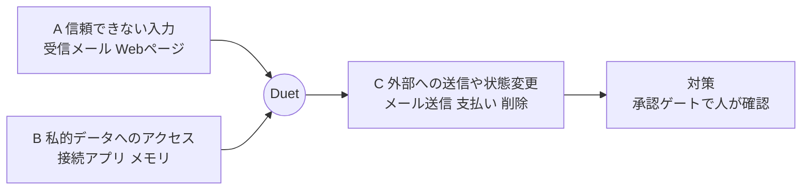

**自分の使い方でできる Rule of Two 的な工夫【分析】**

| 減らす対象 | 具体策 |
|---|---|
| B（私的データ） | **つなぐアプリを絞る。** 人事・法務など機微な情報の置き場は、最初は接続しない |
| A（信頼できない入力） | 知らない相手からの依頼メールに基づく作業は、**慎重に**（本文に隠れた指示がありうる） |
| C（外部への影響） | 最初の2週間は「下書きまで」と明示し、**送信・支払いを自分の手で完結**させる |

### 10-3. 公式が用意している防御（要点）【公式】

| 防御 | 内容 |
|---|---|
| 承認ゲート | 送信・支払い・署名・削除の前に、操作・宛先・内容を見せて待つ |
| 別系統の自動チェック | モデルの外側で、各操作が意図に合うかを評価（Claude Code の auto mode の分類器を拡張） |
| 機微情報の分類器 | 送信しようとするメッセージを別途検査（下の図） |
| 認証情報の隔離 | パスワード・Cookie・サインイン用トークンは**モデルから見えず**、**Duet のメモリにも保存されない** |
| ブラウザの隔離 | 専用の仮想マシン上で動作。決まった命令（開く・クリック・入力）だけで操作 |
| 自己申告 | ブラウザのリクエストに専用の User-Agent を付け、公開 IP も公表。一部の大手サイトは拒否を選択 |
| 第三者による検証 | レッドチーム、外部ペネトレーションテスト、公開バグバウンティの対象 |

### 10-4. 機微情報の扱い

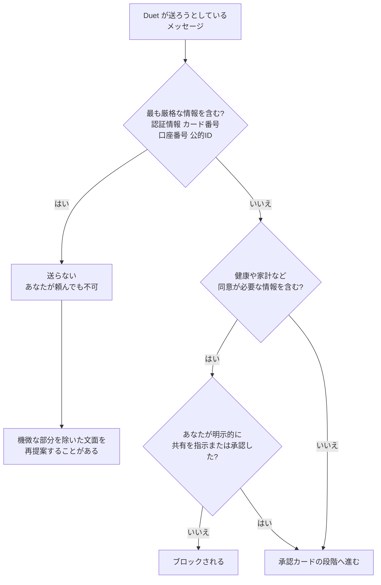

【公式】自分自身の依頼は同意として扱われます（例：歯医者へ症状を伝えるメッセージ）。ただし、この仕組みは**ときに見逃し、または無害なものを止める**ことがあり、承認ゲートと併用される前提だと公式が述べています。

### 10-5. 見落としやすい落とし穴（フィッシング）

【公式】パスワードのフォームは、**アプリの中で、あなたが頼んだサインインのときだけ**表示されます。リンク・SMS・メール・claude.ai 以外のサイトとして届くことは**ありません**。Duet を名乗る何かが別の場所でパスワードを求めてきたら、**偽物**です。

### 10-6. 実運用の安全ルール（そのまま使える）【分析】

```yaml
# 私の Claude Duet 運用ルール（例）
connectors:
  first_two_weeks: [gmail, calendar]   # 最初はこの2つだけ
  add_later: [drive, slack, quickbooks]
approvals:
  always_read: [recipients, body, amounts, dates]
  never_approve_when:
    - 宛先に見覚えのないアドレスがある
    - 頼んでいない範囲の操作が含まれる
    - 急かす文面や不自然なリンクがある
data:
  never_put_in_chat: [パスワード, カード番号, 公的ID番号]
review:
  weekly: [接続アプリの棚卸し, メモリの確認, 承認ログの見直し]
```

---

## 11. 使用量とコストの管理

### 11-1. 何が使用量を消費するか【公式】

- Duet は**プランの使用上限を、通常の Claude のチャットと同じ枠で**使います。**週間の上限**が適用され、**5時間のセッション上限**はその上限の対象となるアカウントにのみ適用されます。
- **朝のブリーフや定期的な確認などの裏の作業も使用量に数えられます。**
- 大きな作業（財務モデルや資料の作成）は、モデルの試行回数と裏作業が増えるため、使用量が大きくなります。
- 確認は**数時間おき**（常時ではない）。常時確認すると上限の消費がはるかに速くなるため、とされています。

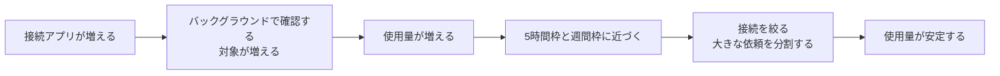

### 11-2. 節約のコツ【分析】

| コツ | 理由 |
|---|---|
| 接続アプリを絞る | 確認の対象が減る |
| 大きな依頼は分割し、**途中でレビュー**する | 方向違いのやり直しを減らす |
| 通知してほしい条件を絞る | 無駄な往復を減らす |
| 緊急でない作業は、まとめて依頼する | 小さな往復の積み重ねを避ける |

### 11-3. 上限リセットの特典【公式】

Duet のリサーチプレビューに受け入れられると、**5時間枠と週間枠の両方がリセットされる「上限リセット」を1回**受けられます。この特典は **2026年11月30日まで**利用可能です（ヘルプセンター記載）。**使い始めるタイミングを逃さないよう、招待が届いたら早めに試す**とよいでしょう。

---

## 12. 4週間導入ロードマップ（初学者向け）

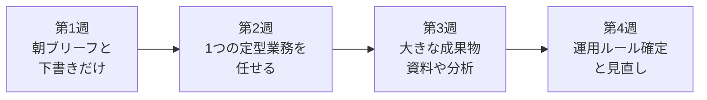

| 週 | 目標 | やること | 合格ライン（目安） |
|---|---|---|---|
| **第1週** | 挙動を知る | 接続は2つだけ（メール・カレンダー）。ブリーフと下書きのみ。送信は自分で | ブリーフの内容が**自分の優先順位と7割程度合う** |
| **第2週** | 1つ任せる | 未払い請求書の確認など、**定型で結果が確かめやすい**業務を1つ | 数字・宛先の誤りを**承認前に毎回検出できる** |
| **第3週** | 大きく頼む | 資料・分析など。分割して依頼し、途中レビュー | **やり直しが少なく**、確認が必要な箇所が絞られている |
| **第4週** | 型にする | 通知ルール・承認ルール・チャネル構成を文章にして固定 | 運用ルールを**他人に説明できる** |

> 【分析】「合格ライン」は筆者の目安で、公式基準ではありません。自分の業務に合わせて調整してください。

---

## 13. 限界と既知の制約

### 13-1. 公式に明記されている制約【公式】

| 制約 | 内容 | 対処 |
|---|---|---|
| モデルを選べない | Opus 5.5 で動き、必要な作業量は Duet が判断 | 受け入れる。重い作業は分割して依頼 |
| ブラウザ作業を見られない | 動いている様子を見たり、操作を引き継いだりできない | 結果と根拠の提示を依頼する |
| 確認は「数時間おき」 | 確認と確認の間に届いた緊急事項は見逃しうる | **緊急のものは自分でも見る** |
| 見られる範囲 | PC 上のすべてのプロジェクトやファイルは見えない。Claude での作業は読めるが変更できない | 必要な資料は接続アプリに置く |
| 電話・SMS | 他人への電話や SMS はできない。承認の上、接続済みアカウントからメール送信は可能 | 電話は自分で |
| 一部コネクタ | Slack などは制限付き。Microsoft 365 は未対応 | 他の接続で代替 |
| 誤判断 | スレッドの読み違い、緊急度の見誤りがありうる | 承認前に必ず確認 |
| 個人的な用事 | 仕事向けの機能に比べて弱い（チケット予約など） | 仕事用途に集中 |
| アプリ構成 | 当面は独立した別アプリ（Claude 本体とは別） | 2つを使い分ける |

### 13-2. 実際に触った評論家の指摘【開発者】

Claire Vo（ChatPRD 創業者、Lenny's Newsletter / How I AI のホスト）は、Duet を受信箱・Slack・営業パイプライン・Google ドキュメントの営業資料・動画・チケット探しで試し、次の趣旨の評価をしています（動画のため、要点のみ紹介）。

| 評価 | 内容の趣旨 |
|---|---|
| 良い点 | オンボーディングやタスク一覧、成果物、チャネルの作りこみなど、**これまでの個人エージェントの発表で最も洗練されている**部類 |
| 課題 | 「プロアクティブ」と言いつつ、**自分から声をかける頻度が足りない**と感じる場面がある |
| 課題 | 応答の遅さ（レイテンシ）が、**同期的に付き合う意欲を削ぐ** |
| 課題 | **デスクトップ版がない**、複数人での共同利用（マルチプレイヤー）に弱い |
| 全体 | 洗練されていても、多くの個人エージェントと注目を奪い合う中で**日常に定着するかが課題** |

> 【分析】この評価は一人の評論家の使用感であり、**あなたの業務で同じとは限りません**。ただし「通知の調整」「待ち時間」「PC 版の不在」は、導入前に確認しておきたい論点です。

### 13-3. 向き・不向きの目安【分析】

| 向いている | 向いていない（現時点） |
|---|---|
| メール・予定・請求・会議準備など、**文脈が接続アプリにある**仕事 | 緊急性が極めて高く、**確認の遅れが致命的**な業務 |
| 結果を**人が最後に確認**できる業務 | 承認なしで完結させたい自動処理 |
| 定型的で、成果物が**検証しやすい**業務 | 個人的な予約・手配が中心の用途 |
| 米国の Pro / Max / Ultra ユーザー | Team / Enterprise、米国外のアカウント |

---

## 14. トラブルシューティング

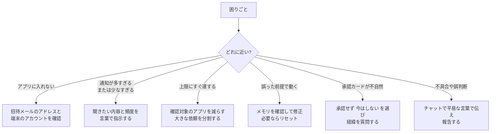

| 症状 | 考えられる原因 | 対処 |
|---|---|---|
| 招待メールが来ない | 順次送付 | 待つ。登録メールと端末のアカウントを確認 |
| 古い情報で動く | 古いメモリ・過去チャットの参照 | メモリを見直す。過去チャット検索をオフにする設定もある |
| 緊急メールの通知が遅れた | 確認が数時間おき | 緊急の連絡手段は別に確保する |
| 数字が合わない | 元データの読み違い | 出典（メール・ファイル）の提示を求めて照合する |
| 「完了」と言うのに終わっていない | Duet は完了を**提案**するだけ | あなたが内容を確認して完了にする |
| 接続を切ったのに情報が残る | 切断は新規アクセスの停止のみ | **メモリをリセット**（アプリの設定から） |
| 不審なパスワード入力画面 | フィッシングの可能性 | アプリ内の自分が頼んだサインイン以外では入力しない |

---

## 15. 運用の振り返り（週1回・15分）【分析】

| チェック項目 | 見ること | 対応 |
|---|---|---|
| ブリーフの質 | 重要事項を拾えているか。余計な項目はないか | 通知ルールを言葉で修正 |
| 承認ログ | 承認した内容に問題はなかったか | 迷った操作は、次から「必ず確認」と指示 |
| 接続アプリ | 使っていないアプリがつながっていないか | 不要なら切断 |
| メモリ | 古い・誤った前提が残っていないか | 修正またはリセット |
| 使用量 | 上限に近づいていないか | 接続や依頼を絞る |
| 失敗事例 | うまくいかなかった依頼 | テンプレートに「完了条件」「承認の境界」を足す |

---

## 16. 開発者向け補足：Claude Code との関係と学べる設計思想

### 16-1. Duet の開発者の使い方【公式】

発表記事では、Anthropic の社内利用が紹介されています。

| 人物 | 使い方（趣旨） |
|---|---|
| Boris Cherny（Claude Code のリード） | **散歩中に頭の中の to-do を話す**。机の前に持ち越さない |
| Chelsea Larsson（モデルとプロダクトの振る舞い設計チームのリード） | 子どもと過ごす前に to-do を渡し、**夜のレポートで結果を受け取る** |
| Karan Ahuja（Duet チームのリード） | ユーザーインタビューの日程調整、**プロトタイプの共同作業、コードの出荷**にも使う |

> 補足【開発者・二次報道】Business Insider の報道では、Karan Ahuja は Meta Superintelligence Labs でプロダクトマネジメントを率いた後、2026 年 8 月に Anthropic で Duet の開発を率いているとされ、X では「Duet を使って Duet を作っている」旨を述べたと伝えられています。

### 16-2. Claude Code の知見を Duet に持ち込む【分析】

| Claude Code の発想 | Duet での応用 |
|---|---|
| **目的・労力・検証方法**を同僚に話すように伝える（Boris Cherny の提案、二次報道） | 7章の5要素。特に「検証方法」＝出典の提示を必ず頼む |
| 確認を人間に求め続けると**承認疲れ**で形骸化（Simon Willison の指摘） | 8章。見るポイントを4つに絞り、**押す前に読む習慣**を作る |
| 自動の安全チェック（auto mode）は、人間のレビューより有害操作を多く止められた、とする Anthropic の評価（Willison が紹介） | Duet の別系統チェックも同じ思想。ただし**100% ではない**ので承認を併用 |
| 防御に頼りきらず、**そもそも危険なデータ・道具を渡さない**設計（Willison の姿勢） | 5章・10章。接続を絞る |
| 繰り返し作業は、**ループやルーティン**として自動化する流れ（Boris Cherny の近年の発言、二次報道） | 定型業務を1つ決めて Duet に任せ、**結果が検証しやすい**ものから広げる |

> 【公式】Claude のブログ記事（[Auto mode is now the default in Claude Code](https://claude.com/blog/auto-mode-default-in-claude-code)）によると、有害な操作を拒否できた人間は **13.6%**、auto mode なら **89%** を止められました。ただしこの評価は、**研究会社を通じて募集した有償のエキスパートテスター 1,053 人**が、**研究用の環境で**参加したもので、**各セッションで危険なコマンドを1つ差し替えて提示**したもので、**その操作は実際には実行されていません**。Willison もこの数字を紹介しています。同時に Willison は、残りの約 11% が止められないこと、悪意のあるパッケージのような攻撃への懸念、さらなる独立した検証を求める姿勢も示しています。**この数字は Claude Code の auto mode の評価であり、Duet そのものの数値ではありません。** また、この結果は自動チェックが人間の注意深いレビューの代わりになることを意味しません。

### 16-3. Duet と Claude Code の使い分け【分析】

| 場面 | 向いている道具 |
|---|---|
| メール・予定・請求・会議準備などの**業務の流れ** | Duet |
| リポジトリを読み書きする**コーディング作業** | Claude Code |
| PC のローカルファイルを扱う作業 | Duet は**見えない**（公式の制約）。ローカル作業は別の道具で |

---

## 17. チェックリスト総まとめ

### 17-1. 使い始める前

- [ ] Pro / Max / Ultra プランで、米国の Claude アカウントを持っている
- [ ] ウェイトリストに、Claude アカウントと同じメールアドレスで登録した
- [ ] 招待メールを開くスマホの Apple / Google アカウントが、そのメールに紐づいている
- [ ] 接続するアプリを最大2つに絞った
- [ ] Claude のメモリに、古い・誤った情報がないか確認した
- [ ] 「任せたいこと」「任せたくないこと」を書き出した

### 17-2. 毎回の依頼で

- [ ] ゴールと完了条件を書いた
- [ ] 「送る・払う・消す」を含む場合、**承認を取るよう**書いた
- [ ] 数字や要約に**出どころを添える**よう頼んだ
- [ ] 大きな依頼は分割した

### 17-3. 承認の前に

- [ ] 宛先・CC・BCC をすべて確認した
- [ ] 本文に頼んでいない内容や不自然なリンクがない
- [ ] 金額・日付が元データと一致している
- [ ] 頼んだ範囲を超えていない
- [ ] 迷ったら「今はしない」を選んだ

### 17-4. 週に1回

- [ ] ブリーフの質を見直し、通知ルールを調整した
- [ ] 接続アプリを棚卸しした
- [ ] メモリを確認した
- [ ] 使用量を確認した

---

## 18. FAQ

**Q1. 日本から使えますか？**
A. 現時点では、リサーチプレビューは**米国の Pro / Max / Ultra ユーザーのみ**が対象で、米国の Claude アカウントが必要です。【公式】対象拡大の時期は、確認できた範囲では示されていません。

**Q2. 追加料金はかかりますか？**
A. 研究プレビュー中は Pro / Max / Ultra に追加料金なしで含まれます。ただし、**使用上限は共有**で、裏の作業も消費します。【公式】

**Q3. パソコンの電源を切っても動きますか？**
A. 動きます。Duet は**クラウド上の専用 PC**で作業するため、スマホや PC の電源に依存しません。【公式】

**Q4. 勝手にメールを送られませんか？**
A. 送信の前には、内容・宛先・全受信者を見せて**承認を待つ**設計です。ただし完璧ではないため、**承認カードは必ず読んでください。**【公式＋分析】

**Q5. パスワードを Duet に教えても大丈夫ですか？**
A. Duet はパスワード・Cookie・サインイントークンを**見ない**設計です。パスワードは、アプリ内のフォームに**自分で入力**し、暗号化されてブラウザに渡されます。チャットに書くのは避けてください。【公式＋分析】

**Q6. モデルを選べますか？**
A. 選べません。Opus 5.5 で動き、必要な作業量は Duet が判断します。【公式】

**Q7. 間違いを見つけたら？**
A. チャットで**平易な言葉で状況を伝える**と、レポートがチームに渡されます。【公式】

**Q8. 接続を切ったら、Duet は私の情報を忘れますか？**
A. 切断で新規アクセスは止まりますが、**すでに学んだ内容は残ります**。消したい場合はメモリのリセットを使います。アカウントを削除すると、Duet が保存したものはすべて消えます。【公式】

**Q9. Claude 本体のアプリとは別物ですか？**
A. Claude アカウントを共有しますが、**別の独立したアプリ**です。メモリ・スキル・接続アプリは引き継がれます。【公式】

---

## 19. 補足ベストプラクティスと根拠ソース

> 「著名な国際的開発者の発信」を優先して調べました。**Duet は公開から4日しか経っていない**ため、Duet 単体を深く検証した開発者の長文記事は限られます。その場合は、**エージェントの安全設計・承認・プロンプトインジェクション**といった、Duet にそのまま当てはまる一般原則の一次情報を補足として示しています。

### 19-1. 補足ベストプラクティス（根拠付き）

| # | ベストプラクティス | 根拠 | 区分 |
|---|---|---|---|
| 1 | **私的データ・信頼できない入力・外部通信の3つを同時に広げない。** 3つ必要なら人の承認など検証を挟む | Simon Willison の Lethal Trifecta ／ Meta の Agents Rule of Two | 【開発者】 |
| 2 | **承認疲れ**を前提に、見るポイントを絞って確認する | Simon Willison（auto mode の記事）／ 発表側も承認頻度の調整を課題と明記 | 【開発者・公式】 |
| 3 | 防御を過信せず、**そもそも危険なデータ・道具を渡さない**設計を優先する | Simon Willison（同上） | 【開発者】 |
| 4 | **目的・労力・検証方法**を、同僚に話すように伝える | Boris Cherny の X 投稿（台湾メディアの報道経由） | 【開発者・二次】 |
| 5 | 多層防御（モデル・ハーネス・ツール・実行環境）で考える。**モデルの安全性だけでは足りない** | Anthropic「Trustworthy Agents in Practice」（2026年4月）の解説 | 【公式・二次解説】 |
| 6 | 認証情報はモデルから**物理的に分離**する（プレースホルダー＋外部プロキシ） | Anthropic Managed Agents の設計（Duet の記事が参照） | 【公式】 |
| 7 | 数字・要約には**出典の提示**を求めて検証する | Duet のヘルプセンター（出典を示す設計） | 【公式】 |
| 8 | プロアクティブなエージェントは、**中断コスト・ユーザー制御・タイミング**のバランスが核心 | プロアクティブエージェントの設計に関する学術論文（arXiv） | 【研究】 |
| 9 | 通知は「何を・どのくらいの頻度で」を**言葉で調整**する | Duet 発表記事 | 【公式】 |
| 10 | 同名の別製品と混同しない | Decagon ブログ ／ GitHub のプラグイン | 【分析】 |

### 19-2. ソース URL 一覧

#### A. Anthropic 公式（一次情報）

| 内容 | URL | 取得状況 |
|---|---|---|
| Claude Duet 製品ページ（FAQ・機能） | https://claude.com/product/claude-duet | 本文を確認 |
| Introducing Claude Duet（発表記事・2026-10-21） | https://claude.com/resources/articles/claude-duet | 本文を確認 |
| Claude Duet Safety, Privacy, and Security（2026-10-23） | https://claude.com/resources/articles/claude-duet-safety-privacy-and-security | 本文を確認 |
| ヘルプセンター「Claude Duet を始める」（日本語） | https://support.claude.com/ja/articles/17631495-claude-duetを始める | 本文を確認 |
| 同・英語版 | https://support.claude.com/en/articles/17631495 | 検索結果で確認 |
| Trustworthy agents（Duet の記事が参照） | https://www.anthropic.com/research/trustworthy-agents | リンクのみ（本文は未取得） |
| Managed Agents の設計（認証情報の分離） | https://www.anthropic.com/engineering/managed-agents | リンクのみ（本文は未取得） |
| Auto mode is now the default in Claude Code（Claude ブログ・1,053 人の評価の一次情報） | https://claude.com/blog/auto-mode-default-in-claude-code | 16章の評価数値の出典。研究環境・1セッション1件の差し替え・非実行という条件付き |
| ブラウザ利用でのプロンプトインジェクション対策 | https://www.anthropic.com/research/prompt-injection-defenses | リンクのみ（本文は未取得） |
| バグバウンティ（HackerOne） | https://hackerone.com/anthropic | リンクのみ |

#### B. 著名な国際的開発者・評論家の発信

| 発信者 | 内容 | URL |
|---|---|---|
| Simon Willison（Django 共同開発者・Datasette 作者） | auto mode の評価への見解、承認疲れ、Lethal Trifecta への懸念（2026-08-08） | https://simonwillison.net/2026/Aug/8/auto-mode/ |
| Simon Willison | Lethal Trifecta の原典（2025-06-16） | https://simonwillison.net/2025/Jun/16/the-lethal-trifecta/ |
| Simon Willison | Agents Rule of Two への評価と留保（2025-11-02） | https://simonwillison.net/2025/Nov/2/new-prompt-injection-papers/ |
| Meta AI | Agents Rule of Two（2025-10-31） | https://ai.meta.com/blog/practical-ai-agent-security/ |
| Claire Vo（ChatPRD / How I AI） | Duet の実使用レビュー（2026-10-21・16分の動画） | https://www.lennysnewsletter.com/p/claude-duet-is-beautiful-i-still |
| Boris Cherny（Claude Code） | 指示の出し方（X 投稿の報道） | https://www.inside.com.tw/article/42593-boris-cherny-prompt-claude-like-coworker-goal-effort-verify |
| Boris Cherny ／ Cat Wu | Claude Code 1周年の振り返り（韓国語の要約） | https://brunch.co.kr/@beingcognitive/42 |

#### C. 報道・解説（補助）

| 内容 | URL | 注意 |
|---|---|---|
| Business Insider 転載（Karan Ahuja ・Mike Krieger の発言） | https://dnyuz.com/?p=307922 | 転載記事。原典は Business Insider |
| Reuters 配信記事（提供範囲の要約） | https://whbl.com/?p=1019379 | ローカル局の転載 |
| Trustworthy Agents の第三者解説 | https://www.cequence.ai/blog/ai/anthropic-agent-security-framework-infrastructure-governance/ | セキュリティ企業の解説（二次） |
| プロアクティブエージェントの基礎（学術） | https://arxiv.org/pdf/2609.37267 | 査読前の可能性あり |
| Duet 練習ガイド（**未検証**と明記された学習用） | https://app.therundown.ai/guides/claude-duet-guide | 執筆者が未使用と明記 |

#### D. 同名の別製品（混同注意）

| 製品 | URL |
|---|---|
| Decagon Duet（エージェント改善ツール） | https://decagon.ai/blog/why-we-built-decagon-duet-on-agent-operating-procedures |
| duet（Claude Code 向けコミュニティ製プラグイン） | https://github.com/tslateman/duet |

---

## 20. 調査メモ（確認できたこと・できなかったこと）

### 20-1. 確認できたこと（2026-10-25 時点）

- 製品ページ・発表記事・安全性の記事・ヘルプセンター（日本語）の**本文を直接取得して確認**した。
- Simon Willison の auto mode の記事（2026-08-08）と Claire Vo のレビューページは**本文（概要）を取得**した。
- Meta の Rule of Two、Willison の Lethal Trifecta は検索結果で内容を確認した。

### 20-2. 確認できなかったこと【未確認】

| 項目 | 状況 |
|---|---|
| 確認間隔の正確な値 | 公式は「数時間おき」と述べるのみ。正確な間隔は未公表 |
| 使用量の目安 | 公式に具体的な見積もりは確認できず |
| 米国外への展開時期 | 確認できた範囲では未発表 |
| Boris Cherny・Karan Ahuja の X 投稿の**原文** | 本ガイドでは、公式発表記事と二次報道の記述に基づく |
| Simon Willison の **Duet 単体**に関する記事 | 調査時点では見つからなかった。関連する一般原則（auto mode・Lethal Trifecta）で補足した |
| 安全性の記事で**「近日公開」とされる詳細** | 追加の技術詳細は今後公開される可能性がある |

### 20-3. このガイドの更新方針

- Duet は**リサーチプレビュー**であり、承認の頻度・サインイン方法・分類器の精度などが**変わると公式が述べています**。
- 新しい公式情報が出た場合は、**1章（提供状況）・8章（承認）・10章（セキュリティ）・13章（制約）**を優先して更新してください。

---
