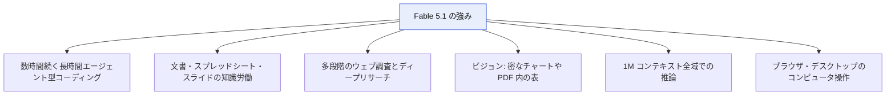
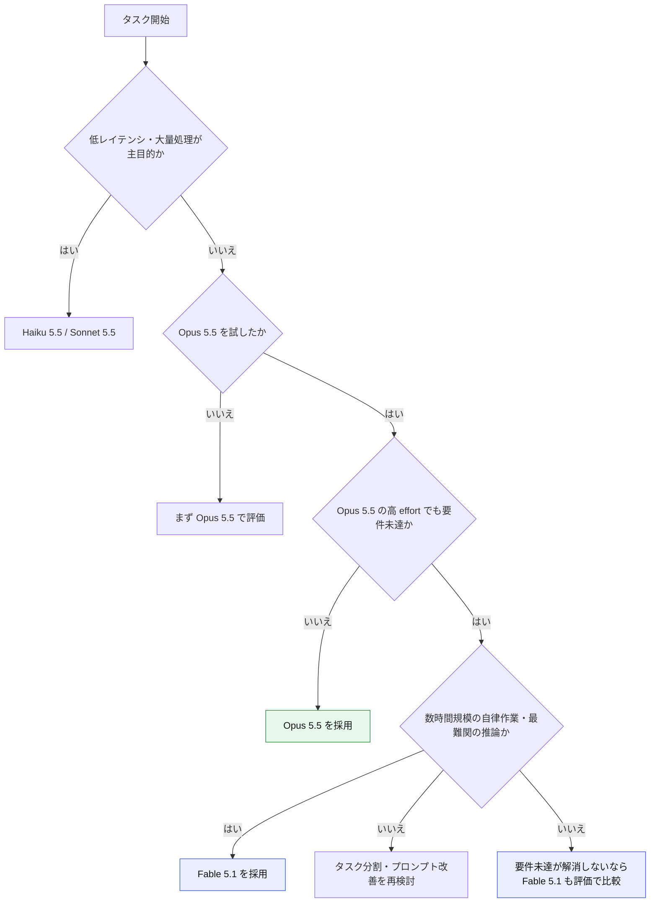
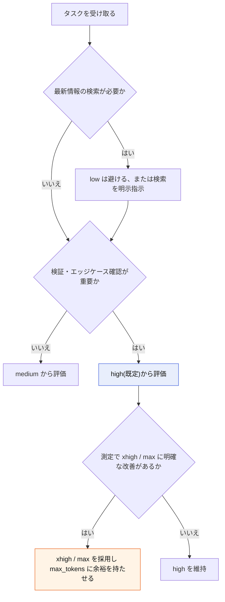
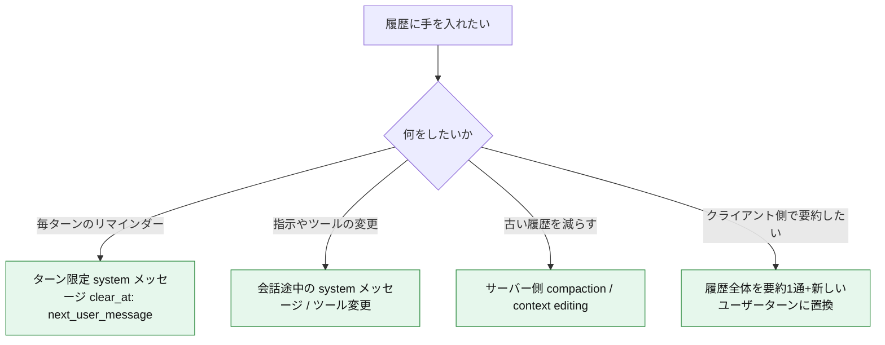
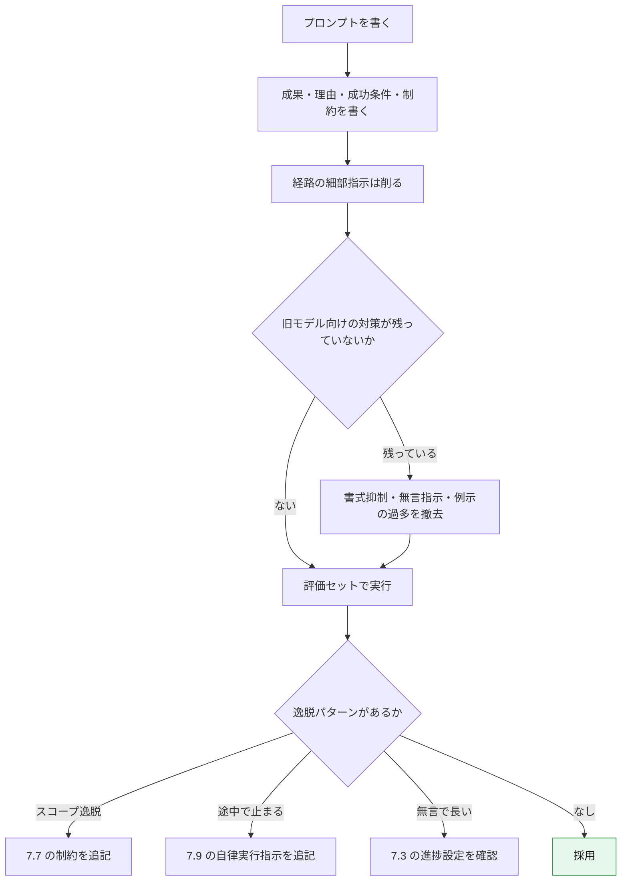
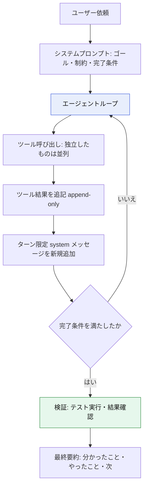
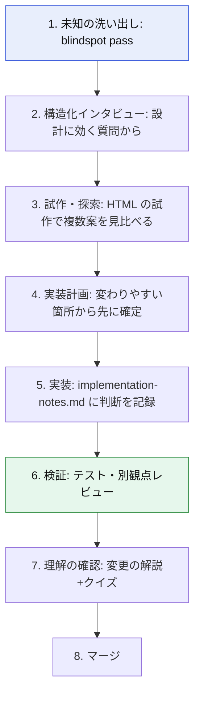
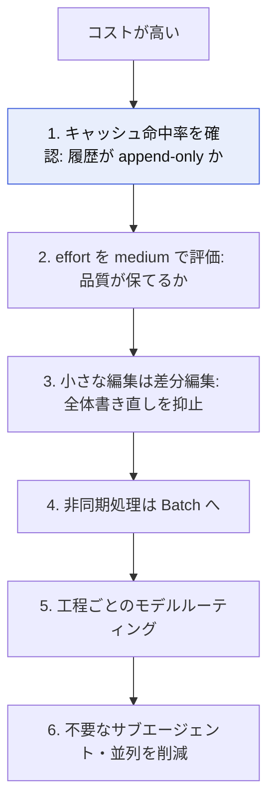
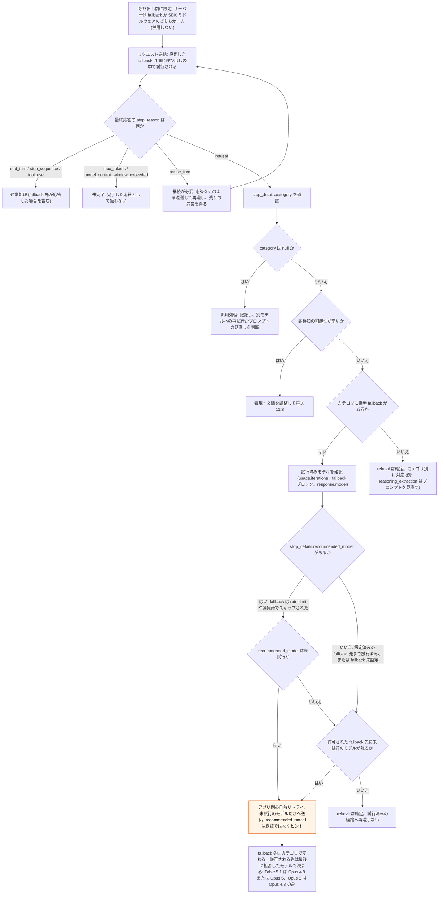
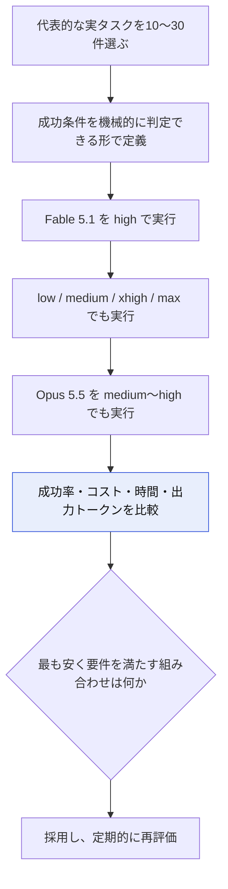

# Claude Fable 5.1 ベストプラクティス完全ガイド(中級〜上級者向け・ステップバイステップ)

> **対象読者**: Claude API / Claude Code をすでに業務で使っている中級〜上級のエンジニア
> **調査基準日**: 2026年11月5日(これ以降の変更は公式ドキュメントで再確認してください)
> **一次情報の優先順位**: Anthropic公式ドキュメント → 著名な国際的開発者の一次発信(Simon Willison、Thariq Shihipar、Boris Cherny など) → 二次解説記事
> **表記ルール**: 図解は Mermaid(フローチャート)と Markdown の表のみ。ASCII アートは使用しません。

---

## 目次

- [0. このガイドの読み方と情報の鮮度](#0-このガイドの読み方と情報の鮮度)
- [1. Fable とは何か(位置づけと基本スペック)](#1-fable-とは何か位置づけと基本スペック)
- [2. Fable 5.1 の挙動の特徴(旧モデルとの違い)](#2-fable-51-の挙動の特徴旧モデルとの違い)
- [3. ステップ1: モデル選定](#3-ステップ1-モデル選定)
- [4. ステップ2: API 基本設定とブレイキングチェンジ対応](#4-ステップ2-api-基本設定とブレイキングチェンジ対応)
- [5. ステップ3: effort 設計](#5-ステップ3-effort-設計)
- [6. ステップ4: 履歴の append-only 運用とキャッシュ](#6-ステップ4-履歴の-append-only-運用とキャッシュ)
- [7. ステップ5: プロンプト設計(薄く、ゴールと制約で)](#7-ステップ5-プロンプト設計薄くゴールと制約で)
- [8. ステップ6: ツール呼び出しとエージェントループ](#8-ステップ6-ツール呼び出しとエージェントループ)
- [9. ステップ7: Claude Code 実践ワークフロー](#9-ステップ7-claude-code-実践ワークフロー)
- [10. ステップ8: コスト最適化](#10-ステップ8-コスト最適化)
- [11. ステップ9: 安全装置・refusal・fallback](#11-ステップ9-安全装置refusalfallback)
- [12. ステップ10: 評価の回し方](#12-ステップ10-評価の回し方)
- [13. アンチパターン早見表](#13-アンチパターン早見表)
- [付録A: そのまま使えるテンプレート](#付録a-そのまま使えるテンプレート)
- [付録B: 最小の実践チェックリスト](#付録b-最小の実践チェックリスト)
- [補足: 追加ベストプラクティスと根拠ソース URL](#補足-追加ベストプラクティスと根拠ソース-url)

---

## 0. このガイドの読み方と情報の鮮度

### 0.1 このガイドの構成

| 章 | 目的 | 想定時間 |
| --- | --- | --- |
| 1〜2 | Fable 5.1 が「何で」「何が変わったか」を把握する | 15分 |
| 3〜6 | API で正しく動かす土台(モデル選定、effort、履歴、キャッシュ) | 30分 |
| 7〜8 | プロンプトとエージェントループの設計 | 30分 |
| 9 | Claude Code での実戦運用 | 20分 |
| 10〜12 | コスト、安全装置、評価 | 20分 |
| 補足 | 一次情報の URL 一覧(根拠の追跡用) | 随時 |

### 0.2 情報の鮮度に関する注意

- 本ガイドの数値(価格、ベンチマーク、仕様)は **2026年11月5日時点で確認できた公式ドキュメントと報道**に基づきます。
- ベンチマークは **Anthropic 自己報告値**です。自社タスクでの再評価を前提にしてください(第12章)。
- **Fable 5.5 は未確認**です。2026年11月4日時点でも、公式発表はなく、流出情報や憶測の段階とされています(補足の URL 参照)。「Fable 6」も公式発表はありません。本ガイドは **Fable 5.1(`claude-fable-5-1`)が現行の一般提供の最上位モデル**という前提で書いています。
- 二次情報サイトには公式と食い違う記述があります。たとえば、ゼロデータリテンション(ZDR)について「Fable 5.1 でも利用可能」とするマーケティング系記事がありますが、公式ドキュメントでは **30日保持で、Anthropic の明示的な許可がない限り ZDR は対象外**とされています。食い違いがある場合は常に公式を優先してください。

---

## 1. Fable とは何か(位置づけと基本スペック)

### 1.1 モデルラインナップにおける位置づけ

Claude は現在、次の階層で提供されています。

| 階層 | 現行モデル | API ID | 主な用途 |
| --- | --- | --- | --- |
| Mythos 系(最上位) | Claude Fable 5.1 | `claude-fable-5-1` | 長時間の自律エージェント、最難関の推論、研究 |
| Mythos 系(限定) | Claude Mythos 5.1 | `claude-mythos-5-1` | Fable 5.1 と同一能力。検証済み組織のみ(サイバー、ライフサイエンス) |
| Opus | Claude Opus 5.5 | `claude-opus-5-5` | 多くのワークロードの出発点 |
| Sonnet | Claude Sonnet 5.5 | `claude-sonnet-5-5` | 速度とコストのバランス |
| Haiku | Claude Haiku 5.5 | `claude-haiku-5-5` | 低レイテンシ、大量処理 |

**ポイント**: Fable 5.1 と Mythos 5.1 は **同じモデル(同じ重み)で、安全装置(safeguards)の強さだけが異なります**。一般の開発者が使うのは Fable です。

### 1.2 タイムライン(主要イベント)

| 日付 | 出来事 |
| --- | --- |
| 2026-06-09 | Claude Fable 5 / Mythos 5 が最初にリリース |
| 2026-06-12 | 米国政府の輸出管理指令に対応するため、Anthropic が両モデルへのアクセスを一時停止 |
| 2026-06-30 | Fable 5 / Mythos 5 への輸出管理が終了 |
| 2026-07-01 | Anthropic がアクセスを復旧(Anthropic の公式声明) |
| 2026-07-20 | Fable 5 が Max / Team Premium プランに含まれる形に(Simon Willison の記事による) |
| 2026-09-01 | **Claude Fable 5.1 / Mythos 5.1 リリース** |
| 2026-09-22 〜 10-07 | Opus 5.5(9/22)、Sonnet 5.5(9/28)、Haiku 5.5(10/7)が順次リリース |

> 輸出管理に関する経緯は、Anthropic の声明(`https://www.anthropic.com/news/fable-mythos-access`)を一次情報として確認してください。

### 1.3 Fable 5.1 の基本スペック(公式ドキュメント)

| 項目 | 内容 |
| --- | --- |
| API ID | `claude-fable-5-1` |
| コンテキスト | 1M トークン(デフォルトかつ最大。全域で標準単価) |
| 最大出力 | 128k トークン |
| 思考(thinking) | **常時オンの adaptive thinking のみ**。深さは `effort` で制御 |
| effort | `low` / `medium` / `high`(デフォルト) / `xhigh` / `max` の5段階 |
| 入力単価 | $10 / MTok |
| 出力単価 | $50 / MTok |
| キャッシュ書き込み | 5分: $12.50 / MTok、1時間: $20 / MTok |
| **キャッシュ読み取り** | **$0.25 / MTok**(Fable 5 の4分の1。入力単価の 2.5%) |
| Batch | 入力 $5 / MTok、出力 $25 / MTok |
| トークナイザー | Fable 5 と同じ。Opus 4.7 より前のモデルと比べ、同じテキストで約30%多くトークン化される |
| データ保持 | 30日保持。ZDR は Anthropic の明示的な許可がない限り対象外 |
| 提供先 | Claude API、AWS(Bedrock では `anthropic.claude-fable-5-1`)、Google Cloud、Microsoft Foundry |

### 1.4 ベンチマーク(Anthropic 自己報告)

| ベンチマーク | Fable 5.1 | Fable 5 | Opus 5 | GPT-5.6 Sol |
| --- | --- | --- | --- | --- |
| Terminal-Bench-Science 0.1 | **52.6%** | 24.7% | 29.0% | 22.4% |
| Terminal-Bench 4.0 | 55.8% | 42.0% | 52.3% | 37.3% |
| CursorBench 3.2.0 | 73.4% | 70.5% | 70.0% | 67.2% |

- Mythos 5.1 は Terminal-Bench 4.0 で 60.9%(より緩い安全フィルター下)と報告されています。
- 改善幅が最も大きいのは **科学研究系のターミナルタスク**です。コーディング系の伸びは相対的に控えめです。
- **これらは参考値**です。Simon Willison も、モデル能力の指標としての単発テストの相関に慎重な姿勢を示しています。

### 1.5 能力が伸びた領域(公式)



---

## 2. Fable 5.1 の挙動の特徴(旧モデルとの違い)

### 2.1 Fable 5 から続く特徴

| 特徴 | 内容 | 実務上の意味 |
| --- | --- | --- |
| **執拗なまでの主体性** | Simon Willison は Fable 5 を「relentlessly proactive」と表現。スクリーンショット1枚と1行の指示から、依存関係を調べ、一時サーバーを立て、ブラウザを操作して原因を特定した | 放置運用に強い一方、**スコープ逸脱と安全面のリスク**が増える |
| **薄いシステムプロンプトを好む** | Thariq Shihipar(Anthropic 当時)は、Claude Code のシステムプロンプトを約80%削減したと発言。例示は「より想像力のあるモデルを縛る」場合がある | プロンプトは**短く、ゴールと制約中心**に |
| **常時 thinking** | `thinking: disabled` とアシスタントのプレフィルは 400 エラー。Claude API では `temperature` / `top_p` / `top_k` の指定も 400 エラー。例外として Microsoft Foundry の公式資料では、`top_p` は 0.99 以上なら受け付けられる(省略時は 0.99。`temperature` / `top_k` は非対応) | 旧来の制御パラメータに頼らない設計へ |

### 2.2 Fable 5.1 で変わった点(Fable 5 → 5.1)

| 変化 | 内容 | 対処(章) |
| --- | --- | --- |
| ユーザー向け進捗テキストが減った | 長いツール実行中、特に高 effort で無言になりやすい | 第7章 |
| 並列ツール呼び出しがばらつく | コーディングや computer use のループで、1ターン1呼び出しになる場合がある | 第8章 |
| `low` で検索しにくくなった | 記憶から答えてしまう傾向 | 第5章、第7章 |
| 文章がやや高密度 | 長文・段落少なめになる場合がある | 第7章 |
| 書式(太字・見出し・箇条書き)が少ない | 旧モデル向けの「書式抑制」指示が逆効果になる | 第7章 |
| 引用符なしの原文再現 | 要約時に原文をそのまま写す頻度が上がった | 第7章 |
| 小さな修正でファイル全体を書き直す | 出力トークンと時間の無駄 | 第7章 |
| 履歴編集で thinking が無効化 | **ブレイキングチェンジ** | 第6章 |

---

## 3. ステップ1: モデル選定

### 3.1 公式の基本方針

公式ドキュメントの方針は次のとおりです。

1. **多くのワークロードは Opus 5.5 から始める**。
2. Fable 5.1 は、**高難度の推論や長時間のエージェント作業**、または **Opus 5.5 を高い effort で動かしても要件を満たせない場合**に使う。

「常に最上位を使う」のではなく、**ルーティング**を前提にします。

### 3.2 選定フローチャート



### 3.3 Fable が特に効く場面

| 場面 | 理由 |
| --- | --- |
| 数時間規模のマルチファイル機能開発・大規模リファクタ・移行 | 長時間セッションでの一貫性が伸びた領域(公式) |
| 他モデルが書いたコードの**レビュー** | 判断力が必要な工程に Fable を集中させる運用が提案されている(wavect の解説) |
| 密なチャート・PDF 内の表の読み取り | ビジョン強化。クロップ・ズームのツールがあると最大効果(第7章) |
| 科学研究系のエージェントタスク | 最も改善幅が大きい領域(Terminal-Bench-Science) |

### 3.4 ルーティングの実践例

| 工程 | 推奨モデル(例) | effort(例) |
| --- | --- | --- |
| 要件の探索・ブラストーミング | Fable 5.1 | high |
| 定型的な実装・変換 | Opus 5.5 または Sonnet 5.5 | medium |
| 難所の設計・デバッグ・最終レビュー | Fable 5.1 | high〜xhigh |
| ログ要約・分類・抽出 | Haiku 5.5 | low |

> これは出発点であり、**自社の評価で上書きしてください**(第12章)。

---

## 4. ステップ2: API 基本設定とブレイキングチェンジ対応

### 4.1 最小の呼び出し

公式サンプルは `client.beta.messages.create` を使っています(effort の mid-conversation 機能などが beta のため)。SDK のバージョンによって型が異なるので、手元の SDK で確認してください。

```python
from pathlib import Path

import anthropic

client = anthropic.Anthropic()

# モデルはリポジトリを読めないので、対象のコードをメッセージに含める
auth_code = Path("src/auth.py").read_text(encoding="utf-8")

response = client.beta.messages.create(
    model="claude-fable-5-1",
    max_tokens=16000,
    output_config={"effort": "high"},  # 既定値。評価で上下させる
    messages=[
        {
            "role": "user",
            "content": f"次の認証モジュールの設計上のリスクを洗い出して\n\n<code>\n{auth_code}\n</code>",
        }
    ],
)

# 拒否や打ち切りを、完了したレビューとして表示しない
if response.stop_reason == "refusal":
    category = response.stop_details.category if response.stop_details else None
    raise RuntimeError(f"リクエストが拒否されました: category={category}")
if response.stop_reason == "max_tokens":
    raise RuntimeError("max_tokens で打ち切られたため、レビューは未完了です")
if response.stop_reason == "model_context_window_exceeded":
    raise RuntimeError("コンテキストウィンドウの上限に達したため、レビューは未完了です")

for block in response.content:
    if block.type == "text":
        print(block.text)
```

この非ストリーミングの呼び出しは、`max_tokens` が 21,333 以下で収まる処理に使います。Python SDK は `3600 × max_tokens ÷ 128,000` 秒で所要時間を見積もり、10分を超えると判定すると、リクエストを送る前に `ValueError` を発生させます。そのため `max_tokens` が 21,333 を超えるとエラーになります。`timeout` を上書きするとこのエラーは出なくなりますが、長時間応答のない接続はネットワークの途中で切られることがあるので、解決策にはしないでください。

`xhigh` / `max` の長い出力では、`.stream()` と `get_final_message()` を使います。

```python
with client.beta.messages.stream(
    model="claude-fable-5-1",
    max_tokens=64000,  # 思考と本文の合計。モデルの上限は 128k
    output_config={"effort": "xhigh"},
    messages=[
        {
            "role": "user",
            "content": f"次の認証モジュールの詳細な設計レビューを書いて\n\n<code>\n{auth_code}\n</code>",
        }
    ],
) as stream:
    response = stream.get_final_message()

# 拒否や打ち切りを、完了したレビューとして表示しない
if response.stop_reason == "refusal":
    category = response.stop_details.category if response.stop_details else None
    raise RuntimeError(f"リクエストが拒否されました: category={category}")
if response.stop_reason == "max_tokens":
    raise RuntimeError("max_tokens で打ち切られたため、レビューは未完了です")
if response.stop_reason == "model_context_window_exceeded":
    raise RuntimeError("コンテキストウィンドウの上限に達したため、レビューは未完了です")

for block in response.content:
    if block.type == "text":
        print(block.text)
```

### 4.2 Fable 5 から移行する際の4つのブレイキングチェンジ

| # | 変更 | 症状 | 対処 |
| --- | --- | --- | --- |
| 1 | **強制ツール使用の廃止** | `tool_choice` が `any` / `tool` だと 400 エラー | `auto`(既定)に戻し、スキーマ保証は **strict tool use** か **structured outputs** へ。ツールを使わせたい場面はプロンプトで明示。**CMEK 組織**の Fable / Mythos では structured outputs(`strict: true` を含む)を使えないため、`tool_choice: auto` のままプロンプトでツールの使用を明示して依頼する(スキーマは保証されない) |
| 2 | **thinking ブロックがモデルに束縛される** | Fable 5.1 の thinking を読めるのは Fable 5.1 と Mythos 5.1 のみ | フォールバックやルーターでモデルを切り替えると、その間の推論は失われる(ブロックは自動で破棄され課金されない) |
| 3 | **履歴編集で thinking が無効化** | thinking ブロックが無効化される。結果は設定で変わり、`prefix_mismatch_behavior: "error"` は 400 エラー(`bound to a different conversation`)、`"drop_block"` は該当ブロック以降を破棄して成功。未設定時の挙動はアカウント作成日で変わる(6.5節) | **履歴は append-only**(第6章) |
| 4 | **advisor ツールの組み合わせ制限** | 実行側が Fable 5.1 のとき、Opus 5.5 / Opus 5 / Fable 5 / Mythos 5 の advisor は 400 エラー | advisor は **実行側以上の能力**を選ぶ |

### 4.3 変えてはいけない前提(Fable 5 から不変)

| 項目 | 内容 |
| --- | --- |
| thinking | `{"type": "adaptive"}` を送るか省略。`enabled` + `budget_tokens` と `disabled` は 400 エラー |
| `thinking.display` | 既定は `"omitted"`。`"summarized"` で要約された推論が返る。**生の思考過程は返らない** |
| interleaved thinking | 自動。beta ヘッダー不要 |
| サンプリング | `temperature` / `top_p` / `top_k` は設定不可 |
| プレフィル | 不可 |
| キャッシュ最小長 | 512 トークン |

### 4.4 「推論を書き出させる」指示は避ける

プロンプトやスキルで「`<thinking>` タグで推論を書き出して」と要求すると、`reasoning_extraction` カテゴリで **refusal になる場合があります**。代わりに次のどちらかを使います。

- 短い**説明**や**行動の要約**を求める
- `thinking.display: "summarized"` で要約済みの推論ブロックを読む

---

## 5. ステップ3: effort 設計

### 5.1 基本方針

**effort は Fable 5.1 での知能・レイテンシ・コストの主要なトレードオフ調整つまみ**です。公式の推奨は次のとおりです。

1. **既定の `high` から始める**。
2. 自社評価で `low` / `medium` / `xhigh` / `max` を試す。
3. **Fable 5 で評価済みでも再実行する**(同じ名前のレベルでも、モデル間で思考量が一致しないため)。

### 5.2 レベル別の目安

| レベル | 公式の位置づけ(要約) | 実務の目安 |
| --- | --- | --- |
| `low` | `medium` 相当より軽い。Opus / Sonnet と比べて、コスト当たりの性能で競える場合がある | 軽い整形、簡単な変更。**検索ツールの呼び出しが減る点に注意** |
| `medium` | Fable 5 と概ね同等の結果を、より低コストで | 通常の機能開発、知識労働の多く |
| `high`(既定) | 複雑な推論、難しいコーディング、エージェントタスク | 迷ったらここ |
| `xhigh` | 長時間(30分超)のエージェント・コーディング | 測定で改善が確認できた場合のみ |
| `max` | 制約なしで最大能力 | 難題の放置運用。**考えすぎる場合がある** |

### 5.3 実測コスト感(Simon Willison の計測)

同じプロンプト(SVG のペリカン描画)を effort ごとに実行した結果です。**用途と単価が限定された1例**ですが、桁の違いを把握する助けになります。

| effort | 出力トークン | 所要時間 | コスト |
| --- | --- | --- | --- |
| `low` | 約2,000 | 約24秒 | 約10セント |
| `medium` | 約2,000 | 約23秒 | 約10セント |
| `high` | 約2,600 | 約30秒 | 約13セント |
| `xhigh` | 約36,800 | 約7分51秒 | 約$1.83 |
| `max` | 約65,900 | 約13分54秒 | 約$3.30 |

> 教訓: **`xhigh` / `max` は「安全のために上げる」設定ではなく、測定した問題を解くための設定**です(Alex McFarland も同趣旨)。

### 5.4 effort 選択のフローチャート



### 5.5 会話の途中で effort を変える(beta)

Fable 5.1 は、**プロンプトキャッシュを壊さずに**会話の途中で effort を変更できます。難所だけ上げ、定型工程は下げる運用が低コストでできます。ただし、effort の変更と append-only の履歴更新は既存のキャッシュを保つだけで、キャッシュを有効にはしません。有効にする手順は、この節の末尾にまとめています。

- beta ヘッダー: `mid-conversation-output-config-2026-07-01`
- 空の system メッセージに `output_config` を付けます。変更が効くのは、**新しい入力を含むユーザーターン**からです。
- `tool_result` だけのユーザーターンは新しい入力に数えません。ツールループの途中で effort を変えても、そのターンには効かず、新しい入力を含むユーザーターンが来るまで直前の effort が続きます。

```python
response = client.beta.messages.create(
    model="claude-fable-5-1",
    max_tokens=4096,
    output_config={"effort": "high"},
    betas=["mid-conversation-output-config-2026-07-01"],
    messages=[
        {"role": "user", "content": "SQLite から PostgreSQL への移行計画を3ステップで"},
        {"role": "assistant", "content": "1. エクスポート 2. スキーマ作成 3. インポートと件数検証"},
        # effort のみを変える system メッセージ(新しい入力を含む次のユーザーターンから有効)
        {"role": "system", "content": [], "output_config": {"effort": "low"}},
        {"role": "user", "content": "上の計画を1文で要約して"},
    ],
)
```

#### キャッシュを有効にする

キャッシュは、リクエストに `cache_control` を指定したときだけ動きます。

| 項目 | 内容 |
| --- | --- |
| 自動で有効にする | リクエストのトップレベルに `cache_control={"type": "ephemeral"}` を指定する。ブレークポイントは最後のキャッシュ可能なブロックに置かれ、会話が伸びると前へ移動する |
| 自動キャッシュの検索範囲 | ブレークポイントからさかのぼって確認するのは**直近20位置まで**(ブレークポイント自身を含む。連続する `tool_use`、連続する `tool_result` はそれぞれ1位置)。自動キャッシュも同じ制限を受ける。1回の追記で20位置以上進むと前回のキャッシュを見つけられず、長い履歴を書き込み直すことになる。大量のブロックを一度に追加する場合は、そこまでに書き込みが済むよう、手前の位置に明示の `cache_control` をあらかじめ置く |
| 明示的に指定する | 個々のコンテンツブロックに `cache_control` を指定する(最大4か所)。自動と併用でき、自動のブレークポイントも4か所の1つに数える |
| 最小長 | 512 トークン。未満のプロンプトは、エラーにならず、キャッシュなしで処理される |
| TTL | 既定は5分で、書き込みまたは読み取りを行ったリクエストの開始時点から数える。キャッシュを使うたびに追加料金なしで更新される。`"ttl": "1h"` で1時間に延ばせる(書き込みは $20 / MTok)。TTL を混在させるときは、1時間のブレークポイントを5分より前に置く。自動キャッシュの1時間と明示の5分を併用する場合も同じ順序が必要で、自動のブレークポイントは最後のブロックに置かれるので、手前に5分の明示指定を置くとこの順序を満たせない(公式に併用例はなく、共通ルールからの解釈) |
| 読み取りの確認 | `usage.cache_read_input_tokens` が 0 より大きければ、キャッシュを読み取っている。`usage.cache_creation_input_tokens` は書き込み量。両方が 0 ならキャッシュされておらず、最小長に満たないことが主な原因 |

### 5.6 `xhigh` / `max` で長い成果物を作るときの注意

高い effort では、**長い成果物を思考の中で書き上げてから、もう一度本文で書く**ことがあります。待ち時間と出力トークンが倍になります。対策は次のとおりです。

| 対策 | 内容 |
| --- | --- |
| まず `high` で実行 | 公式が推奨する出発点 |
| `max_tokens` に余裕を持たせる | 思考と本文の**合計**が上限に含まれる。Python SDK の非ストリーミングでは、21,333 を超える値は送信前に `ValueError` になるので、4.1 のストリーミングを使う |
| 上限を伝える | 「思考と本文の合計が約N トークンの上限に入る。成果物を2回書かず、思考では構造と難しい判断に集中して」といった趣旨の注意をユーザーメッセージ末尾に追加 |

### 5.6.1 `low` で検索が減る問題

`low` では、記憶から答えて検索ツールを呼ばないケースが増えます。対策は2つです。

1. 最新情報が必要なターンだけ effort を上げる(5.5 の mid-conversation)
2. システムプロンプトに「**名前を知っていることと、その現状を知っていることは別。変化の速い領域の固有名詞は、検索して確認する**」旨を入れる

---

## 6. ステップ4: 履歴の append-only 運用とキャッシュ

### 6.1 なぜ重要か

Fable 5.1 では、返ってきた thinking ブロックを送り返したとき、**そのブロックより前の内容(system、tools、全メッセージ)が1バイトも変わっていない場合のみ有効**です。変わると、以降の thinking ブロックがすべて無効になり、**プロンプトキャッシュも再計算**になります。

Claude Code、claude.ai、Managed Agents、Claude Agent SDK は履歴を自動で保持します。**自前で `messages` 配列を組み立てている場合は要確認**です。

### 6.2 やってはいけない編集 / やってよい編集

| 履歴を壊す操作(NG) | 壊さない操作(OK) |
| --- | --- |
| 過去ターンの編集・並べ替え・削除(後続は残す) | 完了したターンに限り、最も古い thinking ブロックの削除、最新の削除、全削除(ターンの進行中やツール実行中は、最新を含む元の thinking ブロックをすべて保持して返す) |
| 毎回挿入して次リクエストで消す「リマインダー」 | サーバー側の **compaction** / **context editing** による整理 |
| 同一会話内で `system` や `tools` を作り直す | `cache_control` マーカーの移動 |
| 同じURLで中身が変わる画像・ドキュメントの再送 | `effort` の変更は、system メッセージによる per-message effort で行う(5.5節)。実効のトップレベル `output_config.effort` を変えると、メッセージのキャッシュは無効になる。既定値の明示と省略は同じ扱いで、無効にならない |

### 6.3 置き換えパターン



### 6.4 ターン限定 system メッセージ(beta)

`role: "system"` のメッセージに `clear_at: "next_user_message"` を付けると、**そのターンの間だけシステムプロンプト相当の権限で効き、次のユーザーメッセージが来ると描画されなくなります**(配列には残るので、そのまま送り返し続けます)。キャッシュは壊れず、消えたメッセージは入力トークンを消費しません。

- beta ヘッダー: `mid-conversation-system-clear-at-2026-08-21`

```python
# ツール結果を返したあとに、毎回「新しいコピー」を末尾に追加する(古いコピーは触らない)
messages.append({"role": "user", "content": tool_results})
messages.append(
    {
        "role": "system",
        "clear_at": "next_user_message",
        "content": "次に必要なものを先に列挙し、互いに依存しないものは1回の応答でまとめて要求すること。",
    }
)
```

### 6.5 履歴の編集を検出する

| 方法 | 内容 |
| --- | --- |
| `prefix_mismatch_behavior` | beta ヘッダー `thinking-binding-controls-2026-08-01` で、無効ブロックの扱いを選ぶ。`"error"` は 400 で拒否、`"drop_block"` は該当ブロック以降を破棄して成功させる |
| `input_transformations` | レスポンスに破棄の理由が記録される(`prefix_binding_mismatch`) |
| リクエストの差分確認 | 通常のセッションで数ターン分のリクエストを保存し、連続するリクエストが**追加分を除いてバイト単位で同一**か確認する |

```python
response = client.beta.messages.create(
    model="claude-fable-5-1",
    max_tokens=16000,
    betas=["thinking-binding-controls-2026-08-01"],
    thinking={
        "type": "adaptive",
        "block_binding": {"prefix_mismatch_behavior": "drop_block"},  # 調査時。本番運用の方針は公式表で確認
    },
    messages=messages,
)
# 調査時は response の input_transformations をログに残す
```

> 公式の移行手順では、**本番の全リクエストで `prefix_mismatch_behavior` を明示し、`input_transformations` を監視する**ことが勧められています。未設定時の挙動はアカウント作成日(2026-08-31 以降は 400 エラー)などで変わります。

### 6.6 クライアント側の compaction

- 最も単純な形は「**履歴全体を1通の要約メッセージ+新しいユーザーターンに置き換え、ほかは再送しない**」ことです。thinking は引き継がれず、新しい文脈で考え直すためエラーにはなりません。
- **早く圧縮しすぎるとコスト削減のつもりが知能を犠牲にする**場合があります。キャッシュ読み取りが安い(入力単価の 2.5%)ので、**圧縮のタイミングを遅らせる実験**も価値があります。
- 要約に**必ず残すもの**を指示します(第7章 7.10)。

---

## 7. ステップ5: プロンプト設計(薄く、ゴールと制約で)

### 7.1 基本原則: 薄いプロンプトを好む

| 原則 | 内容 | 根拠 |
| --- | --- | --- |
| **目的地と境界を渡し、経路は任せる** | 「何を」「なぜ」「成功の見え方」「守る制約」を書く。手順の細部は書かない | Alex McFarland、Boris Cherny の助言(AI Fire 経由) |
| **例示は慎重に** | 例示は、より想像力のあるモデルを縛る場合がある | Thariq Shihipar(Anthropic 当時) |
| **「〜するな」の羅列より文脈** | 禁止ルールを積むより、背景や理由を渡して判断させる | 同上 |
| **既存プロンプトを棚卸し** | 旧モデルのために足した対策(書式抑制、無言の指示など)が逆効果になる | 公式(第7.3、7.4節) |

### 7.2 「完了の定義」を書く

McFarland の整理を、本ガイド用に言い換えます。

| 要素 | 書く内容 |
| --- | --- |
| 成果 | 最終的に何ができていればよいか |
| 理由 | なぜそれが重要か(判断の拠り所になる) |
| 観測可能な成功 | テストが通る、画面で動く、数値が合う、など |
| 守るべき制約 | 変更禁止範囲、互換性、期限、予算 |

### 7.3 進捗テキストを取りこぼさない

Fable 5.1 は、長いツール実行中に**ユーザー向けテキストを書く量が減りました**。次の順で対処します。

1. **まずクライアント側の確認**: 進捗は `thinking` ブロックとして返りますが、既定の `thinking.display: "omitted"` では**中身が空**です。`"updates"`(beta、`thinking-display-updates-2026-08-18`)にして、空でないブロックをステータス行として表示します。`"summarized"` なら推論の要約と一緒に返ります。
2. **プロンプト側の見直し**: 旧モデル用の「最終回答までは所見を伏せて」といった指示を**削除**します。
3. **それでも足りない場合**: 「開始時に一言、作業中は簡潔な更新、最後に単独で読める要約(分かったこと、やったこと、次にやること)」を求める短い指示を追加します。
4. **UI がツール出力を隠す場合**: モデルに伝えます(伝えないと、ユーザーに見せるために追加でコマンドを実行することがあります)。ターン限定 system メッセージで伝えるのが安全です。

### 7.4 書式(書式抑制指示は撤去または条件付きに)

Fable 5.1 は、旧モデルと逆に**太字・見出し・箇条書きを使わなさすぎる**傾向があります。旧モデル向けの「箇条書き禁止」系の指示は、**削除するか、使うべき場面を明示するルールに置き換えます**。

```markdown
- 箇条書きは、依頼があるとき、または多面的で整理に役立つときに使う
- ユーザーが書式の最小化を明示したら、見出し・リスト・太字を使わない
- 日常的・個人的・感情的な会話は、地の文だけで答える
```

### 7.5 文章の密度

文が長く、段落が少ない出力になる場合があります。**「気取った文章(比喩や決め台詞で語る文)をやめて、直接言う」**と指示すると改善します。ユーザーメッセージに入れる方が効果的とされています(公式)。

```markdown
比喩や気取った言い回しを使わず、意味を直接述べてください。リテラルな表現があるならそれを使うこと。
```

### 7.6 引用符のない原文再現を防ぐ

要約タスクで、原文の言い回しを引用符なしで写すことがあります。対策は、**システムプロンプトに「正しい応答の完全な例」を1つ入れる**ことです(ユーザーの依頼、応答、なぜ正しいかの一文)。応答は「各ソースを自分の言葉で1〜2文にまとめ、引用は短く引用符つきで1か所まで」という形にします。ツール名は自分のツールに置き換えます。

### 7.7 スコープを守らせる(Fable の「やりすぎ」対策)

Fable は主体的なので、**近くのバグ修正、機能の拡張、不要なテストの追加**をすることがあります。公式の趣旨を踏まえた指示例です。

```markdown
- 作業中に見つけた既存のバグ、性能上の懸念、依頼に書かれていない挙動は、
  依頼された機能が動くのに必須でない限り、この変更では直さず、フォローアップとして報告する
- 曖昧な点は、文面と周辺コードが最も直接的に支持する解釈で実装し、その仮定を要約に書く(他の解釈向けの作り込みはしない)
- 検証用の使い捨てスクリプトは残さなくてよい。テストは、依頼があるか、
  同種の変更に既存リポジトリがテストを持つ場合のみ、隣接ファイルと同程度の規模でコミットする
- これは「余計なもの」の話。依頼された挙動はすべて完全に実装する
```

**なぜ効くか**: 公式によれば、この種の指示で、成功率を変えずに、頼まれていない追加とテストコードのコミットが大きく減ります。

### 7.8 小さな修正でファイル全体を書き直させない

出力トークンの無駄になります。システムプロンプトか最初のユーザーメッセージに、「結果が変わらないなら、ファイル全体を書き直さず、**最小限の編集で直す**」旨を入れます。これで小〜中規模の変更では Fable 5 並みの挙動に戻ります(公式)。

### 7.9 最後までやり切らせる(自律実行)

「次は〜します」と宣言して終わる、すでに依頼済みの作業なのに「進めましょうか?」と許可を求める、という挙動があります。**ペアプロ型の対話なら許容できますが、非同期の長時間タスクでは致命的**です。

公式は2種類の追記を併用することを勧めています(趣旨のみ要約。全文は公式ページを参照)。

| 追記 | 趣旨 |
| --- | --- |
| **自律実行宣言** | 「ユーザーはリアルタイムで見ておらず、質問に答えられない。依頼から導かれる可逆な作業は、確認せず進める。止まるのは破壊的操作とスコープ変更だけ」。**最初の1文(ユーザーは見ていない)の効果が大きい**ので、そのまま残す |
| **終了前の自己点検** | 「最後の段落が計画・分析・質問・次の手順の列挙・未実施の約束なら、今すぐツール呼び出しで実行する。エラー時のリトライ、情報収集も自分でやる」 |
| **成果物の定義** | 「依頼や承認済みの計画がスコープであり、スコープが成果物。黙って狭めたり広げたりしない。一部が詰まったら残りを完成させ、何を・なぜ残したかを明記」 |

> **トレードオフ**: この追記で、曖昧な依頼についてモデルが質問しにくくなる場合があります。自社タスクで確認してください。確認が必須の操作(本番デプロイ、課金など)があるなら、**そのリストを追記の直後に明記**します。

### 7.10 compaction 要約に残させるもの

クライアント側で要約させる場合、次の6点を**必ず残す**よう指示します(公式の趣旨)。

| # | 残すもの |
| --- | --- |
| 1 | 発生した問題と、その対処・解決 |
| 2 | 検討・試行・却下した選択肢と、その理由 |
| 3 | 依頼・決定・合意・排除・制約・好みを**正確な文言で** |
| 4 | 現在の正確な状態(どこまで終わり、何が確定したか) |
| 5 | 未解決事項、約束、次にやること |
| 6 | 再構築しにくい詳細(名前、数値、日付、リンクなど)を**そのまま** |

さらに、**ユーザーの発言は原文に近く残し、モデル自身の説明は大幅に圧縮してよい**、という重み付けも指示します。

### 7.11 ビジョン(画像・チャート)

密なチャートや PDF 内の表では、**反復して分析・クロップ・拡大して確かめられるとき**に最も良い結果が出ます。

- 理想: 画像処理ライブラリ(PIL、OpenCV)入りのコンテナで動かす
- 軽量案: **画像クロップ用ツール**だけでも効果の大半が得られる(領域を切り出して拡大して返す)
- 公式の cookbook に「crop tool recipe」がある(補足の URL 参照)

### 7.12 プロンプト設計のフロー



---

## 8. ステップ6: ツール呼び出しとエージェントループ

### 8.1 並列ツール呼び出し

| 状況 | 挙動 |
| --- | --- |
| 依頼文が「AとBとCを取得」と**明示** | 並列で呼ぶ(問題なし) |
| コーディング / computer use ループで、次の独立した呼び出しが**暗黙** | 1ターン1呼び出しになる場合がある(品質は落ちないが、ターン数・トークン・待ち時間が増える) |

**対策**: 現在の依頼の末尾に「**次に必要なものを先に(非公開で)列挙し、互いに依存しないものは1回の応答でまとめて要求する**」という1文を足します。ツール結果を返すたびに、**ターン限定 system メッセージ**として新しいコピーを末尾に追加します(第6章)。古いコピーは**そのまま残し**、削除や書き換えをしません(履歴編集になるため)。

### 8.2 強制ツール使用の代替

| やりたいこと | 代替 |
| --- | --- |
| スキーマに合った JSON を応答として得たい | **structured outputs** の JSON outputs(`output_config.format` に `type: "json_schema"` を指定)。`stop_reason` が `refusal` や `max_tokens` の応答はスキーマに合わないことがあるので、応答を検証し、これらの例外を処理する |
| ツール入力をスキーマに合わせたい | ツール定義に `strict: true` を付ける **strict tool use**。`tool_choice: auto` はツール呼び出し自体を保証しないので、ツールが呼ばれなかった場合も処理する |
| 必ずツールを使わせたい | プロンプトで「〜にはこのツールを使うこと」と適用場面を明記(Fable 5.1 は明示的なツール指示によく従う) |

### 8.3 サブエージェント

| 論点 | 内容 | 根拠 |
| --- | --- | --- |
| リードを待たせない | サブエージェント起動ツールは**即座に返し**、結果は後続の `user` メッセージで渡す。リード用に「結果を待つ」別ツールを用意する。コーディングでは平均完了時間が短くなる(品質・トークン・コストは同程度) | 公式 |
| **まず単一エージェントを検討** | Opus 4.5 以降、Opus 5.5、Fable 5.1 は、単一ループで複雑な計画を扱える。ある比較では、単一エージェント構成が約2倍速かった。Anthropic はサブエージェントの統合を評価するための移行キットを公開 | the-decoder の報道(Anthropic Applied AI チームの知見) |
| サブエージェントが有効な場面 | 単一エージェントのコンテキストで**性能低下が測定される**とき、**独立コンテキストで並列実行**したいとき、**ツール選択に苦戦**するとき | 同上 |
| 盲目的に統合しない | あるサポートエージェントの試験では、統合でレイテンシは下がったが、以前動いていた処理が壊れた(専門家への相談をせず自分で答えはじめた) | 同上 |
| ツール数の目安 | ツール選択の精度は、**ツール定義が30〜50を超えると低下**しやすい。スキルとツール検索(tool search)でオンデマンド読み込みに | 同上 |

> 「複数エージェントに分ける」ことが目的化していないかを定期的に点検してください。agent swarm の費用対効果に疑問を呈する研究も出ています(補足の URL 参照)。

### 8.4 エージェントループの全体像



---

## 9. ステップ7: Claude Code 実践ワークフロー

> **注意**: 本章の一部(設定ファイルのキー名など)は二次解説に基づきます。Claude Code は更新が速いため、**公式の Claude Code ドキュメントで必ず再確認**してください。

### 9.1 Fable 5.1 での出発設定

| 項目 | 内容 | 根拠 |
| --- | --- | --- |
| 既定 effort | Claude Code では Fable 5.1 の既定は **high**。ほかの Claude 画面では medium が既定という報告もある(二次情報) | wavect、remio |
| 切り替え | `/effort` で変更。環境変数 `CLAUDE_CODE_EFFORT_LEVEL` が最優先 | 二次解説(mejba) |
| 1ターンだけ上げる | プロンプトに `ultrathink` を含めると、そのターンだけ深い推論を指示できる(セッションの effort は変わらない。「think hard」は通常の文として扱われる)。**Claude Code v2.1.311 以降**のターミナルでは、そのターンの effort を `xhigh` へ上げられる場合があり、上がるときは単語が虹色で表示される。`CLAUDE_CODE_EFFORT_LEVEL`、`maxEffortLevel`、組織の effort 上限のいずれかが `xhigh` 未満だと上がらない。Amazon Bedrock ではキーワードで上がらないため、effort を直接設定する。Fable 5.1 の `xhigh` は `high` よりコストとレイテンシが大きい(5.3節)ので、難所のターンで改善を見込めるときに限って使う | 公式(Claude Code の Model configuration) |
| モデル指定 | `/model claude-fable-5-1` | wavect |

```bash
/effort high                       # 会話内で設定。そのモデルの既定として保存され、以後のセッションにも適用
claude --effort high               # このセッションのみ
CLAUDE_CODE_EFFORT_LEVEL=medium claude   # 環境変数が全設定より優先
```

モデル別に既定を持たせる設定例(二次解説の記載。キー名は公式ドキュメントで要確認):

```json
{
  "effortLevel": "medium",
  "modelSettings": {
    "claude-fable-5-1": { "effortLevel": "high" },
    "claude-opus-5-5": { "effortLevel": "medium" }
  }
}
```

### 9.2 effort は「賢さ」でなく「検証の量」

二次解説(mejba が Anthropic の Claude Code チームの記事を要約)によれば、Fable 5.1 と Opus 5.5 では、**高い effort は主に検証を買う**(先に再現する、テストを書く、別実装と照合する)もので、**間違ったアプローチを救うものではありません**。

| 向いている effort | タスク |
| --- | --- |
| `low` | スケッチ、ブレスト、簡単な変更 |
| `medium` | 通常の機能開発 |
| `high` | バグ調査、隠れたエッジケースがある作業 |
| `max` | 誰も見ていない状態で、難題を最初から最後まで任せる |

### 9.3 全体ワークフロー(Thariq の「未知」の考え方を取り入れた型)

Thariq Shihipar(Anthropic 当時)は、**Fable 5 では出力品質の上限を決めるのがモデルではなく、ユーザー自身の「未知」の整理力**になりつつあると述べています。実装の前に未知を洗い出す工程を置く型です。



| 工程 | やること | 出典の趣旨 |
| --- | --- | --- |
| blindspot pass | 「このコードベースの認証モジュールを知らない。関連する未知の未知を洗い出し、あなたへの指示の出し方も改善して」と依頼 | Thariq(the-decoder の解説) |
| 構造化インタビュー | 設計を変える質問を優先して、1問ずつ聞かせる | 同上 |
| 探索 | 視覚的なものは、方向性の違う複数案を HTML で出させて反応する | 同上 |
| 実装計画 | データモデル、型インターフェース、ユーザー側に近い部分(変わりやすい所)を先に。機械的なリファクタは最後 | 同上 |
| 実装中の記録 | 想定外のケースは保守的な選択肢を選び、逸脱をログに残して継続。`implementation-notes.md` に判断を書かせる | 同上 |
| 理解の確認 | 変更の解説 HTML とクイズを作らせ、**全問正解するまでマージしない** | 同上 |

> **具体と曖昧のバランス**: 指定しすぎると、方針転換すべき場面でも指示に固執します。曖昧すぎると、業界の既定値で判断します(Thariq)。

### 9.4 Claude Code の定番運用(Boris Cherny らの公開知見)

| プラクティス | 内容 | 注意 |
| --- | --- | --- |
| Plan Mode から始める | 複雑なタスクは計画モードで着手 | 公開 tips の集約リポジトリより(二次) |
| 計画を別の Claude でレビュー | スタッフエンジニア役として計画を確認、またはクロスモデルでレビュー | 同上 |
| CLAUDE.md を薄く育てる | 失敗のたびに追記する発想はよいが、**肥大化は逆効果**(システムプロンプト削減の流れと整合) | Anthropic の方針変化に合わせて定期的に刈り込む |
| hooks | PostToolUse でフォーマット、Stop フックで「続行・検証」を促す | 同上 |
| worktree 並列 | 3〜5個の worktree で並列セッション | 同上 |
| スキルは「ゴール+制約」 | 手順を細かく縛らず、**Claude が既定でやらないこと**に絞って書く。Gotchas(失敗しやすい点)節を育てる | Thariq の助言(二次集約) |
| CLI ツールの活用 | `gh`、`aws`、`gcloud`、`sentry-cli` など。API や MCP よりコンテキスト効率が高い場合が多い | wavect の解説(Claude Code の説明に言及) |

### 9.5 安全運用(必読)

Simon Willison は、Fable の主体性の高さを評価する一方で、**悪意ある指示(コードや issue スレッドに潜むプロンプトインジェクション、うっかり貼り付けた内容)に従った場合の影響の大きさ**に言及し、**コーディングエージェントはサンドボックスで、本番環境から切り離して動かす**べきだとしています。

| 対策 | 内容 |
| --- | --- |
| サンドボックス | 本番資格情報・実機から隔離した環境で実行 |
| 権限の最小化 | ツールの許可リスト、書き込み範囲、ネットワーク範囲を絞る |
| 予算の上限 | 時間・トークン・金額の上限を設ける |
| 人間の最終責任 | マージ・デプロイ前の承認は人間が持つ |
| 検証の自動化 | テスト・CI・hooks をガードレールにする |

### 9.6 「Fable を使う工程」を絞る

wavect の解説の整理(要旨): 速度重視は小型モデル、強い汎用コーディングは Opus、**判断力が要る工程は Fable**、ガードレールは hooks・テスト・worktree・CI、最終責任は人間。**最大モデルを全工程に使うのが最適ではない**、という立場です。

---

## 10. ステップ8: コスト最適化

### 10.1 コスト構造を理解する

| 要素 | 内容 |
| --- | --- |
| 入力 | $10 / MTok |
| 出力(思考を含む) | $50 / MTok。**思考トークンも出力として課金** |
| キャッシュ読み取り | $0.25 / MTok(入力の 2.5%) |
| キャッシュ書き込み | 5分 $12.50 / 1時間 $20(MTok) |
| Batch | 入力 $5 / 出力 $25(MTok) |
| トークナイザー | Opus 4.7 より前と比べ、同じテキストで約30%多くなる |

Anthropic は、Fable 5.1 により、典型的なトークン課金のワークロードで Fable 5 比約25%、エージェント型で最大約45%安くなると説明している、と報じられています(Wikipedia の記述。公式発表の原文は公式ブログで確認)。

### 10.2 コストを下げる順番



| 施策 | 効果 | 注意 |
| --- | --- | --- |
| 履歴の append-only 徹底 | キャッシュ命中、thinking 維持 | 第6章 |
| `medium` の評価 | 公式によれば、Fable 5 と概ね同等の結果を低コストで | 自社評価で確認 |
| 差分編集の指示 | 出力トークン削減 | 第7章 7.8 |
| 圧縮の遅延 | 早すぎる圧縮は知能を犠牲にする | キャッシュ読み取りが安い |
| refusal の課金を理解 | カテゴリによっては、出力前の refusal も課金される(2026-09-24 以降) | 第11章 |

### 10.3 費用面の落とし穴

- `xhigh` / `max` と曖昧なタスクの組み合わせは、**大規模なサブエージェントの展開**を招く場合があります(二次解説の報告)。スコープと予算の上限を先に決めます。
- 「失敗したら最初からやり直し」が積み重なると、単価の高さが効いてきます。**検証可能な小さな単位に分けて、失敗コストを局所化**します。

---

## 11. ステップ9: 安全装置・refusal・fallback

### 11.1 仕組み

Fable 5.1 には安全分類器があり、リクエストが拒否されると **HTTP 200 で `stop_reason: "refusal"`** が返り、`stop_details.category` に方針領域が入ります。ただし、名前付きのカテゴリに対応しない refusal では、`category` と `explanation` はどちらも `null` です(正常な値)。拒否の判定は `stop_reason` で行い、`category` がない refusal は汎用の処理へ回します。

### 11.2 対応フロー



### 11.3 誤検知を減らすコツ(公式)

誤検知は旧版より減り、**ソースコードの脆弱性発見は許可されています**。それでも起こりうる3つの状況は次のとおりです。

| 状況 | 対処 |
| --- | --- |
| 「このプログラムはコンパイルできるか」という聞き方 | 「このプログラムにバグはあるか」のように聞く |
| 知名度の低いプログラミング言語 | 言語の説明と、ドキュメントへのアクセスを与える |
| ツール出力に **Base64** が大量に含まれる | Base64 を返すツールを外す(推奨対処) |

### 11.4 フォールバック運用の要点

| 項目 | 内容 |
| --- | --- |
| 設定 | Claude API などでは beta ヘッダー `server-side-fallback-2026-07-01` を付けた `fallbacks: "default"` で、そのカテゴリに推奨されるモデルへ再試行。**Amazon Bedrock、Google Cloud の Google 管理モデル、Microsoft Foundry では利用不可**のため、SDK ミドルウェアまたはクライアント側のリトライで実装する。**Message Batches API でも利用不可**で、`fallbacks` を含む項目はエラーになるためバッチのリクエストに含めない。バッチで拒否された項目(`result.type` が `succeeded` で `stop_reason` が `refusal`)は結果から集め、fallback モデルを指定して個別のリクエストまたは新しいバッチで再送する |
| thinking の扱い | 切り替えの方向で異なる(第4章)。Opus 5 / Fable 5 / Mythos 5 から Fable 5.1 へ切り替えると thinking は引き継がれる。Fable 5.1 から別のモデルへ切り替えると引き継がれない(例外は Mythos 5.1) |
| 応答の判別と記録 | fallback 先が応答しても `stop_reason` は `end_turn` などの通常値のままなので、`stop_reason` だけでは判別できない。トップレベルの `response.model`(実際に応答したモデル)、`content` 内の `fallback` ブロック(切り替え地点。`from` / `to` / `trigger` を持つ)、`usage.iterations` 内の `fallback_message` エントリで判別し、ログに記録する。sticky routing(約1時間、ベストエフォート)で fallback 先が直接応答したターンには `fallback` ブロックが付かないため、`fallback_message` と `response.model` で判別する。チェーン全体が拒否した場合も末尾は `fallback_message` になるので、「`fallback_message` があり、かつ `stop_reason` が `refusal` でない」ことを条件にする。ストリーミングの出力途中で切り替わると `message_start` は元のモデル名のままなので、`fallback` ブロックの `to.model` と最終 `message_delta` の `usage.iterations` を読む |
| 次ターンへの返送 | assistant の `content` は受け取った順序のまま返す。**`fallback` ブロックは削除も移動もしない**(API がこの位置を基準に前後の thinking ブロックを検証するため、境界の両側の thinking を返しているリクエストで省略・移動すると拒否される)。ただし出力途中の切り替えでは、**最後の `fallback` ブロックより前**の `thinking` / `redacted_thinking` / `connector_text`、クライアント側の `tool_use`、結果と対になっていない `server_tool_use` は除く。`text`、結果と対になった `server_tool_use`、最後の `fallback` ブロックより後のブロックは順序を保って残す |
| 課金 | 出力前の refusal も、誤検知が少ないカテゴリでは課金される(2026-09-24 以降)。ストリーム途中の refusal は、入力と出力済み分が通常料金で課金。**fallback credit** は、対象となる Messages API の直接リクエスト(バッチ以外)で、モデル切り替えに伴うキャッシュコストを返金する。サーバー側 fallback と SDK ミドルウェアは credit を自動で適用するが、**自前のリトライには自動で適用されない**。自前で実装する場合は、最初のリクエストに beta ヘッダー `fallback-credit-2026-07-01` を付け、refusal の `stop_details.fallback_credit_token` を、同じヘッダーを付けたリトライのトップレベルパラメータとして渡す(トークンの有効期限は5分)。**同じモデルへ元の本文をそのまま再送しない**(たいてい再度拒否される)。`model` は、最後に拒否したモデルに許可された fallback 先へ変え、以降のターンもそのモデルを使い続ける。Fable 5.1 の refusal の許可先は Opus 4.8 または Opus 5、Opus 5 の refusal の許可先は Opus 4.8 だけ(Fable 5.1 からの fallback 先の Opus 5 が拒否した場合も含む。最後に拒否したモデルは `response.model` で確認する)。Haiku 5.5 の refusal には credit がなく、再試行では fallback 先のキャッシュ書き込みを通常料金で支払う。credit を受けるには、`system` / `messages` / `tools` / `tool_choice` / `thinking` / `cache_control`(使う場合は `output_config` / `mcp_servers` / `context_management` / `container` も)を拒否されたリクエストと完全に一致させ、`anthropic-beta` ヘッダーも揃える。リトライでは本文の `fallbacks` パラメータを必ず削除する(`fallbacks: "default"` も同じ)。このとき `server-side-fallback-*` ヘッダーも一緒に外してよい。それ以外に変更できるのは `model` / `max_tokens` / `stop_sequences` / `stream` / `metadata` / `service_tier` のみ。**履歴に per-message effort(5.5節の `output_config` 付き system メッセージ)があるときは、再試行先を選ぶ前に確認する**。Opus 4.8 は per-message effort に対応せず、Amazon Bedrock の Opus 5 も対応しない。この2つへ元の本文を送ると、トークンの有無にかかわらず 400 になる(エラーは `fallback_credit_token` を名指ししないので、後述の 400 の手順では解決しない)。互換にするために `messages` を変えると拒否されたリクエストと一致しなくなり、credit は受けられない。Fable 5.1 の refusal では、Opus 5 が per-message effort に対応する Claude API、Claude Platform on AWS、Google Cloud なら、fallback 先に Opus 5 を選ぶ。Opus 5.5 も per-message effort に対応するが、Fable 5.1 の fallback 先としては許可されていない。Amazon Bedrock では許可された fallback 先のどちらも対応しないので、互換の fallback 先がない(Microsoft Foundry は公式の対応表に記載がなく要確認)。Opus 5 の refusal は許可先が Opus 4.8 だけなので、per-message effort が履歴にあると、どの環境でも互換の fallback 先がない。互換の fallback 先がなければ、**credit なしの再試行**であることをログなどで明示して送る。トークンを付けず、対象モデルが受け付ける形へ履歴を変える。Opus 4.8 や Amazon Bedrock の Opus 5 では effort だけの system メッセージを削除し、実効の effort をトップレベルの `output_config.effort` で指定する。fallback 先のキャッシュ書き込みは通常料金で課金される。サーバーツールを実行済みのリクエストでは再実行・再課金されるので、そのコストを呼び出し側へ通知するか、エラーを返す。リトライ本文の形は `stop_details.fallback_has_prefill_claim` で決める。`true` または未設定なら、元の本文の `messages` 末尾に、拒否された応答の `content` をそのまま入れた assistant メッセージを1件だけ追加する(最後の `text` ブロック末尾の空白は除き、結果のないクライアント側 `tool_use` は含めない)。この形なら続きから生成され、完了済みのサーバーツールは再実行されない。`false` なら `model` 以外は元の本文のまま送る。サーバーツールの実行後に拒否された場合は、元の本文のままでは credit を受けられないので、追記する形を使う。ただし、リクエストに `output_config.format` または tool_use を強制する `tool_choice` があると追記する形も使えないため、**どちらの形でも credit を受けられない**(Fable 5.1 は強制 `tool_choice` 自体が 400 になるので、実際に該当するのは `output_config.format`)。元の本文での再試行が、トークンは部分応答の継続でしか使えないとする 400 で拒否されたら、トークンを破棄する。トークンなしの再送は通るが、完了済みのサーバーツールが再実行・再課金されるので、黙って再試行せず、**そのコストを呼び出し側へ通知するか、エラーを返す**。エラーメッセージが `redemption temporarily unavailable` の 400 は一時的なもので、本文の形の問題ではない。どの段階で返っても次の手順へ進まず、同じ本文と同じトークンのまま、トークンの有効期限内に再試行する。それ以外の 400 で追記した形が拒否されたら、トークンを付けたまま `model` 以外は元の本文のものを送り、それも `fallback_credit_token` を名指しする 400 で拒否されたらトークンなしで送る(credit は失われる。サーバーツールを実行済みのリクエストでは再実行・再課金されるので、黙って送らず、コストを呼び出し側へ通知するか、エラーを返す)。この手順を省くと、fallback 先のキャッシュ書き込みは通常料金で課金される。**Message Batches の refusal にはクレジットトークンが発行されず**(`stop_details` に `fallback_credit_token` は含まれない)、バッチのリクエストにトークンを渡しても無視される。そのためバッチで拒否された項目の再送に credit は適用されず、再送先の通常料金(新しいバッチならバッチ料金、個別リクエストなら標準料金)で課金される |

### 11.5 コンテンツの出自表示

Fable 5.1 / Mythos 5.1 が生成するテキストには、**統計的なウォーターマーク**が付与されます(トークン追加や隠し文字はなし)。Claude が生成した対応形式の画像・動画・音声のファイルを Claude API の Files API で取得すると、署名付きの **C2PA のコンテンツクレデンシャル**が付きます(入力として渡したファイルや他社が生成したメディアに付与するものではありません)。コンテンツの透明性を求める組織では、運用ポリシーに反映してください。

---

## 12. ステップ10: 評価の回し方

### 12.1 effort × モデルのスイープ



### 12.2 見るべき指標

| 指標 | 理由 |
| --- | --- |
| タスク成功率 | 品質の基準 |
| 総コスト(通常入力+キャッシュ読み取り+キャッシュ書き込み+出力+サーバーツールの利用料) | 単価が高いので必須。区分ごとの単価で計算する。thinking は出力に含まれるので別に足さない。fallback を使う場合は、`usage.iterations` の試行のうち**課金対象の試行だけ**に、その試行のモデルの単価を掛けて合算する。出力前に拒否された試行(`output_tokens` が 0 のエントリ。通常は `message` で、チェーン全体が拒否した場合は末尾の `fallback_message` も含む)は、カテゴリが `bio` / `frontier_llm` / `reasoning_extraction` のときだけ課金され、`cyber` / `general_harms` / `null` は課金されないのに、トークン数は記録される。エントリにカテゴリはないので、`fallback` ブロックの `trigger.category`(チェーン全体が拒否した場合は `stop_details.category`)と照合する。出力後の拒否は課金対象。課金カテゴリは変わることがあるので、[公式のカテゴリ表](https://platform.claude.com/docs/en/build-with-claude/refusals-and-fallback#refusal-response)を確認する。サーバーツールの利用料は、トークン料金とは別に足す。Web search は1,000回あたり $10 で、回数は `usage.server_tool_use.web_search_requests` で確認する(エラーになった検索は課金されない)。ただしトップレベルの `usage` は、返されたメッセージを生成した試行だけを表すので、この回数に以前の試行の検索は含まれない。`usage.iterations` の各エントリにも検索回数のフィールドはない(`type` / `model` とトークン数のみ。2026-11-07 に API リファレンスと SDK の型で確認)ため、エントリを合算して求めることはできない。fallback が走ったリクエストでは、トップレベルの回数を下限として扱い、課金対象の試行を含む検索回数は請求・使用量のレポートで照合する。Web fetch に追加料金はなく、取得内容のトークン料金だけがかかる。コード実行は `web_search_20260209` / `web_fetch_20260209` 以降と併用すると追加料金がなく、併用しない場合は組織ごとに月1,550時間の無料枠を超えた分が、コンテナ1時間あたり $0.05 で課金される(実行時間の最小は5分)。fallback の再試行でサーバーツールが再実行されると、再度課金される。単価は[公式の料金表](https://platform.claude.com/docs/en/about-claude/pricing)を確認する |
| 所要時間・ターン数 | `xhigh` / `max` で急増する |
| スコープ逸脱の件数 | Fable の主体性の副作用 |
| 途中停止・許可待ちの件数 | 自律実行の指示の効きを測る |
| refusal の件数と内訳 | 誤検知のパターン把握 |

### 12.3 再評価のタイミング

- モデル更新時(Fable 5.5 などが公式発表された場合)
- プロンプトや harness を変えたとき
- **effort の名前が同じでも、モデルが変われば思考量は変わる**ため、モデル更新時は必ず再スイープ

---

## 13. アンチパターン早見表

| アンチパターン | 症状 | 正しい対応 |
| --- | --- | --- |
| 旧モデル用の長大なプロンプトをそのまま流用 | 例示や禁止ルールが想像力を縛る | 薄くし、ゴールと制約中心に(第7章) |
| 常に `max` | 遅い・高い・考えすぎ | `high` から始め、測定して上げる(第5章) |
| `low` で最新情報タスク | 検索せず古い知識で回答 | effort を上げる、または検索を明示(第5章) |
| 履歴の途中編集・毎ターンの注入と削除 | 400 エラー、キャッシュ再計算 | append-only、ターン限定 system(第6章) |
| `tool_choice` で強制 | 400 エラー | strict tool use、structured outputs(第4章) |
| 「推論を書き出せ」指示 | `reasoning_extraction` で refusal の場合 | 短い説明を求める、`summarized` を使う(第4章) |
| 旧モデル用の「箇条書き禁止」 | 構造が必要な内容まで抑制 | 条件付きの書式ルールへ(第7章) |
| 無言を前提にした「最後まで伏せて」指示 | ユーザーが進捗を見られない | 削除し、`display: "updates"` を使う(第7章) |
| スコープ指示なしで放置 | 近くの修正、不要なテスト | 7.7 の制約を追記 |
| 何でもサブエージェント | 文脈の欠落、コスト、遅延 | まず単一エージェントを検討(第8章) |
| サンドボックスなしの放置運用 | インジェクションの被害が大きい | 隔離、権限最小化、予算上限(第9章) |
| 二次情報だけで仕様を判断 | ZDR などで食い違い | 公式ドキュメントで確認(第0章) |

---

## 付録A: そのまま使えるテンプレート

### A.1 長時間タスク用のシステムプロンプト(骨子)

公式の自律実行ガイダンスを、本ガイド用に自分の言葉で再構成した骨子です。**全文は公式ページで確認し、自社環境に合わせて調整**してください。

```markdown
あなたは自律的に作業しています。ユーザーはリアルタイムで見ておらず、作業中の質問には答えられません。
「〜しましょうか?」と許可を求めると作業が止まるため、依頼から導かれる可逆な作業は確認せずに進めてください。ただし「確認が必須の操作」は、可逆でも確認なしに実行しません。
止まってよいのは、破壊的な操作、「確認が必須の操作」、ユーザーが判断すべきスコープ変更だけです。

# 完了の定義
- 成果: {最終的に何ができていればよいか}
- 成功条件: {テストが通る、画面で動く、など観測可能な条件}
- 守る制約: {変更禁止範囲、互換性、期限}

# 進め方
- 終了前に最後の段落を点検する。計画、質問、次の手順の列挙、未実施の約束であれば、今すぐ実行する
- 一部が詰まったら、残りを完成させ、何を・なぜ残したかを明記する
- 依頼にない修正や拡張は行わず、フォローアップとして報告する
- 破壊的な操作(削除、再起動、設定変更)と「確認が必須の操作」は、支持する証拠があっても、明示的な承認なしに実行しない。承認を得られない場合は実行せず、止まって報告する

# 確認が必須の操作
- {本番デプロイ、課金、外部への送信など}
```

### A.2 Claude Code に渡すタスク仕様(テンプレ)

```markdown
## ゴール
{何を実現したいか。1〜3文}

## 背景・理由
{なぜ必要か。判断の拠り所になる情報}

## 成功条件(観測可能)
- {例: 該当のテストがすべて通る}
- {例: 画面 X で Y が表示される}

## 制約
- 変更してよい範囲: {ディレクトリ・ファイル}
- 変更しない範囲: {DBスキーマ、公開API など}
- 既存の挙動を変えない: {互換性の条件}

## 進め方の希望
- 最初に未知の洗い出し(blindspot pass)をしてから、計画を提示してください
- 判断に迷った点は implementation-notes.md に記録し、保守的な選択肢で継続してください
- 見つけた既存の問題は、直さずに要約でフォローアップとして報告してください
```

### A.3 要約・圧縮用の指示(骨子)

```markdown
会話を <summary></summary> タグ内に要約してください。新しいコンテキストで、作業のやり直しや制約の再提示なしに続けられるようにします。
次の6点は、長くなっても必ず残してください。
(1) 発生した問題と、その対処・解決
(2) 検討・試行・却下した選択肢と、その理由
(3) 依頼・決定・合意・排除・制約・好みを、正確な文言で
(4) 現在の正確な状態(どこまで終わり、何が確定したか)
(5) 未解決事項、約束、次にやること
(6) 再構築しにくい詳細(名前、数値、日付、リンクなど)を、そのまま
ユーザーの発言は原文に近く、あなた自身の説明は結論や成果まで圧縮してください。
```

---

## 付録B: 最小の実践チェックリスト

### B.1 導入前(API 利用者)

- [ ] モデル ID が利用先に合っている(Claude API は `claude-fable-5-1`、Amazon Bedrock は `anthropic.claude-fable-5-1`。1.3節の「提供先」を参照)
- [ ] 組織またはワークスペースが Fable 5.1 の30日保持要件を満たしている、または ZDR について Anthropic の明示的な許可を得ていることを導入前に確認した
- [ ] Priority Tier への依存がないか確認した(Fable 5.1 は Priority Tier 非対応で、既存の Priority Tier 契約は適用されない)
- [ ] `tool_choice` の `any` / `tool` を撤去した(strict tool use / structured outputs へ移行)
- [ ] `temperature` / `top_p` / `top_k`、プレフィル、`thinking: disabled` を使っていない
- [ ] 履歴を **append-only** にしている(過去ターンの編集・注入と削除がない)
- [ ] `prefix_mismatch_behavior` を明示し、`input_transformations` を監視している
- [ ] 進捗表示に `thinking.display: "updates"`(beta)を使うか、不要か判断した
- [ ] `max_tokens` が、思考+本文の合計に十分な余裕を持つ
- [ ] refusal を処理し、fallback(Opus 4.8 / Opus 5)を設定した(`fallbacks: "default"` には beta ヘッダー `server-side-fallback-2026-07-01` が必要。Amazon Bedrock、Google Cloud の Google 管理モデル、Microsoft Foundry では `fallbacks: "default"` を使えないため、SDK ミドルウェアまたはクライアント側のリトライを使う。Message Batches API でも使えないためバッチのリクエストに含めず、拒否された項目を集めて fallback モデルで個別のリクエストまたは新しいバッチとして再送する)

### B.2 プロンプト

- [ ] ゴール・理由・成功条件・制約を書き、経路の細部指示は削った
- [ ] 旧モデル用の書式抑制・無言指示を撤去または条件付きにした
- [ ] 自律実行する場合、7.9 の指示を入れ、確認必須の操作を明記した
- [ ] スコープ逸脱対策(7.7)と差分編集(7.8)を入れた
- [ ] 「推論を書き出せ」という指示がない

### B.3 運用・評価

- [ ] effort を `high` から始め、`low` / `medium` / `xhigh` / `max` で自社評価した
- [ ] Opus 5.5 と比較し、Fable が本当に必要な工程だけに使っている
- [ ] コスト、時間、成功率、スコープ逸脱、refusal を記録している
- [ ] サンドボックス、権限の最小化、予算の上限を設定した
- [ ] 公式ドキュメントと更新履歴を定期的に確認している

---

## 補足: 追加ベストプラクティスと根拠ソース URL

> **凡例**: 区分は「公式」= Anthropic 公式、「開発者」= 著名な開発者・Anthropic 関係者の一次発信、「報道」= 報道・解説、「二次」= 二次解説。**根拠の強さは 公式 > 開発者 > 報道 > 二次** の順です。

### S.1 公式ドキュメント(最優先)

| 内容 | 区分 | URL |
| --- | --- | --- |
| Fable 5.1 の新機能・ブレイキングチェンジ・価格・提供先 | 公式 | https://platform.claude.com/docs/en/models/fable-5-1/whats-new-fable-5-1 |
| Fable 5.1 向けプロンプトガイド(effort、進捗、並列、append-only、自律実行、スコープ、compaction、ビジョン等) | 公式 | https://platform.claude.com/docs/en/build-with-claude/prompt-engineering/prompting-claude-fable-5-1 |
| 全モデル共通のプロンプトのベストプラクティス | 公式 | https://platform.claude.com/docs/en/build-with-claude/prompt-engineering/claude-prompting-best-practices |
| effort パラメータ | 公式 | https://platform.claude.com/docs/en/build-with-claude/effort |
| Fable 5.1 の移行ガイド | 公式 | https://platform.claude.com/docs/en/models/fable-5-1/migration-guide |
| Fable / Mythos アクセスに関する Anthropic の声明 | 公式 | https://www.anthropic.com/news/fable-mythos-access |
| Fable 5.1 / Mythos 5.1 の発表 | 公式 | https://www.anthropic.com/claude-fable-and-mythos-5-1 |

### S.2 著名な国際的開発者・Anthropic 関係者の発信

| 内容 | 発信者 | 区分 | URL |
| --- | --- | --- | --- |
| Fable 5.1 を5つの effort で比較(時間・コスト・出力量の実測) | Simon Willison(Django 共同開発者、Datasette 作者) | 開発者 | https://simonwillison.net/2026/Sep/1/claude-fable-5-1/ |
| Fable 5 は「relentlessly proactive」(自律性とセキュリティ上の含意) | Simon Willison | 開発者 | https://simonwillison.net/2026/Jun/11/fable-is-relentlessly-proactive/ |
| Simon Willison の Mythos / Fable 関連記事一覧 | Simon Willison | 開発者 | https://simonwillison.net/tags/claude-mythos-fable/ |
| 「A Field Guide to Fable」(未知の整理、blindspot pass、構造化インタビュー、クイズ) | Thariq Shihipar(Anthropic 当時) | 開発者 | https://twitter.com/trq212/status/2073100352921215386 |
| 上記の解説記事(The Decoder) | 報道(Thariq の内容を要約) | 報道 | https://the-decoder.com/anthropic-developer-shares-prompting-tips-for-fable-5-that-focus-on-finding-your-own-blind-spots-first/ |
| 薄いシステムプロンプトへの転換(Claude Code のプロンプトを約80%削減) | Thariq Shihipar | 報道 | https://the-decoder.com/anthropic-says-it-cut-80-percent-of-claude-codes-system-prompt-because-fable-5-models-want-a-smaller-system-prompt/ |
| Claude Code の次の段階(Fable 5.1 vs Fable 5、ハーネス、Mods) | Thariq Shihipar × Latent Space(swyx) | 開発者 | https://www.latent.space/p/thariq |
| Fable 公開日のまとめ「The Field Guide to Fable」 | Latent Space | 報道 | https://www.latent.space/p/ainews-the-field-guide-to-fable |
| Fable 5.1 のプロンプト4原則(完了の定義、effort、検証の事前定義、並列化) | Alex McFarland | 開発者 | https://alexmcfarland.substack.com/p/four-ways-you-should-be-prompting |
| Claude Code の公開 tips 集約(Boris Cherny、Thariq の発言を整理) | コミュニティ集約(原典は Boris Cherny / Thariq) | 二次 | https://github.com/shanraisshan/claude-code-best-practice |
| Boris Cherny の Claude Code tips の集約 | コミュニティ集約(原典は Boris Cherny) | 二次 | https://github.com/SKZL-AI/boris-cherny-claude-code-playbook |

### S.3 単一エージェントとサブエージェントの設計

| 内容 | 区分 | URL |
| --- | --- | --- |
| 単一エージェント+オンデマンドのコンテキストが、多数のサブエージェントより優れる場合(Anthropic Applied AI チームの知見) | 報道 | https://the-decoder.com/anthropic-says-one-ai-agent-beats-many-subagents-now-that-models-can-handle-complexity-alone/ |
| 単一エージェント移行キット(Anthropic 公開) | 公式(GitHub) | https://github.com/anthropics/single-agent-loop-kit |

### S.4 Claude Code・運用の実践記事(二次)

| 内容 | 区分 | URL |
| --- | --- | --- |
| Claude Code で Fable 5.1 を使う(effort、コードレビュー、CLI ツール、モデルルーティング) | 二次 | https://wavect.io/blog/coding-with-claude-fable-5/ |
| Claude Code の effort レベル解説(`/effort`、設定例、検証の量という見方) | 二次 | https://www.mejba.me/nl/blog/claude-code-effort-levels |
| Fable 5.1 のプロンプトのコツ(完了の定義、effort、自己検証、サブエージェント委任) | 二次 | https://www.aifire.co/p/claude-prompt-engineering-fable-5-1-claude-code-tutorial |
| Fable 5.1 と Mythos 5.1 の実践(書き直し、無言のエージェント、thinking の束縛) | 二次 | https://www.qwe.edu.pl/tutorial/claude-fable-5-1-mythos-5-1-tutorial/ |
| Fable 5.1 のプロンプトガイド(解説) | 二次 | https://promptessor.com/blog/claude-fable-5-1-prompting-guide |
| ベンチマークの読み解き(Terminal-Bench-Science ほか) | 二次 | https://www.vellum.ai/blog/claude-fable-5-1-mythos-5-1-benchmarks-explained |

### S.5 モデル階層・最新動向の確認用

| 内容 | 区分 | URL |
| --- | --- | --- |
| Claude の公開履歴(リリース日の整理) | 二次(Wikipedia) | https://en.wikipedia.org/wiki/Claude_(AI) |
| Claude Mythos の経緯 | 二次(Wikipedia) | https://en.wikipedia.org/wiki/Claude_Mythos |
| Fable 5.5 に関する観測(2026-11-04 時点で未確認) | 二次(速報) | https://kingy.ai/blog/claude-fable-5-5/ |
| Fable 5.5 / Mythos 5.5 の流出情報(憶測。公式発表ではない) | 報道 | https://tech.yahoo.com/ai/claude/articles/claude-fable-5-5-gpt-231025180.html |
| Fable / Opus / Mythos の階層の整理(Fable 6 の公式発表なしを含む) | 二次 | https://tessgroup.co.uk/blog/claude-fable-opus-mythos-explained-uk-employers |

### S.6 この補足から導かれる「追加ベストプラクティス」の要約

| # | ベストプラクティス | 根拠 |
| --- | --- | --- |
| 1 | 実装前に「未知」を洗い出す(blindspot pass、構造化インタビュー、探索) | Thariq Shihipar(S.2) |
| 2 | 最後に理解を確認する(解説とクイズを作らせ、全問正解でマージ) | 同上 |
| 3 | 薄いプロンプトで、例示と禁止ルールを積まない | Thariq(S.2)、公式(S.1) |
| 4 | effort は測定して上げる。`xhigh` / `max` は測定した問題のために使う | Willison の実測、McFarland(S.2) |
| 5 | 完了条件と検証方法を先に決める | McFarland(S.2) |
| 6 | 放置運用は必ずサンドボックスで、権限と予算を絞る | Willison(S.2) |
| 7 | まず単一エージェントを検討し、サブエージェントは測定してから | Anthropic の知見(S.3) |
| 8 | 判断力が要る工程にだけ Fable を使い、ほかはルーティング | wavect(S.4)、公式の選定方針(S.1) |
| 9 | ツール定義は絞り(30〜50が目安)、スキルとツール検索で読み込む | Anthropic の知見(S.3) |
| 10 | 二次情報は公式と突き合わせる(ZDR などで食い違いあり) | 本ガイド第0章 |

---

**最終更新**: 2026年11月5日
**次回の見直しの目安**: Fable 5.5 など新モデルの公式発表時、または公式プロンプトガイドの更新時
