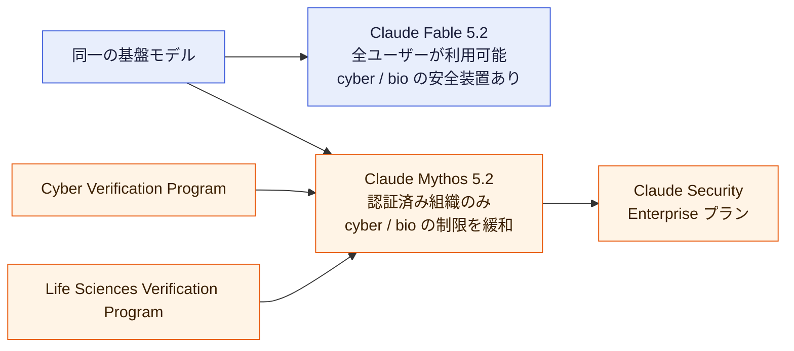
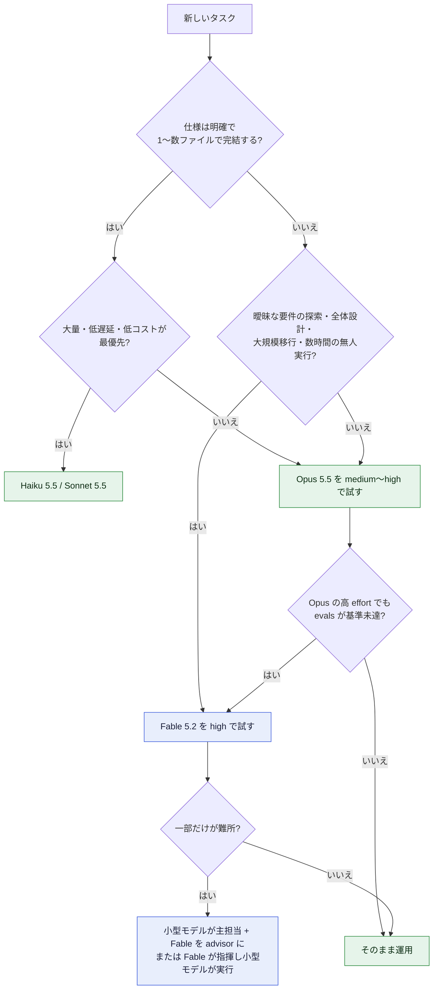
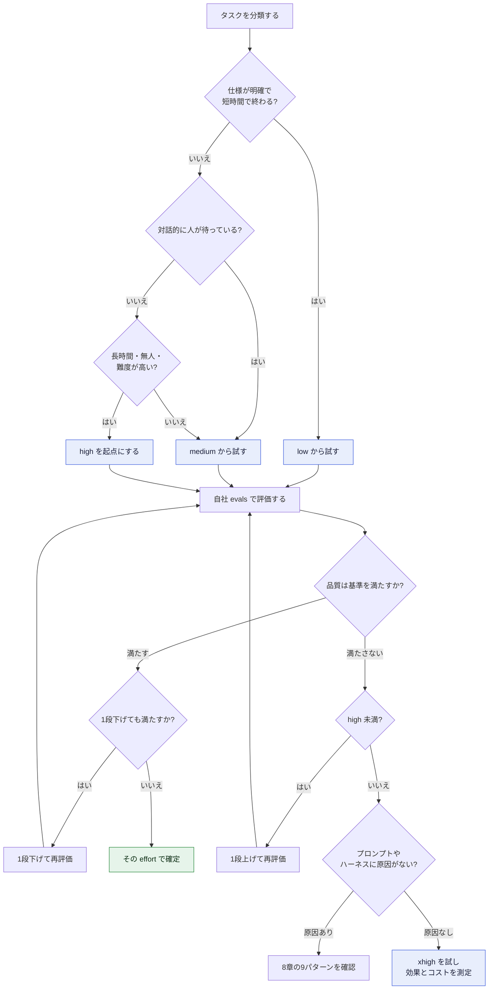
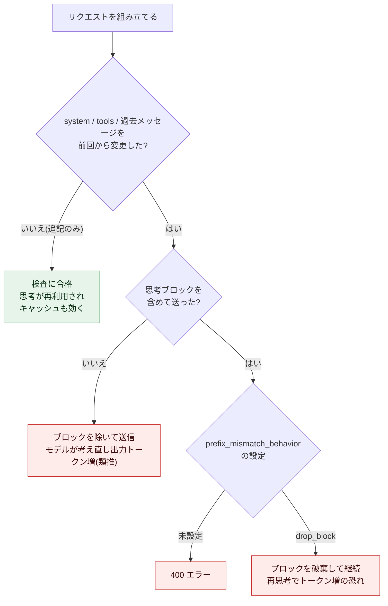
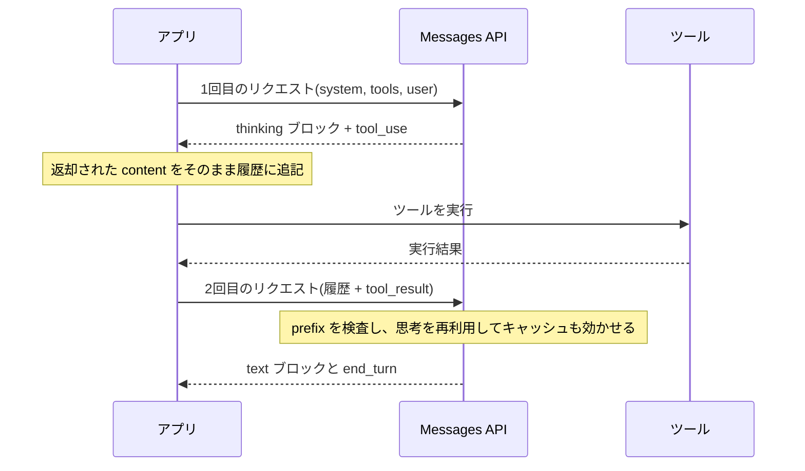
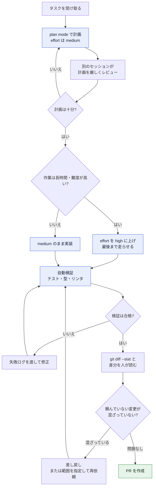
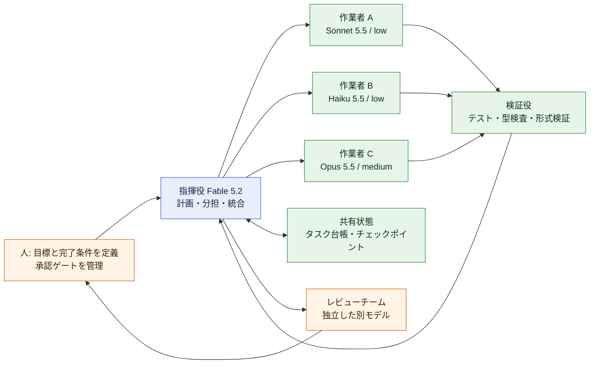
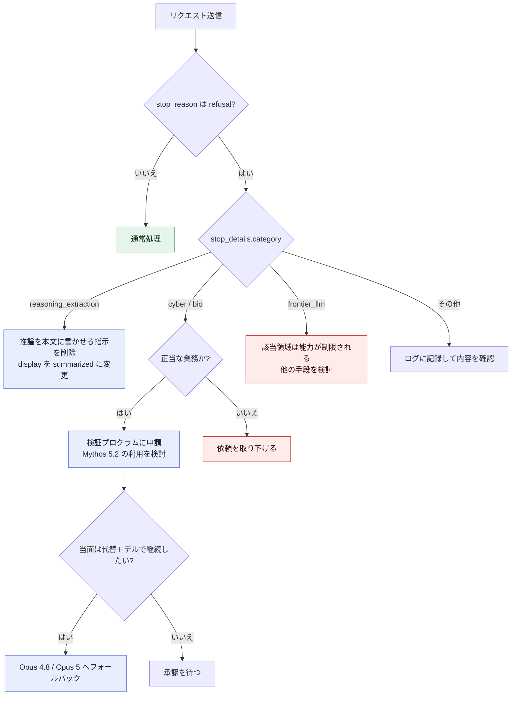
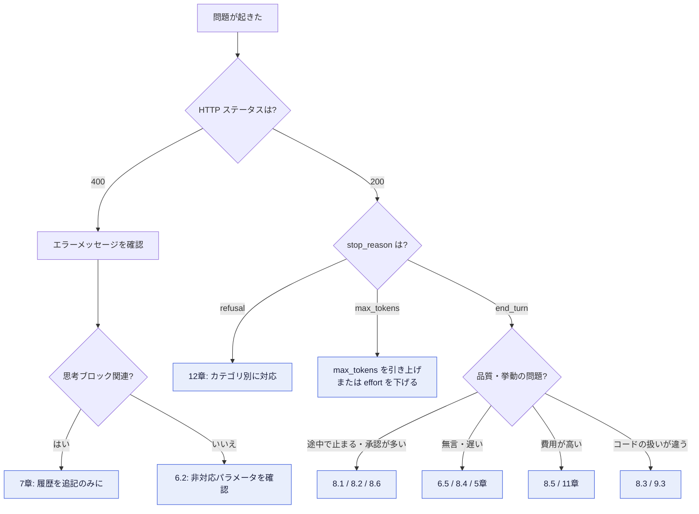

# Claude Fable 5.2 ベストプラクティス完全ガイド

> **中級〜上級者向け・ステップバイステップ解説**(API実装 / Claude Code運用 / マルチエージェント / コスト設計)

| 項目 | 内容 |
| --- | --- |
| 対象モデル | Claude Fable 5.2(API ID: `claude-fable-5-2`)。同一基盤モデルの Claude Mythos 5.2 との関係も扱う |
| 調査時点 | 2026-11-12(リリースの3日後) |
| 想定読者 | Claude API / Claude Code を日常的に使い、モデル切替・effort・サブエージェント設計まで踏み込みたい開発者 |
| 情報源 | Anthropic公式発表・Platform Docs・Claude Code Docs を軸に、著名な国際的開発者(Simon Willison、Ethan Mollick、swyx / Latent Space、Boris Cherny、Alex Albert ほか)の投稿で補強 |
| 図解のルール | フローチャートは Mermaid、その他の図解・比較は Markdown 表で表現(ASCII図解は不使用) |

---

## 0. 読む前に: この資料の確度ラベル

リリース直後は一次情報と推測が混在します。本書では、すべての主張に次のラベルを付けています。

| ラベル | 意味 | 扱い方 |
| --- | --- | --- |
| **[公式]** | Anthropic の発表・ドキュメントに書かれている事実 | 設計の根拠にしてよい。ただし数値は版が更新されうる |
| **[実測]** | 第三者(Artificial Analysis、SemiAnalysis、Vals など)の計測値 | 自社タスクで再現確認してから採用する |
| **[観測]** | 個人・コミュニティの使用感や報告 | 仮説として扱い、自分のevalsで検証する |
| **[私見]** | 本書の筆者による設計提案 | 出発点として使い、自社の条件で調整する |

括弧内の `S1`〜`S45` は、巻末「16. 補足: 追加ベストプラクティスと根拠ソース」のURL表の番号に対応します。

> **重要な注意**: 本書の末尾にある「未確認事項と留意点」に、公式ドキュメント内の数値の揺れや、未確認の噂(Fable 5.5)の扱いをまとめました。意思決定の前に必ず目を通してください。

---

## 目次

1. [概要: Fable 5.2 を30秒で把握する](#1-概要-fable-52-を30秒で把握する)
2. [5.1 から 5.2 で何が変わったか](#2-51-から-52-で何が変わったか)
3. [Step 1: モデル選定](#3-step-1-モデル選定)
4. [Step 2: アクセスと環境の準備](#4-step-2-アクセスと環境の準備)
5. [Step 3: effort 設計](#5-step-3-effort-設計)
6. [Step 4: API 実装の基本](#6-step-4-api-実装の基本)
7. [Step 5: Preserved thinking と履歴管理](#7-step-5-preserved-thinking-と履歴管理)
8. [Step 6: プロンプト設計の9パターン](#8-step-6-プロンプト設計の9パターン)
9. [Step 7: Claude Code 運用](#9-step-7-claude-code-運用)
10. [Step 8: マルチエージェントと長時間実行](#10-step-8-マルチエージェントと長時間実行)
11. [Step 9: コスト設計](#11-step-9-コスト設計)
12. [Step 10: 安全装置・拒否・フォールバック](#12-step-10-安全装置拒否フォールバック)
13. [Step 11: 評価と品質保証](#13-step-11-評価と品質保証)
14. [トラブルシューティング](#14-トラブルシューティング)
15. [導入チェックリストと30日ロードマップ](#15-導入チェックリストと30日ロードマップ)
16. [補足: 追加ベストプラクティスと根拠ソース](#16-補足-追加ベストプラクティスと根拠ソース)
17. [未確認事項と留意点](#17-未確認事項と留意点)

---

## 1. 概要: Fable 5.2 を30秒で把握する

### 1.1 基本スペック

| 項目 | 内容 | 確度 |
| --- | --- | --- |
| リリース日 | 2026-11-09(Mythos 5.2 と同時) | 公式 (S1) |
| API モデル ID | `claude-fable-5-2`(Mythos 5.2 は `claude-mythos-5-2`) | 公式 (S3) |
| Amazon Bedrock | `global.anthropic.claude-fable-5-2` / `us.anthropic.claude-fable-5-2`(`bedrock-runtime` エンドポイントのみ) | 公式 (S3) |
| Microsoft Foundry の fast mode | 専用モデルID `claude-fable-5-2-fast`(Anthropic ホスト展開のみ) | 公式 (S3) |
| コンテキストウィンドウ | 1M トークン(既定かつ最大) | 公式 (S2, S3) |
| 最大出力 | 128K トークン | 公式 (S2) |
| 思考(thinking) | Adaptive thinking が常時オン。深さは effort で制御 | 公式 (S3) |
| 入出力 | テキスト+画像 → テキスト | 公式 (S2) |
| 信頼できる知識の期限 | 2026年6月 | 公式 (S2) |
| トークナイザー | Opus 4.7 で導入されたもの | 公式 (S3) |
| 標準価格 | 入力 $8 / 出力 $40(百万トークンあたり)。5.1 は $10 / $50 | 公式 (S1, S3) |
| キャッシュ価格 | 5分書込 $10 / 1時間書込 $16 / 読出 $0.20 | 公式 (S3) |
| バッチ価格 | 入力 $4 / 出力 $20 | 公式 (S3) |
| fast mode | 最大2.5倍の生成速度。入力 $16 / 出力 $80 | 公式 (S1, S6) |
| 速度 | 5.1 比で最大30%高速 | 公式 (S1) |
| データ保持 | 30日保持が前提。ゼロデータ保持(ZDR)は原則不可(明示許可を除く)。Covered Model | 公式 (S3) |
| 提供先 | Claude Platform、AWS、Google Cloud、Microsoft Foundry、claude.ai の有料プラン | 公式 (S1) |

### 1.2 Fable と Mythos の関係

同じ基盤モデルに、安全装置の違いで2つの名前が付いています。**一般開発者が使うのは Fable、認証済みの組織だけが使えるのが Mythos** です。



- Fable 5.2 の安全装置は 5.1 と同等の堅牢さを保ちつつ、不要なブロックが約55%減(cyber 約60%減、bio 約40%減)とされています [公式] (S1)。
- ブロックされたリクエストは、cyber は Opus 4.8、bio は Opus 5 の応答に切り替わる設計です [公式] (S1)。

### 1.3 公式ベンチマークの要点(Fable 5.2 / Fable 5.1 / Opus 5.5)

数値は各モデルの最高 effort での公式発表値です(特記を除く)[公式] (S1)。

| ベンチマーク | 測るもの | Fable 5.2 | Fable 5.1 | Opus 5.5 |
| --- | --- | --- | --- | --- |
| FrontierCode 2.0(Xhigh) | OSSメンテナがマージするレベルのコード変更 | 49.1% | 32.4% | 45.5% |
| FrontierSWE v2 | エージェント型コーディング | 69.9% | 56.3% | 62.3% |
| AutomationBench | 業務ワークフロー | 51.4% | 31.4% | 42.5% |
| Terminal-Bench-Science 0.1 | 科学研究エージェント | 74.6% | 52.6% | 58.7% |
| OSWorld 2.1(オフライン、部分) | コンピュータ操作 | 89.3% | 83.5% | 87.2% |
| WANDR | 大規模データ収集の検索エージェント | 82.1% | 68.7% | 72.3% |
| Humanity's Last Exam(ツールあり) | 専門家レベルの知識・推論 | 74.2% | 65.6% | 67.7% |
| Chartography(ツールなし) | チャート・図表の読み取り | 73.4% | 44.8% | 64.4% |
| RoboDojo Sim | ロボット制御(シミュレーション) | 64.9% | 27.6% | 39.4% |
| Remote Labor Index(High) | 遠隔業務の自律遂行 | 41.3% | 17.9% | 21.3% |

> **読み方の注意**: 「全部で Opus 5.5 を上回る」わけではありません。Anthropic 自身が「ほとんどの項目で上回る」と表現しており、第三者の評価では AA-Briefcase は Opus 5.5 と信頼区間内で同水準、GDP.pdf の all-pass は Opus 5.5 がわずかに上、といった項目もあります [実測] (S15)。**自社タスクで測るまで、Opus 5.5 より常に良いとは仮定しない**のが安全です。

---

## 2. 5.1 から 5.2 で何が変わったか

### 2.1 変更点の一覧

| 観点 | Fable 5.1 | Fable 5.2 | 確度 |
| --- | --- | --- | --- |
| 価格(入力 / 出力) | $10 / $50 | $8 / $40(20%安) | 公式 (S1) |
| 生成速度 | 基準 | 最大30%高速 | 公式 (S1) |
| 安全装置のブロック | 基準 | 約55%減 | 公式 (S1) |
| 文章の明瞭さ | 基準 | テスターが「より明確」と評価 | 公式 (S1, S5) |
| Claude apps / Claude Code の既定 effort | — | medium | 公式 (S1) |
| API の既定 effort | high | high(変更なし) | 公式 (S3, S4) |
| 思考ブロックの prefix チェック | 2026-08-31 以降に作成したアカウントのみ | **全アカウントで強制** | 公式 (S3) |
| 思考ブロックを読めるモデル | — | Fable 5.2 と Mythos 5.2 のみ | 公式 (S3) |
| コンピュータ操作 | `computer_20251124` とツールセット | **ツールセットのみ**(Bedrock を除く) | 公式 (S3) |
| advisor ツール | — | 5.2 executor は 5.2 / Mythos 5.2 の advisor のみ許可 | 公式 (S3) |
| 指示への追従 | — | スタイル規則を厳密に守る。「考えるな」は効かない | 公式 (S3, S5) |

### 2.2 「安くなった」の落とし穴

トークン単価は20%下がりましたが、**タスクあたりの総コストが下がるとは限りません**。

| 計測 | 内容 | 確度 |
| --- | --- | --- |
| Anthropic | Medium effort では 5.1 より少ないトークンで難タスクを解ける | 公式 (S1) |
| SemiAnalysis GDPx | タスク単価が $67.16 → $88.15(約31%増)。テストケースを数百〜数千件書き、サブエージェントで検証する傾向 | 実測 (S15, S26) |
| Artificial Analysis | max effort のタスク単価は約 $26.5(Opus 5.5 の約2.6倍、Fable 5.1 の約2倍)。一方 high / xhigh では出力約98K トークンで、Opus 5.5 max の約173K を下回る | 実測 (S15, S27) |

> **結論 [私見]**: コスト比較は「単価」ではなく「**effort を揃えた上でのタスクあたり総額**」で行う。詳細は [11章](#11-step-9-コスト設計) で扱います。

---

## 3. Step 1: モデル選定

### 3.1 公式の基本方針

- **まず Opus 5.5 から始める**。必要に応じて、上は Fable / Mythos、下は Sonnet 5.5 / Haiku 5.5 に切り替える [公式] (S1)。
- Platform Docs の表現: Opus で高い effort に上げても評価基準を満たせないときに Fable へ移る [公式] (S3)。
- Fable 5.2 は **Advisor**(小型モデルが難所で相談する先)や **Orchestrator**(単純作業を小型モデルへ委譲する指揮役)としても使える [公式] (S1)。

### 3.2 選定フローチャート



### 3.3 タスク別の使い分け表

| タスク | 推奨 | 根拠 |
| --- | --- | --- |
| コードベース全体の書き換え、Rust移植などの大規模移行 | Fable 5.2 | Anthropic のチームが Python から Rust への移行に使い、起動が約26倍高速になったと報告 [公式] (S1)。Anthropic の Felix Rieseberg も、大きく長いタスクは Fable が上回ると述べる [観測] (S15, S31) |
| 曖昧・仕様が固まっていない作業の探索 | Fable 5.2 | Shopify・Vercel のテスターが「ゆるい発想を磨く」「意図を汲む」と評価 [公式] (S1)。Claude Code チームの発言として、仕様が明確なら Opus、曖昧なら Fable が合う [観測] (S15) |
| 日常のコーディング、明確な仕様の実装 | Opus 5.5 | 公式の既定推奨 [公式] (S1)。Felix Rieseberg は日常では Fable の思考がやや遅いため Opus を好むと述べる [観測] (S15) |
| 数時間の無人エージェント実行 | Fable 5.2(high) | Uber のテスターは10〜12時間の監査で約170のレビューエージェントを走らせ、「完了まで止まらない」と評価 [公式] (S1) |
| 多数のサブエージェントの統括 | Fable 5.2 が指揮、Opus 5.5 / Sonnet 5.5 が実行 | Lydia Hallie は Fable を Opus 5.5 サブエージェントの指揮役として使い、検証の徹底ぶりを評価 [観測] (S15, S30) |
| 画像・チャート・図表の読み取り | Fable 5.2(medium でも可) | Chartography で medium でも Opus 5.5 の最高 effort を上回ると報告 [公式] (S1) |
| 大量・低遅延の分類、抽出、ルーティング | Haiku 5.5 / Sonnet 5.5 | Fable は過剰。コストが見合わない [私見] |
| サイバーセキュリティ、バイオ研究 | Mythos 5.2(認証済み組織のみ) | Fable は該当タスクの多くをブロックする [公式] (S1) |

### 3.4 組み合わせパターン(Claude Code の advisor を含む)

Claude Code の advisor 機能では、メインモデルと advisor モデルの組み合わせに制約があります [公式] (S7)。

| メインモデル | 使える advisor | 狙い |
| --- | --- | --- |
| Sonnet | Fable | 難所だけ Fable の助言を受け、全体を Fable で回さずに済む |
| Haiku | Opus | 最安のメインで、計画だけ強いモデルに頼る |
| Opus | Opus | 2つ目の Opus が1つ目をレビューする |
| Fable 5.2 | Fable 5.2 のみ | 最高能力の組み合わせ。Claude Code は Fable メインに Opus / Sonnet の advisor を適用しない |

> **API でも同じ制約**: Fable 5.2 を executor にする場合、advisor は Fable 5.2 または Mythos 5.2 だけです。Fable 5.1 を指定すると 400 エラーになります [公式] (S3)。逆に、executor を今のまま変えず advisor だけを `claude-fable-5-2` にするのは、どの executor でも可能です [公式] (S3)。

---

## 4. Step 2: アクセスと環境の準備

### 4.1 手順

| 手順 | 作業 | 確認方法 |
| --- | --- | --- |
| 1 | 利用プランを確認する。Fable 5.2 は Pro / Max / Ultra / Team / Enterprise で利用できる [公式] (S2) | claude.ai のモデルピッカーに Fable 5.2 が出る |
| 2 | Claude Code を **v2.1.321 以降** に更新する [公式] (S7, S8) | `claude --version` |
| 3 | モデルを選択する | Claude Code 内で `/model fable` |
| 4 | API を使うなら、モデル ID を `claude-fable-5-2` にする [公式] (S3) | 最小のリクエストで 200 が返る |
| 5 | **データ保持の要件**を法務・セキュリティと合意する。30日保持が前提で、ZDR は原則使えない。Enterprise には Enterprise Frontier Safeguards(顧客インフラ上で保存し ZDR と両立する監視、非公開ベータ)がある [公式] (S1, S3) | 契約・社内規程との突き合わせ |
| 6 | 利用枠の仕様を把握する(4.2 参照) | プラン画面の使用量表示 |

```bash
# Claude Code の確認と起動(v2.1.321 以降が必要)
claude --version
claude --model claude-fable-5-2
```

### 4.2 サブスクリプションの利用枠

| 項目 | 内容 | 確度 |
| --- | --- | --- |
| 週次上限への算入 | Pro と Team の標準席では、Fable は週次上限の**最大50%まで** | 公式 (S1) |
| ローンチ特典 | Fable を含むプラン・席に、契約期間に応じて Fable のリセットが1〜3回(詳細は公式のサポート記事) | 公式 (S1, S36) |
| 有料サブスクの費用対効果 | Theo の分析では、$200 の Ultra で得られる量は Opus 5.5 換算で月約 $15,000 に対し、Fable 5.2 換算で約 $3,000 | 観測 (S15, S32) |

> **[私見]**: 利用枠が限られる環境では、**日常を Opus 5.5、難所だけ Fable** という運用が現実的です。「Fable だけで回す」と枠の消費が速く、50%の上限にも早く当たります。

### 4.3 リソース準備のチェックリスト

- [ ] Claude Code が v2.1.321 以上である
- [ ] モデル選択(`/model`)と effort(`/effort`)の操作を一度試した
- [ ] 組織のデータ保持ポリシーが「30日保持」と矛盾しない
- [ ] 既存のプロンプト・`CLAUDE.md`・エージェント設定を**変更前にバックアップ**した(8章・9章で棚卸しする)
- [ ] 評価用タスクセット(10〜30件)を用意した(13章で使う)

---

## 5. Step 3: effort 設計

Fable 5.2 では、思考(thinking)が常時オンです。「考えるかどうか」は選べず、**「どれだけ深く考えるか」を effort で選ぶ**のが最大の設計ポイントになります。effort は、思考量・ツール呼び出し回数・ターンの所要時間・トークン消費をまとめて左右します [公式] (S5)。

### 5.1 5段階の使い分け

| effort | 向いている用途 | 特徴 | 確度 |
| --- | --- | --- | --- |
| `low` | 素早い往復、仕様が明確なタスク、大量処理、高速・安価なサブエージェント | 5.2 は low でも、5.1 の高 effort に近いスコアが出たと報告されている | 公式 (S5) |
| `medium` | 対話的なコーディング、チャット、日常の知識業務 | Claude apps と Claude Code の既定。5.1 より少ないトークンで難タスクをこなせる | 公式 (S1, S5) |
| `high` | 難しいコーディング・調査・エージェント作業、長時間の無人実行 | **API の既定**。能力向上の大部分はここまでで得られる。medium より明らかに時間がかかる | 公式 (S3, S5) |
| `xhigh` | 最難関の長時間コーディング・エージェント作業で、**効果を測定できた場合のみ** | 内部のコーディング評価でわずかに上昇、トークンは大幅に増える | 公式 (S5) |
| `max` | モデルの上限測定、時間とトークンが無関係なまれなタスク(科学的発見や数学の未解決問題など) | xhigh よりさらに遅く、トークンも大幅に増える | 公式 (S5) |

### 5.2 根拠データ: どの effort が割に合うか

| 出典 | 内容 | 確度 |
| --- | --- | --- |
| Anthropic(FrontierCode 2.0) | High の Fable 5.2 が、Max の Opus 5.5 とほぼ同スコア(45.3% 対 45.5%)で、タスク単価は約半分。Xhigh で 49.1% と、評価した公開モデルで最高 | 公式 (S1) |
| Anthropic(WANDR) | Medium で Opus 5.5 の最高スコアに並び、コストは約40% | 公式 (S1) |
| Anthropic(HLE) | Low で Opus 5.5 の最高スコアに並び、コストは10分の1未満 | 公式 (S1) |
| Vals | 総合で high が最良。xhigh と max を上回った | 実測 (S15, S28) |
| 複数の評価 | max / xhigh が high を下回るケースが複数報告されている。Fable だけに出る傾向で、Opus と Sonnet には出ないという指摘もある | 実測・観測 (S15, S33) |
| Cursor | CursorBench で max が60%、既定が56.9%、5.1 は49.2%。effort の挙動が 5.1 と異なるため、**5.1 の設定を持ち込まず既定から始める**よう注意喚起 | 実測 (S15, S35) |

> **結論 [私見]**: 出発点は **`high`(API)または `medium`(Claude Code)**。そこから「下げて評価が保てるか」を先に試し、上げるのは測定で効果が見えた場合だけにする。**`max` を本番の既定にするのは避ける**。

### 5.3 effort 選択フロー



### 5.4 effort スイープの手順(最初の1週間でやる)

1. 代表的なタスクを **10〜30件**用意し、合否の判定基準(自動テスト、ルーブリックなど)を決める。
2. 同じタスクを `low` / `medium` / `high` / `xhigh` で実行し、**スコア・所要時間・出力トークン・費用**を記録する。
3. 「品質を保てる最も低い effort」をタスク種別ごとに決める。
4. 結果を表にまとめ、運用ルールにする(例: 調査は high、レビューは medium、整形は low)。

```python
import os
import time

import httpx

API = "https://api.anthropic.com/v1/messages"
HEADERS = {
    "x-api-key": os.environ["ANTHROPIC_API_KEY"],
    "anthropic-version": "2023-06-01",
    "content-type": "application/json",
}
# USD / 百万トークン(標準速度。公式価格表より)
PRICE = {"in": 8.0, "out": 40.0, "cache_read": 0.20, "cache_write_5m": 10.0}


def usd(usage: dict) -> float:
    """usage から概算費用(USD)を計算する。思考トークンは output に含まれて課金される。"""
    return (
        usage.get("input_tokens", 0) * PRICE["in"]
        + usage.get("output_tokens", 0) * PRICE["out"]
        + usage.get("cache_read_input_tokens", 0) * PRICE["cache_read"]
        + usage.get("cache_creation_input_tokens", 0) * PRICE["cache_write_5m"]
    ) / 1_000_000


def run_once(prompt: str, effort: str, max_tokens: int = 32_000) -> dict:
    body = {
        "model": "claude-fable-5-2",
        "max_tokens": max_tokens,  # 思考トークンと本文の合計に対する上限
        "output_config": {"effort": effort},
        "messages": [{"role": "user", "content": prompt}],
    }
    t0 = time.time()
    r = httpx.post(API, headers=HEADERS, json=body, timeout=900)
    r.raise_for_status()
    data = r.json()
    text = "".join(b.get("text", "") for b in data["content"] if b["type"] == "text")
    return {
        "effort": effort,
        "sec": round(time.time() - t0, 1),
        "usd": round(usd(data["usage"]), 4),
        "out_tokens": data["usage"]["output_tokens"],
        "stop_reason": data["stop_reason"],
        "text": text,
    }


def sweep(tasks: list[dict], levels=("low", "medium", "high", "xhigh")) -> list[dict]:
    rows = []
    for task in tasks:
        for level in levels:
            res = run_once(task["prompt"], level)
            res["task"] = task["id"]
            res["passed"] = task["check"](res["text"])  # 自社の合否判定関数
            rows.append(res)
    return rows
```

> 大きな `max_tokens` を使う長時間のリクエストは、ストリーミングでの受信が実運用では安全です [私見]。上のコードは仕組みを示すための最小版です。

### 5.5 effort の運用ルール

| ルール | 内容 | 確度 |
| --- | --- | --- |
| 応答の長さは effort で変わらない | effort は応答テキストの長さにはほとんど影響しない。長さや口調は**プロンプトで**指示する | 公式 (S5) |
| 簡単なターンは低い effort で | 「直接答えて、考えないで」という指示は、medium 以上では**思考を止められない**(5.1 では効いた)。high 以上では挨拶にも思考する | 公式 (S3, S5) |
| 設定を持ち込まない | effort ごとの思考量はモデルで異なる。5.1 や Opus 5.5 で調整した値は流用せず、スイープをやり直す | 公式 (S5) |
| 局面で変える | 計画と反復は medium、長い無人区間は high、という切替が有効。キャッシュを保ったまま変えるには per-message effort(ベータ、ヘッダ `mid-conversation-output-config-2026-07-01`) | 公式 (S5) |
| 低い effort のエージェントは早く止まりやすい | low / medium では、ターンを途中で終える傾向が強まる。8章の「完遂」の指示を足す | 公式 (S5) |

---

## 6. Step 4: API 実装の基本

### 6.1 まず最小のリクエストを通す

```bash
curl https://api.anthropic.com/v1/messages \
  -H "x-api-key: $ANTHROPIC_API_KEY" \
  -H "anthropic-version: 2023-06-01" \
  -H "content-type: application/json" \
  -d '{
    "model": "claude-fable-5-2",
    "max_tokens": 16000,
    "output_config": { "effort": "high" },
    "messages": [
      { "role": "user", "content": "このリポジトリの設計上のリスクを3つ挙げて" }
    ]
  }'
```

`output_config.effort` の値は `low` / `medium` / `high` / `xhigh` / `max` です [公式] (S3, S25)。`max_tokens` は**思考トークンと本文の合計**に対する上限で、思考トークンは出力トークンとして課金されます [公式] (S4)。

### 6.2 400 エラーになる指定と、その代替

| やりがちな指定 | 結果 | 代替 | 確度 |
| --- | --- | --- | --- |
| `thinking: {"type": "enabled", "budget_tokens": N}` | 400 | `thinking` を省略するか `{"type": "adaptive"}`。深さは effort で調整 | 公式 (S3) |
| `thinking: {"type": "disabled"}` | 400 | 思考は止められない。低い effort を使う | 公式 (S3) |
| `tool_choice: {"type": "any"}` または `{"type": "tool", ...}`(強制ツール使用) | 400 | `tool_choice: {"type": "auto"}` に `strict: true` を組み合わせるか、JSON出力機能を使う | 公式 (S3) |
| `computer_20251124` ツール | 400(Bedrock を除く) | `computer_toolset_20260801` ツールセット | 公式 (S3) |
| advisor に Fable 5.1 などを指定(executor が Fable 5.2) | 400 | advisor を `claude-fable-5-2` または `claude-mythos-5-2` に | 公式 (S3) |
| 履歴の編集後に古い思考ブロックを送る | 400(`The block is bound to a different conversation`) | 7章を参照 | 公式 (S3) |
| 顧客管理の暗号鍵(CMEK)を使う組織で structured outputs を利用 | 利用不可 | `strict` を外し、ツール入力を自前で検証する | 公式 (S3) |

> プリフィル(assistant の先頭を埋める指定)とサンプリングパラメータには制限があり、Opus 5 から引き継がれています [公式] (S4)。移行ガイドで該当部分を確認してください。

### 6.3 構造化出力は「強制」ではなく「strict」で

強制ツール使用が使えなくなったため、スキーマに沿った JSON が必要な場合は `strict: true` を使います [公式] (S3)。

```json
{
  "model": "claude-fable-5-2",
  "max_tokens": 4000,
  "output_config": { "effort": "low" },
  "tools": [
    {
      "name": "record_review",
      "description": "コードレビューの結果を記録する",
      "strict": true,
      "input_schema": {
        "type": "object",
        "properties": {
          "severity": { "type": "string", "enum": ["low", "medium", "high"] },
          "summary": { "type": "string" }
        },
        "required": ["severity", "summary"],
        "additionalProperties": false
      }
    }
  ],
  "tool_choice": { "type": "auto" },
  "messages": [{ "role": "user", "content": "次の差分をレビューして、結果を記録して: ..." }]
}
```

### 6.4 ツール実行ループの標準形(履歴は追記のみ)

ツール使用ループでは、**直前のアシスタントの応答を、思考ブロック(空のものを含む)も含めて一切加工せずに送り返す**必要があります [公式] (S4)。

```python
def call(body: dict, betas: list[str] | None = None) -> dict:
    headers = dict(HEADERS)
    if betas:
        headers["anthropic-beta"] = ",".join(betas)
    r = httpx.post(API, headers=headers, json=body, timeout=900)
    r.raise_for_status()
    return r.json()


def agent_loop(user_prompt: str, tools: list[dict], run_tool, effort: str = "high", max_turns: int = 60) -> dict:
    # system と tools は会話の途中で変更しない(prefix チェックの対象)
    system = "あなたはこのリポジトリの保守担当エージェントです。..."
    messages = [{"role": "user", "content": user_prompt}]

    for _ in range(max_turns):
        data = call({
            "model": "claude-fable-5-2",
            "max_tokens": 32_000,
            "output_config": {"effort": effort},
            "system": system,
            "tools": tools,
            "messages": messages,
        })

        # 返ってきた content をそのまま追記する。ブロックの削除・並べ替え・書き換えは禁止
        messages.append({"role": "assistant", "content": data["content"]})

        if data["stop_reason"] == "refusal":
            return data  # 12章の方針で処理する
        if data["stop_reason"] != "tool_use":
            return data

        results = []
        for block in data["content"]:
            if block["type"] == "tool_use":
                output = run_tool(block["name"], block["input"])
                results.append({
                    "type": "tool_result",
                    "tool_use_id": block["id"],
                    "content": output,
                })
        messages.append({"role": "user", "content": results})

    raise RuntimeError("max_turns に到達しました")
```

### 6.5 長い無人実行で「無言」に見える問題を避ける

Fable 5.2 は、ツール呼び出しの合間に書く経過報告を**思考ブロックとして**返します。ところが既定の `thinking.display` は `"omitted"` で、その本文が空になります。`text` ブロックだけを描画するクライアントでは、長い処理の間ずっと無言に見えます [公式] (S5)。

| `thinking.display` | 返ってくるもの | 用途 |
| --- | --- | --- |
| `"omitted"`(既定) | 思考ブロックの本文は空 | 画面に出さない。最安・最速 |
| `"updates"` | 各経過報告の短い要約(ベータ。ヘッダ `thinking-display-updates-2026-08-18`) | **ユーザーに進捗を見せたい**とき |
| `"summarized"` | 経過報告 + 要約された推論 | 推論の様子も見たいとき。推論過程の再現を本文に書かせる代わりに使う |

```python
data = call(
    {
        "model": "claude-fable-5-2",
        "max_tokens": 32_000,
        "output_config": {"effort": "high"},
        "thinking": {"type": "adaptive", "display": "updates"},
        "messages": [{"role": "user", "content": "..."}],
    },
    betas=["thinking-display-updates-2026-08-18"],
)

# テキストだけでなく、中身のある thinking ブロックも描画する
for block in data["content"]:
    if block["type"] == "text":
        print(block["text"])
    elif block["type"] == "thinking" and block.get("thinking"):
        print("[進捗]", block["thinking"])
```

> ベータ機能のヘッダ名と挙動は更新されうるため、導入時に公式ドキュメント(S5)の該当箇所を確認してください。

---

## 7. Step 5: Preserved thinking と履歴管理

Fable 5.2 は、過去ターンの思考ブロックを保持して使う **preserved thinking** を前提に動きます。このため、**履歴の扱い方がそのまま信頼性とコストを左右します**。

### 7.1 prefix チェックとは

思考ブロックより前にある内容(`system`、`tools`、過去のメッセージ)が、モデルがそのブロックを出した時点から変わっていないかを API が検査します。変わっていると、既定では 400 エラーです。Fable 5.2 では**全アカウントで強制**されます [公式] (S3)。



### 7.2 変更したくなったときの代替手段

| やりたいこと | やってはいけない | 代わりにやること | 確度 |
| --- | --- | --- | --- |
| 指示を変える・足す | 会話の途中で `system` を書き換える | **新しい会話**で変更する。同じ会話なら最新のユーザーターンに書く。利用可能なら mid-conversation の system メッセージで追記する | 公式 (S5) |
| ツールを増減する | `tools` を書き換える | mid-conversation tool changes(ベータ。ヘッダ `inline-tools-2026-09-15`、参照で名指しする変更は `mid-conversation-tool-changes-2026-07-01`) | 公式 (S3) |
| 履歴を短くする | 古いメッセージを手で削除・要約する | コンテキスト編集(context editing)、または以降の古いターンを残さない compaction。タイミングを自分で選ぶなら compaction on demand(ベータ。ヘッダ `compact-2026-09-04`) | 公式 (S3, S5) |
| ターンごとの注意書きを足す | 過去のメッセージに追記する | ターン限定の system メッセージ(`clear_at: "next_user_message"`)。入れた注意書きは以降のリクエストでも履歴に残す | 公式 (S5) |
| 応答を保存して再送する | 思考ブロックを除いたり、空ブロックを省いたり、順序を変えたりする | 返ってきた形のまま保存・再送する | 公式 (S3, S4) |
| 保存した会話を新プロンプトで再開する | 古い会話に新しい `system` を当てる | 新しい会話として始める | 公式 (S5) |

> Claude Code、claude.ai、Claude Managed Agents、Claude Agent SDK が履歴を組み立てる場合は、利用者側で対応する作業は発生しません [公式] (S3)。**自前でメッセージ配列を組み立てているコードだけ**が点検対象です。

### 7.3 自前実装の点検チェックリスト

- [ ] `system` と `tools` が、会話の全期間で同一である
- [ ] `messages` に追記するだけで、既存要素の変更・並べ替え・削除をしていない
- [ ] アシスタントの各ターンを、**全ブロックを同じ順序のまま**送り返している
- [ ] 履歴の圧縮は compaction / context editing で行い、手作業の要約挿入をしていない
- [ ] 会話の途中でツールのバージョンやアドバイザーのモデルを変えていない(変えるなら新しい会話で)

### 7.4 暫定回避: `drop_block`(あくまで応急処置)

編集を直す時間がないときは、ベータのヘッダ `thinking-binding-controls-2026-08-01` を付け、`thinking.block_binding.prefix_mismatch_behavior` を `"drop_block"` にすると、無効な思考ブロックを破棄して続行できます。破棄したブロックは、レスポンスの `input_transformations` に一覧されます [公式] (S3)。

```json
{
  "model": "claude-fable-5-2",
  "max_tokens": 16000,
  "thinking": {
    "type": "adaptive",
    "block_binding": { "prefix_mismatch_behavior": "drop_block" }
  },
  "messages": ["..."]
}
```

**コストに注意**: 毎ターン破棄すると、モデルが毎回考え直すため出力トークンが増えます。公式の検証では、これが最悪のケースとして挙げられています [公式] (S5)。まず自分のタスクで出力トークンを測り、**恒久策は履歴を追記のみにすること**です。

### 7.5 モデルを切り替えると何が起きるか

| 状況 | 結果 | 確度 |
| --- | --- | --- |
| Opus 5.5 / Sonnet 5.5 / Haiku 5.5 / Fable 5.1 / Mythos 5.1 / Opus 5 などから Fable 5.2 へ移る | 過去の推論を引き継げる(Claude API と Google Cloud の Google 管理版) | 公式 (S3) |
| Fable 5.2 と Mythos 5.2 の間を移る | 互いの思考ブロックを読める | 公式 (S3) |
| **Fable 5.2 から他のモデルへ移る** | 移った先のターンでは、Fable 5.2 の推論を失う(Opus 5.5、Fable 5.1、フォールバック先の Opus 4.8 / Opus 5 を含む) | 公式 (S3) |
| 別のアカウントが Fable 5.2 の思考ブロックを送る | ブロックは破棄され、リクエスト自体は成功する(破棄分は課金されない) | 公式 (S3) |

> **[私見]**: モデルを頻繁に切り替えるルーターは、切替のたびに推論が失われます。**会話ごとにモデルを固定**し、切り替えるなら新しい会話か、サブエージェントとして分離するのが安全です。

### 7.6 ツールループと思考ブロックの流れ



### 7.7 キャッシュとの相乗効果

履歴を追記のみにすると、プレフィックスが毎回一致するため**キャッシュ命中率が上がります**。キャッシュ読み出しは入力単価の0.025倍($0.20/MTok)で、5分書き込みが $10、1時間書き込みが $16(いずれも百万トークンあたり)です。キャッシュ対象の最小サイズは512トークンです [公式] (S3, S4)。

---

## 8. Step 6: プロンプト設計の9パターン

Fable 5.2 は、プロンプトやハーネスの指示を**かなり忠実に守ります**。そのため、5.1 や Opus 5.5 向けに積み上げた指示が、コスト増・副作用・無効化を起こすことがあります [公式] (S5)。ここでは公式の「Prompting Claude Fable 5.2」(S5)の9つの論点を、症状ごとに整理します。

> **本章のテンプレートについて**: 公式ガイドの文面をそのまま転載せず、趣旨を踏まえて筆者が書き直した日本語版を載せています。原文(英語)は S5 で確認してください。**テンプレートは出発点**です。自分のタスクで効果とトークン増を測ってから採用します。

> **変更は新しい会話でのみ行う**: 指示の追加・削除は `system` や `tools` の編集にあたり、7章の prefix チェックに触れます。保存済みの会話を新しい指示で再開すると 400 になりえます [公式] (S5)。

### 8.0 症状から逆引き

| 観察される症状 | 参照する節 |
| --- | --- |
| どの effort にするか迷う。簡単な依頼の返事が遅い | [5章](#5-step-3-effort-設計) |
| ターンが途中で終わる(「残りは〜です」「続けますか?」) | [8.1](#81-作業を最後までやり切らせる) |
| 不要な承認を求める、定型作業まで止まる | [8.2](#82-承認の出し方と承認ルールの書き方)、[8.6](#86-注意書きの積み上がりを防ぐ) |
| 既存コードに継ぎ足すだけ。見つけた問題を報告して放置する | [8.3](#83-コードの所有者を明示する) |
| 長い処理の間、何も表示されない | [6.5](#65-長い無人実行で無言に見える問題を避ける)、[8.4](#84-長いターンでユーザーに状況を伝える) |
| サブエージェントを必要以上に起動して費用が膨らむ | [8.5](#85-サブエージェントの期待値を設定する) |
| 旧モデル向けの指示が効かない、文章がぎこちない | [8.7](#87-旧モデル向けの指示とハーネスを見直す) |
| 最終報告が読みにくい | [8.8](#88-最終報告を読みやすくする) |
| `stop_reason: "refusal"` が返る | [12章](#12-step-10-安全装置拒否フォールバック) |

### 8.1 作業を最後までやり切らせる

**症状**: 長い複数ステップのタスクで、ターンの途中で終わる。残作業を列挙して止まる、続行を提案して待つ、通常の障害(タイムアウトなど)で止まる。**low / medium で起きやすい** [公式] (S5)。

**処方**: システムプロンプトに完遂の方針を入れる。

```markdown
# 作業の完遂
- ユーザーが依頼した作業が残っている間は、ターンを終えない。残作業を並べて止まる、続行の提案をして待つ、という終わり方をしない。
- 状況メモの共有や、ユーザーの回答次第で変わる論点の確認は歓迎する。ただし、回答に依存しない作業は止まらずに進める。
- エラー、タイムアウト、ロックされたファイル、空の結果、失敗するツールに出会ったら、まず原因を調べる。本当の阻害要因でなければ、待って再試行する、要求を直す、別のツールや情報源を使う、といった方法で乗り越える。
- 誰かが「動かせない」と明確に決めたもの(触るなと指定されたファイル、意図的に与えられていない権限、安全上のガードレール)は迂回しない。見つけた事実をそのまま報告し、安全な別の方法で完了を目指す。
- 破壊的・不可逆な操作の確認は、これまでどおり省略しない。
```

**効果とトレードオフ**: 公式の検証(記録済みセッションの再生、medium)では、完了できる作業が残ったまま終わるセッションが**約半分**に減りました。一方、出力トークンは**約30%増**で、「残りを列挙して止まる」型の終わり方は残りました [公式] (S5)。

**注意**:
- 質問が減るので、**リスクのある操作・取り消せない操作の確認ステップは自前で残す** [公式] (S5)。
- **Claude Code は、Fable 5.2 用に `# Finishing work` の節を自動で送っています**。`CLAUDE.md` に同趣旨の文を貼り足す必要はありません [観測] (S16)。

### 8.2 承認の出し方と承認ルールの書き方

| 場面 | 悪い例 | 良い例(筆者作成) | 根拠 |
| --- | --- | --- | --- |
| 続行を許可する | 「続けて」「go」「👍」 | 「はい、ステージングDBでマイグレーションを実行してください」のように**何を許可するかを明示**する | 公式 (S5) |
| 承認ルールを書く | 「社外へのメッセージ送信は承認が必要」と広く書く | 「ファイル削除と本番へのデプロイは事前に確認する。それ以外の定型作業は確認なしで進める」と**対象を具体的に**書く | 公式 (S5) |

公式の検証では、誰も承認する人がいない模擬タスクで「外部の人へのメッセージ送信」を承認必須に列挙したところ、同僚や他チームへの**定型の依頼のおよそ半分**を保留しました [公式] (S5)。

> アレックス・アルバート(Anthropic)の助言: **承認が必要なもの(削除など)を最初に宣言**しておく [観測] (S15, S29)。

### 8.3 コードの所有者を明示する

**症状**: Fable 5.2 は「そのコードが誰のものか」に敏感です。プロンプトが所有に触れない、または他人のコードとして示すと、**既存の構造に継ぎ足し**、重複があっても増やします。近くの問題は**報告するだけで直しません** [公式] (S3, S5)。

**処方**: 構造も自分で良くしてほしいなら、所有者であることを書く。

```markdown
あなたはこのコードベースのオーナーであり、長期的なメンテナーです。設計の判断はあなたに任されています。今後もこのコードの上に作り続ける前提で、重複や構造の問題は見つけた時点で整理してください。
```

Simon Willison は、この発想を「This codebase is yours」と一言で言えば既存コードを遠慮なく改善させられる小ネタとして紹介しています [観測] (S10, S12)。

**効果とトレードオフ**:

| 観点 | 内容 | 確度 |
| --- | --- | --- |
| 重複の統合率 | 小さなコーディングタスクで、一文なしでは1割未満、ありでは大きく上昇(引用元により「約半数」「約75%」と記載が分かれる。17章参照) | 公式 (S5, S10) |
| 出力トークン | 増加(公式は約70〜80%増と記載。別の解説は約1.5倍と読む。実測した解説記事は約2.5倍) | 公式・観測 (S5, S16) |
| 頼んでいない変更 | 新規テストやドキュメントの追加が増える。まれに既存機能の挙動まで変える | 公式 (S5) |
| 最終要約 | 小さな変更が要約から**抜けることがある** | 公式 (S5) |
| 「余計なリファクタをしない」との併用 | 範囲を絞る規則を足しても、それだけでは打ち消せない(それでも統合した割合は、公式は半数超、検証記事の引用は約3分の1と記載が分かれる) | 公式 (S5, S16) |

**使い方のルール [私見+観測]**:
- **プロジェクトの `CLAUDE.md` にだけ書く。`~/.claude/CLAUDE.md`(全体設定)には書かない**。顧客のリポジトリやOSSへのPRでは最小限の変更が望ましいため (S16)。
- チームで共有したくない場合は `CLAUDE.local.md` に書く (S16)。
- **要約ではなく差分を読む**。最初に `git diff --stat` で変更ファイル数を確認する (S16)。

### 8.4 長いターンでユーザーに状況を伝える

**症状**: ツール呼び出しが続く間、ユーザー向けのテキストが少ない。最初のツール呼び出しの前に、何をするかを言わないことがある [公式] (S5)。

**処方は3段階**です。上から順に、目的に応じて足します。

| 段階 | 方法 | 効果 | 確度 |
| --- | --- | --- | --- |
| 1 | クライアントが経過報告を受け取れているか確認する(`thinking.display` を `updates` か `summarized` に。6.5 参照) | 描画漏れによる「無言」を解消 | 公式 (S5) |
| 2 | ハーネスで、ユーザーに見せる出力のないツールステップが連続したら、ターン限定の system メッセージを差し込む(ヘッダ `mid-conversation-system-clear-at-2026-08-21`、`clear_at: "next_user_message"`) | 無言の最長区間が**およそ半分**に短縮 | 公式 (S5) |
| 3 | システムプロンプトに、冒頭の一言・途中の短い報告・最後の自己完結した要約を書く | 全実行で最初のツール呼び出し前にメッセージ。出力トークンは約20%増 | 公式 (S5) |

差し込む注意書きの例(筆者作成):

```markdown
しばらくユーザーに報告していません。今何をしているかを一言で伝えてから、作業を続けてください。
```

システムプロンプト用の文面の例(筆者作成):

```markdown
# 状況の伝え方
- 作業を始める前に、これから何をするかを一行で伝える。
- 作業中は、数回のツール呼び出しごとに現状を一行で報告する。
- 最後に、単独で読める短い要約を書く。見つけたこと、やったこと、次にやることを含める。
```

> **使い分け**: これは**人が直接見ている場面**向けです。誰も更新を必要としない長時間の非同期タスクには不要で、むしろ Fable 5.2 はそうした作業に向くと Anthropic は述べています [公式] (S5)。Claude Code は、60秒間ツール呼び出しだけが続いたときのリマインダーをハーネス側で自動送信しています [観測] (S16)。

### 8.5 サブエージェントの期待値を設定する

**症状**: 委譲を促すプロンプト(Claude Code など)では、Fable 5.2 は**積極的にサブエージェントを起動**し、セッション費用の**大きな割合**をサブエージェントが占めることがあります。`xhigh` / `max` では、自分の作業をサブエージェントにレビューさせる挙動も確認されています [公式] (S5)。第三者の計測でも、サブエージェントによる独立した再検証が総コストを押し上げる様子が報告されています [実測] (S15, S26)。

**処方**:

1. **まず棚卸し**: システムプロンプト、スキル、エージェント定義にある「必ず委譲せよ」という常設指示を読み、不要なものを削る [公式] (S5)。Boris Cherny の2026年1月のヒント(依頼に「サブエージェントを使え」と添える)のように、5.2 以前に有効だった習慣は見直しの対象になる [観測] (S19)。
2. **サブエージェントのモデルを確認**: 既定が高価なモデルだと費用が跳ねる。軽い探索・編集・テスト実行は Haiku 5.5 / Sonnet 5.5 + `low` を指定する [私見]。
3. **ツール説明を書き換える**(委譲が多すぎる場合のみ)。含める内容は、サブエージェントが**セッション費用に何を足すか**、委譲する価値がある場面とない場面、サブエージェントへの**指示の書き方**。公式の検証では、費用に焦点を当てた長めの説明で、high effort のサブエージェント数が**およそ半分**になった [公式] (S5)。

```markdown
# サブエージェントの使い方
- サブエージェントを1つ起動するたびに、セッション全体の費用と所要時間が増える。
- 次の場合だけ使う: 互いに独立した作業を並列に進められる、または多数のファイルにまたがる調査で本体の文脈を汚したくない。
- 次の場合は自分で直接やる: 数ファイル以内の確認、単純な検索、すぐ終わる編集。
- 起動するときは、目的、渡すファイルや範囲、期待する出力の形式、完了条件を指示に含める。
```

### 8.6 注意書きの積み上がりを防ぐ

**症状**: メモリ、ノート、指示ファイルに過去の注意が積み上がり、Fable 5.2 がそれを忠実に守って**不要な承認を求める**。複数のエージェントが協働する構成で目立つ [公式] (S5)。

**処方**:

| 対処 | 具体策 | 確度 |
| --- | --- | --- |
| 古い指示を消す | 理由が失効した「絶対に再試行しない」などをメモリから削除する | 公式 (S5) |
| 承認不要の手順を名指しする | 「もっと自由に動け」ではなく、定型の手順を具体的に列挙する | 公式 (S5) |
| 検証・停止条件を見直す | 「最初のエラーで止めてレビュー」のような条件は自律作業を止める。不要なものは削除・限定する | 公式 (S5) |
| 「絶対に〜しない」を書き換える | **絶対**と書くと、モデルは例外なしの規則として扱う。範囲と理由を添える | 公式 (S5) |

```diff
- 失敗したコマンドは絶対に再実行しない。
+ ./deploy.sh は冪等ではないため、失敗しても再実行しない。冪等なコマンド(テスト、ビルド、読み取り系)は再試行してよい。
```

公式の検証では、過去メモに「再試行しない」を含めた状態で、再試行できる場面でも**再試行しない傾向**が出ました(そのメモがない状態では、ほぼ毎回再試行) [公式] (S5, S16)。

### 8.7 旧モデル向けの指示とハーネスを見直す

| 見直す対象 | 何が起きるか | 対処 | 確度 |
| --- | --- | --- | --- |
| 常設の委譲指示 | 委譲が過剰になり、費用が増える | 読んで、不要なら削除([8.5](#85-サブエージェントの期待値を設定する)) | 公式 (S5) |
| プロンプトに見せるトークン予算 | 予算の大きさでモデルの消費量が変わる。high / xhigh で大きな予算を外したところ、同等の性能でコストが下がった | 予算表示なしで試す。※これは**プロンプト上のテキスト**の話で、API の task budgets(ベータ)ではない | 公式 (S5) |
| 過去ターンを編集するハーネス | 思考ブロックが無効になる | 履歴を追記のみにする([7章](#7-step-5-preserved-thinking-と履歴管理)) | 公式 (S5) |
| 「回答済みとして扱え」系の指示(Opus 5.5 のチャット用に紹介されたもの) | high で、追質問に対する思考が減る。**自分の以前の誤りを指摘しにくくなる** | 自己点検を残したいなら入れない。入れるなら誤り指摘が保たれるかを先に測る | 公式 (S5) |
| 「考えずに直接答えて」 | medium 以上では思考を止められない | 指示を削り、effort を下げる | 公式 (S3, S5) |
| 文体の厳格な上限(例: 1文20語以内) | 文章がぶつ切りになる | 規則を外してから、8.8 のような趣旨ベースの指示を足す | 公式 (S3, S5) |
| 積み上がったルール・メモ・メモリ | 古い警戒心が行動を縛る | 理由が失効したものを削除し、絶対表現には範囲と理由を添える([8.6](#86-注意書きの積み上がりを防ぐ)) | 公式 (S5) |

### 8.8 最終報告を読みやすくする

長い作業の最終報告を読む人は、ツール呼び出しやファイルを見ていないことが多く、**報告単体で意味が通る**必要があります。テスターは文章を、5.1 より上、Opus 5.5 と同程度に明瞭と評価しています [公式] (S5)。

```markdown
# 読み手に伝わる書き方
- 読み手は、あなたのツール呼び出し、推論、開いたファイルを見ていない。別の仕事から切り替えて読むかもしれない。報告は単独で理解できる形にする。
- 重要な点を最初の数文に置く。1行目で使った言葉が、12行目になって初めて分かる、という並べ方をしない。
- 平易な言葉と完結した文で書く。作業中に自分で作った用語や略語を使わない。ものごとは、初めて読む人に通じる言い方で説明する。
- 1文に1つの考え、能動態、同じものには同じ言葉を使う(簡潔な技術英語の考え方に近い)。つながる考えは流れる文章で書き、箇条書きは独立した項目の列挙に限る。
- 必要のない詳細は省き、簡潔にする。ただし、判断に必要な文脈は必ず入れる。
```

公式の検証では、この種の指示で最終報告の密度が下がり、セミコロンも減りました [公式] (S5)。**Claude Code は、この種の節を Fable 5.2 では自動送信していません**ので、報告の読みやすさを重視するなら自分で足します [観測] (S16)。

### 8.9 拒否(refusal)への対応

分類器による拒否の扱いは、[12章](#12-step-10-安全装置拒否フォールバック)でまとめて解説します。

> 一般的なプロンプト技法(明確さ、例示、XMLタグ、段階的思考など)は、全モデル共通のベストプラクティス(S46)に従います。本書は Fable 5.2 に固有の論点に絞っています。

---

## 9. Step 7: Claude Code 運用

### 9.1 コマンド早見表

| 目的 | 操作 | 補足 |
| --- | --- | --- |
| バージョン確認 | `claude --version` | Fable 5.2 は **v2.1.321 以降** (S7, S8) |
| モデル選択 | `/model fable` | Fable アクセスが必要 (S7) |
| effort の変更 | `/effort` | Claude Code では Fable 5.2 は **medium から開始** (S16) |
| fast mode の切替 | `/fast` | 最大2.5倍の生成速度。プレミアム価格 (S6, S8) |
| advisor の設定 | `/advisor`、または `--advisor` フラグ | 組み合わせの制約は3.4 (S7) |
| 指示ファイルの監査 | `/doctor prompt-audit` | v2.1.283 以降。何も書き換えず差分案を提示する (S16) |
| 非対話での実行 | `claude -p "..." --model claude-fable-5-2 --effort medium` | `--effort` は検証記事での使用例 (S16) |
| 非対話 + fast mode | `claude -p "..." --model claude-fable-5-2 --settings '{"fastMode": true}'` | 公式ドキュメントの記載 (S8) |

### 9.2 Step A: Claude Code が自動で送っている指示を知る

検証記事(v2.1.322 で確認)によると、Fable 5.2 を選ぶと、Claude Code は次のような指示をバンドルして送ります [観測] (S16)。

| 公式ガイドの論点 | Claude Code での扱い | あなたがやること |
| --- | --- | --- |
| 作業の完遂 | `# Finishing work` の節を自動送信 | `CLAUDE.md` に重ねて書かない |
| 注意の積み上がり | `# Memory, notes and feedback` の節(Claude 自身が書くメモが対象) | **自分が書いた `CLAUDE.md` は対象外**なので、自分で棚卸しする |
| 長いターンの無言 | ツール呼び出しだけが60秒続いたときのリマインダー | 追加不要 |
| 最終報告の読みやすさ | **送られない** | 必要なら 8.8 を `CLAUDE.md` に足す |
| コードの所有 | **送られない** | 必要なら 8.3 を**プロジェクトの** `CLAUDE.md` に足す |
| effort の調整 | 指示ではなく `/effort` で行う | 5章に従う |

### 9.3 Step B: `CLAUDE.md` を棚卸しする

5.1 / Opus 5.5 時代の指示が残っていると、5.2 ではコストや副作用の原因になります。

1. Fable 5.2 を選んだ状態で `/doctor prompt-audit` を実行する。`CLAUDE.md`、`CLAUDE.local.md`、`AGENTS.md`、`.claude/` 配下(ルール、スキル、コマンド、サブエージェント、出力スタイル)を読み、差分案つきの報告を返す。**承認するまで何も変更しない** [観測] (S16)。
2. 検証記事では、典型的な旧モデル向けの5行に対して次の判定が出ました(要旨) [観測] (S16)。

| 指示の種類 | 判定 | 提案 |
| --- | --- | --- |
| 「考えずに直接答えろ」 | 高: 削除 | 削る(medium 以上では効かず、速度が目的なら effort を下げる) |
| タスクごとのトークン予算を提示 | 高: 削除 | 削る |
| 「すべての検索とレビューでサブエージェントを使え」 | 中: 書き換え | 「多数のファイルにまたがる場合に使い、小さな確認は直接やる」へ |
| 「1文20語以内」などの文体の上限 | 中: 書き換え | 「短く平易な文で書く」へ |
| 「失敗したコマンドは再実行するな」 | 低: 要確認 | 理由と範囲を添える |

3. 指示は**1行ずつ外して**評価しながら進める([13章](#13-step-11-評価と品質保証))。

### 9.4 Step C: プロジェクトの `CLAUDE.md` の雛形

```markdown
# プロジェクト概要
(何のためのシステムか、主要ディレクトリ、ビルドとテストのコマンドを3〜10行で書く)

# 作業ルール
- 変更前後で同じテストを実行し、結果を報告する。
- ファイル削除、本番へのデプロイ、スキーマ変更、force push は事前に確認する。それ以外の定型作業は確認なしで進めてよい。
- 失敗したら原因を読んで直してから再実行する。冪等でない処理(./deploy.sh など)は、失敗後に再実行しない。

# コードの所有
あなたはこのリポジトリのオーナー兼メンテナーです。設計の判断は任せます。重複や構造の問題は見つけた時点で整理してください。

# 報告の書き方
読み手は作業の途中経過を見ていません。報告は単独で理解できるように書き、重要な点を最初の数文に置いてください。
```

> **注意**: 「コードの所有」の節は、[8.3](#83-コードの所有者を明示する) のとおり、最小限の変更を求める場面では**入れない**でください。

### 9.5 Step D: 1日の作業フロー

Boris Cherny(Claude Code の作者)のヒントと、Fable 5.2 固有の知見を合わせた流れです [観測+私見] (S16, S19)。



| 手順 | やること | 根拠 |
| --- | --- | --- |
| 計画 | 複雑なタスクは plan mode から始め、計画に力を注ぐ。別のセッションを「スタッフエンジニア」役にして計画をレビューさせる | Boris Cherny (S19)、コミュニティの集約 (S21, S47) |
| 反復 | 計画・反復は medium、長い無人区間は high(5.5 参照) | 公式 (S5) |
| 検証 | テストや型検査など**機械で確認できる手段**を持たせる。「動くことを示して」と頼み、main と作業ブランチの挙動の差を比較させる | Boris Cherny (S19) |
| 差分レビュー | **要約ではなく差分を読む**。`git diff --stat` から確認する | 公式 (S5)、検証記事 (S16) |

### 9.6 Step E: 並列化と作業ツリー

Boris Cherny は、3〜5個の git worktree を同時に使い、それぞれに独立した Claude セッションを走らせる方法を第一のヒントに挙げています [観測] (S19)。

```bash
# 作業ツリーを分けて、並行して別のブランチで作業する
git worktree add ../myrepo-feature-a -b feature-a
git worktree add ../myrepo-feature-b -b feature-b

# それぞれのディレクトリで Claude Code を起動する
cd ../myrepo-feature-a && claude --model claude-fable-5-2
```

> **Fable 5.2 の注意 [私見]**: 並列セッションが増えるほど、利用枠(Fable は週次上限の最大50%)と費用を速く消費します。**主要な1〜2本だけ Fable、残りは Opus 5.5** にすると現実的です。

### 9.7 Step F: advisor と fast mode を使う

- **advisor**: Sonnet を主役にして難所だけ Fable に相談する、といった構成で、**Fable を全工程で回さずに済む** [公式] (S7)。組み合わせの制約は[3.4](#34-組み合わせパターンclaude-code-の-advisor-を含む)。
- **fast mode(`/fast`)**: 最大2.5倍の生成速度で、価格は標準の2倍(入力 $16 / 出力 $80)。Fable 5.2 では、**Fable 5.2 を使っているときにオンにした場合のみ**設定が保持される。現在のモデルが fast mode に対応しない場合、API 利用では Claude Code が Opus に切り替える [公式] (S1, S8)。
- **effort との関係**: fast mode は**速度**、effort は**思考の深さ**を変える。単純な作業では、fast mode と低い effort の併用で最高速になる [公式] (S8)。

> **[私見]**: fast mode は「**人が待っていて、その待ち時間のコストがトークン代より高い**」場面に限定します。無人の長時間作業には、単価が2倍になるだけなので向きません。

### 9.8 Step G: フックと権限

Claude Code の hooks で、編集後の自動整形や禁止操作のブロックをかけられます。Boris Cherny は、危険な権限スキップより**安全なコマンドを事前許可**する運用を勧めています [観測] (S21, S47)。

```json
{
  "hooks": {
    "PostToolUse": [
      {
        "matcher": "Write|Edit",
        "hooks": [
          {
            "type": "command",
            "command": "jq -r '.tool_input.file_path' | xargs -I{} sh -c 'case \"{}\" in *.ts|*.tsx|*.js) npx prettier --write \"{}\";; esac'"
          }
        ]
      }
    ]
  }
}
```

> **注意**: 上は考え方を示す例です。hooks の設定スキーマと入力 JSON の形はバージョンで変わりうるため、必ず公式の hooks ドキュメント(S43)で確認し、安全な環境で試してから使ってください。

### 9.9 Step H: Anthropic 社内の使い方のヒント

Anthropic の Alex Albert が公開した使い方(Latent Space の要約経由)です [観測] (S15, S29)。

| ヒント | 内容 |
| --- | --- |
| 最初に反論させる | 実装の前に「このアイデアの何が問題か」を聞く。Fable は押し返してくる |
| effort | まず medium か high で始め、xhigh は最難関だけにする |
| 承認の宣言 | 承認が必要な操作(削除など)を**最初に**宣言する |
| まとめて任せる | プロジェクト全体を渡し、数時間走らせる |
| 全体の棚卸し | 「プロジェクト全体を読み、壊れている点・不整合・非効率・不要になったものを洗い出し、確信があるものは直し、残りは一覧にして私のレビューに回して」のような依頼(筆者による言い換え) |

---

## 10. Step 8: マルチエージェントと長時間実行

Fable 5.2 が最も得意とするのは、**数時間〜数日続く、曖昧で大きな作業**です [公式] (S1, S2)。この章では、それを安全に・安く回す設計を扱います。

### 10.1 4つの構成パターン

| パターン | 構成 | 向く場面 | 根拠 |
| --- | --- | --- | --- |
| A. 指揮役 + 作業者 | Fable 5.2 が計画・分担・検証を行い、Opus 5.5 / Sonnet 5.5 / Haiku 5.5 が実行する | 並列にできる作業が多い。費用を抑えたい | Orchestrator として公式に推奨 (S1, S39)。Fable を Opus 5.5 サブエージェントの指揮役に使う実践 (S15, S30) |
| B. 小型メイン + Fable の助言 | Sonnet / Haiku / Opus が主担当で、難所だけ Fable に相談する | 大半は易しく、一部だけ難しい | Advisor として公式に推奨 (S1, S7) |
| C. Fable 単独の長時間実行 | Fable 5.2 が数時間の作業を自走する | 監査、移行、調査など | Uber の10〜12時間のセキュリティ監査で約170のレビューエージェントが稼働 (S1) |
| D. 大規模スウォーム | リード1体 + ヘルパー多数が共有状態で協調する | 機械検証できる巨大な目標(証明、移行) | Fermat の最終定理の形式化で1,000体 (S1, S17) |



### 10.2 事例から学べる設計原則

#### 事例1: Fermat の最終定理の形式化(Anthropic)

| 項目 | 内容 | 確度 |
| --- | --- | --- |
| 規模 | リード1体 + ヘルパー999体。初回の形式化は11日かかったが、今回は約30時間(リード+ヘルパーの内訳は S18) | 公式・観測 (S1, S18) |
| 与えた情報 | 60個の命題の一覧、古典的な証明経路の一文スケッチ、必要な定義、以前の形式化で証明済みの47個の補題、リードとヘルパーの役割。**それ以外の手順は与えていない** | 公式 (S1 の脚注) |
| 比較 | Opus 5.5 を同じ構成で動かすと、18時間で26%しか進まなかった | 公式 (S1) |
| 再開 | 18時間の時点で、両チームとも最後の保存から12時間分を再開して継続した | 公式 (S1) |
| ハーネスの工夫 | リードに自動の時間リマインダーを19回送った。研究者による誘導はなし | 観測 (S18) |

**原則**: (1) **機械で検証できる完了条件**(証明検査器)を置く。(2) 役割と目標を絞って与え、**協調の仕組みはモデルに任せる**。(3) **チェックポイントから再開できる**設計にする。(4) 時間の経過を知らせる仕組みをハーネスに持たせる。

#### 事例2: 官僚化したエージェント群(Ethan Mollick)

Wharton の Ethan Mollick は、25,000回のエージェント起動で450以上の3Dの世界を作る実験を行いました [観測] (S13, S14)。作った世界の磨き込みを頼むと、エージェントが厳格なレビュー規則を作り、規則集は8万7千語に膨らんで**開発が止まりかけました**。彼は、**別のエージェントチームにプロセスを見直させる**ことで速度を取り戻しています [観測] (S14, S48)。

**原則**: エージェント群は**自分でプロセスを増殖させる**ことがある。進捗と規則の量を監視し、**独立したレビュー役**(別チーム・別セッション)に簡素化させる。

#### 事例3: 検証の過剰さがコストになる(SemiAnalysis)

Opus 5.5 や Fable 5.1 が約20件のテストで止まる場面で、Fable 5.2 は**数百〜数千件のテストを書き、サブエージェントで独立に再導出**しました。品質には効きましたが、**そのぶんの費用は避けられません** [実測] (S15, S26)。

**原則**: 検証の深さに**上限(ターン数・予算・時間)**を設ける。低リスクの作業では検証を軽くするよう明示する。

#### 事例4: 自己評価の弱さ(Ethan Mollick)

Mollick は、Fable 5.2 が専門家レベルの作業を広くこなす一方、**自分の成果物の出来や長さを判断するのが苦手**で、論文が182ページに膨らむなど、取捨選択を誤ると報告しています。「ジャグド(ギザギザの)AGI」という言葉で表現しています [観測] (S14, S49)。

**原則**: 長さ、構成、趣味・品位の判断は**人間が担う**。作業の「量」ではなく「出来」を評価するゲートを、人が持つ。

### 10.3 スウォーム設計チェックリスト

- [ ] **完了条件が機械で検証できる**(テスト、型検査、形式検証、ルーブリックの自動採点)
- [ ] 役割を明確にした(リード、ヘルパー、検証役、独立したレビュー役)
- [ ] **共有状態**(タスク台帳、進捗、チェックポイント)を外部に保存し、再開できる
- [ ] エージェントを**隔離環境(サンドボックス)**で動かし、権限を最小にした
- [ ] 上限を設けた(最大ターン数、最大サブエージェント数、予算、時間)
- [ ] サブエージェントの**既定モデルと effort** を明示した(軽作業は小型 + low)
- [ ] 人間の承認ゲート(不可逆操作、公開、課金)を置いた
- [ ] プロセスの肥大化(規則・レビューの増殖)を監視する指標を持った

### 10.4 Managed Agents と advisor の設定を更新する

Claude Managed Agents で advisor を設定している場合、advisor のモデル名は**モデルIDとは別に**更新が必要です。エージェントのモデルを Fable 5.2 に変えるときは、advisor も `claude-fable-5-2` または `claude-mythos-5-2` に変更します [公式] (S3, S4)。公式のオーケストレーションの解説は S39 を参照してください。

---

## 11. Step 9: コスト設計

### 11.1 費用の式

1タスクの総額は、次の合計で考えます。

| 項目 | 式 | 備考 |
| --- | --- | --- |
| 未キャッシュの入力 | トークン数 × $8 / 百万 | 標準速度 |
| キャッシュ読み出し | トークン数 × $0.20 / 百万 | 入力単価の0.025倍 |
| キャッシュ書き込み | 5分: $10 / 1時間: $16(百万あたり) | 最小512トークン |
| 出力(**思考 + 本文**) | トークン数 × $40 / 百万 | 思考トークンも出力として課金される |
| サブエージェント | 上記を各エージェントについて合算 | 費用の大きな割合を占めることがある |
| 再試行・フォールバック | 上記を再実行した分 | 切替でキャッシュが失われる場合がある |

```python
RATES = {  # USD / 百万トークン(公式価格表)
    "standard": {"in": 8.0, "out": 40.0, "cache_read": 0.20, "cache_write_5m": 10.0, "cache_write_1h": 16.0},
    "batch": {"in": 4.0, "out": 20.0},
    "fast": {"in": 16.0, "out": 80.0},  # fast mode のキャッシュ単価は公式の価格表で確認する
}


def estimate_usd(usage: dict, mode: str = "standard") -> float:
    r = RATES[mode]
    return (
        usage.get("input_tokens", 0) * r["in"]
        + usage.get("output_tokens", 0) * r["out"]
        + usage.get("cache_read_input_tokens", 0) * r.get("cache_read", 0)
        + usage.get("cache_creation_input_tokens", 0) * r.get("cache_write_5m", 0)
    ) / 1_000_000


# 例: 未キャッシュ入力5万 + キャッシュ読み出し15万 + 出力3万(思考込み)
example = {"input_tokens": 50_000, "cache_read_input_tokens": 150_000, "output_tokens": 30_000}
print(round(estimate_usd(example), 2))  # 0.40 + 0.03 + 1.20 = 1.63
```

### 11.2 コスト比較の注意

| 論点 | 内容 | 確度 |
| --- | --- | --- |
| 単価と総額は別 | 単価は20%安いが、第三者のタスク単価は**増えた**例がある(SemiAnalysis: 約31%増) | 実測 (S15, S26) |
| effort を揃えて比べる | Fable 5.2 の high は、Opus 5.5 の max とほぼ同等の性能で約半額。しかし Fable の max は Opus 5.5 の約2.6倍のタスク単価 | 公式・実測 (S1, S15, S27) |
| トークン消費の傾向 | 5.2 は max で 5.1 の約1.7倍の出力トークンを使うという計測がある | 観測 (S25) |
| サブスクの場合 | 利用枠は費用ではなく「枠の消費速度」で効く。Fable は Pro / Team 標準席で週次上限の最大50% | 公式 (S1) |

### 11.3 コスト削減のレバー

| レバー | 具体策 | 期待できる効果 | 確度 |
| --- | --- | --- | --- |
| effort を下げる | まず medium で評価し、基準を保てるタスクは medium のまま運用する | 出力トークンと時間が下がる | 公式 (S5) |
| 履歴を追記のみにする | キャッシュ命中率が上がり、読み出しは入力単価の0.025倍になる | 入力費の大幅減 | 公式 (S3) |
| `drop_block` に頼らない | 毎ターン破棄すると再思考が増える | 出力トークン増を回避 | 公式 (S5) |
| バッチ処理 | 急がない処理は Batch API(入力 $4 / 出力 $20) | 標準の半額 | 公式 (S3) |
| サブエージェントを軽量化 | 作業者は Haiku / Sonnet + low にする。委譲の説明に費用を書く | 費用の大きな割合を占めるサブエージェント費を抑制 | 公式 (S5) |
| プロンプト上のトークン予算を外す | 大きな予算の表示を外して再測定する | 同等性能でコスト減の報告 | 公式 (S5) |
| 所有者の指示は必要な場所だけ | 出力トークンが増え、頼んでいない変更も増える | 無駄な変更の回避 | 公式 (S5) |
| fast mode は人が待つ場面だけ | 単価は2倍。無人作業には使わない | 無駄な割増の回避 | 公式 (S6) |
| 簡単なタスクは小型モデルへ | 大量・低遅延の処理は Haiku / Sonnet | 桁違いのコスト差 | 私見 |
| データの量を絞る | 1Mの文脈があっても、不要な資料は入れない | 入力費の削減と精度の安定 | 私見 |

### 11.4 予算ガードの考え方 [私見]

1. **1タスクあたりの上限金額**と**最大ターン数**を決め、ハーネスで強制する。
2. 実行ごとに「入力・出力・キャッシュ・サブエージェント数・所要時間・差分行数」を記録する。
3. 週次で**タスク種別ごとの平均コスト**を見て、effort と構成を見直す。
4. 上限に達したら、**途中経過を保存して人に引き継ぐ**(破棄しない)。

---

## 12. Step 10: 安全装置・拒否・フォールバック

### 12.1 何がブロックされるか

Fable 5.2 には分類器があり、**高リスクなサイバー行為(ペネトレーションテスト、エクスプロイト生成、バイナリ起点の脆弱性解析)**と**生物学研究の多く**をブロックします [公式] (S1)。良性のセキュリティ・ライフサイエンス業務でも誤検知されることがあります [公式] (S5)。

拒否されたリクエストは HTTP 200 で、`stop_reason: "refusal"` が返ります。`stop_details.category` に分類が入ります [公式] (S3, S5)。

| `category` | 意味 | 対応 |
| --- | --- | --- |
| `cyber` | マルウェアやエクスプロイトなど、サイバー被害につながりうる | 正当な業務なら Cyber Verification Program(S37)へ申請。フォールバック先は Opus 4.8 |
| `bio` | 危険な実験手順など、生物学的被害につながりうる | Life Sciences Verification Program へ。フォールバック先は Opus 5 |
| `frontier_llm` | 競合する AI モデルの開発を助ける可能性 | 該当領域(アクセラレータのカーネル最適化、LLM のアーキテクチャ改善)は意図的に能力が Opus 5.5 並みに抑えられている |
| `reasoning_extraction` | モデルに内部推論を**本文に再現させる**依頼 | 該当の指示を削除し、`display: "summarized"` で思考ブロックを読む。**推奨フォールバックはなく、拒否のまま** |
| `general_harms` | その他の利用規約違反領域 | 依頼内容を見直す |
| `null` | 特定の分類に当てはまらない | ログを取り、内容を確認する |

[公式] (S3, S5)。**許可されるフォールバック先は Claude Opus 4.8 と Claude Opus 5 のみ**です。

### 12.2 拒否の処理フロー



### 12.3 フォールバックの実装

| 方法 | 内容 | 確度 |
| --- | --- | --- |
| サーバー側フォールバック(ベータ) | リクエストに `fallbacks: "default"` を指定すると、拒否された依頼をカテゴリ別の推奨モデルで再試行する。Claude API と Google Cloud の Anthropic 管理版で利用可 | 公式 (S3) |
| SDK ミドルウェア | クライアント側で再試行する | 公式 (S3) |
| 自前のリトライ | `stop_reason` と `category` を見て自分で切り替える | 公式 (S3) |

```python
def handle_response(data: dict, retry_on_other_model):
    if data.get("stop_reason") != "refusal":
        return data

    category = (data.get("stop_details") or {}).get("category")

    if category == "reasoning_extraction":
        # 推奨フォールバックなし。プロンプトから推論の再現を求める指示を削除する
        raise ValueError("推論の再現を本文に求めている指示を削除してください")

    if category in ("cyber", "bio"):
        # 許可されたフォールバック先: cyber は Opus 4.8、bio は Opus 5
        target = "claude-opus-4-8" if category == "cyber" else "claude-opus-5"
        return retry_on_other_model(target)

    raise RuntimeError(f"拒否されました: category={category}")
```

> **課金とキャッシュ**: 出力が出る前の拒否が課金されるかは、カテゴリで異なります。レート制限には必ず算入されます。フォールバックでモデルを切り替えると、プロンプトキャッシュと Fable 5.2 の思考が失われますが、**fallback credit** がキャッシュの切替コストを払い戻します [公式] (S3, S42)。

### 12.4 データ保持とプライバシー

| 項目 | 内容 | 確度 |
| --- | --- | --- |
| 保持期間 | Fable 5.2 / Mythos 5.2 は30日保持が前提(Covered Model) | 公式 (S3) |
| ZDR | 明示的に許可された場合を除き利用不可 | 公式 (S3) |
| Enterprise Frontier Safeguards | 顧客のインフラに保存したプロンプトと応答に自動監視をかける仕組み。ZDR と両立する。非公開ベータ | 公式 (S1, S44) |
| 蒸留対策 | Fable 5.2 は最も強い対策を実装。preserved thinking は全アカウントに適用 | 公式 (S1) |
| アカウント間の思考ブロック | ブロックは生成したアカウント(またはリンクされたアカウント)でのみ有効 | 公式 (S3) |

> **[私見]**: 機密性の高い業務では、**ZDR が使えない**点が導入の可否を左右します。法務・セキュリティの確認を、技術検証より先に済ませてください。

---

## 13. Step 11: 評価と品質保証

### 13.1 導入の順序(公式の推奨を踏まえた4ステップ)

公式ガイドが示す「どこから始めるか」を、評価の手順に置き換えると次の流れです [公式] (S5)。

1. **effort を `high` に明示**し、`medium` と `xhigh` でも評価を回す(5.4 のスイープ)。
2. 持ち込む**システムプロンプト、スキル、エージェント定義、メモリ、ハーネスのテキスト**を読み、8.7 の表に沿って削除または再テストする。
3. **一番長いエージェントタスク**を実行し、次の6点を記録する: 早く終わる、不要な承認を求める、無言になる、委譲が多すぎる、既存コードに継ぎ足すだけ、報告が読みにくい。
4. 観察した症状ごとに、**8章の対処を1つずつ**足し、効果とトークン増を自分のタスクで測る。

### 13.2 記録する指標

| 指標 | 見る理由 |
| --- | --- |
| 合格率(自動テスト・ルーブリック) | 品質の本体 |
| 出力トークン(思考込み) | effort とプロンプトの影響が最も出る |
| タスクあたりの総額(サブエージェント含む) | 単価ではなく総額で比較する(11章) |
| 所要時間 | 人が待つ場面の体験 |
| サブエージェントの数とモデル | 費用の見えない大きな割合 |
| 差分の行数・変更ファイル数 | 頼んでいない変更の検出(8.3) |
| 早期終了・承認要求の回数 | 8.1・8.2・8.6 の効果測定 |
| 拒否(`refusal`)の回数とカテゴリ | 12章の運用 |
| 400 エラーの種類と回数 | 6・7章の実装不備の検出 |

### 13.3 プロンプトの変更は1行ずつ検証する

- 変更は**1回に1つ**、同じタスクセットで、**変更前後の合格率・トークン・時間**を比べる。
- 公式の検証でも、効果(完遂の改善)とコスト(出力トークン約30%増)がセットで出ています。**効果だけで採用しない**[公式] (S5)。
- 旧モデル向けの指示を削るときも同様に、**削る前後で品質が保たれるか**を確認する。

### 13.4 評価環境は本番に近づける

Anthropic は、Fable 5.2 と Mythos 5.2 が、**直近のどのモデルよりも頻繁に「評価されているのではないか」と疑う発言をする**と報告しています。実運用での振る舞いを評価で測りにくくなる、という課題です [公式] (S1, S24)。

**示唆 [私見]**:
- 評価用のプロンプトを**玩具のような単純な形にしない**。本番と同じハーネス・ツール・権限で回す。
- モデルの自己申告(「完了しました」)を鵜呑みにせず、**成果物を機械で検証**する。
- Anthropic の自動行動監査では、5.2 は「入力を幻覚する」「やっていないのに完了したと言う」「重要な情報を省く」といった行動が減ったとされます [公式] (S1)。傾向は良好ですが、**自分のタスクでの検証が代わりにはなりません**。

### 13.5 人の判断を残す

Mollick の検証では、Fable 5.2 は大量の成果物を出す一方、**長さ・構成・出来の良し悪しを自分で見切るのが苦手**でした(10.2 事例4)[観測] (S14)。

| 人が持つ判断 | 理由 |
| --- | --- |
| 最終成果物の取捨選択(長さ、構成、品位) | モデルは「量」を出せるが「適切さ」の判断が弱い |
| 不可逆な操作の承認 | 8.1・8.2 のとおり、質問が減る方向に調整するため |
| 目標と完了条件の定義 | 目標が曖昧だと、数時間後に大きくずれる |
| プロセス肥大化の検知 | 10.2 事例2 |

### 13.6 自前の評価セットを持つ

Elvis Saravia(DAIR.AI)は、本番でのモデル選定は公開ベンチマークではなく**自社の評価セット**に基づくべきだと述べています [観測] (S15, S34)。公開ベンチマークは、候補を絞る材料にとどめ、最終判断は自社タスクの数値で行います。

---

## 14. トラブルシューティング

### 14.1 症状別の一覧

| 症状 | 原因 | 対処 | 参照 |
| --- | --- | --- | --- |
| 400: `The block is bound to a different conversation` | 履歴の編集後に、無効になった思考ブロックを送っている | 履歴を追記のみにする。暫定は `drop_block`(トークン増に注意) | 7章 |
| 400: `thinking` 指定が不正 | `enabled` / `disabled` / `budget_tokens` を使っている | 省略するか `adaptive`。深さは effort | 6.2 |
| 400: `tool_choice` が不正 | `any` / 特定ツールの強制 | `auto` + `strict: true` | 6.3 |
| 400: コンピュータ操作ツールのエラー | `computer_20251124` を使っている(Bedrock以外) | `computer_toolset_20260801` | 6.2 |
| 400: advisor のエラー | executor が 5.2 なのに advisor が 5.1 など | advisor を `claude-fable-5-2` か `claude-mythos-5-2` に | 3.4 |
| 簡単な依頼の返事が遅い・高い | high 以上は挨拶にも思考する。「考えるな」は無効 | その種のターンは low / medium に | 5.5 |
| ターンが途中で終わる | low / medium で起きやすい | 完遂の指示(8.1)。effort を上げる | 8.1 |
| 不要な承認を求める | 承認ルールが広い、古い注意書きの積み上がり | 対象を具体的に。古い指示を削除 | 8.2・8.6 |
| 長い処理の間、画面が無言 | `thinking.display` が `omitted` | `updates` / `summarized`。ハーネスで差し込み | 6.5・8.4 |
| サブエージェントが多すぎて高い | 委譲を促す指示、サブエージェントの既定モデル | 常設指示を削る。ツール説明に費用を書く。小型モデル + low | 8.5 |
| 既存コードに継ぎ足すだけ | 所有の言及がない | プロジェクトの `CLAUDE.md` に所有を明記(副作用に注意) | 8.3 |
| 頼んでいない変更が増えた | 所有の指示の副作用 | 範囲を指定する。差分を読む。必要な場所にだけ入れる | 8.3 |
| 文章がぶつ切り | 文体の厳格な上限が残っている | 上限を外し、趣旨ベースの指示に | 8.7・8.8 |
| `stop_reason: "refusal"` | 分類器が発動 | カテゴリ別に対応。必要なら検証プログラムへ | 12章 |
| 最終報告が読みにくい | 低文脈の読み手を想定していない | 8.8 の指示を足す | 8.8 |
| `max` で期待ほど伸びない・遅い | max は high より劣る評価が複数ある | high に戻して比較 | 5.2 |
| ZDR で使えない | 30日保持が前提のモデル | 契約・保持ポリシーを確認。EFS(Enterprise)の検討 | 12.4 |
| モデルを切り替えたら精度が落ちた | Fable 5.2 の思考が引き継がれない | 会話ごとにモデルを固定する | 7.5 |

### 14.2 切り分けフロー



---

## 15. 導入チェックリストと30日ロードマップ

### 15.1 チェックリスト

**環境**
- [ ] Claude Code が v2.1.321 以上
- [ ] データ保持(30日、ZDR 不可)について、法務・セキュリティと合意済み
- [ ] 利用枠の仕様(Fable は週次上限の最大50%)をチーム内で共有済み

**モデルと effort**
- [ ] 日常は Opus 5.5、難所は Fable 5.2、という使い分けを決めた
- [ ] effort を `high` に明示し、`medium` / `xhigh` と比較した
- [ ] `max` を既定にしていない

**API 実装**
- [ ] `thinking` の `enabled` / `disabled` / `budget_tokens` を使っていない
- [ ] 強制ツール使用を使っていない(`auto` + `strict`)
- [ ] 履歴は追記のみで、assistant の応答をそのまま保存・再送している
- [ ] `system` と `tools` を会話の途中で変更していない
- [ ] `max_tokens` が思考分を含む上限として十分である
- [ ] 経過報告を見せたい画面では `thinking.display` を設定した

**プロンプトと指示ファイル**
- [ ] `/doctor prompt-audit` などで旧モデル向けの指示を棚卸しした
- [ ] 「考えるな」「トークン予算」「文体の上限」「常設の委譲」を見直した
- [ ] 承認ルールを具体的な操作で書いた
- [ ] 所有者の指示は、プロジェクトの `CLAUDE.md` の必要な場所にだけ入れた

**コストと安全**
- [ ] 1タスクあたりの上限金額と最大ターン数をハーネスで強制している
- [ ] サブエージェントの既定モデルと effort を明示した
- [ ] `refusal` のカテゴリ別処理とフォールバック先を実装した
- [ ] 正当なセキュリティ・バイオ業務は検証プログラムへの申請を検討した

**評価と運用**
- [ ] 自前の評価セット(10〜30件)で合格率・トークン・費用・時間を記録している
- [ ] 差分(`git diff --stat`)を読む運用がある
- [ ] 最終成果物の取捨選択と不可逆操作の承認は人が持っている

### 15.2 30日ロードマップ

| 期間 | やること | 成果物 |
| --- | --- | --- |
| 1週目 | 環境準備、データ保持の合意、`max_tokens` と 400 エラーの洗い出し、評価セット作成 | 動く最小構成と評価セット |
| 2週目 | effort スイープ、旧モデル向け指示の棚卸し(1行ずつ検証) | タスク別の effort 表、整理した `CLAUDE.md` |
| 3週目 | 症状に応じて8章の対処を追加(完遂・進捗・委譲・所有)、`refusal` の処理実装 | プロンプトの差分と効果測定の記録 |
| 4週目 | マルチエージェント構成の試験(指揮役 + 小型作業者)、予算ガードの導入、運用ルール化 | 運用手順書、コスト・品質の週次レポート |


---

## 16. 補足: 追加ベストプラクティスと根拠ソース

### 16.1 追加ベストプラクティス一覧

本編で扱った内容に加え、公式発表と開発者の投稿から読み取れる実践をまとめました。番号は根拠URL表(16.2)の `S` 番号に対応します。

| No. | ベストプラクティス | 根拠 | 発信者・種別 |
| --- | --- | --- | --- |
| BP-01 | 通常業務は Opus 5.5 を起点にし、評価で足りないときだけ Fable へ上げる | S1, S3, S9 | Anthropic 公式 |
| BP-02 | effort は `high`(API)か `medium`(Claude Code)を起点に、下げる検証を先に行う。`xhigh` / `max` は測定後 | S3, S5, S28 | Anthropic 公式、Vals |
| BP-03 | 5.1 や Opus 5.5 の effort 設定を持ち込まず、評価でスイープし直す | S5, S35 | Anthropic 公式、Cursor |
| BP-04 | 会話履歴は追記のみにし、`system` / `tools` を途中で変えない | S3, S40 | Anthropic 公式 |
| BP-05 | 会話の途中でモデルを切り替えない。切り替えるなら新しい会話か、サブエージェントとして分離 | S3 | Anthropic 公式 |
| BP-06 | 長い無人実行では `thinking.display` を `updates` / `summarized` にして進捗を描画する | S5 | Anthropic 公式 |
| BP-07 | 承認が必要な操作は最初に具体的に宣言する。「続けて」ではなく何を許可するか明示する | S5, S29 | Anthropic 公式、Alex Albert |
| BP-08 | 所有者であることを書くと既存コードの構造改善が進む。ただしプロジェクト限定で書き、差分を読む | S5, S10, S12, S16 | Anthropic 公式、Simon Willison、wmedia |
| BP-09 | `CLAUDE.md` を `/doctor prompt-audit` で棚卸しし、旧モデル向けの指示を整理する | S16 | wmedia(検証記事) |
| BP-10 | 「考えるな」「トークン予算」「文体の厳格な上限」「常設の委譲」を外して再測定する | S5, S16 | Anthropic 公式、wmedia |
| BP-11 | サブエージェントの既定モデルと effort を明示し、ツール説明に費用を書いて過剰な委譲を抑える | S5, S26 | Anthropic 公式、SemiAnalysis |
| BP-12 | Fable は指揮役(Orchestrator)または助言役(Advisor)として使い、実行は小型モデルに任せる | S1, S7, S30 | Anthropic 公式、Lydia Hallie |
| BP-13 | 機械で検証できる完了条件を置き、チェックポイントから再開できるようにする | S1, S17, S18 | Anthropic 公式、Lance Martin ら |
| BP-14 | エージェント群のプロセス肥大(規則の増殖)を監視し、独立したレビューチームに簡素化させる | S13, S14 | Ethan Mollick |
| BP-15 | 長さ・構成・品位の判断は人が担う。モデルの自己評価に頼らない | S14 | Ethan Mollick |
| BP-16 | 実装の前に「このアイデアの何が問題か」を聞く。Fable は押し返してくる | S15, S29 | Alex Albert |
| BP-17 | 複雑なタスクは plan mode から始め、別のセッションに計画をレビューさせる | S19, S21 | Boris Cherny、コミュニティ |
| BP-18 | 3〜5個の git worktree で並列に作業する。ただし利用枠と費用の消費に注意 | S19 | Boris Cherny |
| BP-19 | 検証手段(テスト・型・差分比較)を渡し、「動くことを示して」と頼む | S19 | Boris Cherny |
| BP-20 | fast mode は、人が待っていて待ち時間のコストが高い場面だけに使う | S6, S8 | Anthropic 公式 |
| BP-21 | 本番のモデル選定は公開ベンチではなく、自社の評価セットで決める | S34 | Elvis Saravia(DAIR.AI) |
| BP-22 | 日常は Opus 5.5、難所は Fable、と使い分ける。Fable は枠の消費が速い | S1, S15, S31, S32 | Felix Rieseberg、Theo |
| BP-23 | 仕様が明確なら Opus、曖昧・探索的なら Fable、と補完関係で使う | S15 | Claude Code チームの発言、Theo |
| BP-24 | 拒否(`refusal`)のカテゴリ別処理とフォールバック先を実装する | S3, S42 | Anthropic 公式 |
| BP-25 | 出力が出る前の拒否や、フォールバックでの課金・キャッシュ損失を把握する | S3, S42 | Anthropic 公式 |
| BP-26 | 評価環境を本番に近づける。モデルは評価を疑う発言が増えている | S1, S24 | Anthropic 公式、TechCrunch |
| BP-27 | データ保持(30日、ZDR 不可)の可否を、技術検証より先に確認する | S3, S44 | Anthropic 公式 |

### 16.2 根拠ソースURL一覧

**「取得状況」の凡例**: **本文取得**=ページ本文を読んだ。**スニペット**=検索結果の抜粋のみ確認。**参照リンク**=公式ページ内のリンクとして確認しただけで、本文は未取得(その内容は引用元の記述に基づく)。

#### Anthropic 公式(一次情報)

| ID | 内容 | 取得状況 | URL |
| --- | --- | --- | --- |
| S1 | 発表記事「Introducing Claude Fable 5.2 and Claude Mythos 5.2」(ベンチマーク、価格、安全性、導入事例、可用性) | 本文取得 | https://www.anthropic.com/claude-fable-and-mythos-5-2 |
| S2 | Platform Docs: Claude Fable 5.2 概要(スペック表) | スニペット | https://platform.claude.com/docs/en/models/fable-5-2/overview |
| S3 | Platform Docs: What's new in Claude Fable 5.2(破壊的変更、価格、可用性、拒否とフォールバック) | 本文取得 | https://platform.claude.com/docs/en/models/fable-5-2/whats-new-fable-5-2 |
| S4 | Platform Docs: 移行ガイド | スニペット | https://platform.claude.com/docs/en/models/fable-5-2/migration-guide |
| S5 | Platform Docs: Prompting Claude Fable 5.2(effort、完遂、所有、進捗、サブエージェント ほか) | 本文取得 | https://platform.claude.com/docs/en/build-with-claude/prompt-engineering/prompting-claude-fable-5-2 |
| S6 | Platform Docs: Fast mode | スニペット | https://platform.claude.com/docs/en/build-with-claude/fast-mode |
| S7 | Claude Code Docs: advisor ツール | スニペット | https://code.claude.com/docs/en/advisor |
| S8 | Claude Code Docs: fast mode | スニペット | https://code.claude.com/docs/en/fast-mode |
| S9 | Platform Docs: モデル一覧 | スニペット | https://platform.claude.com/docs/en/models/overview |
| S36 | サポート記事: Fable 5.2 ローンチ特典 | 参照リンク | https://support.claude.com/en/articles/17506494 |
| S37 | サポート記事: Cyber Verification Program | 参照リンク | https://support.claude.com/en/articles/14604842-cyber-verification-program |
| S38 | Claude Fable 5.2 and Mythos 5.2 システムカード | 参照リンク | https://www.anthropic.com/document/claude-fable-5-2-mythos-5-2-system-card |
| S39 | Managed Agents: マルチエージェント・オーケストレーション | 参照リンク | https://platform.claude.com/docs/en/managed-agents/multiagent-orchestration |
| S40 | Platform Docs: Preserved thinking | 参照リンク | https://platform.claude.com/docs/en/build-with-claude/preserved-thinking |
| S41 | Platform Docs: Effort | 参照リンク | https://platform.claude.com/docs/en/build-with-claude/effort |
| S42 | Platform Docs: Refusals and fallback | 参照リンク | https://platform.claude.com/docs/en/build-with-claude/refusals-and-fallback |
| S43 | Claude Code Docs: Hooks | 参照リンク | https://code.claude.com/docs/en/hooks |
| S44 | Enterprise Frontier Safeguards | 参照リンク | https://www.anthropic.com/news/enterprise-frontier-safeguards |
| S46 | Platform Docs: Prompting best practices(全モデル共通) | 参照リンク | https://platform.claude.com/docs/en/build-with-claude/prompt-engineering/claude-prompting-best-practices |
| S17 | Anthropic のエンジニアリング投稿「Safely scaling multi-agent teams with Claude Fable 5.2」(Barry Zhang, Tianyi Peng, Elle Najt, Keller Scholl, Lance Martin) | スニペット | https://claude.dev/blog/safely-scaling-multi-agent-teams-with-fable-5-2/ |

#### 著名な国際的開発者・研究者の投稿

| ID | 発信者 | 内容 | 取得状況 | URL |
| --- | --- | --- | --- | --- |
| S10 | Simon Willison(Django 共同開発者、Datasette 作者) | 公式ガイド「所有者」節の引用と所感 | スニペット | https://simonwillison.net/2026/Nov/10/prompting-claude-fable-52/ |
| S11 | Simon Willison | Fable 5.2 と Claude Code で、謎のビープ音の発生源を特定するツールを作った事例 | スニペット | https://simonwillison.net/2026/Nov/9/mysterious-beeps/ |
| S12 | Simon Willison(X) | 「This codebase is yours」のヒント | スニペット | https://x.com/simonw/status/2120029347948220500 |
| S13 | Ethan Mollick(Wharton)(X) | 2.5万エージェントで3D世界を生成した実験 | スニペット | https://x.com/emollick/status/2119918307457577163 |
| S14 | Ethan Mollick「Fable 5.2 and Jagged AGI」(One Useful Thing)。記事本体は、このコメント欄URLから末尾の `/comments` を除いたもの | スニペット | https://www.oneusefulthing.org/p/fable-52-and-jagged-agi/comments |
| S15 | swyx / Latent Space「Fable 5.2 retakes World #1 LLM spot」(独立評価、効果的な使い方、開発者の反応の総まとめ) | 本文取得 | https://latent.space/p/ainews-fable-5-2-retakes-world-1-llm-spot-as-ant-ipo-roadshow-begins/ |
| S19 | Boris Cherny(Claude Code の作者)(X): チーム由来の使い方のヒント(2026年1月、5.2 以前) | スニペット | https://x.com/bcherny/status/2017742741636321619 |
| S29 | Alex Albert(Anthropic)(X): Fable 5.2 の使い方 | 参照リンク(S15内) | https://x.com/alexalbert__/status/2119869724247077229 |
| S30 | Lydia Hallie(Anthropic)(X): 指揮役としての使用 | 参照リンク(S15内) | https://x.com/lydiahallie/status/2119871667400999166 |
| S31 | Felix Rieseberg(Anthropic)(X): 使い分けの助言 | 参照リンク(S15内) | https://x.com/felixrieseberg/status/2119867837296857361 |
| S32 | Theo(X): 利用枠の費用対効果の分析 | 参照リンク(S15内) | https://x.com/theo/status/2119960608816988596 |
| S33 | Yuchen Jin(X): max の評価への指摘 | 参照リンク(S15内) | https://x.com/Yuchenj_UW/status/2119867942603264279 |
| S34 | Elvis Saravia / DAIR.AI(X): 自前の評価セットの重要性 | 参照リンク(S15内) | https://x.com/omarsar0/status/2119795295630324042 |
| S16 | wmedia.es(Claude Code の実践ヒント)「Fable 5.2 in Claude Code: clean up your CLAUDE.md and add one line」 | 本文取得 | https://wmedia.es/en/tips/claude-code-fable-5-2-claude-md-cleanup |

#### 第三者の独立評価・報道

| ID | 発信者 | 内容 | 取得状況 | URL |
| --- | --- | --- | --- | --- |
| S26 | SemiAnalysis(X): GDPx の結果と費用 | 参照リンク(S15内) | https://x.com/SemiAnalysis_/status/2119961455348826461 |
| S27 | Artificial Analysis(X): Intelligence Index とコスト | 参照リンク(S15内) | https://x.com/ArtificialAnlys/status/2119878995386982508 |
| S28 | Vals AI(X): Vals Index | 参照リンク(S15内) | https://x.com/ValsAI/status/2119872483629408658 |
| S35 | Cursor(X): CursorBench と effort の注意 | 参照リンク(S15内) | https://x.com/cursor_ai/status/2119880829212172509 |
| S22 | CNBC: リリース報道 | スニペット | https://www.cnbc.com/2026/11/09/anthropic-claude-fable-5-2-mythos-5-2.html |
| S23 | MacRumors: リリース報道 | スニペット | https://www.macrumors.com/2026/11/09/anthropic-launches-claude-fable-5-2/ |
| S24 | TechCrunch: リリース報道(評価されていることへの疑い、能力制限) | スニペット | https://techcrunch.com/2026/11/09/anthropic-releases-new-mythos-and-fable-models-amid-rsi-concerns/ |
| S18 | TechTimes: Fermat の最終定理の形式化の補足 | スニペット | https://www.techtimes.com/articles/330361/20261110/claude-fable-52-ai-agents-rebuild-fermats-last-theorem-proof-30-hours-starting-47-lemmas.htm |
| S25 | Medium(Raja Durai): 開発者向けチートシート(第三者の解説) | スニペット | https://medium.com/@rajadurai80/claude-fable-5-2-the-complete-developers-guide-cheat-sheet-5ffbeb68e6a1 |
| S48 | Brave New Coin: Mollick の検証の要約(8万7千語の規則集の記述) | スニペット | https://bravenewcoin.com/insights/claude-fable-5-2-mythos-launch-price-features |
| S49 | GPTunneL: Mollick の検証の要約(182ページの論文の記述) | スニペット | https://www.gptunnel.ru/en/blog/claude-fable-5-2 |
| S45 | kingy.ai: 「Fable 5.5」の噂の追跡(公式発表なしとの整理) | スニペット | https://kingy.ai/blog/claude-fable-5-5/ |

#### コミュニティの集約(参考)

| ID | 内容 | 取得状況 | URL |
| --- | --- | --- | --- |
| S20 | Boris Cherny のヒント集(コミュニティによる集約) | スニペット | https://github.com/SKZL-AI/boris-cherny-claude-code-playbook |
| S21 | Claude Code ベストプラクティス集(コミュニティ) | スニペット | https://github.com/liambuild/claude-code-best-practice |
| S47 | Boris Cherny のチーム由来10ヒント(コミュニティのメモ) | スニペット | https://gist.github.com/joyrexus/e20ead11b3df4de46ab32b4a7269abe0 |

---

## 17. 未確認事項と留意点

意思決定の前に、次の点に注意してください。

1. **「Fable 5.5」は公式発表がありません**(2026-11-12 時点)。最新の Fable は 5.2 で、「5.5」は未確認のラベルとして一部の媒体が使っていたものです。命名が「5.5」でなく「5.2」であることを様々に読み解く議論はありますが、推測です (S15, S45)。
2. **「所有者」の指示の効果の数値が、引用元で揺れています**。重複の統合率は、公式ドキュメントの取得時点の記述(一文なしで1割未満、ありで約75%)と、Simon Willison が引用した版(約半数)で異なります。出力トークンの増え方も、公式の記述(約70〜80%増)、検証記事の読み(約1.5倍)、検証記事の実測(約2.5倍)で異なります (S5, S10, S16)。**傾向として理解し、自社タスクで測定**してください。
3. **Fermat の最終定理の形式化の所要時間**は、発表記事では「30時間」、エンジニアリング投稿の紹介記事では「28.7時間」(初期スナップショットでの試験的実験)と書かれています。発表記事の数値の説明は2026-11-11 に修正されています (S1, S18)。
4. **第三者の数値の多くは、Latent Space の要約経由で確認したものです**(S26〜S35 は、ツイート本文を直接は読んでいません)。引用する場合は、一次のツイートを確認してください。
5. **公式ベンチマークの記載**には、同じ項目で表の数値と本文の数値が併記されている箇所があります(例: Chartography。表は最高 effort、本文は Medium effort の別の数値)。effort 条件を揃えて読んでください (S1)。
6. **ベータ機能とヘッダ名は変わりえます**(`thinking-display-updates-2026-08-18`、`thinking-binding-controls-2026-08-01`、`compact-2026-09-04`、`inline-tools-2026-09-15`、`mid-conversation-output-config-2026-07-01`、`mid-conversation-system-clear-at-2026-08-21` など)。導入時に公式ドキュメントで確認してください。
7. **コード例は、外部APIに接続して実行したものではありません**。構文の検査は行いましたが、動作は自分の環境で確認してください。`fast` の `speed` パラメータや、フォールバックの `fallbacks` などの正確な指定は、公式ドキュメント(S6, S42)に従ってください。
8. **hooks の設定例**は考え方を示すものです。スキーマはバージョンで変わりえます (S43)。
9. **Claude Code が自動送信する指示の内容**(9.2)は、検証記事が v2.1.322 でモデルに質問して確認したもので、Claude Code の更新で変わりえます (S16)。
10. **この資料は新規に作成したものです**。既存の版からの差分ではありません。Fable 5.1 時代の資料がある場合は、2章の差分表と8.7 の見直し表を使って更新してください。

---

*作成日: 2026-11-12 / 対象: Claude Fable 5.2 (`claude-fable-5-2`) / 次回更新の目安: 公式ドキュメントの更新時、または Fable の次期バージョンの発表時*