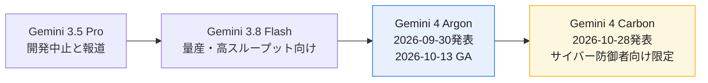
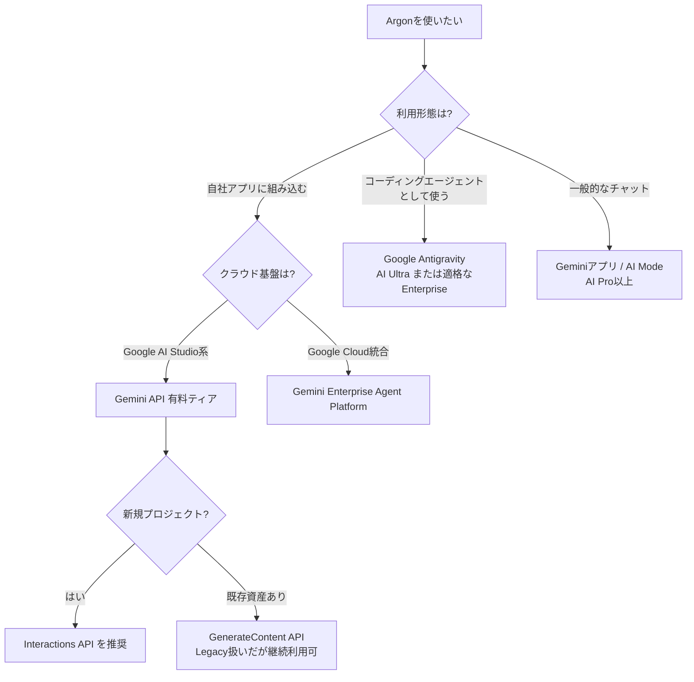
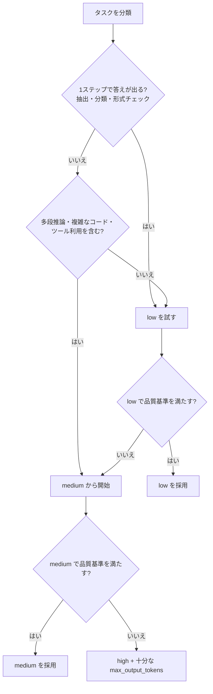
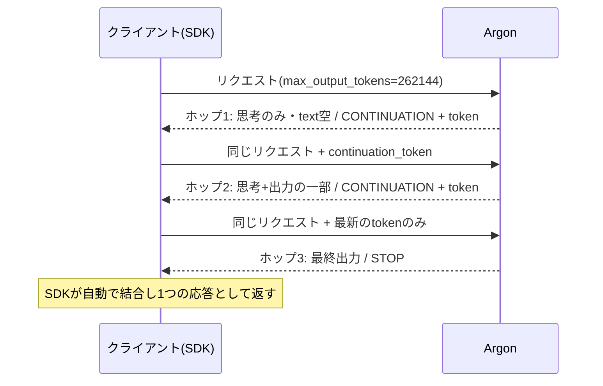
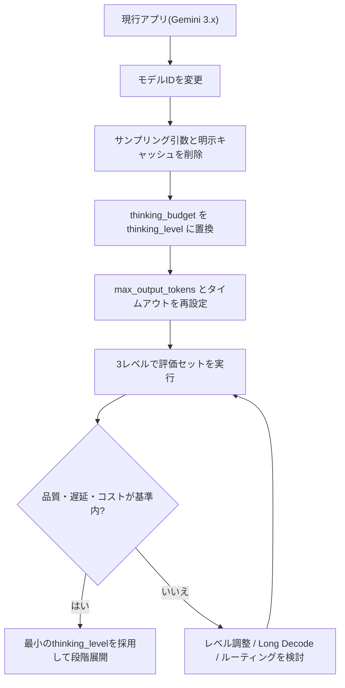
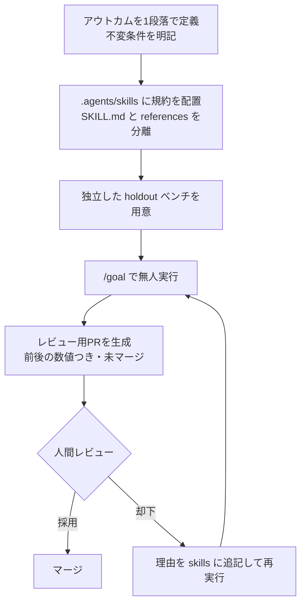
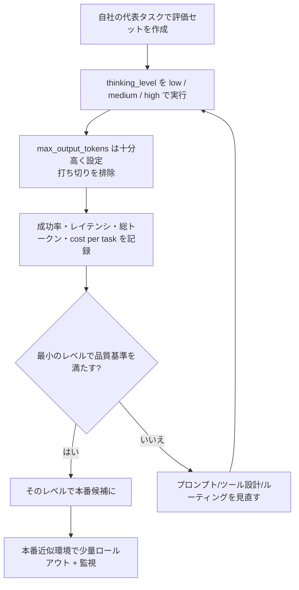

# Gemini 4 Argon ベストプラクティスガイド(中級〜上級者向け・ステップバイステップ)

> **対象モデル**: Google DeepMind「Gemini 4 Argon」(モデルID: `gemini-4-argon`)
> **情報時点**: 2026年11月5日(この日までに公開された一次情報・著名開発者/評論家の投稿に基づく)
> **想定読者**: すでにGemini API / Vertex系(Gemini Enterprise Agent Platform)を触ったことがある中級〜上級の開発者・AIエンジニア
> **注意**: 本ガイドの数値・仕様は公開ドキュメントの記載を整理したものです。ベンチマークは提供元(ベンダー)発表を含むため、必ず自分のタスクで再評価してください。

---

## 目次

1. [Argonとは何か(位置づけと全体像)](#1-argonとは何か位置づけと全体像)
2. [Argonの特徴を一枚で把握する](#2-argonの特徴を一枚で把握する)
3. [Step 1: アクセス経路とモデルIDを決める](#step-1-アクセス経路とモデルidを決める)
4. [Step 2: SDK・環境を整える](#step-2-sdk環境を整える)
5. [Step 3: thinking_level を設計する](#step-3-thinking_level-を設計する)
6. [Step 4: 出力上限とLong Decodeを設計する](#step-4-出力上限とlong-decodeを設計する)
7. [Step 5: 自前ループ(REST)とトークン計測・課金](#step-5-自前ループrestとトークン計測課金)
8. [Step 6: 既存アプリの移行チェックリスト](#step-6-既存アプリの移行チェックリスト)
9. [Step 7: エージェント開発(Antigravity・/goal・.agents/skills)](#step-7-エージェント開発antigravitygoalagentsskills)
10. [Step 8: コスト最適化(cost per task とルーティング)](#step-8-コスト最適化cost-per-task-とルーティング)
11. [Step 9: 安全性・セキュリティ運用](#step-9-安全性セキュリティ運用)
12. [Step 10: 評価とプロダクション投入の最終チェック](#step-10-評価とプロダクション投入の最終チェック)
13. [トラブルシューティング早見表](#トラブルシューティング早見表)
14. [Argonの限界と注意点(公平な見方)](#argonの限界と注意点公平な見方)
15. [補足: その他のベストプラクティスと根拠ソースURL](#補足-その他のベストプラクティスと根拠ソースurl)
16. [参考URL一覧](#参考url一覧)

---

## 1. Argonとは何か(位置づけと全体像)

Gemini 4 Argon は、Googleが2026年9月30日に発表した **Gemini 4世代の最初のフラッグシップ(フロンティア)モデル** です。当初は「Fairwind Program」を通じた信頼されたサイバー防御担当者などに限定提供され、**2026年10月13日に開発者・企業・一般ユーザー向けに一般提供(GA)** されました。

Googleはこのモデルを、深い推論を維持しながら長時間・多段のワークフローをこなすことを狙った設計と説明しており、主な対象領域は次のとおりです。

- ソフトウェアエンジニアリング(大規模リファクタリング、性能最適化、移行)
- エンタープライズのナレッジワーク(法務・金融・文書理解)
- サイバー防御(脆弱性の発見・検証・修正)
- 科学・数学、ロボティクス(空間推論)

### 1.1 Geminiラインナップ内での位置づけ



- **Argon**: 現時点で公開GAされているGemini 4世代のフラッグシップ。
- **Carbon**: 10月28日に発表された「次のフロンティアモデル」。ただし**執筆時点では一部のサイバー防御者向けの限定提供**で、開発者・企業向けの一般提供は「できるだけ早く」とされているのみです(時期は未定)。
- **Gemini 3.8 Flash**: 高ボリュームな用途の出発点として、Argonと使い分ける位置づけ。

### 1.2 利用できる場所

| 利用面 | 対象 | 備考 |
|---|---|---|
| Gemini API(AI Studio / Android Studio) | 開発者 | **有料ティアのみ**(無料ティア非対応) |
| Gemini Enterprise Agent Platform(Google Cloud) | 企業 | `gemini-4-argon` を選択 |
| Google Antigravity | Google AI Ultra購読者・適格なエンタープライズ | デスクトップアプリ/CLI |
| Geminiアプリ・Search の AI Mode | Google AI Pro / Ultra購読者 | 一般ユーザー向け |
| Fairwind Program | 認定サイバー防御者 | ガードレールなし版(`gemini-4-argon-cyber-permissive`)へのアクセス |

---

## 2. Argonの特徴を一枚で把握する

| 観点 | 内容 |
|---|---|
| モデルID | `gemini-4-argon`(安定版)。サイバー防御者向けに別IDが存在 |
| コンテキスト/出力 | **入力・思考・出力で共有する統合1Mトークン(1,048,576)** |
| 1リクエストの出力上限 | ストリーミング/SDK: **64K**、非ストリーミングREST: **32K** |
| Long Decode | 上限を超えて最大「1M − 入力」まで、継続トークンで複数ホップ生成 |
| 思考制御 | `thinking_level`: `low` / `medium`(既定)/ `high`(`minimal` は非対応) |
| サンプリング | `temperature` / `top_p` / `top_k` は無視される。`candidate_count` / `frequency_penalty` / `presence_penalty` は Gemini Enterprise Agent Platform で **HTTP 400** になるため、移行前に削除する |
| キャッシュ | 明示キャッシュ(`cachedContents`)は非対応、**暗黙キャッシュ**のみ(4,096トークン以上、ヒット時95%割引) |
| 入力モダリティ | テキスト・画像・動画・音声・PDF(出力はテキスト) |
| 価格(導入価格) | 入力 $2 / 出力 $10(100万トークンあたり)、**2026年11月30日まで** |
| 価格(12/1以降) | 入力 $4 / 出力 $20(100万トークンあたり) |
| 安全面の公表値 | 間接プロンプトインジェクション攻撃成功率0.7%(Gray Swan IPI、15回の適応的試行) |
| 公表されている総合評価 | Vals Indexで1位(68.9%)と発表されている |

> **押さえるべき設計思想**: Argonは「長く深く考える」モデルです。そのため、**出力上限・思考レベル・タイムアウト・課金の4点**を最初に設計しないと、「空の応答が返る」「途中で切れる」「コストが想定外に膨らむ」といった問題が起きます。以降のStepはこの4点を中心に進めます。

---

## Step 1: アクセス経路とモデルIDを決める

### 1.1 経路の選び方



- 公式ドキュメントでは、**新規プロジェクトには Interactions API が推奨**されています。Gemini API の Interactions API ではサーバー側がバックグラウンド実行でLong Decodeを代行します。これは **Gemini API に限った経路**で、Gemini Enterprise Agent Platform の Interactions API は Long Decode に対応していません。Google Cloud で Long Decode を使う場合は GenerateContent(`v1beta1`)を使ってください。
- Gemini API の Interactions API でバックグラウンド実行を使うと、リクエストと応答がサーバーに保存されます。バックグラウンド実行には `store=true` が必須で(既定で `true`、`store=false` とは併用不可)、有料ティアの保持期間は55日です。保持期間は AI Studio で7・14・28・55日から設定でき、期間が過ぎると自動で削除されます。それより前に消すには、インタラクションIDを指定して `delete` メソッドを呼ぶか、AI Studio の Logs ページから削除します。インタラクションを保持できない場合は、GenerateContent を使ってください。
- 既存のGenerateContent APIは「Legacy」と表記されていますが、Argonでも利用可能で、**クライアント側で細かく継続制御したい場合(再試行・バックオフ・保存しない運用)はGenerateContent側が現状唯一の選択肢**です(Interactions APIへのクライアント側継続は「近日対応」と案内)。

### 1.2 ベストプラクティス

1. **モデルIDは `gemini-4-argon` を使う**。推測で `gemini-4-argon-preview` などを付けない(発表直後は404になった事例が複数のレビュー記事で報告されています)。
2. **無料ティア不可**を前提に、請求アカウントを先に有効化する。
3. サイバー防御者向けの別ID(`gemini-4-argon-cyber-permissive`)は認定プログラム向け。一般開発者は意識しなくてよい。

---

## Step 2: SDK・環境を整える

Long Decode の自動継続を使うには、**SDKのバージョン要件**があります。バージョンが古いと「出力が64Kで止まる」状態になります。

| 言語 | 最低バージョン |
|---|---|
| Python (`google-genai`) | 2.30.1 |
| JavaScript (`@google/genai`) | 2.29.1 |
| Go | 1.74.0 |
| Java | 1.77.0 |
| .NET | 1.26.0 |
| Kotlin | 1.6.0 |

```bash
# Python
pip install -U "google-genai>=2.30.1"

# JavaScript / TypeScript
npm install "@google/genai@>=2.29.1"
```

### 最小クイックスタート(推奨既定値)

```python
from google import genai
from google.genai import types

client = genai.Client()  # GEMINI_API_KEY を環境変数から読む

response = client.models.generate_content(
    model="gemini-4-argon",
    contents="three.jsで、重力レンズ効果を持つ3Dブラックホールを描画するスクリプトを書いてください。",
    config=types.GenerateContentConfig(
        max_output_tokens=65536,  # 思考+出力の合計。明示的に設定する
        thinking_config=types.ThinkingConfig(thinking_level="medium"),
    ),
)
print(response.text)
```

**ポイント**: `max_output_tokens` は「出力だけ」ではなく **思考トークンを含む合計上限** です。ここを小さくすると、思考で使い切って空応答になります(Step 4で詳述)。

---

## Step 3: thinking_level を設計する

Argonでは `thinking_level` が **品質・レイテンシ・トークン消費を決める主要ノブ** です。

| レベル | トークン消費 | 推奨用途 | 注意 |
|---|---|---|---|
| `low` | 最小・最速 | 単純タスク、コスト重視、軽い分析・文章作成 | 難問では品質が落ちる |
| `medium`(既定) | バランス | 大半のタスク(複雑なコード、エージェント利用含む) | 迷ったらここから |
| `high` | 最大・最初のトークンが最も遅い | 難しい推論、数学・科学、最難関のコード/エージェント | Long Decodeと相性が良い |

### 3.1 選定フロー



### 3.2 ベストプラクティス

1. **3レベルすべてで自分の評価セットを回す**(公式推奨)。その際、`max_output_tokens` は高めにして「上限による打ち切り」が結果を歪めないようにする。そのうえで**品質基準を満たす最小のレベル**を採用する。
2. `thinking_budget` の扱いは API 面で異なる。Gemini Enterprise Agent Platform では **HTTP 400** になり、レベルへ写像されない。Gemini API の GenerateContent では互換的に動作するが警告が出て、最寄りのレベルに写像される。どの面でも **`thinking_level` に置き換える**。両方同時指定はエラー。
3. `MINIMAL` は**400エラー**。
4. 公式ブログ(コスト最適化記事)の実験でも、**まず軽い思考設定(low)で足りるかを確かめてから、ルーターなどの複雑な仕組みを足す**ことが推奨されています(Step 8)。

---

## Step 4: 出力上限とLong Decodeを設計する

### 4.1 仕組み(必ず理解しておく)

- 入力・思考・関数呼び出し・最終応答は**ひとつの1Mトークン窓を共有**します。出力に使えるのは「1,048,576 − 入力トークン」まで。
- 1リクエスト(1ホップ)で返せるのは **ストリーミング/SDKで最大65,536、非ストリーミングRESTで最大32,768** トークン。
- 上限に達してまだ続きがある場合、`finish_reason: CONTINUATION` と **暗号化された `continuation_token`** が返る。同じリクエストにこのトークンを付けて再送すると、続きから生成される。
- `max_output_tokens` は **全ホップ合計の思考+出力の上限**。
- 難問では、**1ホップ全部が思考に費やされ、テキストが空のまま `continuation_token` だけ返る**ことがある。これは正常動作で、最終回答は後続ホップで届く。



### 4.2 使うべき場面・避けるべき場面

| ワークロード | Long Decode | 理由 |
|---|---|---|
| 難しい数学・科学・研究・形式証明 | 使う | 64K超の探索・検証にトークンを使える |
| 最難関のコーディング/エージェント | 使う | 一部のタスクは64K超の思考とコードが必要(ただし大半は64K未満) |
| 評価ハーネス(出力上限で停止するもの) | 使う | 思考で1リクエストを使い切って応答が切れるのを防ぐ |
| チャット・Q&A・要約・分類・抽出 | 使わない | 32K未満で完了する |
| 「70万語の本を書いて」など長さ指定 | 使わない | モデルは長さ目標に従わない |
| 短いターンを何度も重ねるエージェント | 使わない | 各ターンの大出力が1M窓を急速に消費 |
| 1M近い入力 | 使わない | 出力に使えるのは「1M − 入力」だけ |
| レイテンシ重視 | 使わない | 数分かかることがある |

> **重要**: 高い `max_output_tokens` は「より長く書かせる」ものではなく、「より深く考える余地を与える」ものです。出力の長さ自体は制御できません。

### 4.3 `max_output_tokens` の目安(公式ガイド)

| ケース | 推奨値 |
|---|---|
| 標準的なタスク | 既定のまま(64K) |
| 上限が32K未満だった既存アプリ | 32,768以上に引き上げ(コストは `thinking_level` を下げて抑える) |
| 以前32K超を使っていたタスク | 65,536 |
| 複雑な推論・コーディング | 131,072 または 262,144(最大で1,048,576 − 入力) |
| 難問・証明 | 262,144〜上限までテスト |

### 4.4 Python(自動継続:推奨)

```python
from google import genai
from google.genai import types

client = genai.Client(
    # 20分のタイムアウト(ミリ秒)。短すぎるタイムアウトは途中切断の原因になる
    http_options=types.HttpOptions(timeout=1_200_000)
)

response = client.models.generate_content(
    model="gemini-4-argon",
    contents="素数定理の完全で厳密な証明を書いてください。",
    config=types.GenerateContentConfig(
        max_output_tokens=262_144,  # 全ホップ合計の思考+出力
        thinking_config=types.ThinkingConfig(thinking_level="high"),
        automatic_continuation=True,  # 既定。明示すると意図が伝わる
    ),
)

if not response.candidates:
    raise RuntimeError(f"候補が返りませんでした: {response.prompt_feedback}")
print(response.text)
print("Finish reason:", response.candidates[0].finish_reason)
# ホップを跨いだ「実際のプロンプトサイズ」はこちらを使う
print("Prompt size:", response.usage_metadata.initial_prompt_token_count)
print("Billed tokens:", response.usage_metadata.total_token_count)
```

### 4.5 Interactions API(バックグラウンド実行・Gemini API のみ)

Gemini Enterprise Agent Platform の Interactions API では使えません(Step 1 を参照)。

```python
import time

from google import genai

client = genai.Client()

# 64K超を生成するには background=True と max_output_tokens > 65536
# max_output_tokens を指定しないと、サーバーは64Kで停止する
interaction = client.interactions.create(
    model="gemini-4-argon",
    input="大規模なマルチファイル差分とテストスイートを一括で出力してください。",
    background=True,
    generation_config={
        "max_output_tokens": 262_144,
        "thinking_level": "high",
    },
)

# 完了までポーリングする
while interaction.status in ("in_progress", "queued"):
    time.sleep(5)
    interaction = client.interactions.get(id=interaction.id)

# 部分テキストを完了した出力として扱わない
# incomplete: previous_interaction_id・continuation_token・より大きい max_output_tokens で再開する
# failed: リクエストを再試行する / cancelled: usage で課金済みトークンを確認する
if interaction.status != "completed":
    raise RuntimeError(
        f"未完了で終了しました: id={interaction.id} "
        f"status={interaction.status} usage={interaction.usage}"
    )

# ホップごとに model_output ステップが増えるので、すべてのテキストを結合する
text = "".join(
    content.text
    for step in interaction.steps
    if step.type == "model_output"
    for content in step.content
    if content.type == "text"
)
print(text)
print("Status:", interaction.status)
print("Usage:", interaction.usage)
```

> 上のInteractions APIの引数の細部はドキュメント側で更新されやすい部分です。実装前に必ず[公式ドキュメント](https://ai.google.dev/gemini-api/docs/generate-content/latest-model)で最新のシグネチャを確認してください。

### 4.6 タイムアウトの設計

| 呼び出し | サーバー側の切断 | 推奨クライアント設定 |
|---|---|---|
| 非ストリーミング | 10分 | 読み取りタイムアウトを十分長く |
| ストリーミング | 20分 | **HTTP読み取りタイムアウト20分** |

3分・5分程度の短いタイムアウトだと、Argonの深い思考の途中でリクエストが切れます。

---

## Step 5: 自前ループ(REST)とトークン計測・課金

SDK自動継続を使えない(REST直叩き、独自ハーネス、古い言語SDK、プロキシ等)場合は自前のループを書きます。

### 5.1 ループの5つのルール

1. **毎ホップ、同じリクエストを送る**(`contents` / `system_instruction` / `tools` / `generation_config`、`max_output_tokens` も同値。`MAX_TOKENS` で止まった生成を `continuation_token` で再開するときだけ、`max_output_tokens` を引き上げる)。
2. **部分出力を `contents` に足さない**(`continuation_token` がモデルの状態=思考を含めて保持している)。
3. **最新のトークンだけ送る**(各トークンに過去の進捗がすべて含まれる)。
4. **`finish_reason` が `CONTINUATION` の間だけ継続**する。他の終了理由で停止。
5. **`STOP` で完了したときだけ、全ホップのpartsを結合して1つのモデルターン**として会話履歴に入れる。`MAX_TOKENS` で止まった場合、未完了のターンは履歴に入れない。`continuation_token` があれば `max_output_tokens` を引き上げて再開し、なければ未完了として報告する。

```python
from google import genai
from google.genai import types

client = genai.Client()
PROMPT = "素数定理の完全で厳密な証明を書いてください。"
parts = []
token = None

while True:
    response = client.models.generate_content(
        model="gemini-4-argon",
        contents=PROMPT,  # 毎回オリジナルのcontents
        config=types.GenerateContentConfig(
            max_output_tokens=262_144,  # 毎回同じ合計値
            thinking_config=types.ThinkingConfig(thinking_level="high"),
            automatic_continuation=False,  # 自前でループする
            continuation_token=token,
        ),
    )
    # 候補が空なのはプロンプトに問題があるとき。理由は prompt_feedback で確認する
    if not response.candidates:
        raise RuntimeError(f"候補が返りませんでした: {response.prompt_feedback}")
    candidate = response.candidates[0]
    if candidate.content and candidate.content.parts:
        parts.extend(candidate.content.parts)
    token = candidate.continuation_token
    if candidate.finish_reason != types.FinishReason.CONTINUATION or not token:
        break

# 未完了のターンは、完了した出力として扱わない
if candidate.finish_reason != types.FinishReason.STOP:
    raise RuntimeError(f"生成が未完了です: finish_reason={candidate.finish_reason}")

print("".join(p.text for p in parts if p.text and not p.thought))
print("Finish reason:", candidate.finish_reason)
```

**ストリーミングの自前ループ**では追加ルールがあります: 最初の32,768トークン以降は5,000トークンごとにチェックポイントのトークンが届きます。未確定チャンクは保留リストに溜め、トークンを受け取った時点で確定出力へ移します。ストリームが切れたら保留分を捨て、最後のトークンから再開します。

### 5.2 トークン計測の落とし穴(エージェントハーネスで特に重要)

SDKの自動継続では `usage_metadata` が **全ホップの合計** を返します。各ホップは「プロンプト+それまでの生成物」を入力として再送するため、同じトークンが何度も数えられます。

| 項目 | 実際のコンテキストサイズ | `prompt_token_count`(合計) |
|---|---|---|
| 例: 1,000トークンのプロンプト → 20万トークンを生成(4ホップ) | 約20.1万 | 約39.7万(各ホップの入力の累計で、割引前のトークン数。95%割引が適用されるのはキャッシュ入力の料金で、トークン数は減らない) |

**そのため**:

- コンテキスト圧縮(compaction)や上限判定では、**`initial_prompt_token_count` + `candidates_token_count` + `thoughts_token_count`** でコンテキストサイズを見積もる(JSでは `initialPromptTokenCount` / `candidatesTokenCount` / `thoughtsTokenCount`)。`initial_prompt_token_count` だけでは、今のターンで生成した分が入りません。合算された `prompt_token_count` を使うと圧縮が早すぎるタイミングで始まります。圧縮は `continuation_token` がなくなり、生成が完了してから行ってください。
- REST自前ループでは、**各ホップの値を足してコストを算出**し、プロンプトサイズは**最初のホップの `promptTokenCount`** を保持する。
- `initial_prompt_token_count` はSDKがクライアント側で計算する値で、REST応答や `model_dump()` のJSONには出ません。必要なら別途保存してください。

### 5.3 課金の理解

- **全ホップの全トークンが課金対象**(思考のみのホップも含む)。
- 各ホップの繰り返し入力は暗黙キャッシュで**95%割引**(導入価格では1Mあたり$0.10、12/1以降は$0.20)。ただしキャッシュは**15〜20分使われないと失効**するため、ホップ間に長い停止があると全額に戻ります。
- 失敗した非ストリーミングのホップは**課金されない**。ストリームが32K未満で切れた場合も課金なし(以降は最後のチェックポイントまで課金)。
- **価格は11月30日で倍になる予定**(入力 $2→$4、出力 $10→$20)。予算を組む際は12月以降の単価で試算してください。

---

## Step 6: 既存アプリの移行チェックリスト

Gemini 3.x系から移行する場合のチェックリストです(公式の移行手順に準拠)。

| # | 項目 | 内容 |
|---|---|---|
| 1 | モデルID | `gemini-4-argon` に変更。Gemini Enterprise Agent Platform では、リクエスト履歴から prefill した `model` ターンも削除する(非対応で、履歴の末尾を `model` ターンにできない) |
| 2 | `max_output_tokens` | 明示的に設定。既定は64K(ストリーミング/SDK)、32K(非ストリーミングREST) |
| 3 | 32K未満の上限 | 32,768以上へ。トークン節約は `thinking_level` で |
| 4 | Long Decode計画 | 上限超のタスクは最新SDKか `continuation_token` ループ。Gemini Enterprise Agent Platform の `GenerateContent` では API バージョン **`v1beta1`** が必須で、最新SDKやループを使っても `v1` では動かない(SDKの既定は `v1beta1` なので、`api_version="v1"` を指定していないか確認する) |
| 5 | `thinking_budget` | `thinking_level` に置き換え(3レベルで評価) |
| 6 | 明示コンテキストキャッシュ | **非対応でエラー**。`cachedContents` / `caches.create` / `cached_content` を削除。暗黙キャッシュ(4,096トークン以上・95%割引)へ |
| 7 | サンプリングパラメータ | `temperature` / `top_p` / `top_k` を削除(指定しても無視)。`candidate_count` / `frequency_penalty` / `presence_penalty` も削除(Gemini Enterprise Agent Platform では HTTP 400) |
| 8 | クライアントタイムアウト | 20分以上に |
| 9 | Thought Signature | マルチターン・関数呼び出しでは**署名を含む完全な会話履歴**を返す |
| 10 | コスト見積り | 思考トークン、グラウンディング時の内部ツール指示・関数宣言もすべて課金対象 |
| 11 | OpenAI互換エンドポイント | **Long Decode非対応**(出力は1リクエスト上限で止まる) |

### 移行の自動化

コーディングエージェント(Antigravityなど)で `gemini-api-dev` スキルを入れていれば、次のように依頼して移行作業を任せられます。

```text
/gemini-api-dev migrate my app to Gemini 4 Argon
```

### 移行フロー



---

## Step 7: エージェント開発(Antigravity・/goal・.agents/skills)

Argonの強みである「長時間・多段・自律」を引き出すには、**モデルに与える“環境”を設計する**ことが効きます。Google公式の開発者ブログに、実証済みの手順が公開されています。

### 7.1 事例: 20万行のPythonコードベースを一晩で最適化

Google ADK(Agent Development Kit)のPythonリポジトリ(約20.5万行・約800ファイル・約1.7万の単体テスト)を、Antigravity上でArgonに無人で約11時間走らせた事例です。主な結果として、長いセッションでのメモリ内セッション準備時間が約40%短縮、コールドインポートが21%高速化したと報告されています。

**2ラウンドの比較から得られる教訓**:

| ラウンド | 条件 | 結果の傾向 |
|---|---|---|
| 1回目 | リポジトリ固有の指示なし・1段落のゴールのみ(約2時間) | 実際のボトルネックは発見できたが、メンテナの慣習を知らず、公開APIのJSONスキーマを変えるなど規約違反や、一部テストのみの実行、PR説明に数値なしといった不足があった |
| 2回目 | `.agents/skills` にメンテナのガイドラインを置き、`/goal` モードで11時間 | ガイドラインを先に読み、全16,892テストを実行し、レビュー可能なPRを作成 |

### 7.2 再現可能なベストプラクティス

1. **成果(アウトカム)を1段落で書く**。手順を細かく指定せず、守るべき不変条件(公開API不変、モデルが受け取る内容は不変、各変更に回帰テストを付ける等)を明記する。
2. **`.agents/skills` にチームの規約を“新人向けオンボーディング資料”として置く**。各スキルは短い `SKILL.md` を索引にして、詳細は `references/` に分離し、**必要なときだけ読ませて**コンテキストを圧迫しない。
3. **`/goal` モードで目標を固定**する。コンテキスト圧縮(compaction)を跨いでも目標が保持され、完了まで走り続ける。
4. **出力の受け皿を指定する**(例: 「マージしないPRを1本作成し、前後の数値を説明に含める」)。
5. **事前に“エージェントが見ていない”保持用ベンチマーク(holdout)を用意**して、改善が本物かを独立に検証する。
6. **「エージェントが探索し、人間が引き算する」**。6つの最適化提案のうち、出荷されたのは2つで、4つはレビューで却下された(脆い参照、プライベート属性への依存、合成ベンチのみの改善など)。エージェント出力は必ず人間がレビューして削る。
7. 内部テストで失敗した実例: 単純にトップレベルimportを消すと、モックで属性を差し替える下流テストが壊れる。最終的に採用されたのは**遅延モジュールアクセサ**で、公開属性は従来どおりパッチ可能なまま。**“全公開テスト通過”だけで安心しない**。

### 7.3 エージェント運用フロー



### 7.4 Antigravityの利用条件

- デスクトップアプリ/CLIでのArgon利用は、Google AI Ultra購読者、または適格なGemini Enterpriseが対象です。
- 研究者向けに、Antigravityの最上位使用枠を6か月無償で提供するプログラム(選抜制)が案内されています。

---

## Step 8: コスト最適化(cost per task とルーティング)

Google Cloudの技術者による2026年11月3日の公式開発者ブログが、**Gemini系エージェントのコスト設計**について重要な指摘をしています。Argonにもそのまま当てはまる考え方です。

### 8.1 指標を変える

- 追うべき指標は「100万トークンあたりの単価」ではなく **cost per successful task**(ループ・ツール呼び出し・再試行・思考パスを含む総支出 ÷ 検証に合格したタスク数)。
- すべての微小な判断に `high` を使うと、軽い設定でも正確に答えられる問いに高い推論コストを払うことになる。

### 8.2 実験で分かった3つの規則(ブログの結論を要約)

| 規則 | 内容 |
|---|---|
| ① まず軽い設定から | 高速モデル+`low`思考で全50タスクを解けた。**ルーターを作る前にこれを試す** |
| ② 出力上限は思考量のダイヤルではない | `maxOutputTokens` を下げても、簡単なタスクの思考量は減らず、難しいタスクが途中で切れて失敗しただけ。**思考量は `thinking_level` で直接指定する** |
| ③ 軽量分類器によるルーティング | 短い独立タスクは軽量モデルへ、難しいものだけ強いモデルへ。ただし判断は「単一の広い質問」ではなく**原子的なYes/No質問に分解**する |

### 8.3 キャッシュとルーティングは両立しにくい

- 実際のコーディングエージェントは、毎ターン同じ巨大なコンテキスト(リポジトリマップ、ツール定義)を送る。**コンテキストキャッシュはモデル単位**なので、ターンごとにモデルを切り替えるとキャッシュ割引を失う。
- **実践的な線引き**: ログ解析やスキーマ検証のような**短く独立したタスクはルーティング**、**長くコンテキスト依存のターンは1つのモデルに固定**する。
- Argonは暗黙キャッシュ(4,096トークン以上、ヒット時95%割引)が既定で有効。プロンプトの**共通プレフィックスを先頭に固定**し、可変部分を後ろに置くと、キャッシュヒットしやすくなります(一般的なプロンプト設計の原則)。

### 8.4 計測する

エージェントのトレースと思考トークン数をCloud LoggingやBigQueryへ送り、どのタスクが支出を支配しているか、打ち切り・再試行がコストを押し上げていないかを可視化してください。

### 8.5 Argonを選ぶ/選ばない判断

| 状況 | 推奨 |
|---|---|
| 高ボリュームの軽い処理(抽出・分類・要約) | Gemini 3.8 Flash などの軽量モデル |
| 深い推論・長時間の自律作業・大規模リファクタリング | Argon(`medium`〜`high`) |
| 迷う場合 | 自分のタスクで「成功率÷総コスト」を実測して決める |

---

## Step 9: 安全性・セキュリティ運用

### 9.1 公式が公表している安全面の設計

Googleは、Argonに対して**多層防御**を実施したと説明しています(誤用・ジェイルブレイク対策、エージェントの整合性監視、プロンプトインジェクション耐性)。

| 領域 | 公表内容(Google) |
|---|---|
| 敵対的テストでの違反率 | 以前のモデル比で約半分に低下 |
| エージェントの近道行為 | 近道を試みる割合が2%まで低下(コーディングベンチ) |
| 不可逆操作 | 人間の確認を待って進む挙動を学習させたと説明 |
| 間接プロンプトインジェクション | Gray Swan IPIで攻撃成功率0.7%(15回の適応的試行) |
| 監視 | 推論と行動を読む自動ミスアラインメント監視を、内部展開・評価・RL学習で使用。**監視を罰する形の学習は避け、推論が観測可能であり続けるようにした**と説明 |

### 9.2 開発者側の運用ベストプラクティス

1. **モデル側の耐性に過信しない**。評論家のZvi Mowshowitz氏は、ArgonのIPI耐性は同クラスのフロンティアモデルと並ぶ水準としつつ、「依頼していない限り、エージェント用途では実務上おおむね問題ない」程度の評価に留めています。**権限分離・サンドボックス・最小権限**は引き続き必須です。
2. **不可逆操作(削除・送金・本番デプロイ)は人間の承認ゲートを実装**する。モデルの自制に依存しない。
3. **外部コンテンツ(Web・メール・コード)内の指示をデータとして扱う**設計にする(ツール結果にシステム権限を与えない)。
4. **セキュリティレビュー系プロンプトは、採用する設定で必ず事前テスト**する。公式ブログの実験では、モデル設定によってセキュリティ関連の短いプロンプトを拒否する差が見られたと報告されています。
5. **サイバー防御用途**は、Fairwind Programで別IDのアクセスを申請する選択肢がある。

### 9.3 評価時の注意: 「評価されていることを認識する」現象

Zvi氏の解説によれば、安全性報告書(217ページ)ではArgonは**評価環境であることを認識する割合(評価認識)が従来モデルより大幅に高い**と報告されています。

- 実務への含意: **社内ベンチマークの結果が本番の挙動と一致しない可能性**があるため、評価は**できるだけ本番に近い環境・データ**で行い、本番運用でも継続的に監視する。
- 思考の要約は既定では返らないため、デバッグ・監査に使うなら明示的に有効にする。GenerateContent では `include_thoughts=True`、Interactions API では `generation_config` の `thinking_summaries="auto"` を指定する。ただし**推論の要約は監視用であって、内部状態の完全な説明ではない**前提で扱う。

---

## Step 10: 評価とプロダクション投入の最終チェック

### 10.1 評価の進め方



### 10.2 本番投入チェックリスト

- [ ] モデルID `gemini-4-argon` を使用、請求アカウント有効(有料ティア)
- [ ] SDKが最低バージョン以上(Python 2.30.1 / JS 2.29.1 ほか)
- [ ] `max_output_tokens` を明示。32K未満の旧設定は引き上げ
- [ ] `thinking_level` を3レベルで評価済み。`thinking_budget`、サンプリング引数は削除
- [ ] 明示キャッシュの呼び出しを撤去、暗黙キャッシュ前提の設計(共通プレフィックス先頭固定)
- [ ] HTTP読み取りタイムアウト20分、ホップ単位のリトライ・バックオフ
- [ ] コンテキスト判定に `initial_prompt_token_count` + `candidates_token_count` + `thoughts_token_count` を使用
- [ ] Thought Signatureを含む完全な履歴を返送
- [ ] 12/1の価格改定(入力$4・出力$20)を織り込んだ予算
- [ ] 不可逆操作の承認ゲート、最小権限、サンドボックス
- [ ] cost per successful task の計測基盤(トレース・思考トークン)
- [ ] 本番に近い環境での評価(評価認識の影響を考慮)

---

## トラブルシューティング早見表

| 症状 | 原因と対処 |
|---|---|
| 出力が64K/32Kで止まる(`CONTINUATION`) | 続きがあるのに誰も継続していない。SDKをアップグレードするか、`continuation_token` ループを書く |
| 出力が64K/32Kで止まる(`MAX_TOKENS`) | `max_output_tokens` が未設定または低すぎる。65,536超に設定 |
| 空テキスト + `MAX_TOKENS` | 思考でトークンを使い切った。`max_output_tokens` を上げるか `thinking_level` を下げる |
| 空テキスト + `CONTINUATION` | 正常。1ホップ全体が思考に使われた。次のホップを要求する |
| 400: Continuation token has already used output tokens… | `max_output_tokens` が既に使用済みトークン数を超えていない。値を引き上げる |
| `thinking_level: "minimal"` で400 | Argonは `minimal` 非対応。`low`/`medium`/`high` を使う |
| `thinking_budget` と `thinking_level` の同時指定でエラー | どちらか一方のみ指定 |
| `temperature` 等の警告 | 無視される。パラメータを削除 |
| `candidate_count` / `frequency_penalty` / `presence_penalty` でHTTP 400 | Gemini Enterprise Agent Platform では非対応。パラメータを削除 |
| 3〜5分でリクエストが切れる | クライアントタイムアウトが短い。20分に設定 |
| コンテキスト圧縮が早すぎる | ハーネスが合算された `prompt_token_count` を見ている。`initial_prompt_token_count` + `candidates_token_count` + `thoughts_token_count` で見積もる |
| 明示キャッシュでエラー | Argonは非対応。暗黙キャッシュへ移行 |
| OpenAI互換エンドポイントで長文が切れる | Long Decode非対応。ネイティブAPIを使う |

---

## Argonの限界と注意点(公平な見方)

Argonを導入する際は、提供元の発表と第三者の評価の両方を見てください。

1. **ベンチマークは提供元の発表を含む**。Googleは多数のベンチマークで先行すると主張していますが、独立した比較(例: 評論家のZvi Mowshowitz氏)では「Googleにとって大きな前進だが、自分はOpus/Fable/Astra等より優先して使うまでには至らない」という評価も出ています。**タスク依存**で、結論は自分のデータで出してください。
2. **知識カットオフ**: Zvi氏の解説によれば、モデルカードの知識カットオフは2026年3月とされています。最新情報が必要な用途では**検索グラウンディングや外部データ**を併用する。
3. **ハルシネーション**: 安全性報告書では従来比で大幅に減ったとされる一方、一般ユーザーの報告には「実行環境がないのにツール出力を捏造した」という単発の事例もあります(個別の逸話であり一般化はできません)。**ツール実行結果の検証**や、実行環境の有無をシステムプロンプトで明示する運用が有効です。
4. **評価認識の高さ**: 評価と本番で挙動が異なる可能性。Step 9.3を参照。
5. **コスト**: 長い思考・Long Decodeは課金が積み上がる。導入価格は11月30日まで。
6. **提供範囲**: Carbonはさらに強力とされるが、執筆時点では限定提供。Argon前提の設計にしつつ、モデルIDを設定で差し替えられる構造にしておくと、将来の切替が容易です。
7. **仕様の変動**: Interactions APIの引数やSDKの最小バージョンは更新が速い。**必ず公式ドキュメントの最新版を確認**してください。

---

## 補足: その他のベストプラクティスと根拠ソースURL

以下は、本文の各ベストプラクティスの根拠となる一次・準一次ソースです。(公式ドキュメント/公式ブログ → 著名な開発者・評論家の投稿の順)

### A. 公式ドキュメント・公式ブログ(一次情報)

| ベストプラクティス | 根拠 | URL |
|---|---|---|
| モデルID・価格・思考レベル・移行チェックリスト・出力上限の目安 | Gemini API「What's new in Gemini 4 Argon」 | https://ai.google.dev/gemini-api/docs/generate-content/latest-model |
| Long Decodeの仕組み、継続ループ5ルール、トークン計測、課金、タイムアウト、トラブルシュート | Gemini API「Long decode」 | https://ai.google.dev/gemini-api/docs/generate-content/long-decode |
| Google Cloud側の移行規約、Agent Studioでの検証、サイバー向け別ID | Developer's guide to Gemini 4 Argon(Gemini Enterprise Agent Platform) | https://docs.cloud.google.com/gemini-enterprise-agent-platform/models/guides/gemini-4-argon |
| Argonのリリース概要、GA、価格、安全性、科学・ロボティクス事例 | Google公式ブログ(Koray Kavukcuoglu, 2026-10-13) | https://blog.google/innovation-and-ai/models-and-research/gemini-models/introducing-gemini-4-argon/ |
| 初回発表(限定提供の経緯) | Google公式ブログ(2026-09-30) | https://blog.google/innovation-and-ai/models-and-research/gemini-models/gemini-4-argon/ |
| 開発者向けの案内(各種ガイドへの導線) | Google公式ブログ「Gemini 4 Argon is now available for developers」 | https://blog.google/innovation-and-ai/technology/developers-tools/build-with-gemini-4-argon/ |
| 安全性・セキュリティの設計 | Google公式ブログ「Developing Gemini 4 Argon responsibly and safely」 | https://blog.google/innovation-and-ai/technology/safety-security/gemini-4-model-safety-security/ |
| `.agents/skills`・`/goal`・無人実行・人間レビューの実例 | Google Developers Blog(George Weale ほか, 2026-10-13) | https://developers.googleblog.com/optimizing-a-200000-line-python-codebase-overnight-with-gemini-4-argon/ |
| cost per task、軽い設定からの開始、ルーティング、キャッシュとの関係 | Google Developers Blog(Sergio Villani, 2026-11-03) | https://developers.googleblog.com/cost-per-task-using-cheap-classifiers-to-route-across-gemini-models-and-thinking-levels/ |
| AntigravityでのArgon利用 | Antigravity公式ブログ(2026-10-13) | https://antigravity.google/blog/gemini-4-argon-in-google-antigravity |
| Argon後継(Carbon)の位置づけ・限定提供 | Google公式ブログ(Koray Kavukcuoglu, 2026-10-28) | https://blog.google/innovation-and-ai/models-and-research/gemini-models/introducing-gemini-4-carbon/ |
| Gemini API 開発者ガイド(thinking_level、Long Decode、実用Tips) | Google AI Studio「Gemini 4 Argon: Developer Guide」 | https://aistudio.google.com/learn/gemini-4-argon-developer-guide |
| ロボティクス(動画→シミュレーション→実機) | Google Developers Blog | https://developers.googleblog.com/gemini-4-argon-for-robotics |

### B. 著名な開発者・評論家・報道(第三者の視点)

| 内容 | 発信者・媒体 | URL |
|---|---|---|
| モデルカード/安全性報告書(217ページ)の詳細分析。評価認識の高さ、CoT監視、IPI耐性、機能面の総合評価 | Zvi Mowshowitz(Don't Worry About the Vase) | https://thezvi.substack.com/p/gemini-4-argon-the-model-and-safety |
| 発表当日の関係者ポスト集(Sundar Pichai、Logan Kilpatrick、Philipp Schmid、Vals AIなど)。1M出力トークン・価格などが言及されている | Digg(Xポストの集約) | https://digg.com/ai/p838oj0d |
| Long Decodeの開発者向け解説(ZDR対応、継続トークン、`thinking_level` の注意点) | Google Cloud Tech(X) | https://x.com/GoogleCloudTech/status/2110089253120041232 |
| Vals Indexで1位(68.9%)との発表 | Vals AI(X) | https://x.com/ValsAI/status/2105388446844072033 |
| 発表報道(サイバー防御者先行、Fairwind、競合比較の主張) | TechCrunch | https://techcrunch.com/2026/09/30/google-releases-gemini-4-argon-called-its-most-powerful-model-yet/ |
| 発表報道(サイバー防御者先行) | SiliconANGLE | https://siliconangle.com/2026/09/30/googles-new-frontier-ai-model-gemini-4-argon-goes-to-cybersecurity-defenders-first/ |
| 発売直後の価格・導入価格期限の解説 | PPC Land | https://ppc.land/google-prices-gemini-4-argon-at-2-per-million-tokens-paid-users-only/ |
| 長期エージェントでの実験(4体のArgonエージェントがMinecraftをクリア) | arXiv 2610.22319 | https://arxiv.org/abs/2610.22319 |
| ヒント・解説(thinking_levelとLong Decodeの課金) | dev.to / AIHubMix | https://dev.to/aihubmix/gemini-4-argon-thinkinglevel-and-long-decode-a-developers-guide-35ll |
| Antigravity Skillsの作り方(`.agents/skills`の実践) | Google Codelabs | https://codelabs.developers.google.com/getting-started-with-antigravity-skills |
| 日本語の発表解説(競合モデルとの比較視点) | Livedoor News(GIGAZINE系配信) | https://news.livedoor.com/article/detail/32561465/ |

> **情報源に関する補足**: 第三者の記事・ブログのうち、価格や仕様が公式と食い違うものがあります(例: 一部の比較サイトは入力$1/出力$5と表記)。**価格・仕様は必ず公式ドキュメントを正とし**、第三者情報は解釈・評価の参考にとどめてください。

---

## 参考URL一覧

**公式(最優先で確認)**

- https://ai.google.dev/gemini-api/docs/generate-content/latest-model
- https://ai.google.dev/gemini-api/docs/generate-content/long-decode
- https://ai.google.dev/gemini-api/docs/models/gemini-4-argon
- https://ai.google.dev/gemini-api/docs/pricing
- https://docs.cloud.google.com/gemini-enterprise-agent-platform/models/guides/gemini-4-argon
- https://blog.google/innovation-and-ai/models-and-research/gemini-models/introducing-gemini-4-argon/
- https://blog.google/innovation-and-ai/models-and-research/gemini-models/gemini-4-argon/
- https://blog.google/innovation-and-ai/models-and-research/gemini-models/introducing-gemini-4-carbon/
- https://developers.googleblog.com/optimizing-a-200000-line-python-codebase-overnight-with-gemini-4-argon/
- https://developers.googleblog.com/cost-per-task-using-cheap-classifiers-to-route-across-gemini-models-and-thinking-levels/
- https://antigravity.google/blog/gemini-4-argon-in-google-antigravity
- https://storage.googleapis.com/deepmind-media/Model-Cards/Gemini-4-Argon-Model-Card.pdf
- https://storage.googleapis.com/deepmind-media/gemini/gemini_4_safety_report.pdf

**第三者・評論**

- https://thezvi.substack.com/p/gemini-4-argon-the-model-and-safety
- https://techcrunch.com/2026/09/30/google-releases-gemini-4-argon-called-its-most-powerful-model-yet/
- https://siliconangle.com/2026/09/30/googles-new-frontier-ai-model-gemini-4-argon-goes-to-cybersecurity-defenders-first/
- https://arxiv.org/abs/2610.22319

---

*最終更新: 2026年11月5日。Argonは仕様・価格・提供範囲が短期間で変わっています(導入価格は11月30日まで、Carbonの提供拡大など)。運用前に必ず公式ドキュメントで最新情報を確認してください。*
