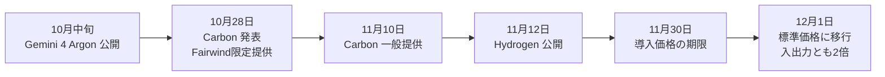
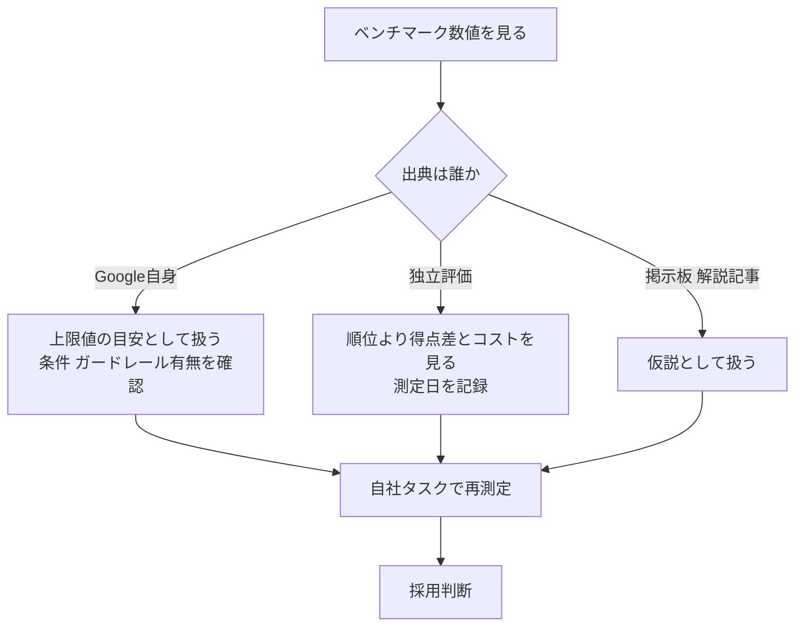
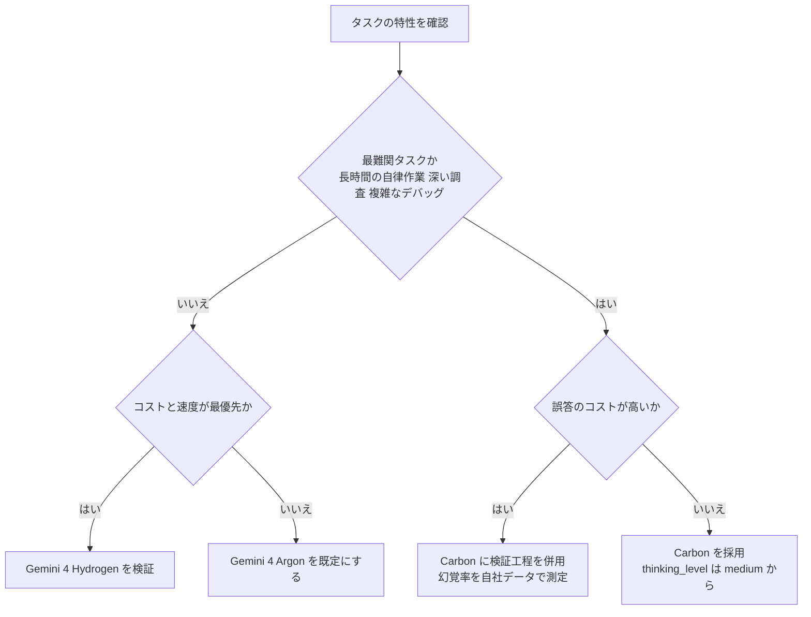
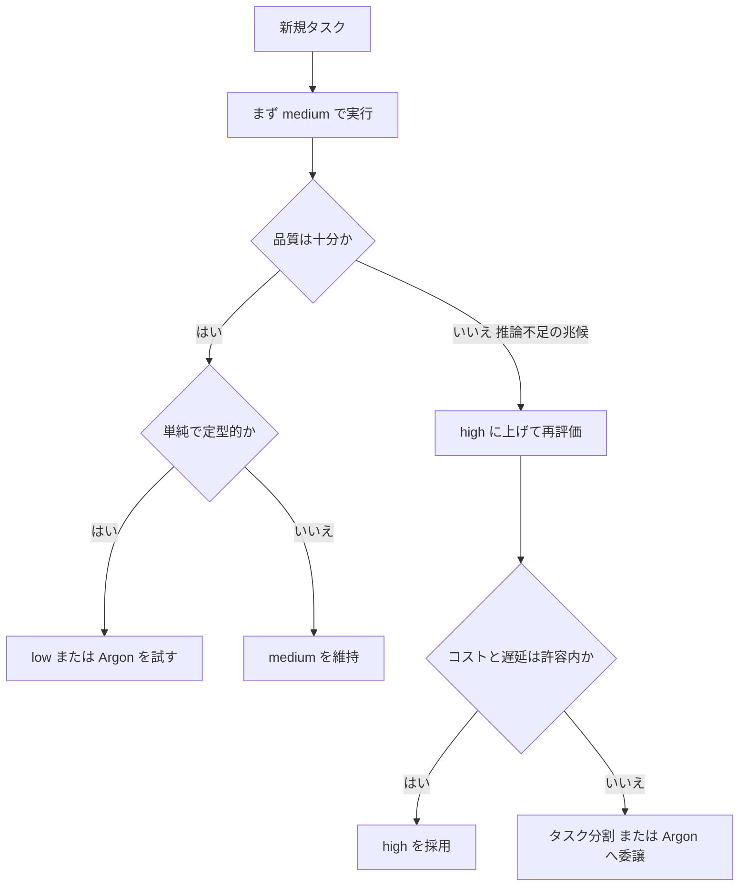
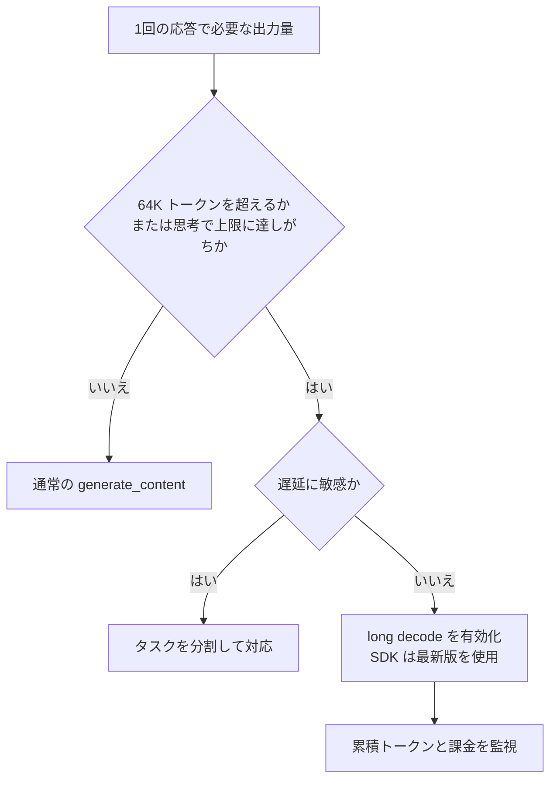
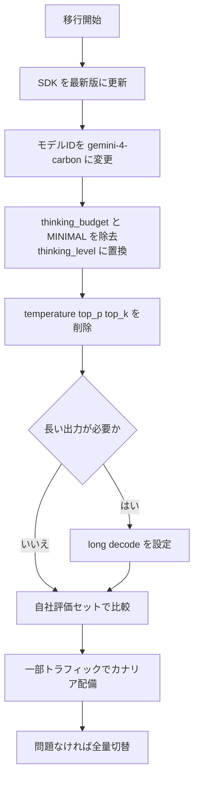
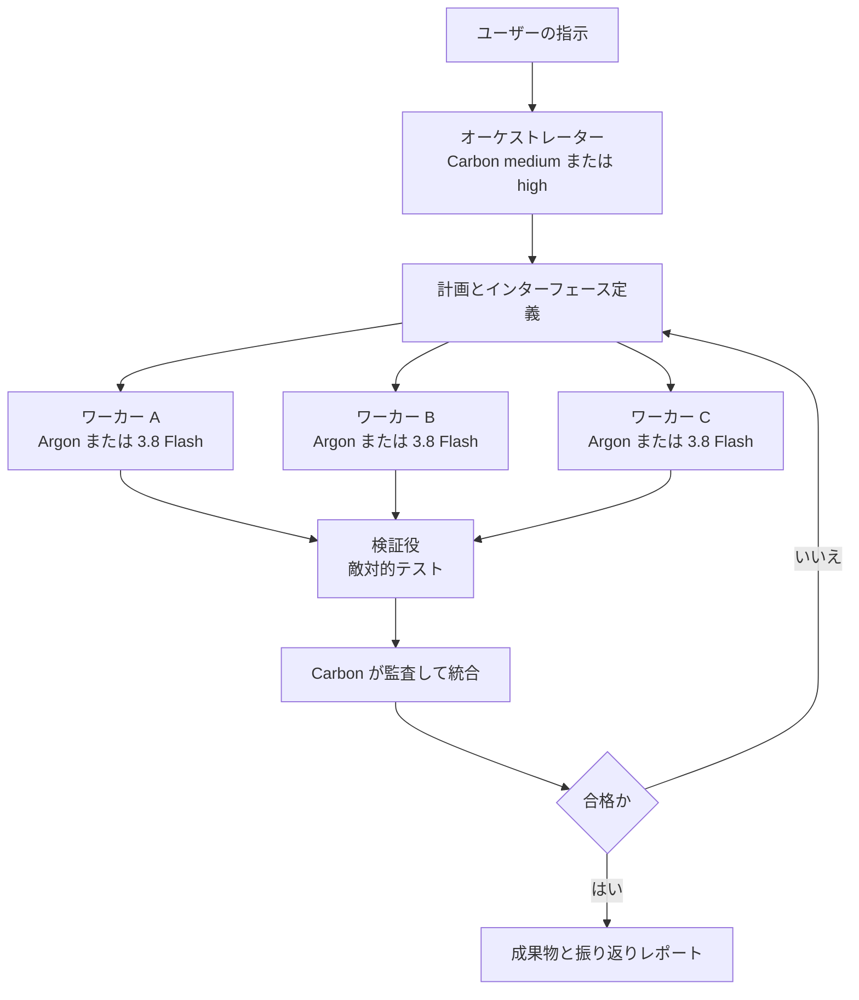
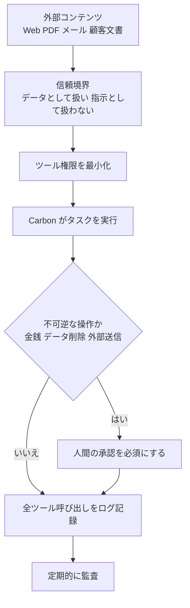
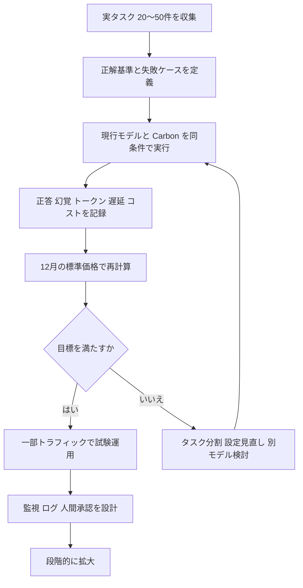

# Gemini 4 Carbon 完全ガイド（中級〜上級者向け）

> **対象**: Gemini API / Google AI Studio / Gemini Enterprise Agent Platform（旧 Vertex AI 系）でエージェントや業務自動化を作る中級〜上級の開発者
> **モデルID**: `gemini-4-carbon`
> **調査基準日**: 2026年11月14日（一般提供開始 11月10日から4日後）
> **読み方**: Step 1 から順に読むと「選ぶ → 呼ぶ → 調整する → 移行する → 運用する」の流れで理解できます。各主張の末尾の `[S番号]` は、末尾「16. 補足」のソース一覧に対応します。

---

## 目次

1. [Carbonの位置づけ](#1-carbonの位置づけ)
2. [仕様と料金と提供面](#2-仕様と料金と提供面)
3. [性能をどう読むか](#3-性能をどう読むか)
4. [モデル選定](#4-モデル選定)
5. [最初のAPI呼び出し](#5-最初のapi呼び出し)
6. [thinking_levelの設計](#6-thinking_levelの設計)
7. [長い出力と長時間タスク](#7-長い出力と長時間タスク)
8. [Argonや3.xからの移行手順](#8-argonや3xからの移行手順)
9. [長期タスクのプロンプト設計](#9-長期タスクのプロンプト設計)
10. [マルチエージェント構成](#10-マルチエージェント構成)
11. [コストとレイテンシの最適化](#11-コストとレイテンシの最適化)
12. [セキュリティと信頼性](#12-セキュリティと信頼性)
13. [評価と本番導入の手順](#13-評価と本番導入の手順)
14. [よくある落とし穴](#14-よくある落とし穴)
15. [まとめ](#15-まとめ)
16. [補足 ベストプラクティスと根拠ソース](#16-補足-ベストプラクティスと根拠ソース)

---

## 0. この記事の信頼度ラベル

発表から日が浅いため、情報源ごとに信頼度が違います。本文では次のラベルを使います。

| ラベル | 意味 | 扱い方 |
|---|---|---|
| **公式** | Google / DeepMind / Google Cloud のブログ・ドキュメント | 仕様・料金・API挙動の根拠にする |
| **開発者発信** | 著名な開発者本人の投稿（Philipp Schmid、Simon Willison など） | 実運用の勘所として参考にする |
| **独立評価** | Artificial Analysis など第三者のベンチマーク | 公式数値と必ず突き合わせる |
| **二次情報** | 解説記事・まとめ・掲示板の報告 | 仮説として扱い、自社環境で再現する |

> **注意**: 順位や速度の数値は発表後も更新されます。本ガイドの数値は2026年11月14日時点の観測値です。意思決定の前に各ソースで再確認してください。

---

## 1. Carbonの位置づけ

Gemini 4 Carbon は、Google が「最も強いモデル」と位置づける Gemini 4 ファミリーの最上位です。コーディング、金融、法務、サイバーセキュリティ、科学といった複雑な実務で「深く掘る」仕事を想定しています [S5][S6]。

### 1.1 Gemini 4 ファミリーの役割分担

| モデル | 位置づけ | 向く仕事 |
|---|---|---|
| **Gemini 4 Carbon** | 最上位。最難関タスク向け | 複雑なデバッグ、長時間の自律エンジニアリング、研究、深い調査 [S2] |
| **Gemini 4 Argon** | 大半の業務の標準 | 一般的なソフトウェア開発とナレッジワーク。応答が速く、1ターンあたりのトークン消費が少ない [S2][S12] |
| **Gemini 4 Hydrogen** | 最も低コスト | 日常的なコーディングと軽量なエージェント作業（11月12日公開）[S12][S19] |

Google は「Argon は大半の開発・業務に最適、Carbon は限界に挑むタスク向けで、より多くのトークンを使って徹底的に探索し検証ループを回す」と説明しています [S2]。つまり **Carbon は「常に最強だから使う」モデルではなく、「難しい仕事にだけ投入する」モデル** です。

### 1.2 リリースの流れ



- 10月28日に発表された時点では、サイバー防御チーム向けの **Fairwind Program** 経由に限定されていました [S1]。
- 11月10日に開発者・企業・研究者・消費者へ拡大されました [S2]。
- 導入価格は **2026年11月30日まで** で、12月1日から2倍になります [S2][S11]。

### 1.3 Carbon の「強み」を3行で

1. **長期（ロングホライズン）の自律作業**: Google社内では、数日にわたり行き詰まりを乗り越えて大規模コードベースの根本原因を特定・修正する事例が報告されています [S1]。
2. **サイバーセキュリティ**: 脆弱性の発見・悪用検証・修正の各段階で最先端の成績を主張しています [S1][S2]。
3. **誠実さと範囲遵守**: 根拠のない主張の削減、曖昧さがあるときの確認、スコープ逸脱の抑制を重点的に改善したと説明されています [S1][S2]。

---

## 2. 仕様と料金と提供面

### 2.1 仕様

| 項目 | 内容 | 出典 |
|---|---|---|
| モデルID | `gemini-4-carbon`（サイバー向け: `gemini-4-carbon-cyber-permissive`、Fairwind 承認プロジェクトのみ） | [S5][S6] |
| ステータス | GA（リリース日 2026-11-10） | [S5] |
| コンテキスト | 入力・思考・出力で共有する **1,048,576 トークン** | [S3][S5] |
| 最大出力 | 1,048,576 トークン（long decode 利用時。入力分は差し引き） | [S3][S6] |
| 入力モダリティ | テキスト、画像、音声、動画（Gemini API では PDF やコードも直接入力可）。出力はテキスト | [S3][S5] |
| 思考レベル | `low` / `medium`（既定）/ `high`（cyber-permissive 版の既定） | [S6][S7] |
| 対応機能 | Thinking、システム指示、構造化出力、暗黙的コンテキストキャッシュ、エージェント的な動画理解 | [S5] |
| 非対応（Agent Platform のモデルページ記載） | RAG Engine、チューニング、Gemini Live API | [S5] |
| 対応API | GenerateContent、Interactions、Count Tokens、Chat Completions | [S5] |
| 知識カットオフ | 2026年3月（二次情報） | [S17] |

> **ポイント**: 非対応機能は **提供面（Gemini API か Agent Platform か）で異なる** 可能性があります。導入前に、自分が使う面のモデルページで機能表を確認してください [S5][S9]。

### 2.2 料金

| 区分 | 入力（100万トークン） | キャッシュ入力 | 出力（100万トークン） |
|---|---|---|---|
| 導入価格（〜2026-11-30） | $2.00 | $0.10 | $10.00 |
| 標準価格（2026-12-01〜） | $4.00 | $0.20 | $20.00 |

- キャッシュ入力は入力単価の **95% 割引** です [S1]。
- Argon と同じ単価ですが、**Carbon は1タスクあたりのトークン消費が多くなりがち** なので、実コストは単価だけでは決まりません [S12][S17]。
- Simon Willison は「Argon と Carbon が同価格なのは分かりにくい」と指摘し、Argon は1ターンのトークン消費が少ないため実質的な差が出ると整理しています [S12]。

### 2.3 どこで使えるか

| 対象 | 入口 |
|---|---|
| 開発者 | Gemini API 有料枠（Google AI Studio、Android Studio） |
| 企業 | Gemini for business、Agent Platform、Antigravity、CodeMender |
| 一般ユーザー | Google AI Ultra 加入者向けに Gemini アプリ、AI Mode、Antigravity |
| 研究者 | 申請制で Antigravity の最上位利用枠を6か月無償（順次受け入れ） |
| サイバー防御 | Fairwind Program に申請（`cyber` 版） |

出典: [S2][S3]。AI Pro 加入者は Argon が中心で、アプリ内の Carbon は Ultra 向けです [S17]。

---

## 3. 性能をどう読むか

### 3.1 Google が公表している主な数値（公式）

| 領域 | 指標 | 結果 | 出典 |
|---|---|---|---|
| 脆弱性発見 | SEC-bench Pro | 88.2% | [S1] |
| 脆弱性の悪用検証 | ExploitGym | 54.8% | [S1] |
| 修正（パッチ） | CWE-bench | 71.0% | [S1] |
| Web開発 | WebDev Arena | +89 Elo で 4位（1768） | [S1] |
| 不正行為抑制 | Terminal-Bench 4.0 | 成功した不正 0.0%、試行 0.4% | [S1] |
| プロンプトインジェクション | Gray Swan IPI | 攻撃成功率 0.0%（Argon は 0.7%） | [S1] |
| 根拠のない主張 | 社内テスト | Argon 比で約半減 | [S1] |
| 過剰実行 / 過少実行 | 社内テスト | それぞれ 26% / 29% 削減 | [S1] |
| エージェント誠実性 | 375タスク | 合格率 92%（Argon は 70%） | [S2] |
| 実務ベンチ | CursorBench 4.0、Perplexity WANDR、Zapier AutomationBench | 1位、次点の外部モデルよりタスク当たりコストが2倍以上低いと主張 | [S2] |

> **読み方の注意**: 上表の多くは Google 自身の測定です。サイバー系は **ガードレールなしの条件** で評価されたと明記されており、一般提供版の挙動とは異なります [S1]。

### 3.2 独立評価の見え方

| 評価者 | 観測値 | メモ |
|---|---|---|
| Artificial Analysis（Intelligence Index v5） | 発表時 59 で首位。その後の更新で 60、他モデルの追い上げにより順位は変動 | 順位は時期で変わるため、引用時は日付を添える [S14][S17] |
| Artificial Analysis（Coding Agent Index） | Antigravity CLI 利用で 59（Claude Code + Opus 5.5 は 62） | コーディングエージェントでは首位ではない [S14][S26] |
| Artificial Analysis（AA-Omniscience） | 正答率は Argon より約10ポイント向上。一方で **幻覚率は 4% から 11% に上昇** | それでも全モデル中2番目に低い水準 [S16][S26] |
| ARC Prize / Vals AI / Arena | 項目により首位〜上位。ARC-AGI-3 では差を付けられたとの報告 | 二次情報経由。一次ページで再確認 [S17] |

### 3.3 速度と冗長性

- Artificial Analysis のデータでは、Carbon は **冗長（出力トークンが多い）側** に位置し、出力速度は計測により 80〜96 トークン/秒、High での最初の回答トークンまでの時間は 1分超と報告されています [S15][S17]。
- Hacker News では「待ち時間が長く実用になりにくい」という報告と、「未完成の論文に他モデルが見落とした指摘をくれた」という肯定的な報告が混在しています [S17][S28]。

### 3.4 読み取りのまとめ



---

## 4. モデル選定

### 4.1 判断フロー



### 4.2 Argon と Carbon の使い分け早見表

| 観点 | Argon | Carbon |
|---|---|---|
| 位置づけ | 大半の開発・業務の標準 | 限界に挑むタスク専用 |
| トークン消費 | 少なめ | 多め（探索と検証ループを回す）|
| 応答速度 | 速い | 遅い傾向 |
| 幻覚率（AA-Omniscience） | 4% | 11% |
| 誠実性（エージェント誠実性ベンチ） | 70% | 92%（Google報告） |
| 切替コスト | － | Argon からはモデルID変更のみで移行可能 [S3][S10] |

### 4.3 「2段構え」が基本戦略

Google の開発者ガイドは、**Carbon を計画・調整・最終検証に、実装の並列スライスを Argon や Gemini 3.8 Flash に委譲する** 構成を推奨しています [S3][S4]。Philipp Schmid（Google AI Studio）も同様に、アーキテクチャとコードレビューに Carbon、並列編集に 3.8 Flash を当てる使い方を紹介しています [S10]。

---

## 5. 最初のAPI呼び出し

### 5.1 前提

- SDK は最新版へ。Interactions API の自動継続（automatic continuation）を使うには、Python `google-genai` 2.34.0 以上、JS/TS `@google/genai` 2.32.0 以上、Go 1.77.0 以上、Java 1.80.0 以上が目安です [S6]。
- Gen AI SDK の具体的な引数名は更新されるため、実装前に公式ドキュメントで確認してください。以下は考え方を示す最小例です。

### 5.2 Python（GenerateContent）

```python
from google import genai
from google.genai import types

client = genai.Client()  # 環境変数 GEMINI_API_KEY を使用

response = client.models.generate_content(
    model="gemini-4-carbon",
    contents="このリポジトリの認証フローの競合状態を調査し、根本原因と修正案を示してください。",
    config=types.GenerateContentConfig(
        thinking_config=types.ThinkingConfig(thinking_level="medium"),
        # temperature / top_p / top_k は指定しない（無視され、警告になる）
    ),
)

print(response.text)
print(response.usage_metadata)  # 思考トークンも課金対象なので必ず記録する
```

### 5.3 チェックポイント

| 項目 | 推奨 | 理由 |
|---|---|---|
| `thinking_level` | まず `medium` | 既定値。Schmid も「ほぼすべてに medium を使う」と述べている [S10] |
| `temperature` など | 指定しない | Carbon では無視され、非推奨警告が出る [S3][S7] |
| 使用量の記録 | `usage_metadata` を毎回保存 | 思考トークンも含め全トークンが課金される [S7] |
| Interactions API の値 | 小文字（`"low"` `"medium"` `"high"`） | Agent Platform のドキュメントに記載 [S6] |

---

## 6. thinking_levelの設計

`thinking_level` は **品質・遅延・トークン消費を決める最大のつまみ** です。Carbon は `low` / `medium` / `high` の3段階です [S6]。

### 6.1 目安表（公開情報から整理）

> 公式表の文言そのものではなく、公式ガイドと開発者の発言から編集者が整理した目安です。

| レベル | 向く場面 | 注意点 |
|---|---|---|
| `low` | 定型的な抽出、分類、短い変換（ただし Argon や Hydrogen の方が適する場合が多い） | Carbon を使う意義が薄れやすい |
| `medium`（既定） | 大半のコーディング、分析、エージェントの計画・レビュー | まずここから。オーケストレーター役にも推奨 [S3][S10] |
| `high` | 難しいバグの根本原因調査、長大な証明、最終監査 | 遅延とコストが増える。Artificial Analysis では最上位の指数だが、1タスク当たりのコストも最大 [S15] |

Artificial Analysis の公開データでは、**Medium の方が High よりタスク当たりコストが低い**（$6.59 対 $7.76、標準価格換算）と報告されています [S15]。差が小さい場合は medium を既定にし、失敗したタスクだけ high で再実行する運用が合理的です。

### 6.2 選び方のフロー



### 6.3 思考トークンの落とし穴

- Gemini 4 では **思考トークンや、グラウンディング利用時の内部ツール指示・関数宣言も含め、モデルが処理した全トークンが課金対象** です [S7]。
- 思考が長くなって出力上限に達し、回答が途中で切れる問題が起こり得ます。Argon の long decode ガイドは、無効のままだと `MAX_TOKENS` による不完全な生成が増える可能性を指摘しています [S21]。次章で対策します。

---

## 7. 長い出力と長時間タスク

### 7.1 統合された 100万トークン枠

Carbon（と Argon）では、入力・思考・出力が **1つの 1M トークン枠を共有** します。通常の1リクエストの出力上限（ストリーミングで約64K、非ストリーミングREST で約32K）を超える必要があるときは **long decode** を使います [S3][S6][S21]。

### 7.2 long decode の要点

| 項目 | 内容 | 出典 |
|---|---|---|
| 何をするか | 1回の生成を複数セグメントに分け、最大 1,048,576 トークン（入力を除く）まで継続する | [S6] |
| 既定 | **無効**（明示的に有効化が必要） | [S21] |
| 向く用途 | 複数ファイルの差分生成、長大なテストスイート、長い証明、出力上限で打ち切られる評価ハーネス | [S3][S6] |
| 向かない用途 | 遅延に敏感なリクエスト（数分かかることがある） | [S6][S21] |
| 注意 | 古い SDK や OpenAI 互換レイヤーでは継続トークンで長い応答を取得できない | [S6] |
| 注意 | `promptTokenCount` はターンを重ねて累積的に増える | [S21] |
| データ保持 | `generateContent` / `streamGenerateContent` 経由の long decode は ZDR 対応 | [S21] |

> **誤解しやすい点**: long decode は「回答を長くする」機能ではなく、**モデルが考える余地を増やして完結した回答を返させる** 機能です。推論の深さは `thinking_level` で制御します [S6]。

### 7.3 判断フロー



---

## 8. Argonや3.xからの移行手順

### 8.1 移行チェックリスト

| 項目 | Gemini 3.x | Gemini 4（Carbon） | 対応 |
|---|---|---|---|
| モデルID | `gemini-3.1-pro-preview` など | `gemini-4-carbon` | 文字列を差し替え [S6][S7] |
| Argon からの移行 | － | **モデルID変更のみ**で同じ thinking 制御・1M枠・価格 | 差し替えて評価 [S3] |
| `thinking_budget` | レベルにマップされていた | Agent Platform では **HTTP 400**、Gemini API の開発者ガイドでは非推奨の警告 | `thinking_level` に置換 [S3][S7][S8] |
| `thinking_level="MINIMAL"` | 対応 | **HTTP 400** | `LOW` を使用 [S7][S8] |
| `temperature` / `top_p` / `top_k` | 一部有効 | 無視され、警告 | 削除 [S3][S7] |
| トークン課金 | 一部のみ課金 | **全トークン課金**（思考、内部ツール指示を含む） | 予算とアラートを再設計 [S7] |
| 長い出力 | 上限内 | long decode が必要な場合あり | SDK更新と有効化 [S6] |

> **差異に注意**: `thinking_budget` の扱いは、Agent Platform のドキュメント（400エラー）と Gemini API の開発者ガイド（警告）で記述が異なります [S3][S8]。**どちらの面でも通るよう、移行時に確実に削除** してください。

### 8.2 移行フロー



Google は、コーディングエージェントに `gemini-api-dev` スキルを入れて「コードベースを `gemini-4-carbon` に移行して」と依頼する方法も案内しています [S4]。ただし自動移行の結果は、上のチェックリストで必ず人が確認してください。

---

## 9. 長期タスクのプロンプト設計

Google の開発者ガイドが示す実践パターンを、実装観点で整理します [S3][S4]。

### 9.1 パターン1: 長い実行の前に意図を揃える

Carbon は長時間、自律的に作業できます。だからこそ **走り出す前** にゴールと成功条件を確認させます。

```markdown
## 目的
決済APIのタイムアウト時に二重課金が起きる問題を根本原因から修正する。

## 成功条件
- 再現テストが追加され、修正後に通ること
- 既存テストが全て通ること
- 公開APIの互換性を壊さないこと

## 制約
- 変更は `payments/` 配下に限定する
- 本番設定ファイルには触れない

## 最初にやること
実装に入る前に、エッジケースと成功条件について確認が必要な点を質問として列挙してください。
```

Carbon は曖昧さがあるとき、推測で進めずに関連ソースを調べて食い違いを提示する方向に調整されています [S1]。この性質を活かし、**質問を先に出させる** のが有効です。

### 9.2 パターン2: 実フィードバックループを与える

Google は、Carbon が **自分の変更を実際のフィードバック（テスト、ビルド、画面表示）で検証できるとき** に最も力を発揮すると説明しています [S4]。Web アプリ開発では、コードだけでなく描画された UI も確認しながら修正する挙動が紹介されています [S2]。

| 与えるもの | 例 |
|---|---|
| テスト実行手段 | `pytest`、`npm test` を実行できる権限 |
| ビルド検証 | 型チェック、リンター、CI の結果 |
| 視覚的検証 | ブラウザのスクリーンショット、レンダリング確認 |
| 受け入れ基準 | 成功条件を機械的に判定できる形で記述 |

### 9.3 パターン3: マルチモーダルをそのまま渡す

画像、音声、動画、PDF、コード、テキストを直接渡せます [S3]。図面、スキーマ図、グラフ入りの密な資料は、**文字起こししてから渡すよりも原本のまま** 渡す方が、図表の情報を保てます。Google は、図表・設計図・表を含む密なファイル上のエージェント推論を測る MKA ベンチマークを Artificial Analysis と共同で公開しています [S2]。

### 9.4 パターン4: 振り返りをさせる

複数ファイルにまたがる長い自律作業のあとは、差分を読むだけでは全体像をつかみにくくなります。Carbon に **インタラクティブな可視化（アーキテクチャ図、データフロー図、パイプラインの手順解説）** を作らせると、変更内容をすばやく把握できます [S3][S4]。作業の途中で「ここまでの軌跡を見直して」と振り返りを促す使い方も紹介されています [S4]。

```markdown
ここまでの作業を振り返ってください。
1. 当初の目的と、現時点の差分のずれ
2. 試して失敗したアプローチとその理由
3. 残っているリスクと未検証の項目
最後に、変更全体を説明するデータフロー図をHTMLで作成してください。
```

### 9.5 パターン5: 他のモデルへの指示役にする

Carbon は、画像・動画・音声・音楽などを生成する **他の Gemini モデルへのプロンプトを書くのも得意** と紹介されています [S4]。素材生成の指示書づくりを Carbon に任せ、生成そのものは専用モデルに任せる構成が取れます。

---

## 10. マルチエージェント構成

### 10.1 基本構成



### 10.2 役割の割り当て

| 役割 | 推奨モデル | 根拠 |
|---|---|---|
| アーキテクチャ設計、タスク調整、最終検証 | Carbon（`medium` または `high`） | 深い推論が要る役割に配置 [S3][S4] |
| 葉モジュールの移行、単体テスト作成、高頻度のチェック | Argon または Gemini 3.8 Flash | 並列実装の高速実行 [S3][S4] |
| 敵対的検証 | 軽量モデルを複数 | 変更ごとに検証者がテストする設計 [S2] |

### 10.3 Google Antigravity の `/swarm`（プレビュー）

- 1つのプロンプトから **協調するエージェントチーム** を作り、進行状況をリアルタイムで追跡できます。作業は隔離されたワークスペースで並列に進みます [S2][S3]。
- Schmid は、エージェント同士が **メッセージボード** で連絡する点を紹介しています [S10]。
- Antigravity のモデル選択には **Orchestrator** が追加され、Hydrogen と Carbon などの強力なモデルを組み合わせて、品質・効率・遅延のバランスを取ります（Ultra 向けは Orchestrator (Carbon) / (Argon)）[S19]。
- Antigravity SDK を使うと、役割ごとにどのモデルを使うかをプログラムで明示的に配線できます [S19]。

> **留意点**: The New Stack は、`/swarm` がエージェント間でコンテキストをどう共有するか、競合する変更をどう扱うか、どのタスクに Carbon が必要かをどう判断するかについて、Google がまだ十分に説明していないと指摘しています [S18]。プレビュー機能なので、重要なリポジトリでは **ブランチ隔離とレビューを前提** に使ってください。

### 10.4 Managed Agents での利用

Gemini API の Managed Agents でも `gemini-4-carbon` をモデルとして指定できます [S3][S4]。

---

## 11. コストとレイテンシの最適化

### 11.1 コストを決める4要素

| 要素 | 内容 | 対策 |
|---|---|---|
| 単価 | 導入価格は 11月30日まで。12月1日から2倍 | 12月価格で予算を組む |
| トークン消費 | Carbon は探索と検証で多く使う | `medium` 既定、難所だけ `high` |
| キャッシュ | キャッシュ入力は95%割引。暗黙的キャッシュに対応 | 共通プレフィックス（システム指示、資料）を先頭に固定 [S1][S5] |
| 役割分担 | 全工程を Carbon で回さない | 実装スライスは Argon / Flash へ |

### 11.2 コスト試算ヘルパー

```python
# 100万トークンあたりの単価（USD）
INTRO = {"in": 2.00, "cached": 0.10, "out": 10.00}      # 〜2026-11-30
STANDARD = {"in": 4.00, "cached": 0.20, "out": 20.00}   # 2026-12-01〜


def estimate_cost(usage, rates):
    """usage_metadata からコストを概算する。

    前提: prompt_token_count にはキャッシュ分が含まれ、
    思考トークンは出力と同単価で課金されるものとして扱う。
    実際の課金区分は公式料金ページで確認すること。
    """
    cached = getattr(usage, "cached_content_token_count", 0) or 0
    prompt = (getattr(usage, "prompt_token_count", 0) or 0) - cached
    thoughts = getattr(usage, "thoughts_token_count", 0) or 0
    candidates = getattr(usage, "candidates_token_count", 0) or 0
    output = candidates + thoughts
    return (prompt * rates["in"] + cached * rates["cached"] + output * rates["out"]) / 1_000_000


# 使い方: 11月の請求額を12月価格で再計算して予算を立てる
# cost_nov = estimate_cost(response.usage_metadata, INTRO)
# cost_dec = estimate_cost(response.usage_metadata, STANDARD)
```

### 11.3 レイテンシの扱い

- High では最初の回答トークンまで長い待ち時間が報告されています [S15][S17]。**対話UIに直結させない** か、進捗表示とバックグラウンド実行を組み合わせてください。
- long decode は数分かかり得るため、遅延に敏感な経路では使いません [S6]。
- 非同期バッチ的な処理（夜間の調査、コードベース全体の監査）は Carbon の得意領域です。Google の事例にも、複数の夜間ループで大規模な再構築を行う例があります [S2]。

---

## 12. セキュリティと信頼性

### 12.1 Google の公表内容

| 項目 | 内容 | 出典 |
|---|---|---|
| 安全スタック | Argon と同じ多層構成（モデル学習、リアルタイムの悪用防御、プロンプトインジェクション耐性、思考過程の監視） | [S1] |
| 悪用対策 | 適応的レッドチーミングで攻撃経路の99%を遮断、1回あたりの突破率 0.8%（Argon は 3.1%） | [S2] |
| 外部テスト | Trajectory Labs が 132 時間・1.3万超のリクエストで新たな汎用ジェイルブレイクを確認せず | [S2] |
| 間接プロンプトインジェクション | Gray Swan IPI で攻撃成功率 0.0%。ただし **「改善の余地は残る」と Google 自身が明記** | [S2] |
| 利用条件 | Google Frontier Model として、サービス固有条件の第34条（不正利用モニタリング）の対象 | [S5][S6] |
| 評価の範囲 | 新たな全面評価ではなく Argon の知見を引き継いだ部分がある（二次情報の読み解き） | [S17][S24] |

### 12.2 実装側の防御設計



| 対策 | 内容 |
|---|---|
| 最小権限 | 読み取り専用から始め、書き込みは対象を限定 |
| 人間の承認 | 金銭、削除、外部送信、本番デプロイは必ず承認を挟む |
| 出典の確認 | 事実の主張には根拠を出させ、独立ソースで検証する |
| ログと監査 | プロンプト、ツール呼び出し、出力を記録して追跡可能にする |

### 12.3 「誠実さ」と「幻覚率」を両方見る

Google は誠実性ベンチ（375タスク）で合格率 92%、データが欠けているときに埋めずに指摘する挙動を強調しています [S2]。一方、Artificial Analysis の知識系ベンチでは **幻覚率が Argon より上がった** と報告されています [S16][S26]。両者は測っているものが異なります（前者は欠損データや方法論の欠陥への対応、後者は知識問題で「分からない」と言うべき場面での誤答）。**法務・医療・金融のように誤答が高くつく用途では、自社データで幻覚率を測定してから採用してください。**

---

## 13. 評価と本番導入の手順

### 13.1 導入フロー



### 13.2 評価シートの項目

| 項目 | 記録内容 |
|---|---|
| タスクID | 実際の業務から選ぶ。過去に失敗した5件と、誤答が高くつく5件を必ず含める |
| 設定 | モデル、`thinking_level`、long decode の有無 |
| 正確性 | 正解 / 部分的 / 不正解 |
| 幻覚 | 根拠のない事実を述べたか（有 / 無） |
| トークン | 入力、キャッシュ、思考、出力 |
| 時間 | 最初のトークンまで、完了まで |
| コスト | 導入価格と標準価格の両方で算出 |

### 13.3 運用開始後

1. **12月1日に価格が2倍になる** ことを、予算アラートに反映する。
2. 順位や速度は更新されるため、**月次で同じ評価セットを再実行** する。
3. プレビュー機能（`/swarm` など）は仕様変更を前提に、バージョンと設定を記録する。

---

## 14. よくある落とし穴

| 落とし穴 | 症状 | 対処 |
|---|---|---|
| 全タスクを Carbon で処理 | コストと遅延が膨らむ | Argon / Hydrogen を既定にし、難所だけ Carbon |
| `thinking_budget` を残したまま | HTTP 400 または警告 | `thinking_level` に置換 |
| `MINIMAL` を指定 | HTTP 400 | `low` に変更 |
| `temperature` を調整して品質を上げようとする | 効果なし | 削除し、プロンプトと `thinking_level` で制御 |
| 出力が途中で切れる | `MAX_TOKENS` で不完全 | long decode と最新 SDK |
| 導入価格のまま予算化 | 12月に請求が約2倍 | 標準価格で試算 |
| 古い順位表を引用 | 現状と食い違う | 測定日を明記し一次ページで確認 |
| 高い自律度で権限を広く与える | 想定外の操作や情報流出 | 最小権限と人間承認 |
| 幻覚率を確認せず法務・医療に投入 | 自信のある誤答 | 自社データで測定、検証工程を追加 |
| `/swarm` を本番リポジトリで直接実行 | 競合する変更 | ブランチ隔離とレビュー |

---

## 15. まとめ

1. **Carbon は「最難関専用」**。標準は Argon、低コスト用途は Hydrogen。判断は4章のフローで。
2. **thinking_level は `medium` から**。難所だけ `high`。`thinking_budget`、`MINIMAL`、サンプリングパラメータは使わない。
3. **長い仕事は long decode と実フィードバック**。意図の確認、テストやUI検証のループ、振り返りの可視化をセットで設計する。
4. **2段構えのマルチエージェント**。Carbon が計画と監査、Argon や Flash が並列実装。
5. **12月1日から単価は2倍**。トークン消費の多さも織り込んで、標準価格で試算する。
6. **数値は自社データで検証**。公式数値は上限の目安、独立評価は時期で変わる。誤答が高くつく用途では幻覚率を必ず測る。

---

## 16. 補足 ベストプラクティスと根拠ソース

> 以下は2026年11月14日時点で確認できたソースです。**著名な開発者の発信** を中心に、公式資料と独立評価を併記します。発表から数日のため、開発者による長期運用の知見はまだ少なく、今後の更新に注意してください。

### 16.1 補足のベストプラクティス（ソース付き）

| # | ベストプラクティス | 根拠 |
|---|---|---|
| 1 | Argon から Carbon への移行はモデルID変更のみで試し、まず `medium` で運用する | Philipp Schmid（Google AI Studio）[S10] / 公式ガイド [S3] |
| 2 | Carbon は計画・監査役、実装は軽量モデルに委譲する | 公式ガイド [S3][S4]、Schmid [S10] |
| 3 | 価格は12月価格で予算化する。Argon と同価格でもトークン消費が違う点に注意 | Simon Willison [S11][S12] |
| 4 | 幻覚率と誠実性は別指標。誤答が高くつく用途は自社データで測定する | Artificial Analysis [S16]、公式 [S2] |
| 5 | 長時間タスクの前に意図とエッジケースを質問させる | 公式ガイド [S3][S4] |
| 6 | 変更を自分でテストできるフィードバックループを用意する | 公式ガイド [S4]、公式ブログ [S2] |
| 7 | 長い作業の後は可視化と振り返りで全体像を確認する | 公式ガイド [S3][S4] |
| 8 | プレビュー機能（`/swarm`）は隔離とレビューを前提に使う | The New Stack [S18] |
| 9 | 順位は日付付きで引用し、一次ページで再確認する | Artificial Analysis の更新履歴 [S14][S15]、レビュー記事 [S17] |
| 10 | 不可逆操作には人間の承認を入れ、プロンプトインジェクション対策を残す | 公式の留意点 [S2] |

### 16.2 ソース一覧

#### 公式

| ID | タイトル | URL |
|---|---|---|
| S1 | Gemini 4 Carbon: our next frontier model（Koray Kavukcuoglu、10月28日） | https://blog.google/innovation-and-ai/models-and-research/gemini-models/introducing-gemini-4-carbon/ |
| S2 | Gemini 4 Carbon is now available（Koray Kavukcuoglu、11月10日） | https://blog.google/innovation-and-ai/models-and-research/gemini-models/gemini-4-carbon-now-available/ |
| S3 | Gemini 4 Carbon: Developer Guide（Google AI Studio） | https://aistudio.google.com/learn/gemini-4-carbon-developer-guide |
| S4 | Google for Developers の同ガイド投稿 | https://x.com/googledevs/status/2120261599500161276 |
| S5 | Gemini 4 Carbon（Agent Platform モデルページ） | https://docs.cloud.google.com/gemini-enterprise-agent-platform/models/gemini/4-carbon |
| S6 | Developer's guide to Gemini 4 Carbon（Agent Platform） | https://docs.cloud.google.com/gemini-enterprise-agent-platform/models/guides/gemini-4-carbon |
| S7 | Get started with Gemini 4（Agent Platform） | https://docs.cloud.google.com/gemini-enterprise-agent-platform/models/start/get-started-with-gemini-4 |
| S8 | Migrate to the latest Gemini models（Agent Platform） | https://docs.cloud.google.com/gemini-enterprise-agent-platform/models/migrate |
| S9 | Gemini 4 Carbon（Gemini API モデルページ） | https://aistudio.google.com/docs/models/gemini-4-carbon |
| S19 | Gemini 4 Hydrogen and Orchestrator（Antigravity ブログ） | https://antigravity.google/blog/gemini-4-hydrogen-in-google-antigravity/ |
| S20 | Google 公式アカウントの提供開始告知 | https://x.com/Google/status/2120186185423159331 |
| S21 | Developer guide to Gemini 4 Argon Long Decode（Google Cloud Tech） | https://x.com/GoogleCloudTech/status/2110089253120041232 |
| S22 | Gemini 4 Argon: Developer Guide | https://aistudio.google.com/learn/gemini-4-argon-developer-guide |
| S23 | Fairwind Program | https://deepmind.google/fairwind-program/ |
| S24 | Gemini 4 Carbon Safety and Security report（PDF） | https://storage.googleapis.com/deepmind-media/gemini/gemini_4_carbon_safety_report.pdf |
| S25 | Gemini 4 Carbon Model Card（PDF） | https://storage.googleapis.com/deepmind-media/Model-Cards/Gemini-4-Carbon-Model-Card.pdf |

#### 開発者発信（著名な国際的開発者）

| ID | 発信者 | 内容 | URL |
|---|---|---|---|
| S10 | Philipp Schmid（Google AI Studio） | 開発者ガイドの紹介。Argon からはID変更のみ、ほぼ `medium`、`/swarm` で Carbon を設計・レビューに配置 | https://x.com/_philschmid/status/2120209233019019723 |
| S11 | Simon Willison | `llm-gemini` 0.36 のリリース。3段階の thinking の比較、価格が12月1日に倍増する点、Antigravity での検証 | https://simonwillison.net/2026/Nov/10/llm-gemini/ |
| S12 | Simon Willison | Gemini 4 の価格体系が分かりにくいという指摘（Hydrogen 公開日の記事） | https://simonwillison.net/ |
| S13 | Simon Willison | Carbon の SVG 生成と Three.js 検証の投稿 | https://x.com/simonw/status/2120258951594037732 |
| S29 | Zapier（二次情報経由） | AutomationBench レポート | https://zapier.com/es/benchmarks/gemini-carbon-4-report |

#### 独立評価・解説・コミュニティ

| ID | 内容 | URL |
|---|---|---|
| S14 | Artificial Analysis: Carbon が Intelligence Index v5 で首位（10月28日時点） | https://artificialanalysis.ai/articles/gemini-4-carbon-new-number-1 |
| S15 | Artificial Analysis: Carbon のモデルページ（速度、コスト、冗長性） | https://artificialanalysis.ai/models/releases/gemini-4-carbon |
| S16 | Artificial Analysis: AA-Omniscience（幻覚率） | https://artificialanalysis.ai/evaluations/omniscience |
| S17 | DEV Community: 公式主張、独立結果、初期ユーザーの声を分けて整理したレビュー | https://dev.to/hamzaahmadaslam/gemini-4-carbon-review-googles-claims-independent-results-and-what-testers-found-45lb |
| S18 | The New Stack: Carbon と `/swarm`、Signal の暗号の検証事例、未説明の点 | https://thenewstack.io/gemini-4-carbon-swarm/ |
| S26 | Trending Topics: Artificial Analysis の結果の要約 | https://www.trendingtopics.eu/gemini-4-carbon-dethrones-claude-opus-5-5/ |
| S27 | HackerNoon: 予算と運用への影響 | https://hackernoon.com/gemini-4-carbon-is-locked-heres-what-it-means-for-your-budget-and-your-patch-window |
| S28 | Hacker News の発表スレッド（S17 経由で確認） | https://news.ycombinator.com/item?id=50442303 |
| S30 | Bito: Carbon と Argon の比較（ベンダーによる検証、S17 経由） | https://bito.ai/blog/gemini-4-carbon-vs-gemini-4-argon-vs-gemini-3-1-pro/ |

### 16.3 情報の限界

- 発表から4日しか経っておらず、長期運用の知見、レート制限、リージョンの詳細は今後変わる可能性があります。
- Artificial Analysis の順位・速度・レイテンシは更新や計測条件で変動します（本ガイドでは 80〜96 トークン/秒、最初の回答トークンまで 1分超という幅を併記しました）。
- Agent Platform と Gemini API のドキュメントで記述が異なる箇所（`thinking_budget` の扱い、非対応機能）があります。実装前に、使用する提供面の最新ドキュメントを確認してください。
- 二次情報（S17 と、そこで引用されるベンダー検証・掲示板）は、一次ページで再確認できるまで仮説として扱ってください。

---

*作成日: 2026年11月14日 / 次回更新の目安: 12月1日の価格改定後、および `/swarm` の一般提供時*
