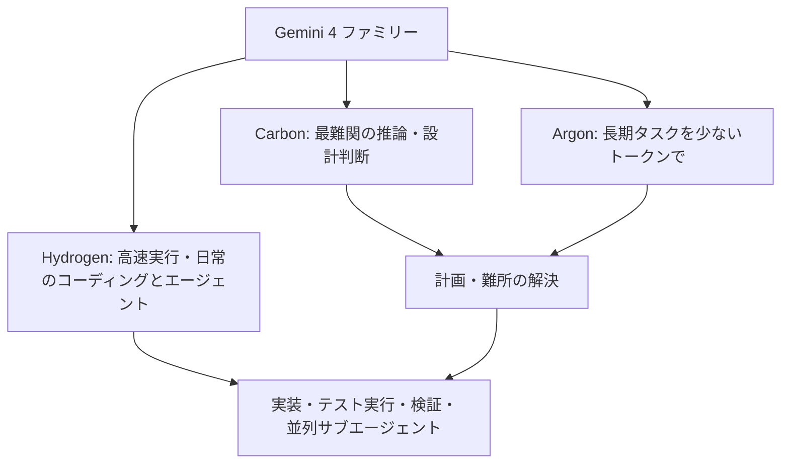
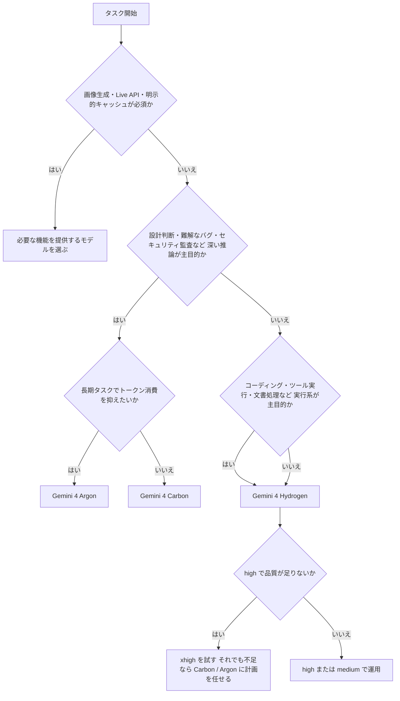
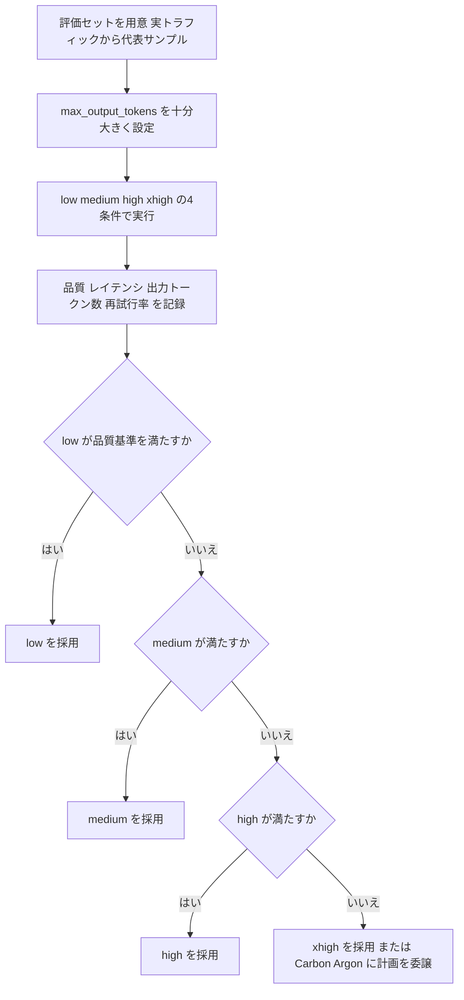
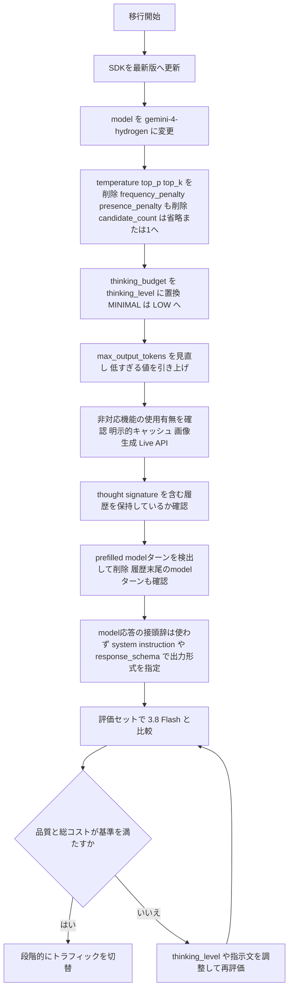
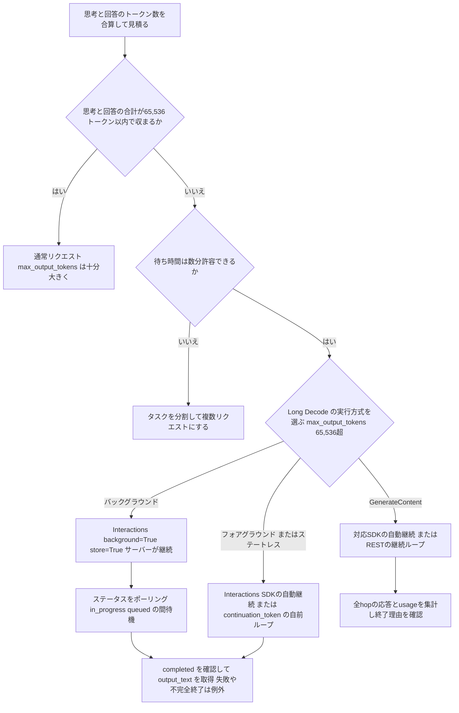
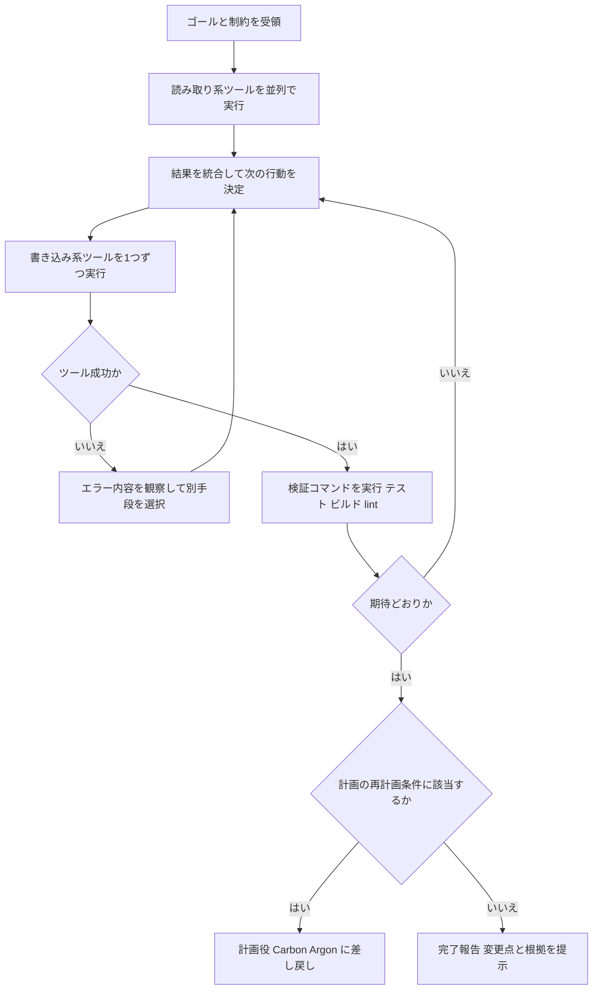
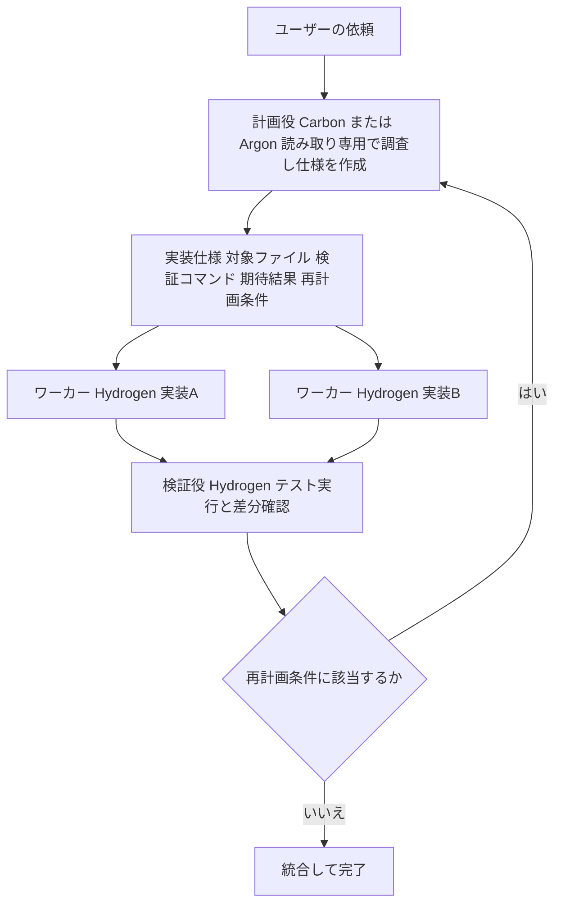
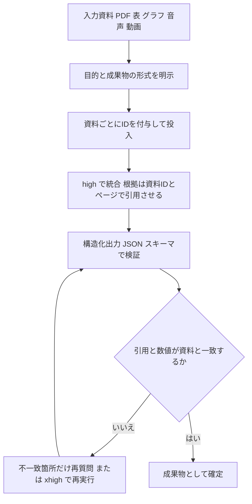
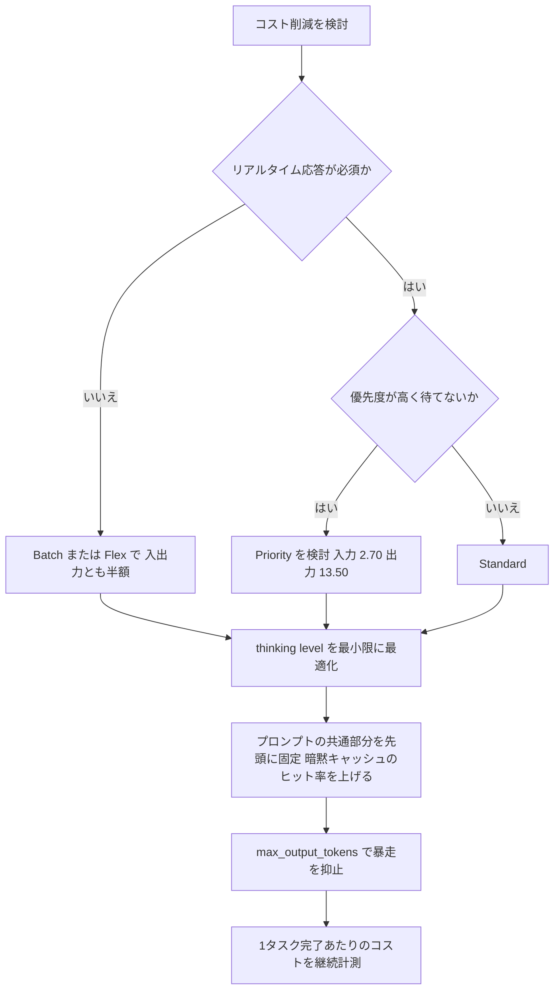
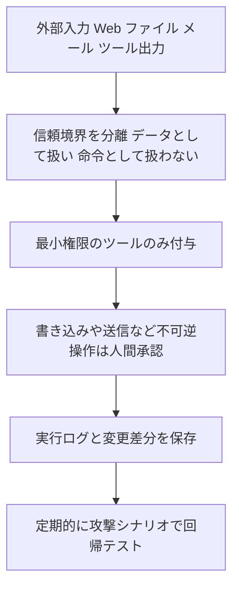

# Gemini 4 Hydrogen 完全ガイド(中級〜上級者向け・ステップバイステップ版)

> **対象読者**: Gemini API / Google AI Studio / Antigravity で実プロダクトやエージェントを構築・運用している中級〜上級エンジニア
> **情報基準日**: 2026年11月13日(Gemini 4 Hydrogen 発表の翌日)
> **最終更新日**: 2026年11月14日
> **注意**: 発表直後のため、Google公式情報(ブログ・ドキュメント・モデルカード)と第三者記事・個人検証を明確に区別して記載しています。第三者情報には「(第三者)」、推奨設計のうち筆者の設計判断には「(設計判断)」と付けています。数値・価格は必ず公式ページで再確認してください。

---

## 目次

1. [Gemini 4 Hydrogen とは(位置づけ)](#1-gemini-4-hydrogen-とは位置づけ)
2. [スペック早見表](#2-スペック早見表)
3. [Step 1: モデル選定(Hydrogen / Argon / Carbon / 3.8 Flash)](#step-1-モデル選定)
4. [Step 2: Thinking level の設計と評価](#step-2-thinking-level-の設計と評価)
5. [Step 3: Gemini 3.8 Flash からの移行](#step-3-gemini-38-flash-からの移行)
6. [Step 4: 出力トークンと Long Decode](#step-4-出力トークンと-long-decode)
7. [Step 5: エージェントのツール呼び出し設計](#step-5-エージェントのツール呼び出し設計)
8. [Step 6: Carbon / Argon との役割分担(Orchestrator)](#step-6-carbon--argon-との役割分担orchestrator)
9. [Step 7: マルチモーダル・長文書処理](#step-7-マルチモーダル長文書処理)
10. [Step 8: コスト最適化](#step-8-コスト最適化)
11. [Step 9: 評価・安全性・プロンプトインジェクション対策](#step-9-評価安全性プロンプトインジェクション対策)
12. [Step 10: 提供面別の使いどころ](#step-10-提供面別の使いどころ)
13. [アンチパターン集](#アンチパターン集)
14. [導入チェックリスト](#導入チェックリスト)
15. [補足: その他のベストプラクティスと根拠ソース](#補足-その他のベストプラクティスと根拠ソース)
16. [参考URL一覧](#参考url一覧)

---

## 1. Gemini 4 Hydrogen とは(位置づけ)

Gemini 4 Hydrogen は、Google が2026年11月12日に発表した Gemini 4 ファミリーの**高速・低コスト側のモデル**です。Googleは「日常使いのエージェント実行エンジン(daily driver for agentic workflows)」と位置づけています。

- フロンティア側の **Gemini 4 Carbon / Argon** は、深く長い推論(アーキテクチャ判断、難解なバグ、長期タスク)が得意
- **Hydrogen** は、コード記述・テスト実行・変更検証といった**高速な実行**に最適化
- 単体でも使え、Carbon / Argon と組み合わせる「実行担当」としても設計されている



**押さえるべき特徴(公式発表ベース)**

| 観点 | 内容 |
|---|---|
| 速度 | デフォルトの high で Gemini 3.8 Flash 比 **2.5倍**高速にタスク完了 |
| 知能 | Artificial Analysis Intelligence Index で high=51(Argon の 50 を上回る)、xhigh=54 |
| コーディング | Terminal-Bench 4.1 で 57%(3.8 Flash は 18.2%) |
| 信頼性 | 捏造(fabricated claims)が 3.8 Flash 比 **5倍以上減少**、ツール失敗や検索結果ゼロへの適応も改善 |
| 思考制御 | 4段階の thinking level(low / medium / high〔既定〕/ **xhigh**〔Hydrogen で新設〕) |
| コンテキスト | 入力・思考・出力で共有する 1,048,576 トークンの統合ウィンドウ |
| 価格 | $1.50 / 100万入力トークン、$7.50 / 100万出力トークン(1Mコンテキスト全域でフラット) |

> 出典: Google公式ブログ(Koray Kavukcuoglu)。URLは[参考URL一覧](#参考url一覧)を参照。

**位置づけについての補足(第三者)**

- 発表前は「Gemini 4 Flash のコードネーム」と報じられていましたが、正式なモデルIDは `gemini-4-hydrogen` です(`gemini-4-flash` ではありません)。
- 「Carbon/Argon から蒸留(distillation)された」という解説を書いている個人開発者もいますが、これは**公式に確認できていない推測**です。第三者記事(MarkTechPost)は、モデルカードに「Gemini 4 Carbon から適応(adapted)された」と書かれていると報じています。モデルカード原本で確認してください。

---

## 2. スペック早見表

| 項目 | Gemini 4 Hydrogen |
|---|---|
| モデルID | `gemini-4-hydrogen` |
| 発表日 | 2026-11-12 |
| 入力モダリティ | テキスト / 画像 / 動画 / 音声 / PDF(第三者記事が公式モデルページを引用) |
| 出力 | テキスト(画像生成・音声生成・Live API は**非対応**、第三者記事が公式モデルページを引用) |
| コンテキスト | 1,048,576 トークン(入力+思考+出力の合算) |
| 出力上限 | 同期リクエストの既定は 65,536 トークン。Long Decode で最大「1M − 入力トークン」まで |
| Thinking level | `low` / `medium` / `high`(既定) / `xhigh` |
| サンプリング | `temperature` / `top_p` / `top_k` は Gemini 4 系では**無視される** |
| キャッシュ | **暗黙的(implicit)キャッシュのみ**。明示的キャッシュは非対応(第三者記事が公式を引用) |
| 無料枠 | あり(Gemini API / AI Studio) |
| 提供面 | Gemini API、Google AI Studio、Android Studio、Gemini for business、Gemini アプリ、Google Search、Gemini in Sheets、Antigravity(HydrogenはFree / Google AI Plus / Pro / Ultraで利用可。Orchestratorのプラン制限は別) |

**価格表(Gemini API・100万トークンあたり、第三者記事が公式価格ページを引用)**

| 消費オプション | 入力 | 出力(思考トークン含む) | キャッシュ |
|---|---|---|---|
| Standard | $1.50 | $7.50 | $0.075(暗黙のみ) |
| Batch | $0.75 | $3.75 | $0.0375 |
| Flex | $0.75 | $3.75 | $0.0375 |
| Priority | $2.70 | $13.50 | $0.135 |

> 公式価格ページ(ai.google.dev の pricing)で最新値を確認してから設計してください。

---

## Step 1: モデル選定

**目的**: 「全部 Hydrogen」でも「全部 Carbon」でもなく、タスクごとに最小コストで品質要件を満たすモデルを選ぶ。

Googleの推奨は、**Carbon / Argon が判断し、Hydrogen が実行する**分業です。



**モデル比較表**

| 観点 | Hydrogen | Argon | Carbon |
|---|---|---|---|
| 得意領域 | 日常のコーディング、ツール実行、マルチモーダル文書、並列サブエージェント | 長期タスクを少ないトークンで | 最難関の推論、アーキテクチャ、セキュリティ |
| 既定 thinking | high | medium | medium |
| 利用可能な level | low / medium / high / xhigh | low / medium / high | low / medium / high |
| 価格(入力/出力) | $1.50 / $7.50 | 導入価格 $2 / $10(〜11/30)→ $4 / $20(12/1〜)(第三者・Simon Willison) | Argon と同価格 |
| 無料枠 | あり | なし(第三者記事) | なし |

**ステップ**

1. 必須機能(画像生成・Live API・明示的キャッシュなど)の対応を確認してから、自分のタスクを「判断系」と「実行系」に分類する
2. 必須機能を満たす実行系は Hydrogen を既定とし、`high` から評価を始める
3. 判断系の比率が高いワークロードだけ Argon / Carbon を計画役に置く
4. 3.8 Flash を使い続ける理由(単価)がないか確認する(第三者記事では 3.8 Flash の期間限定価格が $0.75 / $3.75 とされています。**価格だけで判断せず、品質・速度・再試行率を含めた総コストで比較**すること)

> **価格の読み方に注意**: Simon Willison は「Hydrogen は安価モデルのはずだが、現時点では Carbon/Argon に対し 25% 引きにすぎない。12/1 に Carbon/Argon が倍額になると割引率が拡大する」と指摘しています。12/1 以降の比率は 1.5 ÷ 4 = 0.375 なので、**約62.5%安**になる計算です(筆者算出)。

---

## Step 2: Thinking level の設計と評価

**目的**: 「必要な推論深度にだけ待ち時間とトークン代を払う」。Hydrogen の最大の設計ポイントです。

### 2-1. 4段階の使い分け(Google公式ガイダンス)

| Level | トークン使用量 | 推奨用途 |
|---|---|---|
| `low` | 最小・最低レイテンシ | コスト/レイテンシ重視、高スループット処理、軽いチャット |
| `medium` | 少なめ | 対話的コーディング、ライブUIプロトタイピング、レスポンス重視のツール呼び出し |
| `high`(既定) | バランス | 複雑なコーディング、エージェント実行、ツール呼び出し、マルチモーダル知識作業 |
| `xhigh` | 最大 | `high` で足りない、難しい多段のコーディング/エージェント課題。追加の待ち時間とトークンを許容できる場合のみ |

**Googleの助言**: まず `high` から始め、`xhigh` は `high` で不足する問題に限定する。`xhigh` は単純なプロンプトで**考えすぎて遅く高くなる**。

### 2-2. 公開されている性能の傾向(第三者)

VentureBeat が掲載した Artificial Analysis 計測の概況です(第3列は同記事のコスト指標で、定義は原文を参照)。

| Level | AA Intelligence Index | 記事掲載のコスト指標 |
|---|---|---|
| low | 27 | $0.29 |
| medium | 41 | $0.80 |
| high | 51 | $1.87 |
| xhigh | 54 | $3.16 |

読み取れる傾向(筆者算出):

- `low → high` で指数が大きく伸びる(27 → 51)
- `high → xhigh` は +3 ポイントに対しコスト指標が約 **1.7倍**(3.16 ÷ 1.87)。**逓減が明確**
- よって「迷ったら high、xhigh は難問だけ」というGoogleの助言と整合する

### 2-3. 評価手順(推奨フロー)

Googleの助言は「**4つのlevel全てで評価し、`max_output_tokens` を大きめにして出力が途中で切れないようにしたうえで、品質基準を満たす最も低いlevelを選ぶ**」です。



### 2-4. 実装上の要点

- Gemini 4 系では `thinking_budget` を指定すると **HTTP 400** になります。`thinking_level` を使ってください(Google Cloud ドキュメント)。
- `thinking_level="MINIMAL"` も Gemini 4 では **HTTP 400**。代わりに `LOW` を使います。
- Interactions API では `"low" / "medium" / "high" / "xhigh"` と小文字表記、Vertex 側のサンプルでは大文字(`LOW` など)が使われる箇所があります。SDK・APIごとの表記は公式ドキュメントで確認してください。

```python
from google import genai
from google.genai import types

client = genai.Client()

# thinking_level を明示する(表記・型はSDKバージョンにより異なるため公式ドキュメントで確認)
resp = client.models.generate_content(
    model="gemini-4-hydrogen",
    contents="このリポジトリのN+1クエリを特定し、最小差分で修正案を出して",
    config=types.GenerateContentConfig(
        thinking_config=types.ThinkingConfig(thinking_level="high"),
        max_output_tokens=32768,  # 出力切れ防止のため十分大きく
        # temperature / top_p / top_k は Gemini 4 系では無視されるため指定しない
    ),
)
print(resp.text)
```

**やってはいけないこと**

- 全リクエストを `xhigh` で固定する(単純タスクで遅く高くなる)
- 評価せずに `low` へ下げてコスト削減する(`low` と `high` の品質差は大きい)

---

## Step 3: Gemini 3.8 Flash からの移行

Googleは Hydrogen を「Gemini 3.8 Flash 以前の Flash 系からの推奨アップグレード」と位置づけています。**モデル名の差し替えだけでは動かない箇所**があるため、手順化します。



**移行チェック表**

| 領域 | Gemini 3.x | Gemini 4(Hydrogen) | 対応 |
|---|---|---|---|
| `thinking_budget` | level に変換される場合あり | **HTTP 400** | `thinking_level` へ置換 |
| `thinking_level="MINIMAL"` | サポート | **HTTP 400** | `LOW` を使用 |
| `temperature` / `top_p` / `top_k` | 一部無視 | 無視(削除が公式要件) | リクエストから削除。再現性は別手段で担保 |
| `frequency_penalty` / `presence_penalty` | モデルによる | **非対応** | リクエストから削除 |
| `candidate_count > 1` | 複数候補を指定できるモデルあり | **非対応** | パラメータを削除するか `1` に調整 |
| prefilled `model` ターン | 応答の接頭辞を与える構成あり | **非対応**。履歴をmodelターンで終えない | 事前挿入したmodelターンを削除し、出力形式はsystem instructionや `response_schema` で指定。過去の実応答とthought signatureは保持 |
| 課金 | 一部トークンのみ課金 | 思考トークン、およびグラウンディング使用時の内部ツール指示・関数宣言を含め**処理した全トークンが課金対象** | コスト試算を作り直す |
| 明示的キャッシュ | 利用可 | **非対応**(第三者記事が公式を引用) | プロンプト構造を暗黙キャッシュ向けに(Step 8) |
| 出力上限 | 65,536 | 既定 65,536、Long Decode で拡張 | Step 4 参照 |

> 出典: Google Cloud「Get started with Gemini 4」および「Thinking」ドキュメント。Argon向けの移行リファレンス(gemini-skills リポジトリ)には、Python `google-genai` ≥ 2.30.1 / JS `@google/genai` ≥ 2.29.1 という要件が記載されています。Hydrogen向けの要件はWhat's newページで確認してください。

非対応パラメータとprefillの除去は[公式移行ガイド](https://docs.cloud.google.com/gemini-enterprise-agent-platform/models/migrate)も参照してください。履歴末尾がmodelの実応答なら、署名ごとその応答を保持し、次のuser入力または対応するツール結果を追加してから送信します。応答の接頭辞として挿入したmodelターンとは区別します。

**移行のコツ**

1. **まず同一プロンプトで比較**: 指示文を変えずに 3.8 Flash と並べ、差分が「モデル差」なのか「指示の曖昧さ」なのか切り分ける
2. **再試行率と総トークンを見る**: 単価ではなく「1タスク完了あたりのコスト」で比較する。Google は 2〜2.8倍高速・トークン使用 12〜23% 減という**パートナー初期検証値**を公表しています(ワークロード依存なので自社計測が必須)
3. **旧パラメータの残骸を grep**: `thinking_budget`、`temperature`、`MINIMAL`、`frequency_penalty`、`presence_penalty`、`candidate_count > 1` の残存はHTTP 400または無視の原因になる

---

## Step 4: 出力トークンと Long Decode

Hydrogen は入力・思考・出力が**1つの 1,048,576 トークン窓を共有**します。思考(`xhigh` など)を深くするほど、同じ窓の中で出力に使える量が減る点に注意が必要です。

- 同期リクエストの出力は**既定で 65,536 トークン**
- それを超える出力(複数ファイルのdiff、長大なテストスイート等)は **Long Decode** を使う
- Interactions API は、`max_output_tokens` を 65,536 超に設定し、バックグラウンド実行またはフォアグラウンドのクライアント側継続を選べる。`background=True` は `store=True` が必要で、サーバーがhopを連結する。`background=False` では対応SDKの自動継続、または `automatic_continuation=False` と `continuation_token` を使う自前ループを利用する。`store=False` のステートレス実行も可能で、その場合は前回IDの代わりに元の入力を再送し、モデル・ツール・system instruction・生成設定を各hopで維持する([公式Interactions Long Decode](https://ai.google.dev/gemini-api/docs/long-decode#client-side-continuation))。
- GenerateContent APIでも、対応する最新版SDKは `max_output_tokens > 65,536` で自動継続する。RESTや自前ループでは `CONTINUATION` と `continuation_token` を扱い、同じリクエストを継続する([公式GenerateContent Long Decode](https://ai.google.dev/gemini-api/docs/generate-content/long-decode))。必要なSDKバージョンは両APIの公式資料で確認する。



```python
# Interactions API のバックグラウンド実行を選ぶ場合の例
# 注意: 実機で動作確認し、SDKバージョン・パラメータ名は公式ドキュメントで確認してください
import time
from google import genai

client = genai.Client()

interaction = client.interactions.create(
    model="gemini-4-hydrogen",
    input="このモジュール群を新APIへ移行する差分をすべて出力して",
    background=True,   # サーバー側継続を選択。フォアグラウンドのクライアント側継続も可能
    store=True,
    generation_config={"max_output_tokens": 262144, "thinking_level": "high"},
)

while interaction.status in ("in_progress", "queued"):
    time.sleep(5)
    interaction = client.interactions.get(id=interaction.id)

if interaction.status == "failed":
    raise RuntimeError(f"Interaction failed: {interaction.id}")
if interaction.status == "cancelled":
    raise RuntimeError(f"Interaction cancelled: {interaction.id}")
if interaction.status == "incomplete":
    raise RuntimeError(f"Interaction incomplete; review limits before retrying: {interaction.id}")
if interaction.status != "completed":
    raise RuntimeError(f"Unexpected interaction status: {interaction.status}")

text = interaction.output_text
```

[公式のバックグラウンド実行例](https://ai.google.dev/gemini-api/docs/background-execution)と[Interactions APIの状態定義](https://ai.google.dev/api/interactions-api)に従い、成功した完了状態でのみテキストを採用します。

**Long Decode の運用ルール**

| ルール | 理由 |
|---|---|
| 必要なワークロードだけに使う(Google: チャット・Q&A・要約・抽出は通常 32K 未満で完了) | 数分かかり得る、課金も膨らむ |
| `max_output_tokens` は仕事に必要な量だけに制限する | 出力トークン(思考を含む)の課金だけを抑える。リクエスト総額の上限ではなく、継続hopの追加入力課金やツール料金も発生し得る |
| `max_output_tokens > 65,536` と対応する継続方式を選ぶ | Interactionsのバックグラウンド実行、フォアグラウンド／ステートレスのSDK自動継続・自前ループ、GenerateContentのSDK自動継続・RESTループを使い分ける。SDKの対応バージョンを確認する |
| 集計トークンの扱いに注意(第三者: Long Decode 中は各hopの入力が合算され、見かけ上コンテキストが過大に見える) | 監視・課金ダッシュボードの誤読防止 |
| 固定長を狙った出力指定は効かない(第三者) | 長さ制御は指示文と分割設計で行う |

---

## Step 5: エージェントのツール呼び出し設計

Hydrogen は「エージェントループの実行役」として、次の挙動が公式に強調されています。

- **読み取り・検索系ツール呼び出しを並列にバッチ実行**する(ファイルを1つずつ読まない)
- ツール呼び出しが失敗したり検索結果が空だったりしても、**状況に適応**する
- **外科的な編集**(無関係なファイルを書き換えない)
- 根拠のない断定を避け、**不足コンテキストを指摘**する(捏造が3.8 Flash比で5倍以上減)

### 5-1. エージェントループの基本形



### 5-2. 設計のベストプラクティス

| # | プラクティス | 理由・根拠 |
|---|---|---|
| 1 | **読み取り系ツールは並列実行を許す設計**にする(ツール側の同時実行・レート制限を確認) | Hydrogenが並列バッチを前提に最適化されているため |
| 2 | **書き込み系は直列**にし、各書き込み後に検証コマンドを挟む | 外科的編集の利点を活かし、副作用の連鎖を防ぐ(設計判断) |
| 3 | ツールのエラーメッセージは**モデルが読んで次の行動を選べる情報量**で返す | 失敗への適応が強化されているため |
| 4 | プロンプトに「**不明点は推測せず、足りない情報を列挙する**」を明記する | 捏造低減の効果を最大化する(設計判断) |
| 5 | マルチターン/関数呼び出しでは **thought signature を含む履歴を丸ごと返す** | Gemini 4 の公式要件。思考の要約では代用できない(第三者の移行記事も指摘) |
| 6 | 状態を持つ会話は Interactions API の `store=true` + `previous_interaction_id` を検討 | 署名を含む状態をサーバー側で保持できる(第三者記事が公式を引用) |
| 7 | 「無関係なファイルは変更しない」「変更ファイル一覧を最後に出す」をシステム指示に入れる | 差分レビューを容易にし、過剰変更を検知する(設計判断) |

履歴を圧縮するときは、以前の資料を削って後続のthought signatureだけを保持すると会話prefixが変わり、既定の `prefix_mismatch_behavior="ERROR"` ではHTTP 400になり得ます。対応する `ThinkingConfig` の `prefix_mismatch_behavior="DROP"` (Interactions APIでは `generation_config.prefix_mismatch_behavior="drop"`)を使って不一致の署名を破棄させるか、サポートされる新規履歴へのリセットを行ってください。変更していない履歴では引き続き署名をそのまま保持します([公式Hydrogenガイド](https://docs.cloud.google.com/gemini-enterprise-agent-platform/models/guides/gemini-4-hydrogen))。

```python
# マルチターンでは thought signature を含む履歴を丸ごと再送する(概念コード)
# 呼び出し元で会話ごとに history=[] を作成し、対応する履歴を渡す。他の会話と共有しない。
def step(client, history, user_msg):
    history.append({"role": "user", "parts": [{"text": user_msg}]})
    resp = client.models.generate_content(
        model="gemini-4-hydrogen",
        contents=history,
        # tools=[...]  # 関数宣言
    )
    # 重要: 返却された content を加工せずそのまま履歴へ(署名の欠落・要約置換をしない)
    history.append(resp.candidates[0].content)
    return resp
```

---

## Step 6: Carbon / Argon との役割分担(Orchestrator)

Googleは Hydrogen を「Carbon / Argon が設計・難所解決を担い、Hydrogen がコード編集・並列サブエージェント・テスト実行を担う**高効率な実行エンジン**」と位置づけています。

### 6-1. Antigravity の Orchestrator

Antigravity に新設された **Orchestrator** は、1つのセッション内で Carbon と Hydrogen を動的に切り替えます。Google公表値では、Terminal-Bench 4.0 で**Carbon に近いタスク成功率**を保ちながら、平均で**クォータ消費 24%減・完了 19%高速**でした。

並列エージェントが必要な場合は、**Carbon が調整役、Hydrogen がワーカーと検証役**になり、隔離されたワークスペースで同時に実装とテストを進める構成が紹介されています。



### 6-2. 自前で分業を組むときの設計(設計判断)

| 設計項目 | 推奨 |
|---|---|
| 計画役の出力 | 実行役が**質問できない前提**で、対象ファイル・シンボル・変更内容・検証コマンド・期待出力を明記した仕様にする |
| 再計画条件 | 仕様の末尾に「Re-plan if: …(前提が崩れた兆候)」のチェックリストを必ず入れる |
| 実行役の thinking | 既定は `high`、機械的な修正は `medium` 以下、詰まったときだけ `xhigh` |
| 検証 | 実行役と別のコンテキスト(検証役)でテストを回し、自己採点バイアスを避ける |
| 計画役の呼び出し頻度 | 毎ターンではなく、仕様作成時と再計画時のみ(コスト最適化) |

> 参考(第三者の個人開発者による解説): Antigravity の Orchestrator は、計画フェーズで書き込みツールを無効化した読み取り専用ターンを Argon が実行し、`exit_plan_mode` で仕様を書いた時点で実行ターンが Hydrogen に移る二段階プロトコルだと説明されています。また Hydrogen は 3.8 Flash と同じ「高速実行クォータ枠」を共有するとの記述があります。これらは公式発表ではなく**ユーザー観察**なので、Antigravityの公式ブログで確認してください。

---

## Step 7: マルチモーダル・長文書処理

Hydrogen は入力・思考・出力で共有する 1,048,576 トークンのコンテキスト内で、**PDF・スプレッドシート・図表・音声・録画動画**を引用付きレポートや構造化成果物へ統合します。入力と出力それぞれに100万トークンを同時に使うことはできません。例えば入力80万トークンなら、思考を含む出力の残り枠は最大248,576トークンです。

公式が示す指標(Google公表値): Multimodal Knowledge Agent(MKA)53.4%、Agents' Last Exam v1.1 で 71.6%。



**ベストプラクティス**

1. **資料に識別子を振り、出力に「資料ID+ページ/時刻」の引用を必須化**する(捏造の検出が容易になる。設計判断)
2. 表・グラフ中心の資料は、**抽出してほしい項目と単位を先に列挙**する
3. 動画は「どの区間を見るか」を指定する。Googleは「特定フレームを検査するエージェント的動画理解」を強化したと説明
4. 出力は JSON スキーマで構造化し、**スキーマ検証→不一致だけ再質問**の自己修復ループにする
5. 1Mトークンを使い切る前に、**不要資料を削る**(入力が多いほど課金と待ち時間が増える。出力と窓を共有する点も考慮)。会話prefixを変更する場合はStep 5の `prefix_mismatch_behavior="DROP"` または対応する履歴リセットを使い、変更前の署名だけを再利用しない

---

## Step 8: コスト最適化

### 8-1. コストの構造

- 課金は**入力 + 出力(思考トークンを含む)**。Gemini 4 では処理した全トークンが課金対象
- 出力は入力の5倍単価($7.50 vs $1.50)。**思考トークンが出力側に乗る**ため、thinking level がコストに直結する
- Hydrogen は 1M コンテキスト全域でフラット価格(長文だけ高くなる階段料金がない)

**試算例(筆者算出・Standard価格、キャッシュ割引なし・ツール利用なしの仮定)**: 初期入力5万、出力10万(思考含む)を、バックグラウンド実行の2 hopで生成する場合。1 hop目の出力を65,536トークン、2 hop目を34,464トークンとすると、2 hop目の入力は初期入力と既生成分の合計115,536トークンです。課金対象の入力は全hop合計165,536トークン、出力は100,000トークンとなり、コンテキスト使用量は最大150,000トークンで共有上限内に収まります。

| モデル | 計算 | 合計 |
|---|---|---|
| Hydrogen | 0.165536 × 1.5 + 0.1 × 7.5 | **$0.998304** |
| Argon / Carbon(12/1以降の倍額 $4 / $20) | 0.165536 × 4 + 0.1 × 20 | $2.662144 |

[公式のLong Decode課金説明](https://ai.google.dev/gemini-api/docs/generate-content/long-decode#understand-billing)のとおり、継続hopには追加入力課金があります。実際の請求は各hopのusageと適用されるキャッシュ割引で確認し、ツール利用時は別途その料金も加算してください。

### 8-2. 最適化フロー



### 8-3. 具体策

| 施策 | 内容 |
|---|---|
| Batch / Flex | 非同期・夜間処理は入出力とも半額(第三者記事が公式価格を引用) |
| thinking level 最適化 | 評価(Step 2)に基づき、タスク種別ごとに `low`〜`high` を振り分ける。`xhigh` は例外運用 |
| 暗黙キャッシュ前提の構造化(設計判断) | 明示的キャッシュが使えないため、**システム指示・ツール定義・参照資料を常にプロンプトの先頭に同じ順序で固定**し、可変部(ユーザー入力)を末尾に置く |
| 出力の上限管理 | `max_output_tokens` を用途別に設定(暴走・無限ループ対策) |
| グラウンディング課金 | Google検索グラウンディングは無料枠なし(無料階層)。有料階層では月5,000検索の無料枠をGemini 3以降のモデル間で共有し、超過分は1,000検索あたり$14、日次上限あり。Geminiリクエスト数ではなく検索クエリ数で課金され、1回のGeminiリクエストが複数の課金対象検索を起こし得る(第三者記事が公式を引用。要確認。[公式料金表](https://ai.google.dev/gemini-api/docs/pricing)) |
| データの扱い | 無料階層の内容はGoogleの製品改善に使われる。通常の有料サービスでは原則として製品改善に使われないが、**Paid Contributor Tierの内容は製品・モデルの改善に利用される**。有料サービスでも不正利用監視のためプロンプト・応答が保持され得る。機密データを送信する前に、適用される階層・最新の保持方針・ログとデータ共有の設定を確認する([公式データ共有方針](https://ai.google.dev/gemini-api/docs/logs-policy#contributor-tier)、[有料サービス規約](https://ai.google.dev/gemini-api/terms#data-use-paid)) |
| モデル分業 | 計画だけ上位モデル、実行は Hydrogen(Step 6) |

---

## Step 9: 評価・安全性・プロンプトインジェクション対策

### 9-1. Googleが公表している安全性の指標

| 指標 | 内容(Google公表値) |
|---|---|
| 越権(overreach) | エージェントタスクで最大 81% 減 |
| 過少対応(under-service) | 最大 79% 減 |
| 不整合な行動・タスクの近道 | ツール使用・コーディング評価で 12倍減 |
| 権限境界の迂回 | 不可能・ブロックされたタスクで最大 2倍起きにくい |
| 誠実性 | 社内エージェント誠実性評価で 96.7% |
| 思考の可読性 | 20万ターン超の監査で、chain-of-thought の可読性 99.9%・欺瞞的な推論の編集ゼロ |
| 間接プロンプトインジェクション | Gray Swan IPI ベンチマークで 2.3倍超の耐性 |
| 誤拒否 | HealthBench Pro での誤拒否 0.4% 未満 |

> これらは**Google社内・自社評価を含む公表値**です。自社環境の攻撃シナリオで必ず再検証してください。耐性が向上しても、ゼロにはなりません。

### 9-2. 運用レベルの多層防御(設計判断)



**チェックポイント**

1. 外部コンテンツ(Web検索結果、メール、取得文書)に含まれる指示は**命令として扱わない**とシステム指示に明記する
2. ツール権限は**最小化**し、削除・送信・課金などは必ず人間承認を挟む
3. 「権限境界を越えるとき」のモデルの挙動(停止して報告するか)をテストケース化する
4. 評価セットに**インジェクションを含む入力**を入れ、リリースごとに回帰テストする
5. 思考の要約(thought summary)を有効化して監査ログに残すと、失敗解析がしやすい(Gemini API の thinking ガイドに thought summaries の記載あり)

---

## Step 10: 提供面別の使いどころ

| 提供面 | 使いどころ・ポイント |
|---|---|
| **Gemini API / Google AI Studio** | 全ティアで利用可。まず AI Studio の Run settings で thinking level を切り替えて挙動を確認 |
| **Android Studio** | Androidアプリ開発での日常的なコード生成・デバッグ(Gemini API経由) |
| **Antigravity** | HydrogenはFree、Google AI Plus、Pro、Ultraで利用可能。Orchestratorは別機能で、Carbon版はUltra、Argon版はUltraと対象のPro(有料プランまたは対象端末の試用)に限定される。Hydrogenへのアクセス権と区別する([公式モデル一覧](https://antigravity.google/docs/models)、[プラン](https://antigravity.google/docs/plans))。Gemini front end design skill(google-gemini/demolab)と併用したUI生成の事例が公式に紹介されている |
| **Gemini for business** | API・モデルドロップダウン・Antigravity・Sheets 内の Gemini から利用 |
| **Gemini in Sheets** | 財務データを対話的なモデルへ変換。Googleは「Sheets canvas で出力生成が従来比30%超高速」と説明 |
| **Gemini アプリ / Google Search** | 一般ユーザー向け。無料ユーザーは自動モデル選択で提供。Searchでは複数部分の質問の意図理解、クエリfan-outの強化、表や画像を含む視覚的回答が改善 |
| **Gemini Managed Agents** | Antigravity エージェントの既定モデルが Hydrogen になった(第三者記事が公式を引用) |

**デモの活用**: 公式は Geminisland(3Dボクセルをリアルタイム生成する共有島)や、AI Studio 上の「3D Medic Managed Agent」アプリ(3Dファイルの検査・エラー検出・修正)をデモとして公開しています。自分のプロトタイプの「動作の目安」として確認すると、thinking level の効きが掴めます。

---

## アンチパターン集

| # | アンチパターン | 問題 | 対策 |
|---|---|---|---|
| 1 | 全リクエストを `xhigh` に固定 | 単純タスクで遅く高い。逓減も大きい | 評価に基づき level を振り分け(Step 2) |
| 2 | `thinking_budget` / `MINIMAL` を残す | HTTP 400 | `thinking_level`(`LOW`〜`XHIGH`)に置換 |
| 3 | `temperature` で再現性を担保しようとする | 無視される | 出力スキーマ・評価・リトライで担保 |
| 4 | `max_output_tokens` を小さく据え置く | 思考で枠を使い切り、回答が途中で切れる | 十分大きく設定して評価 |
| 5 | thought signature を捨てる/要約に置換 | マルチターン・関数呼び出しが壊れる | content をそのまま履歴に戻す |
| 6 | 明示的キャッシュ前提の設計 | Hydrogenでは非対応 | 暗黙キャッシュ向けのプロンプト構造 |
| 7 | 画像生成・Live API を期待する | 非対応 | 別モデルと組み合わせる |
| 8 | 計画・設計判断まで Hydrogen に丸投げ | 深い判断では Carbon/Argon が適する | 計画役を分離(Step 6) |
| 9 | 単価だけで 3.8 Flash と比較 | 再試行・トークン量を見落とす | 1タスク完了あたりの総コストで比較 |
| 10 | 外部入力の指示に従わせる | インジェクションの温床 | 信頼境界の分離、最小権限(Step 9) |
| 11 | Long Decode を常用 | 遅く高い | 必要なワークロードに限定 |
| 12 | 発表直後の第三者記事の数値を鵜呑み | 誤り・更新の可能性 | 公式ドキュメントで再確認 |

---

## 導入チェックリスト

**移行・実装**

- [ ] SDK を最新化した
- [ ] `model="gemini-4-hydrogen"` に変更した
- [ ] `temperature` / `top_p` / `top_k` を削除した
- [ ] `frequency_penalty` / `presence_penalty` を削除し、`candidate_count > 1` を削除または `1` に調整した
- [ ] prefilled modelターンを削除し、送信履歴がmodelターンで終わっていないことを確認した。出力形式は指示や `response_schema` で指定した
- [ ] `thinking_budget` / `MINIMAL` を `thinking_level` に置換した
- [ ] `max_output_tokens` を十分大きく設定した
- [ ] 思考と回答の合計が65,536を超える箇所に Long Decodeの継続方式(バックグラウンド／フォアグラウンド／ステートレス／GenerateContent)を設計した
- [ ] thought signature を含む履歴を保持している
- [ ] 非対応機能(明示的キャッシュ・画像生成・Live API・音声生成)を使っていない

**評価・運用**

- [ ] 4つの thinking level で評価し、最低限の level を選んだ
- [ ] 1タスクあたりの総コスト(再試行込み)を 3.8 Flash と比較した
- [ ] 12/1 の Carbon/Argon 価格改定を踏まえたモデル構成を検討した
- [ ] プロンプトの共通部分を先頭に固定した(暗黙キャッシュ)
- [ ] インジェクションを含む回帰テストを用意した
- [ ] 不可逆操作に人間承認を挟んだ
- [ ] 価格・仕様を公式ドキュメントで再確認した

---

## 補足: その他のベストプラクティスと根拠ソース

### A. 著名な開発者・Google関係者の発信

| 発信者 | 内容(要旨) | URL |
|---|---|---|
| **Koray Kavukcuoglu**(SVP, Google DeepMind / Chief AI Architect) | Hydrogen を「日常のエージェント実行エンジン」と位置づけ、Carbon/Argonとの併用、4段階 thinking、Orchestrator、安全性指標を公式発表 | https://blog.google/innovation-and-ai/models-and-research/gemini-models/introducing-gemini-4-hydrogen/ |
| **Logan Kilpatrick**(Google DeepMind、Gemini API / AI Studio 担当) | 「3.8 Flash より2.5倍速く、はるかに賢く、捏造は5分の1」と発信。日常的に利用していると言及 | https://x.com/OfficialLoganK/status/2120941998014390392 |
| **Logan Kilpatrick**(同) | 発表ポスト。全ティアの AI Studio・API・Search・Antigravity 等で提供 | https://x.com/OfficialLoganK/status/2120940951292268640 |
| **Simon Willison**(Django共同作成者、LLMツール `llm` の作者) | 発表当日に `llm-gemini` 0.37 をリリース。Gemini 4 の**価格体系が分かりにくい**こと、Hydrogen が Carbon/Argon に対して現状25%引きにとどまり、12/1の倍額改定後に割引が拡大することを指摘。無料枠モデルであり Google Search のAI機能を支えるとも整理 | https://simonwillison.net/2026/Nov/12/llm-gemini/ |
| **Simon Willison**(X) | 自作の「自転車に乗るペリカン」SVG生成テストで、Hydrogen は Carbon/Argon より明らかに出来が劣ると報告(**非公式の一例**であり、コーディング性能の代表ではない点に注意) | https://x.com/simonw/status/2121039423441981444 |
| Google AI(公式X) | Hydrogen は Argon を AA Intelligence Index で上回り、Antigravity で Carbon と併用できる旨 | https://x.com/GoogleAI/status/2120940683233984862 |

### B. 追加のベストプラクティスと根拠

| # | ベストプラクティス | 根拠・補足 | ソースURL |
|---|---|---|---|
| 1 | **評価は4 level × 十分大きい `max_output_tokens`** で実施し、品質基準を満たす最低 level を採用 | Googleの level 選択ガイダンス(第三者記事が公式ページを引用) | https://teamorouter.com/blogs/gemini-4-hydrogen-api |
| 2 | `thinking_budget` / `MINIMAL` は Gemini 4 で 400。`thinking_level` へ移行 | Google Cloud 公式ドキュメント | https://docs.cloud.google.com/gemini-enterprise-agent-platform/models/thinking |
| 3 | Hydrogen の既定は HIGH、XHIGH は Hydrogen のみ対応 | Google Cloud 公式ドキュメント | https://docs.cloud.google.com/gemini-enterprise-agent-platform/models/start/get-started-with-gemini-4 |
| 4 | Gemini 4 は `temperature` / `top_p` / `top_k` を無視 | 同上 | https://docs.cloud.google.com/gemini-enterprise-agent-platform/models/start/get-started-with-gemini-4 |
| 5 | thought signature を含む履歴を保持する | Argon向けマイグレーションガイド(Gemini 4 共通の要件) | https://ai.google.dev/gemini-api/docs/generate-content/latest-model |
| 6 | Long Decode は必要なワークロードのみ。バックグラウンドまたはクライアント側継続を選ぶ | Google公式 Long Decode ガイド | https://ai.google.dev/gemini-api/docs/long-decode |
| 7 | 移行時は SDK 更新・パラメータ除去・出力上限見直しをチェックリスト化 | google-gemini 公式 gemini-skills の移行リファレンス | https://github.com/google-gemini/gemini-skills/blob/main/skills/gemini-api-dev/references/migration.md |
| 8 | 移行時の落とし穴(出力上限・`temperature` 無視・Long Decode の課金)を事前に把握 | 開発者コミュニティ(DEV)の Argon 移行記事 | https://dev.to/aihubmix/moving-gemini-3x-code-to-gemini-4-argon-failure-modes-and-fixes-4h1p |
| 9 | Long Decode は継続hopごとに課金・入力集計が膨らむため上限管理が必要 | 同上および DEV の Argon 統合ガイド | https://dev.to/aihubmix/gemini-4-argon-thinkinglevel-and-long-decode-a-developers-guide-35ll |
| 10 | 状態管理は `store=true` + `previous_interaction_id`、思考ブロックは改変しない | DEV の Gemini 4 Argon 本番移行ガイド | https://dev.to/hao_kang_82922526dfe5d934/gemini-4-argon-api-the-production-migration-guide-for-agents-1gkg |
| 11 | Carbon で計画、Hydrogen で並列実行・検証。Orchestrator で自動化 | Google公式(Antigravityブログへのリンク付き) | https://blog.google/innovation-and-ai/technology/developers-tools/build-with-gemini-4-hydrogen/ |
| 12 | Orchestrator の二段階プロトコル(読み取り専用計画→実行)と thinking tier の使い分け(ユーザー観察) | DEV 個人開発者の検証記事(**非公式**) | https://dev.to/evgenii_zinner/gemini-4-hydrogen-xhigh-thinking-and-native-orchestrator-mode-in-google-antigravity-2699 |
| 13 | AI Studio で High を選んで試験し、制限到達時はリセット/再試行情報に従う | 開発者のハンズオン(**非公式**) | https://proflead.dev/posts/gemini-4-hydrogen-review-tutorial/ |
| 14 | 第三者のベンチマーク(AA Index)で level ごとの知能・コストを確認 | VentureBeat 記事(Artificial Analysis計測を引用) | https://venturebeat.com/technology/google-launches-gemini-4-hydrogen-a-faster-smarter-pricier-flash-successor |
| 15 | Search / Gemini アプリでの挙動(fan-out・視覚的回答)を理解し、ユーザー向け体験を設計 | Google Search 公式ブログ | https://blog.google/products-and-platforms/products/search/gemini-4-hydrogen-search-upgrade/ |
| 16 | 安全性・限界の詳細はモデルカードで確認 | Google DeepMind モデルカード(PDF) | https://storage.googleapis.com/deepmind-media/Model-Cards/Gemini-4-Hydrogen-Model-Card.pdf |

### C. 情報の信頼性についての注意

1. **発表翌日の情報**です。価格・提供面・仕様は短期間で更新されることがあります。
2. 価格・非対応機能・グラウンディング課金の一部は**第三者記事が公式ページを引用した内容**で、筆者は公式のモデルページ(`ai.google.dev/gemini-api/docs/models/gemini-4-hydrogen`)と pricing ページの原文を直接確認できていません。**実装前に原文確認が必須**です。
3. Long Decode と Interactions API のコード例は **Argon向け公式ガイドの記載パターンを Hydrogen に適用した例**です。パラメータ名やSDKバージョンは実機で検証してください。
4. 「蒸留モデルである」「Antigravity のクォータ枠共有」などは**公式発表ではない観察・推測**です。
5. Simon Willison のペリカンテストは**非公式な単発の生成比較**で、コーディングやエージェント性能の代表指標ではありません。同様に、Google公表のベンチマーク値は自社公表で、第三者による再現・検証を待つ段階のものがあります。

---

## 参考URL一覧

**Google公式**

- Introducing Gemini 4 Hydrogen: https://blog.google/innovation-and-ai/models-and-research/gemini-models/introducing-gemini-4-hydrogen/
- Gemini 4 Hydrogen for developers: https://blog.google/innovation-and-ai/technology/developers-tools/build-with-gemini-4-hydrogen/
- Google Search × Hydrogen: https://blog.google/products-and-platforms/products/search/gemini-4-hydrogen-search-upgrade/
- モデルカード(PDF): https://storage.googleapis.com/deepmind-media/Model-Cards/Gemini-4-Hydrogen-Model-Card.pdf
- Gemini API What's new(Hydrogen): https://ai.google.dev/gemini-api/docs/whats-new-gemini-4-hydrogen
- Gemini API モデルページ(Hydrogen): https://ai.google.dev/gemini-api/docs/models/gemini-4-hydrogen
- Antigravity × Hydrogen(Orchestrator): https://antigravity.google/blog/gemini-4-hydrogen-in-google-antigravity
- Gemini API Thinking ガイド: https://ai.google.dev/gemini-api/docs/thinking
- Long Decode ガイド: https://ai.google.dev/gemini-api/docs/long-decode
- Google Cloud: Developer's guide to Gemini 4 Hydrogen: https://docs.cloud.google.com/gemini-enterprise-agent-platform/models/guides/gemini-4-hydrogen
- Google Cloud: Get started with Gemini 4: https://docs.cloud.google.com/gemini-enterprise-agent-platform/models/start/get-started-with-gemini-4
- Google Cloud: Thinking: https://docs.cloud.google.com/gemini-enterprise-agent-platform/models/thinking
- Gemini API: 最新モデル(Argon)ガイド: https://ai.google.dev/gemini-api/docs/generate-content/latest-model
- AI Studio: Gemini 4 Argon Developer Guide: https://aistudio.google.com/learn/gemini-4-argon-developer-guide
- google-gemini/gemini-skills 移行リファレンス: https://github.com/google-gemini/gemini-skills/blob/main/skills/gemini-api-dev/references/migration.md

**著名な開発者・Google関係者の発信**

- Simon Willison: https://simonwillison.net/2026/Nov/12/llm-gemini/
- Simon Willison(X): https://x.com/simonw/status/2121039423441981444
- Logan Kilpatrick(X): https://x.com/OfficialLoganK/status/2120941998014390392
- Logan Kilpatrick(X・発表): https://x.com/OfficialLoganK/status/2120940951292268640
- Google AI(X): https://x.com/GoogleAI/status/2120940683233984862

**メディア・コミュニティ(第三者)**

- VentureBeat: https://venturebeat.com/technology/google-launches-gemini-4-hydrogen-a-faster-smarter-pricier-flash-successor
- MarkTechPost: https://www.marktechpost.com/2026/11/13/google-gemini-4-hydrogen/
- TestingCatalog: https://www.testingcatalog.com/google-launches-gemini-4-hydrogen-for-pro-and-ultra-users/
- TeamoRouter(API・価格の解説): https://teamorouter.com/blogs/gemini-4-hydrogen-api
- DEV(Antigravity / xhigh / Orchestrator): https://dev.to/evgenii_zinner/gemini-4-hydrogen-xhigh-thinking-and-native-orchestrator-mode-in-google-antigravity-2699
- DEV(Argon移行の落とし穴): https://dev.to/aihubmix/moving-gemini-3x-code-to-gemini-4-argon-failure-modes-and-fixes-4h1p
- DEV(Argon thinking_level と Long Decode): https://dev.to/aihubmix/gemini-4-argon-thinkinglevel-and-long-decode-a-developers-guide-35ll
- DEV(Argon 本番移行ガイド): https://dev.to/hao_kang_82922526dfe5d934/gemini-4-argon-api-the-production-migration-guide-for-agents-1gkg
- Proflead(ハンズオン): https://proflead.dev/posts/gemini-4-hydrogen-review-tutorial/

**ベンチマーク参照先(公式ブログ内リンク)**

- Artificial Analysis: https://artificialanalysis.ai/
- Terminal-Bench 4.0: https://www.tbench.ai/news/terminal-bench-4-0
- Agent Arena: https://arena.ai/leaderboard/agent
