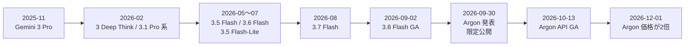
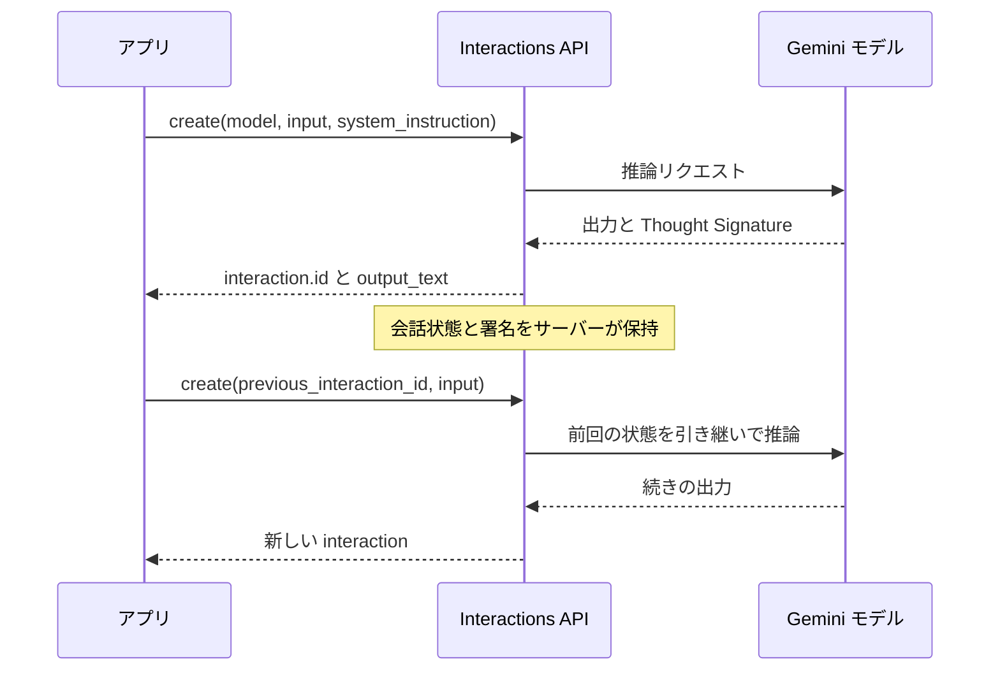
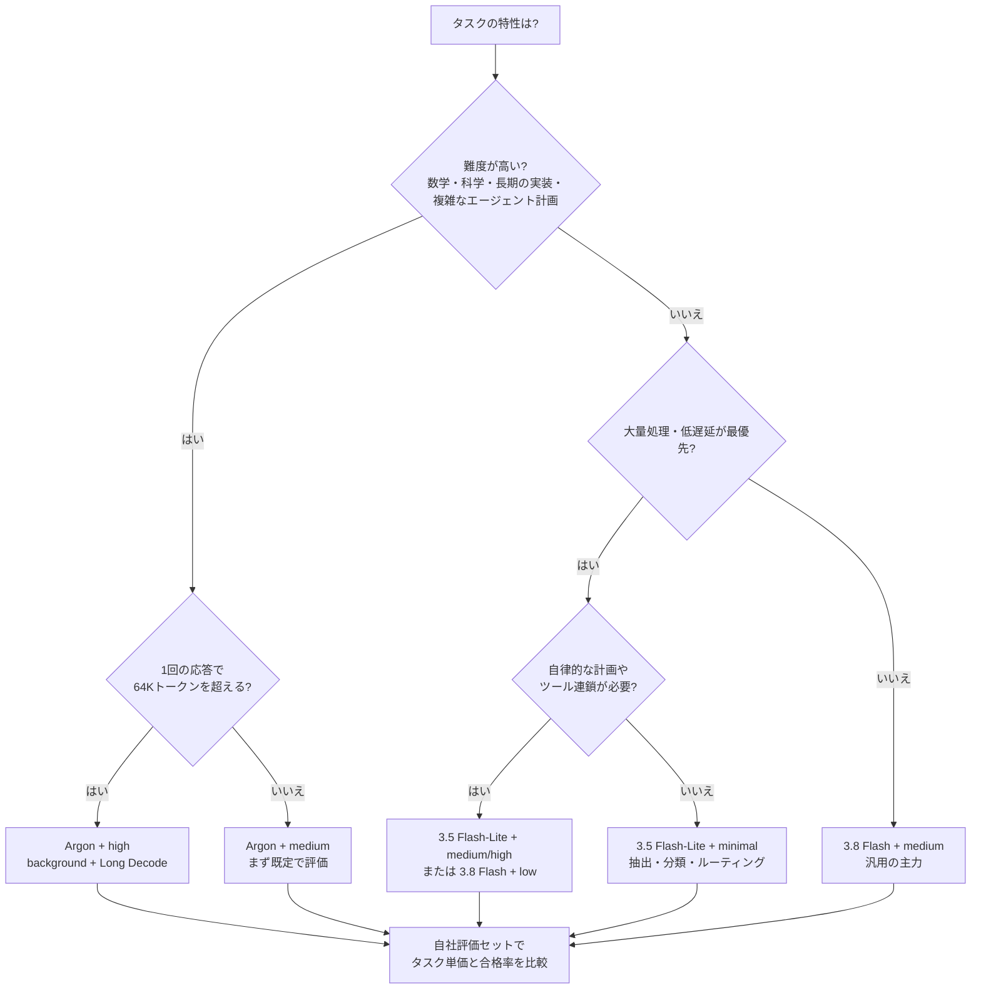
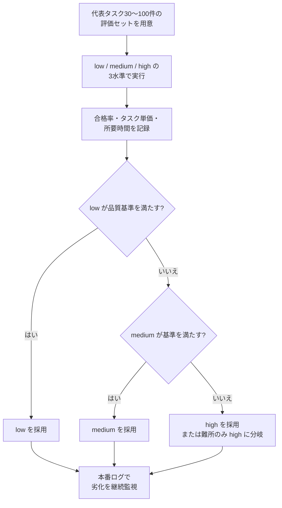
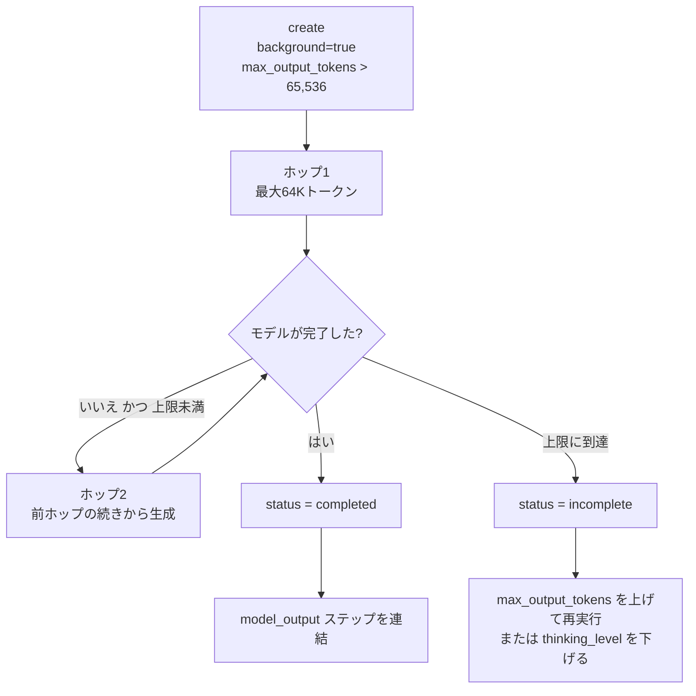
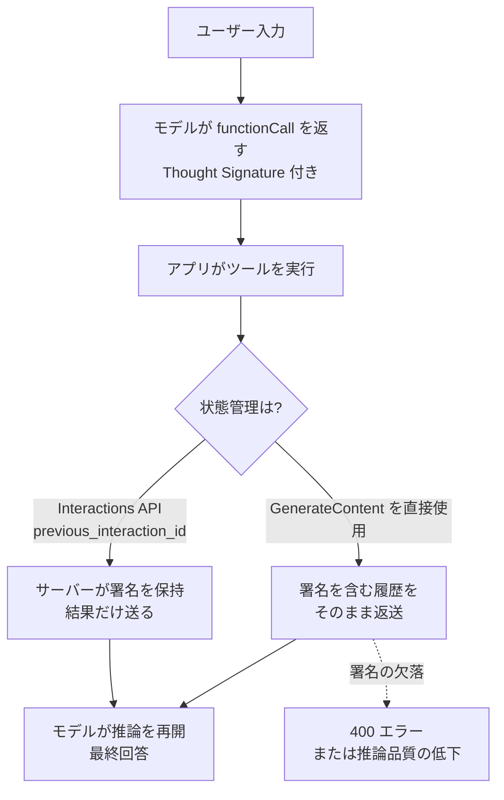
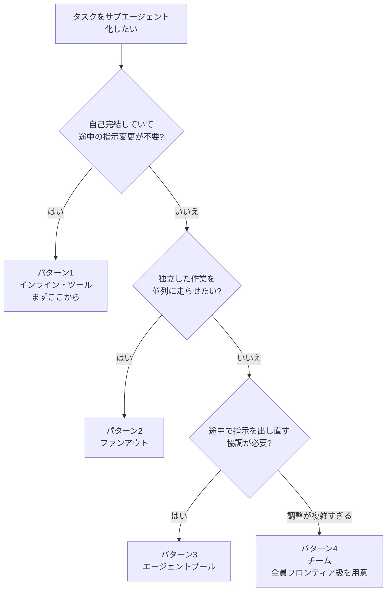
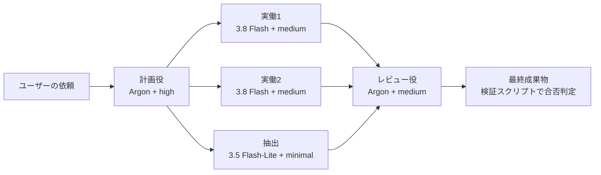
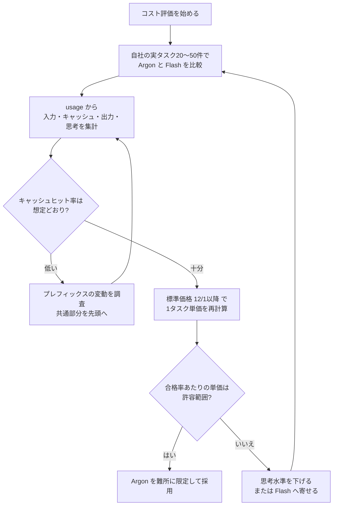
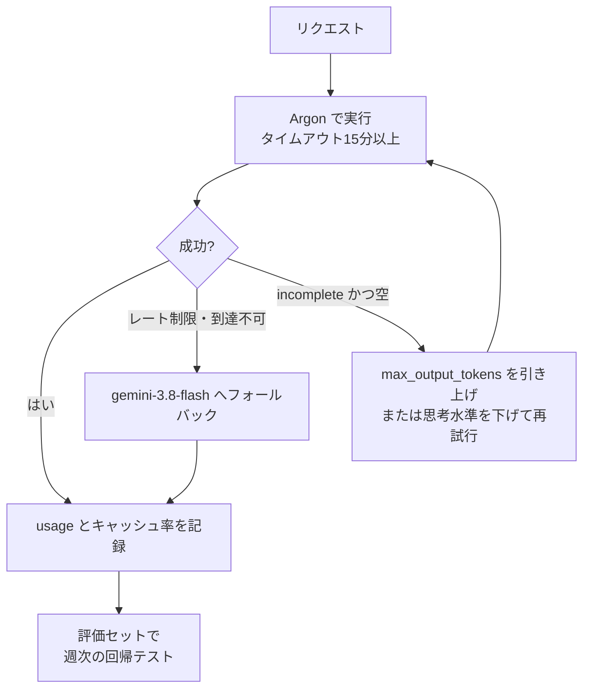

# Google Gemini 最新モデル ベストプラクティス完全ガイド

> **対象読者**: 中級〜上級のAIエンジニア / **情報時点**: 2026年10月23日 / **形式**: ステップバイステップ
> **範囲**: Gemini 4 Argon、Gemini 3.8 / 3.6 / 3.5 Flash 系、周辺モデル(画像・動画・音声・Live・ロボティクス)、Interactions API、Managed Agents(Antigravity)
> **表記ルール**: 図解は Mermaid と Markdown の表のみを使用。コードブロックはすべて言語指定(シンタックスハイライト付き)。

---

## 目次

1. [このガイドの読み方と情報の確からしさ](#0-このガイドの読み方と情報の確からしさ)
2. [2026年10月時点の全体像](#1-2026年10月時点の全体像)
3. [Step 1: 環境を整える(Interactions API を軸にする)](#step-1-環境を整えるinteractions-api-を軸にする)
4. [Step 2: ワークロードに合うモデルを選ぶ](#step-2-ワークロードに合うモデルを選ぶ)
5. [Step 3: thinking_level を設計する](#step-3-thinking_level-を設計する)
6. [Step 4: max_output_tokens と Long Decode を使いこなす](#step-4-max_output_tokens-と-long-decode-を使いこなす)
7. [Step 5: 旧モデルからの移行で壊れやすい点を先に潰す](#step-5-旧モデルからの移行で壊れやすい点を先に潰す)
8. [Step 6: プロンプトとコンテキストを設計する](#step-6-プロンプトとコンテキストを設計する)
9. [Step 7: 関数呼び出しと Thought Signatures](#step-7-関数呼び出しと-thought-signatures)
10. [Step 8: エージェント設計(Managed Agents / サブエージェント)](#step-8-エージェント設計managed-agents--サブエージェント)
11. [Step 9: コスト最適化(タスク単価で測る)](#step-9-コスト最適化タスク単価で測る)
12. [Step 10: 本番運用(信頼性・安全性・評価)](#step-10-本番運用信頼性安全性評価)
13. [Step 11: マルチモーダル・周辺モデルの使いどころ](#step-11-マルチモーダル周辺モデルの使いどころ)
14. [よくある落とし穴と対処(トラブルシューティング表)](#よくある落とし穴と対処トラブルシューティング表)
15. [導入チェックリスト](#導入チェックリスト)
16. [補足: 著名開発者・独立評価から得られる追加のベストプラクティス](#補足-著名開発者独立評価から得られる追加のベストプラクティス)
17. [参考URL(根拠ソース一覧)](#参考url根拠ソース一覧)

---

## 0. このガイドの読み方と情報の確からしさ

### 0.1 読み方

各 Step は「**何をするか → なぜか → どうやるか → 確認方法**」の順で構成しています。最短で実務に入りたい場合は、次の順で読んでください。

| 目的 | 読む章 |
| --- | --- |
| 今すぐ Argon を試したい | Step 1 → Step 3 → Step 4 → Step 5 |
| 既存アプリを Gemini 3.x / 2.5 から移行したい | Step 5 → Step 7 → Step 9 |
| エージェントを作りたい | Step 6 → Step 7 → Step 8 → Step 10 |
| コストを抑えたい | Step 3 → Step 9 |

### 0.2 情報の確からしさ(重要)

このガイドの数値・主張は、出どころによって信頼度が異なります。判断材料として必ず区別してください。

| 区分 | 例 | 扱い方 |
| --- | --- | --- |
| **公式ドキュメント** | モデルID、価格、API仕様、移行チェックリスト | 設計の根拠として採用してよい。ただし変更されるため実装前に再確認 |
| **ベンダー報告ベンチマーク** | DeepSWE v1.1、Vals Index、Gray Swan IPI など | 「Google が自社の条件で測った値」。第三者再現が出るまで参考値 |
| **独立評価** | Artificial Analysis の Intelligence Index・タスク単価 | 比較の軸として有用。ただし指標の定義に依存する |
| **個人・小規模ベンチ** | 特定モノレポでの実測ブログなど | 単一コードベースの結果。自社タスクで再現確認が必須 |

> **この種のモデルの比較記事は日々更新されます。** 価格・提供形態・非推奨スケジュールは、実装・見積もりの直前に公式ページ([参考URL](#参考url根拠ソース一覧)の A 群)で必ず確認してください。

---

## 1. 2026年10月時点の全体像

### 1.1 一枚で把握する「現行ラインナップ」

| モデル | モデルID | 位置づけ | 主な特徴 | 価格(100万トークンあたり、入力 / 出力) |
| --- | --- | --- | --- | --- |
| **Gemini 4 Argon** | `gemini-4-argon` | **最上位(フロンティア)** | 長期的なソフトウェア開発・エージェント・数学/科学向け。入出力で共有される約1Mトークンの統合ウィンドウ、**Long Decode**(最大 約1Mトークン出力) | 導入価格 **$2 / $10**(〜2026-11-30)、12/1以降 **$4 / $20**。キャッシュ入力 $0.10 → $0.20 |
| **Gemini 3.8 Flash** | `gemini-3.8-flash` | **最新の Flash(主力の高速モデル)** | 長期ソフトウェア開発、自律エージェント、企業ワークフロー向け。Managed Agents(Antigravity)の既定モデル | 導入価格 $0.75 / $3.75(〜2026-12-31)、2027-01-01以降 $1.50 / $7.50 |
| **Gemini 3.6 Flash** | `gemini-3.6-flash` | 前世代の安定 Flash | トークン効率・コード/エージェント計画の改善、出力の冗長さの改善 | 3.7 Flash 公開時に導入価格 $0.75 / $3.75 が適用(〜2026-12-31)。以降 $1.50 / $7.50 |
| **Gemini 3.5 Flash-Lite** | `gemini-3.5-flash-lite` | **低遅延・低コスト** | 大量処理、データ抽出、サブエージェント向け。既定の思考レベルは `minimal` | $0.30 / $2.50 |
| Gemini 3.7 Flash | `gemini-3.7-flash` | 非推奨(API では 3.8 Flash へ自動ルーティング) | — | — |
| Gemini 3.5 Flash | `gemini-3.5-flash` | 非推奨(API では 3.6 Flash へ自動ルーティング) | — | — |
| Gemini 2.5 系 | `gemini-2.5-*` | レガシー | API では「過去に使ったユーザーのみ」アクセス制限。Vertex 側の退役日は 2026-10-20 | 新規プロジェクトでは使わない |

> **注意**: 非推奨・退役日は **Gemini API(AI Studio)** と **Google Cloud(Vertex / Gemini Enterprise Agent Platform)** で異なります。たとえば 3.7 Flash は API 側で 2026-10-08 に非推奨化されて 3.8 Flash にルーティングされますが、Cloud 側のモデルバージョン表では 2027-01-28 退役と記載されています。**利用している提供面のページ**を基準にしてください。

### 1.2 周辺モデル(用途別)

| 用途 | モデル / エージェント | 要点 |
| --- | --- | --- |
| 画像生成・会話編集 | `gemini-nano-banana-2.1`(Nano Banana 2.1) | 2026-10-06 GA。視覚品質、プロンプト追従、キャラクター一貫性、文字描画、極端な縦横比(1:4 / 4:1 / 1:8 / 8:1)を改善。旧 `gemini-3.1-flash-image` は非推奨 |
| 動画生成・編集 | `gemini-omni-1.1-flash` | 対話型の動画生成/編集。動画延長、最初と最後のフレーム補間、解像度指定(360p〜4K。1080p/4Kはアップスケール) |
| 音楽生成 | `lyria-3.5` | フルレングス楽曲生成、44.1kHz ステレオ |
| 音声合成(TTS) | `gemini-3.8-flash-tts` / `gemini-3.8-flash-lite-tts` | スタジオ品質 / 低コスト・高スループット。Voices エンドポイントと音声デザイン・複製 |
| リアルタイム音声 | `gemini-3.8-live` / `gemini-3.8-live-extended-thinking` | Live API 用。低遅延対話 / バックグラウンド推論付き |
| 文字起こし | `gemini-3.5-transcribe` / `gemini-3.5-transcribe-live` | 85言語以上、話者分離、単語タイムスタンプ、語彙バイアス |
| ロボティクス | `gemini-robotics-er-2-preview` ほか | 具現化推論(プレビュー) |
| リサーチ・エージェント | `deep-research-preview-04-2026` / `deep-research-max-preview-04-2026` | 旧 `deep-research-pro-preview-12-2025` は 2026-10-23 に停止予定 |
| コーディング・エージェント | `antigravity-preview-09-2026`(Managed Agents) | 既定モデルは 3.8 Flash。`agent_config` で Argon に切替可能 |

### 1.3 リリースの流れ(把握しておきたい時系列)



> Gemini 3.5 Pro は公開されず、最上位は Gemini 4 Argon に置き換わった、と複数の報道が伝えています。

### 1.4 Argon の公式な要点(最低限これだけは押さえる)

| 項目 | 内容 |
| --- | --- |
| 統合ウィンドウ | 入力・思考・出力が **1,048,576 トークンを共有** |
| 1リクエストの出力 | 既定 **65,536 トークン**。それ以上は **Long Decode**(`background: true` + `max_output_tokens` 引き上げ) |
| 思考レベル | `low` / `medium`(既定)/ `high`。`minimal` は非対応 |
| サンプリング | `temperature` / `top_p` / `top_k` は **無視される**(送っても効かない) |
| キャッシュ | **明示キャッシュ(`cachedContents` / `caches.create`)は非対応でエラー**。**暗黙キャッシュのみ**(4,096トークン以上のプロンプトで有効、キャッシュヒット入力は95%割引) |
| 提供 | 有料 Gemini API、Google AI Studio、Antigravity、対象の Gemini Enterprise。**無料枠では使えない** |
| 新機能 | エージェント型動画理解が GA、Managed Agents(Antigravity)で利用可 |
| タイムアウト | 難しいプロンプトは数分かかる。**HTTPクライアントのタイムアウトは15分以上**、または background 実行 |

### 1.5 ベンチマークの読み方(ベンダー報告と独立評価を分けて見る)

| 指標 | Gemini 4 Argon | 比較 | 区分 |
| --- | --- | --- | --- |
| DeepSWE v1.1 | 77.9% | Claude Opus 5.5 74.2% / GPT-6 Astra 74.1% | ベンダー報告 |
| Vals Index | 68.9%(1位と報告) | — | ベンダー報告 |
| AutomationBench(Zapier) | 51.3%(1位と報告) | — | ベンダー報告 |
| LVBench(長尺動画理解) | 91.7% | — | ベンダー報告 |
| ERQA(具現化推論) | 87% | — | ベンダー報告 |
| Terminal-Bench 4.0 | 57.4% | Claude Opus 5.5 66.4% | Google の比較表(Argon が劣後) |
| Gray Swan 間接プロンプトインジェクション(攻撃成功率、低いほど良い) | 0.7% | Opus 5.5 1.0% など | ベンダー報告 |
| Artificial Analysis Intelligence Index | 53(高思考) | GPT-6 Astra 53 / GPT-6.1 Sol 52 / Claude Opus 5.5 は5ポイント上 | **独立評価** |
| 同 インデックス1タスクあたりコスト | $1.99(導入価格)/ $3.98(標準価格) | GPT-6 Astra $3.26 | **独立評価** |

**読み取れること**

1. Argon は「全勝」ではなく、**長期的なソフトウェア開発・金融/法務・業務自動化・長尺動画**で強く、ターミナル操作系などでは競合が上回る領域もある。
2. **導入価格のうちは安い**が、12/1 に2倍になる。比較は必ず「標準価格」でも行う。
3. ベンダー報告値は、独立リーダーボードにまだ載っていないものがある。**自社タスクでの再現**が最終判断。

---

## Step 1: 環境を整える(Interactions API を軸にする)

### 何をするか

Gemini 3 世代以降の新機能(サーバー側の会話状態管理、背景実行、Managed Agents、Long Decode)は **Interactions API** を中心に提供されています。まず SDK と認証、最小の呼び出しを確立します。

### なぜか

- Interactions API は **モデルとエージェントを同じインターフェースで扱う**統一API。
- `previous_interaction_id` で **会話状態と Thought Signatures をサーバー側で保持**でき、クライアントの履歴管理ミスを減らせる(Philipp Schmid の解説でも「再送不要・署名の自動管理」が利点として挙げられています)。
- Argon の Long Decode(1Mトークン出力)は **背景実行(background)を前提**にした仕組み。

### どうやるか

```bash
# 1) SDK のインストール(Python の例)
pip install --upgrade google-genai

# 2) 認証(Argon は無料枠では使えないため、課金が有効なプロジェクトのキーを使う)
export GEMINI_API_KEY="あなたのAPIキー"
```

```python
# 3) 最小の呼び出し(Interactions API)
from google import genai

client = genai.Client()

interaction = client.interactions.create(
    model="gemini-4-argon",
    input="このリポジトリの設計上のリスクを3つ挙げて、根拠も示してください。",
)
print(interaction.output_text)
```

```python
# 4) 会話の継続: 履歴を自分で組み立てず、前回のIDを渡す
first = client.interactions.create(
    model="gemini-4-argon",
    input="決済リトライ処理の競合状態を分析して。",
    system_instruction="あなたはシニアのバックエンドエンジニアです。根拠のない断定はしないでください。",
)

second = client.interactions.create(
    model="gemini-4-argon",
    input="では、トランザクションロックを安全に書き直して。",
    # system_instruction は会話履歴として引き継がれないため、各リクエストで指定し直す
    system_instruction="あなたはシニアのバックエンドエンジニアです。根拠のない断定はしないでください。",
    previous_interaction_id=first.id,   # サーバー側の状態を引き継ぐ
)
print(second.output_text)
```

```bash
# 5) コマンドラインで素早く試す(Simon Willison の llm プラグイン経由)
pip install llm llm-gemini
llm -m gemini-4-argon -o thinking_level high 'Prove that there are infinitely many primes'
```



### 確認方法

- 最小リクエストが成功し、`interaction.output_text` が返る。
- 2回目の呼び出しで、1回目の文脈が踏まえられている。

> **ヒント**: 公式は「コーディングエージェントで移行を自動化する」手順を提供しています。Antigravity など Skills 対応エージェントなら、`npx skills add google-gemini/gemini-skills --skill gemini-interactions-api --global` を実行後、`/gemini-interactions-api migrate my app to Gemini 3.6 Flash` のように依頼できます(Argon 向けは `gemini-api-dev` スキルで `/gemini-api-dev migrate my app to Gemini 4 Argon`)。

---

## Step 2: ワークロードに合うモデルを選ぶ

### 何をするか

「最上位を常用する」のではなく、**難所だけ Argon、量をこなす部分は Flash / Flash-Lite** という階層設計にします。

### なぜか

- Argon は導入価格でも Flash より高く、**12/1 以降は単価が2倍**。
- 独立評価でもトークン消費は多め(Intelligence Index 1タスクあたり出力約62kトークンという報告)で、**1トークン単価ではなく1タスク単価**で判断する必要がある。
- Google 自身が **Argon を計画役・レビュー役、3.8 Flash を並列のサブエージェント**にする構成を提案している、と提供各社のドキュメントが伝えています。

### モデル選定フロー



### 選定の目安(表)

| ワークロード | 第一候補 | 理由・注意 |
| --- | --- | --- |
| 難しい数学・科学・形式的証明 | Argon + `high` + Long Decode | 64Kを超える思考が必要なことがある |
| 大規模リファクタ・複数ファイル修正 | Argon + `medium` | 公式は「複雑なコードやエージェント用途にも medium を推奨」 |
| 日常的なコーディング補助・企業ワークフロー | 3.8 Flash + `medium` | 長期ソフトウェア開発向けに設計された Flash。コストが低い |
| 低遅延チャット・下書き・インシデント対応 | 3.8 Flash + `low` | 公式が low の用途として例示 |
| 高スループットの文書抽出・構造化JSON | 3.5 Flash-Lite(`minimal` 〜 `high`) | 文書の複雑さに応じて minimal と high の両方で試す |
| 自律サブエージェント(ツール連鎖あり) | 3.5 Flash-Lite + `medium` / `high` | `minimal` のままだとツール実行が早期終了することがある |
| 長尺動画の理解 | Argon または Flash 系のエージェント型動画理解 | トークンを大幅に節約できる(後述) |
| スクリーンショットからのHTML再現など視覚的な精密さ | 他社モデルとの比較評価を必須に | 個人ベンチで Argon が最下位だった例がある(単一ベンチ) |

---

## Step 3: thinking_level を設計する

### 何をするか

`thinking_level` を「品質・遅延・トークン消費」の**主要ダイヤル**として扱い、**3水準すべてで自社評価を回し、基準を満たす最低の水準**を採用します。

### なぜか

- 公式が「`low` / `medium` / `high` の3水準で評価し、品質基準を満たす最低水準を選ぶ」と明記しています。
- 個人ベンチ(paddo.dev)でも、**努力水準を上げても常に良くなるわけではない**ことが報告されています(Claude / GPT 系での実測で、既定の medium が最適だった例。他社モデルの結果なので Gemini にそのまま当てはまるとは限らず、**自社で測る**のが原則)。

### 水準の使い分け

| 水準 | トークン消費 | 向く用途 | 注意 |
| --- | --- | --- | --- |
| `minimal`(Flash / Flash-Lite のみ。**Argon と 3.8 Flash は非対応でエラー**) | 最小 | 高スループットの抽出・分類・ルーティング | 3.8 Flash / Argon で指定すると400系エラー |
| `low` | 少 | 単純タスク、コスト重視、軽い分析・文章作成 | 難問では品質が落ちる |
| `medium`(既定) | 中 | **大半のタスク**。複雑なコード、エージェント用途 | まずここから |
| `high` | 多(最初のトークンまでが遅い) | 難しい推論、数学/科学、最難関のコード・エージェント | Long Decode と相性が良い |

```python
# thinking_level は generation_config で指定する
interaction = client.interactions.create(
    model="gemini-4-argon",
    input="この決済パイプラインの再試行時の競合状態を分析し、ロックを安全に書き直して。",
    generation_config={"thinking_level": "medium"},
)
```

### 水準の決め方(評価ループ)



### よくある失敗

- 「トークンを減らしたい」ときに `max_output_tokens` を下げる → **思考で使い切って答えが空になる**。トークンを減らすなら `thinking_level` を下げる(公式の注意)。
- Gemini 3.5 以前の `thinking_budget` を残す → 3.6 以降は `thinking_level`(文字列)へ置換する。

---

## Step 4: max_output_tokens と Long Decode を使いこなす

### 何をするか

`max_output_tokens` を「**思考+出力の合計上限**」として設計し、64Kを超える必要があるときだけ **Long Decode(背景実行)** を使います。

### なぜか

- Argon は思考にも出力枠を使うため、**低い上限だと思考だけで切れて空の応答**になりうる。
- Long Decode は **64Kトークンずつの「ホップ」** で続きを生成し、サーバーが自動で連結する。使いすぎるとコストと時間が膨らむ。

### 設定の目安(公式)

| 状況 | `max_output_tokens` | background |
| --- | --- | --- |
| 標準タスク | 既定(65,536)のままか未設定 | 不要 |
| 既存アプリで32K未満に制限している | **32,768 以上へ引き上げ** | 不要 |
| 長いコーディング・エージェントタスク | 65,536 から開始 | 不要 |
| 複雑な推論・数学・科学・証明 | **131,072 / 262,144 など**(最大で 1,048,576 − 入力トークン) | **必須(`true`)** |

### Long Decode の実装例

```python
import time
from google import genai

client = genai.Client()

interaction = client.interactions.create(
    model="gemini-4-argon",
    input="素数定理の完全で厳密な証明を書いてください。",
    background=True,                      # Long Decode は背景実行が前提
    store=True,                           # 背景実行には store=True が必要(store=False とは併用不可)
    generation_config={
        "max_output_tokens": 262144,      # 65,536 を超える値を必ず設定する
        "thinking_level": "high",
    },
)

# 完了までポーリング(長時間かかるため、短いタイムアウトで待たない)
while interaction.status in ("in_progress", "queued"):
    time.sleep(5)
    interaction = client.interactions.get(id=interaction.id)

# ホップごとに model_output ステップが増えるので、すべて連結する
text = "".join(
    content.text
    for step in interaction.steps
    if step.type == "model_output"
    for content in step.content
    if content.type == "text"
)
print(text)
print("Status:", interaction.status)
print("Usage:", interaction.usage)
```



### ステータスの扱い

| status | 意味 | 対処 |
| --- | --- | --- |
| `completed` | 完了 | `model_output` を連結。続けるなら `previous_interaction_id` に `id` を渡す |
| `requires_action` | ツール呼び出し待ち | ツールを実行して結果を返す |
| `incomplete` | `max_output_tokens` を使い切った(思考中で本文が空のこともある) | 上限を上げて再送、または思考水準を下げる |
| `failed` | サーバー側で失敗 / 24時間超過 | 再試行。再発するなら interaction ID をサポートに共有 |
| `cancelled` | 利用者がキャンセル | `usage` で課金トークンを確認 |

### Long Decode を使うべきでない場面(公式)

| 場面 | 理由 |
| --- | --- |
| チャット・要約・分類・抽出 | 32Kトークン未満で終わる |
| 「70万語の本を書いて」のような**長さ指定** | モデルは長さ目標に従わない |
| 短いターンを何度も重ねるエージェント | 各ターンの大きな出力が共有コンテキストをすぐ埋める |
| 入力が上限に近いプロンプト | 出力は「1,048,576 − 入力」しか使えない |
| 低遅延が必要なリクエスト | 数分〜かかる |

### ストリーミング時の注意(長時間ストリームは切れる前提で作る)

| ルール | 内容 |
| --- | --- |
| interaction ID を保存 | `interaction.created` イベントから取得 |
| すべての `event_id` を保存 | テキスト差分だけでなく `status_update` にも付く |
| 再接続は `last_event_id` で | 最後の `event_id` を指定して `get` を `stream` で呼ぶ |
| 読み切ってから状態確認 | 再接続後はストリームを最後まで読む(取りこぼしイベントは再送される) |
| 読み取りタイムアウト | **15〜20分** |
| 最初の64K以降 | 約5,000トークンの塊で届く。**間が空いても止まっていない** |

### トークン数の数え方(落とし穴)

`usage.total_input_tokens` は **各ホップの入力の合計**で、実際のコンテキスト長ではありません。たとえば1,000トークンのプロンプトで20万トークンを生成すると、入力合計は約39.7万トークンと表示されますが、実コンテキストは約20.1万トークンです。**要約・圧縮(コンテキスト圧縮)の判断に `total_input_tokens` を使わない**でください。実サイズの推定は「プロンプト + `total_output_tokens` + `total_thought_tokens`」です。

---

## Step 5: 旧モデルからの移行で壊れやすい点を先に潰す

### 何をするか

Gemini 3.6 以降(および今後のすべての世代)で適用される API 変更を、**移行前に洗い出して修正**します。多くは「エラーにならず挙動だけ変わる」ため、静かに品質が落ちます。

### 移行チェックリスト(Argon / 3.8 Flash 共通を中心に)

| # | 項目 | やること | 放置した場合 |
| --- | --- | --- | --- |
| 1 | モデルID | `gemini-4-argon` / `gemini-3.8-flash` へ変更 | 旧モデルは自動ルーティングや退役の対象 |
| 2 | サンプリング引数 | `temperature` / `top_p` / `top_k` を**削除** | Argon では無視される(将来の世代では400エラー) |
| 3 | 決定性の確保 | 引数ではなく **`system_instruction` に明示的なルール**を書く | 出力の揺れが残る |
| 4 | 明示キャッシュ | `cachedContents` / `caches.create` を**削除**(Argon) | **エラー**。暗黙キャッシュへ切替 |
| 5 | 思考指定 | `thinking_budget` → `thinking_level`(文字列) | 後方互換で受け付けられるが非推奨で、挙動を予測しにくい。`thinking_level` と併用すると400エラー |
| 6 | `minimal` | Argon / 3.8 Flash では使わない | エラー |
| 7 | モデルターンの事前入力(prefill) | 廃止。`system_instruction` や構造化出力で代替 | **400エラー**(最後の非空ターンが model の場合) |
| 8 | `candidate_count` | 削除(Gemini 3以降非対応) | エラーまたは無視 |
| 9 | `max_output_tokens` | 32,768以上へ引き上げ(Argonは思考に枠を使う) | 空応答・途中切れ |
| 10 | タイムアウト | HTTPクライアントを15分以上、または背景実行 | 難問で切断 |
| 11 | 会話状態 | `previous_interaction_id` でサーバー側に保持 | 署名欠落・履歴不整合 |
| 12 | 関数呼び出し | 応答の対応(`id` / `name` / 件数)を厳密に一致させる | 400エラー(Step 7) |

### prefill の置き換え例

```python
# 悪い例(旧来の prefill): 最後が model ターンだと 400 エラーになる
# contents = [
#   {"role": "user",  "parts": [{"text": "Hello world をスペイン語に翻訳して"}]},
#   {"role": "model", "parts": [{"text": "翻訳:"}]},   # <- これがエラーの原因
# ]

# 良い例: system_instruction で出力形式を指定する
interaction = client.interactions.create(
    model="gemini-3.8-flash",
    input="'Hello world' をスペイン語に翻訳して。",
    system_instruction="前置きなしで、翻訳結果だけを出力してください。",
)
```

### 暗黙キャッシュへの切替(Argon)

| 項目 | 内容 |
| --- | --- |
| 仕組み | 自動(コード変更不要)。4,096トークン以上のプロンプトで有効という公式記載 |
| 割引 | キャッシュヒット入力は95%割引($0.10 / 100万トークン。12/1以降 $0.20) |
| 設計 | **共通部分(システム指示・ツール定義・長い資料)を必ず先頭に置く**。変化する部分は末尾に |
| 確認 | レスポンスの `usage` の `total_cached_tokens` でヒット量を観測する |

> **提供面で条件が異なる**例: Google Cloud 側の開発者ガイドには、共有プレフィックスの最小サイズが API の記載と異なる旨の言及があります。購入した提供面のドキュメントとレスポンスの実測値を基準にしてください。

---

## Step 6: プロンプトとコンテキストを設計する

### 何をするか

Argon / 3.8 Flash は「**長く自律的に走らせる**」ことに強みがあります。細かいターンごとの指示ではなく、**ゴール・制約・検証基準・使える道具**を最初に渡す設計へ切り替えます。

### なぜか

- 公式の開発者ガイド(AI Studio)は、Argon の長期タスクでの性能が出る条件として「**実際のフィードバックループで自分の変更を検証できること**」を挙げています。
- Gemini 3.8 Flash は **難しい多段タスクで意図的に多くのトークンを使う**(小さな推論ステップ、反復的なツール呼び出し、途中検証)。日常タスクでは思考水準を下げて抑える、と公式が明記。
- Philipp Schmid(Google DeepMind)は「コンテキストエンジニアリングとは、文脈を増やすことではなく**次のステップに必要な最小の有効コンテキスト**を見つけること」と整理しています。

### 実務で効く5つの型(公式ガイドの要点を実装向けに整理)

| 型 | やること | 理由 |
| --- | --- | --- |
| **1. 事前確認(pre-flight)** | 作業前に「必要なツール・資料へのアクセス」と「意図の理解」をモデルに確認させる | 長時間の自律実行の後でアクセス不足が判明する事故を防ぐ |
| **2. 完走させる** | ターンごとの細切れ指示をやめ、合意した目標まで自律的に実行させる。**不可逆な操作の前だけ**人間の承認を挟む | 計画→実装→検証→修正の反復が1回の実行内で完結する |
| **3. 検証スクリプトを書かせる** | 再現可能な検証スクリプトを作らせ、ベースラインを記録し、変更ごとにパス/フェイルで反復させる | 具体的な合否基準があると、Argon は仮説検証を繰り返して「全部グリーン」まで進める |
| **4. 振り返りを資産化** | 完了後に学び(最短経路・罠)を `AGENTS.md` や再利用可能なスキルへ書かせる | 次回以降のセッションが最初から直線的に進む |
| **5. 動画は「見る場所」を探させる** | エージェント型動画理解で、必要な時刻・フレーム・音声だけを取得させる | 長尺動画でトークンを大幅削減(Flash系の発表では最大88%減という記載) |

### プロンプトの骨格(コピーして使える雛形)

```python
SYSTEM = """\
あなたは大規模なコードベースを担当するシニアエンジニアです。

# 目標
{goal}

# 制約
- 変更は最小限。依存関係の追加は事前に確認する。
- 不可逆な操作(削除・本番への反映・外部への送信)の前に、必ず私の承認を求める。

# 検証基準(合格条件)
- {verification_command} がすべて成功すること。
- 既に通っているテストを壊さないこと。

# 進め方
1. 作業前に、使えるツール・資料・前提を確認し、理解した意図を1段落で述べる。
2. 検証スクリプトを先に用意し、ベースラインを記録する。
3. 変更 → 検証 → 修正を、合格条件を満たすまで繰り返す。
4. 最後に、学んだこと(最短経路・つまずき)を3点にまとめる。
"""

interaction = client.interactions.create(
    model="gemini-4-argon",
    system_instruction=SYSTEM.format(
        goal="決済リトライ処理の競合状態を解消する",
        verification_command="pytest -q tests/payments",
    ),
    input="上記の進め方で、リポジトリの該当部分から着手してください。",
    generation_config={"thinking_level": "medium", "max_output_tokens": 65536},
)
```

### 文脈を軽くする原則(Schmid のコンテキストエンジニアリング)

| 原則 | 具体策 |
| --- | --- |
| 圧縮・要約で「コンテキストの腐敗」を防ぐ | 長時間エージェントは履歴を要約するか、新しいセッションに切り替える |
| 共有は「通信」で行う | サブエージェントへは全履歴を渡さず、タスクと必要な事実だけを渡す |
| ツールセットを小さく保つ | 使わないツール(例: 不要な MCP の関数)は無効化 |
| ツールの説明は「ツール向けのプロンプト」 | 説明文と引数のスキーマを丁寧に書く |
| 不要なツール呼び出しを減らす | 低い思考水準や system instruction で呼び出し方針を明示(Gemini 3.x 公式の推奨) |

### モデル特性に合わせた補正

| 症状 | 原因の例 | 対処 |
| --- | --- | --- |
| UIの見た目が好みでない(Flash 3.6) | 機能するコードは強いが、視覚的なスタイルは旧モデルが好まれた評価がある | **明示的なデザインガイドライン**を渡す |
| 診断タスクで余計なファイルを触る | 指示追従の揺れ | 「診断のみ。変更は提案として出力」と明記 |
| 簡単なフロントエンド作業で探索が多い(3.6 Flash) | 変更前にプログラム的に調べる傾向 | 思考水準を下げる / 手順を指定する |
| 出力が長すぎる | 冗長さ | 3.6 Flash 以降は改善。さらに system instruction で形式を指定 |

---

## Step 7: 関数呼び出しと Thought Signatures

### 何をするか

Gemini 3 以降は、**推論状態を暗号化した Thought Signature** を次のリクエストに返す必要があります。Interactions API の**ステートフル運用(`previous_interaction_id`)**を使えば、サーバーが管理するため手作業は最小になります。

### なぜか

- 署名がないと、ツール実行の間にモデルが**自分の推論ステップを「忘れる」**。
- 関数呼び出しでは、現在のターンで署名が欠けると **400エラー**(`generateContent` の厳格検証)。通常のテキストでは厳格には検証されないが、**品質が落ちる**。
- 画像の会話型編集でも署名は重要。

### 署名の扱いルール(GenerateContent を直接使う場合)

| 状況 | 署名の位置 | やること |
| --- | --- | --- |
| 単一の関数呼び出し | その `functionCall` パート | 受け取ったまま返す |
| **並列**の関数呼び出し | **最初の `functionCall` だけ**に署名 | 受け取った順序のまま返す |
| 逐次(複数ステップ) | 各ステップの最初の呼び出しにそれぞれ署名 | **蓄積したすべての署名**を履歴に含める |
| 他世代のモデルから会話を引き継ぐ / 自前で挿入した関数呼び出し | 有効な署名なし | 公式の回避方法(ダミー署名等)に従う |



### 関数応答の作法(3.x 共通の公式推奨)

| 項目 | 推奨 |
| --- | --- |
| 応答の対応 | Interactions API の `function_result` は呼び出しの `id` を **`call_id`** に指定する(GenerateContent の `FunctionResponse` は `id`)。`call_id` / `name` / 件数が直前の呼び出しと**一致**(Interactions API は不一致をエラーにする) |
| マルチモーダル | 画像などは**応答ペイロードの中**に入れる(別パートにしない) |
| 追加指示 | 関数応答テキストの末尾に **`\n\n` 区切りで追記**(別パートにしない) |
| `Malformed_Function_Call` | ツール前のテキスト要件に起因する場合は、公式の回避策ページに従う |
| `generateContent` を使う場合のみ | すべての `FunctionResponse` に `call_id` と `name` を含める |

```python
# 追加指示は「応答テキストの末尾」に \n\n で付ける
import json

result_text = json.dumps(result, ensure_ascii=False)
function_response_text = f"{result_text}\n\n次は、この結果を根拠に3行で要約してください。"
```

---

## Step 8: エージェント設計(Managed Agents / サブエージェント)

### 何をするか

(1)まずは **Managed Agents の Antigravity エージェント**で素早く立ち上げ、(2)必要に応じて**サブエージェントの型**を段階的に重くします。

### 8.1 Managed Agents(Antigravity)の基本

| 項目 | 内容 |
| --- | --- |
| エージェントID | `antigravity-preview-09-2026`(旧 `antigravity-preview-05-2026` は 2026-10-05 に停止) |
| 既定モデル | **Gemini 3.8 Flash**。`agent_config` で Argon などへ変更可能 |
| 実行環境 | `environment="remote"`(新しいサンドボックス) |
| 会話状態と環境状態 | **独立して管理**される(Schmid の解説) |
| 長いセッション | 約135kトークンで文脈を自動圧縮(5月時点の解説。最新値は公式で確認) |
| 認証情報 | Credentials API により、**秘密情報がサンドボックス内に存在しない**設計(GitHubトークンを露出させずに利用できる、という解説) |

```python
# 難しい作業だけ Argon に切り替える
interaction = client.interactions.create(
    agent="antigravity-preview-09-2026",
    input=(
        "https://web.dev をパフォーマンス・Core Web Vitals・SEOの観点で監査し、"
        "モバイル/デスクトップ別の比較表と優先度付きの修正案を出力してください。"
    ),
    environment="remote",
    agent_config={
        "type": "antigravity",
        "model": "gemini-4-argon",   # 省略時は gemini-3.8-flash
    },
)
print(interaction.output_text)
```

> **移行の注意(09-2026版)**: ローカルでツールを実行する(`local_environment`)場合や `function_call` ステップを解析している場合は、組み込みツールの**引数名がPascalCase**になり、ファイル編集が**行範囲置換**へ変わっています(例: `replace_file_content(TargetFile, StartLine, EndLine, ...)`)。リモートサンドボックスで `output_text` / `model_output` だけを読む場合は、エージェント文字列の更新だけで済みます。

### 8.2 サブエージェント4パターン(Philipp Schmid, 2026-05)

| パターン | 仕組み | 向くケース | 必要なモデル能力 |
| --- | --- | --- | --- |
| **1. インライン・ツール** | サブエージェントを関数として呼ぶ(同期/非同期) | 自己完結の作業(調査・レビュー・テスト生成) | ツールを呼べれば小型モデルでも可 |
| **2. ファンアウト** | `spawn` で並列起動 → `wait` で回収 | 独立した並列タスク | 「いつ待つか」を判断できること |
| **3. エージェントプール** | 永続エージェントにメッセージを送る | 複数ステップで専門家が協調 | 複数エージェントの状態を追跡できること |
| **4. チーム** | エージェント同士が直接メッセージ | 調整ロジックが単独エージェントの手に余る大規模作業 | **全員がフロンティア級**が必要 |



**鉄則(Schmid)**: パターン1から始める。上のパターンに上がるほど、より高性能なモデルが必要。**小型モデルを使うならパターン1か2に留める**。

### 8.3 「Argon は計画とレビュー、Flash は実働」の階層構成

提供各社のドキュメントでは、Google の提案として **Argon を計画役・レビュー役、3.8 Flash を並列サブエージェント**にしてコストと品質を両立する構成が紹介されています。

```python
# 役割ごとにモデルと思考水準を割り当てる(簡易ルーター)
ROUTES = {
    "plan":    {"model": "gemini-4-argon",       "thinking_level": "high"},
    "work":    {"model": "gemini-3.8-flash",     "thinking_level": "medium"},
    "extract": {"model": "gemini-3.5-flash-lite", "thinking_level": "minimal"},
    "review":  {"model": "gemini-4-argon",       "thinking_level": "medium"},
}

def run(role: str, prompt: str, system: str = ""):
    cfg = ROUTES[role]
    return client.interactions.create(
        model=cfg["model"],
        input=prompt,
        system_instruction=system or None,
        generation_config={"thinking_level": cfg["thinking_level"]},
    )

plan = run("plan", "この移行作業を、独立して並列実行できる5つ以内のタスクに分解して。")
```



---

## Step 9: コスト最適化(タスク単価で測る)

### 何をするか

**「1トークン単価」ではなく「1タスクを解く総コスト」**で評価し、キャッシュを効かせ、価格改定(12/1)を織り込んだ見積もりを作ります。

### なぜか

- Simon Willison は発表当日に「重要なのは、エージェント環境でゴールに到達するまでにモデルが使うトークン数だ」と指摘しています。
- Artificial Analysis の測定では、Argon の導入価格でのタスク単価は $1.99(標準価格では $3.98)。一方、個人ベンチ(paddo.dev)では **トークン単価は Opus 5.5 の半分でも、出力トークンが約2.8倍で総コストは上回った**という結果も報告されています(単一ベンチ・Claude Code 経由)。**独立評価と個人ベンチで傾向が異なるため、自社タスクで測る**のが唯一確実な方法です。

### コスト見積もりの実装

```python
from datetime import date

# 公式の導入価格(2026-11-30まで)と標準価格(2026-12-01から)。100万トークンあたりUSD
PRICES = {
    "intro":    {"input": 2.0, "cached": 0.10, "output": 10.0},
    "standard": {"input": 4.0, "cached": 0.20, "output": 20.0},
}

def argon_cost(usage, today: date | None = None, assume_standard: bool = False) -> float:
    today = today or date.today()
    tier = "standard" if (assume_standard or today >= date(2026, 12, 1)) else "intro"
    p = PRICES[tier]

    cached = usage.total_cached_tokens or 0
    fresh_input = (usage.total_input_tokens or 0) - cached
    # 思考トークンも出力として課金される
    out = (usage.total_output_tokens or 0) + (usage.total_thought_tokens or 0)

    return (fresh_input * p["input"] + cached * p["cached"] + out * p["output"]) / 1_000_000

# 標準価格で見積もる習慣をつける(導入価格だけで判断しない)
# print(argon_cost(interaction.usage, assume_standard=True))
```

> 上記は考え方を示すための簡易コードです。`usage` のフィールド名と、`total_output_tokens` に思考トークンが含まれるかどうかは、必ず公式の `usage` 説明と**実際のレスポンス**で確認して調整してください(含まれる場合は二重計上になります)。

### キャッシュを効かせる設計

| 施策 | 内容 |
| --- | --- |
| 共通部分を先頭に | システム指示・ツール定義・長い参考資料 → 変化する質問は末尾 |
| **プレフィックスを毎回変えない** | ターンごとに先頭付近へメッセージを差し込む設計は避ける |
| ヒット率を計測 | `total_cached_tokens` をログに出し、ダッシュボード化 |
| 明示キャッシュに頼らない | Argon は暗黙キャッシュのみ |

**実例(paddo.dev の報告)**: 第三者ハーネス(Claude Code)+ OpenRouter 経由で Argon を使った最初の実行は **$17.60**で、入力8.4Mトークンのうちキャッシュはわずか59k。原因は、毎ターン**システムロールのメッセージ**が差し込まれ、ゲートウェイがそれを Gemini のシステムプロンプトへ移すため**プロンプト先頭が毎回変わり**、暗黙キャッシュが効かなかったこと。メッセージを直前のユーザーターンへ移すプロキシで **$2.62(入力の94%がキャッシュ)**になったという報告です。**第三者ハーネスで Argon を使うときは、価格を評価する前にキャッシュヒット率を確認**してください。



### その他のコスト削減レバー

| レバー | 内容 |
| --- | --- |
| 思考水準を下げる | 公式:トークンを減らすなら `max_output_tokens` ではなく `thinking_level` |
| 階層構成 | 難所だけ Argon、量は Flash / Flash-Lite |
| エージェント型動画理解 | Flash 系の発表で、長尺動画のトークンを最大88%削減(静的処理との比較) |
| Batch / Flex / Priority 推論 | 公式ドキュメントに最適化の選択肢として掲載(適用条件と割引は最新ページで確認) |

---

## Step 10: 本番運用(信頼性・安全性・評価)

### 10.1 信頼性

| 項目 | ベストプラクティス |
| --- | --- |
| タイムアウト | HTTP は **15分以上**。難問は背景実行 + ポーリング / ストリーム再接続 |
| フォールバック | Argon が使えない・レート制限・到達不可のとき **3.8 Flash へ自動フォールバック**するラッパーを用意(Argon は無料枠不可) |
| 空応答の監視 | `incomplete` かつ本文が空 → 思考で上限を使い切った兆候。`max_output_tokens` と思考水準を見直す |
| 非推奨の追跡 | モデルごとの退役日(提供面で異なる)を CI で定期チェック |
| 観測性 | `usage`(入力・キャッシュ・出力・思考)、`status`、所要時間、ツール呼び出し回数を記録 |



### 10.2 安全性

| リスク | 対策 |
| --- | --- |
| 間接プロンプトインジェクション | Google は Argon を「間接インジェクションに最も強いモデル」と報告(Gray Swan IPI で攻撃成功率0.7%)。ただし**ゼロではない**ため、外部コンテンツを読むエージェントには権限分離・出力検証・人間承認を併用 |
| 不可逆操作 | 削除・本番反映・外部送信の前に**承認ゲート**を置く(公式ガイドの方針) |
| 秘密情報 | サンドボックス内に置かない。Credentials API 等で**実行時に注入し、モデルに見せない** |
| 暴走・逸脱 | Google は Argon の思考過程と行動を監視して必要時に実行を止める緩和策を展開していると説明。アプリ側でも**ステップ数・時間・コストの上限**を設ける |
| セキュリティ用途 | 防御目的の脆弱性発見・修正に強い一方、既存のセキュリティ用プロンプトは**先に Argon でテスト**し、拒否される領域は既存ツールを併用(提供事業者の移行ガイドの助言)。専用のサイバー向け変種(`gemini-4-argon-cyber-permissive` 等)が Cloud のモデル一覧に別枠で存在するが、**利用資格・用途の制限は公式で確認** |

### 10.3 評価(エージェントは最初のプロンプト以降を測る)

| 原則 | 内容 |
| --- | --- |
| 自社タスクで測る | ベンダー/第三者のベンチは出発点にすぎない。実コードベース・実業務の変更を再現して合否を判定 |
| 3水準 × 2モデル | Argon / Flash × `low` / `medium` / `high` で、**合格率・壊した既存テスト数・タスク単価・所要時間**を並べる |
| 回帰を見る | 「新しいテストを直せたか」だけでなく**既に通っていたテストを壊していないか**も指標にする(個人ベンチの観点) |
| ハーネスを分離 | モデルの差かハーネスの差かを、同じタスクを別ハーネスでも走らせて切り分ける |
| 価格改定後で再評価 | 標準価格(12/1以降)で再計算 |

---

## Step 11: マルチモーダル・周辺モデルの使いどころ

| 領域 | ベストプラクティス |
| --- | --- |
| **画像理解** | 指示では**モダリティを明示**して(「図の凡例と本文表の両方を突き合わせて」など)、個別に分析させず**統合**させる(Gemini 3 の公式ガイダンス)。精密なレイアウト再現が要る場合は、他モデルとの比較評価を必須に |
| **動画理解** | エージェント型動画理解(GA)で、時刻・フレーム・音声を必要に応じて取得させる。長尺で特に有効 |
| **画像生成・編集** | Nano Banana 2.1 で会話的に編集。**Thought Signatures を必ず返す**(会話型編集では署名が重要)。極端な縦横比(1:4〜8:1)や文字描画が改善 |
| **動画生成** | Omni Flash:延長・補間・解像度指定。1080p/4K はアップスケール出力である点を成果物仕様に明記 |
| **音声(リアルタイム)** | 低遅延は `gemini-3.8-live`、背景推論が必要なら `…-live-extended-thinking`。同期でなく**非同期関数呼び出しが既定** |
| **TTS** | 高品質は Flash TTS、大量・リアルタイムは Flash-Lite TTS。Voices エンドポイントで音声デザイン/複製(**複製は同意確認が前提**) |
| **文字起こし** | 非ストリーミングは `gemini-3.5-transcribe`、ストリーミングは `…-live`。語彙バイアス(最大1,000語)で固有名詞を安定化 |
| **ロボティクス** | Argon は ERQA 87% と報告。プレビューの `gemini-robotics-er-2-*` は物理動作を伴うため**ブロッキング関数呼び出し**で安全に |

---

## よくある落とし穴と対処(トラブルシューティング表)

| 症状 | 原因 | 対処 |
| --- | --- | --- |
| 応答が空だが課金される | 思考で `max_output_tokens` を使い切った(`incomplete`) | 上限を32,768以上に。必要なら思考水準を下げる |
| 出力が64Kで止まる | `background` が `false`、または上限未設定 | `background: true` + `max_output_tokens` > 65,536 |
| 400: `max_output_tokens` > 65536 は `background=false` で未対応 | Long Decode は背景実行が前提 | `background: true` にする |
| 400: `store=true is required` | 背景実行は保存が必須 | `store: true` |
| `temperature` を変えても出力が変わらない | Argon は無視する | 引数を削除し、`system_instruction` で制御 |
| `caches.create` でエラー | Argon は明示キャッシュ非対応 | 削除し、暗黙キャッシュ設計へ |
| 3.8 Flash / Argon で `minimal` がエラー | 非対応の水準 | `low` / `medium` / `high` へ |
| 最後が model ターンで400 | prefill の廃止 | `system_instruction` / 構造化出力へ |
| 関数呼び出しで400 | 署名欠落、または応答の `id` / `name` / 件数の不一致 | 状態管理を Interactions API に寄せる。応答を厳密に対応づける |
| `Malformed_Function_Call` | ツール前のテキスト要件 | 公式の回避策ページに従う |
| 想定よりコストが高い | キャッシュ不発(プレフィックスの変動)/ 出力トークン過多 | `total_cached_tokens` を確認。共通部分を先頭へ。思考水準を下げる |
| 長いストリームが途中で切れる | 接続断は起こりうる | `event_id` を保存し `last_event_id` で再接続。タイムアウト15〜20分 |
| コンテキスト圧縮が早すぎる | `total_input_tokens`(各ホップ入力の合計)を実サイズと誤認 | 実サイズ = プロンプト + 出力 + 思考 で推定 |
| Antigravity で自分のツール解析が壊れた | 09-2026版でツール引数・編集方式が変更 | PascalCase引数・行範囲置換へ対応 |
| 無料キーで Argon が呼べない | 無料枠対象外 | 課金有効なプロジェクトのキーを使う |
| 旧モデルが勝手に別モデルになった | 3.7 Flash → 3.8 Flash、3.5 Flash → 3.6 Flash の自動ルーティング | モデルIDを明示的に更新し、評価をやり直す |

---

## 導入チェックリスト

### A. 準備

- [ ] 課金が有効なプロジェクトの API キーを用意した(Argon は無料枠不可)
- [ ] 最新の `google-genai` SDK を導入した
- [ ] Interactions API で最小リクエストが成功した

### B. 移行(旧モデルがある場合)

- [ ] `temperature` / `top_p` / `top_k` / `candidate_count` を削除した
- [ ] prefill(最後が model ターン)を排除した
- [ ] `thinking_budget` を `thinking_level` に置換した
- [ ] 明示キャッシュ(`caches.create`)を削除した
- [ ] `max_output_tokens` を32,768以上にした
- [ ] HTTPタイムアウトを15分以上にした(または背景実行)

### C. 設計

- [ ] モデル階層(難所は Argon、量は Flash / Flash-Lite)を決めた
- [ ] 3水準(`low` / `medium` / `high`)で評価し、基準を満たす最低水準を採用した
- [ ] 検証スクリプト(合否基準)と、不可逆操作の承認ゲートを用意した
- [ ] 関数呼び出しの応答対応(`id` / `name` / 件数)と署名の扱いを確認した

### D. 運用

- [ ] `usage`(入力・キャッシュ・出力・思考)とキャッシュヒット率を記録している
- [ ] **標準価格(12/1以降)**で1タスク単価を再計算した
- [ ] フォールバック(Argon → 3.8 Flash)を実装した
- [ ] 提供面ごとの非推奨・退役スケジュールを定期確認する仕組みがある
- [ ] 自社タスクの評価セットで週次の回帰テストを回している

---

## 補足: 著名開発者・独立評価から得られる追加のベストプラクティス

> 以下は公式ドキュメント以外の、著名な開発者・独立評価機関の発信から抽出した実践知です。**根拠URLは各項に併記**し、全URLは [参考URL](#参考url根拠ソース一覧) にも再掲しています。個人ベンチの数値は単一ケースとして扱ってください。

### S-1. 「トークン単価」ではなく「ゴール到達までのトークン」で比較する(Simon Willison)

- **内容**: エージェント環境では、モデルが目標に到達するまでに使う総トークンが支配的。Artificial Analysis が公開する「ベンチマーク全体の実行コスト」(Argon は約$2,407)のような**総コスト指標**を見る。
- **根拠**: Simon Willison's Weblog(2026-10-13)https://simonwillison.net/ / llm-gemini の Argon 対応 https://github.com/simonw/llm-gemini

### S-2. 最小の有効コンテキストと小さなツールセット(Philipp Schmid, Google DeepMind)

- **内容**: コンテキストの圧縮・要約、共有は「通信」で行う、ツールセットを小さく、「エージェント=ツール」は構造化スキーマで。
- **根拠**: https://www.philschmid.de/context-engineering / https://x.com/_philschmid/status/1996654346386526697 / https://www.philschmid.de/building-agents

### S-3. サブエージェントは「パターン1から」(Philipp Schmid)

- **内容**: 上位パターンほど高性能モデルが必要。小型モデルならパターン1〜2。
- **根拠**: https://www.philschmid.de/subagent-patterns-2026

### S-4. サーバー側状態 + 自動署名管理(Philipp Schmid)

- **内容**: `previous_interaction_id` を使い、履歴再送と署名管理を省く。
- **根拠**: https://www.philschmid.de/building-agents-interactions-api / https://x.com/_philschmid/status/2007157689999340002

### S-5. Managed Agents で秘密情報をサンドボックスに入れない(Philipp Schmid)

- **内容**: 認証情報はサンドボックス外で管理し、実行時に注入する。
- **根拠**: https://www.philschmid.de/gemini-managed-agents-developer-guide / https://www.philschmid.de/managed-agents-credentials

### S-6. 仕様→計画→小さな実装→検証の規律(Addy Osmani)

- **内容**: `/spec` → `/plan` → `/build` → `/test` → `/review` → `/ship`。「仕様が先、コードは後」「テストは証拠」。承認は計画に1回、検証は各タスクで維持。Gemini CLI / Antigravity CLI 向けアダプタも提供。
- **根拠**: https://github.com/addyosmani/agent-skills

### S-7. 第三者ハーネスではキャッシュヒット率を先に確認(paddo.dev)

- **内容**: プレフィックスが毎回変わると暗黙キャッシュが効かず、コストが6倍以上に。ヒット率を見てから価格を判断。
- **根拠**: https://paddo.dev/blog/gemini-4-argon/

### S-8. 回帰(既存テストを壊さない)と視覚タスクの個別評価(paddo.dev)

- **内容**: 実モノレポの変更で Argon は「既存テストを壊さない」点が強かった一方、スクリーンショット→HTML再現では最下位。**用途別に評価**する。
- **根拠**: https://paddo.dev/blog/gemini-4-argon/

### S-9. 独立評価の使い方(Artificial Analysis)

- **内容**: 知能指数だけでなく、**タスク単価・出力トークン数・導入価格/標準価格の差**を見る。Argon は導入価格で優位だが標準価格では差が縮む。
- **根拠**: https://artificialanalysis.ai/articles/gemini-4-argon-google-top-three-labs / https://artificialanalysis.ai/models/gemini-4-argon

### S-10. 大規模実運用の移行ノウハウ(各ゲートウェイ・開発者コミュニティ)

- **内容**: 長い生成は「合計の許容出力トークン」をホップ全体で指定、継続中に新規ユーザーメッセージを挟まない(OpenRouter)。サンプリング引数の無視・明示キャッシュ廃止・思考水準の既定変更・低い出力上限による空応答の課金(DEV Community の移行解説)。
- **根拠**: https://openrouter.ai/docs/cookbook/evaluate-and-optimize/model-migrations/gemini-4.md / https://dev.to/aihubmix/moving-gemini-3x-code-to-gemini-4-argon-failure-modes-and-fixes-4h1p

### S-11. SDK・エコシステムでの対応状況(Guillaume Laforge ほか)

- **内容**: Java の Interactions SDK v2.1.0 が Argon・Long Decode・再開可能なSSEストリーム・`continuationToken` による継続に対応。Vercel AI Gateway は `reasoning` で思考水準を指定。
- **根拠**: https://github.com/glaforge/gemini-interactions-api-sdk/releases/tag/v2.1.0 / https://vercel.com/changelog/gemini-4-argon-now-available-on-ai-gateway

### S-12. グローバルなスキルの再利用(Google Developer Expert の実践)

- **内容**: `~/.agents/skills` をシンボリックリンクで Antigravity のグローバルスキルに読み込ませ、旧 `~/.gemini` の移行用フォルダを整理する。
- **根拠**: https://dev.to/gde/google-antigravity-gemini-4-argon-how-to-load-your-global-agents-skills-2cek

---

## 参考URL(根拠ソース一覧)

### A. Google 公式(一次情報)

| 内容 | URL |
| --- | --- |
| What's new in Gemini 4 Argon(最新モデル・移行チェックリスト・価格) | https://ai.google.dev/gemini-api/docs/latest-model |
| Gemini 4 Argon 発表(Google ブログ) | https://blog.google/innovation-and-ai/models-and-research/gemini-models/introducing-gemini-4-argon/ |
| Gemini 4 Argon 開発者ガイド(AI Studio) | https://aistudio.google.com/learn/gemini-4-argon-developer-guide |
| Long decode ガイド | https://ai.google.dev/gemini-api/docs/long-decode |
| What's new in Gemini 3.8 Flash | https://ai.google.dev/gemini-api/docs/whats-new-gemini-3.8 |
| What's new in Gemini 3.6 Flash and 3.5 Flash-Lite | https://ai.google.dev/gemini-api/docs/whats-new-gemini-3.6 |
| What's new in Gemini 3.7 Flash | https://ai.google.dev/gemini-api/docs/whats-new-gemini-3.7 |
| Antigravity エージェント | https://ai.google.dev/gemini-api/docs/antigravity-agent |
| Gemini 3 開発者ガイド(Interactions API) | https://ai.google.dev/gemini-api/docs/interactions/gemini-3 |
| Gemini API リリースノート(changelog) | https://ai.google.dev/gemini-api/docs/changelog |
| 思考(Thinking) | https://ai.google.dev/gemini-api/docs/thinking |
| 思考署名(Thought signatures) | https://ai.google.dev/gemini-api/docs/thought-signatures |
| コンテキストキャッシュ | https://ai.google.dev/gemini-api/docs/caching |
| 料金 | https://ai.google.dev/gemini-api/docs/pricing |
| Prompt engineering | https://ai.google.dev/gemini-api/docs/prompting-strategies |
| Google Cloud: モデルのバージョンとライフサイクル | https://docs.cloud.google.com/gemini-enterprise-agent-platform/models/model-versions |
| Gemini アプリのリリースノート | https://gemini.google/release-notes/ |
| Gemini 4 Argon for Robotics(Google Developers Blog) | https://developers.googleblog.com/gemini-4-argon-for-robotics/ |
| New Gemini API updates for Gemini 3(Google Developers Blog) | https://developers.googleblog.com/new-gemini-api-updates-for-gemini-3/ |

### B. 著名な国際的開発者の発信

| 発信者 | 内容 | URL |
| --- | --- | --- |
| Simon Willison | 週次ブログ(Argon のコスト観・llm-gemini 0.35) | https://simonwillison.net/ |
| Simon Willison | llm-gemini(Argon対応・thinking_level) | https://github.com/simonw/llm-gemini |
| Philipp Schmid(Google DeepMind) | ブログ一覧 | https://www.philschmid.de/ |
| Philipp Schmid | サブエージェント4パターン | https://www.philschmid.de/subagent-patterns-2026 |
| Philipp Schmid | Managed Agents 開発者ガイド | https://www.philschmid.de/gemini-managed-agents-developer-guide |
| Philipp Schmid | Interactions API でのエージェント構築 | https://www.philschmid.de/building-agents-interactions-api |
| Philipp Schmid | Gemini 3 でのエージェント構築 | https://www.philschmid.de/building-agents |
| Philipp Schmid | コンテキストエンジニアリング | https://www.philschmid.de/context-engineering |
| Philipp Schmid | Credentials API | https://www.philschmid.de/managed-agents-credentials |
| Philipp Schmid(X) | 最小の有効コンテキスト | https://x.com/_philschmid/status/1996654346386526697 |
| Philipp Schmid(X) | Interactions API 発表 | https://x.com/_philschmid/status/2007157689999340002 |
| Addy Osmani | エンジニアリング・スキル集(Gemini CLI / Antigravity 対応) | https://github.com/addyosmani/agent-skills |
| Guillaume Laforge | Gemini Interactions API Java SDK v2.1.0 | https://github.com/glaforge/gemini-interactions-api-sdk/releases/tag/v2.1.0 |

### C. 独立評価・実測・解説

| 内容 | URL |
| --- | --- |
| Artificial Analysis: Argon が上位3ラボ入り(知能指数・タスク単価) | https://artificialanalysis.ai/articles/gemini-4-argon-google-top-three-labs |
| Artificial Analysis: Gemini 4 Argon モデルページ | https://artificialanalysis.ai/models/gemini-4-argon |
| paddo.dev: Argon vs Opus 5.5 の実コード比較(キャッシュの罠を含む) | https://paddo.dev/blog/gemini-4-argon/ |
| VentureBeat: 発表時のベンチマーク分析 | https://venturebeat.com/technology/google-unveils-gemini-4-argon-retaking-benchmark-lead-over-openai-and-anthropic-but-in-limited-release |
| VentureBeat: 一般提供と導入価格 | https://venturebeat.com/technology/google-makes-gemini-4-argon-broadly-available-with-limited-time-low-api-pricing-of-2-10-per-1m-token |
| 9to5Google: 発表の概要 | https://9to5google.com/2026/09/30/gemini-4-argon-announcement/ |
| Releasebot: Gemini API 更新履歴 | https://releasebot.io/updates/google/gemini-api |

### D. 移行・統合の実践ガイド

| 内容 | URL |
| --- | --- |
| OpenRouter: Gemini 4 移行ガイド | https://openrouter.ai/docs/cookbook/evaluate-and-optimize/model-migrations/gemini-4.md |
| Vercel AI Gateway: Argon 対応 | https://vercel.com/changelog/gemini-4-argon-now-available-on-ai-gateway |
| DEV: Gemini 3.x コードから Argon への移行(失敗モードと対処) | https://dev.to/aihubmix/moving-gemini-3x-code-to-gemini-4-argon-failure-modes-and-fixes-4h1p |
| DEV: Antigravity + Argon でグローバルスキルを読み込む | https://dev.to/gde/google-antigravity-gemini-4-argon-how-to-load-your-global-agents-skills-2cek |
| DEV: Gemini 3.5 Flash 開発者ガイド(関数呼び出し・思考保持) | https://dev.to/googleai/gemini-35-flash-developer-guide-1i46 |

---

*最終更新: 2026年10月23日。価格・提供形態・非推奨日は頻繁に変わります。実装・見積もりの前に A 群の公式ページで再確認してください。*
