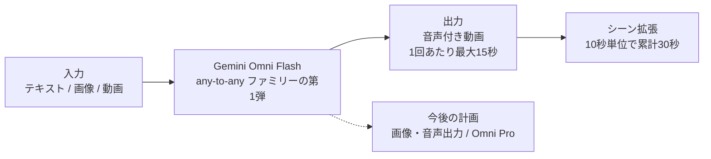
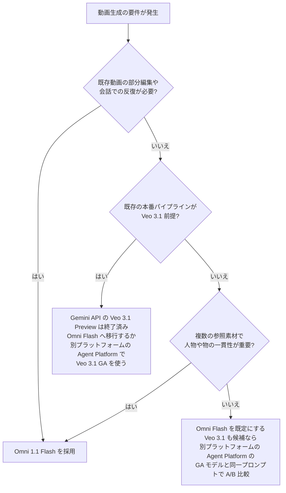
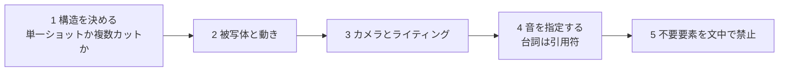
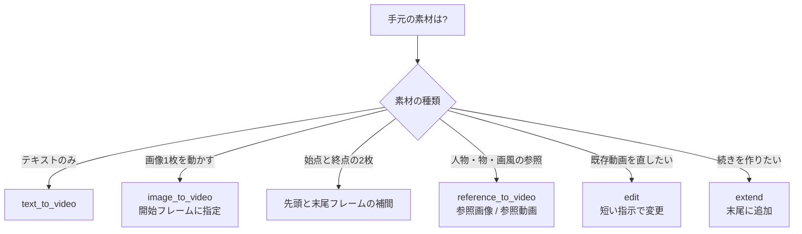
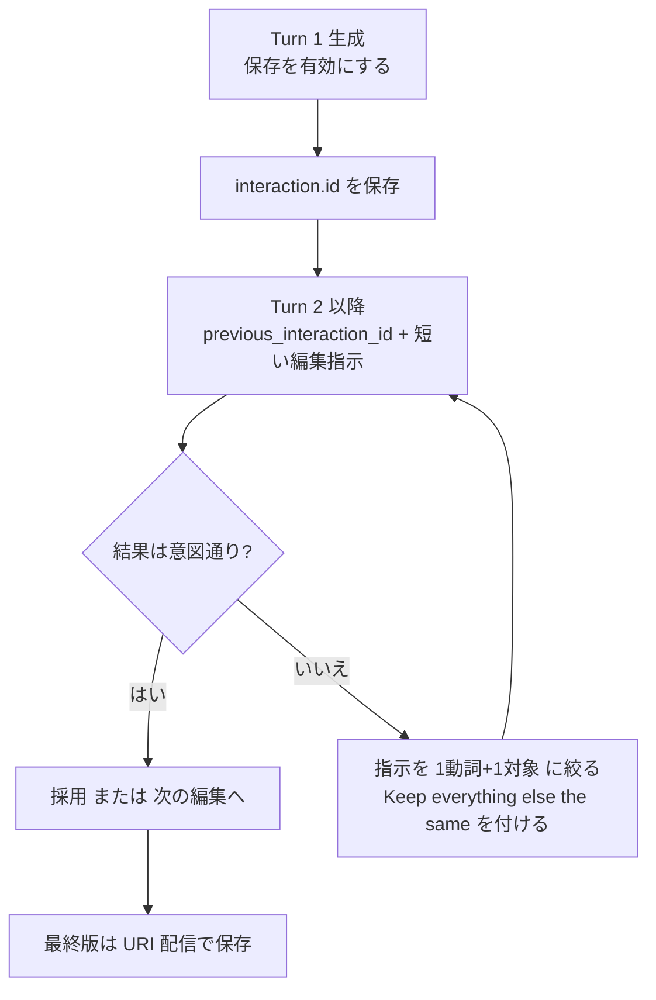
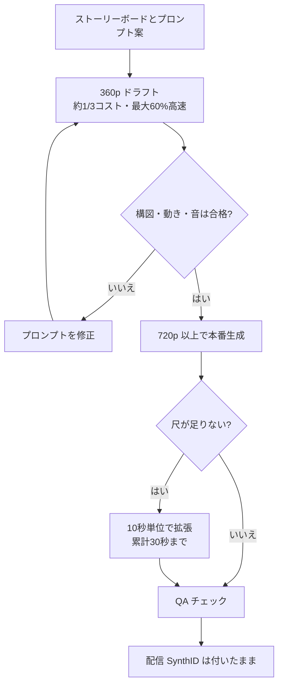
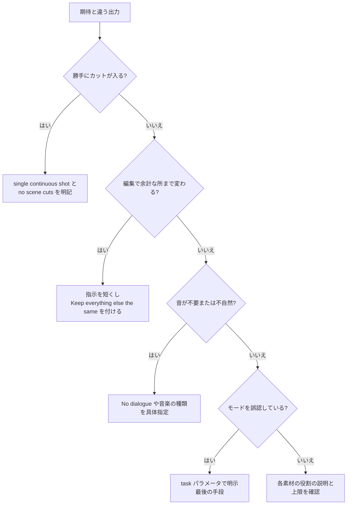

# Gemini Omni 実践ガイド:中級〜上級者向けステップバイステップ・ベストプラクティス

> **対象読者**: 動画生成 API / 生成メディアのプロダクト実装経験がある中級〜上級の開発者・AIエンジニア
> **調査時点**: 2026年11月7日までの公開情報(公式ページの確認日も 2026-11-07)
> **対象モデル**: Gemini Omni Flash(`gemini-omni-1.1-flash`)
> **1.2 への自動移行(2026-11-07 に公式で確認)**: Omni 1.2 Flash(`gemini-omni-1.2-flash`)は 2026-11-05 に一般提供されました。`gemini-omni-1.1-flash` は 4 週間の移行期間中は利用でき、**2026-12-03 からはリクエストが `gemini-omni-1.2-flash` へ自動で転送**されます。コード変更は不要で、課金は 1.2 の料金になります。1.2 の**拡張の上限は累計 30 秒**で、動画出力は $12.00 / 100 万トークンです(720p で約 $0.07 / 秒)。本ガイドの拡張とコストの例はこの値に合わせています。1.2 では生成が最大 15 秒、編集の入力動画が 15 秒以下、参照画像が最大 6 枚にも変わっていますが、それ以外の章は 1.1 の記述のままなので、実装前に[公式ドキュメント](https://ai.google.dev/gemini-api/docs/omni)を確認してください。

---

## 0. このガイドの前提(必ず最初に読む)

| 項目 | 内容 |
| --- | --- |
| 表記の補正 | 依頼文の「Googlei」は **Google** と解釈しました。 |
| Omni の正体 | Gemini Omni は **「何を入力しても動画を出力する」any-to-any 型の生成メディアモデルファミリー**です。ファミリーとしてはテキスト・画像・音声・動画を扱いますが、現行の Gemini API で入力できるのはテキスト・画像・動画で、**音声入力・音声参照のアップロードは非対応**です(参照動画の音声も無視されます)。現時点の出力は **音声付き動画**です。 |
| 混同しやすい点 | Google の最新フラッグシップ推論 LLM は別モデル(Gemini 4 Argon)です。Omni は LLM ではなく **動画の生成・編集モデル**です。 |
| 情報の確度 | 一次情報(Google 公式ドキュメント・公式ブログ)を軸にし、報道・サードパーティ情報は **二次情報**として明記します。筆者の推論は「推論」と書きます。 |
| 独立ベンチマーク | Omni 1.1 Flash について、公開リーダーボード上の独立ベンチマークは調査時点で確認できませんでした。品質面の優位性の主張は **ベンダー側の発表**として扱ってください。 |

---

## 目次

1. [Omni を 5 分で理解する](#1-omni-を-5-分で理解する)
2. [Step 1: モデル選定(Omni か Veo 3.1 か)](#step-1-モデル選定omni-か-veo-31-か)
3. [Step 2: 環境準備と最小実装](#step-2-環境準備と最小実装)
4. [Step 3: 出力パラメータの制御](#step-3-出力パラメータの制御)
5. [Step 4: プロンプト設計の原則](#step-4-プロンプト設計の原則)
6. [Step 5: 入力モードの使い分け](#step-5-入力モードの使い分け)
7. [Step 6: 対話型の動画編集](#step-6-対話型の動画編集)
8. [Step 7: シーン拡張で最大 30 秒へ](#step-7-シーン拡張で最大-30-秒へ)
9. [Step 8: コスト設計とドラフト運用](#step-8-コスト設計とドラフト運用)
10. [Step 9: 本番運用(信頼性・安全性・地域制約)](#step-9-本番運用信頼性安全性地域制約)
11. [既知の制約まとめ](#既知の制約まとめ)
12. [アンチパターン集](#アンチパターン集)
13. [導入チェックリスト](#導入チェックリスト)
14. [補足: 追加ベストプラクティスと根拠ソース URL](#補足-追加ベストプラクティスと根拠ソース-url)
15. [情報の確度と更新方針](#情報の確度と更新方針)

---

## 1. Omni を 5 分で理解する

### 1.1 一言でいうと

Omni は、Veo(動画)・Imagen(画像)・別系統の音声といった **分離されたスタック**を 1 つの Gemini ベースのモデルに集約し、**モダリティをまたいで推論したうえで動画を出力する**モデルです。「動画版 Nano Banana」と紹介されることが多く、会話で少しずつ直していく **対話型編集**が中核機能です。

### 1.2 公式ドキュメントが挙げる 3 つの中核能力

| 能力 | 意味 | 実装への含意 |
| --- | --- | --- |
| ネイティブ・マルチモーダル | テキスト・画像・音声・動画を同時に処理し、整合性の高い出力を作る | 参照素材を足すほど制御しやすいが、各素材の役割を自然言語で明示する必要がある |
| 対話型編集 | Interactions API で「ここだけ直して」を繰り返せる | 状態は `previous_interaction_id` で引き継ぐ |
| 世界知識 | 物理の理解に Gemini の歴史・科学・文化の知識を組み合わせる | 説明的・物語的なカットでも破綻しにくい設計(ただし検証は必須) |

### 1.3 位置づけ



### 1.4 タイムライン

| 日付 | 出来事 | 確度 |
| --- | --- | --- |
| 2026-05-19 | Google I/O 2026 で Omni を発表。第1弾の Omni Flash が Gemini アプリ・Flow・YouTube Shorts で提供開始。1 回 10 秒の上限は「モデルの限界ではなく展開上の判断」と説明された | 報道(TechCrunch 等) |
| 2026-06-30 | 開発者向けに Gemini API でプレビュー公開 | 二次情報+Google DeepMind 所属開発者の投稿 |
| 2026-08-27 | **Omni 1.1 Flash が一般提供(GA)**。モデル ID は `gemini-omni-1.1-flash`。シーン拡張・先頭/末尾フレーム指定・360p ドラフト・1080p/4K 出力・動画参照が追加 | 公式ブログ+公式料金ページ |
| 2026-09-30 | プレビュー用 ID(`gemini-omni-flash-preview`)の廃止日(最短) | 二次情報。**公式の Deprecations ページで要確認** |
| 2026-11-05 | **Omni 1.2 Flash が一般提供(GA)**。モデル ID は `gemini-omni-1.2-flash`。生成は最大 15 秒、参照画像は最大 6 枚 | 公式の変更履歴 |
| 2026-12-03 | `gemini-omni-1.1-flash` へのリクエストが `gemini-omni-1.2-flash` へ自動で転送され、1.2 の料金で課金される | 公式の Omni ページ・Deprecations ページ |
| 未定 | 上位の **Omni Pro** は予告のみ。調査時点で提供日は確認できず | 報道・二次情報 |

### 1.5 提供面(どこで使えるか)

| 提供面 | 用途 |
| --- | --- |
| Gemini アプリ | 一般ユーザー向け。Gemini アプリでは Veo 3.1 に代わる既定の動画モデル |
| Google Flow | クリエイター向けスタジオ(Google AI Plus / Pro / Ultra 契約者) |
| YouTube Shorts / YouTube Create | 一般ユーザー向けに無料提供と報じられている |
| Google AI Studio / Gemini API | 開発者向け(本ガイドの主対象)。有料枠 |
| Gemini Enterprise Agent Platform | エンタープライズ向け本番ワークロード |
| サードパーティ | Adobe Firefly、Figma Weave、ComfyUI などが統合(公式ブログ・各社ブログ記載) |

---

## Step 1: モデル選定(Omni か Veo 3.1 か)

### 1.1 公式の既定方針

Gemini API の動画概要ページは **「動画生成の既定は Omni Flash」**としています。理由として、動画の一貫性、複数入力(テキスト・画像・音声・動画)の同時推論、キャラクター一貫性、事実の正確さ、多ターンの対話型編集を挙げています。Gemini API の Veo 3.1 Preview は 2026-10-22 に終了しました。Veo 3.1 を使う場合の GA モデル(`veo-3.1-generate-001` / `veo-3.1-fast-generate-001`)は、**Gemini API とは別のプラットフォーム**である Gemini Enterprise Agent Platform で提供されています。

> **注意(情報の食い違い)**: 動画概要ページには、Veo 3.1 の用途として「シーン拡張」「末尾フレーム指定」を挙げる記述が残っています。一方、Omni の公式ページ(2026-09-23 更新)では Omni 1.1 でも **拡張と先頭/末尾フレーム指定をサポート**しています。概要ページの記述が古い可能性があるため、**Omni のページを正**として扱い、実機で検証してください。

### 1.2 判断フロー



### 1.3 Omni と Veo 3.1 の比較

| 観点 | Gemini Omni 1.1 Flash | Veo 3.1 |
| --- | --- | --- |
| 強み | 対話型編集・複数入力の推論・参照による一貫性 | 専用の動画生成モデル。サードパーティ解説では「写実性の専門家」と評されることが多い(二次情報) |
| API 形態 | **Interactions API** | `client.models.generate_videos`。長時間実行オペレーションを `client.operations.get` でポーリングして完了を待つ(Gemini Enterprise Agent Platform の GA モデル) |
| 出力解像度 | 360p / 720p(既定)/ 1080p(アップスケール)/ 4K(アップスケール) | 4K アップスケールと報じられている(二次情報) |
| 編集 | 会話で反復編集(最重要の差別化点) | 会話型の反復編集は公式の訴求点ではない(Omni 側の差別化点) |
| 音声 | 動画と同期した音声を生成。プロンプトで制御 | ネイティブ音声あり |
| 価格目安 | 720p で約 $0.07/秒(Omni 1.2。Omni 1.1 は約 $0.10/秒。公式料金ページ) | 開発者の投稿では Omni 1.1 の価格(約 $0.10/秒)と同水準と言及(Veo 3.1 Fast との比較) |

---

## Step 2: 環境準備と最小実装

### 2.1 前提

- **有料枠が必要**です。公式料金ページ上、Omni Flash の入出力は無料枠が「Not available」です。
- SDK は `google-genai`。呼び出しは **Interactions API**(`client.interactions.create`)です。
- Interactions API は 2026 年 5 月に破壊的変更が入っているため、古いサンプルをコピーする前に公式の移行ドキュメントを確認してください(URL は補足に記載)。

```bash
pip install -U google-genai
export GEMINI_API_KEY="YOUR_API_KEY"
```

### 2.2 最小実装(text-to-video)

```python
import base64
from google import genai

client = genai.Client()
MODEL = "gemini-omni-1.1-flash"


def save_video(interaction, path: str) -> None:
    """SDK 専用の便利フィールド output_video から mp4 を保存する。"""
    # 動画が返らないときやデコードに失敗したときに既存ファイルを壊さないよう、先に検証する
    output_video = interaction.output_video
    if output_video is None or not output_video.data:
        raise RuntimeError(f"No video returned: status={interaction.status}")
    video_bytes = base64.b64decode(output_video.data)

    with open(path, "wb") as f:
        f.write(video_bytes)


interaction = client.interactions.create(
    model=MODEL,
    input=(
        "Continuous, unbroken handheld shot of a tabby cat on a sunny windowsill, "
        "looking into a leafy garden. Sound design: gentle breeze, distant birds. "
        "No dialogue."
    ),
)
save_video(interaction, "cat.mp4")
print("interaction id:", interaction.id)  # 後続の編集・拡張で使う
```

### 2.3 REST で直接呼ぶ場合の注意

`interaction.output_video` は **SDK 専用の便利フィールド**です。REST では、レスポンスの `steps` 配列から `type` が `model_output` のステップを探し、その `content` 内の `type: "video"` を取り出します。

```json
{
  "steps": [
    { "type": "user_input", "content": [{ "type": "text", "text": "..." }] },
    { "type": "thought", "content": [{ "text": "...", "type": "thought" }] },
    {
      "type": "model_output",
      "content": [{ "type": "video", "mime_type": "video/mp4", "data": "<base64>" }]
    }
  ],
  "id": "v1_...",
  "status": "completed",
  "model": "gemini-omni-1.1-flash",
  "object": "interaction"
}
```

### 2.4 動作確認の観点

| 確認項目 | 期待 |
| --- | --- |
| `interaction.id` が取得できる | 以降の編集・拡張の起点になる |
| mp4 が再生でき、音声トラックがある | 既定で適切な音声が生成される |
| 意図しないカット割りがない | 入っていたら Step 4 の「単一ショット指定」を適用 |

---

## Step 3: 出力パラメータの制御

### 3.1 アスペクト比・解像度・配信方式

`response_format` で制御します。`type: "video"` は省略可能です。

| パラメータ | 値 | 備考 |
| --- | --- | --- |
| `aspect_ratio` | `"16:9"`(既定)/ `"9:16"` | 縦動画は `9:16` |
| `resolution` | `"360p"` / `"720p"`(既定)/ `"1080p"` / `"4k"` | 1080p と 4K は **アップスケール出力** |
| `delivery` | `"uri"` | 4MB 超の動画は URI 配信を使う |

```python
interaction = client.interactions.create(
    model=MODEL,
    input="A futuristic city with neon lights and flying cars, cyberpunk style",
    response_format={
        "type": "video",
        "aspect_ratio": "9:16",
        "resolution": "1080p",
        "delivery": "uri",
    },
)
```

この例は URI 配信なので、生成結果は `interaction.output_video.data` ではなく、次の 3.2 の手順で `interaction.output_video.uri` から取得します。

### 3.2 大きな動画は URI 配信で取得する

公式の推奨は、**4MB を超える動画(720p 超など)では `delivery="uri"`** を使うことです。返ってくる Google ホストの URI が `ACTIVE` になるまでポーリングしてからダウンロードします。

```python
import re
import time
from google import genai

client = genai.Client()

interaction = client.interactions.create(
    model="gemini-omni-1.1-flash",
    input="A beautiful sunset over a calm ocean.",
    response_format={"type": "video", "delivery": "uri"},
)

video_output = interaction.output_video
if video_output is None or not video_output.uri:
    raise RuntimeError(f"No video returned: status={interaction.status}")
# URI の末尾には :download?alt=media が付くので、ファイル ID だけを取り出す
match = re.search(r"/files/([^/:?]+)", video_output.uri)
if match is None:
    raise RuntimeError(f"URI からファイル ID を取得できません: {video_output.uri}")
file_name = match.group(1)

deadline = time.monotonic() + 600  # 待ち時間の上限(秒)
while True:
    info = client.files.get(name=f"files/{file_name}")
    if info.state.name == "ACTIVE":
        break
    # FAILED や STATE_UNSPECIFIED など、想定外の状態では待ち続けない
    if info.state.name != "PROCESSING":
        raise RuntimeError(f"Generation failed: state={info.state.name}")
    if time.monotonic() >= deadline:
        raise TimeoutError(f"Timed out waiting for {info.name}")
    time.sleep(5)

client.files.download(file=video_output.uri, destination="output.mp4")
```

公式の Python サンプルは `uri.split("/")[-1]` で ID を取り出していますが、公式の REST 例の URI は `:download?alt=media` で終わるため、この方法では末尾が ID に残ります。上の例では ID だけを取り出しています。

> **落とし穴**: `GET /v1beta/interactions/{id}` で後から取得すると、最初に `delivery: "uri"` で作成していても **動画は base64 のインラインデータで返ります**。`uri` フィールドが確実にあるのは、作成直後のレスポンスか SSE ストリームです。**作成直後に URI を保存**してください。

### 3.3 同期・非同期と保存設定(速度と編集可否のトレードオフ)

| 設定 | 効果 | 副作用 |
| --- | --- | --- |
| `background=false`, `store=false`, `stream=false` | 同期の単発呼び出しで最速になる | **`store=false` だと、その動画は `previous_interaction_id` での後続編集ができない** |
| 既定(保存あり) | 後続ターンで編集・拡張できる | 同期単発より遅くなる可能性 |

**使い分けの指針**: 一発で完結する用途(サムネイル動画など)は `store=false`。編集・拡張を想定する用途は保存を有効にします。

---

## Step 4: プロンプト設計の原則

公式プロンプトガイドの要点を、実務で使いやすい形に整理します。**ガイドの原文の列挙ではなく、筆者による再構成**です。

### 4.1 設計の流れ



### 4.2 原則一覧

| 原則 | やること | 理由・根拠 |
| --- | --- | --- |
| 単一ショットの明示 | 「single continuous shot」「no scene cuts」などを書く | 既定では **複数ショットの物語的な構成** を作ろうとするため(公式) |
| 否定はプロンプト内に書く | 「No dialogue」「No extra sound effects」 | **ネガティブプロンプト用の独立フィールドは無い**(公式) |
| 音は能動的に指定 | 音楽・環境音・台詞を具体的に書く | 既定でも音声は付くが、意図通りとは限らない(公式) |
| 時間指定は自然言語で良い | 「After 3 seconds, ...」やタイムコード `[0-3s]` | 厳密な構文は不要。カット割りやリズムの設計に有効(公式) |
| 画面内テキストは文字列を明示 | 看板・ナンバープレートなどの表記を引用符で指定 | 自然に現れる文字も、定義すると正確に描かれやすい(公式) |
| メタ指示を使う | 「micro-detail, expression, timing を重視」など品質観点を伝える | 公式ガイドに「meta prompting」として記載 |
| 英語で書く | 指示文は英語で書く | **英語は完全サポート、他言語は未評価**で結果にばらつきが出る(公式) |

### 4.3 推奨テンプレート(筆者案)

構造化して書くと再現性が上がります。以下は筆者が整理したテンプレートで、公式が定める書式ではありません。

```yaml
Mode: text-to-video
Format: 9:16 vertical video, 10 seconds, single continuous shot, no scene cuts
Subject: A barista in a small Tokyo coffee shop, mid-30s, wearing a dark apron
Action: She slowly pours steamed milk into a latte, finishing with a leaf pattern
Camera: Slow push-in from medium shot to close-up on the cup, shallow depth of field
Lighting/Mood: Warm morning window light, calm and cozy
Audio: Soft jazz piano in the background, subtle milk-pouring sound
Constraints: No dialogue. No on-screen text.
```

### 4.4 タイムコード指定の例

```markdown
[0-3s] A person is walking along a rainy street at night
[3-6s] They stop and turn toward the camera
[6-10s] They start running, camera tracking from behind
Audio: Rain ambience, low synth drone. No dialogue.
```

### 4.5 画面内テキストの例

```python
prompt = (
    'One word on screen at a time: "did, you, know, that, Omni, can, do, text?" '
    "Each word appears for 1 second with a different animated style. No dialogue."
)
```

> **日本語テキストの描画**: 公式が評価済みとしているのは英語のみです。日本語の看板や字幕を動画内に描かせる用途は、**必ず事前に品質検証**し、難しければ後工程(編集ソフト)で重ねる設計にしてください(推論を含む実務上の推奨)。

---

## Step 5: 入力モードの使い分け

### 5.1 モード選択フロー



### 5.2 モード別の要点

| モード | 入力 | 要点 |
| --- | --- | --- |
| text-to-video | テキスト | 単一ショット・音・禁止事項を明記 |
| image-to-video | 画像 + テキスト | 高解像度の画像と、**具体的な動きの記述**が有効。「make it move」のような曖昧指示は弱い(公式) |
| 先頭/末尾フレーム補間 | 画像 2 枚 + テキスト | 2 枚を `input` に並べ、遷移を記述する |
| subject reference | 参照画像 + テキスト | 複数の被写体画像(例: 猫と毛糸玉)を組み合わせて 1 本の動画にできる |
| edit | 動画 + テキスト | 短い指示 + 「他は維持」(Step 6) |
| extend | 動画 + テキスト | 末尾から最大 10 秒を追加(Step 7) |

### 5.3 `task` パラメータは最後の手段

`generation_config.video_config.task` に `text_to_video` / `image_to_video` / `reference_to_video` / `edit` / `extend` を指定できますが、公式は **まずプロンプトで解決し、うまくいかないときだけ `task` で明示**することを推奨しています。`task` を使うと **追加の制約がかかる**ためです。

### 5.4 画像・動画の「役割」を自然言語で指定する

素材が複数あるときは、各素材の役割を自然言語で明示します。公式は、`<FIRST_FRAME>`、`<LAST_FRAME>`、`<IMAGE_REF_0>`、`<VIDEO_REF_0>` のような制御文字列をプロンプトに**入れない**よう案内しています(非推奨で、今後のモデルでは非対応)。素材は `input` に渡し、並び順や内容で指し示します。

```markdown
A woman is walking along a beach at sunset.
Use the first image as the starting frame.
Use the second image as a reference for the woman's appearance, not as a literal frame.
```

**末尾に添える誘導文(公式の推奨)**:

| 目的 | 末尾に書く内容 |
| --- | --- |
| 開始フレームとして使う | 「Use this image as the starting frame.」 |
| 開始と最終のフレームを指定する | 「Use the first image as the starting frame and the second image as the last frame.」 |
| ループ動画にする | 「Use this image as the first frame and the last frame.」 |
| 参照画像として使う | 「…should not be used as literal initial frames.」の趣旨を書く |
| 参照動画として使う | 「Do not use them as a source for video editing.」の趣旨を書く |

### 5.5 参照素材の上限と性質

| 項目 | 公式の記述 |
| --- | --- |
| 動画参照(Omni 1.2) | 3〜10 秒の生成は最大 3 クリップ、11〜15 秒の生成は最大 1 クリップ(各 3 秒まで)。参照動画の **音声は無視される** |
| 動画参照の向き | 見た目(顔や外観)の保持に向く |
| 音声入力・音声参照のアップロード | 現行 API バージョンでは **非対応** |
| 複数動画をまたぐ推論 | **非対応**(精度低下や予期しない出力の恐れ) |

---

## Step 6: 対話型の動画編集

Omni の最大の差別化点です。**1 ターンで 1 つの変更**を積み重ねる設計にします。

### 6.1 状態を持つ編集(生成 → 編集)

```python
import base64
from google import genai

client = genai.Client()
MODEL = "gemini-omni-1.1-flash"

# Turn 1: 生成(保存を有効にしておく)
res1 = client.interactions.create(model=MODEL, input="A woman playing violin outdoors.")

# Turn 2: 直前の動画を編集
res2 = client.interactions.create(
    model=MODEL,
    previous_interaction_id=res1.id,
    input="Make the violin invisible. Keep everything else the same.",
)

# 動画が返らないときやデコードに失敗したときに既存ファイルを壊さないよう、先に検証する
output_video = res2.output_video
if output_video is None or not output_video.data:
    raise RuntimeError(f"No video returned: status={res2.status}")
video_bytes = base64.b64decode(output_video.data)

with open("edited.mp4", "wb") as f:
    f.write(video_bytes)
```

### 6.2 編集のループ設計



### 6.3 編集プロンプトの 4 原則

| 原則 | 悪い例 | 良い例 |
| --- | --- | --- |
| 短く書く | 詳細に動きを描写した長文で猫を追加 | `Add a cat that jumps onto his lap, he begins to pet it. Keep everything else the same.` |
| 1 回に 1 変更 | 背景変更と衣装変更を同時に指示 | 背景 → 衣装と **ターンを分ける** |
| 維持を明示 | 変更点だけを書く | 末尾に `Keep everything else the same.`(公式が推奨する定型句) |
| 消去は「見えなくする」 | `remove the phone and fill the background...` | `Make the phone invisible. Keep everything else the same.` |

公式が示す編集の例は、スタイル変更(アニメ調)、小物の追加、照明の変更、画面内テキストの書き換えなどです。**過度に説明的なプロンプトは、意図しない変更を招く**とされています。

### 6.4 自前の動画をアップロードして編集する

Files API でアップロードし、状態が `ACTIVE` になったことを確認してから `uri` を渡します。

```python
import base64
import time
from google import genai

client = genai.Client()

deadline = time.monotonic() + 600  # 待ち時間の上限(秒)
video_file = client.files.upload(file="Video.mp4")
while video_file.state.name == "PROCESSING":
    if time.monotonic() >= deadline:
        raise TimeoutError(f"Timed out waiting for {video_file.name}")
    time.sleep(10)
    video_file = client.files.get(name=video_file.name)

# FAILED や STATE_UNSPECIFIED では止め、ACTIVE のときだけ uri を渡す
if video_file.state.name != "ACTIVE":
    raise RuntimeError(f"File is not usable: state={video_file.state.name}")

interaction = client.interactions.create(
    model="gemini-omni-1.1-flash",
    input=[
        {"type": "video", "uri": video_file.uri},
        {"type": "text", "text": "Change the lighting to be more dramatic. Keep everything else the same."},
    ],
)

# 動画が返らないときやデコードに失敗したときに既存ファイルを壊さないよう、先に検証する
output_video = interaction.output_video
if output_video is None or not output_video.data:
    raise RuntimeError(f"No video returned: status={interaction.status}")
video_bytes = base64.b64decode(output_video.data)

with open("edited.mp4", "wb") as f:
    f.write(video_bytes)
```

### 6.5 編集でできないこと

| 項目 | 内容 |
| --- | --- |
| 音声(声)の編集 | **非対応**。台詞を変えたい場合は再生成か別工程で対応 |
| 入力動画の長さ | アップロード動画もモデル生成動画も **15 秒以下**(Omni 1.2) |
| 地域 | アップロード動画の編集は EEA・スイス・英国では **提供なし**(日本は記載なし) |
| 人物 | 特定の識別可能な人物を含む画像のアップロード・編集は非対応 |

---

## Step 7: シーン拡張で最大 30 秒へ

### 7.1 仕組み

- **末尾に最大 10 秒**を連続して追加します(拡張の生成は 3〜10 秒)。
- Omni 1.1 では **直前 10 秒を文脈として参照**します(旧版は最後の 1 秒のみ)。そのため映像・動き・キャラクター・音の一貫性が上がります。
- **1 回 3〜10 秒ずつ、動画全体で累計 30 秒まで**拡張できます(Omni 1.2 の上限。2026-12-03 からは `gemini-omni-1.1-flash` へのリクエストも 1.2 へ転送されます)。入力動画の最後のフレームの一部が、遷移を滑らかにするために編集されます。

### 7.2 拡張の実装

```python
import base64
from google import genai

client = genai.Client()
MODEL = "gemini-omni-1.1-flash"

first = client.interactions.create(model=MODEL, input="A fox runs across a snowy field at dawn.")

# モデル生成動画の続きを作る(多ターン)
second = client.interactions.create(
    model=MODEL,
    previous_interaction_id=first.id,
    input=[{"type": "text", "text": "Continue the scene. The music builds."}],
    response_format={"resolution": "360p"},  # まずドラフトで確認する
)

# 動画が返らないときやデコードに失敗したときに既存ファイルを壊さないよう、先に検証する
output_video = second.output_video
if output_video is None or not output_video.data:
    raise RuntimeError(f"No video returned: status={second.status}")
video_bytes = base64.b64decode(output_video.data)

with open("extended.mp4", "wb") as f:
    f.write(video_bytes)
```

### 7.3 拡張のプロンプトのコツ

| 目的 | 書き方の例 |
| --- | --- |
| 音を変えたい | 「The music continues into the chorus」のように **音の変化を明示** |
| 同じシーンか、カットか | 「Show the same characters in the next scene」で別シーンへ |
| 新キャラ追加 | Omni 1.2 では、参照画像を `input` に一緒に渡し、「The person shown in the reference image enters the scene」のように自然言語で指定する(参照動画は拡張に使えない) |
| 時間指定 | タイムコードの **0s は「拡張部分の先頭」**。10 秒の動画を拡張して「After 2s cut」と書くと、全体では 12 秒地点でカットが入る |

### 7.4 拡張の制約

| 制約 | 内容 |
| --- | --- |
| 追加位置 | **末尾のみ**。先頭への追加や中間の延長は不可 |
| アップロード動画の台詞 | 人物が話しているアップロード動画に **台詞を追加する拡張はできない**(無言のままか、台詞を足さない指示なら可) |
| モデル生成動画の台詞 | 多ターン(`previous_interaction_id`)での拡張なら台詞・音声の生成が可能 |
| 入力長 | アップロード動画は 15 秒以下(多ターンの場合は対象外)。拡張後の全長は 30 秒まで(Omni 1.2) |
| 地域 | アップロード動画の拡張は EEA・スイス・英国では提供なし(モデル生成動画の拡張は全提供地域で可) |

---

## Step 8: コスト設計とドラフト運用

### 8.1 料金の事実関係

| 項目 | 内容 | 確度 |
| --- | --- | --- |
| 入力 | $1.50 / 100 万トークン(テキスト・画像・動画・音声) | 公式料金ページ |
| 出力(テキスト) | $9.00 / 100 万トークン | 公式料金ページ |
| 出力(動画) | Omni 1.2 は $12.00 / 100 万トークン。**720p の動画 1 秒 = 5,792 トークン**。実効では約 $0.07 / 秒(10 秒で約 $0.70)。Omni 1.1 は $17.50(約 $0.10 / 秒)で、2026-12-03 からは 1.2 の料金で課金される | 公式料金ページ |
| 360p | 1,931 トークン / 秒(約 $0.023 / 秒)で、720p の約 3 分の 1 のコスト。**最大 60% 高速** | トークン数は公式料金ページ、速度は公式ブログ |
| 1080p / 4K | Omni 1.2 は 1080p(アップスケール)が 8,688 トークン / 秒(約 $0.104 / 秒)、4K(アップスケール)が 17,376 トークン / 秒(約 $0.209 / 秒) | 公式料金ページ |
| 無料枠 | 公式料金ページで入出力は「Not available」 | 公式料金ページ |
| データ利用 | 有料枠では「製品改善に利用しない」と記載 | 公式料金ページ |

### 8.2 見積もり関数(筆者案)

この例の単価は `gemini-omni-1.2-flash` のものです。`gemini-omni-1.1-flash` も 2026-12-03 からは 1.2 の料金で課金されるので、同じ式で見積もれます(それまでの 1.1 の動画出力は $17.50 / 100 万トークン)。

```python
MODEL = "gemini-omni-1.2-flash"  # 下の単価とトークン数が対象とするモデル
USD_PER_M_INPUT_TOKENS = 1.50    # 公式料金ページ
USD_PER_M_VIDEO_TOKENS = 12.00   # 公式料金ページ(Omni 1.2)
# 動画 1 秒あたりの出力トークン数(公式料金ページの Omni 1.2 の値)
TOKENS_PER_SEC = {"360p": 1931, "720p": 5792, "1080p": 8688, "4k": 17376}
# 思考トークンは出力料金に含まれる。動画時の適用単価は明記がないため、高いほうで見積もる
USD_PER_M_THINKING_TOKENS = 12.00


def estimate_cost(
    seconds: float,
    resolution: str = "720p",
    attempts: int = 1,
    input_tokens: int = 0,
    thinking_tokens: int = 0,
) -> float:
    """概算コスト(USD)。入力・思考トークンは 1 試行あたりの値で、attempts は採用までの試行回数。"""
    video_cost = seconds * TOKENS_PER_SEC[resolution] * USD_PER_M_VIDEO_TOKENS / 1_000_000
    input_cost = input_tokens * USD_PER_M_INPUT_TOKENS / 1_000_000
    thinking_cost = thinking_tokens * USD_PER_M_THINKING_TOKENS / 1_000_000
    return (video_cost + input_cost + thinking_cost) * attempts


print(f"{MODEL} の見積もり")
print(f"10s 720p x1      : ${estimate_cost(10):.2f}")
print(f"10s 360p x5 + 4K : ${estimate_cost(10, '360p', 5) + estimate_cost(10, '4k'):.2f}")
print(f"10s x3 累計30秒 720p : ${estimate_cost(10, '720p', 3):.2f}")  # 初回生成 + 拡張 2 回
# 入力と思考のトークン数は、実際の応答の使用量から設定する(下の値は例)
print(f"10s 720p x3 入力・思考込み: ${estimate_cost(10, attempts=3, input_tokens=2_000, thinking_tokens=5_000):.2f}")
```

### 8.3 コスト目安(Omni 1.2 の単価・筆者計算)

次の表は動画出力の料金だけです。入力と思考トークンの料金は含みません。

| シナリオ | 概算 |
| --- | --- |
| 5 秒 × 1 回 | 約 $0.35 |
| 10 秒 × 1 回 | 約 $0.70 |
| 10 秒の生成 + 10 秒の拡張 2 回(累計 30 秒) | 約 $2.09 |
| 10 秒の 360p ドラフト × 5 回 | 約 $1.16 |

### 8.4 推奨ワークフロー



### 8.5 ドラフト運用の注意(推論を含む)

- **ドラフトと本番は別の生成になる可能性があります。** 公式は `temperature`・`top_p`・システム指示などのサンプリング制御を **非対応**としており、同じプロンプトでも結果が変わりえます。「360p で確定した構図が、720p 以上で再生成しても再現される」と仮定せず、**本番の解像度でも採用判定をする**運用にしてください(推論。実測で確認を)。
- **上限の把握**: 見積もりは「(動画の秒数 × 単価 + 入力料金 + 思考トークン料金) × 成功までの試行回数」で考えます。コストを決めるのは動画の長さより **試行回数**です。

---

## Step 9: 本番運用(信頼性・安全性・地域制約)

### 9.1 運用設計のチェックポイント

| 領域 | ベストプラクティス | 根拠 |
| --- | --- | --- |
| ID の永続化 | 編集・拡張の可能性があるジョブは `interaction.id` を DB に保存。サーバー側のインタラクションは無期限には保持されない(有料枠の既定は 55 日で、AI Studio で 7・14・28 日に短縮できる)。保持期間の後も再開が必要なジョブは、完成動画・プロンプト・参照素材を自前で保存し、復旧手順を用意する。15 秒以下の完成動画はアップロード動画として編集・拡張し直せる(地域制約に注意)。15 秒を超える完成動画は再アップロードで編集・拡張できないので、保存したプロンプトと参照素材から再生成する | 状態は `previous_interaction_id` で引き継ぐ。保持期間は Interactions API の概要ページ(公式) |
| 保存設定 | 後続編集が必要なら `store=false` にしない | `store=false` の動画は編集不可(公式) |
| 大容量出力 | 4MB 超は URI 配信。作成直後に URI を保存 | 後から GET するとインライン base64 で返る(公式) |
| 生成待ち | `FAILED` を含む状態遷移を処理し、ポーリング間隔と上限時間を設ける | 生成時間は長さ・解像度・負荷で変動(公式) |
| モデル ID | 新規実装は `gemini-omni-1.2-flash` を使う。`gemini-omni-1.1-flash` は既存コードの移行先としてだけ残す(プレビュー ID からの移行を含む。2026-12-03 からは 1.2 へ転送される) | `gemini-omni-1.1-flash` は移行期間のみ(公式)。プレビュー ID は廃止予定(二次情報。公式で確認) |
| 動画の起点管理 | 参照・編集に使う素材はバージョン管理し、どの素材がどの出力を生んだか追跡 | 運用上の推奨(筆者) |

### 9.2 安全性・ガバナンス

| 項目 | 内容 |
| --- | --- |
| SynthID | すべての生成動画に不可視の透かしが入る。**無効化できない**ため、公開側の表示ポリシーと整合させる |
| 安全フィルタ | 入力プロンプトと生成動画の両方に適用される(地域で異なる) |
| 人物・未成年 | 識別可能な人物や、EEA・スイス・英国での未成年を含む画像のアップロード編集には制限がある |
| 権利 | 参照素材(顔・商品・画風)の利用許諾は自社で管理する |
| データ | 有料枠は製品改善に利用されないと公式料金ページに記載。契約条件は必ず自社で確認 |

### 9.3 トラブルシュート



---

## 既知の制約まとめ

| カテゴリ | 制約 |
| --- | --- |
| 生成長 | 1 回あたり最大 10 秒(Omni 1.2 は最大 15 秒)。拡張で累計 30 秒 |
| 制御パラメータ | システム指示・`temperature`・`top_p`・停止シーケンス・ネガティブプロンプト欄は **非対応** |
| 音声 | 声の編集は非対応。音声入力・音声参照のアップロードも非対応 |
| 動画参照(Omni 1.2) | 3〜10 秒の生成は最大 3 クリップ、11〜15 秒の生成は最大 1 クリップ(各 3 秒まで)。複数動画をまたぐ推論は非対応 |
| 入力動画 | 編集はアップロード動画もモデル生成動画も 15 秒以下。拡張のアップロード動画は 15 秒以下で、拡張後の全長は 30 秒まで(Omni 1.2) |
| 拡張位置 | 末尾のみ |
| YouTube | YouTube 動画をメディアソースとして使うことは非対応 |
| スループット | Provisioned Throughput は非対応 |
| 言語 | 英語は完全サポート。他言語は未評価 |
| 地域 | アップロード動画の編集・拡張は EEA・スイス・英国で提供なし |

---

## アンチパターン集

| アンチパターン | なぜ悪いか | 対策 |
| --- | --- | --- |
| 1 本の長文プロンプトに全指示を詰める | 編集では過剰な説明が意図しない変更を招く | 生成は構造化、編集は短く 1 変更ずつ |
| 単一ショットを指定せずに生成する | 既定で複数ショットの物語になる | 単一ショットを明記 |
| 否定を「ネガティブ欄」に入れようとする | そのフィールドは存在しない | 「No ...」を本文に書く |
| `store=false` のまま編集フローを組む | 動画が後続ターンで編集できない | 編集前提なら保存を有効に |
| 古い GET で URI を取り直そうとする | インライン base64 で返ってくる | 作成直後に URI を保存 |
| 最初から 4K で試行錯誤する | 試行回数 × 高単価でコストが膨らむ | 360p ドラフトで収束させる |
| `task` を常時指定する | 追加の制約がかかる | プロンプトで解決し、最後の手段にする |
| 日本語の看板や字幕を動画内に直接描かせる | 非英語は未評価 | 事前検証し、必要なら後工程で重ねる |
| 参照動画に音声を期待する | 参照動画の音声は無視される | 音はプロンプトで指定 |
| 独立ベンチ無しで「最高品質」と断定 | 評価はベンダー発表が中心 | 自社データで A/B 評価 |

---

## 導入チェックリスト

**設計**

- [ ] Omni を既定とし、Veo 3.1 も候補なら Agent Platform の GA モデルと同一プロンプトで A/B 比較した
- [ ] 編集・拡張の要否を決め、保存設定(`store`)を設計した
- [ ] 英語プロンプトのテンプレートを整備した

**実装**

- [ ] 新規実装は `gemini-omni-1.2-flash` を使い、`gemini-omni-1.1-flash` は既存コードの移行先に限っている。旧プレビュー ID は使っていない
- [ ] 4MB 超は URI 配信で、作成直後に URI を保存している
- [ ] `PROCESSING` と `FAILED` を処理するポーリングを実装した
- [ ] `interaction.id` を永続化している

**品質**

- [ ] 単一ショット・音・禁止事項をテンプレートに含めた
- [ ] 編集は「短い指示 + 他は維持」で運用している
- [ ] 同一性・小物・文字・音の連続性を QA 項目にした

**コストと運用**

- [ ] 360p ドラフト → 本番の二段階にし、試行回数の上限を決めた
- [ ] 1080p / 4K の単価を公式料金ページで再確認した
- [ ] SynthID・地域制約・人物権利のポリシーを法務と整合させた

---

## 補足: 追加ベストプラクティスと根拠ソース URL

調査時点は 2026-11-07 まで。**一次情報(公式)→ 著名開発者・主要メディア → サードパーティ**の順に整理しています。

### A. 一次情報(Google 公式)

| 内容 | URL |
| --- | --- |
| Omni Flash 公式ドキュメント(生成・編集・拡張・プロンプトガイド・制約。2026-09-23 更新) | https://ai.google.dev/gemini-api/docs/omni |
| 料金ページ(Omni のトークン単価と 720p 換算) | https://ai.google.dev/gemini-api/docs/pricing |
| Gemini API の動画概要(Omni を既定とする方針、Veo との使い分け) | https://ai.google.dev/gemini-api/docs/video |
| 公式ブログ「Gemini Omni 1.1 Flash lets you build with more control」(シーン拡張、10 秒の文脈参照、360p プレビュー、採用事例) | https://blog.google/innovation-and-ai/technology/developers-tools/build-with-gemini-omni-1-1-flash/ |
| Gemini アプリの Omni 紹介ページ(Veo 3.1 から Omni への切り替え) | https://gemini.google/overview/video-generation/ |
| 公式 Skill(コーディングエージェント向けの Omni API 手順) | https://github.com/google-gemini/gemini-skills/blob/main/skills/gemini-omni-flash-api/SKILL.md |
| Interactions API の概要 | https://ai.google.dev/gemini-api/docs/interactions-overview |
| Interactions API の破壊的変更(2026 年 5 月) | https://ai.google.dev/gemini-api/docs/interactions-breaking-changes-may-2026 |
| 廃止予定の一覧(プレビュー ID の確認用) | https://ai.google.dev/gemini-api/docs/deprecations |
| リリースノート | https://ai.google.dev/gemini-api/docs/changelog |
| Files API(動画アップロード) | https://ai.google.dev/gemini-api/docs/files |
| クイックスタート Colab | https://colab.sandbox.google.com/github/google-gemini/cookbook/blob/main/quickstarts/Get_started_Omni.ipynb |

### B. 著名な開発者・主要メディア

| 内容 | URL | 補足 |
| --- | --- | --- |
| Philipp Schmid(Google DeepMind)の投稿。Omni Flash の API プレビュー時に「動画編集で SOTA、$0.10 / 秒で Veo 3.1 Fast と同価格」と発信(2026-06-30)。別の投稿で、Interactions API を使えば数行のコードで編集できる例も紹介 | https://digg.com/tech/plr69ybe(原典は X の @_philschmid) | **ベンダー所属開発者の発言**。独立した検証ではない |
| TechCrunch「Omni は動画から始まる」。Sundar Pichai の「any input から create anything」という方針、Flash の 10 秒上限が展開判断であること | https://techcrunch.com/2026/05/19/googles-gemini-omni-turns-images-audio-and-text-into-video-and-thats-just-the-start/ | 報道 |
| FutureFive:発表時点の提供面(アプリ・Flow・YouTube)と、音声入力は当初は声の参照のみだった点 | https://futurefive.co.nz/story/google-launches-gemini-omni-flash-for-video-editing | 報道 |

> **調査の限界**: Simon Willison 氏など独立系の著名開発者による I/O 2026 の総括は確認できましたが、**Omni 1.1 の API 利用に特化した詳細な検証記事は見つけられませんでした**。この領域は今後の一次検証が出てくる余地が大きいため、定期的に再調査してください。

### C. サードパーティ(実装・価格の補助情報)

| 内容 | URL | 補足 |
| --- | --- | --- |
| ComfyUI が Omni Flash 1.1 の統合を解説(1 つのノードで text / image / reference / edit / extend) | https://blog.comfy.org/p/gemini-omni-11-flash-in-comfyui-faster | 公式ブログ形式 |
| Replicate の Omni 1.1 ページ(ネイティブ音声、台詞は引用符、プロンプト内ネガティブ) | https://replicate.com/google/gemini-omni-1.1 | 配信プラットフォーム |
| Runware の Omni Flash 1.1 ガイド(プロンプト構造、参照、編集、拡張) | https://runware.ai/docs/models/google-gemini-omni-flash-1-1/guides | 推論基盤の独自ガイド |
| Eachlabs の編集ガイド(「1 つだけ変える」「Keep everything else the same」の運用) | https://www.eachlabs.ai/blog/gemini-omni-1-1-flash-video-editing-guide | 公式ガイドの解説。声の編集不可も整理 |
| Atlas Cloud の価格解説(5 / 10 / 40 秒のコスト) | https://www.atlascloud.ai/blog/tips/gemini-omni-flash-1.1-pricing | Omni 1.1 時点の報道値。40 秒の例は 1.2 の上限を超え、単価も 1.2 と異なる |
| TuttoAndroid(解像度別単価を報道) | https://www.tuttoandroid.net/news/2026/08/28/gemini-omni-1-1-flash-ufficiale-scene-estese-4k-1169741/ | 二次情報 |
| OrcaRouter の launch 解説(独立ベンチ無し、1080p / 4K の公式単価が未掲載である点の指摘) | https://www.orcarouter.ai/blog/gemini-omni-1-1-flash-launch | 二次情報。懐疑的な視点として有用 |
| Geotoolbox(日付と提供面、プレビュー ID の廃止日) | https://geotoolbox.ai/blog/gemini-omni | 二次情報 |
| Usefastlane(Omni Pro は提供日未定、Veo 4 は未発表との整理) | https://www.usefastlane.ai/blog/gemini-omni | 二次情報 |
| コミュニティのプロンプト集 | https://github.com/flaqai/awesome-gemini-omni-flash | コミュニティ。品質は玉石混交 |

### D. 追加のベストプラクティス(根拠付き)

| ベストプラクティス | 根拠 |
| --- | --- |
| 台詞は **引用符で囲み**、音楽・効果音・環境音は別途記述する | Replicate のモデルページ(上の C 表) |
| 編集結果が崩れたら、再生成する前にまず指示を「1 動詞 + 1 対象」まで短縮し、「Keep everything else the same」を付ける | 公式ドキュメント+Eachlabs |
| 新規ジョブは Omni を既定にする。Gemini API の Veo 3.1 Preview を使っていた資産は、Omni か Agent Platform の Veo 3.1 GA へ移行する | 公式の動画概要ページ |
| ComfyUI などのノードベース環境では、同一ノードで全モードを切り替えてワークフロー化する | ComfyUI ブログ |
| コーディングエージェント(Claude Code・Gemini CLI 等)には、公式 Skill を読ませて実装する | 公式 GitHub の gemini-skills |

---

## 情報の確度と更新方針

### 資料間の食い違いと扱い

| 論点 | 状況 | 本ガイドの扱い |
| --- | --- | --- |
| 1080p / 4K の単価 | 公式料金ページは Omni 1.2 の解像度別トークン数を掲載している(2026-11-07 確認)。Omni 1.1 は 720p の換算だけで、報道・再販業者は 1080p ≒ $0.15、4K ≒ $0.30 / 秒と報告していた | **Omni 1.2 は公式値を採用**し、1.1 の報道値は見積もりに使わないこととした |
| 拡張・末尾フレームの対応 | 動画概要ページは Veo 3.1 の用途として挙げるが、Omni ページは Omni 1.1 での対応を明記 | Omni ページを正とした |
| プレビュー ID の廃止日 | 複数の二次情報が 2026-09-30 と記載。公式ページでの直接確認は未実施 | 公式 Deprecations で要確認とした |
| Omni の位置づけ | 一部の解説記事は Omni を Gemini 2.0 系の理解モデルと説明するなど、公式と矛盾する | 公式ドキュメントと矛盾する記事は採用しなかった |

### 更新のトリガー

| トリガー | アクション |
| --- | --- |
| Omni Pro の提供開始 | モデル選定フロー(Step 1)とコスト表(Step 8)を更新 |
| 画像・音声出力の追加 | 「出力は動画のみ」という前提(第 0 章・第 1 章)を更新 |
| Interactions API の仕様変更 | 全コード例を再検証 |
| 参照・拡張の上限緩和 | 5.5 と既知の制約表を更新 |

---

*以上。本ガイドは 2026 年 11 月 7 日時点までの公開情報に基づきます。価格・制限・モデル ID は変わりやすいため、実装前に必ず公式ドキュメントで再確認してください。*
