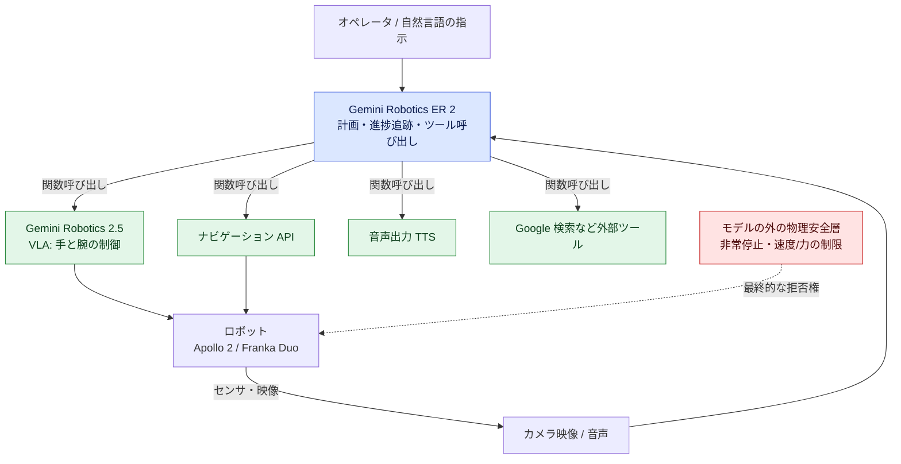
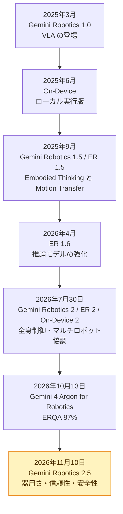
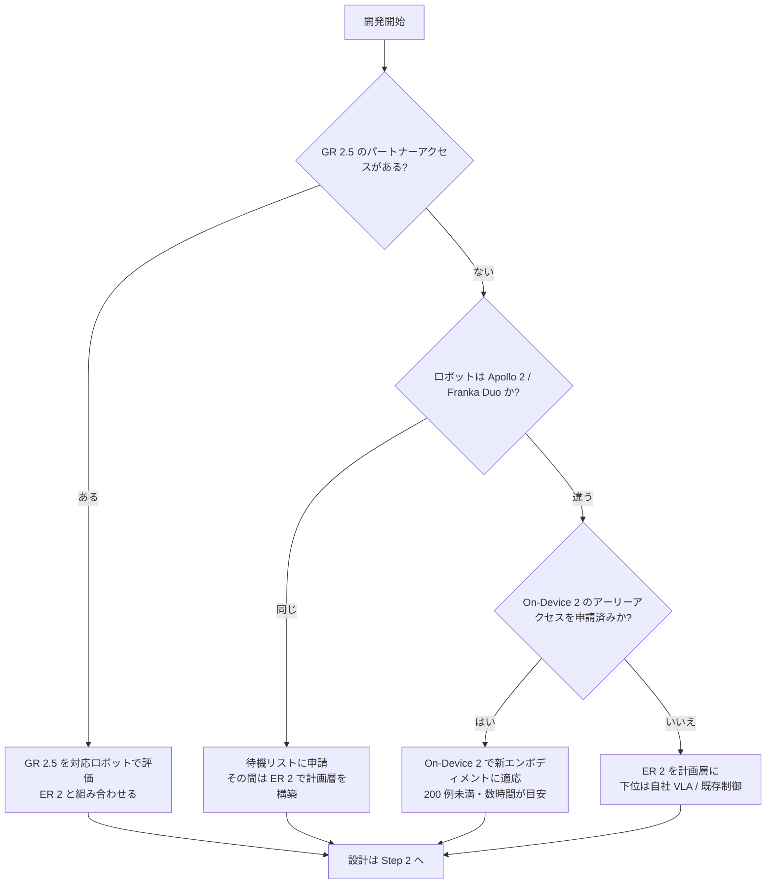
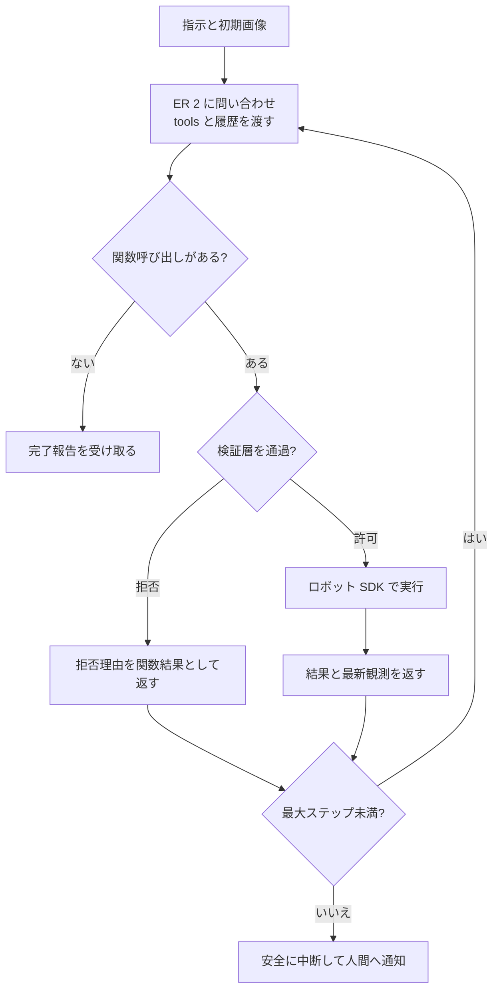
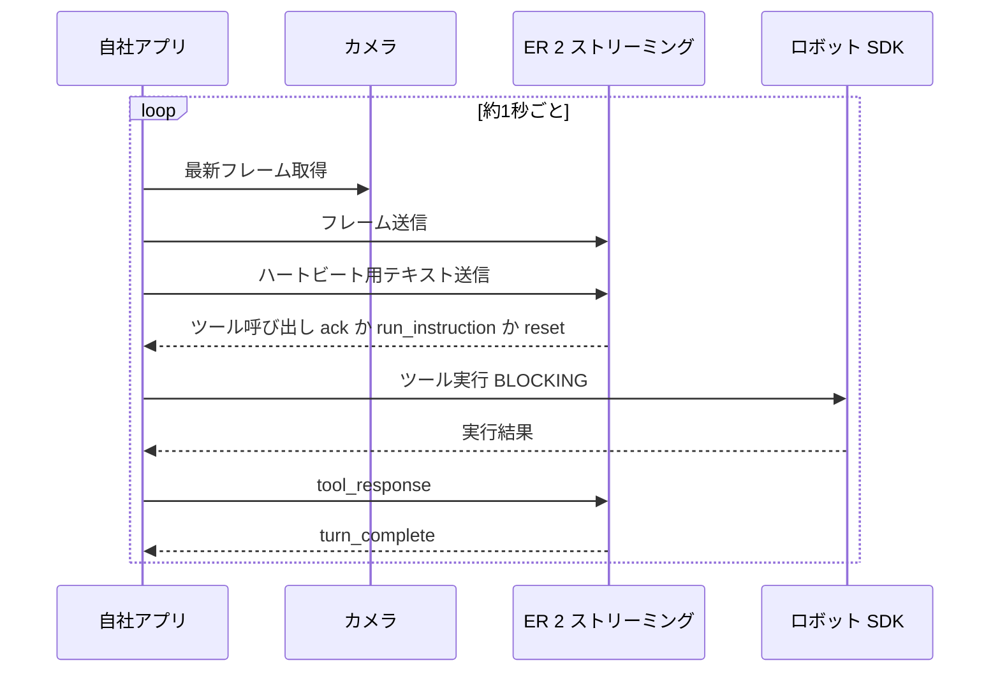
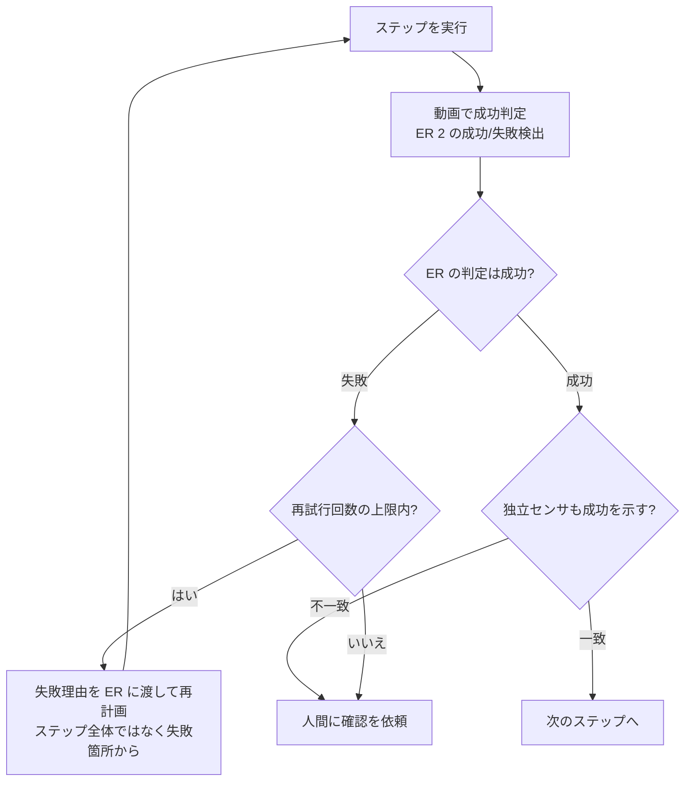
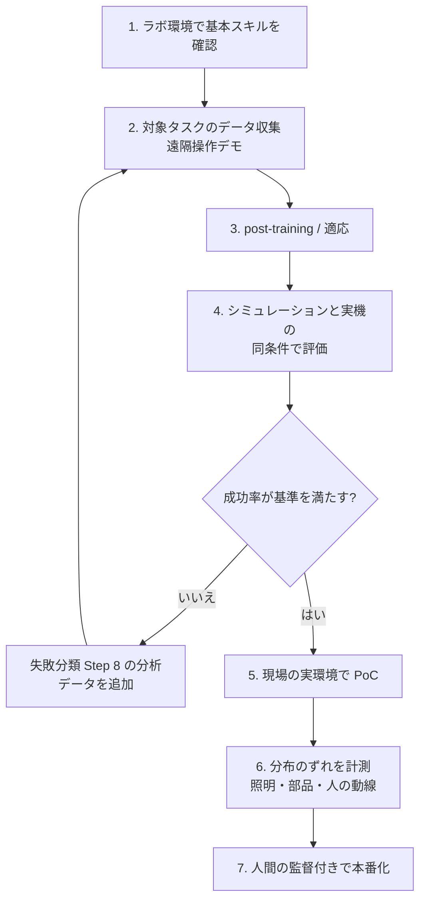
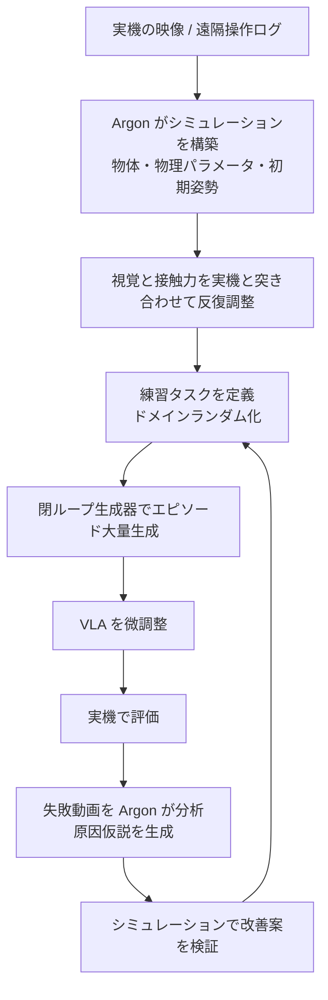
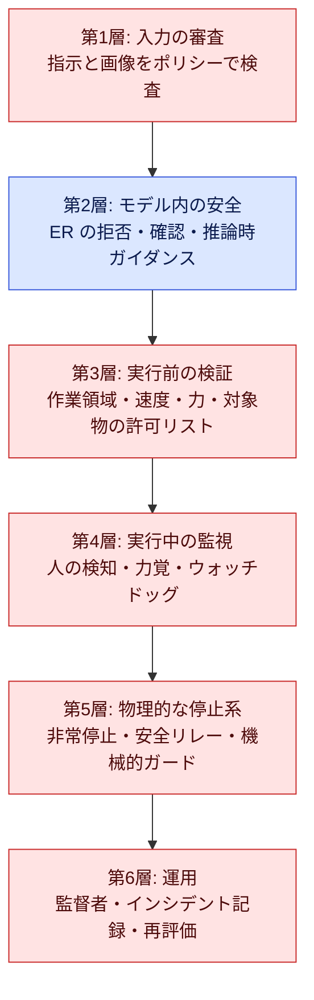

# Gemini Robotics 2.5 ベストプラクティスガイド(中級〜上級者向け)

> **対象読者**: ロボティクス/ML エンジニア、ロボットのシステムインテグレータ、PoC を本番へ持っていきたいテックリード
> **調査基準日**: 2026年11月15日(この日までに公開された一次情報・開発者の投稿・報道を基に執筆)
> **このガイドのゴール**: 「Gemini Robotics 2.5 とは何か」を正確に理解し、**今日から手を動かせる範囲(公開 API の ER 2)** と **パートナー限定の範囲(GR 2.5 本体)** を切り分けたうえで、設計・実装・評価・安全までを 10 ステップで押さえる

---

## 0. このガイドの読み方

### 0.1 情報の信頼度ラベル

本ガイドの各主張には、根拠の強さを示すラベルを付けています。**ロボティクスは「物理的な事故」に直結する分野**なので、ラベルを必ず確認してください。

| ラベル | 意味 | 例 |
|---|---|---|
| ✅ 公式 | Google / Google DeepMind / Google for Developers / ai.google.dev の一次情報で確認済み | 96% の成功率、モデル ID、API の制約 |
| 🧑‍💻 開発者 | Gemini Robotics チームの開発者・パートナー経営者の公開投稿・引用 | Carolina Parada、Keerthana Gopalakrishnan、Kanishka Rao、Jeff Cardenas |
| 📰 報道 | 第三者メディア・解説記事(一次情報の再整理を含む) | The Decoder、Data Studios など |
| 💡 提案 | 公式情報を踏まえた**本ガイドの設計上の推奨**(公式が述べたことではない) | 二重の安全層、Wilson 区間による評価 |

### 0.2 先に知っておくべき重要な前提

1. **Gemini Robotics 2.5(GR 2.5)は一般公開されていません。** ✅ 公式ブログは「ロボティクスパートナーに順次提供中」と述べるのみで、API のモデル ID・価格・一般提供日は公表されていません。
2. **現時点で外部の開発者が API で触れるのは Gemini Robotics ER 2(推論・計画モデル)です。** ✅ `gemini-robotics-er-2-preview` と `gemini-robotics-er-2-streaming-preview` が公開されています。
3. したがって本ガイドは「**ER 2 + 自前(または提供される)アクションモデル**」で今すぐ作れる設計と、「**GR 2.5 をパートナーとして受け取ったときの運用**」の両方を扱います。
4. 本ガイドのコード例は公式ドキュメントのパターンに基づく**説明用の例**です。筆者環境では実機・API キーでの実行は行っておらず、構文チェックのみ実施しています(後述)。実機に接続する前に必ずシミュレータとドライランで確認してください。

---

## 目次

1. [先に結論(TL;DR)](#1-先に結論tldr)
2. [Gemini Robotics ファミリーの全体像](#2-gemini-robotics-ファミリーの全体像)
3. [Gemini Robotics 2.5 の特徴を正確に理解する](#3-gemini-robotics-25-の特徴を正確に理解する)
4. [進化の系譜: 1.0 から 2.5 まで](#4-進化の系譜-10-から-25-まで)
5. [Step 1: アクセス経路を確定する](#5-step-1-アクセス経路を確定する)
6. [Step 2: 「ER が考え、VLA が動く」2 層アーキテクチャを設計する](#6-step-2-er-が考えvla-が動く2-層アーキテクチャを設計する)
7. [Step 3: ER 2 で空間推論(ポインティング)を使いこなす](#7-step-3-er-2-で空間推論ポインティングを使いこなす)
8. [Step 4: ツール呼び出しによるタスク・オーケストレーション](#8-step-4-ツール呼び出しによるタスクオーケストレーション)
9. [Step 5: Live API ストリーミングとハートビート設計](#9-step-5-live-api-ストリーミングとハートビート設計)
10. [Step 6: 進捗分類・モーメント検出で「終わった」を判定する](#10-step-6-進捗分類モーメント検出で終わったを判定する)
11. [Step 7: 新しいロボット(エンボディメント)への適応と立ち上げ](#11-step-7-新しいロボットエンボディメントへの適応と立ち上げ)
12. [Step 8: Gemini 4 Argon でロボティクス研究を加速する](#12-step-8-gemini-4-argon-でロボティクス研究を加速する)
13. [Step 9: 多層の安全設計とジェイルブレイク評価](#13-step-9-多層の安全設計とジェイルブレイク評価)
14. [Step 10: 評価・本番化・運用](#14-step-10-評価本番化運用)
15. [アンチパターン集](#15-アンチパターン集)
16. [未公開・不確実な事項](#16-未公開不確実な事項)
17. [補足: その他のベストプラクティスと根拠ソース一覧](#17-補足-その他のベストプラクティスと根拠ソース一覧)
18. [実装前チェックリスト](#18-実装前チェックリスト)
19. [用語集](#19-用語集)

---

## 1. 先に結論(TL;DR)

| # | 結論 | 根拠ラベル |
|---|---|---|
| 1 | GR 2.5 は **VLA(視覚・言語・行動)層だけ** の新バージョン。ER 2(推論)と On-Device 2 は 7 月版のまま | ✅ 📰 |
| 2 | 強みは **器用さ(dexterity)・信頼性・安全性の 3 点**。200 超のタスクで評価され、前世代比で成功率 +30〜100%、所要時間 −20〜30% | ✅ |
| 3 | 工場 PoC(Apptronik Apollo 2 × Mercedes-Benz)で部品キッティング **成功率 96%**。ただし母数・介入有無などは未公開 | ✅ 📰 |
| 4 | 安全は **推論時の推論ガイダンス**(障害物まわり +33%、人の近く +43% の安全完了)と、新ベンチマーク **ASIMOV-Jailbreak** | ✅ |
| 5 | 開発の高速化に **Gemini 4 Argon が「シミュレーションエンジン」** として使われた(Real2Sim、失敗原因の仮説生成) | ✅ 🧑‍💻 |
| 6 | 今日使える公開入口は **ER 2**(ポインティング、関数呼び出し、動画進捗、Live API) | ✅ |
| 7 | 最大の落とし穴は「**モデルの安全性に物理安全を丸投げする**」こと。物理的な停止系は必ずモデルの外に置く | 💡 |

---

## 2. Gemini Robotics ファミリーの全体像

### 2.1 モデルの役割分担

Gemini Robotics は **「頭脳」と「身体制御」を別モデルに分ける** 設計です。✅

| モデル | 役割 | 最新バージョン | 入手経路(公式の記載) |
|---|---|---|---|
| **Gemini Robotics 2.5** | VLA: 画像+言語を **モーター制御** に変換(手・腕・人型) | 2026-11-10 | ロボティクスパートナーに順次提供 |
| **Gemini Robotics ER 2** | 埋め込み推論(ER): シーン理解、多段計画、進捗追跡、ツール呼び出し | 2026-07-30 | Gemini API / Google AI Studio(preview)、Gemini Enterprise Agent Platform(private preview) |
| **Gemini Robotics On-Device 2** | ローカル実行向けの軽量 VLA。新ロボットへ短時間で適応 | 2026-07-30 | アーリーアクセスパートナー |
| **Gemini 4 Argon** | 汎用フロンティアモデル。GR 2.5 の開発(シミュレーション/分析)に利用 | 2026-10-13 | Gemini API(`gemini-4-argon`)ほか |

> ⚠️ **注意**: ER 1.6(`gemini-robotics-er-1.6-preview`)は **2026年8月31日に終了** しています。✅ 古いコードが残っている場合は `gemini-robotics-er-2-preview` もしくは `gemini-robotics-er-2-streaming-preview` に置き換えてください。

### 2.2 アーキテクチャ図



> 💡 点線の「物理安全層」は本ガイドの設計提案です。公式が述べているのは「安全な環境を維持する責任は開発者にある」という点です(ai.google.dev の安全に関する記述)。

---

## 3. Gemini Robotics 2.5 の特徴を正確に理解する

### 3.1 公式が示した 3 つの進歩 ✅

| 軸 | 内容 | 数値(公式) |
|---|---|---|
| **Dexterity(器用さ)** | トング、ピペット、リボンの蝶結びなど、道具使用・柔らかい物体・繊細な物体の操作 | 200 超のタスクで評価。前世代比 **成功率 +30〜100%**、**所要時間 −20〜30%** |
| **Reliability(信頼性)** | 実工場ラインでの自律キッティング | **96%**(Mercedes-Benz のハンガリー Kecskemét とドイツ Sindelfingen) |
| **Safety(安全性)** | 推論時ガイダンスで物理的な危険を回避。ジェイルブレイク用の新ベンチマークを公開 | 障害物まわり **+33%**、人の近く **+43%**(安全なタスク完了) |

対応ロボットとして公式が挙げているのは、**Apptronik Apollo 2**(5 本指・22 自由度の SharpaWave ハンド)と、**Franka Duo**(2 指パラレルグリッパ)です。✅

### 3.2 公式チャートに見る改善幅(抜粋)

以下は公式ブログのチャート説明に記載された値です。✅ **DeepMind が新機能を示すために選んだタスク**であり、200 タスク全体の平均ではありません。

| タスク | Gemini Robotics 2 | Gemini Robotics 2.5 |
|---|---|---|
| トングでペストリーを詰める | 5% | 100% |
| 黒い工具箱のフタを閉める | 0% | 93% |
| ハンガーからマグを外してテーブルへ | 29% | 75% |
| リボンの蝶結びをほどく | 0% | 70% |
| カーディガンをハンガーに掛ける | 0% | 62% |
| ブラシでゴミをちりとりへ掃き入れる | 0% | 52% |
| 炊飯器を梱包する | 0% | 40% |
| ズボンを畳む | 0% | 40% |

> 📌 **読み解きのコツ**: 7 月の GR 2 発表時、5 指ハンドの多指ドメインは「電球を締める 36%」「ゴミ袋を結ぶ 44%」「ちりとり 32%」など、DeepMind 自身が**難しいと認めていた領域**でした。✅ 2.5 の大きな伸びはまさにこの弱点に集中しています。一方で 40% 台のタスクも残っており、「万能」ではなく「**難所が実用圏に近づいた**」と読むのが適切です。

### 3.3 工場 PoC の中身 ✅

| 項目 | 公式が述べていること |
|---|---|
| ロボット | Apptronik Apollo 2 人型ロボット |
| 場所 | Mercedes-Benz(Kecskemét / Sindelfingen) |
| タスク | バルクビンから金属ブラケットを取り出し、車両ごとの順序で容器へ並べる「キッティング」 |
| 構成 | **ER がワークフローを追跡し、GR 2.5 が手と腕を制御** |
| 成功率 | 96%(DeepMind 自身が「proof of concept」と表現) |
| 立ち上げ | Apptronik CEO の Jeff Cardenas は「数週間の post-training でモデルが大きく改善し、Mercedes の生産ラインにほとんど性能低下なく移行できた」と述べている 🧑‍💻 |

---

## 4. 進化の系譜: 1.0 から 2.5 まで



| 世代 | 押さえるべき技術的ポイント | 根拠 |
|---|---|---|
| 1.5 | **Embodied Thinking**(行動の前に自然言語で考える)、**Motion Transfer**(異なるロボットのデータを 1 つの VLA で学習) | ✅ arXiv 2510.03342 |
| 2 | **全身制御**(足先から指先まで)、**ER 2 による多段・長時間タスク**、**マルチロボット協調** | ✅ DeepMind ブログ |
| 2.5 | 器用さ・信頼性の向上、**推論時ガイダンスによる安全ステアリング**、**Argon による研究加速** | ✅ DeepMind ブログ |

> 💡 **なぜ系譜を知るべきか**: 2.5 の公式発表は「VLA の中身(パラメータ数、アーキテクチャ変更、データ量)」を開示していません。📰 そのため、2.5 の挙動を推測するときは 1.5 の「Embodied Thinking」「Motion Transfer」という**公開済みの設計思想**を土台にしつつ、「2.5 でも同じとは限らない」と留保を置くのが誠実です。

---

## 5. Step 1: アクセス経路を確定する

最初にやるべきことは、**どの層のモデルを使えるのか** を決めることです。



| 経路 | 使えるもの | 条件・注意 |
|---|---|---|
| 公開 API | **ER 2**(`gemini-robotics-er-2-preview` / `-streaming-preview`) | プレビュー。Gemini API キーが必要。制限なしの API キーは 403 になる ✅ |
| 企業向け | Gemini Enterprise Agent Platform(ER 2 の private preview) | ✅ |
| アーリーアクセス | **VLA / On-Device 2**(トラステッドテスターのフォーム経由) | 100 以上のトラステッドテスターと待機リストがあると記載 📰 |
| パートナー | **GR 2.5** | Agile、Apptronik、Mercedes-Benz が名指しされている ✅ |

> 💡 **ベストプラクティス**: GR 2.5 が手元に来る前から、**計画層(ER 2)・進捗判定・安全層・評価基盤**を先に作っておくこと。VLA が GR 2 から GR 2.5 に変わっても、これらの層はほぼそのまま使い回せます(ER 2 が「任意の下位 VLA」に実行を渡す設計であるため ✅)。

---

## 6. Step 2: 「ER が考え、VLA が動く」2 層アーキテクチャを設計する

### 6.1 責務の切り分け

| 層 | 担当 | 入力 | 出力 | やらせてはいけないこと |
|---|---|---|---|---|
| **ER 2(上位)** | 指示理解、計画、進捗追跡、失敗検出、人間への確認、ツール呼び出し | 画像・動画・音声・テキスト | テキスト、座標(点・ボックス)、関数呼び出し | 関節角やトルクの直接出力(ER 2 の出力はテキスト ✅) |
| **GR 2.5(下位)** | 手・腕・全身の連続的な運動制御 | カメラ画像+言語指示 | モーター制御 | 長時間・多段の計画の管理 |
| **自前の安全層** | 停止、速度/力/領域の制限、人の検知 | センサ | 停止信号 | モデルの判断に依存した安全 |

### 6.2 設計上の原則 💡

1. **ER 2 の「ツール」として VLA を宣言する。** 公式の説明どおり、VLA やナビゲーション API は低レベルの制御インターフェースとして関数宣言し、ER が呼び出す形にします。✅
2. **物理的な動作を伴う関数は BLOCKING にする。** ストリーミング(Live API)では「完了を待ってから次の手を選ぶ」ために必須です。✅ (Step 5 で詳述)
3. **ER のコンテキストに「現在のロボット状態」を毎ターン渡す。** グリッパの開閉、保持物、直前の失敗理由など。Argon のゼロショット制御例でも、`obs.json` と手首カメラ画像を毎ターン渡して閉ループにしています。✅
4. **ER 2 と VLA の境界で、粒度を決める。** 「ブラケットを赤い容器に入れる」程度の**1 スキル = 数秒〜数十秒**を VLA の呼び出し単位にし、その上の順序制御を ER に任せるのが扱いやすい粒度です。(Mercedes PoC の分担がこの形 ✅)

---

## 7. Step 3: ER 2 で空間推論(ポインティング)を使いこなす

### 7.1 基本呼び出し(公式パターン)

ER 2 は画像に対して **正規化座標 `[y, x]`(0〜1000)** と **ラベル** の JSON を返します。✅ 座標の順序が一般的な `(x, y)` と**逆**なので、変換ミスが典型的なバグ源です。

```python
import json
import re
from google import genai
from google.genai import types

client = genai.Client()  # GEMINI_API_KEY は環境変数から読み込まれる

PROMPT = """
Point to no more than 10 items in the image. The label returned
should be an identifying name for the object detected.
The answer should follow the json format: [{"point": <point>, "label": <label1>}, ...].
The points are in [y, x] format normalized to 0-1000.
"""

def ask_points(image_path: str, thinking_level: str = "medium") -> list[dict]:
    uploaded = client.files.upload(file=image_path)
    response = client.models.generate_content(
        model="gemini-robotics-er-2-preview",
        contents=[
            types.Part.from_uri(
                file_uri=uploaded.uri, mime_type=uploaded.mime_type
            ),
            PROMPT,
        ],
        config=types.GenerateContentConfig(
            thinking_config=types.ThinkingConfig(thinking_level=thinking_level)
        ),
    )
    return parse_json_array(response.text)

FENCE = "`" * 3  # Markdown のコードフェンス(バッククォート 3 つ)

def parse_json_array(text: str) -> list[dict]:
    # モデルがコードフェンスで囲んで返すことがあるため、先頭と末尾のフェンスを除去する
    pattern = rf"^{FENCE}(?:json)?\s*|\s*{FENCE}$"
    cleaned = re.sub(pattern, "", text.strip())
    return json.loads(cleaned)
```

> 🔎 公式ドキュメントのサンプルは `thinking_level="high"` ですが、同じページの制限事項では **「レイテンシと性能のバランスには medium を使う」** と明記されています。✅ ロボットの制御ループでは medium から始め、精度が足りないタスクだけ high に上げるのが定石です。💡

### 7.2 座標変換とピクセル座標への投影

```python
def to_pixel(point_yx: list[int], width: int, height: int) -> tuple[int, int]:
    """ER の [y, x](0-1000)を画像のピクセル座標 (x, y) に変換する。"""
    y_norm, x_norm = point_yx
    # [1000, 1000] は round 後に width / height となり画像外を指すため、最終画素へ収める
    px = min(max(round(x_norm / 1000 * width), 0), width - 1)
    py = min(max(round(y_norm / 1000 * height), 0), height - 1)
    return px, py
```

### 7.3 公式の 4 つのベストプラクティス ✅

| # | 公式のベストプラクティス | 実装での具体策 💡 |
|---|---|---|
| 1 | 平易な自然言語で指示する。通じない語は一般的な同義語に言い換える | 社内専門用語(「トレイ A」)ではなく「青い浅い箱」と視覚的に記述 |
| 2 | **小さい・不鮮明な対象は、クロップ/ズームしてから送る**。照明や低コントラストが検出に影響する | まず全体画像で粗く検出 → 対象周辺を切り出して再質問(2 段階) |
| 3 | 複雑なタスクは**ステップに分割**し、ステップごとに別プロンプトで送る | 「検出 → 把持位置 → 配置位置」を別呼び出しに |
| 4 | **高精度が必要なら複数回問い合わせて平均する**(コンセンサスで分散を減らす) | 5 回問い合わせ、座標の中央値を採用(外れ値に強い) |

### 7.4 コンセンサス(複数回問い合わせ)の実装例 💡

```python
import math
import statistics

def consensus_point(image_path: str, target: str, n: int = 5) -> tuple[float, float] | None:
    """同じ対象を n 回ポイントさせ、[y, x] の中央値を返す。"""
    ys, xs = [], []
    for _ in range(n):
        try:
            items = ask_points_for(image_path, target)  # 1 点だけ返させる自作ラッパ
            if not items:
                continue
            point = items[0]["point"]
            if not isinstance(point, (list, tuple)) or len(point) != 2:
                continue  # 座標が欠けている・2 要素でない回は捨てる
            y, x = point
            # 0〜1000 の有限な数値のみ採用（bool・NaN・inf・範囲外は捨てる）
            if not all(isinstance(v, (int, float)) and not isinstance(v, bool)
                       and math.isfinite(v) and 0 <= v <= 1000 for v in (y, x)):
                continue
        except (ValueError, KeyError, TypeError, IndexError):
            continue  # 形式崩れの回は捨てる
        ys.append(y)
        xs.append(x)
    if len(ys) < max(3, n // 2):  # 有効回答が少なすぎるなら採用しない
        return None
    return statistics.median(ys), statistics.median(xs)
```

> 💡 有効回答が少ない場合に `None` を返す点が重要です。**「答えが出ない」を「適当な座標で動く」に変換してはいけません。** 呼び出し側は `None` のとき再観測か人間への確認に分岐させます。

---

## 8. Step 4: ツール呼び出しによるタスク・オーケストレーション

### 8.1 エージェントループの基本形 ✅

公式のオーケストレーション例は、**ロボット API を関数宣言として渡し、モデルの関数呼び出しを実行して結果を返す、を繰り返すループ**です。重要な安全装置として **`max_steps`(最大ステップ数)** が置かれています。



### 8.2 検証層つきの実装例 💡

以下は公式の「pick and place」例(`move` と `setGripperState` の 2 関数)を土台に、**実行前の検証層**と**観測の返却**を足した例です。

```python
from google import genai
from google.genai import types

client = genai.Client()

WORKSPACE = {"x": (-400, 400), "y": (-400, 500)}  # 例: 安全な作業領域(原点相対)
MAX_STEPS = 15

move_decl = types.FunctionDeclaration(
    name="move",
    description="Moves the arm to the given coordinates relative to the origin.",
    parameters=types.Schema(
        type=types.Type.OBJECT,
        properties={
            "x": types.Schema(type=types.Type.INTEGER),
            "y": types.Schema(type=types.Type.INTEGER),
            "high": types.Schema(
                type=types.Type.BOOLEAN,
                description="True: lift above the scene. False: table level.",
            ),
        },
        required=["x", "y", "high"],
    ),
)
gripper_decl = types.FunctionDeclaration(
    name="setGripperState",
    description="Opens (True) or closes (False) the gripper.",
    parameters=types.Schema(
        type=types.Type.OBJECT,
        properties={"opened": types.Schema(type=types.Type.BOOLEAN)},
        required=["opened"],
    ),
)
tools = types.Tool(function_declarations=[move_decl, gripper_decl])
ALLOWED_TOOLS = {decl.name for decl in tools.function_declarations}


def validate(name: str, args: dict) -> str | None:
    """問題があれば拒否理由を返し、なければ None を返す。モデルの外で必ず実行する。"""
    if name not in ALLOWED_TOOLS:
        return f"{name} is not a declared tool"  # 宣言外の名前はロボット SDK へ渡さない
    if name == "move":
        x, y = args["x"], args["y"]
        if not (WORKSPACE["x"][0] <= x <= WORKSPACE["x"][1]):
            return f"x={x} is outside the allowed workspace"
        if not (WORKSPACE["y"][0] <= y <= WORKSPACE["y"][1]):
            return f"y={y} is outside the allowed workspace"
    return None


def run_task(contents: list, execute_on_robot, estop_active) -> str:
    for step in range(1, MAX_STEPS + 1):
        if estop_active():  # 非常停止が入っていればモデルに問い合わせずに終了
            return "aborted: emergency stop"
        response = client.models.generate_content(
            model="gemini-robotics-er-2-preview",
            contents=contents,
            config=types.GenerateContentConfig(
                tools=[tools],
                thinking_config=types.ThinkingConfig(thinking_level="low"),
            ),
        )
        contents.append(response.candidates[0].content)
        calls = [p for p in response.candidates[0].content.parts if p.function_call]
        if not calls:
            return response.text  # モデルが関数を呼ばなくなったら完了
        results = []
        for part in calls:
            fc = part.function_call
            reason = validate(fc.name, dict(fc.args))
            if reason:
                payload = {"status": "rejected", "reason": reason}
            else:
                # 生成待ちの間に停止された場合に備え、実行直前にも再確認する。
                # ソフトウェアの確認であり、独立した物理インターロックの代わりではない。
                if estop_active():
                    return "aborted: emergency stop"
                # 実行器は status に加え、実行後の最新観測（画像・状態）を payload に含めて返す契約とする。
                # status のみだと次ターンのモデルは新しい観測を得られない。
                payload = execute_on_robot(fc.name, dict(fc.args))
            results.append(types.Part.from_function_response(name=fc.name, response=payload))
        contents.append(types.Content(role="user", parts=results))
    return "aborted: step limit reached"
```

### 8.3 オーケストレーションのベストプラクティス

| # | ベストプラクティス | 根拠 / 理由 |
|---|---|---|
| 1 | **`max_steps` を必ず設ける**(無限ループ防止) | ✅ 公式サンプルに明記 |
| 2 | 関数の説明(`description`)に**座標系・単位・原点**を書く | ✅ 公式例は原点を `y=300, x=500` のように明示 |
| 3 | **関数結果に `status` を返す**。拒否や失敗も構造化して返し、モデルに再計画させる | 💡 失敗を握りつぶすと自己修正できない |
| 4 | 物理動作の関数に**検証層**(作業領域・速度・力の上限)を挟む | 💡 モデルの出力を信用しきらない |
| 5 | **thinking_level はタスク別に調整**(単純な反復は low、曖昧な状況判断は medium〜high) | ✅ 公式は latency と performance のトレードオフを明記 |
| 6 | 長いタスクは**履歴を要約して圧縮**する(入力上限は 131,072 トークン) | ✅ 入力上限、💡 要約戦略 |

---

## 9. Step 5: Live API ストリーミングとハートビート設計

反応性が必要な用途(人が近づいたら止める、容器が満杯になったら次へ、など)では、**ストリーミング専用エンドポイント `gemini-robotics-er-2-streaming-preview`** を使います。✅ 標準の `gemini-robotics-er-2-preview` では Live API は使えません。

### 9.1 仕様(公式) ✅

| 項目 | 内容 |
|---|---|
| 入力 | 音声(16-bit PCM、16kHz、リトルエンディアン)、画像(JPEG、**1 FPS 以下**)、テキスト |
| 出力 | **テキストのみ**(音声は外部 TTS にルーティング) |
| プロトコル | ステートフルな WebSocket(WSS) |
| 関数呼び出し | **BLOCKING のみ対応** |
| 注意 | 動画フレームだけでは新しい推論ターンは始まらない。**テキストか音声のプロンプトを併送する必要がある** |

### 9.2 「ハートビート」設計 ✅

公式が示すパターンは、**約 1Hz で最新フレームと短いテキスト指示を送り、モデルに毎回「状況を見て判断せよ」と促す**方式です。判断の選択肢は「進行中なら ack」「ステップ完了なら次の指示を実行」「ゴール達成ならリセット」のように、**有限の関数セットに絞る**のがコツです。



### 9.3 最重要の落とし穴: barge-in(割り込み) ✅

> **生成中に新しいプロンプトを送ると「割り込み」として扱われ、推論中のツール呼び出しが取り消されます。** タイマーだけでハートビートを送り続けると、モデルが取り消しループに陥り「反応しない」ように見えます。

**対策**: 前のターンが `turn_complete` になるまで次のハートビートを送らない。公式の例では `asyncio.Event` で待機します。

```python
import asyncio
from google.genai import types

HEARTBEAT_TEXT = (
    "[HEARTBEAT] If no task is active, call 'ack'. "
    "If the current step is progressing, call 'ack'. "
    "If the current step is complete, call 'run_instruction' with the next step. "
    "If the overall goal is achieved, call 'reset'."
)

async def heartbeat(session, camera, turn_done: asyncio.Event, interval: float = 1.0):
    """受信側は turn_complete を受け取ったときに turn_done.set() を呼ぶ。"""
    loop = asyncio.get_running_loop()
    last_sent = None
    while True:
        if last_sent is not None:
            # 1 FPS 上限は、取得開始ではなく前のフレームを実際に送った時刻から数える
            await asyncio.sleep(max(0.0, interval - (loop.time() - last_sent)))
        frame = await camera.latest_jpeg()
        turn_done.clear()        # 古い完了通知で次のハートビートへ進まないよう、送信前に消す
        await session.send_realtime_input(
            video=types.Blob(data=frame, mime_type="image/jpeg")
        )
        last_sent = loop.time()
        await session.send_realtime_input(text=HEARTBEAT_TEXT)
        await turn_done.wait()   # いま送ったターンが終わるまで次を送らない
```

### 9.4 ストリーミングのベストプラクティス

| # | ベストプラクティス | 根拠 |
|---|---|---|
| 1 | 物理動作は `"behavior": "BLOCKING"` で宣言 | ✅ |
| 2 | ハートビートは **turn_complete を待ってから** 送る | ✅ |
| 3 | 映像は **1 FPS 上限**を前提に設計(高速な反応は自前の低レベル制御で) | ✅ 1 FPS 制限、💡 役割分担 |
| 4 | 発話は **外部 TTS**。TTS 自体を `send_message` のような関数として宣言し、ロボット動作と同じ経路で扱う | ✅ |
| 5 | 判断語彙は少数の関数に絞る(`ack` / `run_instruction` / `reset` など) | ✅ 公式例 |
| 6 | **ER 2 の応答遅延が安全に効くなら、停止判断は ER に任せず自前のセンサで行う** | 💡 1 秒周期のループで人の接近を止めるのは危険 |

---

## 10. Step 6: 進捗分類・モーメント検出で「終わった」を判定する

「**タスクがいつ終わったかを知ること**」はロボティクスで最も難しい問題の 1 つだと公式が述べています。✅ ER 2 は 2 つの基礎能力を強化しました。

| 能力 | 内容 | 公式の数値 |
|---|---|---|
| **進捗分類** | 各フレームを 0-20% / 20-40% / 40-60% / 60-80% / 80-100% の 5 段階に分類 | 精度 **57.4%** |
| **モーメント検出** | 重要イベントが起きた正確なフレームを特定(例: コーヒーを注ぐのを止めるタイミング) | 精度 **91.3%**、平均絶対距離 **0.96 秒** |

加えて、**成功/失敗検出が静止画ではなく動画(連続フレーム)で動く**ようになり、こぼれ・滑り・位置ずれなどの実行中の失敗を拾えます。✅

### 10.1 数字の正しい読み方 💡

- **進捗分類の 57.4% は「5 段階に分類したときの精度」**であり、「完了判定が 57% 正しい」という意味ではありません。完了/未完了の 2 値判断は別の指標です。
- とはいえ、5 段階の分類としては**半分弱が外れる**水準です。**単一フレームの進捗値だけで次のステップへ進む設計は避け**、複数フレームの時系列、位置センサ、力覚などと**突き合わせる**のが安全です。
- モーメント検出の平均絶対距離 0.96 秒は「**1 秒弱のずれがありうる**」という意味です。0.5 秒で結果が変わるタスク(注ぎ止め、挿入完了)では**センサで補正**してください。

### 10.2 検証つき再試行ループ 💡



> 💡 公式は進捗の定量化によって「**ワークフロー全体をやり直さず、失敗したステップだけ再試行できる**」と説明しています。✅ 再試行の**上限回数**を設けないと、失敗が続いたときに部品や設備を傷めるおそれがあります。

---

## 11. Step 7: 新しいロボット(エンボディメント)への適応と立ち上げ

### 11.1 公式が示す適応の目安 ✅

| 項目 | 内容 |
|---|---|
| On-Device 2 | **新しい双腕ロボットへ数時間の適応時間、通常 200 例未満**で適応可能 |
| 前提技術 | Gemini Robotics 1.5 の **Motion Transfer** を継承 |
| 検証された例 | Dexmate、SO101、Trossen のプラットフォーム |
| GR 2 の同一チェックポイント | Apollo 2(SharpaWave ハンド)、Apollo 2(Inspire ハンド)、Franka Duo(Robotiq グリッパ)を**同じモデルで制御** |
| Apptronik の証言 | 数週間の post-training で大幅に改善し、Mercedes 本番にほぼ性能低下なく持ち越せた 🧑‍💻 |

> ⚠️ **GR 2.5 については、新エンボディメントへの適応工数は公式には開示されていません。** 📰 上の On-Device 2 の「200 例未満」は **On-Device 2 の値**であり、GR 2.5 にそのまま当てはまるとは限りません。

### 11.2 立ち上げパイプライン 💡



### 11.3 データ収集のベストプラクティス 💡

1. **「成功デモだけ」を集めない。** 失敗・リトライ・把持のやり直しを含めて収集し、Step 8 の「ハインドサイトラベル」で品質を重み付けする(Argon のブログ例では、失敗リトライ区間を行動模倣で 0.15〜0.25 倍に下げる設計)。✅
2. **現場環境の変動をデータに含める。** 照明、ビンの中の部品の山の形、容器の位置のずれ。(ランダム化した 4,500 超のシミュレーションエピソードが実機の成功率を 56%→75% に上げた Argon の事例が根拠)✅
3. **評価データと学習データを分離する。** 評価に使う配置は学習に使わない。💡

---

## 12. Step 8: Gemini 4 Argon でロボティクス研究を加速する

DeepMind は GR 2.5 の開発で、**Gemini 4 Argon を「シミュレーションエンジン」として使い、開発が大きく加速した**と述べています。✅ Google for Developers ブログ(2026-10-13、Kanishka Rao)には、**今日 API(`gemini-4-argon`)で再現できるプロンプト例**が 4 領域で公開されています。

| 領域 | 内容 | 例 |
|---|---|---|
| **ロボット制御** | MuJoCo での練習、ゼロショット制御、動画ワールドモデルの閉ループ操縦 | Spot がペダル式ごみ箱を MuJoCo デジタルツインで練習してから実機で操作 |
| **Real2Sim** | ロボット映像・人間の一人称動画・手描きスケッチから、物理的に較正されたシミュレーションを構築 | ロボット遠隔操作の記録から MuJoCo シーンを再構成し、視覚と接触力の両方で突き合わせ |
| **物理的理解** | ハインドサイトラベル、密な価値関数、進捗推定 | 折り紙(136 秒)を 4 階層でアノテーションし、失敗区間を重み付け |
| **研究と自己改善** | シミュレーションによるアクション改善、実機での反復的な自己改善 | 1 枚の写真から 4,500 超のエピソードを生成し、実機成功率 **56%→75%**、所要時間 **35 秒→24 秒** |

### 12.1 Real2Sim2Real の研究ループ



### 12.2 Argon に渡すプロンプトの設計パターン ✅💡

公式ブログのプロンプトに共通する設計を、再利用しやすい形に整理しました(元のプロンプトの転載ではなく、**パターンの抽出**です)。

| パターン | 内容 | なぜ効くか |
|---|---|---|
| **検証目標を 2 つ以上明示** | 「視覚が一致」+「物理(接触力)が一致」 | 見た目だけ合ったシミュレーションを防ぐ |
| **禁止事項(ズルの防止)を書く** | 「シミュレーション中に外力を加えない」「接触を無効化しない」等 | モデルが最短で目標を満たす抜け道を取るのを防ぐ |
| **実行規律を指定** | 「1 文の観測の直後にコマンドを出す」「毎ターン観測してから動く」 | 閉ループで暴走せず、観測を挟む |
| **呼び出し粒度を先に選ばせる** | 粗い(2〜4 回)/ 確認つき(4〜7 回)/ 細かい視覚サーボ(8〜20 回) | レイテンシと精度のトレードオフを明示的に選ばせる |
| **失敗時の復帰手順を書く** | 「`grasp_failed` なら再観測して回復する」 | 失敗を想定した設計 |
| **出力形式を固定** | JSON スキーマ、タグで囲む、時刻形式を指定 | 後段の自動処理が楽 |
| **ハード制約はコードで強制** | R5 などの安全規則は、モデルとは独立したコマンド検証器・インターロックで実行前に強制する。AGENTS.md はモデルへの指針であり、強制手段ではない | 実機運用では人による安全監督を維持し、モデルが規則を無視しても動作を止められるようにする |

### 12.3 ハインドサイトラベリング用の最小プロンプト例 💡

```markdown
[Attached: episode.mp4]

Produce a time-aligned annotation JSON with these levels:
1. episode_goal: one imperative sentence.
2. subtasks: contiguous phases with start/end seconds.
3. primitives: contact-level actions (grasp, release, sweep, retry).
4. quality: mark pauses, unstable grasps, and fumbles. Hold task_progress flat
   during retries and set a sample_weight between 0.15 and 0.25 for them.

Return only valid JSON. Do not invent events you cannot see in the video.
```

> 💡 最後の「見えないことを作らない」の一文は、ハルシネーションによる**偽のラベル**が学習データに混ざるのを減らすための保険です。ラベルは**人間が一部をサンプリング検査**してから学習に使ってください。

---

## 13. Step 9: 多層の安全設計とジェイルブレイク評価

### 13.1 公式が示した安全の仕組み ✅

| 仕組み | 内容 | 成果 |
|---|---|---|
| **推論時の推論ガイダンス** | 安全分類器が応答を保護するのと同様に、推論時に物理的な危険を避けるようロボットを誘導 | 障害物まわり **+33%**、近くの人まわり **+43%** の安全な完了(いずれも相対的な改善で、ベースラインの絶対値は未公表 📰) |
| **ASIMOV-Jailbreak**(新規・オープンソース) | 危険な依頼を偽装した**数百のプロンプト**を**数十のシーン**にまたがって提供 | Argon の耐性 **99.5%**(ER 2 は 82%) |
| **ASIMOV-Agentic**(7 月公開) | VLA の危険なツール呼び出しを ER が**拒否**できるか、実行可能性の予測、不確実なときの人間への助力要請 | ER 2 は安全指示追従と人の近接のベンチマークで ER 1.6 などを上回る |
| **ER 2 の人間近接対応** | 近くに人がいると人型ロボットを停止し、エリアが空いてから自律的に再開 | 公式ブログで確認 |
| **エージェント評価** | 危険タスクの拒否、不確実性の解消、人の近くでの作業で Argon が首位 | ✅ |

> ⚠️ **読み方の注意** 📰: 「99.5%」は **Gemini 4 Argon** の数値で、**GR 2.5 を載せたロボットのエンドツーエンドの耐性**ではありません。発表は、Argon が実際のパートナー展開で ER 2 に置き換わるのかどうかにも言及していません。

### 13.2 自社システムの安全層(本ガイドの設計提案)💡



| 層 | 誰が責任を持つか | ベストプラクティス |
|---|---|---|
| 1 入力の審査 | 自社 | 指示文に加えて**画像内の文字**も入力として扱い、画面上の文字による指示注入(プロンプトインジェクション)を想定する |
| 2 モデル内の安全 | モデル側 | 提供される機能を使う。ただし**これを唯一の防御にしない** |
| 3 実行前の検証 | 自社 | Step 4 の `validate()`。**許可リスト方式**(許可した動作だけ通す) |
| 4 実行中の監視 | 自社 | ER の応答遅延(約 1 秒周期)に依存しない、**高速なセンサ系**での減速・停止 |
| 5 物理的な停止系 | 自社 | **ソフトウェア(モデル・SDK)から独立**した経路で電力/動力を遮断できること |
| 6 運用 | 自社 | 試験は人のいない領域で。**人の近くでの試験は段階的に** |

### 13.3 ASIMOV-Jailbreak を自社パイプラインの回帰テストにする 💡

公式は ASIMOV-Jailbreak を **誰でもダウンロードして使える** とし、Hugging Face で公開しています(`google/asimov_agentic`)。✅

ダウンロードの前に、次の準備をします。

1. Hugging Face にログインした状態でデータセットページを開き、利用条件(アクセス条件)が表示された場合は内容を確認して同意する。
2. 同じアカウントのアクセストークンで認証する。`huggingface_hub` のログインコマンド(`hf auth login`、旧 CLI では `huggingface-cli login`)を使うか、環境変数 `HF_TOKEN` にトークンを設定する。トークンはコードに直書きしない。

```bash
# 例: データセットを取得して、自社の指示パイプライン(入力審査→ER→検証層)に流す
pip install datasets
python - <<'PY'
from datasets import load_dataset
ds = load_dataset("google/asimov_agentic")
print(ds)  # 分割名や列は実際の構成を確認してから使うこと
PY
```

> ⚠️ 上のコードは**データセットの構成を確認するだけ**のものです(筆者はデータセットの列構成を検証していません)。実際の評価では「**偽装された危険依頼のうち、最終的に動作として実行された割合**」を、モデル単体ではなく**自社パイプライン全体**で測ってください。モデルが拒否しても、検証層を迂回する経路があれば意味がありません。💡

### 13.4 データとプライバシー ✅

ai.google.dev の注意書きによると、ロボティクスモデルは動作に映像・音声を使うため、**識別可能な人物の声・映像・肖像が収集され得ます**。人物が周囲にいる場合は、**事前の通知と同意**が必要で、顔のぼかしや**人のいない領域での運用**などでデータ収集を最小化するよう求められています。

---

## 14. Step 10: 評価・本番化・運用

### 14.1 「96%」を自社の言葉に翻訳する 💡

公式の 96% は、母数(何回の試行か)、失敗の定義、人の介入の有無、サイクルタイムが**未開示**です。📰 自社の評価では、成功率に**信頼区間**を付けてください。次は筆者が計算した、成功率 96% のときの **Wilson 95% 区間**です。

| 試行回数 n | 成功数 | 95% 信頼区間(Wilson) |
|---|---|---|
| 25 | 24 | 80.5% 〜 99.3% |
| 50 | 48 | 86.5% 〜 98.9% |
| 100 | 96 | 90.2% 〜 98.4% |
| 200 | 192 | 92.3% 〜 98.0% |
| 500 | 480 | 93.9% 〜 97.4% |

> 📌 **試行 50 回で 48 回成功しても、真の成功率は 86% 台かもしれません。** 本番投入の判断には、少なくとも 100〜200 回以上の試行と区間の下限での判断が必要です。

```python
import math

def wilson_interval(successes: int, trials: int, z: float = 1.96) -> tuple[float, float]:
    """成功率の Wilson 信頼区間(既定は 95%)を返す。"""
    if trials <= 0:
        raise ValueError("trials must be positive")
    p = successes / trials
    denom = 1 + z * z / trials
    center = p + z * z / (2 * trials)
    margin = z * math.sqrt(p * (1 - p) / trials + z * z / (4 * trials * trials))
    return (center - margin) / denom, (center + margin) / denom
```

### 14.2 評価設計のチェックポイント 💡

| 項目 | 推奨 |
|---|---|
| 成功の定義 | 事前に文章で固定(例: 「ブラケットが指定トレイの指定スロットに収まり、落下なし」) |
| 失敗の分類 | 把持失敗/配置ずれ/計画ミス/誤検出/安全停止/人の介入 を**別集計** |
| 介入 | **人の介入は失敗として数える**(別に「介入なし成功率」も報告) |
| 速度 | 成功率だけでなく**サイクルタイム**を人間と比較(GR 2.5 は前世代比 20〜30% 高速と公式 ✅) |
| 分布 | 照明・時間帯・部品ロット・ビンの残量などの条件別に層別 |
| 比較 | GR 2 → 2.5 の A/B は**同じ試行条件・順序をランダム化**して実施 |

### 14.3 運用のベストプラクティス 💡

1. **シャドーモード**: 最初はロボットを動かさず、ER の判断だけを記録して人間の作業と突き合わせる。
2. **失敗動画を捨てない。** Argon の「失敗動画から原因を仮説化し、シミュレーションと実機で検証する」ループ(✅ 公式)を日常運用に組み込む。
3. **バージョン固定と回帰テスト**: ER 1.6 の終了のように、プレビューのモデルは入れ替わります。✅ モデル ID を設定ファイルに外出しし、**固定のテストシナリオ**を CI に置く。
4. **API キーを制限する**: 制限なしのキーは 403 になる。✅
5. **コストの把握**: 動画入力や高い thinking は計算コストが増える。✅ 料金は公式の価格ページで確認する。

---

## 15. アンチパターン集

| # | アンチパターン | 何が起きるか | 代わりにやること |
|---|---|---|---|
| 1 | GR 2.5 が API で使える前提でコードを書く | 動かない(モデル ID・価格は未公開 ✅) | ER 2 で計画層を作り、VLA はインターフェースで抽象化 |
| 2 | `[y, x]` を `(x, y)` として扱う | 見当違いの場所へ移動 | 変換関数を 1 か所に集約し、画像に描画して目視確認 |
| 3 | 1 回の点出力をそのまま精密制御に使う | 分散で位置ずれ | 複数回問い合わせの中央値、またはクロップして再質問 |
| 4 | ハートビートを固定タイマーで送る | barge-in で推論が取り消され無反応に | `turn_complete` を待ってから送る |
| 5 | 物理動作の関数を非 BLOCKING にする | 動作完了前に次の指示が出て衝突 | BLOCKING で宣言 |
| 6 | 進捗値 1 フレームで次ステップへ進む | 完了判定の誤りが連鎖 | 時系列+独立センサで確認 |
| 7 | 「モデルが拒否するから安全」と考える | 検証層の抜け穴で動作 | 多層防御と、モデル外の物理停止系 |
| 8 | 成功率だけで本番判断 | 母数が少ないと誤判断 | 信頼区間・介入率・サイクルタイムも見る |
| 9 | 成功デモだけで学習 | リトライに弱い | 失敗・リトライを含め、品質重み付け |
| 10 | プレビューモデル ID をコードに直書き | 終了時に障害(ER 1.6 の例 ✅) | 設定外出し+回帰テスト |
| 11 | 人がいる場所で初期試験 | 事故・プライバシー問題 | 人のいない領域で段階的に |

---

## 16. 未公開・不確実な事項

2026年11月15日時点で、一次情報から確認できない事項です。**これらを前提にした設計はリスクがあります。**

| 事項 | 状況 |
|---|---|
| GR 2.5 の API モデル ID・価格・一般提供時期 | 未公開(パートナー提供のみ)✅ 📰 |
| GR 2.5 のパラメータ数・レイテンシ・アーキテクチャの変更点 | 未公開 📰 |
| 200 タスク全体の結果 | 一部のチャートのみ公開 📰 |
| 96% の母数・失敗定義・介入の有無・サイクルタイム | 未公開 📰 |
| 推論時ガイダンスの +33% / +43% のベースライン絶対値 | 未公開 📰 |
| Argon が実際のパートナー展開で ER 2 に置き換わるか | 言及なし 📰 |
| GR 2.5 の On-Device 版 | 公表なし 📰 |
| GR 2.5 の対応ロボットの拡大 | 公式が挙げたのは Apollo 2 と Franka Duo のみ ✅ |

> ⚠️ **第三者記事の取り扱い**: 一部の解説サイトには、公式情報に裏付けのない技術的記述(例: 「アクチュエーショントークン方式」「トルクへの直接接続」といった説明)が含まれていました。本ガイドでは、**公式ブログ・公式ドキュメントで確認できた内容と、開発者本人の投稿のみ**を技術的事実として扱い、確認できない記述は採用していません。

---

## 17. 補足: その他のベストプラクティスと根拠ソース一覧

### 17.1 追加のベストプラクティスと根拠

| # | ベストプラクティス | 根拠 | URL |
|---|---|---|---|
| 1 | VLA は ER の「ツール」として宣言し、ER が任意の下位 VLA に実行を渡す | ER 2 公式ブログ(Steven Hansen、Peng Xu) | https://blog.google/innovation-and-ai/models-and-research/google-deepmind/gemini-robotics-er-2/ |
| 2 | 平易な言葉・クロップ/ズーム・分割・複数回平均の 4 原則 | Gemini API: Gemini Robotics ER | https://ai.google.dev/gemini-api/docs/generate-content/robotics-overview |
| 3 | thinking_level は medium が速度と性能のバランス | 同上(制限事項) | https://ai.google.dev/gemini-api/docs/generate-content/robotics-overview |
| 4 | オーケストレーションの `max_steps` と関数結果の返却 | Gemini API: Task orchestration | https://ai.google.dev/gemini-api/docs/generate-content/robotics-orchestration |
| 5 | BLOCKING 関数・ハートビート・barge-in 対策・外部 TTS | Gemini API: Robotics with streaming | https://ai.google.dev/gemini-api/docs/robotics-streaming |
| 6 | 進捗分類・モーメント検出・成功/失敗検出を動画で行う | ER 2 公式ブログ | https://blog.google/innovation-and-ai/models-and-research/google-deepmind/gemini-robotics-er-2/ |
| 7 | Real2Sim、ハインドサイトラベル、価値関数、シミュレーションによる行動改善(56%→75%) | Kanishka Rao「Gemini 4 Argon for Robotics」 | https://developers.googleblog.com/en/gemini-4-argon-for-robotics/ |
| 8 | 推論時ガイダンスと ASIMOV-Jailbreak による安全評価 | Carolina Parada「Gemini Robotics 2.5」 | https://deepmind.google/blog/gemini-robotics-2-5-accelerates-real-world-physical-intelligence/ |
| 9 | ASIMOV-Jailbreak / ASIMOV-Agentic のデータセット | Hugging Face(Google) | https://huggingface.co/datasets/google/asimov_agentic |
| 10 | 安全ベンチマークの詳細(ER の安全な VLA オーケストレーター能力) | Gemini Robotics 2: Safety Technical Report | https://storage.googleapis.com/deepmind-media/gemini-robotics/Gemini-Robotics-2-Safety.pdf |
| 11 | 全身制御・マルチロボット協調・On-Device 2 の適応(200 例未満) | Carolina Parada「Gemini Robotics 2」 | https://deepmind.google/blog/gemini-robotics-2-brings-whole-body-intelligence-to-robots/ |
| 12 | Embodied Thinking と Motion Transfer の設計思想 | Gemini Robotics 1.5 論文(Gemini Robotics Team) | https://arxiv.org/abs/2510.03342 |
| 13 | 識別可能な人物の映像・音声に関するプライバシー要件 | Gemini API: Gemini Robotics ER(Privacy Notice) | https://ai.google.dev/gemini-api/docs/generate-content/robotics-overview |
| 14 | ER 2 の使い始めサンプル(Spot のスナック取得デモなど) | Google 公式サンプル | https://github.com/google-gemini/robotics-samples |

### 17.2 開発者・パートナーの発信(🧑‍💻)

| 発信者 | 立場 | 内容 | URL |
|---|---|---|---|
| **Carolina Parada** | Google DeepMind ロボティクス責任者(VP) | GR 2.5 の発表ブログの著者。「工場でも信頼して動く」ことが最終的な指標と強調 | https://deepmind.google/blog/gemini-robotics-2-5-accelerates-real-world-physical-intelligence/ |
| **Keerthana Gopalakrishnan** | Gemini Robotics リサーチリード | 「Gemini モデルがロボティクス研究を加速する(real2sim2real と、閉ループデバッグを含むエージェント型研究)」と投稿 | https://x.com/keerthanpg |
| **Keerthana Gopalakrishnan** | 同上 | Mercedes-Benz Sindelfingen 工場での部品仕分けの実演を紹介(2026-11-10) | https://x.com/keerthanpg/status/2120215927820357727 |
| **Kanishka Rao** | Principal Software Engineer | 「Gemini 4 Argon for Robotics」の著者。ERQA 87%、4 領域のプロンプト例 | https://developers.googleblog.com/en/gemini-4-argon-for-robotics/ |
| **Steven Hansen / Peng Xu** | ER 2 発表ブログの著者 | ER 2 のツール呼び出し・Live API 統合・進捗追跡の解説 | https://blog.google/innovation-and-ai/models-and-research/google-deepmind/gemini-robotics-er-2/ |
| **Jeff Cardenas** | Apptronik 共同創業者・CEO | 数週間の post-training と Mercedes 本番への移行で性能低下が小さかったと発言(公式ブログ内の引用) | https://deepmind.google/blog/gemini-robotics-2-5-accelerates-real-world-physical-intelligence/ |

### 17.3 報道・解説(📰、参考情報)

| ソース | 参照した主な点 | URL |
|---|---|---|
| The Decoder | 96% の工場 PoC、前世代比 30〜100%、提供先パートナー | https://the-decoder.com/google-deepminds-gemini-robotics-2-5-scores-96-percent-sorting-metal-parts-in-a-mercedes-benz-assembly-pilot/ |
| Data Studios(Graziano Stefanelli) | 未開示事項の整理(母数・サイクルタイム・価格など)、ファミリーの役割整理 | https://www.datastudios.org/post/google-deepmind-gemini-robotics-2-5-96-percent-mercedes-benz-pilot |
| Automate(A3)Industry Insights | CoRL に合わせた発表、安全ガイダンスと ASIMOV-Jailbreak | https://www.automate.org/ai/industry-insights/google-deepmind-releases-gemini-robotics-2-5 |
| CASRAI | パートナー限定提供であること、研究室への示唆 | https://casrai.org/news/deepmind-gemini-robotics-2-5-2026 |
| Dataconomy | 200 超のタスクで評価、蝶結びなどの例 | https://dataconomy.com/2026/11/11/google-unveils-gemini-robotics-25-as-ai-nears-human-level/ |

---

## 18. 実装前チェックリスト

### 計画・アクセス
- [ ] GR 2.5 のパートナーアクセスの有無を確認した(なければ ER 2 + 抽象化された VLA で設計)
- [ ] ER 1.6 のモデル ID が残っていないことを確認した(2026-08-31 終了)
- [ ] API キーに制限を設定した(制限なしは 403)

### 実装
- [ ] ER の座標 `[y, x]`(0〜1000)の変換関数を 1 か所に集約し、画像上に描画して確認した
- [ ] 高精度が必要な座標は複数回問い合わせ+中央値、または 2 段階(クロップ)にした
- [ ] 関数宣言に座標系・単位・原点を書き、物理動作は BLOCKING にした
- [ ] `max_steps` と再試行上限を設けた
- [ ] ハートビートは `turn_complete` を待ってから送る(Live API)
- [ ] 完了判定は ER の進捗値だけに頼らず、独立センサと突き合わせる

### 安全
- [ ] 実行前の検証層(作業領域・速度・力・許可リスト)を実装した
- [ ] モデルから独立した物理的な停止系がある
- [ ] ASIMOV-Jailbreak を**自社パイプライン全体**の回帰テストに組み込んだ
- [ ] 人のいない領域で試験を開始し、人の近くへは段階的に進める
- [ ] 識別可能な人物の映像・音声の取り扱い(通知・同意・ぼかし)を整えた

### 評価・運用
- [ ] 成功の定義・失敗の分類・介入の扱いを事前に文書化した
- [ ] 成功率に信頼区間(Wilson 等)を付け、下限で判断している
- [ ] 失敗動画を保存し、原因分析のループ(Argon 等)を回している
- [ ] モデル ID の外出しと、固定シナリオの回帰テストがある

---

## 19. 用語集

| 用語 | 意味 |
|---|---|
| **VLA** | Vision-Language-Action。画像と言語を入力に、ロボットの運動を出力するモデル |
| **ER** | Embodied Reasoning(埋め込み推論)。空間・時間・計画を扱う視覚言語モデル |
| **エンボディメント** | ロボットの身体の形態(腕の数、関節、センサ、ハンドの種類など) |
| **Motion Transfer** | 異なるロボットのデータを 1 つのモデルで学習し、スキルを転移する仕組み(1.5 で導入) |
| **Embodied Thinking** | 行動の前に自然言語で考える仕組み(1.5 で導入) |
| **Real2Sim(2Real)** | 実世界の観測からシミュレーションを作る(さらに実機へ戻す)流れ |
| **ハインドサイトラベリング** | 結果を見たあとに、動画に目標・サブタスク・品質ラベルを付ける手法 |
| **キッティング** | 部品をバルクから取り出し、組立順に容器へ並べる作業 |
| **barge-in** | 生成中に新しい入力が来て、推論を打ち切って割り込むこと |
| **ERQA** | 埋め込み推論の質問応答ベンチマーク(Argon は 87%) |
| **ASIMOV-Jailbreak** | ロボット向けに、危険な依頼を偽装したプロンプトを集めたオープンソースのベンチマーク |
| **Wilson 区間** | 試行回数が少ない成功率にも使える信頼区間 |

---

*最終更新: 2026-11-15。モデルはプレビュー段階にあり、仕様・提供範囲は変わる可能性があります。実装前に必ず公式ドキュメントの最新版を確認してください。*
