# Google Antigravity 最新ベストプラクティス完全ガイド(中級〜上級者向け)

> **情報基準日: 2026-11-06**(App v2.29.0 / CLI v1.4.12 時点の公式ドキュメント・公式ブログ・著名開発者の投稿を調査)
> 対象読者: すでにAIコーディングエージェントを使った経験があり、Antigravityを「実務で壊れず、速く、安全に」使い込みたいエンジニア
> 構成: 全体像 → ステップバイステップ実践(Step 1〜16) → アンチパターン → 導入ロードマップ → 補足ベストプラクティスと根拠URL

---

## 0. このガイドの読み方

### 0.1 根拠タグの凡例

本文の各記述には、根拠の強さを示すタグを付けています。

| タグ | 意味 | 信頼度の扱い |
|:--|:--|:--|
| **[公式]** | `antigravity.google` の公式ドキュメント・公式ブログ・公式GitHubに基づく事実 | 仕様として扱える(ただし更新が速いので再確認推奨) |
| **[開発者]** | Addy Osmani、Simon Willison、Johann Rehberger など著名開発者・研究者の投稿に基づく知見 | 設計思想・リスク判断の根拠として扱う |
| **[二次]** | 技術メディア・解説記事・コミュニティの報告 | 参考情報。公式で裏取りできるまで断定しない |
| **[筆者推奨]** | 上記の事実から導いた運用上の推奨(筆者の判断) | 自分の環境で検証してから採用する |

### 0.2 「Antigravity」という名称の整理(混乱しやすいポイント)

2026年5月の「Antigravity 2.0」以降、名称が複数の製品面を指すようになりました。

| 呼称 | 実体 | 備考 |
|:--|:--|:--|
| **Antigravity App**(2.0) | スタンドアロンのデスクトップアプリ。エージェントの起動・監視・調整の中核 | Windows / macOS / Linux 対応 [公式][二次] |
| **Antigravity CLI(`agy`)** | Go製のターミナル版。Gemini CLI(コンシューマー向け)の後継 | 2026-06-18 にコンシューマーのGemini CLI利用が終了 [二次][開発者] |
| **Antigravity IDE** | 旧「Antigravity 1.0」(VS Code系エディタ)を別製品として再提供したもの | 版番号は 2.0.1 から再開。2026-10時点で企業向けは非対応、最新リリースは2026-08 [二次] |
| **IDE Extensions** | VS Code / Visual Studio / JetBrains / Zed / Xcode / Eclipse 向け拡張、ACP経由のその他エディタ | Eclipse拡張は初回リリースが直近 [公式][二次] |
| **Antigravity SDK** | Pythonで独自エージェントを作るためのSDK(研究プレビュー扱い) | `pip install google-antigravity` [二次] |

> **[筆者推奨]** このガイドは「App と CLI が同じエージェントを動かす」[公式] 前提で、**App + CLI を主軸**に解説します。IDEは旧来のエディタ中心の作業に限定して考えると整理しやすくなります。

---

## 目次

1. [全体像: Antigravityは何が違うのか](#1-全体像-antigravityは何が違うのか)
2. [直近の動向(2026年10〜11月)](#2-直近の動向2026年1011月)
3. [モデルと思考レベルの選び方](#3-モデルと思考レベルの選び方)
4. [Step 1: 導入・認証・初期設定](#step-1-導入認証初期設定)
5. [Step 2: プロジェクトと権限設計(最重要)](#step-2-プロジェクトと権限設計最重要)
6. [Step 3: ルール(AGENTS.md)の設計](#step-3-ルールagentsmdの設計)
7. [Step 4: スキルで「手順」を資産化する](#step-4-スキルで手順を資産化する)
8. [Step 5: 探索 → 計画 → 実行(/grill-me と /plan)](#step-5-探索--計画--実行grill-me-と-plan)
9. [Step 6: 検証ループを先に作る](#step-6-検証ループを先に作る)
10. [Step 7: サブエージェントと並列実行](#step-7-サブエージェントと並列実行)
11. [Step 8: /goal・/boost・/teamwork の使い分け](#step-8-goalboostteamwork-の使い分け)
12. [Step 9: Automations と /schedule](#step-9-automations-と-schedule)
13. [Step 10: MCP・プラグイン・フック](#step-10-mcpプラグインフック)
14. [Step 11: Remote Control・Remote Agents・Voice mode](#step-11-remote-controlremote-agentsvoice-mode)
15. [Step 12: レビューとアーティファクト](#step-12-レビューとアーティファクト)
16. [Step 13: CLI運用(セッション管理・ヘッドレス・CI)](#step-13-cli運用セッション管理ヘッドレスci)
17. [Step 14: SDKで独自エージェントを作る](#step-14-sdkで独自エージェントを作る)
18. [Step 15: セキュリティ硬化](#step-15-セキュリティ硬化)
19. [Step 16: クォータ・コスト管理](#step-16-クォータコスト管理)
20. [アンチパターン集](#アンチパターン集)
21. [トラブルシューティング](#トラブルシューティング)
22. [導入ロードマップ(4週間)](#導入ロードマップ4週間)
23. [補足: 著名開発者の知見に基づく追加ベストプラクティス](#補足-著名開発者の知見に基づく追加ベストプラクティス)
24. [参考URL一覧(根拠ソース)](#参考url一覧根拠ソース)
25. [注意事項と今後の確認事項](#注意事項と今後の確認事項)

---

## 1. 全体像: Antigravityは何が違うのか

### 1.1 沿革(要点)

| 時期 | 出来事 | 根拠 |
|:--|:--|:--|
| 2025-11-18 | Gemini 3 と同日に公開。VS Code系のエージェント中心IDEとして無料プレビュー開始 | [二次] Wikipedia / TechCrunch |
| 2025-12 | Pro / Ultra のレート制限引き上げ、無料ユーザーは週次制限へ | [二次] Wikipedia |
| 2026-01〜03 | エージェントのターミナルコマンドをサンドボックスで実行するオプションを追加(macOS / Linux) | [二次] Wikipedia |
| 2026-05-19 | **Antigravity 2.0**(Google I/O)。デスクトップApp・CLI・SDKを発表。サブエージェントとスケジュール実行、音声コマンドを追加 | [二次] TechCrunch / TNW |
| 2026-06-18 | コンシューマー向けGemini CLIが終了し、Antigravity CLIへ移行 | [二次][開発者] |
| 2026-09 | SDKでローカルモデル対応、サブエージェント別モデル指定、scheduleツールを標準有効化(Python SDK 0.1.18) | [公式] GitHub |
| 2026-10-13 | **Gemini 4 Argon** をApp / CLIへ展開(Pro・Ultra向け) | [公式] ブログ |
| 2026-11-03 | **App v2.29.0**: Voice mode、Remote Agents、Automations再設計、Jupyterビューア | [公式][二次] |

### 1.2 設計思想: 「エージェント・ファースト」

従来のAIコーディング支援(補完・チャット)との最大の違いは、**人間の役割がタイピングから「委任・監督・検証」へ移る**点です。

| 観点 | 従来のIDE内アシスタント | Antigravity |
|:--|:--|:--|
| 主役 | 人間のエディタ操作 | エージェント(複数並列) |
| 成果物 | コード差分 | コード + **アーティファクト**(計画・スクリーンショット・ブラウザ録画など) [二次] |
| 実行環境 | エディタ内 | ターミナル・ブラウザ・サンドボックス・リモート環境 |
| 拡張 | 設定・拡張機能 | ルール / スキル / サブエージェント / MCP / プラグイン / フック [公式] |
| 無人実行 | 基本なし | Automations・`/schedule`・Remote Agents [公式] |

### 1.3 製品面の関係図

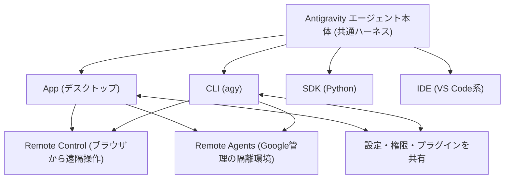

> **[公式]** App と CLI は同じエージェントを動かし、設定と権限が双方向に同期されます。CLIのセッションはAppへエクスポートして続行できます。
> **[開発者]** Simon Willison は、SDKが「オープンソースのPythonラッパー + 同梱のクローズドなGoバイナリ」である点、CLIがクローズドソースである点を指摘しています(2026-05-20)。**[筆者推奨]** 長期運用では、ベンダー依存の度合いを意識して設計してください。

---

## 2. 直近の動向(2026年10〜11月)

### 2.1 最新アップデートの要点

| 日付 | 版 | 内容 | 根拠 |
|:--|:--|:--|:--|
| 2026-11-03 | App v2.29.0 | **Voice mode**(Gemini Live)、**Remote Agents**(Pro / Ultra、段階的展開)、Automationsページ再設計、Jupyter notebookビューア、組み込みブラウザの履歴とダウンロード | [公式][二次] |
| 2026-11-02前後 | App v2.28.2 | プラグインMarketplaceにパートナー製(Figma、Linear、Notion、Stripe など)を追加、プラグイン追加直後のサインイン | [二次] Releasebot |
| 2026-10〜11 | App v2.26.0 | 通知設定、質問・権限プロンプトを入力欄の上に固定、会話の並べ替え・絞り込み | [二次] Releasebot |
| 2026-11-03前後 | CLI v1.4.12 | プラグインAPIキープロバイダー(任意)、Markdown表のストリーミング表示改善 | [二次] |
| 2026-10-13 | Gemini 4 Argon 展開 | Pro / Ultra向けにApp・CLIで利用可能 | [公式] |
| 2026-11-18(予定) | 旧モデル削除 | Claude Sonnet 4.6 / Opus 4.6、GPT-OSS-120b が削除予定 | [公式] |

> **[筆者推奨]** Voice mode と Remote Agents は「段階的展開」のため、自分のアカウントでは未表示の可能性があります。まず設定画面と最新版への更新を確認してください。

### 2.2 Gemini 4 Argon の社内実績(公式ブログ)

公式ブログによれば、Alphabet内でArgon搭載のAntigravityを使った結果、4週間でエージェント生成コードが35%増え、投稿後ロールバックが30%減ったと報告されています [公式]。また、134件の古いバグ報告のうち97件を3時間未満でクローズした事例が紹介されています [公式]。

> **[筆者推奨]** これらは提供元の自己報告です。自社環境へそのまま当てはめず、Step 6(検証ループ)で自分の指標を取ってから拡大してください。

---

## 3. モデルと思考レベルの選び方

### 3.1 利用できるモデル(2026-11-06時点・公式ドキュメント)

| モデル | Free / Plus | Pro | Ultra | Enterprise | 備考 |
|:--|:--:|:--:|:--:|:--:|:--|
| Gemini 4 Argon | 不可 | 有料Pro、または対象プレミアムデバイスの試用 | 可 | 可 | 最上位。Low / Medium / High |
| Gemini 3.8 Flash | 可 | 可 | 可 | 可 | 標準の常用モデル |
| Gemini 3.7 Flash / 3.6 Flash | 不可 | 不可 | 不可 | 可 | |
| Gemini 3.1 Pro | 不可 | 不可 | 不可 | 可 | |
| Claude Sonnet 5.5 / Opus 5.5 (Thinking) | 不可 | 有料Proのみ | 可 | 可 | |
| Claude Sonnet 4.6 / Opus 4.6 (Thinking) | 可 | 可 | 不可 | 不可 | **2026-11-18 に削除予定** |
| GPT-OSS-120b | 可 | 可 | 可 | 不可 | **2026-11-18 に削除予定** |

出典: [公式] `https://antigravity.google/docs/models/`
補足: 画像生成(UIモックアップや図の生成など)には別モデル(Nano Banana 2)が内部的に使われ、選択はできません [公式]。

### 3.2 思考レベルとモデルの使い分け

公式ドキュメントでは、思考レベル(Low / Medium / High)で「素早い小編集」と「深い多段推論(設計・デバッグ)」のバランスを取るとされています [公式]。

| 作業の種類 | 推奨モデル | 思考レベル | 根拠 |
|:--|:--|:--|:--|
| 小さな修正・命名・フォーマット | Gemini 3.8 Flash | Low | [筆者推奨] |
| 通常の機能実装・テスト追加 | Gemini 3.8 Flash | Medium | [筆者推奨] |
| 並行バグ・アーキテクチャ設計・難しいデバッグ | Gemini 4 Argon / Claude Opus 5.5 | High | [公式]の思考レベル説明に基づく [筆者推奨] |
| セキュリティ監査・大規模レビュー | Gemini 4 Argon | High | 公式ブログの監査事例 [公式] |
| 大量の定型タスク(サブエージェント、Automationsの一次処理) | Flash系 | Low〜Medium | [筆者推奨] |

### 3.3 モデル選択フロー

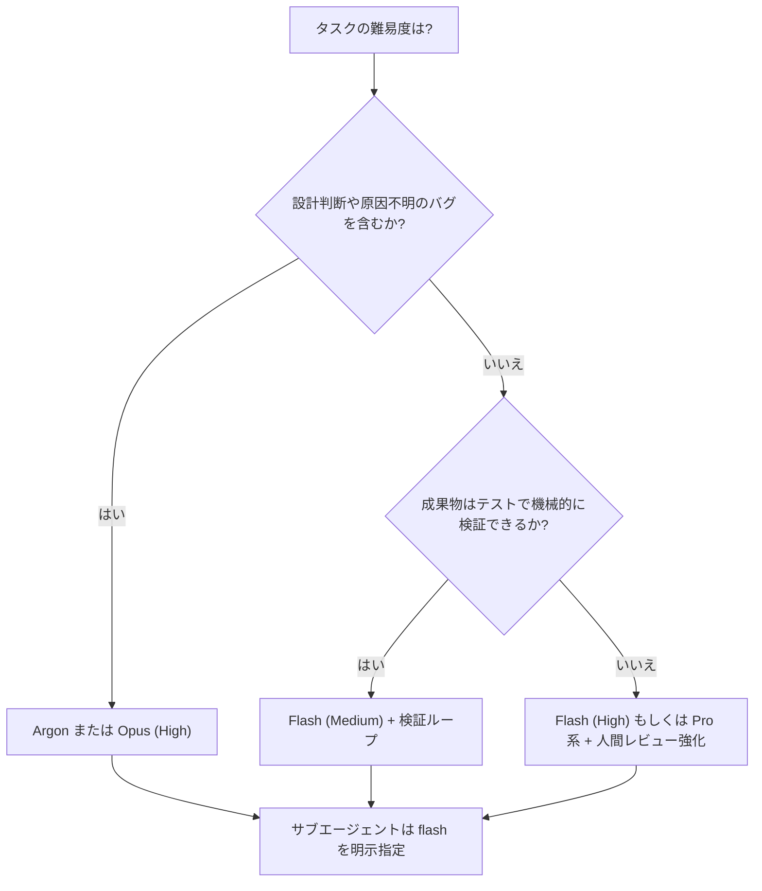

### 3.4 モデルを切り替えるときの注意

- 会話中にモデルを変えても、**実行中のターンは前のモデルで完走**します [公式]。
- Gemini系とClaude / GPT系では**クォータ(週次・5時間枠)が別バケット**で表示されます [公式]。片方が尽きても、もう片方で続行できます。
- Automationsは、モデル階層(Flash Lite / Flash(既定)/ Pro)を自動化ごとに選べます [公式]。

---
## Step 1: 導入・認証・初期設定

### 1.1 インストール

CLIは公式READMEのワンライナーで導入できます [公式]。

```bash
# macOS / Linux
curl -fsSL https://antigravity.google/cli/install.sh | bash

# 起動(対話TUI)
agy
```

```powershell
# Windows (PowerShell)
irm https://antigravity.google/cli/install.ps1 | iex
```

Appは `https://antigravity.google/download` から入手します [公式]。CLIの認証はシステムのキーリングを使い、セッションがなければGoogleサインインにフォールバックします [公式]。

### 1.2 導入前に必ず確認すること

| 確認項目 | 理由 | 根拠 |
|:--|:--|:--|
| 利用するアカウント種別(個人 / 企業) | Auto権限プリセット、CLIの音声入力、IDEなど、**企業アカウントで使えない機能がある** | [公式] |
| インタラクションデータの扱い | CLIのREADMEには、利用によりインタラクションデータの収集・利用に同意する旨の記載がある。機密コードを扱う前に規約を確認する | [公式] |
| Gemini CLIからの移行 | コンシューマーのGemini CLI利用は2026-06-18で終了。公式に移行ガイドあり | [二次][開発者] |
| 旧ワークフローのスキル移行 | 公式ドキュメントに「Workflows to Skills」の移行ページがある | [公式] |

> **[筆者推奨]** 業務リポジトリで使う前に、**ダミーのリポジトリで Step 2〜6 を一巡**してください。権限と検証ループの感覚をつかむ最短ルートです。

### 1.3 設定ファイルの置き場所(早見表)

| 対象 | 置き場所 | 備考 |
|:--|:--|:--|
| CLI設定・権限 | `~/.gemini/antigravity-cli/settings.json` | AppとCLIで権限は同期 [公式] |
| グローバルルール | `~/.gemini/AGENTS.md` / `~/.gemini/GEMINI.md` / `~/.gemini/config/rules/*.md` | [公式] |
| ワークスペースルール | `AGENTS.md` / `GEMINI.md` / `.agents/rules/*.md` | リポジトリルートまでの親フォルダも対象 [公式] |
| ワークスペーススキル | `<root>/.agents/skills/<name>/SKILL.md` | 旧 `.agent/skills` も互換 [公式] |
| グローバルスキル | `~/.gemini/config/skills/<name>/` | AppとCLIで共有 [公式] |
| カスタムサブエージェント | `.agents/agents/<name>.md` / `~/.gemini/config/agents/` | [公式] |
| プラグイン | `~/.gemini/config/plugins/<plugin>/` | skills / agents / rules / MCP / hooks を同梱 [公式] |

---

## Step 2: プロジェクトと権限設計(最重要)

エージェントを「速く」使うほど、**権限設計の質がそのまま事故率**になります。Antigravityの権限は、すべての操作を `action(target)` 形式で評価する統一エンジンです [公式]。

### 2.1 プロジェクトという単位

- エージェントは**プロジェクト**単位で動き、アクセスできるフォルダと設定・権限がプロジェクトごとに定義されます [公式]。
- Appではプロジェクトが**Git worktree**をネイティブにサポートし、エージェントを隔離された作業フォルダで走らせられます [公式]。
- 設定はプロジェクトごとに変えられるため、**信頼できるリポジトリは緩め、未知のフォルダは厳しめ**にできます [公式]。
- 複数フォルダ(複数リポジトリ)をまたぐ作業も設定できます [公式]。

### 2.2 権限評価の順序

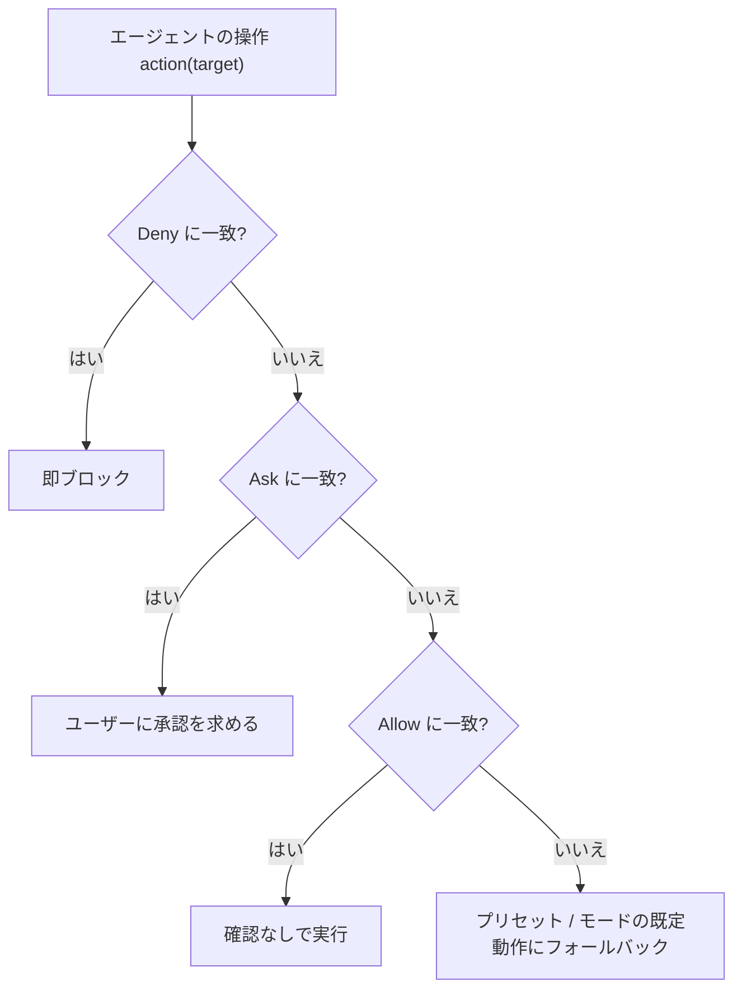

優先順位は **Deny > Ask > Allow** です。たとえば `command(*)` をAskに、`command(git)` をAllowに入れると、Askが勝ってすべてのコマンドで確認が出ます [公式]。

### 2.3 App の権限プリセット(2026-11時点)

| プリセット | ターミナルサンドボックス | ターミナルコマンド | ファイル範囲 | MCP / Web |
|:--|:--|:--|:--|:--|
| **Request Review** | 無効 | 常に確認 | ワークスペースのみ | 確認 |
| **Default**(既定) | 有効 | サンドボックス内は自動、外は確認 | ワークスペース + 一時ディレクトリ | 確認 |
| **Auto** | 有効 | サンドボックス内は自動、外は自動判定 | ワークスペース + 一時ディレクトリ | 確認 |
| **Turbo** | 無効 | 無制限に許可 | **マシン全体** | 許可 |

出典: [公式] `https://antigravity.google/docs/permissions/`

注意点:

- **Auto** は macOS / Linux は v2.23.0 以降、Windows は v2.26.0 以降で、サンドボックスが使える場合に利用可能。**企業・ビジネスアカウントでは現状使えません** [公式]。
- Defaultのサンドボックスは、既定で**ネットワーク接続なし**です。コマンドが書き込めるのはワークスペース、一時ディレクトリ、共有ビルドキャッシュです。`/usr` や `/etc` などのシステムディレクトリは読み取れますが、`~/.ssh` や `.env` などの機密ファイルはブロックされます [公式]([Terminal sandbox](https://antigravity.google/docs/sandbox/))。
- `read_url` に許可したドメインは、そのまま**サンドボックスの外向き通信許可リストにコンパイルされます** [公式]。つまり `read_url(*)` は、サンドボックスの外向き通信を事実上全開にします。

### 2.4 プリセットの選び方

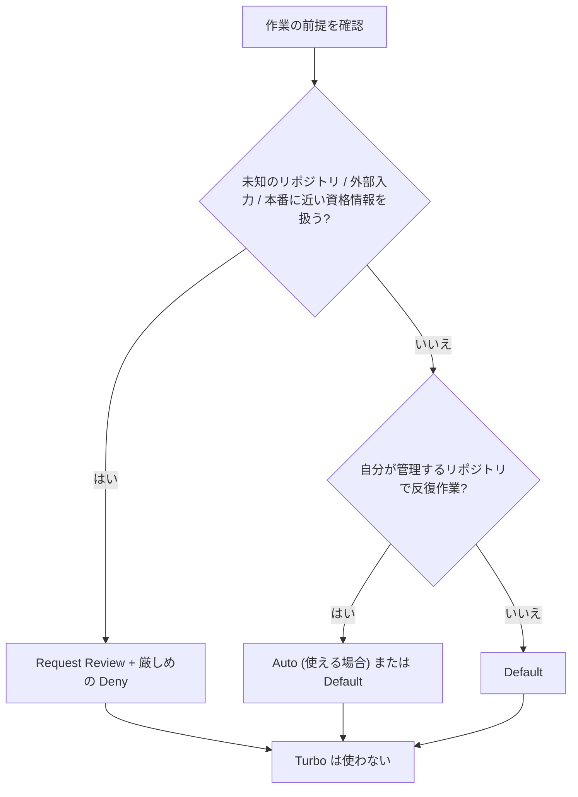

> **[筆者推奨]** Turboは、使い捨ての隔離環境(VM / コンテナ)以外では選ばないでください。マシン全体への読み書きとMCP・Webの自動許可が同時に開きます [公式]。

### 2.5 CLIの権限設定

CLIは、**実行モード**と `toolPermission` と詳細ルール(allow / ask / deny)の三層で制御されます [公式]。

| 実行モード | 動作 | 備考 |
|:--|:--|:--|
| `default` | ファイル変更前に差分レビュー。コマンドは `toolPermission` に従う | 既定 |
| `accept-edits` | ワークスペース内のファイル編集・作成を自動承認 | コマンドは引き続き評価 |
| `auto` | 編集とサンドボックス内コマンドを自動承認、外は自動判定 | macOS / Linux は v1.3.5+、Windows は v1.4.4+。企業は不可 |

`Shift` + `Tab` でモードを切り替えられます [公式]。`toolPermission` の値は次のとおりです [公式]。

| 値 | 意味 |
|:--|:--|
| `request-review`(既定) | 書き込み・Bash・外部通信の前に確認 |
| `proceed-in-sandbox` | サンドボックス内は自動、外は確認 |
| `strict` | 読み取り以外は常に確認(`auto` を上書き) |
| `always-proceed` | 承認を完全に省略(`--dangerously-skip-permissions` と同等) |

> **[二次]** DEV Community の解説によれば、`--dangerously-skip-permissions` は承認を切るだけで、ターミナルサンドボックスの設定は変えません。CLIのサンドボックスは既定で無効なので、**承認なし + サンドボックスなし**になり得ます。

### 2.6 まず入れておくべき設定例(CLI)

```json
{
  "toolPermission": "proceed-in-sandbox",
  "enableTerminalSandbox": true,
  "permissions": {
    "allow": [
      "write_file(src/)",
      "read_url(developer.mozilla.org)",
      "mcp(linter/*)"
    ],
    "ask": [
      "command(git push)",
      "execute_url(aws.amazon.com)",
      "mcp(sql/execute_mutation)"
    ],
    "deny": [
      "command(rm -rf)",
      "command(sudo)",
      "command(regex:(.*/)?curl .*)",
      "write_file(.git/)",
      "write_file(<HOME>/.ssh)"
    ]
  }
}
```

出典: [公式] の設定例を元に、`toolPermission` と `read_url` の許可範囲を絞って構成(**[筆者推奨]**)。

- `<HOME>` は、`echo "$HOME"` で確認した自分のホームディレクトリの絶対パスに置き換えてください。公式の例も絶対パスで、`write_file` が `~` を展開するとは書かれていません [公式]。
- `command` の `allow` ルールは、サンドボックスの**内外を問わず**確認なしの実行を許可します [公式]。`proceed-in-sandbox` ならサンドボックス内のコマンドは自動で実行され、外で実行するときは確認が出るので、`npm run` の `allow` ルールは入れていません(**[筆者推奨]**)。
- この例の `curl` は `deny` なので、`allow` で例外を作れません。例外が必要な場合は `ask` へ移します(Step 15.3)。
- `command(...)` は既定で単語・トークンの前方一致です [公式]。そのため `command(git push)` は `git -C /path push` のような別の書き方を捕まえません(前方一致の仕様からの帰結)。別の書き方はこの `ask` に一致しないので、サンドボックスからリモートと必要な資格情報へ到達できる場合は、確認なしで push される可能性があります。すべてのコマンドで確認が必要なら、`ask` に `command(*)` を設定します。`ask` は `allow` より優先されます [公式]。
- `command(rm -rf)` の保護も同じ前方一致の範囲に限られ、`rm -fr` のようにオプションの順序を変えた形には一致しません(前方一致の仕様からの帰結)。また、サンドボックス内でもワークスペースへは書き込めるので、この `deny` を入れていても、サンドボックス内のコマンドがワークスペースのファイルを削除する可能性はあります。

### 2.7 コマンドマッチの落とし穴

次の構文は、無害な接頭辞の裏で任意コマンドを実行できるため、**接頭辞マッチが無効化され、行全体の完全一致でしか自動許可されません** [公式]。

| 構文 | 例 |
|:--|:--|
| コマンド置換・プロセス置換 | `$(...)`、バッククォート、`<(...)` |
| 算術展開・ブレース展開 | `$((...))`、`{a,b}` |
| サブコマンドを実行させるフラグ | `git -c core.pager=<cmd>`、`tar --to-command` |

たとえば `command(git)` を許可していても、`git status && git log` は通り、`git log $(whoami)` は確認が出ます [公式]。許可ルールが「効かない」と感じたら、まずこの仕様を疑ってください。

### 2.8 承認プロンプトのスコープ編集

ファイル・URL・MCPの承認カードでは、許可前に対象文字列を編集してスコープを広げられます(単一ファイル → 親ディレクトリなど)。広げた許可は**そのターンの間**有効で、同じ種類の確認の連発を防げます。ただし**ターミナルコマンドには使えません** [公式]。

---

## Step 3: ルール(AGENTS.md)の設計

### 3.1 ルールとスキルの違い

公式は、**ルール = 制約・不変条件**、**スキル = 複数手順のワークフロー**と整理しています [公式]。

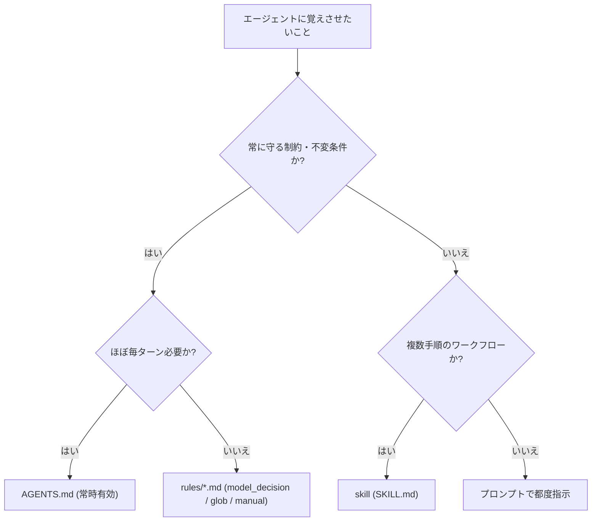

### 3.2 ルールの探索ルール

| 項目 | 仕様 | 根拠 |
|:--|:--|:--|
| 探索範囲 | ワークスペースと、リポジトリルートまでの親フォルダ + グローバル | [公式] |
| **サブフォルダ** | ワークスペースより**下**のフォルダのルールは、そこを編集しても読まれない | [公式] |
| 結合方式 | 置換ではなく**累積**(見つかったすべてを結合) | [公式] |
| `AGENTS.md` / `GEMINI.md` | frontmatter不要、常時有効 | [公式] |
| `rules/*.md` | **frontmatterと有効な `trigger` が必須**。欠落や不正値(`alwaysOn` など)は**黙って破棄される** | [公式] |
| `rules/` 直下のみ走査 | サブディレクトリは `.agents/rules.json` に登録しない限り無視 | [公式] |
| サイズ上限 | include の展開後に24,000バイトを超えるファイルは切り詰められる。有効なグローバルルールと `always_on` ルールの合計が20,000トークンを超えると、大きいルールファイルから順にポインタへ降格 | [公式] |

> **[二次]** 一部の解説記事には「ルールは12,000文字上限」という古い情報があります。**公式の現行値は上記(24KB / 20,000トークン)** です。

### 3.3 `trigger` の4種類

```markdown
---
trigger: model_decision   # always_on | model_decision | glob | manual
description: "DBマイグレーションやSQLスキーマ変更を書く・レビューするときに適用する"
---

# DBマイグレーション規約

1. カラムの削除・改名は1回のデプロイで行わず、expand-and-contract で段階的に行う。
2. 既存テーブルへのインデックス作成には必ず CONCURRENTLY を付ける。
```

| trigger | 動作 | 向いている内容 |
|:--|:--|:--|
| `always_on` | 毎ターン全文を注入 | 絶対に外せない制約(`AGENTS.md` に直接書く方が簡単) |
| `model_decision` | パスと `description` だけ先に注入し、必要時に全文を読む | 詳細なドメイン別ガイド |
| `glob` | 必須の `globs` のパターンに一致するファイルを扱うときだけ自動で有効化 | 言語別・領域別の規約(例: `*.proto`) |
| `manual` | `@` メンションしたときだけ読み込む | リリースチェックリスト、監査基準(CLIはルールのメンション非対応) |

`glob` の frontmatter は次のように書きます。`globs` はカンマ区切りの文字列で、`*` で始まるパターンは引用符で囲みます [公式]。

```markdown
---
trigger: glob
globs: "*.proto, **/*.pb.go"
---
```

### 3.4 AGENTS.md の雛形

```markdown
# プロジェクト概要
- 目的: 請求サービスのAPI。TypeScript + PostgreSQL。

# 必ず守るコマンド
- テスト: `npm test`(変更後は必ず実行して結果を報告する)
- Lint: `npm run lint`
- 型チェック: `npm run typecheck`

# コーディング規約
- 入力検証は zod を使う。
- `internal/` を他パッケージから import しない。

# 触ってはいけないもの
- `migrations/` の既存ファイル、`.env*`、`infra/prod/`

# 完了の定義
- テスト・Lint・型チェックがすべて成功し、変更点と未確認事項を最後に要約する。
```

**[筆者推奨]** 設計の指針:

| 指針 | 理由 |
|:--|:--|
| 短く保つ(まず50〜100行を目安に) | 常時有効ルールは毎ターン文脈を消費する(上限もある) [公式] |
| 「何をしないか」と「完了の定義」を必ず書く | 検証ループ(Step 6)の入口になる |
| 詳細手順はスキルへ逃がす | 段階的開示でコンテキストを節約できる [公式] |
| 他ツールと共通化したいなら `AGENTS.md` | Cursor、Claude Code、Codexなどとの共通形式として扱える [二次] |
| Antigravity固有の上書きだけ `GEMINI.md` | [二次] CoinGecko公式ドキュメントの説明 |

ファイルの取り込みには `@[ラベル](パス)`(本文をインライン展開)と `@ファイル名`(正規パスへの書き換えのみ)の2種類があります [公式]。

```markdown
APIの設計基準は次に従う:
@[API Design Standards](../docs/api-standards.md)

DBモデルを変更する前に @src/db/schema.ts を確認する。
```

---

## Step 4: スキルで「手順」を資産化する

### 4.1 スキルの仕組み(段階的開示)

スキルは、`SKILL.md` を含むフォルダです。エージェントは**毎ターン、スキルの名前と説明の一覧だけを見て**、関連しそうなら全文を読み、その手順に従います [公式]。

| 段階 | 内容 |
|:--|:--|
| 発見 | 毎ターン、名前と `description` の一覧を見る |
| 起動 | 関連すると判断したら `SKILL.md` 全文を読む |
| 実行 | 手順に従って作業する |

### 4.2 スキルの書き方(公式ベストプラクティス)

| 原則 | 具体策 |
|:--|:--|
| 1スキル1目的 | 「何でも屋」を作らず、タスクごとに分ける |
| 説明が命 | `description` は三人称で、**何をするか + いつ使うか**を具体的に書く(キーワードを含める) |
| スクリプトはブラックボックス | 信頼できるスクリプトは、まず `--help` で使い方を確認させ、ソース全体を読ませない。信頼できないスクリプトは、実行前に本体と依存関係を確認し、書き込みとネットワークの権限を制限する |
| 決定木を入れる | 複雑なスキルには「状況ごとの選択肢」の節を設ける |

出典: [公式] `https://antigravity.google/docs/skills/`

### 4.3 スキル例(検証必須の実装手順)

```markdown
---
name: implement-with-verification
description: 機能追加やバグ修正を、先にテストを用意してから実装し、テスト成功を確認して完了報告する。実装タスクで、変更後に検証が必要なときに使う。
---

# 手順

1. 変更対象と既存テストを確認する(探索のみ。この段階ではファイルを編集しない)。
2. 再現または仕様を表す失敗するテストを先に書く。
3. 最小の実装でテストを通す。
4. `npm test` と `npm run lint` を実行し、出力を貼って報告する。
5. 失敗したら原因を特定して2回まで自力修正する。解消しなければ中断して状況を報告する。

# 判断基準

- 既存テストがない場合: 先に最小のテストを追加してよいか、ユーザーに確認する。
- 変更が3ファイルを超える場合: 実装前に計画を提示して承認を得る。
```

### 4.4 スキルの配置・呼び出し・配布

| 観点 | 内容 | 根拠 |
|:--|:--|:--|
| 配置(App / CLI共通) | `<workspace>/.agents/skills/` と `~/.gemini/config/skills/` | [公式] |
| CLIのみ追加で読む場所 | `~/.gemini/antigravity-cli/skills/`、`~/.gemini/skills/`(Appは読まない) | [公式] |
| 呼び出し | 自動(説明との照合)、または `/<スキル名>` で明示 | [公式] |
| CLIでの扱い | スキルは自動でスラッシュコマンドになる。追加後は `/skills reload` か新規会話 | [公式] |
| プラグインで配布 | `agy plugin install <名前>`(GitHub URLやローカルパスも可) | [公式] |

```bash
agy plugin list --json            # 同梱スキル名とパスも確認できる
agy plugin install ./my-skills-plugin
```

> **[開発者]** Addy Osmani は、開発ライフサイクル(定義・計画・実装・検証・レビュー・出荷)を24のスキルにした `agent-skills` を公開し、Antigravity CLI向けのセットアップ手順も用意しています。厳密に「計画してから実装」を守らせたい場合は、プロジェクトの `AGENTS.md` に必要なスキルの流れを書くよう案内しています。

> **[筆者推奨]** 自作する前に、まず既存スキル集を試し、自分のリポジトリで効いたものだけを残してください。スキルを増やしすぎると、説明一覧そのものが文脈を圧迫します。

---

## Step 5: 探索 → 計画 → 実行(/grill-me と /plan)

### 5.1 公式が示す基本形

公式のCLIベストプラクティスは、複雑な変更を**探索・計画・実行の3段階に分けると精度が最も高い**としています [公式]。

| 段階 | やること | プロンプト例 |
|:--|:--|:--|
| 探索 | 書き込み前に、コードベースがどう解決しているかを説明させる | `ルーターが /docs/:page をどう解決しているか説明して` |
| 計画 | 対象ファイル・依存・ロジック変更を**実装計画アーティファクト**に出させる | `/plan /docs/best-practices を追加する計画を書いて` |
| 実行 | 計画を承認してから編集させる | `計画どおりに実装して` |

### 5.2 `/grill-me` と `/plan` の組み合わせ

- `/grill-me <タスク>` は、エージェントが**1問ずつ質問し、各質問に推奨回答を添えて**、作業前に判断事項を詰めます [公式]。
- 回答を計画に変えるには、`/plan` と重ねて使います [公式]。
- `/plan` は、コードベース探索 → 要件確認 → レビュー可能な計画の作成を行い、**承認後に初めて変更を書きます** [二次]。

```markdown
/plan /grill-me ユーザー単位のレート制限をブックマークAPIに追加する
```

### 5.3 全体フロー

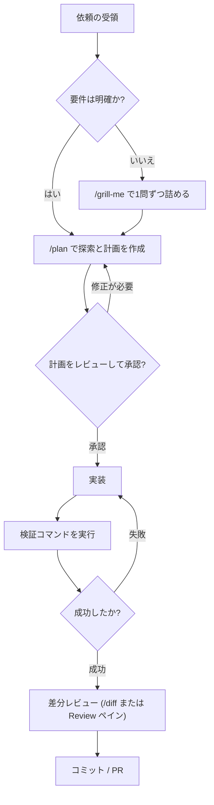

### 5.4 使い分けの目安

| 状況 | 推奨 | 根拠 |
|:--|:--|:--|
| 要件が曖昧・破壊的変更を含む | `/grill-me` を先に | [二次][開発者] |
| 影響範囲が広い・複数ファイル | `/plan` で計画を承認してから実装 | [公式] |
| 1〜2行の自明な修正 | 計画を省いて直接依頼 | [筆者推奨] |
| 高コストな作業(大規模・長時間) | 計画段階で止めて見積りを確認 | [二次] |

> **[筆者推奨]** `/grill-me` は最初は手間に感じますが、後から修正ループに入るコストを大きく減らせます。曖昧な依頼ほど先に使ってください。

---

## Step 6: 検証ループを先に作る

### 6.1 公式の最重要ルール

公式のCLIベストプラクティスは、自律エージェントから**信頼できる変更を得る最も効果的な方法は、ローカルで検証できる仕組み(テスト・ビルド・フォーマッタ)を渡すこと**だと明記しています [公式]。

手順:

1. ワークスペースにテストスイートを用意する。
2. テストがなければ、**先にテストを書かせる**。
3. エージェントが実装したら、ローカルのテストコマンドで検証させる。
4. 実行結果を見て、エージェントが自動で反復するのを確認する。

```markdown
main.py に機能Xを実装して。実装後に npm test を実行し、結果を貼って報告して。
```

### 6.2 検証手段の階層

| 層 | 手段 | 向いている変更 |
|:--|:--|:--|
| 1. 静的 | 型チェック、Lint、フォーマッタ | すべて |
| 2. 単体・統合 | テストスイート | ロジック、API |
| 3. 実行確認 | ローカルサーバー起動 + 組み込みブラウザ | UI、フロー |
| 4. 自動ブラウザ検証 | `/browser`(ブラウザサブエージェント) | Webアプリ全般 |
| 5. 人間 | 差分・録画・スクリーンショットのレビュー | 最終判断 |

ブラウザサブエージェントは、Chromeを操作してWebページのテスト・デバッグを行い、Chrome DevTools MCPとネイティブ統合され、セッションをWebM動画で録画できます [公式]。UIの不具合を調べるときは、スクリーンショットや録画を `ctrl+v` で添付すると、エージェントが映像を参照して診断します [公式]。

### 6.3 「作る側」と「確かめる側」を分ける

> **[開発者]** Addy Osmani のLoop Engineeringでは、**生成するエージェントと検証するエージェントを分ける**ことを勧めています(モデルに自分の宿題を採点させない)。実装と検証でサブエージェントを分ける設計は、Step 7で扱います。

### 6.4 検証プロンプトのテンプレート

```markdown
# 依頼
<やりたいこと>

# 完了条件(すべて満たしたら完了)
- npm test が成功し、新規テストが追加されている
- npm run lint と npm run typecheck がエラーなし
- 変更したファイル一覧と、確認できなかった点を最後に報告する

# 禁止
- 既存テストを削除・スキップして通すこと
- 完了条件を満たしていないのに完了と報告すること
```

---

## Step 7: サブエージェントと並列実行

### 7.1 サブエージェントの基本

メインエージェントは、調査・ビルド・テスト実行などを**サブエージェント**に委任できます。各サブエージェントは**クリーンなコンテキスト**で起動し、独立した会話として並列に動きます [公式]。

| 項目 | 仕様 | 根拠 |
|:--|:--|:--|
| 起動 | 親が `invoke_subagent` を呼ぶ | [公式] |
| 作業場所 | `inherit`(親と同じ)/ `branch`(隔離Git worktree)/ `share`(ディレクトリ共有) | [公式] |
| コンテキスト | 親の会話履歴は**引き継がない** | [公式] |
| 組み込み | `research`(調査)、`browser`(`/browser` 経由のみ)、`self`(呼び出し元の複製) | [公式] |
| 入れ子の深さ | 最大10階層 | [公式] |
| 権限 | 親の許可コマンド接頭辞・ファイル範囲・サンドボックス設定を**継承** | [公式] |
| 承認要求 | 親のUI・サブエージェントパネルに上がってくる | [公式] |

### 7.2 カスタムサブエージェントの定義

```markdown
---
name: code-auditor
description: セキュリティ監査・静的解析・品質レビュー用のサブエージェント。実装後の独立した検証で使う。
tools:
  - view_file
  - grep_search
  - run_command
subagent: true
mainAgent: false
model: pro
commandExecutionPolicy: sandbox
skills:
  - skills/security-checklist
---

# System Prompt
あなたはセキュリティ監査とコードレビューの専門家です。ファイルを変更せず、脆弱性・メモリリーク・アンチパターンを検査してください。

# Review Guidelines
1. 明示的に求められない限り、ファイルは編集しない。
2. インジェクション、未検証入力、ハードコードされた秘密情報を指摘する。
3. 各指摘に、簡潔で実行可能な修正案を付ける。
```

出典: [公式] の例(`https://antigravity.google/docs/subagents/`)を、検証担当として使う想定に**[筆者推奨]** で調整。

| frontmatter | 既定値 | 説明 |
|:--|:--|:--|
| `name` / `description` | 必須 | `description` は、親が委任先を決める判断材料 |
| `tools` | `[]` | 許可するツールを明示。**ツール名の綴り間違いはハングの原因になる既知の問題** |
| `model` | `inherit` | `inherit` / `flash` / `pro` |
| `commandExecutionPolicy` | `sandbox` | `off` / `auto` / `eager` / `sandbox` |
| `mainAgent` / `subagent` | `true` | 主エージェントとして選べるか / `invoke_subagent` で呼べるか |

### 7.3 実装と検証を分ける構成

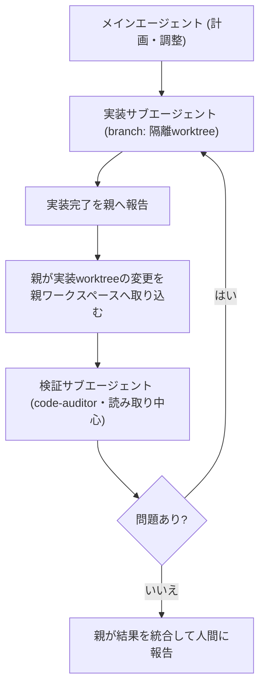

> **[筆者推奨]** `branch` の変更が親ワークスペースへ自動で戻るとは、公式に書かれていません。親と同じワークスペースで検証するなら、古いコードを検証しないよう、検証の前に変更を取り込んでください。

### 7.4 ライフサイクルと操作

| 状態 | 意味 | 操作 |
|:--|:--|:--|
| Running | 実行中 | 停止はパネルの Stop Subagent、CLIでは `k` |
| Idle | 作業完了で待機。メッセージを受けると**文脈を保ったまま**再起動 | `@名前 追加指示` で直接話しかけられる |
| Killed | 完全終了。一時worktreeは自動削除、履歴はJSONLで残る | 再起動不可 |

CLIの主要な操作 [公式]:

| 操作 | キー / コマンド |
|:--|:--|
| 状況一覧・切り替え | `/agents` |
| 承認待ちのサブエージェントへ移動 | `Alt` + `J` |
| 画面を離れずに承認 | `Ctrl` + `K` |
| 非エージェントのバックグラウンド処理 | `/tasks` |

### 7.5 並列化の運用ルール

| ルール | 理由 | 根拠 |
|:--|:--|:--|
| 並列サブエージェントは**3〜5程度から**始める | クォータが共有され、1つの目標が10以上の呼び出しに展開され得る | [二次] |
| 同じファイルを複数エージェントに触らせない | 人間の同時コミットと同じ衝突が起きる。worktreeで隔離する | [開発者] Addy Osmani |
| サブエージェントは `model: flash` を基本にする | コスト・速度の最適化 | [筆者推奨] |
| 権限は親から継承されることを前提に設計する | 親に広い権限を与えると全サブエージェントに及ぶ | [公式][二次] |
| `tools` の綴りを検証する | 未対応の名前でハングする既知の問題がある | [公式] |

---

## Step 8: /goal・/boost・/teamwork の使い分け

### 8.1 コマンド比較

| コマンド | 役割 | 利用条件 | 根拠 |
|:--|:--|:--|:--|
| `/plan` | 探索・要件確認・計画 | 全プラン | [公式] |
| `/grill-me` | 1問ずつ質問して判断を詰める | 全プラン | [公式] |
| `/goal <目的>` | 目標が完了するまで自律的に継続 | 全プラン | [公式][二次] |
| `/boost` | 難問向けの3階層マルチエージェント推論(Orchestrator → DeepCoder / DeepInvestigator → ワーカー) | Pro / Ultra / Enterprise | [公式] |
| `/teamwork` | 長期・大規模作業向けのエージェントチーム(マイルストーン分解・並列実装・独立検証) | 有料プラン | [公式] |

> **[二次]** `/teamwork` は一部のリリースノートで `/teamwork-preview` と表記されています。自分の版のコマンド一覧(`/` 入力)で確認してください。

### 8.2 `/goal` を安全に使う

`/goal` は、ターンごとの確認なしで完了まで走るため、**完了条件が機械的に判定できるときだけ**有効です。

`/goal` が変えるのは停止の挙動だけで、**ツールの権限や承認要件は変わりません** [公式]([Goal command](https://antigravity.google/docs/commands/goal/))。承認が必要な操作に当たると、承認されるまで実行は止まります。

| 条件 | 良い `/goal` | 悪い `/goal` |
|:--|:--|:--|
| 完了が明確 | `npm test が全件成功し、lint エラーが0になるまで` | `コードをよくして` |
| 範囲が限定的 | `src/billing/ 配下のみ変更してよい` | 範囲の指定なし |
| 失敗時の中断を指示 | `同じ失敗が3回続いたら中断して報告`(プロンプトの指示で、強制された停止条件ではない) | 中断の指示なし |

`/goal` に反復回数の上限はありません [公式]。「3回で中断」はプロンプト内の指示なので、繰り返し失敗したときに止まるかどうかは、エージェントがこの指示に従うかどうかに依存します。

> **[開発者]** ループ設計の解説(Developers Digestなど)でも、**終了判定・予算(回数/クォータ)・1周に含める内容**の3点が、エージェントの失敗の大半に関わると整理されています。`/goal` は「プロンプト」ではなく「ループ」として設計してください。

### 8.3 エスカレーションの考え方

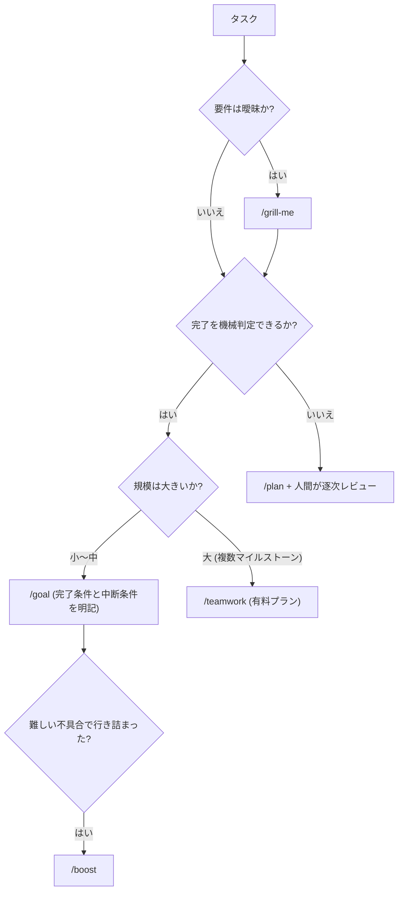

---
## Step 9: Automations と /schedule

### 9.1 2種類の「予約実行」

| 機能 | 対象 | 用途 | 根拠 |
|:--|:--|:--|:--|
| **Automations**(旧 scheduled tasks) | App | プロジェクトに対し、**スケジュールで会話を開始**する(不在中も実行) | [公式] |
| **`/schedule`** | App / CLI | **1つの会話の中**でのタイマーや定期チェック | [公式] |

Automationsの仕様 [公式]:

| 項目 | 内容 |
|:--|:--|
| 繰り返し | 時間ベースのトリガーで定期的に会話を開始 |
| モデル階層 | 自動化ごとに Flash Lite / Flash(既定)/ Pro を選択 |
| 実行時刻 | 正確な分ではなく**おおよそ**。間隔の最大10%(上限15分)までばらつく |
| 手動実行 | メニューの **Run Now**。**Create with Prompt** で作成をエージェントに案内させられる |

### 9.2 無人化は段階的に進める

> **[開発者]** Addy Osmani は、Loop Engineering(2026-06-07)で、ループを成立させる要素としてAutomations(スケジュール)、worktree、スキル、プラグイン/コネクタ、サブエージェントの5つを挙げています。AntigravityにはこれらのプリミティブがApp内に揃っています。
> 同様に、コミュニティの参照リポジトリでは「レポートのみ → 修正支援 → 無人実行」と段階的に展開する進め方が示されています [二次]。

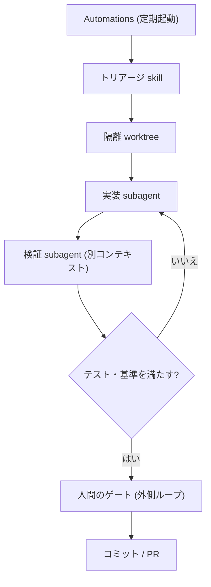

| 段階 | 内容 | 権限 |
|:--|:--|:--|
| L1: レポートのみ | 失敗CI・古い依存・未解決Issueを**調べて報告するだけ** | 読み取りのみ |
| L2: 修正案 | worktreeで修正し、**PR下書きまで**。人間が承認 | 書き込みはworktreeのみ |
| L3: 無人修正 | 信頼できる定型作業だけ、基準を満たしたら自動PR | 検証サブエージェント必須 |

**[筆者推奨]** の運用:

- 一次処理(分類・要約)は Flash Lite / Flash、修正は Pro、と**階層を分ける**。
- Automationsにも権限設定は効く。**設定を変えても既存タスクは書き換わらない**との報告があるため [二次]、権限変更後は既存の自動化を見直す。
- 「人間が最終ゲートを持つ」設計にする。Addy Osmaniの7月のフォローアップは、エージェントが内側のループを回し、**品質判断と出荷判断は人間が外側のループで持つ**べきだと整理しています [開発者][二次]。

---

## Step 10: MCP・プラグイン・フック

### 10.1 拡張の全体像

| 仕組み | 役割 | 配置・操作 | 根拠 |
|:--|:--|:--|:--|
| **MCP** | ローカルツール・DB・リモートAPIへの接続 | 設定ファイル、`/mcp`(CLI) | [公式][二次] |
| **プラグイン** | skills / agents / rules / MCP / hooks を1単位で配布 | App: Customizations → Marketplace。CLI: `agy plugin ...` | [公式] |
| **JSONフック** | 実行サイクルの要所でローカルのシェルスクリプトを実行 | グローバルまたはワークスペースのJSON | [公式] |

### 10.2 MCPの権限設計

- 未設定のMCPツールは**既定で確認**になります [公式]。
- 権限は `mcp(サーバー/ツール)`、`mcp(サーバー/*)`、`mcp(*)` で指定します [公式]。

```json
{
  "permissions": {
    "allow": ["mcp(linter/*)"],
    "ask": ["mcp(sql/execute_mutation)"],
    "deny": []
  }
}
```

> **[筆者推奨]** 「読み取り系は許可、更新系は確認」を原則にしてください。`mcp(*)` の一括許可は避けます。

### 10.3 プラグインの導入と運用

```bash
agy plugin list
agy plugin install <plugin-name>      # 公式マーケットプレイスの既定は antigravity-plugins-official
agy plugin install https://github.com/<owner>/<repo>
agy plugin validate /path/to/plugin   # 自作・外部プラグインの検証(Addy Osmaniのセットアップ手順でも使用)
```

| 運用ルール | 理由 |
|:--|:--|
| **サードパーティ製プラグインは中身を確認してから**入れる | スキル・フック・MCPを一括で持ち込むため、実質的に任意のコード実行経路になる [筆者推奨] |
| Appで入れたプラグインはCLIにも反映される | 設定が共有される [公式] |
| 外部サービス連携は、認証後に権限(`mcp(...)`)を絞る | 既定は確認だが、一括許可で崩れやすい [筆者推奨] |

> **[二次]** 2026年11月のMarketplaceにはパートナー製プラグインが追加されています(Figma、Linear、Notion、Stripe など)。コードレビュー系(CodeRabbit など)のプラグインは、**Antigravity側のターミナル権限とサンドボックスの対象**になります。事前承認したい場合は、許可ルールを設定します。

### 10.4 フックの使いどころ

フックは、ツール呼び出しの前、モデル応答の後、ループの停止条件で処理を差し込めます [公式]。

| 用途 | 例 | 根拠 |
|:--|:--|:--|
| 実行前ガード | 禁止パターンのコマンドや秘密情報を含む出力を事前に止める | [筆者推奨] |
| 実行後チェック | 編集後に自動でフォーマッタ・Lintを走らせる | [筆者推奨] |
| 停止条件の強制 | 「テスト未実行では完了としない」をスクリプトで担保する | [筆者推奨] |

---

## Step 11: Remote Control・Remote Agents・Voice mode

### 11.1 Remote Control と Remote Agents の違い

| 観点 | Remote Control | Remote Agents |
|:--|:--|:--|
| 実行場所 | **自分のマシン**(ローカルのファイル・ツール・認証情報・worktreeをそのまま使う) | **Googleが管理する隔離環境** |
| 目的 | 長時間作業を**外出先から監視・承認** | PCをスリープ/オフにしても**作業を継続** |
| 作業対象 | ローカルのワークスペース | リモートプロジェクト(GitHubリポジトリ、Google Driveファイル、アップロード) |
| 利用条件 | 設定で有効化 | **Google AI Pro / Ultra**(個人のGoogleアカウント) |
| アクセス | 任意のWebブラウザ、プッシュ通知 | App、CLI、`antigravity.google.com` |

出典: [公式] `https://antigravity.google/docs/features/`

```bash
# Remote Control
agy --remote-control              # 新規セッションで有効化
agy remote-control start          # 常時待機のヘッドレスCLI(OSのサービスとして登録)
agy remote-control stop           # 常時待機サービスを停止し、登録も解除
# 現在のセッションだけ: /remote-control で有効化、/remote-control off で解除

# Remote Agents
agy --remote-agent --project <remote_project_id>
```

- **Remote Controlの止め方**: 常時待機サービスを止めるのは `agy remote-control stop` です。`/remote-control off` は現在のセッションのトンネルを切断するだけで、公式の説明にサービスの停止は含まれません [公式]。
- **Remote Agentsの権限**: リモートセッションの権限はローカルとは別で、リモートエージェントの設定に従います。既定のプリセットは `always-proceed (turbo)` なので、ローカルの `deny` ルールが適用されるとは限りません。リモートセッションで `/config` の Remote Agent タブからプリセットを、`/permissions` からリモートのルールを確認してください [公式]。

出典: [公式] `https://antigravity.google/docs/remote-control/`、`https://antigravity.google/docs/remote-agents/`

### 11.2 選び方

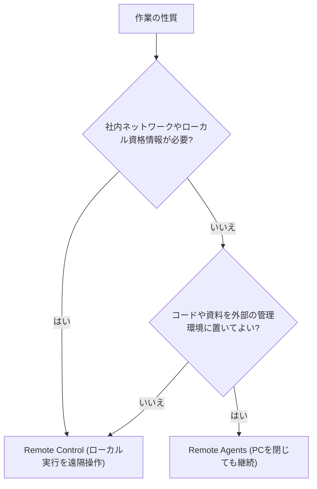

> **[筆者推奨]** 機密性の高いコードは、Remote Agents でも Remote Control でも、適用される利用規約と組織のポリシーを確認してから扱ってください。Remote Control はローカルで実行しますが、データがローカルにとどまることを保証するものではありません。

### 11.3 Voice mode(2026-11-03〜、段階的展開)

- **Gemini Live**による双方向の音声会話で、タスクの指示、実行中の補足・修正、停止の指示ができます [公式]。
- 権限プロンプトへの許可/拒否や質問への回答も音声でできますが、**破壊的な操作は画面でのクリックが必要**です [公式]。
- 既定では静かに作業し、進捗報告の頻度は指示で変えられます [公式]。
- CLIは `/voice live`(または `F6`)で音声会話、`/voice dictate`(または `F5`)で音声入力です。企業アカウントのCLIでは音声入力は利用できません [公式]。

> **[筆者推奨]** 音声でも承認が通せるため、**権限設計(Step 2)が甘いまま使うと、誤認識がそのまま実行に繋がります**。Request ReviewまたはDefaultで使い始めてください。

---

## Step 12: レビューとアーティファクト

### 12.1 App のレビュー機能

AppのGitネイティブな **Review** ペインでは、次ができます [公式]。

| 機能 | 内容 |
|:--|:--|
| 比較ビュー | Uncommitted(未コミット)/ Branch(ブランチ全体)/ Agent Edits(エージェントが編集したファイル) |
| ファイル操作 | ステージ、アンステージ、未ステージ変更の破棄 |
| リポジトリ操作 | コミット(メッセージ空欄なら自動生成)、Amend、Push |
| フィードバック | 差分の行にコメントして、エージェントに修正を指示 |

CLIでは `/diff` で、作業ツリー・コミット履歴・**ターンごとの変更**を見られ、行コメントで次の指示を出せます [公式]。

### 12.2 アーティファクトで「信頼」を作る

エージェントは生のツール呼び出しではなく、タスクリスト・実装計画・スクリーンショット・ブラウザ録画といった**検証可能な成果物(アーティファクト)** を出します [二次]。公式ドキュメントには、実装計画・ウォークスルー・スクリーンショットの各アーティファクトの解説があります [公式]。

| 使い方 | 内容 |
|:--|:--|
| 計画アーティファクトを承認の単位にする | 実行前に、対象ファイル・依存・変更方針を人間が確認する(Step 5) |
| ウォークスルーで変更の意図を読む | コードを読む前に、変更の全体像を把握する |
| コメントで差し戻す | 計画・差分・成果物に対するインラインのコメントで修正を依頼(音声入力も可) [公式] |

### 12.3 メンションと引用で、文脈を狭く正確に渡す

| 操作 | App | CLI |
|:--|:--|:--|
| ファイル・フォルダ・ルール・過去会話の参照 | `@` | `@`(ファイルとディレクトリ) |
| 応答・差分・成果物の一部を次の発言へ | 選択して **Quote** | — |
| 組み込みブラウザ上の文面を指す | 選択して **Comment**(`C`)/ **Quote** | — |
| 特定サブエージェントへ直接指示 | `@サブエージェント名` | `@サブエージェント名` |

出典: [公式] `https://antigravity.google/docs/features/`

> **[筆者推奨]** 「探させる」より「指す」。`@` でパスを渡すほうが、トークンも誤読も減ります。

---

## Step 13: CLI運用(セッション管理・ヘッドレス・CI)

### 13.1 セッションを制御するコマンド

| 操作 | コマンド | 用途 | 根拠 |
|:--|:--|:--|:--|
| 中断 | `esc` | 誤った検索や逸脱に気づいたら即座に止める | [公式] |
| 巻き戻し | `/rewind`(`/undo`) | ビルドエラーが積み重なったとき、安定した時点へ戻す | [公式] |
| 分岐 | `/fork` | 安定した地点から複製セッションで実験する。複製されるのは会話だけで、ローカルのファイルは複製されない。失敗したら `/resume` で会話を戻せるが、作業ツリーの変更は元に戻らない。ファイルも分離するには、実験の前に Git ブランチを切るか変更を stash する | [公式] |
| 別プロジェクトへ分岐 | `/fork <project_id>` | 会話のコピーを別プロジェクトで続ける | [公式] |
| 再開 | `/resume` / `--conversation` | その会話のプロジェクトで再開 | [公式] |
| 文脈の確認 | `/context` | 文脈の使用状況を確認 | [公式](コマンド一覧) |
| クォータ確認 | `/usage` | 使用量とレート制限 | [公式] |
| Appへ引き継ぎ | `/export` | CLIセッションをAppのGUIで続行 | [公式][二次] |

### 13.2 ヘッドレス実行(スクリプト・CI)

`-p`(`--print` / `--prompt`)で1回だけ実行して終了します。機械可読な出力も得られます [公式]。

```bash
agy -p "このgit diffをレビューして、Conventional Commits形式のコミットメッセージ案を書いて"
```

| CIでの注意 | 理由 | 根拠 |
|:--|:--|:--|
| **必要な許可ルールだけ**を事前に定義し、実行後は `stderr` の拒否通知を確認する | 承認できない操作は待たずに soft-deny され、実行は続いて終了コード `0` で終わるため、終了コードだけでは拒否を検知できない(公式のヘッドレス文書の記載。v1.4.12 の変更履歴には個別の記載なし) | [公式][筆者推奨] |
| `always-proceed` / `--dangerously-skip-permissions` を使わない | 承認を丸ごと切るため | [公式][二次] |
| 出力をそのままマージ判断に使わない | 検証は別のゲート(テスト・人間)で行う | [開発者] |
| 印刷モードでスラッシュコマンド展開を止めたいなら `--disable-slash-commands` | 想定外のスキル展開を避ける | [二次] |

### 13.3 エディタ連携(ACP)

Agent Client Protocol(ACP)で、Zedなど対応エディタからAntigravityを呼べます。公式には、VS Code、Visual Studio、JetBrains、Zed、Xcode、Eclipse向けの拡張のドキュメントがあります [公式]。

---

## Step 14: SDKで独自エージェントを作る

### 14.1 SDKの位置づけ

| 項目 | 内容 | 根拠 |
|:--|:--|:--|
| 言語 | Python(`pip install google-antigravity`)。Dart向けのクライアントSDKパッケージ(pub.dev)も公開されている | [二次] |
| ライセンス | Apache 2.0(研究プレビュー扱いとの報告) | [二次] |
| 主な構成 | ポリシーエンジン、フック、MCP、スキル、サブエージェント、構造化出力 | [二次] / [公式]ドキュメント構成 |
| 実体 | オープンソースのPythonラッパー + 同梱のクローズドなGoバイナリ | [開発者] |
| 関連 | Gemini API側の**Managed Agents**(隔離サンドボックスで実行) | [二次] |

```bash
pip install google-antigravity
```

### 14.2 直近の主な変更(Python SDK 0.1.18 / 2026-09-21)

| 変更 | 内容 |
|:--|:--|
| ローカルモデル | LiteRT 設定とローカルOpenAI互換設定が正式に利用可能 |
| 評価用プリセット | `AgentConfig.eval()`: 自律許可・ベンチ向けリトライ・コマンドのデーモン実行を設定し、画像生成とサブエージェントを外してコーディング能力の評価に集中 |
| サブエージェント別モデル | 親とは独立にモデルを指定可能 |
| scheduleツール | 標準のツール群で既定有効。エージェントとサブエージェントがタイマーやcron型のバックグラウンドジョブを設定可能 |
| Vertex AI | サービス階層の扱いが拡張 |

出典: [公式] `https://github.com/google-antigravity/antigravity-sdk-python/discussions/216`

### 14.3 SDK運用の勘所

| 勘所 | 理由 | 根拠 |
|:--|:--|:--|
| バージョンを**固定**する(0.1.x) | 設定クラスが短期間で大きく変わっている(例: モデル設定の再設計) | [二次] pub.dev の変更履歴 |
| ポリシーを**拒否基本**で組む | Appと同じく、操作を許可・確認・拒否で評価する設計思想 | [公式]の権限モデル |
| フックで監査ログを残す | ステップ前後のフックで、ツール呼び出しを記録できる | [二次] |
| 構造化出力を使う | 後段の処理(CI、チケット連携)を安定させる | [公式]ドキュメント構成 |

> **[筆者推奨]** 社内ツールにする場合は、**CLIのヘッドレス実行で足りないか**を先に検討してください。SDKは、独自のUIやポリシー、複数エージェントのオーケストレーションが必要なときに価値が出ます。

---

## Step 15: セキュリティ硬化

### 15.1 なぜ重要か: 「致命的な三要素」

> **[開発者]** Simon Willison は、エージェントに**(1)機密データへのアクセス、(2)信頼できない入力への露出、(3)外部への通信手段**の3つがそろうと、データ流出が構造的に起こり得ると整理しています(lethal trifecta)。

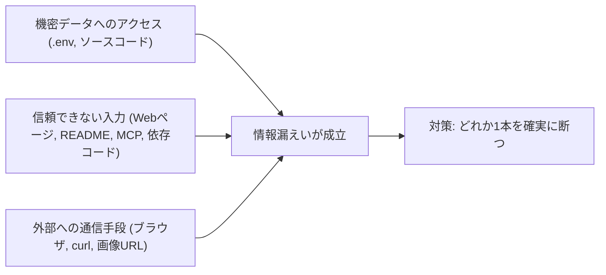

### 15.2 Antigravityでの実例(2025-11の指摘)

| 年月 | 指摘者 | 内容 |
|:--|:--|:--|
| 2025-11 | PromptArmor | Web上の「連携ガイド」に隠した指示(1pxの文字)で、ワークスペースの資格情報とコードを収集させ、ブラウザサブエージェントで外部サイトへ送出させる攻撃連鎖 |
| 2025-11 | PromptArmor | ブラウザの許可リストに、ログ収集に悪用できるドメインが含まれていた |
| 2025-11 | PromptArmor | `.gitignore` 対象ファイルの読み取り制限が、シェルコマンド経由で回避された |
| 2025-11 | Johann Rehberger | 他の関連する脆弱性を報告(「Antigravity Grounded!」) |

出典: [開発者] Simon Willison の紹介記事と、PromptArmor・Johann Rehberger の元記事(参考URL一覧を参照)

> **[開発者]** Willison によれば、当時Googleはこれらを既知の問題として扱っていました。**[筆者推奨]** 現行版(2.x)ではサンドボックスや権限モデルが大きく更新されていますが、修正状況は自分で検証できていない限り「対策済み」とは考えないでください。

### 15.3 多層防御チェックリスト

| 層 | 対策 | 根拠 |
|:--|:--|:--|
| 資格情報 | **エージェントから見える資格情報は、非本番・厳しい利用上限付き**にする | [開発者] Simon Willison |
| 資格情報 | `.env` をワークスペース外へ置く。ワークスペース内に残す場合は、`read_file` と `write_file` の両方を `deny` に入れる。ターミナルサンドボックスを無効にした構成では、コマンドはホストで動くので、これらのルールでは承認済みのコマンドによる `.env` の読み取りを防げない場合がある。その構成での保護は、ファイルの保存場所(エージェントを実行するユーザーが読めない場所)で確保する | [公式]の実行モデル [筆者推奨] |
| 通信 | `read_url` の許可は**必要なドメインだけ**(サンドボックスの外向き通信に直結) | [公式] |
| 通信 | `command(regex:(.*/)?curl .*)` を `ask` に入れ、実行のたびに確認する。公式の例の `command(regex:curl .*)` は `/usr/bin/curl` のような絶対パス指定に一致しない。CLI 1.5.2 のヘッドレス実行(`allow` は `command(*)`)で確認すると、公式の例では `/usr/bin/curl --version` が確認なしで実行され、上の形では `curl` と `/usr/bin/curl` の両方が `ask` に一致した(ヘッドレスは確認を出せないので拒否される)。このルールで止まるのは `curl` だけで、`wget` やスクリプト言語からの通信は止まらない。外向き通信の全体は `read_url` の許可とサンドボックスで絞る。優先順位は Deny > Ask > Allow なので、`deny` や `ask` を個別の `allow` で緩めることはできない。例外を認めない場合だけ `deny` にする | [公式]の優先順位 [筆者推奨] |
| 実行 | Default / Auto を使い、Turboを避ける | [公式] |
| 破壊 | `command(rm -rf)`、`command(sudo)`、`write_file(.git/)`、`write_file(<HOME>/.ssh)`(`<HOME>` は自分のホームの絶対パス)を `deny` | [公式]の例 |
| ブラウザ | `execute_url`(クリック・入力)は既定で確認。本番コンソールは `ask` に固定 | [公式] |
| ブラウザ | 組み込みブラウザは、自分のChromeプロファイルとは別のCookie・ログインを持つ | [公式] |
| 入力 | 外部ドキュメント・Issue・READMEは**信頼できない入力**として扱い、読ませた直後は書き込み権限を絞る | [開発者][筆者推奨] |
| 継承 | サブエージェントは親の権限を継承する。親に広い権限を与えない | [公式] |
| 監視 | 承認プロンプトの対象文字列を**読んでから**許可する(スコープ編集は広げすぎない) | [公式] |
| 企業 | 企業アカウントはAutoが使えないなど、制限が異なる。管理者設定を確認 | [公式] |

---

## Step 16: クォータ・コスト管理

| 観点 | 内容 | 根拠 |
|:--|:--|:--|
| 制限の単位 | **5時間枠**と**週次**の2種類。Gemini系とClaude / GPT系は別バケット | [公式] |
| 共有範囲 | 使用量はApp・CLI・SDKで共有されるとの報告 | [二次] |
| 見える化 | `/usage`(クォータ)、`/credits`(クレジット)、`/context`(文脈) | [公式](コマンド一覧) |
| エージェントは残量を知らない | 自分で `/usage` を確認する運用にする | [二次] |
| 思考量の調整 | `/effort` コマンド、モデルの思考レベル(Low / Medium / High) | [公式] |
| 脇道の質問 | `/btw` でメインの流れを止めずに別質問 | [公式](コマンド一覧) |

**[筆者推奨]** コスト最適化の順序:

1. 計画を先に作り、**無駄な再実装を避ける**(Step 5)。
2. サブエージェントとAutomationsの既定モデルをFlash系にする。
3. 難問だけArgon / Opus(High)、`/boost` は「行き詰まったとき」に限る。
4. 長い会話は区切り、`/fork` と `/resume` で文脈を整理する。
5. 無人実行は、上限を決めてから回す(`/goal` に中断条件を書く)。

---

## アンチパターン集

| # | アンチパターン | 何が起きるか | 代わりにやること |
|:--|:--|:--|:--|
| 1 | 計画なしで大規模変更を依頼 | 方針違いの実装を丸ごとやり直し | `/plan`(必要なら `/grill-me`)で承認してから実装(Step 5) |
| 2 | 検証手段がない状態で自律実行 | 「動いたつもり」の変更が混入 | テスト・Lint・型チェックを先に用意(Step 6) |
| 3 | Turbo / `always-proceed` を日常運用に使う | マシン全体への読み書きと外部通信が全開 | Default / Auto + 拒否リスト(Step 2) |
| 4 | `read_url(*)` を許可 | サンドボックスの外向き通信が事実上全開 | 必要ドメインのみ許可 |
| 5 | ルールを`rules/`に置くがfrontmatterなし/`trigger`のtypo | **黙って破棄**され、効いていると誤認 | 有効な `trigger` を必ず記述、`/` 入力や設定画面で読み込みを確認 |
| 6 | ルール・スキルを肥大化させる | 文脈を圧迫、重要な指示が埋もれる | 常時有効は短く、詳細は `model_decision` やスキルへ |
| 7 | 同一ファイルを複数エージェントが編集 | 衝突・上書き | worktree(`branch`)で隔離 |
| 8 | 作ったエージェント自身に検証もさせる | 自己採点で甘くなる | 検証は別サブエージェント(Step 7) |
| 9 | `/goal` に曖昧な目標 | 無限ループ・クォータ浪費 | 機械判定できる完了条件と中断条件(Step 8) |
| 10 | 外部ドキュメントを読ませた直後に高権限で作業 | 間接プロンプトインジェクション | 信頼できない入力の後は書き込み・通信を絞る(Step 15) |
| 11 | 本番資格情報をエージェントから見える場所に置く | 流出時の被害が最大化 | 非本番・上限付きの資格情報(Step 15) |
| 12 | サードパーティのプラグインを無検証で導入 | スキル・フック・MCPを一括で持ち込む | 中身を確認し、権限を絞る(Step 10) |

---

## トラブルシューティング

| 症状 | 想定原因 | 確認・対処 | 根拠 |
|:--|:--|:--|:--|
| ルールが効かない | `rules/*.md` にfrontmatterがない、または `trigger` が不正(`alwaysOn` など) | `always_on` / `model_decision` / `glob` / `manual` のいずれかに修正 | [公式] |
| サブフォルダのルールが効かない | ワークスペースより下のルールは読まれない | ルートまたは親、`rules.json` で登録 | [公式] |
| `rules/` 配下のサブディレクトリが無視される | 直下の `.md` のみ走査 | `.agents/rules.json` に登録 | [公式] |
| スキルが出てこない | 配置場所の違い、CLI実行中に追加した | `.agents/skills/` を確認し、`/skills reload` か新規会話 | [公式] |
| サブエージェントが固まる | `tools` に未対応・綴り違いの名前 | `view_file`、`run_command` など正確な名前に | [公式] |
| `command(git)` を許可したのに確認が出る | `$(...)` など完全一致が必要な構文を含む | 行全体の完全一致ルール、または `regex:` を使う | [公式] |
| Windowsでコマンドルールが効かない | 単語に分割できないコマンドは完全一致が必要 | 必要なコマンド行だけを、その行全体と一致するルールで許可する(`git` 全体を許可しない) | [公式][筆者推奨] |
| Autoが選べない | 企業・ビジネスアカウント、サンドボックス非対応、版が古い | 版(v2.23.0+ / Windowsはv2.26.0+)とアカウント種別を確認 | [公式] |
| CLIで `proceed-in-sandbox` が確認になる | サンドボックスが使えない環境(v1.4.4以降) | `request-review` と同様に動作する仕様 | [公式] |
| Voice mode / Remote Agents が出ない | 段階的展開、Pro / Ultra限定 | 最新版に更新、アカウントと権限を確認 | [公式][二次] |
| 承認プロンプトの連発 | 許可スコープが細かすぎる | ファイル・URL・MCPはスコープ編集で親ディレクトリへ(コマンドは不可) | [公式] |

---

## 導入ロードマップ(4週間)

| 週 | ゴール | やること | 完了の目安 |
|:--|:--|:--|:--|
| 1 | 安全に動かす | Step 1〜2。ダミーリポジトリで権限プリセットと拒否リストを設定 | Default / Request Review で、危険操作がブロックされることを確認できた |
| 2 | 再現性を作る | Step 3〜6。`AGENTS.md`、スキル1本、`/grill-me` → `/plan` → 検証ループ | 同じ依頼で、毎回テスト付きの変更が出る |
| 3 | 並列化する | Step 7〜8、12。実装と検証のサブエージェント、`/goal` の完了条件 | 2タスクを並列に回し、差分レビューで衝突しなかった |
| 4 | 無人化と拡張 | Step 9〜11、13。L1のAutomations、MCP、Remote Control、CI | レポート型の自動化が安定し、承認すべき操作だけが人間に届く |

---
## 付録A: クイックリファレンス

### A.1 よく使うコマンド・キー

| 目的 | コマンド / キー | 補足 |
|:--|:--|:--|
| 起動 | `agy` | 対話TUI |
| 1回だけ実行 | `agy -p "<プロンプト>"` | ヘッドレス。CI向け |
| モード切替 | `Shift` + `Tab` | default / accept-edits / auto |
| 要件を詰める | `/grill-me <タスク>` | 1問ずつ質問 |
| 計画する | `/plan <タスク>` | 承認後に実装 |
| 両方 | `/plan /grill-me <タスク>` | 質問の結果を計画へ |
| 目標まで継続 | `/goal <目的>` | 完了条件と中断条件を書く |
| 難問 | `/boost` | Pro / Ultra / Enterprise |
| 大規模 | `/teamwork` | 有料プラン |
| ブラウザ検証 | `/browser` | ブラウザサブエージェント |
| エージェント一覧 | `/agents` | `Alt`+`J` で承認待ちへ、`Ctrl`+`K` で即承認 |
| 巻き戻し / 分岐 | `/rewind` / `/fork` | 戻るときは `/resume` |
| 差分 | `/diff` | 行コメントで修正指示 |
| 権限 | `/permissions` | セッション中のモードとルール |
| 設定 | `/config`(`/settings`) | 設定エディタ |
| 使用量 | `/usage` | 5時間枠・週次 |
| Appへ送る | `/export` | GUIで続行 |
| 音声 | `/voice live`(`F6`)/ `/voice dictate`(`F5`) | 企業アカウントの音声入力は不可 |
| 遠隔操作 | `/remote-control` | 現在のセッションの解除は `/remote-control off`。常時待機サービスの停止は `agy remote-control stop` |
| 検索パレット(App) | `Cmd`/`Ctrl` + `K` | 会話・ファイル・コマンド |

出典: [公式] `https://antigravity.google/docs/features/`、`https://antigravity.google/docs/subagents/`、[二次] DEV Community(権限コマンド)

### A.2 初日にやることチェックリスト

| ✔ | 項目 |
|:--|:--|
| ☐ | ダミーリポジトリで `agy` を起動し、認証を完了した |
| ☐ | 権限プリセット(Default または Request Review)を明示的に選んだ |
| ☐ | `deny` に `rm -rf` / `sudo` / `.git/` / ホームの絶対パスで書いた `.ssh` を入れた |
| ☐ | `AGENTS.md` に「テスト・Lintコマンド」「触らない場所」「完了の定義」を書いた |
| ☐ | `/plan /grill-me` で小さな機能を1本通した |
| ☐ | テストを先に書かせ、実行結果を貼らせた |
| ☐ | `/usage` で枠の残量を確認した |
| ☐ | 資格情報が非本番・上限付きであることを確認した |

---

## 補足: 著名開発者の知見に基づく追加ベストプラクティス

ここでは、Antigravity固有のドキュメントに加えて、**著名な国際的開発者・研究者**が公開している知見を、Antigravityの運用へ翻訳します。

### B.1 Addy Osmani: 「ループを設計する」

著名な開発者であるAddy Osmaniは、2026-06-07のエッセイ「Loop Engineering」で、**エージェントに毎回プロンプトを打つ人から、プロンプトを打つ仕組みを設計する人へ**移ることを提唱しました [開発者]。主要な構成要素を、Antigravityの機能に対応づけると次のとおりです。

| Loop Engineering の要素 | 役割 | Antigravityでの対応 | 根拠 |
|:--|:--|:--|:--|
| Automations | 定期的な発見・トリアージ | App の Automations、`/schedule` | [開発者][公式] |
| Worktrees | 並列エージェントの衝突回避 | プロジェクトのworktree対応、サブエージェントの `branch` | [開発者][公式] |
| Skills | プロジェクト知識の明文化 | `.agents/skills/`(Step 4) | [開発者][公式] |
| Plugins / Connectors | 既存ツールへの接続 | MCP、プラグインMarketplace(Step 10) | [開発者][公式] |
| Sub-agents | アイデア出しと独立した検証 | カスタムサブエージェント(Step 7) | [開発者][公式] |

> この対応づけは、Osmaniの記事の構成要素と公式機能を突き合わせた**[筆者推奨]** の整理です。Osmani自身の記事は、複数のツールを横断して書かれています。

運用上の示唆:

- スキルがないループは、毎周プロジェクト知識をゼロから再導出する。スキルがあれば知識が複利で積み上がる [開発者]。
- 「作る側」と「検証する側」を分ける [開発者]。
- 2026-07-09 のフォローアップでは、**エージェントが内側のループ(調査・実装・検証・反復)を回し、人間が外側のループ(品質判定と出荷判断)の責任を持つ**と整理されている [二次]。
- 単発の作業や、完了の判断が主観的な作業では、**ループ化より単発の良いプロンプトの方が有利**な場合がある [二次]。すべてをループにしない。

### B.2 Addy Osmani: 仕様をエージェントに渡す

Osmaniは「How to write a good spec for AI agents」で、エージェント向けの仕様書の書き方を整理しています。その中でSimon Willisonの指摘を引用し、段階的なゲート(仕様 → 計画 → 実装)が、脆い成果物(「カードの家」型のコード)を防ぐと述べています [開発者]。また、**複数エージェントの並列運用は有効だが精神的に消耗するため、最初は2〜3体から**始めるよう勧めています [開発者]。

| 翻訳先 | Antigravityでの実践 |
|:--|:--|
| 仕様 → 計画 → 実装のゲート | `/grill-me` → `/plan` → 承認 → 実装(Step 5) |
| 仕様をエージェントに常時見せる | `AGENTS.md` から `@[...]` で仕様書をインライン展開(Step 3) |
| 並列は最初2〜3体 | サブエージェントの同時数を絞る(Step 7)。二次情報では3〜5程度が目安 |

### B.3 Addy Osmani: agent-skills(24スキル)をAntigravityで使う

OsmaniのGitHubリポジトリ `agent-skills` は、定義・計画・実装・検証・レビュー・出荷の各段階をスキル化し、Antigravity CLI向けのセットアップ手順(プラグインとして導入、`agy plugin validate` で検証)を用意しています [開発者]。ワークフローを厳格に守らせるには、プロジェクトの `AGENTS.md` に仕様・計画・必要なスキルの流れを書くよう案内されています [開発者]。

> **[筆者推奨]** 一括導入ではなく、**自分のチームで効いた2〜3スキルから**始めてください(説明一覧が文脈を使うため)。

### B.4 Simon Willison: 「製品を評価するときは、触れるものだけを」

Willisonは2026-05-20のGoogle I/O記事で、**自分で試せないもの(coming soon)については書かない**方針を示し、Antigravityについて次を整理しました [開発者]。

- 公式サイトはAntigravityを、デスクトップApp・CLI(Go製)・SDK(Pythonラッパー + 同梱のクローズドバイナリ)・元のIDE(VS Code系)として並べている。
- Gemini CLI(オープンソース)は、サブスクリプションでは2026-06-18に使えなくなり、クローズドソースのAntigravity CLIに置き換わる。
- 個人向けエージェント(Gemini Spark)がGemini 3.5 FlashとAntigravityの上で動くと説明されており、サンドボックス化された一時VMで実行する旨が企業向け記事に書かれている。
- 機密データを大量に流す製品なので、プロンプトインジェクション対策が堅牢であることを望む、という趣旨の警鐘。

> **[筆者推奨]** Voice modeやRemote Agentsのような**段階的展開の新機能**は、本番に近い作業へ使う前に、小さな検証プロジェクトで挙動を確認してください。

### B.5 Simon Willison / Johann Rehberger / PromptArmor: セキュリティの教訓

| 教訓 | 内容 | 根拠 |
|:--|:--|:--|
| 三要素のどれかを断つ | 機密データ・信頼できない入力・外部通信のうち、最も断ちやすいのは通常**外部通信** | [開発者] Willison |
| 資格情報の爆発半径を縮める | エージェントが見える資格情報は、非本番・厳しい利用上限付きに | [開発者] Willison |
| 「許可リストの既定」を鵜呑みにしない | ブラウザの既定許可ドメインに、悪用可能なものが含まれていた事例 | [開発者] PromptArmor / Willison |
| 設定でなく**権限層**で守る | モデルは、特に攻撃者が介在する場合、指示や文脈整合性を一貫して守るとは限らない | [開発者] Rehberger |
| 読み取り制限の迂回を想定する | `.gitignore` の読み取り制限が、シェル経由で迂回された事例 | [開発者] PromptArmor |

→ Antigravityでは、**プロンプトでの禁止ではなく、`deny` ルールとサンドボックス、`read_url` の最小化で守る**(Step 2、Step 15)。

### B.6 Google公式Codelab: 役割分担パイプライン

Googleのコードラボでは、`.agents/` ディレクトリに**PM(仕様化)・エンジニア(実装)・レビュー担当**のエージェントを定義し、ワークフローで連結する自律開発パイプラインが紹介されています [公式 Codelab]。

| 役割 | 担当 | Antigravityの実装先 |
|:--|:--|:--|
| 仕様化 | あいまいな依頼を技術仕様へ | `/grill-me` + 仕様用カスタムエージェント |
| 実装 | 承認された仕様をコードへ | 実装サブエージェント(`branch`) |
| レビュー | 本番水準かを精査 | 読み取り中心の検証サブエージェント |

### B.7 公式ブログの実用ユースケース(Gemini 4 Argon)

| ユースケース | 要点 | 本ガイドの該当 |
|:--|:--|:--|
| バックログ整理 | 134件の古い不具合報告から、現存性を履歴・テレメトリで調べ、97件をクローズ。残りは担当者別に分類 | Step 9(L1の調査型) |
| レガシー移行 | カスタムスキルで旧コードベースをRustへ書き換え | Step 4(スキル) |
| セキュリティ監査 | 差分ではなく**実行時の権限の流れ**をたどって重大な不具合を発見 | Step 7(検証サブエージェント) |
| サポートチケット対応 | 分類・原因追跡・修正案と返信の下書きまで。**人間が承認** | Step 9(人間のゲート) |

出典: [公式] `https://antigravity.google/blog/gemini-4-argon-in-google-antigravity`(提供元の自己報告として扱う)

### B.8 国内の実践知(スラッシュコマンドの使い分け)

日本語の実践記事では、最初に覚えるべきコマンドとして `/plan`、`/grill-me`、`/goal`、`/browser` が挙げられ、**要件が曖昧なら `/grill-me`、計画を確認したいなら `/plan`、完走まで任せたいなら `/goal`、Webアプリを実機確認したいなら `/browser`** という使い分けが紹介されています [二次]。本ガイドのStep 5・8と一致します。

---

## 参考URL一覧(根拠ソース)

### C.1 公式ドキュメント・公式ブログ(Google)

| ID | URL | 根拠となる内容 |
|:--|:--|:--|
| D1 | https://antigravity.google/docs/features/ | App・CLI共通機能、プロジェクト、サブエージェント、Remote Control / Agents、Voice mode、Automations、VCSパネル |
| D2 | https://antigravity.google/docs/cli/best-practices/ | 検証ループ、探索→計画→実行、権限、`/rewind` `/fork`、ヘッドレス実行 |
| D3 | https://antigravity.google/docs/skills/ | スキルの構造、段階的開示、ベストプラクティス、配置場所 |
| D4 | https://antigravity.google/docs/rules/ | ルールの探索範囲、`trigger`、サイズ上限、`rules.json` |
| D5 | https://antigravity.google/docs/subagents/ | サブエージェントの定義・状態・継承・`/boost` `/teamwork` |
| D6 | https://antigravity.google/docs/permissions/ | 権限プリセット、Deny > Ask > Allow、完全一致の例外、CLIモード |
| D7 | https://antigravity.google/docs/models/ | 利用可能モデルとプラン、思考レベル、削除予定 |
| D8 | https://antigravity.google/blog/gemini-4-argon-in-google-antigravity | Argonの展開と社内ユースケース |
| D9 | https://antigravity.google/docs/commands/grill-me/ | `/grill-me` の動作と `/plan` との併用 |
| D10 | https://antigravity.google/docs/slash-commands/ | スラッシュコマンド概要 |
| D11 | https://github.com/google-antigravity/antigravity-cli | CLIのインストールと機能一覧 |
| D12 | https://github.com/google-antigravity/antigravity-sdk-python/discussions/216 | Python SDK 0.1.18 のリリースノート |
| D13 | https://codelabs.developers.google.com/autonomous-ai-developer-pipelines-antigravity | `.agents/` による役割分担パイプライン(Google Codelabs) |

### C.2 著名開発者・研究者の投稿

| ID | 発信者 | URL | 根拠となる内容 |
|:--|:--|:--|:--|
| P1 | Addy Osmani | https://addyosmani.com/blog/loop-engineering/ | Loop Engineering。ループ設計の5要素、作る側と確かめる側の分離 |
| P2 | Addy Osmani | https://github.com/addyosmani/agent-skills/blob/main/docs/antigravity-setup.md | agent-skillsのAntigravity CLI向けセットアップ |
| P3 | Addy Osmani | https://addyo.substack.com/p/how-to-write-a-good-spec-for-ai-agents | エージェント向け仕様の書き方、最初は2〜3体の並列 |
| P4 | Simon Willison | https://simonwillison.net/2026/may/20/google-io | Google I/O 2026とAntigravity(構成・CLIの移行・セキュリティ懸念) |
| P5 | Simon Willison | https://simonwillison.net/2025/Nov/18/google-antigravity/ | Antigravity公開時の第一印象 |
| P6 | Simon Willison | https://simonwillison.net/2025/Nov/25/google-antigravity-exfiltrates-data/ | PromptArmorの指摘の紹介と対策(資格情報の限定) |
| P7 | Simon Willison | https://simonwillison.net/tags/lethal-trifecta | 致命的な三要素の解説集 |
| P8 | PromptArmor | https://www.promptarmor.com/resources/google-antigravity-exfiltrates-data | 間接プロンプトインジェクションによる情報流出の実証 |
| P9 | Johann Rehberger | https://embracethered.com/blog/posts/2025/security-keeps-google-antigravity-grounded/ | Antigravityの関連する脆弱性の報告 |

### C.3 技術メディア・解説記事(二次情報)

| ID | URL | 根拠となる内容 |
|:--|:--|:--|
| M1 | https://techcrunch.com/2026/05/19/google-launches-antigravity-2-0-with-an-updated-desktop-app-and-cli-tool/ | Antigravity 2.0の発表(App・CLI・SDK) |
| M2 | https://thenextweb.com/news/google-antigravity-2-desktop-cli-sdk-io-2026 | 2.0の概要、Go製CLI、Gemini CLIの終了 |
| M3 | https://en.wikipedia.org/wiki/Google_Antigravity | 沿革、サンドボックス導入、IDEの扱い、版情報 |
| M4 | https://dev.to/moruku36/what-changed-in-google-antigravitys-november-update-remote-agents-voice-mode-and-a-native-1ph9 | 2026-11-03アップデートの要点 |
| M5 | https://dev.to/agentrq/there-is-no-agy-yolo-how-yolo-mode-actually-works-in-antigravity-ide-and-cli-456l | YOLO相当の設定とサンドボックスの関係 |
| M6 | https://www.layer3labs.io/guides/google-antigravity-2-0 | 2.0とIDEの違い、SDK、サブエージェントの権限継承 |
| M7 | https://www.aibuilderclub.com/blog/antigravity-cli-guide | CLIのコマンド・モード・クォータの注意 |
| M8 | https://www.firecrawl.dev/blog/antigravity-skills | スキル・ルール・ワークフロー・MCPの整理、スキル集の比較 |
| M9 | https://releasebot.io/updates/google/antigravity | 直近リリースの要約 |
| M10 | https://www.gradually.ai/en/changelogs/antigravity/ | 変更履歴(v2.29.0、CLI v1.4.12、Eclipse拡張) |
| M11 | https://www.gradually.ai/en/antigravity-cli-commands/ | CLIコマンド一覧 |
| M12 | https://docs.coderabbit.ai/cli/antigravity.md | プラグインと権限・サンドボックスの関係 |
| M13 | https://www.aibuilderclub.com/blog/loop-engineering-addy-osmani | Osmaniのループ設計の要約とフォローアップ |
| M14 | https://www.developersdigest.tech/blog/loop-engineering-designing-agent-loops | ループの終了判定・予算の設計 |
| M15 | https://gittrend.io/repo/cobusgreyling/loop-engineering | 段階的なループ展開(L1〜L3)の参照リポジトリ |
| M16 | https://www.yoshidumi.co.jp/collaboration-lab/google-antigravity-slash-commands | 日本語のスラッシュコマンド解説 |
| M17 | https://docs.coingecko.com/docs/ai-agent-hub/antigravity | AGENTS.md / GEMINI.md の使い分け事例、MCP設定の場所 |
| M18 | https://docs.agno.com/tools/toolkits/others/antigravity.md | Gemini APIのManaged Agents(サンドボックス)連携 |
| M19 | https://pub.dev/packages/antigravity/changelog | Dartクライアントの変更履歴(サブエージェント、フック) |

---

## 注意事項と今後の確認事項

| 区分 | 内容 |
|:--|:--|
| 情報の鮮度 | Antigravityは更新頻度が非常に高く、AppはおおむねリリースごとにUI・権限・コマンドが変わります。**最終的な仕様は必ず公式ドキュメントと自分の版のコマンド一覧で確認**してください |
| 自己報告の数値 | Argonの社内実績(35%増・30%減など)は提供元の自己報告です |
| 未確認の領域 | 次の項目は今回、一次情報を直接確認していないため、本文では詳細に踏み込んでいません: `/plan` の内部手順の詳細、JSONフックのスキーマ、サンドボックスの内部構成、各プランの料金・制限値 |
| 情報源の食い違い | ルールの上限は、古い解説で12,000文字とされるものがありますが、公式は24KB / 20,000トークンです。**公式を優先**しています |
| 脆弱性情報 | 2025-11の指摘は当時の版に対するものです。現行版での修正状況は、個別に検証してください |
| 名称 | 依頼文の「Googlei」は、Googleとして解釈しました |
| 個人・企業の違い | Auto権限、CLIの音声入力、IDEなどは、企業・ビジネスアカウントで利用できない場合があります |
| 免責 | 本ガイドは情報提供であり、セキュリティ・法務・契約上の判断を保証するものではありません。機密コードの取り扱いは、所属組織のポリシーと各サービスの規約に従ってください |

---

*最終更新: 2026-11-06(情報基準日)*