# OpenAI Codex 最新版ベストプラクティスガイド(中級〜上級者向け)

> **対象読者**: すでにコーディングエージェントを触ったことがあり、チーム開発・長時間タスク・並列運用まで広げたい中級〜上級のエンジニア
> **情報基準日**: 2026年11月7日(調査時点で確認できた最新の公開情報)
> **形式**: ステップバイステップ。フローチャートは Mermaid、図解と表は Markdown のみ(ASCII アートは使用しません)

---

## 目次

1. [本ガイドの読み方と情報の信頼度](#0-本ガイドの読み方と情報の信頼度)
2. [Codex の現在地(2026年11月)](#1-codex-の現在地2026年11月)
3. [モデルの選び方と推論レベル](#2-モデルの選び方と推論レベル)
4. [Step 1: 環境構築と設定レイヤー](#step-1-環境構築と設定レイヤー)
5. [Step 2: 権限とサンドボックスの設計](#step-2-権限とサンドボックスの設計)
6. [Step 3: プロンプト設計とプランニング](#step-3-プロンプト設計とプランニング)
7. [Step 4: AGENTS.md を「痩せたまま」育てる](#step-4-agentsmd-を痩せたまま育てる)
8. [Step 5: Skills とプラグイン](#step-5-skills-とプラグイン)
9. [Step 6: MCP で外部コンテキストをつなぐ](#step-6-mcp-で外部コンテキストをつなぐ)
10. [Step 7: 検証ループとレビュー](#step-7-検証ループとレビュー)
11. [Step 8: 並列化(worktree とサブエージェント)](#step-8-並列化worktree-とサブエージェント)
12. [Step 9: 長時間タスクとコンテキスト管理](#step-9-長時間タスクとコンテキスト管理)
13. [Step 10: 自動化と CI への組み込み](#step-10-自動化と-ci-への組み込み)
14. [Step 11: コストと使用量の最適化](#step-11-コストと使用量の最適化)
15. [Step 12: セキュリティと Daybreak](#step-12-セキュリティと-daybreak)
16. [新モデルへの移行チェックリスト](#13-新モデルへの移行チェックリスト)
17. [アンチパターン集](#14-アンチパターン集)
18. [著名な国際的開発者の知見まとめ](#15-著名な国際的開発者の知見まとめ)
19. [補足: その他のベストプラクティスと根拠ソース URL](#16-補足-その他のベストプラクティスと根拠ソース-url)
20. [未確認事項と今後の確認ポイント](#17-未確認事項と今後の確認ポイント)
21. [最終チェックリスト](#18-最終チェックリスト)

---

## 0. 本ガイドの読み方と情報の信頼度

Codex は「モデル」「アプリ」「CLI」「クラウド」が毎月のように更新されるため、**根拠の強さ**を明示します。

| ラベル | 意味 | 扱い方 |
|---|---|---|
| 【公式】 | OpenAI 公式ドキュメント・公式ブログ・公式リリースノート | 原則そのまま採用 |
| 【開発者】 | 著名な国際的開発者・OpenAI 中の人の個人発信 | 経験則として採用。文脈(モデル世代)を確認 |
| 【研究】 | 論文・プレプリント | 条件付きで採用 |
| 【二次】 | 解説記事・集計サイト | 公式で裏取りしてから採用 |
| 【筆者見解】 | 上記から導いた本ガイドの推論 | 自分の環境で検証 |

> **鮮度に関する注意**: 筆者が確認できた Codex CLI の最新安定版は `0.167.0`(2026-11-06)でした。実際の画面・コマンドは `codex --version` と [公式変更履歴](https://developers.openai.com/codex/changelog/) で必ず照合してください。

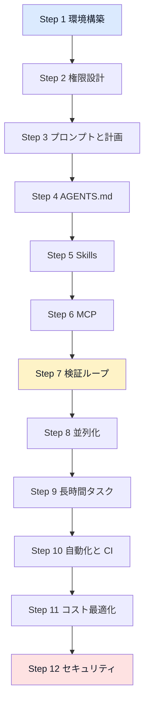

**読み方の推奨**: すでに運用中なら Step 4(AGENTS.md)→ Step 7(検証)→ 「新モデルへの移行チェックリスト」の順に読むと、今日から効果が出ます。

---

## 1. Codex の現在地(2026年11月)

### 1-1. 「Codex」は製品ファミリーの名前

Codex は単一のツールではなく、複数の入口を持つ製品ファミリーです。

| サーフェス | 特徴 | 向いている場面 |
|---|---|---|
| デスクトップアプリ | ChatGPT デスクトップアプリ内の独立した Codex ビュー。スレッド管理・worktree・差分レビュー・自動化 | 日常の主戦場、並列スレッド運用 |
| CLI(`codex`) | オープンソース(Apache 2.0)。`codex exec` で非対話実行 | ターミナル中心の作業、CI、スクリプト化 |
| IDE 拡張 | 開いているファイルや選択範囲を自動でコンテキスト化 | 編集中の局所的な依頼 |
| Codex Cloud | OpenAI 管理のマシンでタスクを実行。PC がスリープでも継続 | 長時間・非同期タスク、モバイルからの起動 |
| GitHub 連携 | PR への自動レビュー、`@codex review` | チームのレビュー標準化 |
| モバイル(Remote) | デスクトップのチャットを遠隔操作 | 外出先での承認・進捗確認 |

根拠: 【公式】[Best practices](https://developers.openai.com/codex/learn/best-practices)、【公式】[ChatGPT Work and Codex(ヘルプ)](https://help.openai.com/en/articles/20001275-chatgpt-work)、【二次】[Wikipedia: OpenAI Codex](https://en.wikipedia.org/wiki/OpenAI_Codex_(AI_agent))

### 1-2. ここ1年の流れ(押さえるべき転換点)

| 時期 | 出来事 | 運用への含意 |
|---|---|---|
| 2025-04 | Codex CLI がオープンソースで公開 | ローカル実行の原点 |
| 2025-11 | GPT-5.1-Codex-Max。複数コンテキストを跨ぐ「コンパクション」を初めてネイティブ学習 | 長時間タスクの前提が変わった |
| 2026-02 | デスクトップアプリ登場、GPT-5.3-Codex、高速版 Spark | アプリ中心の運用へ |
| 2026-03 | GPT-5.4 で Codex とメインモデルを統合、サブエージェント GA、プラグイン、Codex Security | 「コーディング専用モデル」の系列が消えた |
| 2026-04 | GPT-5.5。OpenAI は GPT-5.5-Codex を出さないと明言 | モデル選択は汎用ラインナップから |
| 2026-07 | Codex アプリが ChatGPT デスクトップアプリに統合 | 入口が一本化(Codex は別ビュー) |
| 2026-09 | GPT-6 Astra(9/3)、GPT-6 Sol/Luna(9/22)、GPT-6.1 Sol(9/29 DevDay) | 現行世代の始まり |
| 2026-10 | GPT-6.1 Terra(10/26)。GPT-5.5 は ChatGPT/Work/Codex から退役(API は継続) | 旧世代前提の設定は棚卸しが必要 |

根拠: 【開発者】[Simon Willison: Romain Huet の引用](https://simonwillison.net/2026/Apr/25/romain-huet/)、【開発者】[Simon Willison の gpt タグ](https://simonwillison.net/tags/gpt/)、【公式】[GPT-6.1 Sol 発表](https://openai.com/index/introducing-gpt-6-1-sol/)、【二次】[Releasebot: OpenAI Models](https://releasebot.io/updates/openai/openai-models)

### 1-3. 設定の優先順位と全体構造

CLI・IDE・アプリは**同じ設定レイヤーを共有**します。つまり一度整えた `~/.codex/config.toml` はこの3つで効き、`AGENTS.md` は全サーフェスで効きます。Codex Cloud は OpenAI が管理するマシンで動くので、ローカルの `~/.codex/config.toml` の設定が適用されるとは考えないでください。

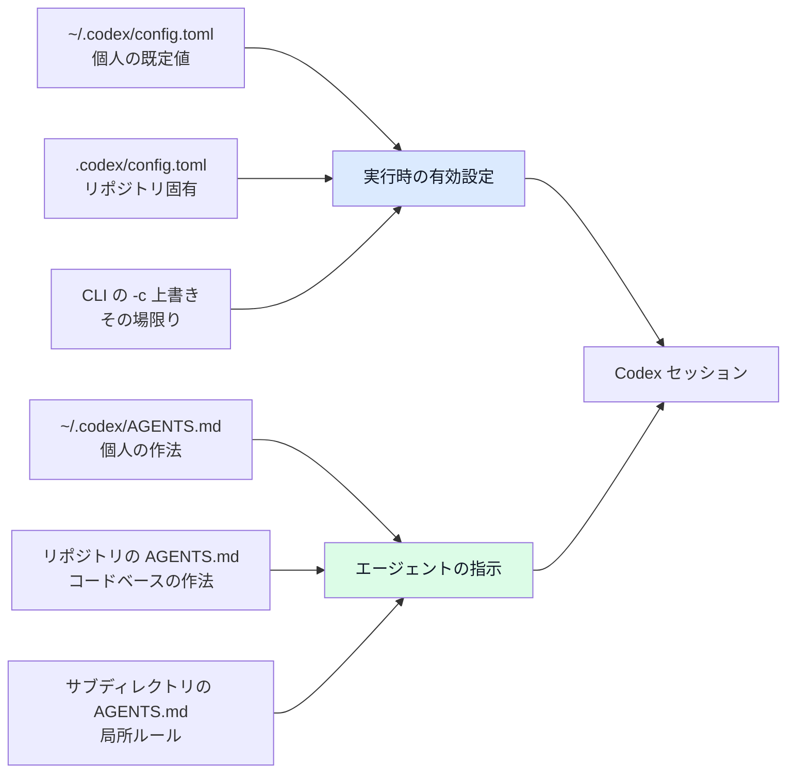

---

## 2. モデルの選び方と推論レベル

### 2-1. 現行ラインナップ(2026-11-07 時点)

OpenAI のモデル階級は **Luna < Terra < Sol < Astra**(大きいほど高性能・高価格)です。この序列は OpenAI の Ted Sanders 氏が説明しています。

| モデル | API モデル名 | API 標準価格(100万トークン) | 位置づけ |
|---|---|---|---|
| GPT-6 Astra | `gpt-6-astra` | 入力 $10 / 出力 $50 | 最上位。長期・ツール多用・コンピュータ操作 |
| GPT-6.1 Sol | `gpt-6.1-sol` | 入力 $2 / キャッシュ $0.10 / 出力 $10 | Astra に迫る性能を 1/5 の価格で。Codex CLI の同梱カタログで既定 |
| GPT-6.1 Terra | `gpt-6.1-terra` | 入力 $1 / キャッシュ $0.05 / 出力 $5 | 画面理解・コンピュータ操作・自然な文章が得意な中位 |
| GPT-6 Luna | `gpt-6-luna` | Terra の約 1/10(Simon Willison の記述) | 高速・低価格・大量処理 |

補足:

- Sol / Terra / Luna / Astra は、**ChatGPT の通常チャットではなく Work と Codex 向け**に提供されるモデルがあります(Sol 6.1 と Terra 6.1 は発表時点で通常 Chat 非対応)。
- API のコンテキストは 1.05M トークンです。API では、入力が 272K トークンを超えるリクエストは、**リクエスト全体**が入力・キャッシュ入力は2倍、出力は1.5倍の料金になります。**ChatGPT Work / Codex 上の GPT-6.1 Sol の既定コンテキストは 500K トークン**で、これらのサブスクリプションの使用量に長いコンテキストの割増はありません。
- Terra はデスクトップアプリ・CLI・API で選べますが、IDE 拡張では当面対象外と報じられています(【二次】)。

根拠: 【公式】[GPT-6.1 Sol](https://openai.com/index/introducing-gpt-6-1-sol/)、【公式】[ヘルプ: ChatGPT Work and Codex](https://help.openai.com/en/articles/20001275-chatgpt-work)、【開発者】[Simon Willison: GPT-6.1 Terra](https://simonwillison.net/2026/Oct/26/gpt-61-terra/)、【二次】[Enjoy Agentic Industries: Terra](https://enjoy.dev/blog/gpt-6-1-terra/)、【二次】[everruns モデルプロファイル](https://docs.rs/crate/everruns-contracts/latest/source/src/model_profile_data/profiles/gpt6.rs)

### 2-2. 選び方のフロー

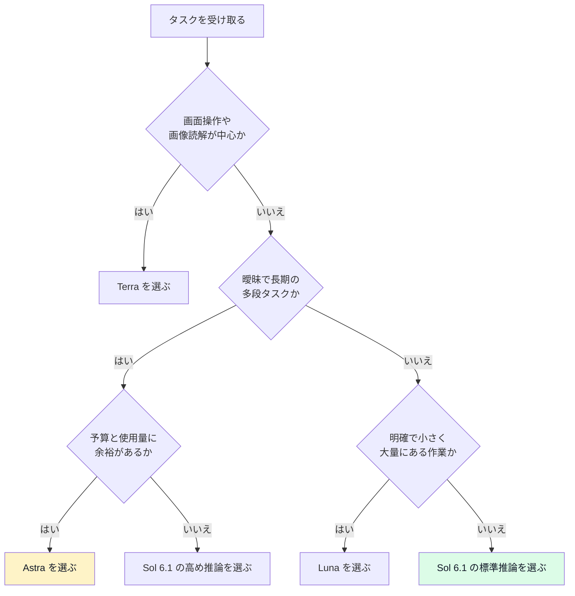

【筆者見解】日常の既定は **Sol 6.1 + medium** から始め、「失敗が目立つタスクだけ上げる」運用が費用対効果の面で無難です。OpenAI の Ted Sanders 氏は、Terra について「技術的な文章は Astra/Sol より上手い場合があり、視覚・コンピュータ操作は同等で速いが、その他は少し劣る」と述べています(Hacker News コメント、Simon Willison が引用)。

### 2-3. 推論レベルと速度

| 設定 | 内容 | 使いどころ |
|---|---|---|
| `low` | 速い。範囲が明確なタスク | 小修正、リネーム |
| `medium` | バランス型 | 日常の実装 |
| `high` | 複雑な変更・デバッグ | 原因不明のバグ |
| `xhigh` / `max` | 長時間・推論重視 | 大規模リファクタ |
| `ultra` | 単一エージェントを超え、サブエージェントに分割 | 分割しやすい大タスク |
| Fast モード | 含まれる使用量を 2.5 倍、購入クレジットと Enterprise の従量課金を 2 倍のレートで消費して高速化 | 急ぎのとき |
| Ultrafast | 最大 8 倍速のトークン生成。消費は含まれる使用量で 8 倍、購入クレジットと Enterprise の従量課金で 6 倍。発売時は Pro $500 など一部プラン限定 | レイテンシ最優先 |

CLI での指定例です。

```bash
# 起動時にモデルを指定
codex --model gpt-6.1-sol

# 1回限りの非対話実行
codex exec -m gpt-6.1-sol "現在の変更をレビューして"

# セッション中にモデルと推論レベルを切り替え
# /model
```

`~/.codex/config.toml` で既定値にする例です。

```toml
model = "gpt-6.1-sol"
model_reasoning_effort = "medium"   # low / medium / high / xhigh / max / ultra
```

バージョン 0.165.0 以降、対応モデルでは**会話の途中で推論レベルを変更**できるのが既定になりました。「最初は medium で探索し、詰まったら high に上げる」が手軽にできます(【二次】Releasebot の要約。詳細は公式 GitHub リリースで確認)。

---

## Step 1: 環境構築と設定レイヤー

### 1-1. なぜ最初にやるか

公式は「品質問題の多くは実は**セットアップ問題**」と指摘しています(作業ディレクトリの誤り、書き込み権限の不足、モデル既定値、ツールやコネクタの欠落など)。プロンプトを工夫する前に環境を整えます。

### 1-2. 手順

1. **サインイン方式を決める**: ChatGPT アカウントでサインインするとプランの使用量・課金が適用され、API キーを使うと API 料金になります。
2. **個人既定値**を `~/.codex/config.toml` に書く(モデル、推論レベル、承認・サンドボックス方針)。
3. **リポジトリ固有の挙動**を `.codex/config.toml` に書く(MCP、サブエージェント数など)。このファイルは**信頼済みのプロジェクトでだけ読み込まれます**。未信頼のリポジトリでは、MCP の設定や `/goal` の有効化(`features.goals`)も適用されないので、先にプロジェクトを信頼済みにします。
4. **一時的な変更**だけを CLI 引数で上書きする。
5. `/init` で `AGENTS.md` の雛形を作り、**必ず自分のチームの実態に合わせて編集**する。
6. 診断: ネットワークまわりの不調は `codex doctor --network-only`(0.166.0 で追加)で切り分ける。

```bash
# 雛形生成(CLI 内)
# /init

# 設定状態の確認(CLI 内)
# /status

# ネットワーク・接続・WebSocket の診断
codex doctor --network-only
```

### 1-3. 設定ファイルの最小例

```toml
# ~/.codex/config.toml(個人既定値の例)
# 使えるモデルはプランやワークスペースの設定で異なる。/model で確認する
model = "gpt-6.1-sol"
model_reasoning_effort = "medium"

# 承認とサンドボックスの方針は Step 2 で詳述
# 値の正式な名称は公式の config-sample で確認してください
```

```toml
# .codex/config.toml(リポジトリ固有の例)
[features]
goals = true          # /goal を有効化(Step 9)

[agents]
max_threads = 4       # サブエージェントの同時数(既定は V1 が 6、V2 が 3。4 は V1 では減らし、V2 では増やす)
max_depth = 1         # V1 の入れ子の深さ(V2 では無視。既定は 1。上げるとコストが乗算される)
```

根拠: 【公式】[Best practices](https://developers.openai.com/codex/learn/best-practices)、【公式】[Sample configuration](https://developers.openai.com/codex/config-sample)、【公式】[Subagents](https://developers.openai.com/codex/subagents)、【二次】[Releasebot: Codex 変更履歴](https://releasebot.io/updates/openai/codex)

---

## Step 2: 権限とサンドボックスの設計

### 2-1. 2つのつまみ

Codex には OS レベルのサンドボックスがあり、次の2つを独立に調整します。

| つまみ | 決めること |
|---|---|
| 承認ポリシー(approval) | いつ人間に許可を求めるか |
| サンドボックス(sandbox) | どのディレクトリを読み書きでき、何にアクセスできるか |

公式の推奨は「**最初は既定のまま厳しく**。信頼できるリポジトリや特定のワークフローで必要が明確になってから緩める」です。

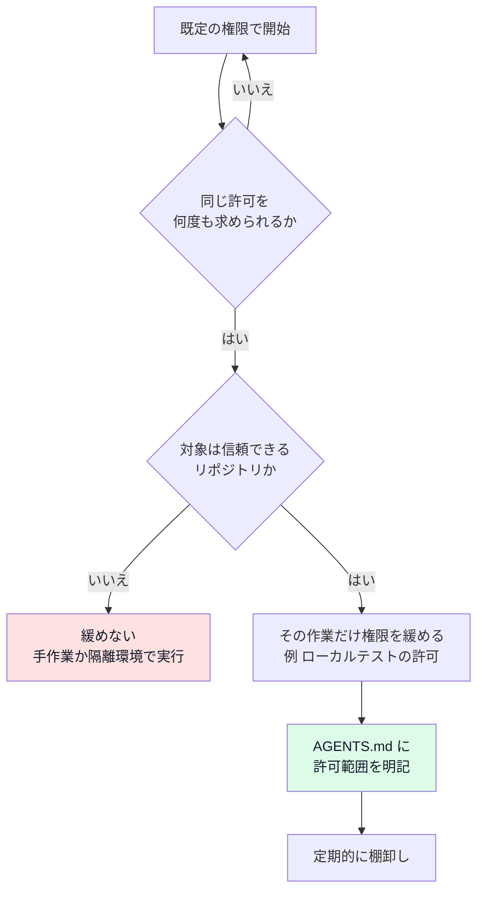

### 2-2. 実務上の作法

- **フル権限を最初から与えない**(公式が挙げる典型的な失敗)。
- 権限はセッション中に `/permissions` で変更できます。0.164.0 以降は `/model` と `/permissions` にインライン引数で渡せます。
- **ネットワーク**: プロキシ層で「ホスト名の許可が先、DNS 解決は後」「Host ヘッダ重複の拒否」など防御が強化されています(0.163.0)。管理環境では許可ドメインを明示します。
- **資格情報のマスク**: リモートの Bash 実行などで資格情報をマスクする機能が入っています(0.164.0)。`.env` を丸ごと見せない設計を維持します。
- **承認レビュー(Guardian)**: 変更履歴には、昇格した操作を実行前に審査する仕組み(Guardian)に関する項目が多数あります。OpenAI は自動レビュー側へ利用者を誘導していると報じられています【二次】。有効化・既定値はバージョンで変わるため、`/status` と公式リリースノートで確認してください。
- **再開時の権限**: スレッドの再開・フォークでは、承認済みの権限が保持されます(0.163.0 / 0.166.0)。ただし**期限切れの承認を前提にしない**運用が安全です。

### 2-3. サブエージェントと権限

サブエージェントは**親セッションのサンドボックスと承認設定を継承**し、カスタムエージェントのファイルでは置き換えられません。「ファイルを編集しないで」と指示しても、それは**お願いであって鍵ではありません**。カスタムエージェントの `sandbox_mode` も親セッションの権限を変えません。委任前に親セッションを読み取り専用にすると、サブエージェントはその読み取り専用のサンドボックスを継承します。ただし、サンドボックスの設定だけでは読み取り専用の動作は保証されません。サブエージェントは親の MCP サーバーも継承するので、書き込みのできるツールが使える状態なら別途の対策が必要です。MCP ツールの呼び出しには承認の設定(`default_tools_approval_mode` など)が適用されるので、書き込みのできるツールは外すか、承認を求める設定にします。

根拠: 【公式】[Best practices](https://developers.openai.com/codex/learn/best-practices)、【公式】[Subagents](https://developers.openai.com/codex/subagents)、【二次】[Releasebot: Codex 変更履歴](https://releasebot.io/updates/openai/codex)、【二次】[flaviocopes: subagents](https://flaviocopes.com/ai-glossary/subagents/)

---

## Step 3: プロンプト設計とプランニング

### 3-1. 4要素フレームワーク(公式の既定)

公式は、プロンプトに次の4つを含めることを基本形にしています。

| 要素 | 内容 | 例 |
|---|---|---|
| Goal | 何を変更・構築するか | 「注文 API に冪等性キーを導入する」 |
| Context | 関係するファイル・ドキュメント・エラー(`@` でファイル指定) | `@src/orders/` と失敗ログ |
| Constraints | 守る規約・アーキテクチャ・安全要件 | 「公開 API のシグネチャは変えない」 |
| Done when | 完了条件 | 「該当テストが通り、型チェックが通る」 |

```text
目的: 注文作成 API に冪等性キーを導入し、二重送信で注文が重複しないようにする。
コンテキスト: @src/orders/create.ts と @src/orders/create.test.ts、本番で起きた重複注文のログ。
制約: 公開 API のレスポンス形式は変えない。DB マイグレーションは追加してよいが既存列は変更しない。
完了条件: 新規テストを含む orders 配下のテストがすべて通り、lint と型チェックが通る。差分の要約と残リスクを最後に報告する。
```

### 3-2. 計画を先に立てるべき場面

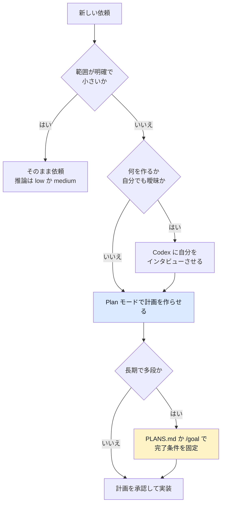

- **Plan モード**: `/plan` または `Shift+Tab` で切替。コンテキスト収集と確認質問を経て、実装前に強い計画を作ります(公式が最も勧める方法)。
- **インタビュー**: 「前提を疑い、曖昧な点を質問してから計画を書いて」と頼みます。
- **PLANS.md(実行計画テンプレート)**: 長期・多段の作業向け。[実行計画ガイド](https://developers.openai.com/cookbook/articles/codex_exec_plans)を参照。

【開発者】一方で、Peter Steinberger 氏(`Shipping at Inference-Speed`、2025-12-28 公開)は Plan モードを使わず、モデルと**会話しながら探索**して方向を決める流儀を取っています。これは GPT-5.x 世代での経験談であり、**どちらが正しいかはタスクとモデル次第**です。迷ったら「不可逆な変更・影響範囲が広い変更では計画を先に」と覚えると安全です。

### 3-3. 推論レベルの当て方

公式の目安は、速く範囲が明確なら Low、複雑な変更やデバッグは Medium〜High、長く推論の重い作業は Extra High です。**最初から最大にしない**ことが、使用量の節約と待ち時間の短縮につながります。

### 3-4. 音声入力

アプリの音声ディクテーションで依頼を話すと、文脈を長く詰め込みやすくなります(公式のヒント)。

根拠: 【公式】[Best practices](https://developers.openai.com/codex/learn/best-practices)、【公式】[Prompting](https://developers.openai.com/codex/prompting)、【開発者】[Steinberger: Shipping at Inference-Speed](https://steipete.me/posts/2025/shipping-at-inference-speed)

---

## Step 4: AGENTS.md を「痩せたまま」育てる

### 4-1. 公式の基本方針

`AGENTS.md` は「エージェント向けの README」で、自動的にコンテキストへ読み込まれます。公式が挙げる中身は次のとおりです。

| 項目 | 例 |
|---|---|
| リポジトリ構成と重要ディレクトリ | `src/` は API、`infra/` は IaC |
| 実行方法 | 起動手順、必要な環境変数の名前 |
| ビルド・テスト・lint コマンド | 該当ディレクトリだけ回すコマンド |
| 規約と PR の期待値 | コミットメッセージ規約 |
| 制約と禁止事項 | 本番データに触れない |
| 完了の定義と検証方法 | テストと型チェックが通ること |

配置は3層です。`~/.codex` のグローバル、リポジトリ直下、サブディレクトリ。Codex はプロジェクトルートから起動ディレクトリまでを順に読むので、サブディレクトリの AGENTS.md が常に読み込まれるとは限りません。適用されるのは、基本的にそのディレクトリか配下で起動したときです。リポジトリ直下で起動したときの挙動は、使っている Codex CLI の版の公式ドキュメントで確認してください。読み込まれたファイルのうち、**現在地に近いファイルが優先**されます。

### 4-2. 重要な新常識: 「長いほど良い」は誤り

ここ半年で、運用の主流が「足す」から「削る」へ変わりました。根拠は2つあります。

**根拠1【研究】ETH Zurich らの評価(Gloaguen ら, 2026)**: 複数のエージェントとモデルで、コンテキストファイル(AGENTS.md など)を評価したところ、タスク成功率が改善しない(論文版の表現では低下する傾向)一方で、**推論コストは 20% 以上増加**しました。エージェントは指示に従うので、不要な要件は探索やテストを増やして**タスクを難しくする**というのが結論です。人手で書くファイルは「最小限の要件」に絞るべきとされます。なお、ドキュメントを削除した条件では LLM 生成のコンテキストファイルが役立ったため、**リポジトリから発見できない情報**こそが AGENTS.md の価値です。

**根拠2【公式・開発者】OpenAI の Eric Provencher 氏(2026-09-11, GPT-6 Astra 向け)**: Skills・AGENTS.md・タスクプロンプトに積み上がった古い指示は、コンテキストを圧迫して挙動を悪化させ得ると指摘しています。要点は次のとおりです。

| 旧来の指示 | 問題 | 改善 |
|---|---|---|
| 「編集の前に毎回、設計書 3 本を読む」 | 誤字修正でもコンテキストを浪費 | 必要なものだけ読むよう、**文脈依存**で文書を指す |
| 「必ずテストを走らせて確認する」 | Astra は自分でやるので過剰テストに | 削除。許可したい手順だけ明記 |
| 「勝手に進めず必ず確認」など強い境界表現 | 続けてほしい場面でも止まる | 境界の文言を見直す |
| 最初の実装で止めて確認する要件 | 早めの停止に誘導される | 完了条件を**事前に**定義(実行・確認・修正まで含める) |

【筆者見解】Provencher 氏の記事は Astra を前提にしていますが、削る原則は Sol 6.1 など他モデルでも「過剰な手順の指示は害になり得る」という方向で有効と考えられます。ただし、モデルごとに挙動が違うため、**移行時に A/B で確認**してください。

### 4-2b. 「許可」を書くのも AGENTS.md の仕事

Astra は慎重で、安全と確信できないことはしません。**安全だと分かっているワークフローには許可を与える**と、無駄な停止が減ります。

```markdown
## ローカルテストについて

ローカルのテストは使い捨てのフィクスチャで動き、本番へのアクセスはありません。
実行して構いません。依頼された変更が原因の失敗は修正し、影響範囲のテストを再実行してください。
都度の承認は不要です。
```

### 4-3. 良い AGENTS.md の最小例

```markdown
# AGENTS.md

## このリポジトリ
- `apps/api`: REST API(TypeScript)。`apps/web`: フロントエンド。
- 共有ライブラリは `packages/` 配下。

## コマンド(ここから発見できないものだけ)
- API のテスト: `pnpm --filter api test`
- 型チェック: `pnpm typecheck`(全体で約 90 秒かかる)

## 制約
- 本番の資格情報や `.env.production` に触れない。
- 公開 API の変更は `docs/api-changes.md` に追記する。

## 完了の定義
- 変更箇所のテストと型チェックが通っている。
- 差分の要約と残リスクを最後に報告する。
```

### 4-4. 育て方のループ

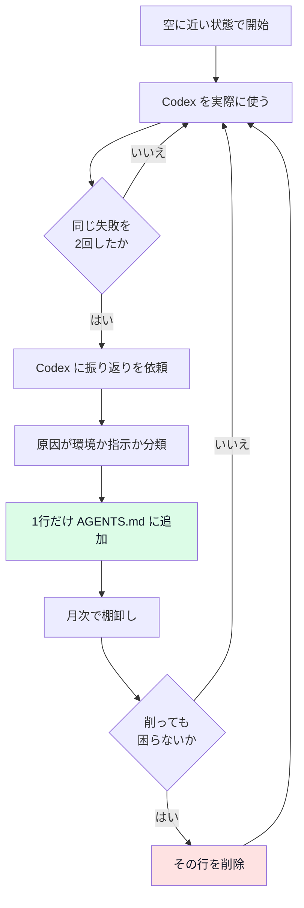

公式も「同じミスを2回したら振り返りを依頼して AGENTS.md を更新する」「ルールは繰り返しの失敗を見てから足す」「大きくなったら本体は簡潔にし、計画やレビュー用の別 Markdown を参照させる」と述べています。

> **棚卸しの検証質問**(筆者の推奨): 「この行を消したらエージェントはミスをするか?」答えが「いいえ」なら消す。

根拠: 【公式】[Best practices](https://developers.openai.com/codex/learn/best-practices)、【公式】[AGENTS.md ガイド](https://developers.openai.com/codex/guides/agents-md)、【公式ブログ】[Rethinking skills and prompts for GPT-6 Astra](https://developers.openai.com/blog/rethinking-skills-and-prompts-for-gpt-6-astra)、【研究】[arXiv 2602.11988](https://arxiv.org/abs/2602.11988)、【二次】[KIberblick の解説](https://kiberblick.de/aktuell/2026/2026-09-14-openai-skills-agents-md-astra/)、【二次】[Upsun: AGENTS.md less is more](https://developer.upsun.com/posts/ai/agents-md-less-is-more)

---

## Step 5: Skills とプラグイン

### 5-1. いつ Skill にするか

公式の目安は「**同じプロンプトを繰り返し使う、または同じワークフローを直し続けるなら Skill にする**」です。

| 手段 | 向いているもの |
|---|---|
| AGENTS.md | 常時適用すべき、リポジトリ全体のルール |
| Skill | 特定の作業でだけ必要な手順(ログ調査、リリースノート、移行計画など) |
| プラグイン | Skill や連携を**配布**したいとき(複数 Skill、アプリ連携の同梱) |
| 自動化 | 手順が安定した繰り返し作業のスケジュール実行 |

### 5-2. Skill 設計の5原則

1. **1つの Skill は1つの仕事**に絞る。
2. **description は短く、いつ使うかを明確に**。名前と説明は常にコンテキストへ載るため、長すぎる・競合する・「選んで!」と主張する説明は害になります。Skill が増えすぎると、説明が短縮されて選びにくくなります。
3. **段階的開示(progressive disclosure)**: ルートの `SKILL.md` は最小限の案内役にし、詳細は参照ファイルやスクリプトへ。
4. **手順書ではなく判断基準を書く**: 精緻な旅程のような手順は、最近のモデルでは逆効果になり得ます。
5. **無差別にダウンロードしない**: 多すぎる Skill は、各説明の見える量を減らし、選択を難しくします。

```markdown
---
name: db-migration-review
description: DB マイグレーションを追加・変更するときだけ使う。互換性とロールバックを確認する。
---

# DB マイグレーションレビュー

確認観点は `references/checklist.md` を参照。本文には詳細を書かない。
```

悪い description の例は「データベースに関することなら何でも使う」です。DB に触れるたびに読み込まれ、不要な指示でコンテキストを消費します。

### 5-3. 配置場所とスキル作成

| 場所 | 用途 |
|---|---|
| `$HOME/.agents/skills` | 個人用 |
| `.agents/skills`(リポジトリ) | チーム共有。新メンバーのオンボーディングにも有効 |
| プラグイン | 広く配布 |

雛形は `$skill-creator` で作ります。最初はローカルで反復し、広く共有する段階でプラグイン化します。リポジトリの Skill は**他のメンバーのエージェント(別モデルかもしれない)**も導くため、「どのモデルが使うか」を意識して書きます。

根拠: 【公式】[Agent Skills](https://developers.openai.com/codex/skills)、【公式】[Best practices](https://developers.openai.com/codex/learn/best-practices)、【公式ブログ】[Rethinking skills and prompts for GPT-6 Astra](https://developers.openai.com/blog/rethinking-skills-and-prompts-for-gpt-6-astra)、【公式】[openai/skills](https://github.com/openai/skills)、[Agent Skills 仕様](https://agentskills.io/specification)

---

## Step 6: MCP で外部コンテキストをつなぐ

### 6-1. 使うべき条件

公式は次の場合に MCP を使うよう勧めています。

- 必要な文脈が**リポジトリの外**にある
- データが頻繁に変わる
- 貼り付けの指示ではなく、**ツールとして使わせたい**
- ユーザーやプロジェクトを跨いで再現可能な連携が欲しい

STDIO と、OAuth 付きの Streamable HTTP の両方に対応します。

```bash
# STDIO サーバーを追加(名前と起動コマンドを指定)
codex mcp add context7 -- npx -y @upstash/context7-mcp

# Streamable HTTP サーバーを追加(名前と URL を指定)
codex mcp add example --url https://mcp.example.com

# セッション中にサーバーへサインイン(0.161.0 以降)
# /mcp login <名前>
```

### 6-2. 運用の作法

- **最初は1〜2個**: 手作業の繰り返しを確実に減らすツールだけ入れる。全部つなぐところから始めない。
- **企業利用**: 企業向け MCP のサインインやアカウント連携の許可(0.164.0)、組織用のプラグイン配布が整っています。
- **セキュリティ**: 外部から取り込む内容は信頼できない入力として扱います(Step 12)。

```toml
# .codex/config.toml の MCP 設定例(サーバー名と URL は例)
[mcp_servers.openaiDeveloperDocs]
url = "https://developers.openai.com/mcp"
```

根拠: 【公式】[Best practices](https://developers.openai.com/codex/learn/best-practices)、【公式】[MCP](https://developers.openai.com/codex/mcp)、【二次】[Releasebot: Codex 変更履歴](https://releasebot.io/updates/openai/codex)

---

## Step 7: 検証ループとレビュー

### 7-1. 「生成して終わり」にしない

公式は、Codex に**テストの作成・実行・確認・レビュー**まで担当させることを勧めています。ただし「良い状態」が何かを知らせるのは、プロンプトか AGENTS.md の役割です。

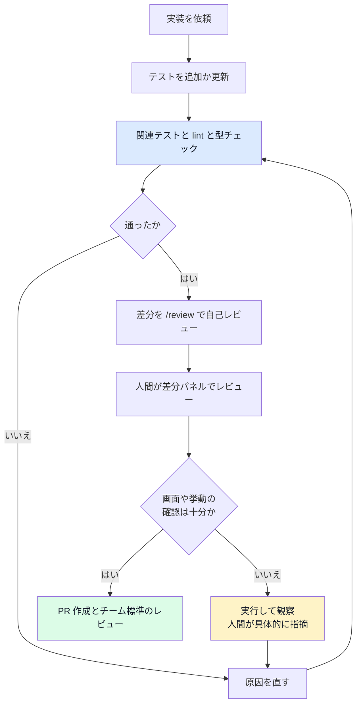

### 7-2. `/review` の使い分け

| 対象 | 用途 |
|---|---|
| ベースブランチとの比較 | PR スタイルのレビュー |
| 未コミットの変更 | 手元の作業の確認 |
| 特定コミット | 後追い確認 |
| カスタム指示 | 観点を指定(セキュリティ、性能など) |

チームで `code_review.md` を作り、`AGENTS.md` から参照すると、レビューの観点がリポジトリや担当者を跨いで揃います。GitHub 連携では PR への自動レビューや `@codex review` が使え、OpenAI 社内では Codex が全 PR をレビューしていると公式が述べています(【公式】[Best practices](https://developers.openai.com/codex/learn/best-practices))。

```markdown
## Review guidelines

- 認可チェックの漏れを最優先で指摘する。
- 例外の握りつぶしは P1 として扱う。
- スタイルの好みは指摘しない。
```

GitHub のコードレビューでは、変更ファイルに最も近い `AGENTS.md` の指針が適用されるため、重点パッケージには深い階層に個別の指針を置けます。ローカルの `/review` は、起動時にリポジトリのルートから作業ディレクトリまでの `AGENTS.md` を読み込みます。ルートで起動すると、それより深い階層の指針は自動では読み込まれないことがあるので、対象のパッケージで起動してください。

### 7-3. 実例が教える限界: 見た目のバグは見落とす

Simon Willison 氏は、Codex Desktop(GPT-5.6 Sol Ultra、サブエージェントを積極活用するモード)に、同一プロンプトでゲームを一発で作らせました。52 分で、API 料金換算では約 $23 の作業でしたが、キャラクターの目が巨大な球になっているバグを、開発中にスクリーンショットを見ていたにもかかわらず**自分では発見できませんでした**。人間が「なぜ巨大な黒い球があるの?」と聞き、「直して」と頼むと解決しました。

【筆者見解】教訓は3つです。

1. 視覚的な品質は、**自動検証の対象に含めても漏れる**。人間の確認か、具体的な視覚仕様(チェックリスト)が要る。
2. 一発で作らせた後の**短い追撃プロンプト**が非常に効く。
3. 検証コストは、使用量見積もり(API 換算)に含めて考える。

根拠: 【公式】[Best practices](https://developers.openai.com/codex/learn/best-practices)、【公式】[GitHub Code Reviews](https://developers.openai.com/codex/use-cases/github-code-reviews)、【開発者】[Simon Willison: Moonlight & Mayhem](https://simonwillison.net/2026/Aug/7/moonlight-mayhem/)(上記 gpt タグ一覧内の記事)

---

## Step 8: 並列化(worktree とサブエージェント)

### 8-1. 3つの並列手段の違い

| 手段 | 何が並列になるか | 向く場面 | 主な注意点 |
|---|---|---|---|
| 複数スレッド | 独立した作業単位 | 別々の機能・調査 | 同じファイルを触らせない |
| Git worktree | ファイルシステムの隔離 | 同一リポジトリで並行編集 | マージ計画 |
| サブエージェント | 1タスク内の分担 | 探索・テスト・トリアージ | トークン消費が増える |

公式の失敗例として、「**同じファイルに対して複数のライブスレッドを worktree なしで走らせる**」ことが挙げられています。

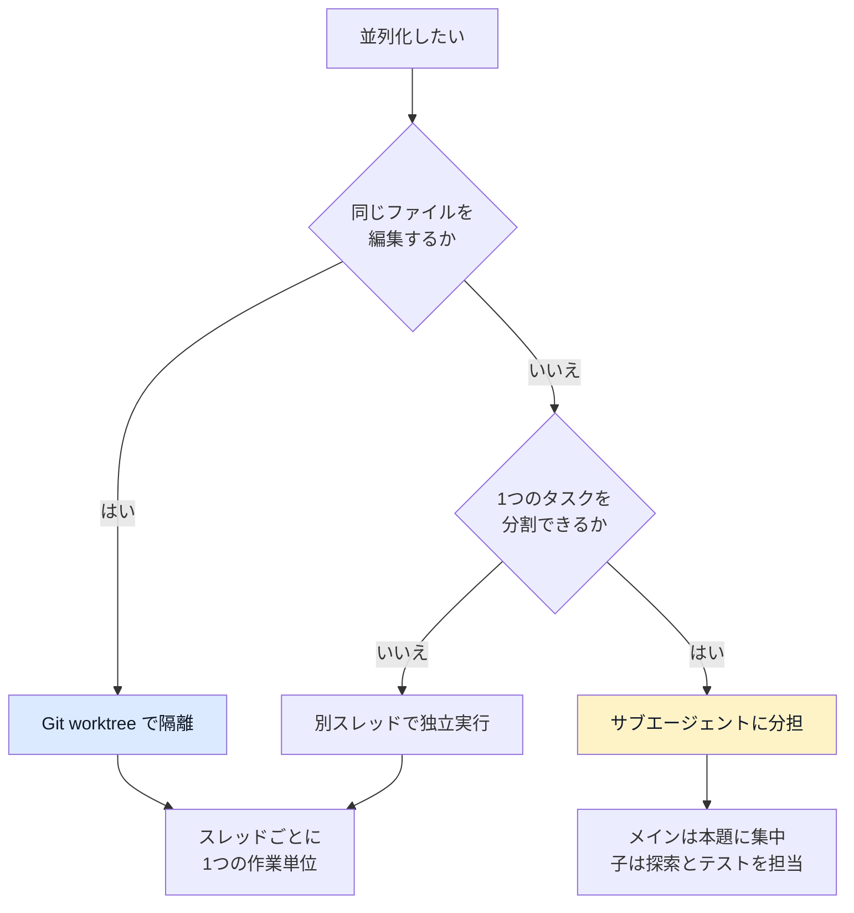

### 8-2. サブエージェントの設定

組み込みの役割には `default`(汎用)、`worker`(実装・修正)、`explorer`(読み取り中心の探索)があります。独自のエージェントは TOML ファイルで定義します(個人は `~/.codex/agents/`、プロジェクトは `.codex/agents/`)。必須フィールドは `name`、`description`、`developer_instructions` です。

```toml
# .codex/agents/pr-explorer.toml(例)
name = "pr_explorer"
description = "PR の変更点を調べ、影響範囲を要約する担当。"
developer_instructions = "コードを編集しない。根拠となるファイルと行を挙げて要約する。"
model_reasoning_effort = "medium"
```

- `developer_instructions` の編集禁止は指示であり、読み取り専用のサンドボックスは作りません。ファイルに `sandbox_mode` を書いても親の設定は上書きされないので、権限は親セッションで設定します(Step 2-3)。
- サブエージェントの同時数の既定は V1 が 6、V2 が 3 です(Codex のソースコードの既定値。公式ドキュメントは「Codex が既定値を選ぶ」とだけ説明)。V2 で同時数を減らすなら、`agents.max_threads` は 3 未満にします。`agents.max_depth` の既定は 1 です。`agents.max_depth` は V1 の設定で、V2 では無視されます。**深さを上げるとコストが乗算**されるので、多くのワークフローは深さ 1 で十分です。
- カスタムエージェントは**狭く、意見を持たせる**(1つの明確な仕事)のが公式の助言です。
- 使うモデルの目安: 曖昧で多段の仕事には `gpt-6.1-sol`、速く狭く大量の仕事には `gpt-6-luna`(公式ドキュメントの提案を二次情報が要約)。
- **サブエージェントが起動するのは、利用者が明示的に頼んだときか、適用される AGENTS.md や Skill が委任を指示しているとき**です。各子が独自にモデルとツールを使うため、単一エージェントより多くのトークンを消費します。
- 例外は **Ultra** です。ChatGPT で Ultra を選ぶと、並列作業が有効な場面では、明示的な依頼がなくても自動で委任することがあります。サブエージェントの利用が増え、その分トークンの消費も増えます。公式がこの自動委任を明記しているのは ChatGPT についてで、ローカルの Codex(アプリ・CLI・IDE)の説明に挙がる起動条件は上の 2 つです。

### 8-3. セッション管理のコマンド

| コマンド | 用途 |
|---|---|
| `/subagents` | 並列エージェントのスレッド切替 |
| `/fork` | 元の履歴を保ったまま新スレッドへ分岐 |
| `/resume` | 保存済み会話の再開 |
| `/side` | 横道の会話。スレッド切替後に戻れる |
| `/compact` | 長くなったスレッドの要約(自動でも行われる) |
| Command Center | エージェントタスクの一覧、ピン留め、履歴のページング |

**1つの作業単位に1つのスレッド**が原則です。同じ問題の続きなら同じスレッドで推論の軌跡を保ち、本当に枝分かれするときだけフォークします。

根拠: 【公式】[Subagents](https://developers.openai.com/codex/subagents)、【公式】[Best practices](https://developers.openai.com/codex/learn/best-practices)、【開発者】[Simon Willison: サブエージェント GA](https://simonwillison.net/2026/Mar/16/codex-subagents)、【二次】[flaviocopes: subagents](https://flaviocopes.com/ai-glossary/subagents/)

---

## Step 9: 長時間タスクとコンテキスト管理

### 9-1. モデル側の進化

- GPT-5.1-Codex-Max 以降、モデルが複数のコンテキストウィンドウを跨いで作業する**コンパクション**が前提になりました。
- GPT-6 Astra では、履歴を繰り返し要約し直す代わりに、**ノートをコンテキスト間で保持しつつ、過去のコンテキストを検索可能に保つ**変更が Codex に入ったと報じられています(【二次】)。
- Codex 自身も使用状況を監視し、長いタスクでは自動で要約して不要な詳細を捨てます。

### 9-2. `/goal` で「終わり」を定義する

長期タスクは `/goal`(目標モード)を使います。有効化は設定の `features.goals = true`、または `codex features enable goals` です。アプリでは進捗がコンポーザの上に表示され、一時停止・再開・編集・クリアができます。

**良い目標は、成功を判定できる**(具体的な成果物、測定可能な目標値、テスト条件)ことが重要です。

```text
/goal JavaScript から TypeScript へ移行する。完了条件: `pnpm typecheck` がエラー 0 件、`pnpm test` が全件成功、公開 API のエクスポート名が変わっていない。進捗は 20 ファイルごとに MIGRATION.md の表へ記録する。
```

【二次】解説では、目標のプロンプトは「タスク説明」と「終了条件」を兼ねるため、「パフォーマンス改善」のような曖昧な目標は恣意的な判定を招く、と指摘されています。

### 9-3. 長時間運用のライフサイクル

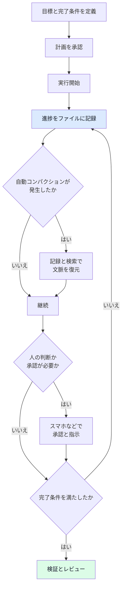

### 9-4. 実務ポイント

- **スレッドは使い捨てのチャットではなく作業場**: 決定事項と文脈が蓄積するので、再説明のコストが減ります。
- **記録をファイルへ**: OpenAI の Codex 責任者 Thibault Sottiaux 氏は、自分の考えや目標をファイルに書いて Codex に参照させる習慣があると語っています(Latent Space のプロフィール)。長期運用では TODO・意思決定・ブロッカーを同期フォルダに置く方法も紹介されています。
- **「理解」まで委譲しない**: Sottiaux 氏は、実行だけでなく理解まで委ねると、利用者自身の把握が弱くなる危険を警告しています。PR の説明は必ず自分で読んでください。
- **キュー**: `codex queue --thread <SESSION_ID> --message "残りのチェックを実行する" --resume` で、メッセージをキューに積んだ後にスレッドを再開できます(0.166.0)。`--thread` にはセッションの UUID か正確な名前を指定します。再開には、起動中のローカルデーモンか、`--remote` で選んだサーバーが必要です。再開できなくても、コマンドは警告を出して正常終了します。作業中に追加の指示を送って即座に舵を切る(Steer)こともできます(0.163.0)。
- **Codex Cloud**: PC がスリープしても動くので、長時間・非同期の仕事に向きます。モバイルでは **Cloud** と環境を直接選んでタスクを実行できます。
- **Remote**: 接続した PC のチャットをモバイルから操作します。Codex Cloud と違い、接続先の PC が起動していてスリープせず、オンラインである必要があります。

根拠: 【公式】[Prompting](https://developers.openai.com/codex/prompting)、【二次】[FoneArena: GPT-6 Astra の機能](https://www.fonearena.com/blog/491506/openai-gpt-6-astra-features.html)、【開発者】[Latent Space: Thibault Sottiaux](https://latent.space/wiki/thibault-sottiaux/)、【開発者】[Simon Willison: GPT-5.1-Codex-Max](https://simonwillison.net/tags/gpt/)、【二次】[Releasebot: Codex 変更履歴](https://releasebot.io/updates/openai/codex)

---

## Step 10: 自動化と CI への組み込み

### 10-1. 「スキルが方法、自動化がスケジュール」

手順がまだ人の細かい介入を要するなら、**先に Skill 化**し、予測可能になってから自動化します。公式が挙げる失敗例は「手作業で安定していない繰り返し作業を、いきなり自動化する」ことです。

| 自動化に向く作業 | 補足 |
|---|---|
| 直近のコミット要約 | 毎朝のスタンドアップ用 |
| バグの兆候のスキャン | 結果は人が確認 |
| リリースノート下書き | 週次 |
| CI 失敗の確認 | 原因の一次切り分け |
| 定期的な分析 | スケジュール実行 |

アプリの Automations タブで、プロジェクト・プロンプト(Skill の呼び出し可)・頻度・実行環境(専用 worktree かローカルか)を選べます。ローカルプロジェクトの定期実行には、PC の電源が入っていて、アプリが起動している必要があります。専用 worktree を選んでも条件は同じです。スリープ中の扱いは公式に明記がないので、実行されない場合があると考えて設計してください(本ガイドの推論)。**振り返りにも使う**と効果的です。最近のセッションを要約させ、繰り返す摩擦を AGENTS.md や Skill の改善に反映させます。

### 10-2. 非対話実行

```bash
# CI などでの一発実行(モデル指定。codex exec の既定は読み取り専用なので、修正を保存するには書き込みを許可する)
codex exec -m gpt-6.1-sol --sandbox workspace-write "失敗している統合テストの根本原因を調べて修正して"
```

SDK(TypeScript など)からの呼び出しにも対応しています。企業環境では、Vertex AI(`model_provider = "gcp"`)や Amazon Bedrock も使えます。

```toml
# ~/.codex/config.toml に書く(プロジェクトの .codex/config.toml ではプロバイダ設定は無視される)
# Vertex AI を使う例(0.165.0 で追加された組み込みプロバイダ)
model_provider = "gcp"

[model_providers.gcp]
project_id = "your-project-id"  # 省略時は GOOGLE_CLOUD_PROJECT
location = "global"             # 省略時は GOOGLE_CLOUD_LOCATION(それもなければ global)
```

前提として Google Cloud CLI を導入し、`gcloud auth application-default login` で ADC(Application Default Credentials)を設定します。ただし、これらの手順だけではモデルへのアクセス権は付与されません。Google Cloud 経由の OpenAI モデル(`gpt-6.1-sol` を含む)は**プライベートプレビュー**なので、アクセスを申請し、対象プロジェクトでモデルを利用できることを確認してください。そのうえで、利用できるモデルを `model` に指定します。根拠: 【公式】[Advanced Configuration](https://developers.openai.com/codex/config-advanced)、【公式】[Configuration Reference](https://developers.openai.com/codex/config-reference)、【公式】[OpenAI on Google Cloud](https://developers.openai.com/api/docs/guides/google-cloud)

### 10-3. チーム運用の注意(二次情報の指摘)

【二次】AI コーディングツールを配布しても**配信速度が変わらない**のは、コード生成の1ノードだけが自動化され、周辺の計画・レビュー・テスト・デリバリーが従来のままだからだ、という分析があります(HackerNoon 記事、Steinberger 氏の記事を引用)。個人では推論時間が律速になりますが、チームではタスクを生み出すプロセスが律速になります。**プロセス側(テスト、レビュー、ドキュメント)に投資**してください。

根拠: 【公式】[Best practices](https://developers.openai.com/codex/learn/best-practices)、【公式】[Automations](https://developers.openai.com/codex/app/automations)、【二次】[HackerNoon](https://hackernoon.com/ai-coding-tools-wont-fix-a-broken-development-process)、【二次】[Releasebot: Codex 変更履歴](https://releasebot.io/updates/openai/codex)

---

## Step 11: コストと使用量の最適化

### 11-1. 使用量の仕組み(押さえるべき点)

- ChatGPT アカウントでのサインインは**プランの使用量**を消費し、API キーは API 料金です。
- Astra は GPT-5.6 Sol より**使用量を速く消費**する場合があります(タスク、入出力サイズ、推論レベル、速度設定で変わる)。
- Terra は同じ使用量枠で、GPT-5.6 Terra より多くの作業ができ、Sol 6.1 や Astra よりも大幅に多くできるとされています(固定倍率は公式に明記なし)。
- Fast モードは、プランに含まれる使用量を同じモデルの Standard の 2.5 倍、購入クレジットと Enterprise の従量課金を 2 倍のレートで消費します。Ultrafast は最大 8 倍速のトークン生成で、消費は含まれる使用量で Standard の 8 倍、購入クレジットと Enterprise の従量課金で 6 倍です。発売時は Pro $500 や一部の企業プランに限定されていました。

### 11-2. コスト削減の優先順位

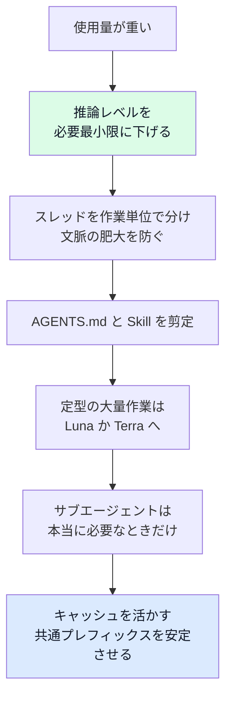

- GPT-6.1 Sol のキャッシュ入力は $0.10/100万トークンで、入力の 5%、GPT-6 Sol より半額です。**エージェントの長い会話ほど効く**ため、プレフィックス(システム指示・AGENTS.md・ツール定義)を安定させるのが有効です(Hacker News のコメントも「Codex では実利が大きい」と評価)。
- GPT-5.6 以降の API 料金では、キャッシュ書き込みは既定の 30 分保持で非キャッシュ入力の 1.25 倍、Responses API の 12 時間保持で 2.5 倍です。読み取りは大半のモデルで 90% 割引、GPT-6.1 Sol と GPT-6.1 Terra で 95% 割引です。Codex のクレジット課金には別途のキャッシュ書き込み料金がなく、API キーでの利用は API 料金に従います。
- **一次情報で確認**: Plus プランのメッセージ上限などは変動するため、公式の料金ページで最新値を確認してください。

根拠: 【公式】[GPT-6.1 Sol](https://openai.com/index/introducing-gpt-6-1-sol/)、【公式】[ヘルプ: ChatGPT Work and Codex](https://help.openai.com/en/articles/20001275-chatgpt-work)、【公式コミュニティ】[GPT-6.1 Terra 発表](https://community.openai.com/t/gpt-6-1-terra-delivering-fast-and-capable-computer-use-at-a-lower-price/1409900)、【二次】[Handy AI: GPT-6.1 Sol](https://handyai.substack.com/p/model-drop-gpt-61-sol)、【開発者】[Simon Willison: 2026-06-26 の引用](https://simonwillison.net/tags/gpt/)

---

## Step 12: セキュリティと Daybreak

### 12-1. エージェント利用の基本姿勢

- 最小権限で始める(Step 2)。
- 外部から取り込む内容(Web、Issue、MCP の戻り値)は**信頼できない入力**として扱い、プロンプトインジェクションを想定する。
- 資格情報はマスクし、本番系へ到達できないテスト環境を使う。
- 共有ドキュメント・サブエージェントの権限継承を理解する(Step 2-3)。

### 12-2. Astra の安全装置を理解する

GPT-6 Astra は OpenAI で初めて、サイバー面の Preparedness Framework で最高の **Critical** に分類されたモデルです。Codex では、安全装置が働くと**実行前にレビューを促す表示**が出ることがあり、無害な作業でも誤作動し得ると OpenAI 自身が認めています(API ではタスクが停止することもある)。0.166.0 では、**安全ブロックの説明と、より安全な後続プロンプトの選択肢**が TUI に追加されました。

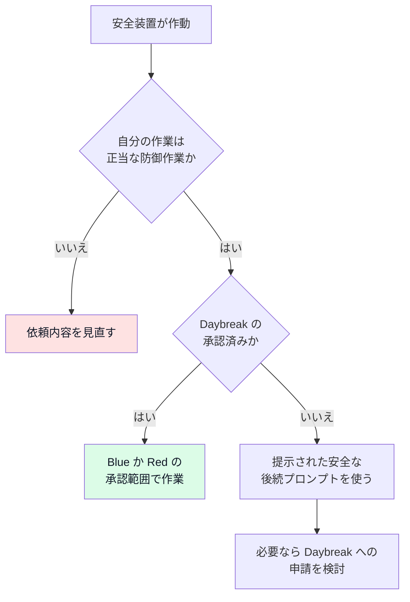

### 12-3. Daybreak と Codex Security

**Daybreak** は OpenAI のサイバー防御プログラムです(2026年5月に開始)。Codex Security(リポジトリをスキャンし、編集可能な脅威モデルを作り、隔離環境で脆弱性を検証し、修正案を提示する)と、サイバー向けモデルなどを統合します。

| 階層 | 内容 |
|---|---|
| Daybreak Blue | 承認された防御者向け。汎用の最前線モデルを、セキュリティ作業向けに調整した安全装置で提供。ほとんどの防御者の出発点 |
| Daybreak Red | 高度な脆弱性調査、エクスプロイト検証、ペネトレーションテスト、レッドチーム向けの特化モデル |

Codex のバージョンによって、Daybreak の既定の有効/無効や API キーでの利用条件が変わってきた履歴があります(0.161.0 では「明示的に有効化」、0.163.0 では「対象アカウントで既定有効」)。**自分の環境の挙動は `/status` と公式リリースノートで確認**してください。個人の参加者には、2026年9月1日からハードウェアセキュリティキーの採用が求められると報じられています。

根拠: 【公式】[OpenAI Daybreak](https://openai.com/cyber)、【二次】[TechRadar: Daybreak 拡張](https://www.techradar.com/pro/security/openai-extends-daybreak-security-project-and-reveals-new-cyber-model-but-for-approved-users-only)、【二次】[National CIO Review](https://nationalcioreview.com/?p=79581)、【二次】[The Batch: GPT-6 Astra](https://www.deeplearning.ai/the-batch/gpt-6-astra-is-a-star)、【二次】[Releasebot: Codex 変更履歴](https://releasebot.io/updates/openai/codex)

---

## 13. 新モデルへの移行チェックリスト

新しい世代への移行は、**棚卸しの好機**です。Provencher 氏は「Codex に、記事の内容に基づく監査をさせる」ことも勧めています。

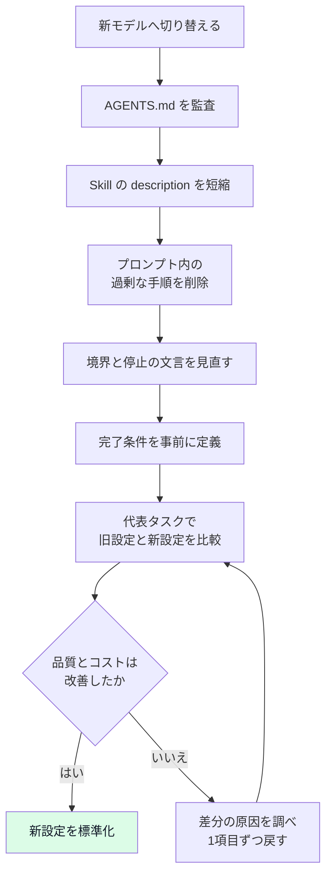

| チェック項目 | 質問 |
|---|---|
| AGENTS.md | 各行を消したらミスが起きるか。リポジトリから発見できる情報を重複していないか |
| Skill | description は「何を・いつ」だけか。他の Skill と競合しないか。ルートは案内役か |
| 読み取り指示 | 「毎回全部読む」を「必要に応じて」に変えたか |
| テスト指示 | モデルが自発的にやることを過剰に命じていないか |
| 境界表現 | 強すぎる確認要求で止まっていないか。許可すべき安全な手順に許可を与えたか |
| 完了条件 | 実行・確認・修正まで含めて事前に書いたか |
| 持続性 | 「最初の実装で止めて確認」という要件が不要に早い停止を招いていないか |
| 公式の移行支援 | `$openai-docs` Skill を使った移行(GPT-5.5 時代から提供)や、CLI 同梱の OpenAI Docs 移行ガイド(GPT-6 系の推論・ツール・データ所在の観点を追加)を活用したか |

【開発者】Simon Willison 氏は、GPT-5.5 の公式プロンプトガイドを引用し、「前の世代のプロンプトを全部引き継がず、**製品要件を保てる最小のプロンプトから新しいベースラインを作る**」という OpenAI の推奨が興味深いと述べています。

根拠: 【公式ブログ】[Rethinking skills and prompts for GPT-6 Astra](https://developers.openai.com/blog/rethinking-skills-and-prompts-for-gpt-6-astra)、【開発者】[Simon Willison: GPT-5.5 prompting guide](https://simonwillison.net/2026/Apr/25/gpt-5-5-prompting-guide/)、【二次】[Releasebot: Codex 0.163.0](https://releasebot.io/updates/openai/codex)

---

## 14. アンチパターン集

| アンチパターン | なぜ悪いか | 代わりに |
|---|---|---|
| 毎回の依頼に恒久ルールを書く | 重複と肥大。再現性が低い | AGENTS.md か Skill へ |
| AGENTS.md に何でも書く | 成功率が上がらずコストだけ上がる(ETH の評価) | 発見できない情報だけを最小限に |
| 初日からフル権限 | 事故の被害範囲が広い | 既定から開始し、必要箇所だけ緩める |
| 計画なしで複雑タスク | 前提のズレが後半で発覚 | Plan モード、インタビュー、PLANS.md |
| テスト・ビルドのコマンドを教えない | エージェントが自分の作業を確認できない | AGENTS.md に明記 |
| 同じファイルで複数スレッド | 変更が衝突 | worktree で隔離 |
| 不安定な作業を即自動化 | 失敗が静かに蓄積 | 手作業→Skill→自動化の順 |
| プロジェクト単位で1スレッド | 文脈肥大と品質低下 | 作業単位で1スレッド |
| 1つの Skill に複数の仕事 | 選択ミスと文脈の浪費 | 1 Skill 1仕事、ルートは案内役 |
| 常に最大の推論レベル | 遅く高価。過剰思考 | medium から始め、失敗時のみ上げる |
| 結果を見ずに信じる | 視覚・仕様のバグを見落とす | 実行して観察、具体的に指摘 |
| 実装と一緒に「理解」まで委譲 | 自分の把握が弱くなる | 要約を読み、設計判断は自分で |

---

## 15. 著名な国際的開発者の知見まとめ

| 人物・所属 | 主張(要旨) | 文脈と注意 | ソース |
|---|---|---|---|
| Eric Provencher(OpenAI) | Skills・AGENTS.md・プロンプトを削って整える。説明は短く、段階的開示、完了条件を事前に | GPT-6 Astra 向けの助言(2026-09) | [OpenAI Developers ブログ](https://developers.openai.com/blog/rethinking-skills-and-prompts-for-gpt-6-astra) |
| Simon Willison | 2025年11月が能力の転換点。Codex での実践記録、サブエージェント、プロンプトの再構築を紹介 | 実験的なケース(ゲーム生成など)が中心 | [gpt タグ](https://simonwillison.net/tags/gpt/) |
| Peter Steinberger | 出力は推論時間が律速。複数プロジェクトをキューで並行。Codex は先に大量に読むので手戻りが少ない | GPT-5.x 世代(2025-12)の経験談 | [Shipping at Inference-Speed](https://steipete.me/posts/2025/shipping-at-inference-speed) |
| Thibault Sottiaux(OpenAI Codex) | 目標や考えをファイルに書いて渡す。理解の委譲は避ける。信頼(安全・セキュリティ)が企業導入の鍵 | プロフィール記事の要約 | [Latent Space](https://latent.space/wiki/thibault-sottiaux/) |
| Ted Sanders(OpenAI) | Luna < Terra < Sol < Astra。Terra は技術的な文章・速い画面操作に向く | Hacker News のコメント | [HN](https://news.ycombinator.com/item?id=50248124) |
| Gloaguen, Vechev ら(ETH Zurich) | コンテキストファイルは成功率を上げず、コスト 20% 以上増。最小要件に | 評価対象は主に Python リポジトリ | [arXiv](https://arxiv.org/abs/2602.11988) |
| Romain Huet(OpenAI) | GPT-5.4 以降、Codex とメインモデルは単一系統。別建ての Codex モデルはない | 製品戦略の説明(2026-04) | [Simon Willison の引用](https://simonwillison.net/2026/Apr/25/romain-huet/) |

---

## 16. 補足: その他のベストプラクティスと根拠ソース URL

ここでは、本文に入れきれなかった実践と、その根拠 URL をまとめます。**【公式】を優先し、【二次】は裏取りの手がかり**として使ってください。

### 16-1. 追加のベストプラクティス

| # | ベストプラクティス | 要点 | 根拠 URL | 種別 |
|---|---|---|---|---|
| 1 | 4要素のプロンプト | Goal / Context / Constraints / Done when | https://developers.openai.com/codex/learn/best-practices | 公式 |
| 2 | Plan モードとインタビュー | `/plan`、Shift+Tab。曖昧なら質問させてから計画 | https://developers.openai.com/codex/learn/best-practices | 公式 |
| 3 | 実行計画テンプレート | 長期・多段は PLANS.md | https://developers.openai.com/cookbook/articles/codex_exec_plans | 公式 |
| 4 | AGENTS.md の3層配置 | グローバル、リポジトリ、サブディレクトリ。近いものが優先 | https://developers.openai.com/codex/guides/agents-md | 公式 |
| 5 | AGENTS.md を最小化 | 発見できない情報だけ。足すのは失敗の後 | https://arxiv.org/abs/2602.11988 | 研究 |
| 6 | Skill の description を短く | 名前と説明は常時ロード。競合を避ける | https://developers.openai.com/blog/rethinking-skills-and-prompts-for-gpt-6-astra | 公式ブログ |
| 7 | Skill は1仕事・段階的開示 | ルートを案内役にし詳細は参照へ | https://developers.openai.com/codex/skills | 公式 |
| 8 | プラグインで配布 | 複数 Skill や連携の同梱 | https://developers.openai.com/codex/plugins/build | 公式 |
| 9 | MCP は必要最小限 | 外部・変動データ。最初は1〜2個 | https://developers.openai.com/codex/mcp | 公式 |
| 10 | 権限は既定から段階的に | 承認とサンドボックスの2つのつまみ | https://developers.openai.com/codex/learn/best-practices | 公式 |
| 11 | `/review` と `code_review.md` | レビュー観点の標準化 | https://developers.openai.com/codex/learn/best-practices | 公式 |
| 12 | GitHub の自動レビュー | `@codex review`、近い AGENTS.md の指針を適用 | https://developers.openai.com/codex/use-cases/github-code-reviews | 公式 |
| 13 | サブエージェントの権限継承 | 読み取り専用は親セッションで設定(カスタムエージェントの sandbox_mode では変わらない) | https://developers.openai.com/codex/subagents | 公式 |
| 14 | worktree で並列隔離 | 同一ファイルの並行編集を避ける | https://developers.openai.com/codex/app/worktrees | 公式 |
| 15 | 自動化は安定後に | スキルが方法、自動化がスケジュール | https://developers.openai.com/codex/app/automations | 公式 |
| 16 | `/goal` で完了条件を固定 | 測定可能な目標。`features.goals` | https://developers.openai.com/codex/prompting | 公式 |
| 17 | Astra 向けの棚卸し | 過剰手順の削除、停止基準の見直し | https://developers.openai.com/blog/rethinking-skills-and-prompts-for-gpt-6-astra | 公式ブログ |
| 18 | 使用量・モデル別の消費 | 含まれる使用量で Fast 2.5 倍、Ultrafast 8 倍(購入クレジットと Enterprise の従量課金は 2 倍、6 倍)、Astra は重め | https://help.openai.com/en/articles/20001275-chatgpt-work | 公式 |
| 19 | Terra の位置づけ | 画面操作・文章・視覚に強い中位 | https://simonwillison.net/2026/Oct/26/gpt-61-terra/ | 開発者 |
| 20 | 検証で見た目のバグを拾う | 人間の確認と具体的な追撃プロンプト | https://simonwillison.net/2026/Aug/7/moonlight-mayhem/ | 開発者 |
| 21 | キューで複数プロジェクトを並行 | 計画してキューに入れ、戻ってレビュー | https://steipete.me/posts/2025/shipping-at-inference-speed | 開発者 |
| 22 | プロセス側の改善 | コード生成だけの自動化では全体は速くならない | https://hackernoon.com/ai-coding-tools-wont-fix-a-broken-development-process | 二次 |
| 23 | Daybreak と Codex Security | 脅威モデル→隔離検証→修正案 | https://openai.com/cyber | 公式 |

### 16-2. 参考 URL 一覧(種別ごと)

**公式(OpenAI)**

- https://developers.openai.com/codex/learn/best-practices
- https://developers.openai.com/codex/prompting
- https://developers.openai.com/codex/guides/agents-md
- https://developers.openai.com/codex/skills
- https://developers.openai.com/codex/subagents
- https://developers.openai.com/codex/concepts/subagents
- https://developers.openai.com/codex/mcp
- https://developers.openai.com/codex/config-basic
- https://developers.openai.com/codex/config-sample
- https://developers.openai.com/codex/cli/slash-commands
- https://developers.openai.com/codex/app/worktrees
- https://developers.openai.com/codex/app/automations
- https://developers.openai.com/codex/app/review
- https://developers.openai.com/codex/integrations/github
- https://developers.openai.com/codex/use-cases/github-code-reviews
- https://developers.openai.com/codex/plugins/build
- https://developers.openai.com/cookbook/articles/codex_exec_plans
- https://developers.openai.com/blog/rethinking-skills-and-prompts-for-gpt-6-astra
- https://developers.openai.com/api/docs/models/gpt-6-astra
- https://openai.com/index/introducing-gpt-6-1-sol/
- https://openai.com/index/introducing-gpt-6-1-terra/
- https://openai.com/index/gpt-6-astra/
- https://openai.com/cyber
- https://help.openai.com/en/articles/20001275-chatgpt-work
- https://community.openai.com/t/gpt-6-1-terra-delivering-fast-and-capable-computer-use-at-a-lower-price/1409900
- https://github.com/openai/codex/releases
- https://github.com/openai/skills
- https://agentskills.io/specification

**著名な国際的開発者・OpenAI 関係者**

- https://simonwillison.net/tags/gpt/
- https://simonwillison.net/2026/Oct/26/gpt-61-terra/
- https://simonwillison.net/2026/Sep/22/opus-and-sol-and-luna/
- https://simonwillison.net/2026/Aug/7/moonlight-mayhem/
- https://simonwillison.net/2026/Jul/12/bump/
- https://simonwillison.net/2026/Apr/25/gpt-5-5-prompting-guide/
- https://simonwillison.net/2026/Apr/25/romain-huet/
- https://simonwillison.net/2026/Mar/16/codex-subagents
- https://simonwillison.net/2026/Jan/4/inflection/
- https://steipete.me/posts/2025/shipping-at-inference-speed
- https://newsletter.pragmaticengineer.com/i/185922983/interesting-learnings-from-thow-peter-builds-software
- https://latent.space/wiki/thibault-sottiaux/
- https://news.ycombinator.com/item?id=50248124

**研究**

- https://arxiv.org/abs/2602.11988
- https://eth-sri.github.io/publications/gloaguen2026agentsmd

**二次情報(裏取り用)**

- https://releasebot.io/updates/openai/codex
- https://releasebot.io/updates/openai/openai-models
- https://en.wikipedia.org/wiki/OpenAI_Codex_(AI_agent)
- https://techcrunch.com/2026/09/29/openai-launches-gpt-6-1-sol-says-it-nearly-matches-gpt-6-astra-and-costs-less/
- https://9to5mac.com/2026/10/26/openai-upgrades-chatgpt-and-codex-with-new-gpt-6-1-terra-model/
- https://enjoy.dev/blog/gpt-6-1-terra/
- https://flaviocopes.com/gpt-6-1-sol.md
- https://flaviocopes.com/ai-glossary/subagents/
- https://codex.danielvaughan.com/2026/09/04/gpt-6-astra-codex-cli-integration-guide-critical-cyber-threshold/
- https://codex.danielvaughan.com/2026/04/12/codex-cli-best-practices-workflow-maturity-model
- https://www.fonearena.com/blog/491506/openai-gpt-6-astra-features.html
- https://www.deeplearning.ai/the-batch/gpt-6-astra-is-a-star
- https://www.techradar.com/pro/security/openai-extends-daybreak-security-project-and-reveals-new-cyber-model-but-for-approved-users-only
- https://nationalcioreview.com/?p=79581
- https://kiberblick.de/aktuell/2026/2026-09-14-openai-skills-agents-md-astra/
- https://developer.upsun.com/posts/ai/agents-md-less-is-more
- https://www.implicator.ai/intermediate-tutorial-how-to-build-reliable-workflows-with-openai-codex/
- https://hackernoon.com/ai-coding-tools-wont-fix-a-broken-development-process
- https://handyai.substack.com/p/model-drop-gpt-61-sol

---

## 17. 未確認事項と今後の確認ポイント

誠実さのため、本ガイドで**確認しきれていない点**を明記します。

| 項目 | 状況 | 確認方法 |
|---|---|---|
| 設定キーの正式な値名(approval・sandbox) | 公式の config-sample を直接は照合していない | `config-sample` と `/permissions` の表示 |
| Guardian(承認レビュー)の既定と名称 | 変更履歴の断片と報道からの理解 | 公式リリースノート、`/status` |
| Daybreak の既定有効化の条件 | バージョンで変遷。最新条件は未確定 | 公式 Daybreak ページ、変更履歴 |
| Luna の正確な価格 | 「Terra の約 1/10」という記述のみ | API モデルページ |
| Terra の IDE 拡張対応 | 二次情報のみ | 公式モデル一覧 |
| Provencher 氏の助言の Sol 6.1 への適用範囲 | Astra 向けの記事。一般化は筆者見解 | 自環境での A/B |
| Plus プランのメッセージ上限 | 変動する | 公式料金ページ |
| ETH の論文の結論の一般性 | 主に Python リポジトリ。版により表現が異なる(改善なし/低下傾向) | 論文本文と自分のリポジトリでの検証 |
| 11/7 以降の更新 | 本ガイドは基準日時点 | 公式変更履歴 |

---

## 18. 最終チェックリスト

運用を始める前、または見直しの際にコピーして使ってください。

```markdown
## 環境と権限
- [ ] `codex --version` と公式変更履歴で最新版を確認した
- [ ] 個人既定(~/.codex/config.toml)とリポジトリ固有(.codex/config.toml)を分けた
- [ ] 権限は既定から開始し、緩めた箇所を AGENTS.md に明記した

## 指示の設計
- [ ] プロンプトに Goal / Context / Constraints / Done when を入れている
- [ ] 複雑なタスクは Plan モードかインタビューから始めている
- [ ] AGENTS.md は「リポジトリから発見できない情報」だけに絞った
- [ ] Skill の description は短く、1 Skill 1仕事、ルートは案内役

## 検証と並列化
- [ ] テスト・lint・型チェックのコマンドを Codex が知っている
- [ ] /review と code_review.md でレビュー観点を標準化した
- [ ] 見た目や挙動は人が確認し、具体的に追撃している
- [ ] 同一ファイルの並行編集は worktree で隔離している
- [ ] サブエージェントは必要なときだけ、深さは 1

## 長期運用とコスト
- [ ] 長期タスクは /goal で測定可能な完了条件を定義した
- [ ] 1つの作業単位に1スレッドで運用している
- [ ] 推論レベルは medium から始め、必要時のみ上げている
- [ ] 安定した作業だけを自動化している

## セキュリティ
- [ ] 外部入力は信頼できないものとして扱っている
- [ ] 資格情報はマスクし、本番へ到達できない環境を使っている
- [ ] 新モデル移行時に AGENTS.md と Skill を棚卸しした
```

---

*本ガイドは 2026年11月7日時点で公開されていた情報に基づきます。価格・提供範囲・コマンドは頻繁に変わるため、実運用では必ず公式ドキュメントで最終確認してください。*
