# OpenAI「dots」初学者向け ステップバイステップ・ベストプラクティスガイド

> **対象読者**: ChatGPT は使ったことがあるが、「常時稼働エージェント」は初めての方
> **情報基準日**: 2026年10月24日(dots は 2026年9月29日の OpenAI DevDay 2026 で発表)
> **ゴール**: 最初の dot を安全に作り、小さな仕事から任せ、1週間で「信頼できる運用」に育てる

---

## 0. このガイドの読み方

### 0.1 情報の確度について

dots は発表から約4週間の新しい製品で、仕様・提供範囲が日々更新されています。本ガイドでは、各情報の確度を次の記号で示します。

| 記号 | 意味 | 例 |
|---|---|---|
| ◎ | OpenAI の一次資料(公式発表・ヘルプセンター・安全性投稿)を直接確認した | 4,000以上のアプリ連携、Custom Rules の4種類の挙動 |
| ○ | 一次資料を引用している二次資料(百科・報道)経由で確認した | 行動ルールの分類表、System Card の評価結果 |
| △ | 実践者の経験談・個人の提案で、公式の保証ではない | 「1週間は既定ルールのまま使う」などの運用の工夫 |

> **注意**: 起点としてご指定いただいた日本語版(`openai.com/ja-JP/index/introducing-dots/`)は、取得時にボット検知で遮断されました。そのため同じ発表の英語版(`openai.com/index/introducing-dots/`)と、同日公開の安全性投稿・ヘルプセンター記事で内容を確認しています。

### 0.2 このガイドの構成

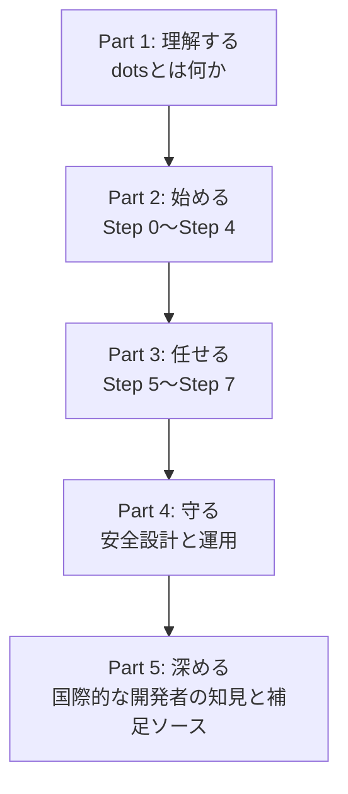

### 0.3 目次

- [Part 1: 理解する](#part-1-理解する)
  - [1. dots とは何か](#1-dots-とは何か)
  - [2. 全体像](#2-全体像)
  - [3. ChatGPT・ChatGPT Work・Codex との使い分け](#3-chatgptchatgpt-workcodex-との使い分け)
- [Part 2: 始める](#part-2-始める)
  - [Step 0: 利用資格と費用を確認する](#step-0-利用資格と費用を確認する)
  - [Step 1: 最初の dot を作る](#step-1-最初の-dot-を作る)
  - [Step 2: アプリ(プラグイン)を最小限だけ接続する](#step-2-アプリプラグインを最小限だけ接続する)
  - [Step 3: Custom Rules を先に決める](#step-3-custom-rules-を先に決める)
  - [Step 4: 最初の仕事を任せる(ブリーフの書き方)](#step-4-最初の仕事を任せるブリーフの書き方)
- [Part 3: 任せる](#part-3-任せる)
  - [Step 5: 定期タスクとバックグラウンド調査](#step-5-定期タスクとバックグラウンド調査)
  - [Step 6: チャンネルと自分の PC をつなぐ](#step-6-チャンネルと自分の-pc-をつなぐ)
  - [Step 7: 見守る・止める・やり直す](#step-7-見守る止めるやり直す)
- [Part 4: 守る](#part-4-守る)
  - [8. 安全設計を理解する](#8-安全設計を理解する)
  - [9. メモリとプライバシー](#9-メモリとプライバシー)
  - [10. 1週間の運用ルーチン](#10-1週間の運用ルーチン)
  - [11. よくある失敗とトラブルシュート](#11-よくある失敗とトラブルシュート)
  - [12. ベストプラクティス・チェックリスト](#12-ベストプラクティスチェックリスト)
- [Part 5: 深める](#part-5-深める)
  - [13. 国際的な開発者・専門家の知見](#13-国際的な開発者専門家の知見)
  - [14. 補足: その他のベストプラクティスと根拠ソース](#14-補足-その他のベストプラクティスと根拠ソース)
  - [15. 参考URL一覧](#15-参考url一覧)
  - [16. 用語集](#16-用語集)
  - [17. 更新時の注意](#17-更新時の注意)

---

# Part 1: 理解する

## 1. dots とは何か

**dots(単数: dot)** は、OpenAI が 2026年9月29日に ChatGPT 内で提供を始めた**常時稼働(always-on)型のエージェント**です。◎

OpenAI は「目標を渡し、自分でやってよいことを決めておけば、会話と会話の合間にも仕事を進め、結果を持ち帰り、判断が必要なときだけ相談してくる」存在として説明しています。◎

### 1.1 30秒で押さえる要点

| 項目 | 内容 | 確度 |
|---|---|---|
| 動力 | OpenAI の最新モデル **GPT-6 Astra** | ◎ |
| 作業場所 | dot ごとに**専用のクラウドコンピュータとブラウザ**を持つ | ◎ |
| 接続先 | ChatGPT のプラグイン経由で **4,000以上のアプリ** | ◎ |
| 連絡手段 | ChatGPT(デスクトップ・Web・モバイル)、Slack、Microsoft Teams、テキストメッセージ(限定ベータ) | ◎ |
| 動き方 | 頼まれなくても背景で調べ物をし、提案する(「プロアクティブ調査」) | ◎ |
| 統制 | 何を自分で行い、いつ確認し、何を絶対にしないかを利用者が決める | ◎ |
| 注意 | 間違えることがある。重要な成果物は必ず人が確認する | ◎ |

### 1.2 「普通のチャット」との決定的な違い

通常の ChatGPT は「質問 → 回答 → 終了」の**単発のやりとり**です。dot は「責任を引き受けて、続きを担当する」存在です。

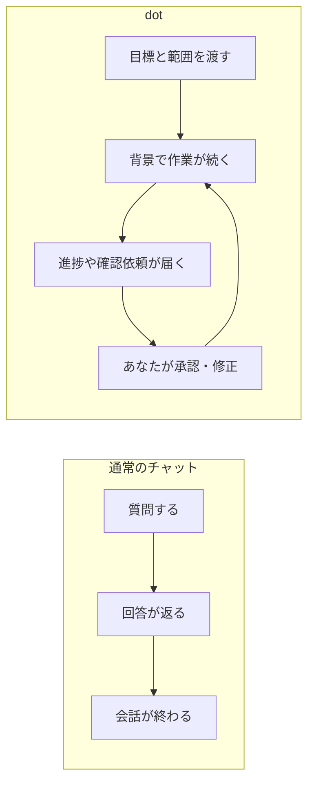

> **初学者への一言**: 「質問する相手」ではなく「仕事を引き継ぐ同僚」だと考えると、設計の勘所(権限・報告・確認)が理解しやすくなります。

### 1.3 OpenAI が示している利用イメージ

- Slack に不具合報告が上がると、dot がすぐ調査を始める(社内利用の例)◎
- 早期テスターの dot が、請求書の送り忘れに気づき、下書きを作り、本人の承認後に送信した ◎
- 将来は「複数の dot がチームで動く」構想で、組織向けの**スペシャリスト dot**(独自の ID・権限を持つ)も試験段階にある ◎

---

## 2. 全体像

### 2.1 構成要素の関係

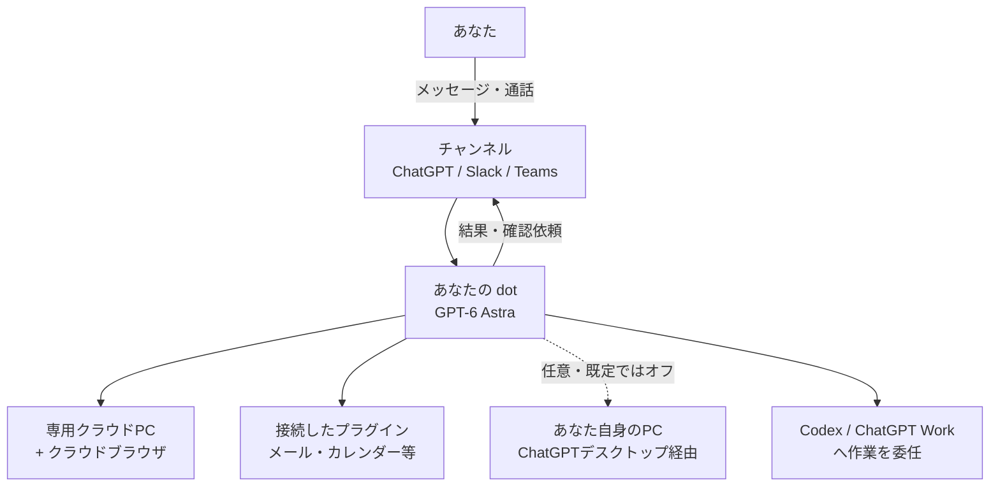

ポイントは次の3つです。

1. **dot の作業場所は「あなたの PC」ではなく、dot 専用のクラウド PC** ◎
2. 自分の PC を使わせるかどうかは**任意で、既定はオフ** ◎
3. 作業の入口(チャンネル)が複数あっても、**文脈は引き継がれる**(ChatGPT で始めた話を Slack で続けられる)◎

### 2.2 用語ミニ辞典(最低限)

| 用語 | 意味 |
|---|---|
| dot | あなた専属の常時稼働エージェント。名前を付けられる(既定のハンドルは `@yourname-dot`)|
| プラグイン | ChatGPT がアプリ(メール・カレンダー・Slack 等)につながる仕組み。権限は dots・ChatGPT・Work・Codex で共有される |
| Custom Rules | 「何を勝手にやってよいか・必ず聞くか・任せないか」を行為ごとに決めるルール |
| Auto-review | 対象となる操作(メッセージ送信やファイル変更など)について、実行前に別の安全システムが計画をチェックする仕組み |
| プロアクティブ調査 | 頼まれていない時間に、読み取り専用で背景調査し、メモを残す機能 |
| Activity View | dot の進行中・委任中のタスクを一覧し、指示の追加や停止ができる画面 |

---

## 3. ChatGPT・ChatGPT Work・Codex との使い分け

dots は既存ツールを置き換えるのではなく、**それらに仕事を振り分ける司令塔**として位置づけられています。◎(dot は Work や Codex のタスクを作成でき、プラグイン権限は共有されます)

| ツール | 向いている仕事 | 動き方 |
|---|---|---|
| ChatGPT(通常チャット) | 質問、文章作成、アイデア出し | 都度のやりとり |
| ChatGPT Work | 1回きりの調査や作業を最後まで進める | 作業ごとに依頼 |
| Codex | コードの作成・修正・レビュー | 開発タスクごと |
| **dot** | **継続的な責任**(見守り、定期確認、段取り、手配) | 常時待機し、必要に応じて上記へ委任 |

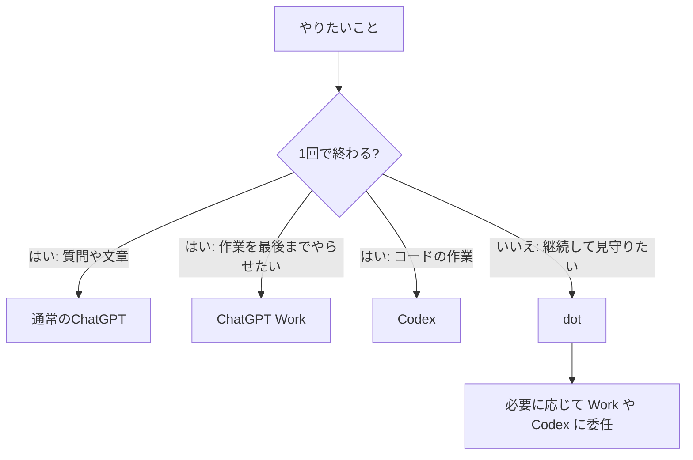

> **初学者の目安**: 「来週もこの件を気にかけておいてほしい」と思ったら dot、「今これを片付けて」なら Work や Codex、という切り分けが分かりやすいです。△

---

# Part 2: 始める

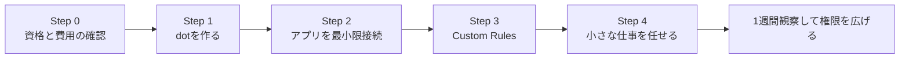

## Step 0: 利用資格と費用を確認する

### 0-1. 提供範囲(ローンチ時点の公式情報)

| 項目 | 内容 | 確度 |
|---|---|---|
| Pro | EEA(欧州経済領域)・スイス・英国を除く市場。段階的に展開 | ◎ |
| Business Premium | サポート対象の全リージョン | ◎ |
| Enterprise(Edu・Healthcare 含む) | ベータ。ワークスペース管理者が有効化するまで既定はオフ | ◎ |
| 年齢 | 18歳以上 | ◎ |
| Free / Go / Plus | 対象外と案内されている | ○ |
| Pro の価格帯 | 発表当初は「Pro」としか記載がなく、$200 のみとの報道もあったが、10月初旬の公式ガイドでは Pro 100 / 200 / 500 が対象と案内されたと報告されている | ○(要再確認)|

### 0-2. 費用と使用量

| 項目 | 内容 | 確度 |
|---|---|---|
| 最初の dot | Pro・Business Premium では追加料金なし | ◎ |
| dot との会話 | ChatGPT の使用量上限にはカウントされない | ○ |
| dot が起動する Codex・Work のタスク | 使用量にカウントされる | ○ |
| 最初の1か月 | プランごとに案内された、上限を拡大した使用量枠が適用される。使用量にカウントされないのは **dot との会話のみ**で、dot が起動する Work・Codex のタスクはカウントされる。その後の条件は各プランで案内予定 | ◎ |
| 追加の dot・速度・作業量 | 今後追加できる予定(価格は未公表)| ◎ |

> **要確認**: 「最初の1か月」は発表(9月29日)からの期間なので、**10月末に切り替わる可能性があります**。最新の条件は必ずヘルプセンターで確認してください。

### 0-3. 作る前の心構え(3原則)

1. **最初から全権を渡さない**。読み取りと下書きから始める。△
2. **取り消せないこと(送信・購入・削除)は、人が最後に押す**。◎(OpenAI も購入や完全削除には承認を求める設計)
3. **初週は不具合が出る前提**で、重要な業務に直結させない。△(早期レビューで、権限エラーやメッセージ欠落が報告されている ○)

---

## Step 1: 最初の dot を作る

### 手順

1. **ChatGPT デスクトップアプリ**(Windows 版もあり)、**デスクトップのブラウザ**、または **iOS / Android アプリ**で ChatGPT を開く ◎(メッセージングチャネルの接続にはデスクトップが必要。dot の作成自体はモバイルでも可能)
2. 画面の案内に従って dot を作成し、**名前**を付ける(後からプロフィールの鉛筆アイコンで変更可)◎
3. キャラクターまたはペットを選ぶ(見た目だけの設定)◎
4. 作成後、dot に**自己紹介**をさせる ◎

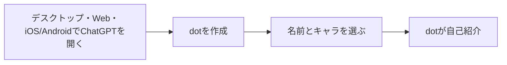

### つまずきポイント

| 症状 | 原因と対処 |
|---|---|
| 発表ページの作成リンクで「デスクトップから作成してください」と出る | 発表直後はモバイルから作成できなかった。Simon Willison 氏もこの表示に遭遇している ◎。現在は iOS / Android アプリからの作成にも対応している ◎。表示が出る場合はアプリを最新版に更新するか、デスクトップで作成する。なお、メッセージングチャネルの接続はデスクトップで行う必要がある |
| 使えない | 段階的な展開のため、アカウントに届くまで数日かかる場合がある ◎ |

---

## Step 2: アプリ(プラグイン)を最小限だけ接続する

dot がアプリ経由で読める情報や実行できる操作は、あなたが接続したアプリの範囲に限られます。◎ ただし、これは dot ができることのすべての境界ではありません。専用のクラウドブラウザ・コンピュータ(および自分の PC との接続)は、アプリ接続とは別に管理する権限として扱ってください(→ [Step 6](#step-6-チャンネルと自分の-pc-をつなぐ)、[8. 安全設計](#8-安全設計を理解する))。接続は **「いま任せたい仕事に必要な最小限」** から始めます。

### 2-1. 接続の前に知っておくこと

- 接続したアプリの情報を、dot は**頼まれなくても背景で確認し、記憶を作ることがある** ◎
- **アプリの接続を解除しても、すでに dot が取得した情報は消えない**。消すには dot 自体をリセットする ◎
- プラグインの権限は dots・ChatGPT・Work・Codex で**共有**される(すでに接続済みのものは使える)◎
- メールは、**個人のメールアカウントを接続して使わせる**ことができる。ローンチ時点では dot 専用のメールアドレスは持てなかった ◎(その後、専用アドレスを持たせた利用者の報告もあるため、最新状況は要確認 ○ → [13.2](#132-ethan-mollickwharton-教授one-useful-thing))

### 2-2. 最小権限の接続順序(おすすめ)

| 順番 | 接続するもの | 理由 | 確度 |
|---|---|---|---|
| 1 | カレンダー(読み取り中心) | 影響が小さく、価値がすぐ分かる | △ |
| 2 | メール(読み取り) | 要約・下書き作成に使える | △ |
| 3 | Slack | 相談窓口になる。ただし「何を監視するか」は明示が必要 | ◎ |
| 4 | 送信・変更ができる権限 | Custom Rules が固まり、挙動を観察してから | △ |

> **ベストプラクティス**: アプリを足すたびに、そのプラグインが**「読むだけ」か「変更・送信もできる」か**を権限画面で必ず確認しましょう。△

---

## Step 3: Custom Rules を先に決める

**Custom Rules は、dots を安全に使う最重要の設定**です。◎ 「接続の前に、または接続と同時に」決めるのが鉄則です。△

### 3-1. 4つの挙動

行為(例:メール送信、購入、ファイル共有)ごとに、次の4つから選びます。◎

| 挙動 | 意味 | 向いている行為 |
|---|---|---|
| 確認なしで実行 | 聞かずにやる | 調査・整理・下書き・自分だけが見るチェックリスト更新 |
| 事前承認があれば実行 | あなたがプロンプトで**明示的に依頼した行為**だけ実行 | 「この請求書を今日送って」と指定した送信 |
| 実行前に確認 | 毎回聞く | 社内への連絡、予定の変更 |
| あなたに引き渡す | あなたが自分で行う | 社外への公開、金銭、パスワード、権限変更 |

> 「事前承認(pre-approved)」とは、**あなたがプロンプトで明示的にその行為を依頼した**という意味です。◎ 「下書きを作って」は「送って」という承認にはなりません。◎

### 3-2. 変更できないもの

Custom Rules で次のものは**オフにできません**。◎

- 中核の安全要件(例:パスワード変更ではあなたに操作を返す)
- Auto-review(別の安全チェック)
- プロアクティブ調査の制限(読み取り専用)

### 3-3. 設定場所

| 画面 | 場所 | 確度 |
|---|---|---|
| モバイル | Customize → Custom rules | ◎ |
| デスクトップ | Settings → Personalization → Permissions | ○ |

dot にルール案を作らせることもできますが、**ルールの変更には、あなたの承認が必要**です。◎

### 3-4. 初期設定の例(コピーして使えます)

次のプロンプトで、厳しめのルールを dot と一緒に作れます。△

```markdown
Custom Rules を一緒に作りたいです。最初は厳しめにしてください。

- メールやメッセージの送信は、毎回、実行前に私に確認する
- 購入や支払いは必ず私に引き渡す
- パスワードや金銭に関わる操作は必ず私に引き渡す
- 私の個人情報を、このチャット以外へ共有しない

各ルールを1つずつ見せて、私が承認してから保存してください。
```

### 3-5. ルールを決める「2つの質問」

どの挙動を選ぶか迷ったら、次の判断で整理できます。△

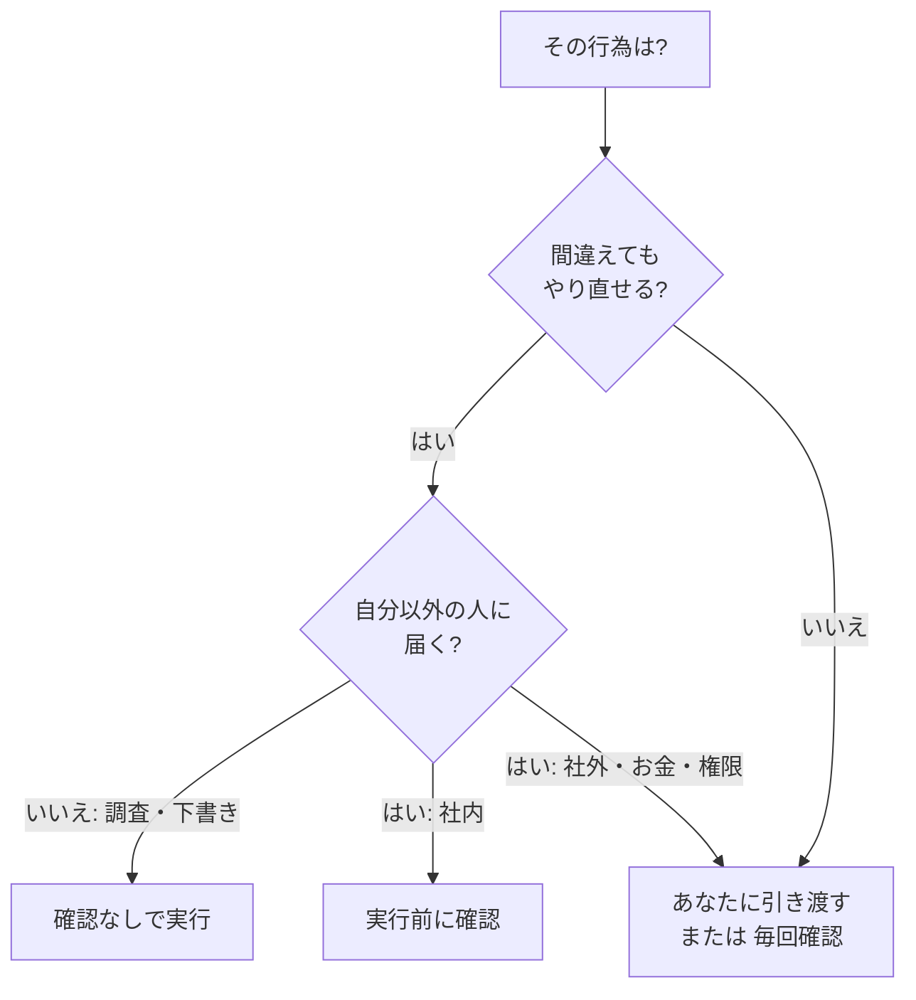

> **覚えておくこと**: OpenAI 自身も「dot は**ルールに従っているつもりでも**間違えることがある」と明記しています。◎ ルールは「やらせない保証」ではなく**「やらせたくない方向への強い指示」**と考え、公開物や金銭は最終ボタンを人に残してください。△

---

## Step 4: 最初の仕事を任せる(ブリーフの書き方)

### 4-1. 最初の原則: 「質問」ではなく「仕事」を渡す

dot には、孤立したプロンプトではなく、**「継続して見ておいてほしいこと」**から始めるよう OpenAI のガイドが勧めています。○(Forbes が OpenAI のガイダンスとして紹介)

### 4-2. 良いブリーフの5要素

| 要素 | 書くこと | 例 |
|---|---|---|
| ゴール | 何を達成したいか(結果)| 「来週の新機能リリースを予定通り進める」|
| 情報源 | どこを正とするか | 「進捗は共有スプレッドシート『リリース管理』を正とする」|
| 成果物 | 何をいつ出すか | 「毎週月曜9時に、遅れている項目の要約」|
| 権限の範囲 | やってよいこと・いけないこと | 「下書きは自由。送信は私の確認後」|
| レビュー点 | どこで人が見るか | 「外部に出る文面は私が確認」|

> **コツ(重要)**: 手順を細かく書くより、**ゴール・制約・完了条件**を渡すほうが、最近のエージェントには効果的です。Ethan Mollick 氏は、手順を1つずつ指示するプロンプトの価値が新しいモデルでは小さくなっていると述べています。→ [13.2](#132-ethan-mollickwharton-教授one-useful-thing)

### 4-3. 最初の自己紹介プロンプト(おすすめ)

最初に、dot に「あなたの仕事」を聞き取らせます。△

```markdown
自己紹介をしてください。そのあと、私の働き方を1問ずつ質問してください。
聞くこと: 私の役割、今四半期の優先事項、使っているツール、良い仕事の基準。

メモは短くしてください。
パスワードや金融情報など、機微な情報は保存しないでください。
私が「OK」と言うまで、このチャット以外での行動はしないでください。
```

### 4-4. 週次ステータスのブリーフ(テンプレート)

```markdown
# ミッション
毎週金曜16時までに、今週の進捗レポートの下書きを作ってください。

# 情報源
- カレンダーの今週の会議
- 共有ドキュメント「週次メモ」

# 成果物の形式
- 完了 / 次にやること / 判断が必要なこと の3セクション
- 各項目に、根拠にした元メモの箇所を添える

# ルール
- 下書きまでは自由に作成してよい
- メールやメッセージの送信は、必ず私に確認する
- 情報が足りないときは、推測せず質問する
```

### 4-5. 最初の1週間におすすめの「小さな仕事」

| 仕事 | 理由 | 権限 |
|---|---|---|
| 毎朝のカレンダー確認と予定の要約 | 読み取りのみで安全 | 読み取り |
| 週次ステータスの下書き | 下書きで止められる | 読み取り+下書き |
| 調べ物の定点観測(競合・ニュース) | 背景調査に向く | 読み取り |
| 請求書の下書き(送信は承認後)| 事例が公式にあり、承認の流れを体験できる | 下書き+確認後送信 |

---

# Part 3: 任せる

## Step 5: 定期タスクとバックグラウンド調査

### 5-1. 定期タスク(スケジュール)

dot に「毎朝カレンダーを確認して今日の予定を教えて」のように頼むと、**定期実行**されます。◎

- 実行履歴は会話に表示される ◎
- dot のプロフィールの **In progress / Scheduled / Completed** で状況を確認できる ◎
- タスクを開いて、繰り返しの頻度・時刻・完了通知を変更できる ◎
- 「決まった時刻に動かしたい仕事」には、スケジュールを明示して保存する。スケジュールには、仕事の内容、タイムゾーン、通知条件、通知先を含める ○

```markdown
毎週月曜の朝7時(日本時間)に、今週のカレンダーと
Google Drive の「計画メモ」を確認してください。

- 重要な変更や衝突があるときだけ、私に個別にメッセージを送る
- 何もなければ「特になし」と週次のまとめに書く(水増しはしない)
- ファイルの変更や送信はしない(読み取りのみ)
```

> **ポイント**: 通知は「毎回」ではなく**「判断が必要なときだけ」**にすると、見守りの負担が減ります。△

### 5-2. プロアクティブ調査(頼まれていない時間の動き)

dot は、あなたが操作していない間に、背景で**接続済みの情報源を読み取り、役立ちそうな提案を探す**ことがあります。◎

この機能は**コードで制限**されており、次のことはできません。◎

- 他の人にメッセージを送る
- プラグイン経由でコンテンツを変更する
- ブラウザやコンピュータを操作する

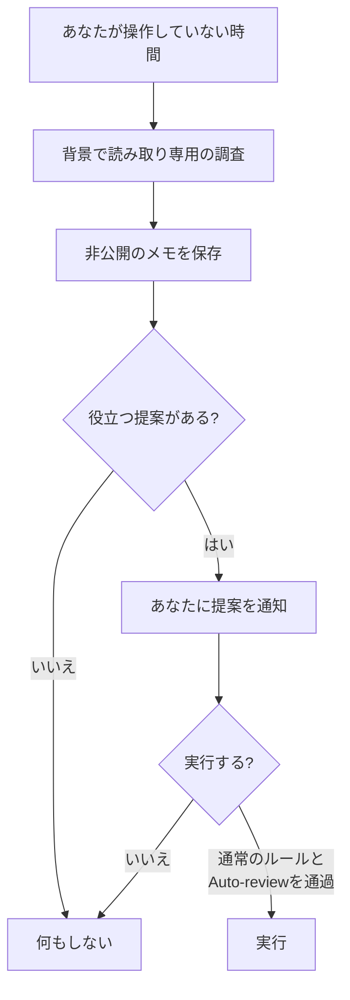

**重要**: 能動的な調査用のツールは**直接メッセージを送信できません**。調査で見つけたことを実行に移す段階では、**通常の行動ルールと安全チェックが適用**されます。これらのチェックはミスを減らしますが、完全になくすものではありません。◎

---

## Step 6: チャンネルと自分の PC をつなぐ

### 6-1. チャンネル(連絡手段)

| チャンネル | 設定方法 | 注意点 | 確度 |
|---|---|---|---|
| ChatGPT(デスクトップ・Web・モバイル)| そのまま | 通話もできる。ローンチ時点では dot からあなたへ**発信はできない** | ◎ |
| Slack | デスクトップで連携を設定 | チャンネルに追加しただけでは監視は始まらない。**何を監視するか指定し、繰り返しタスクを確認**する必要がある | ◎ / ○ |
| Microsoft Teams | 組織の設定が必要。Enterprise 管理ガイドでは招待制のアルファと記載されている | 管理者の許可が必要 | ○ |
| テキストメッセージ | ChatGPT モバイルアプリ、デスクトップアプリ、またはデスクトップ Web の dot プロフィールから電話を接続 | 限定ベータ(米国の一部 Pro のみ)。**iMessage または RCS が必要で、SMS には非対応**。第三者プロバイダー経由なので、**機微な情報の送信には注意**。`STOP` と返信すると dot からの送信が止まる | ◎ |

> **覚えておくこと**: 通話を終えても、**頼んだ作業が止まるとは限りません**。作業を止めたいときは、Pause やタスクの停止を使いましょう。○

### 6-2. あなた自身の PC を使わせる(任意)

- 既定は**オフ**。dot は専用のクラウド PC で動く ◎
- 接続するには、**その PC の ChatGPT デスクトップアプリ**で操作し、「アクセスを許可」を確認する。取り消しは「アクセスを取り消す」◎
- 接続すると、dot はローカルのファイルを扱ったり、ローカルのスキルやブラウザを使えるようになる(クラウドのブラウザがブロックされたときに有効)◎
- 同時に接続できる PC は**1台**。作業中はその PC がオンラインで ChatGPT アプリを開いている必要がある ○

| 使う場面 | 判断 |
|---|---|
| 調査・下書き・スケジュール管理 | 接続**不要**(クラウドPCで足りる)|
| 手元のファイルを直接扱わせたい | 必要になった時点で接続 |
| 機密ファイルが多いPC | 接続を**避ける**か、作業用の別PCを使う |

> **ベストプラクティス**: ローカル接続は「**必要な期間だけオン、終わったら取り消す**」運用が安全です。△

---

## Step 7: 見守る・止める・やり直す

### 7-1. 見守る: Activity View

デスクトップアプリの **Activity View** では、進行中・委任中のタスクと状態を確認でき、**文脈の追加・誤解の訂正・方向転換・停止の指示**ができます。◎ また、dot のプロフィールから**dot の専用 PC を開いて**、作業の様子を直接見ることもできます。◎

### 7-2. 止める: 停止の4つの手段

| 操作 | 効果 | 注意 |
|---|---|---|
| Pause(プロフィールの「…」メニュー)| dot を一時停止し、**Resume するまで**止める | 委任したタスクは Activity、定期タスクの状態と操作は Scheduled で確認する |
| Activity | 個別の委任タスクを開いて確認・停止 | タスクごとに操作 |
| Scheduled | 定期タスクを無効化・削除 | 繰り返しを止めたいときに使う |
| Resume | 一時停止から再開 | |

出典: 公式ドキュメントの内容を二次資料経由で整理 ○

> **重要**: **Pause や Reset(dot の削除)は、完了済みの変更を自動的にロールバックしません**。取り消しや復元ができるかどうかは操作の種類と接続アプリによって異なるため、必要に応じて接続アプリ側の復元手段(送信取り消し、変更履歴、ゴミ箱など)を確認してください。○ だからこそ、事前の Custom Rules が大切です。

### 7-3. やり直す: Reset(dot の削除)

Reset は、dot の**会話・保存済みメモリ・定期タスクを削除**します。◎ 一方で、dot が作成したファイル、Codex のスレッド、ChatGPT の会話は別に保存されており、残ります。○

手順: dot のプロフィール → 「…」メニュー → Reset → 削除内容を確認 → Reset を押す ◎

> **覚えておくこと**: ローンチ時点では、dot が持つ**個別のメモリを見たり編集・削除することはできず**、消す方法は dot の Reset のみでした。◎ 機微な情報は、そもそも教えないのが最善です。

---

# Part 4: 守る

## 8. 安全設計を理解する

OpenAI は、dots の安全を**多層**で作っていると説明しています。◎

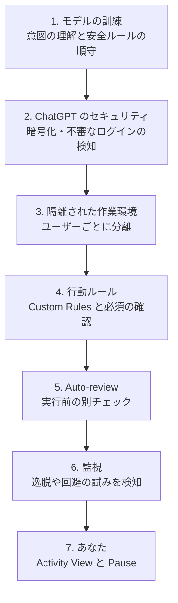

### 8.1 行動ルールの標準的な分類

OpenAI の安全性投稿とヘルプセンターに基づく整理です(二次資料経由 ○)。

| 区分 | 例 | 既定の扱い |
|---|---|---|
| 読む・準備する | 許可された情報の閲覧、分析、会話内の下書き | アプリの権限内で実行 |
| 情報を共有する | メッセージやファイルの送信 | 共有する情報と相手の種類をカバーする承認が必要。健康情報は相手の指名が必須 |
| 購入 | 加盟店サイトに保存済みのカードで購入 | 承認が必要(事前承認も、その購入を具体的にカバーする場合のみ可)|
| 毎回確認(推奨設定)| データの完全削除、出所不明のソフトのインストール、新しいセキュリティ関連アクセスの付与 | 承認が必要になる場合がある(常に求められるとは限らない)。安全のため「毎回確認」にしておくことを推奨 |
| あなたに引き渡す | パスワード変更、金融口座間の送金 | あなたが自分で行う |

さらに、次の2点が明記されています。◎

- 1通のメッセージを承認しても、**以後ずっと連絡してよいという許可にはならない**
- 後で作業を続けても、他の dot に委任しても、**承認の範囲は広がらない**

### 8.2 Auto-review の流れ

対象となる操作(メッセージ送信やファイル変更など)について、実行前に別の安全システムが、あなたの指示・Custom Rules・安全要件に照らして計画をチェックします。◎ たとえばメールなら、宛先と内容を確認し、**宛先の間違いや意図しない情報漏えい**のリスクを減らします(ただし、完全になくすものではありません)。◎

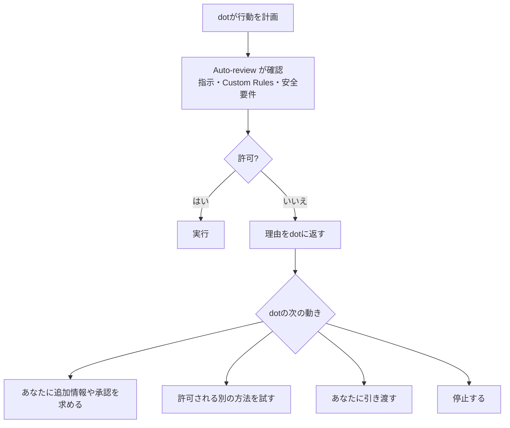

> Auto-review は「権限を与えるもの」ではなく、**別の審査役を挟んで確認する仕組み**です(「reviewer swap, not a permission grant」)。○ **あなたが承認しても、中核の安全要件は上書きできません。**◎

### 8.3 認証情報(パスワード)の扱い

- 対応しているサイトでは、**ログインフォームの入力中はモデルを一時停止**し、認証情報をモデルに見せずにブラウザ環境へ直接送る ○
- 対応した保存済みパスワードの流れでは、暗号化された専用サービスが認証情報を渡し、モデルには渡さない ○
- ただし、**チャット・ドキュメント・プラグインに貼り付けたパスワードは、モデルから見える可能性がある** ○

> **鉄則**: パスワードや認証コードを、dot のチャットに**貼り付けない**。サインインが必要なときは、dot のブラウザ画面で自分が入力する。◎

### 8.4 プロンプトインジェクションへの備え

Web ページ・メール・ドキュメントに埋め込まれた**悪意ある指示**が、dot の行動に化けるリスクがあります。OpenAI はモデルの安全対策、ツールの制限、行動前のチェック、監視を組み合わせて対処すると説明しており、**リスクを減らすが、なくすものではない**と述べています。◎ / ○

あなたにできる対策:

1. **信頼できない相手のメールやファイルを、dot に大量に処理させない**(特に送信権限があるとき)△
2. **外部への送信は「毎回確認」にする**(Step 3)△
3. 不審な動きを見つけたら、すぐ **Pause**(Step 7)

### 8.5 限界を知る(評価結果から)

OpenAI は GPT-6 Astra の System Card に dots の付録を追加し、プロンプトインジェクションや権限の遵守を評価しています。○

| 評価 | 報告された結果(二次資料経由)|
|---|---|
| 大量の攻撃メールを混ぜた評価 | スコア上の攻撃成功なし |
| Auto-review を守るか | OpenAI 公式の Auto-review 記事によると、Codex の社内運用スナップショットではレビュー対象に上がった操作の拒否率は約1%(720件中7件)。検出率(recall)はそれぞれ別の合成評価の値で、プロンプトインジェクションの合成評価で 99.3%、全攻撃カテゴリの合成評価で 90.2%。dots の System Card 評価は、編集なしの実リクエスト 5,000 件と、カテゴリごとに 30 件の合成ケースで行われた。**完全な安全を保証するものではない** |
| 権限や範囲の変化への適応 | 91.8% が合格(49件中45件)|
| 警告を尊重するか(不要な継続)| 15〜17%台で不要な継続が観測された |
| 連続タスクでの境界維持 | 重大な逸脱なし。ただし中間タスクが5→10に倍増すると、中程度の範囲逸脱フラグが8.6%→19.7%に上昇 |

> **読み方**: 結果は良好な項目が多い一方、「長い連続作業ほど境界がにじむ」「警告後も続けることがある」という傾向が報告されています。だからこそ、**長時間の自動実行ほど、Pause と確認を人が握る**ことが大切です。△(数値の定義は System Card の原文を参照してください)

---

## 9. メモリとプライバシー

| 項目 | 内容 | 確度 |
|---|---|---|
| メモリ | dot は ChatGPT のメモリと最近の会話の文脈を受け取り、自分のメモリも作る(接続アプリからも)。dot の会話は ChatGPT のメモリにも寄与しうる | ◎ |
| 保持されないもの | 認証情報、画像、スクリーンショットは文脈に保持されない | ○ |
| 削除 | dot 自身のメモリを消すには dot を Reset する。ChatGPT 側のメモリは通常のメモリ設定で管理 | ◎ |
| 学習への利用(個人プラン)| 「Improve the model for everyone」の設定で、dot の会話や作業が学習に使われるか決まる | ◎ |
| 学習への利用(Business・Enterprise・Edu)| 既定では学習に使わない | ◎ |
| 背景調査のメモ | 直接は学習に使わない。ただし、調査の内容を適格な会話に持ち込むと、設定次第で使われうる | ◎ |
| 人によるレビュー | モデル改善をオフにしていても、安全関連などの限られた場合に人が確認することがある | ◎ |
| カメラ・マイク・画面 | 利用には、まず PC を dot に接続し、そのうえで ChatGPT アプリにデバイスのアクセス許可を与える必要がある | ○ |

### 9.1 プライバシーのベストプラクティス

1. **機微情報は教えない**(診断情報・口座・認証情報)。教えたものは Reset まで残る前提で考える △
2. **学習への利用を避けたいなら**、「Improve the model for everyone」の設定を確認する ◎
3. **接続を解除しただけで安心しない**。取得済みの情報を消すには Reset が必要 ◎
4. **テキストメッセージで機微な情報をやり取りしない**(第三者プロバイダー経由)◎
5. 個人データの請求は、OpenAI の Privacy Portal から行える ◎

---

## 10. 1週間の運用ルーチン

dot は「設定して終わり」ではなく、**観察して権限を少しずつ広げる**ことで育ちます。△

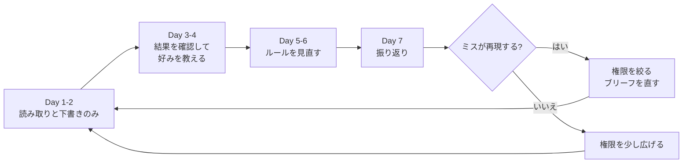

### 10.1 日別の目安

| 日 | やること |
|---|---|
| Day 1 | dot を作成、アプリは1〜2個だけ接続、既定の Custom Rules のまま使う、読み取りの仕事を1つ任せる |
| Day 2 | 下書きの仕事を任せる。**出力は必ず自分で確認**する |
| Day 3〜4 | 良い点・悪い点を具体的に教える(例: 「冗長で一般的すぎる。具体例を残して、冒頭の大げさな表現を削って」)。「ダメ」だけでは学習が進まない |
| Day 5〜6 | 承認プロンプトの傾向を見て、**よく承認する行為だけ**ルールを緩める。逆に、冷や汗をかいた行為は厳しくする |
| Day 7 | 下の週次振り返りを実施 |

### 10.2 週次振り返りプロンプト

```markdown
1週間お疲れさまでした。振り返りをしてください。

1. 今週やった仕事を一覧にしてください
2. 私に修正された点と、そこから学んだことを書いてください
3. 判断に迷って止まった場面はありましたか
4. 来週、権限を広げてよい行為と、絞るべき行為を提案してください

提案だけにして、ルールの変更は私の承認後に行ってください。
```

---

## 11. よくある失敗とトラブルシュート

| 失敗・症状 | 原因 | 対処 |
|---|---|---|
| 毎回、承認を求められて面倒 | ルールが厳しい、または依頼が曖昧 | 頻繁に承認する**低リスク**の行為だけ、少しずつ緩める。事前承認にするには、依頼文で対象の行為を具体的に特定する。将来送るメッセージなら、送り先・内容・送信時刻または送信条件も指定する |
| 勝手に送ってしまわないか不安 | 送信のルール未設定 | 送信は「実行前に確認」に設定。**下書きの依頼は送信の承認ではない** |
| サインイン・認証コード・CAPTCHA で止まる | 本人確認が必要 | dot のブラウザ画面を開いて、自分でサインインを完了すると再開する |
| 権限エラー・メッセージが届かない | 初期のバグや権限設定 | プラグインの権限と、接続状態を確認。重要な業務では、まだ依存しすぎない |
| 長く動いていて止まらない | 委任タスクが残っている | Pause はメインタスクだけを止める。Activity で委任タスクも確認して停止 |
| 実行済みとあるのに成果物がない | 完了表示と成果物の配信は別 | 「完了した」は成果物の到達の証拠ではない。**成果物を自分で確認** ○ |
| ミスが再発する | 好みや基準が伝わっていない | 「ダメ」ではなく、**何がどうダメで、どうしてほしいか**を具体的に伝える |
| Slack で勝手に動かない | 監視の指定がない | 何を監視するか、繰り返しタスクとして明示し、確認する |
| 使用量の消費が気になる | Work・Codex タスクはカウントされる | dot との会話は上限にカウントされないが、起動されたタスクはカウントされる。大きな作業の前に範囲を確認 |
| アプリを外したのに情報が残る | 接続解除は取得済み情報を消さない | 消したい場合は Reset |

---

## 12. ベストプラクティス・チェックリスト

### 作る前

- [ ] 自分のプランと地域が対象か確認した(Pro は EEA・スイス・英国が対象外)
- [ ] 最初の1週間は、重要業務に直結させないと決めた
- [ ] 費用と使用量の最新条件(最初の1か月の扱いなど)を確認した

### 設定

- [ ] 接続するアプリは**必要最小限**にした
- [ ] 各プラグインの権限(読み取りのみか、変更・送信もできるか)を確認した
- [ ] **Custom Rules を決めた**(送信・購入・パスワード・金銭)
- [ ] 外部への送信は「実行前に確認」または「引き渡し」にした
- [ ] 自分の PC への接続はオフのままにした(必要なときだけオン)

### 依頼

- [ ] 「質問」ではなく「仕事」として、ゴール・情報源・成果物・権限・レビュー点を書いた
- [ ] 手順の細かい指示ではなく、完了条件と制約を書いた
- [ ] 「下書きまで」「変更しない」を依頼文に明示した

### 運用

- [ ] パスワードや認証コードを dot のチャットに貼らない
- [ ] 機微な情報は教えない
- [ ] 外部に出る成果物は、必ず自分で確認する
- [ ] Pause・Activity・Scheduled の場所を覚えた
- [ ] 週に1回、振り返りをしてルールを見直す
- [ ] 不審な動きを見たら、すぐ Pause する

---

# Part 5: 深める

## 13. 国際的な開発者・専門家の知見

発表後の公開情報から、**著名な国際的開発者・研究者・メディアの発言**を整理します。ここでは、**事実(何が書かれているか)**と、**本ガイドの解釈(実践への落とし込み)**を分けて書きます。

### 13.1 Simon Willison(Django 共同作者、Datasette・LLM CLI の作者)

**ライブブログ(2026-09-29)**: DevDay の基調講演を現地から実況し、dots の挙動を観察しています。

| 観察された事実 | 本ガイドの解釈 |
|---|---|
| dots は「Muse に非常によく似た」UI。OpenAI の社員は、Slack で dot に直接仕事を委任している | 「チャットで話す相手」ではなく「Slack にいる同僚」のように使う設計思想 |
| ライブデモで、dot が反応しない「遅い朝」の場面があった。作成リンクがモバイルでは動かず、デスクトップを求められた | **初期は不安定な場面がある**前提で、最初の1週間は重要業務に使わない |
| OpenAI の Thibault Sottiaux 氏は、dots は Codex ハーネスの信頼性と長時間タスク対応から生まれたと話した | dots は**コーディングエージェントの延長にある**(長い作業に強い一方、権限設計が重要) |
| 質疑で、「dot は ChatGPT で共有した情報に既定ではすべてアクセスするわけではない」「任せる責任と目標は、自分が納得できる範囲で与えられる」という趣旨の回答があった | **権限は段階的に広げる**のが公式の想定 |
| 同氏は、トークン量より**「ドル当たりの成果(outcome per dollar)」**を重視していると述べた | 使用量ではなく、**成果で評価**する |

**投稿「We're going to need default hard budget caps on pretty much everything」(2026-10-03)**: コーディングエージェントや個人エージェントは、お金のかかるコードやサービスを簡単に立ち上げられる。だから、**「X ドルを超えたら止める」ハードな上限が既定である必要がある**(警告メールだけのソフトな上限では足りない)と主張しています。

- 本ガイドの解釈: dots 自体の使用量は当面プランに含まれるが、**dot に任せて外部の従量課金サービス・API・クラウドを動かす**場合は、**そちら側にハードな予算上限を設定してから**任せるのが安全です。△

### 13.2 Ethan Mollick(Wharton 教授、One Useful Thing)

**記事「The Dot and the Swarm」(2026-10-01)** の要点:

| 事実(記事の趣旨)| 本ガイドの解釈 |
|---|---|
| 「Bitter Lesson」: 人間が手順を細かく設計する必要があると思っていたことが、より強いモデルで解決されてきた。プロンプトも同様で、手順を1つずつ導く価値は新しいモデルでは小さい | ブリーフは**手順ではなく、ゴール・制約・完了条件**で書く(Step 4) |
| 常時稼働の個人エージェントは、「何を伝えなくて済むか」が重要。文脈をメッセージから学び、計画を自分で立てる | 最初の自己紹介・聞き取りで、**文脈を貯めさせる**(Step 4-3)|
| 自身のエージェントが、**自分のミス**(許可申請メールのプロジェクト番号の誤り)を見つけた | dot は「自分のミスを見つけてくれる」利点がある一方、**直す前に確認**させる |
| ただし、エージェントが自己組織化して想定外の方向へ進むリスクも指摘(Hugging Face の事案への言及)| 承認・外部連絡・機微情報・未承認の行為は人が握る |
| 別記事「Agency and Agents」で、エージェントが人に助けを求めるべき場面として、**費用の支出・部外者への連絡・機微情報へのアクセス・未承認の行為**などの承認が必要な場面を挙げている | Step 3 の Custom Rules の根拠と一致 |

**X への投稿(2026-10-15)**: 自分の Dot に**専用のメールアドレス**を持たせたところ「驚くほど簡単」で、次の理由で相性が良かったと述べています。

- 自分のメールで dot に下書き・送信をさせたくない
- 相手に**AI とやりとりしていることが分かる**ようにしたい
- 連絡は、カスタマーサービスや、自分が知らない情報の確認などに限り、個人的な知人には送らせない

- 本ガイドの解釈: **「自分の代理で送る」より「AI として名乗って連絡する」**運用は、誤解や責任の所在の面で安全です。ただし、ローンチ時点のヘルプでは専用メールは未対応と記載されていたので、**現在の対応状況は最新のヘルプで確認**してください。△

### 13.3 Every(Dan Shipper 氏のチーム)の Vibe Check

Every のチームは、発表前から数日間 dots を実際に使い、「Vibe Check」を公開しています。

| 事実(要約)| 本ガイドの解釈 |
|---|---|
| うまく動くときは、ChatGPT の使い方が変わる。dot が ChatGPT のスレッドを束ね、メール・Slack を使う | 「**窓口が1つ**で、裏で他のツールを動かす」使い方が本来の強み |
| テストしたバージョンは**バグが多く、権限の問題やメッセージの取りこぼし、アプリ内ブラウザへの接続失敗**があり、推奨は1〜2週間待ってから、との判断 | **初期の不安定さは前提**。重要業務の依存は、安定を確認してから |

### 13.4 Dan McAteer(早期テスター、開発者)

OpenAI が紹介した早期テスターの事例として、**フリーランスの執筆の請求書**を、dot が背景でメールのスレッドから詳細を拾い、下書きを作り、**承認後に PDF で送信**した例があります。○(The Next Web 経由で AI Wiki が紹介)

- 本ガイドの解釈: 「**下書きまでは自動、送信は承認後**」という流れが、最も公式の想定に近い成功パターンです。

### 13.5 知見の共通点

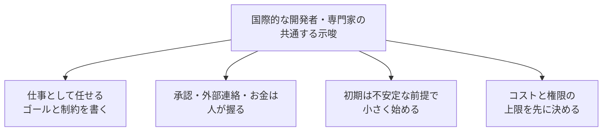

---

## 14. 補足: その他のベストプラクティスと根拠ソース

| # | ベストプラクティス | 根拠(要約)| ソース | 確度 |
|---|---|---|---|---|
| 1 | 孤立したプロンプトではなく、継続してほしい**ジョブ**を渡す | OpenAI のガイダンスが「見ておいてほしいこと」から始めるよう勧めていると報じられている。ヘルプセンターも「目標を渡し、自分でやってよい範囲を決める」と説明 | https://www.forbes.com/sites/ronschmelzer/2026/10/05/what-are-openai-dots-and-do-you-need-them/ <br> https://help.openai.com/articles/20001530 | ◎/○ |
| 2 | **接続の前に** Custom Rules を決める。外部に出るものは「確認」か「引き渡し」 | 公式 FAQ が Custom Rules を境界設定の手段として説明。ルールに従っても間違えることがあると明記 | https://help.openai.com/en/articles/20001529-dots-privacy-security-and-safety-faqs | ◎ |
| 3 | 「下書き」と「送信」を分けて依頼する | OpenAI の説明では、返信の下書きを頼んでも送信の許可にはならない | https://help.openai.com/en/articles/20001529-dots-privacy-security-and-safety-faqs | ◎ |
| 4 | 行為を「やり直せるか」「他人に届くか」の2軸で分類する | 実践者の整理。公式の行動ルールの分類(読む・共有・購入・削除・引き渡し)と整合 | https://gptdot.net/getting-started/ | △ |
| 5 | 最初の1週間は既定のルールで、1つずつ承認して挙動を観察する | 既定では重要な行為の前に確認が入るため、基準の挙動を見てから調整するのが合理的 | https://www.aiagentslibrary.com/blog/how-to-use-openai-dots/ | △ |
| 6 | 自分の PC への接続は必要時のみ | 公式ヘルプ: ローカルアクセスは任意で、既定はオフ。取り消しも可能 | https://help.openai.com/ar/articles/20001530-getting-started-with-your-dot | ◎ |
| 7 | パスワードをチャットに貼らない。サインインは dot のブラウザで本人が行う | 安全性投稿・FAQ: 専用のセキュアサインインの流れはモデルに認証情報を見せない設計。貼り付けた値は見える可能性 | https://openai.com/index/how-we-build-safety-security-and-privacy-into-dots/ | ◎/○ |
| 8 | 機微情報は教えない。消すなら Reset | 個別メモリは編集・削除できず、接続解除では取得済み情報が消えない | https://help.openai.com/articles/20001530 <br> https://help.openai.com/en/articles/20001529-dots-privacy-security-and-safety-faqs | ◎ |
| 9 | 外部の従量課金サービスには**ハードな予算上限**を先に設定 | エージェントは費用の発生するコードやサービスを簡単に立ち上げる。ソフトな警告では不十分 | https://simonwillison.net/2026/Oct/3/default-hard-budget-caps/ | ◎(主張は筆者の意見)|
| 10 | ブリーフは手順ではなく、ゴール・制約・完了条件で書く | 新しいモデルでは手順を細かく導くプロンプトの価値が小さい(Bitter Lesson)| https://www.oneusefulthing.org/p/the-dot-and-the-swarm | ◎(解釈は本ガイド)|
| 11 | エージェントに「いつ人に聞くか」を設計する(費用・外部連絡・機微情報・未承認の行為)| エージェントが人に助けを求めるべき場面の整理 | https://www.oneusefulthing.org/p/agency-and-agents | ◎ |
| 12 | AI として名乗って連絡させる(専用アドレス等)。ただし最新の対応状況を確認 | 個人のメールでの代理送信を避け、相手に AI だと分かるようにする運用例 | https://x.com/emollick/status/2110557530531447165 | ◎(個人の経験談)|
| 13 | 初期は不安定な前提。重要業務の依存は1〜2週間様子を見る | 早期の実機レビューで、権限の問題やメッセージの取りこぼし、ブラウザ接続失敗が報告された | https://every.to/live/openai-devday-2026 <br> https://every.to/vibe-check/vibe-check-dots-always-on-agents-in-chatgpt | ◎(検証は各自で)|
| 14 | 長い連続作業ほど Pause と確認を人が握る | System Card の付録で、連続タスクの増加により範囲逸脱フラグが上昇、警告後の不要な継続も観測 | https://deploymentsafety.openai.com/gpt-6-astra/change-log | ○ |
| 15 | 「完了」表示を成果物の到達の証拠としない | 公式ドキュメントの内容として、完了した実行は、成果物が正しく作成・配信された証拠にはならないとされる | https://learn.chatgpt.com/docs/dots/tasks-and-memory | ○ |
| 16 | 通知は「判断が必要なときだけ」 | 水増しをせず、重要なときだけ個別連絡する運用例 | https://www.aiagentslibrary.com/blog/openai-dots-prompts/ | △ |
| 17 | 組織で使うなら、管理者設定とガバナンスを確認 | Enterprise は管理者が dot・Slack・ローカル PC・Custom Rules を個別に制御。スペシャリスト dot は Microsoft Agent 365 との統合を進行中 | https://learn.chatgpt.com/docs/enterprise/dots-admin-guide <br> https://thenewstack.io/openai-dots-gpt6-agents/ | ○ |
| 18 | 日本語の実利用レビューも参考にする | 日本のメディアが、dots を使った体験レビューを公開している(スマホでの便利さ、指示しなくても必要時に動く点)| https://www.businessinsider.jp/article/2610-openai-dots-ai-agent-review/ | △ |

> 凡例: ◎=一次資料を直接確認 / ○=二次資料経由 / △=実践者の工夫。URL の `learn.chatgpt.com` は、二次資料(AI Wiki)に記載された参照先で、今回は直接取得できていません。最新の内容は各自でご確認ください。

---

## 15. 参考URL一覧

### 15.1 OpenAI 公式(一次資料)

| 資料 | URL |
|---|---|
| Introducing dots(日本語版・ご指定の起点)| https://openai.com/ja-JP/index/introducing-dots/ |
| Introducing dots(英語版)| https://openai.com/index/introducing-dots/ |
| How we build safety, security, and privacy into dots | https://openai.com/index/how-we-build-safety-security-and-privacy-into-dots/ |
| Getting started with your dot(ヘルプセンター)| https://help.openai.com/articles/20001530 |
| Dots privacy, security, and safety FAQs | https://help.openai.com/en/articles/20001529-dots-privacy-security-and-safety-faqs |
| DevDay 2026 Recap | https://openai.com/index/devday-2026-recap/ |
| 発表ポスト(X)| https://x.com/OpenAI/status/2104984504133918973 |
| GPT-6 Astra System Card(変更履歴)| https://deploymentsafety.openai.com/gpt-6-astra/change-log |
| Auto-review of agent actions without synchronous human oversight(OpenAI Alignment)| https://alignment.openai.com/auto-review/ |

### 15.2 国際的な開発者・専門家

| 発信者 | 資料 | URL |
|---|---|---|
| Simon Willison | OpenAI DevDay 2026 live blog | https://simonwillison.net/2026/Sep/29/openai-devday-2026-live-blog/ |
| Simon Willison | We're going to need default hard budget caps on pretty much everything | https://simonwillison.net/2026/Oct/3/default-hard-budget-caps/ |
| Ethan Mollick | The Dot and the Swarm | https://www.oneusefulthing.org/p/the-dot-and-the-swarm |
| Ethan Mollick | Agency and Agents | https://www.oneusefulthing.org/p/agency-and-agents |
| Ethan Mollick | X: Dot に専用メールアドレスを持たせた経験(2026-10-15)| https://x.com/emollick/status/2110557530531447165 |
| Every(Dan Shipper 氏のチーム)| Vibe Check: dots(実機検証)| https://every.to/vibe-check/vibe-check-dots-always-on-agents-in-chatgpt |
| Every | DevDay 2026 ライブ更新 | https://every.to/live/openai-devday-2026 |

### 15.3 報道・解説

| 媒体 | URL |
|---|---|
| The New Stack: OpenAI just launched Dots. Here's why they matter for developers | https://thenewstack.io/openai-dots-gpt6-agents/ |
| TechCrunch: OpenAI launches Dots, its bubbly agentic avatar | https://techcrunch.com/2026/09/29/openai-launches-dots-its-bubbly-agentic-avatar/ |
| VentureBeat: OpenAI launches Dots, always-on AI agent coworkers, and ChatGPT Space | https://venturebeat.com/technology/openai-launches-dots-always-on-ai-agent-coworkers-and-chatgpt-space-where-they-can-collaborate-with-human-teams |
| Al Jazeera: OpenAI launches 'dots' | https://www.aljazeera.com/economy/2026/9/30/openai-launches-dots-personal-ai-assistant-built-to-handle-everything |
| Forbes: What Are OpenAI Dots And Do You Need Them? | https://www.forbes.com/sites/ronschmelzer/2026/10/05/what-are-openai-dots-and-do-you-need-them/ |
| Business Insider Japan(日本語レビュー)| https://www.businessinsider.jp/article/2610-openai-dots-ai-agent-review/ |
| BGR: Everything OpenAI Announced At DevDay 2026 | https://www.bgr.com/2272332/openai-devday-2026-announcements/ |
| AI Wiki: Dots (OpenAI)(一次資料へのリンク集として有用)| https://aiwiki.ai/wiki/openai_dots |

### 15.4 実践ガイド(実践者・コミュニティ。公式の保証ではありません)

| 資料 | URL |
|---|---|
| gptdot.net: How to use ChatGPT Dots in 4 steps | https://gptdot.net/getting-started/ |
| AI Agents Library: How to Use OpenAI Dots | https://www.aiagentslibrary.com/blog/how-to-use-openai-dots/ |
| AI Agents Library: Dots プロンプト集 | https://www.aiagentslibrary.com/blog/openai-dots-prompts/ |
| tosheo.ai: OpenAI dots チュートリアル | https://www.tosheo.ai/ai-tools/openai-dots |

---

## 16. 用語集

| 用語 | 説明 |
|---|---|
| 常時稼働エージェント | 会話が終わっても、背景で仕事を続けられるエージェント |
| GPT-6 Astra | dots を動かす OpenAI のフラッグシップモデル |
| スペシャリスト dot | 組織が独自の ID・資格情報・権限を与えて、特定業務を担当させる dot(試験段階)|
| ChatGPT Space | 社員・ChatGPT・Codex・dots が共有の文脈で共同作業する場(DevDay で発表)|
| Microsoft Agent 365 | Microsoft のエージェント向けの管理・セキュリティ基盤。スペシャリスト dot との統合を進行中 |
| プロンプトインジェクション | Web ページやメールなどに仕込まれた悪意ある指示で、エージェントを誤動作させる攻撃 |
| Pause / Reset | 一時停止 / dot の削除(会話・メモリ・定期タスクを消す)|

---

## 17. 更新時の注意

- dots は**段階的な展開中**で、機能・プラン・地域・料金が頻繁に変わります。**特に次の項目は、使う前に最新情報を確認**してください。
  1. 最初の1か月の使用量の扱い(10月末に切り替わる可能性)
  2. Pro の対象ティア(100 / 200 / 500)
  3. モバイルからの dot の作成
  4. dot 専用メールアドレスの対応状況
  5. Teams・テキストメッセージの提供範囲
- 本ガイドの数値・仕様は **2026年10月24日時点**の公開情報に基づきます。
- 医療・法務・金融など、**重大な判断を伴う業務**では、dot の出力を必ず専門家や自分で確認してください。OpenAI も、重要な成果物は確認するよう案内しています。◎
