# GPT-6 Astra 実践ベストプラクティスガイド(中級〜上級者向け)

> **対象モデル**: OpenAI `gpt-6-astra`(GPT-6 ファミリーの最上位モデル)
> **情報時点**: 2026年11月5日(この日付までに公開された情報を調査して反映)
> **想定読者**: すでに Responses API や Codex を触ったことがあり、本番ワークロードへの採用判断と設計をしたい中級〜上級のエンジニア
> **ゴール**: Astra の「できること」だけでなく、「どう設計し、どう制御し、どこで疑うか」までをステップ形式で身につける

---

## 0. この資料の読み方

### 0.1 情報の信頼度ラベル

本ガイドの記述には、根拠の強さを示すラベルを付けています。

| ラベル | 意味 | 例 |
|---|---|---|
| **公式** | OpenAI の公式ブログ・開発者ドキュメント・モデルページ | developers.openai.com, openai.com |
| **開発者** | 著名な国際的開発者・研究者・専門メディアによる検証や考察 | Simon Willison、Latent Space、Redwood Research の研究者など |
| **報道** | 大手報道機関や二次情報による報告 | TechCrunch、CNBC、Reuters 系の報道 |
| **要検証** | 単発の測定や、出典間で数値が食い違う情報 | 個別ベンチマークの再現値など |

> **重要**: ベンチマーク値は多くがベンダー自己申告で、ハーネス(評価環境)にも依存します。本ガイドの数値は「方向性の把握」に使い、採用可否は**自社タスクでの評価**で決めてください(第11章)。

### 0.2 目次

1. [Astra とは何か](#1-astra-とは何か)
2. [Step 1: モデルを選ぶ(Astra / Sol / Terra / Luna)](#2-step-1-モデルを選ぶ)
3. [Step 2: 最小実装と移行時の必須変更](#3-step-2-最小実装と移行時の必須変更)
4. [Step 3: 推論強度・速度モードを設計する](#4-step-3-推論強度速度モードを設計する)
5. [Step 4: Astra の行動特性とプロンプト設計](#5-step-4-astra-の行動特性とプロンプト設計)
6. [Step 5: スキル・AGENTS.md・タスクプロンプトを作り直す](#6-step-5-スキルagentsmdタスクプロンプトを作り直す)
7. [Step 6: 新 API 機能(非同期ツール・中間操縦・並列化)](#7-step-6-新-api-機能)
8. [Step 7: コンピュータ利用(Computer Use)を安全に運用する](#8-step-7-コンピュータ利用を安全に運用する)
9. [Step 8: コストとレイテンシの最適化](#9-step-8-コストとレイテンシの最適化)
10. [Step 9: 安全性・ガバナンス・監視](#10-step-9-安全性ガバナンス監視)
11. [Step 10: 評価・移行・運用ループ](#11-step-10-評価移行運用ループ)
12. [著名開発者の知見(補足ベストプラクティス)](#12-著名開発者の知見補足ベストプラクティス)
13. [アンチパターン集](#13-アンチパターン集)
14. [チェックリスト](#14-チェックリスト)
15. [参考 URL(根拠ソース)](#15-参考-url根拠ソース)

---

## 1. Astra とは何か

### 1.1 一言でいうと

**Astra は「答える」より「やり遂げる」ことに振り切った、GPT-6 世代の最上位モデル**です。**公式**

OpenAI は Astra を、コンピュータ利用・ブラウジング・ソフトウェアエンジニアリング・サイバーセキュリティ・科学・専門業務で最先端と位置づけています。**公式** 公式ドキュメントでは、複数の評価で出力トークンを大幅に減らしながら高い成績を出し、トークン単価は高くてもタスク単位の推定コストは旧モデルより低かったと説明されています。**公式**

### 1.2 主な仕様

| 項目 | 内容 | 根拠 |
|---|---|---|
| モデル ID | `gpt-6-astra` | **公式** モデルページ |
| コンテキスト長 | 1,050,000 トークン | **公式** |
| 最大出力 | 128,000 トークン | **公式** |
| 知識カットオフ | 2026年4月30日 | **公式** |
| 入力 / 出力 | テキスト・画像入力 / テキスト出力(音声・動画は非対応) | **公式** |
| 料金(100万トークンあたり) | 入力 $10、キャッシュ読み取り $1、キャッシュ書き込み $12.50(最低30分保持。最低12時間保持は $25)、出力 $50 | **公式** |
| 割増 | 入力が 272K トークン超のリクエストは、全体が入力・キャッシュ 2倍、出力 1.5倍 | **公式** |
| 割引・割増 | Batch / Flex は標準の 50%、Fast モードは 2倍 | **公式** |
| 推論強度 | `low` / `medium`(既定)/ `high` / `xhigh` / `max`(`none`・`minimal` は非対応) | **公式** |
| ツール | Web 検索、ファイル検索、コード実行、ホスト型シェル、Apply Patch、スキル、コンピュータ利用、MCP、ツール検索、画像生成 | **公式** |
| 非対応 | ファインチューニング | **公式** |
| 提供経路 | OpenAI API、ChatGPT(Work 含む)、Codex、AWS など(非同期ツール呼び出し、`configuration_update`、中間操縦は Amazon Bedrock では利用不可) | **公式** **報道** |

### 1.3 Astra が「変えたこと」

公式が強調する変更点を、開発者目線で整理します。

| 変化 | 開発者への意味 |
|---|---|
| **コンピュータ利用の大幅強化** | API のないアプリでも画面操作で業務を自動化できる範囲が広がる。**公式** |
| **トークン効率とリトライ削減** | 「単価が高い=総額が高い」とは限らない。ただし単発測定では逆の結果も出ている(第9章)。**公式** **要検証** |
| **アラインメント(意図・権限の遵守)** | 許可範囲を守る傾向が強く、その分、確認で止まりやすい。**公式** |
| **長時間タスクでの一貫性** | GPT-5.6 Sol より長い作業でも文脈を保ちやすい。**公式** |
| **新 API 機能** | 非同期ツール呼び出し、中間操縦、キャッシュを保つ推論強度変更、ミスアラインメント監視。**公式** |
| **サイバー能力が「Critical」** | OpenAI の Preparedness Framework で、初めて Critical に到達したと発表。アクセスと安全策が厳格化。**公式** |

### 1.4 Astra を巡る時系列

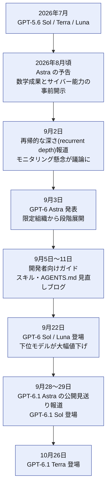

> **注意**: 2026年11月5日時点で現行の最上位は **GPT-6 Astra** です。**GPT-6.1 Astra は公開見送り**と報じられており、現行モデルではありません。**報道** 名前の似た「GPT-6.1 Sol」「GPT-6.1 Terra」とは別物です。

---

## 2. Step 1: モデルを選ぶ

### 2.1 GPT-6 ファミリーの位置づけ

**公式**の説明を軸に、料金は公式モデルページと開発者の整理を併記します。

| モデル | 位置づけ | 推論強度 `none` | 料金の目安(入力 / 出力、100万トークン) |
|---|---|---|---|
| **GPT-6 Astra** | 最難関の推論・コーディング・専門業務向けの最上位 | 非対応 | $10 / $50 |
| **GPT-6.1 Sol** | Astra に近い性能を低コストで | 非対応 | 公式モデルページで確認 |
| **GPT-6.1 Terra** | 視覚推論、精密な画面操作、自然な文章向けの高速・高効率 | 対応 | 公式モデルページで確認 |
| **GPT-6 Sol** | GPT-6 世代の中位モデル(9月22日に登場) | 対応 | 約 $2 / $10(Simon Willison の整理) |
| **GPT-6 Luna** | 最速・最安、高頻度の限定タスク向け | 対応 | 約 $0.10 / $0.50(同上) |

> GPT-6 Sol / Luna の料金は、2026年9月22日時点の Simon Willison の比較表に基づきます。**開発者** GPT-6.1 系は公式モデルページで最新値を確認してください。

### 2.2 選択フロー

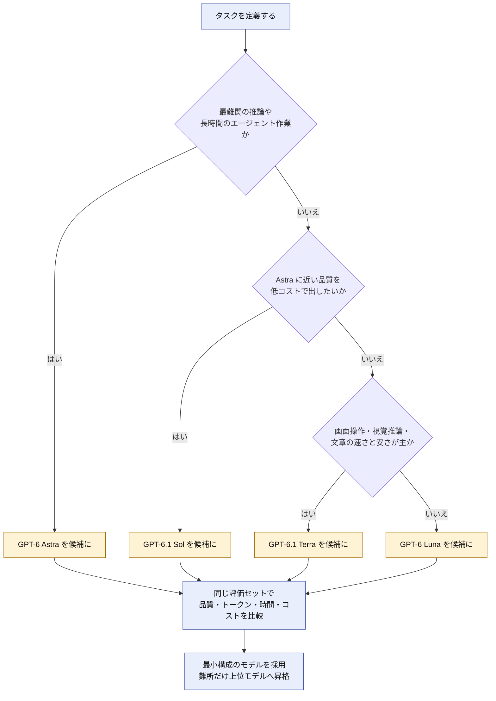

> **GPT-6 Sol をフローに含めない理由**: 公式モデルページが、新しい Sol モデルとして GPT-6.1 Sol を案内しているためです。**公式** 新規採用では GPT-6.1 Sol を候補にしてください。すでに GPT-6 Sol で運用している場合は、同じ評価セットで GPT-6.1 Sol と比較してから移行を判断します。

### 2.3 選ぶときの原則

1. **Astra を既定にしない**。公式は、Sol と比較して「品質とコストのトレードオフを自分のタスクで測る」ことを勧めています。**公式**
2. **Astra を使うべき場面**は、(a) 失敗コストが高い、(b) 手戻りが多い長時間エージェント、(c) API のない画面を操作する、(d) 科学・数学・セキュリティ調査など最難関の推論、のいずれかです。
3. **階層化する**。計画・難所は Astra、定型処理は Sol / Terra / Luna、というサブエージェント分担が現実的です(第7章)。

---

## 3. Step 2: 最小実装と移行時の必須変更

### 3.1 最小コード(Responses API)

Astra で**ツールを使う場合は Responses API が前提**です。Chat Completions はツールなしのリクエストのみ対応します。**公式**

```python
from openai import OpenAI

client = OpenAI()

resp = client.responses.create(
    model="gpt-6-astra",
    reasoning={"effort": "medium"},  # 既定。none / minimal は使えない
    input=[
        {
            "role": "user",
            "content": "Web アプリケーションのログ出力を構造化ログに移行する計画を、"
                       "段階ごとの作業と確認項目に分けて立ててください。",
        }
    ],
)

print(resp.output_text)
```

### 3.2 GPT-5.6 / 旧モデルからの移行チェック

**公式**の移行ガイドを、作業しやすい表にまとめます。

| 項目 | 変更内容 |
|---|---|
| `model` | `gpt-6-astra` に変更 |
| 推論強度 | 現在の実効値を維持。`none` は不可なので **`low` に置換**。`minimal` を使っていた場合も **`low` から**開始して比較 |
| ツール呼び出し | **Responses API に移行**。Chat Completions はツールなしのみ |
| サンプリング系 | 推論強度が `none` 以外のとき、`temperature`、`top_p`、`top_logprobs` は**削除**。Chat Completions では `logprobs` も削除し、Responses API では `include` から `message.output_text.logprobs` を削除 |
| キャッシュ設定 | GPT-5.5 以前から移行する場合、`prompt_cache_retention` を `prompt_cache_options.ttl`(例: `"30m"`)へ置換。キャッシュ書き込みの課金(標準入力の、`"30m"` は 1.25 倍、`"12h"` は 2.5 倍)を確認 |
| 推論強度の途中変更 | 後述の `configuration_update` を使う(リクエスト単位の `reasoning.effort` は固定したままキャッシュを保つ) |
| データ所在地 | Astra の Fast モードは EU データレジデンシー非対応。Ultrafast は US と グローバル処理のみ |
| 不要な承認停止 | 「勝手に確認で止まる」場合は第5章の自律性プロンプトで調整 |

> **Tips**: Codex 利用者は、公式のドキュメントスキルを使って「このプロジェクトを GPT-6 ファミリーへ移行して」と依頼する方法も案内されています。**公式** ただし生成された差分は必ず自分でレビューしてください。

### 3.3 移行フロー

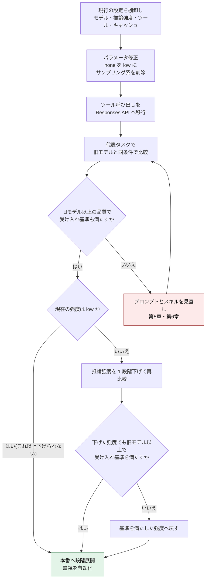

---

## 4. Step 3: 推論強度・速度モードを設計する

### 4.1 推論強度(`reasoning.effort`)の使い分け

Astra は `low` から `max` までの 5 段階です。**公式** Astra 固有の最適値は公式に明記されていないため、**GPT-5.6 ガイドの考え方を出発点にして自社評価で決める**のが安全です。**公式**

| 強度 | 使いどころ | 注意 |
|---|---|---|
| `low` | レイテンシ重視、定型・短い作業、`none` からの置き換え | 難所で品質が落ちないか評価 |
| `medium`(既定) | まずのベースライン | 迷ったらここから |
| `high` | 測定で品質向上が確認できるとき | 時間とトークンが増える |
| `xhigh` | 難問、多段の検証が必要な作業 | 費用対効果を必ず測る |
| `max` | 最も難しい品質優先の作業のみ | Simon Willison は Astra の `max` で、27分かけて道路データから走行ルートを生成させている。**開発者** 長時間化を前提に設計する |

### 4.2 強度を決めるフロー

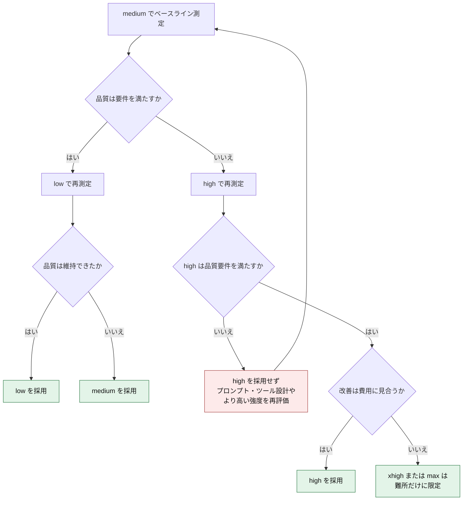

### 4.3 会話の途中で強度を変える(`configuration_update`)

**難しいターンだけ強度を上げ、簡単な追い込みでは下げる**ための仕組みです。リクエスト単位の `reasoning.effort` を固定したまま、`configuration_update` 入力アイテムでキャッシュを壊さずに強度を切り替えられます。**公式**

押さえるべき制約は次のとおりです。**公式** **開発者**

- 標準の**単一エージェントモード**でのみ利用でき、プロモード(`reasoning.mode: "pro"`)では拒否される
- 変更できるのは**推論強度(`reasoning.effort`)と出力形式(`text.format`)**で、同じ `configuration_update` で両方を指定できる
- `configuration_update` を履歴内で連続して置くと拒否される
- 自動コンパクション(自動圧縮)、自動トランケーション(自動切り詰め)、独立の `/responses/compact` エンドポイントとは併用できない。明示的に `compaction_trigger` で圧縮した後は、次のユーザーメッセージの前に新しい `configuration_update` を入れ、圧縮前に変更した設定(`reasoning.effort`、`text.format`)を**すべて再指定**する。一部だけ再指定すると、たとえば `text.format` が抜けて、期待した出力形式にならないことがある
- レスポンスの `reasoning.effort` は、更新後の値ではなく**リクエスト単位の設定**を報告し続ける

> **Tips**: ログ・課金分析では、実際に効いている強度とレスポンスの表示が一致しない点に注意してください。ターンごとの強度を自前のメタデータにも記録しておくと原因調査が楽になります。

### 4.4 Fast / Ultrafast / プロモード

| 機能 | 内容 | 注意点 |
|---|---|---|
| **Fast モード** | 最速の API 速度。標準の **2倍**の料金 | Astra では**遅延 SLA なし**、**EU データレジデンシー非対応**。**公式** |
| **Ultrafast モード** | さらに高速な新モード | Astra は **US レジデンシーとグローバル処理のみ**。EU・その他の地域エンドポイントは非対応。**公式** |
| **プロモード** | より多くのモデル作業を行い、1 つの最終回答を返す | レイテンシとトークンが増える。品質向上が評価で確認できる難問に限定。`configuration_update` とは併用不可 |

> **判断軸**: 「ユーザーが待つ」場面は Fast / Ultrafast を検討し、「裏で走る」バッチ的な作業は Batch / Flex(標準の 50%)を検討します(第9章)。

---

## 5. Step 4: Astra の行動特性とプロンプト設計

### 5.1 Astra の 5 つの行動特性

公式ガイドは、Astra の挙動を次の 5 つに整理し、それぞれをプロンプトで調整するよう勧めています。**公式**

| 特性 | Astra の傾向 | 開発者の対処 |
|---|---|---|
| **主導性と完遂** | 結果が大きく変わりうる場面では確認を求めやすく、期待より早く止まることがある | 自律性の方針を明示する |
| **指示追従** | 長い指示をよく守る一方、スキルや `AGENTS.md` の内容に敏感 | 読み込まれる指示ファイルを監査する |
| **文体と書式** | 箇条書き・表・Markdown で見やすく整える傾向。同じ言い回しを繰り返すことがある | 文体と構造を明示する |
| **サブエージェント委任** | 期待より委任が少ないことがある | 委任の条件と量を指定する |
| **テストと検証** | コーディングで丁寧にテストする。小さな変更では過剰になりうる | 検証の深さを調整する |

### 5.2 症状から対処を引く

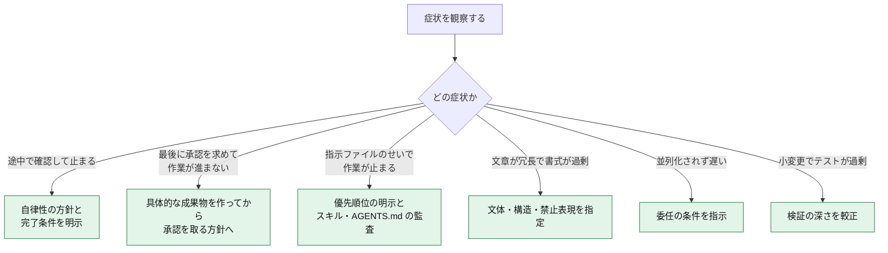

### 5.3 プロンプトのテンプレート(出発点)

以下は公式ガイドの趣旨を、日本語で再構成した**出発点**です。そのまま使わず、自社のタスクで評価してから採用してください。**公式**

#### (1) 主導性と完遂: 止まりすぎるとき

```markdown
## 自律性の方針
- ユーザーの意図とタスク範囲は、指示と会話の文脈から推測すること。確認より実行を優先し、依頼された作業を完了まで運ぶ。
- 「〜できますか」「〜したい」「手伝って」は、作業の依頼として扱う。可否の返答、計画の提示、続行の申し出だけで止まらない。
- 破壊的または不可逆でない限り、読み取り専用の調査、作業用ブランチの作成などは、許可を待たずに進める。
- ドラフト PR の作成は外部への書き込みなので、人の承認を得てから行う。
- 部分的な解決や「とりあえず動く」段階で終わらせない。依頼の成果が満たされるまで続ける。
```

> **注意**: 公式のプロンプト例は、ドラフト PR の作成を自律的に進めてよい作業に含めています。本ガイドでは 10.6 のガバナンス項目(外部書き込みは人の承認を必須にする)に合わせて、承認の対象に変更しています。

#### (2) 承認の取り方: 承認が最後の一手になるように

```markdown
## 承認の取り方
- ユーザーに質問や承認を求める前に、承認対象を具体的で確認可能な成果物にする。
- デプロイ、外部アプリへの書き込み、マージ、公開の前に必要な作業をすべて終え、ユーザーの承認が最後の一手になるようにする。
- 可逆な作業、読み取り専用の操作、レビューや修正、すでに許可されている作業では承認を求めない。ただし、外部への書き込みは可逆でも人の承認を必須とする。すでに人の承認を得ている操作は、改めて承認を求めない。
- 仮説的なリスクに基づく警告、免責、承認フロー、チェックリストを新たに足さない。
```

#### (3) 指示の優先順位: スキルとの衝突を防ぐ

```markdown
## 指示の優先順位
- ユーザーの明示的な指示は、スキルのガイドラインより優先する。両者が衝突する場合はユーザーの指示に従う。
- スキルが原因で、確認を求める・一時停止する・作業を残す・意図から外れる場合は、読んだ SKILL.md を示し、該当する指示を引用し、どう作用したかを短く説明する。スキルの明示的な要件と、自分の解釈を区別して述べる。
```

> **Tips**: 後半の「止まった理由を説明させる」指示は、読み込まれる指示ファイルが多い環境で、**黙って効いている矛盾した指示を見つける**のに有効です。**公式**

#### (4) 文体と書式: Markdown を減らしたいとき

```markdown
## 文体
- 1 段落 1 主張の簡潔な文章を基本とする。箇条書きは、並列・順序・比較のために本当に必要なときだけ使う。入れ子の箇条書きは避ける。
- 平易な言葉、具体例、的確な動詞を使い、能動態で直接的に書く。
- 要点を先に述べ、そのあとに読み手に必要な説明を足す。
- 専門用語は、考えを伝えるのに役立つ範囲に限る。読み手の前提知識に合わせて書き方を調整する。
- 決まり文句、結論の要約フレーズ、「X ではなく Y」型の対比、造語ラベルは使わない。
```

#### (4b) 作業報告の読みやすさ

```markdown
## 他のエージェントや人間への報告
- 他のエージェントへ送るメッセージと最終回答は、人間が読む可能性がある。単語や数字の間に適切な区切りを入れ、読める文章にする。
```

#### (5) サブエージェント委任

```markdown
## 並列化
- 作業を並列化でき、時間短縮または品質向上が見込めるなら、ルート・サブを問わず、協調ツールを使って他のエージェントへ委任する。
- 委任は、独立していて成果物が明確な作業に限る。依存関係のある作業は順に進める。
```

#### (6) テストと検証の較正

```markdown
## 検証
- 可逆で影響の小さい変更について、実装をなぞるだけのテストは書かない。検証のためにテストを書くなら、意味があり必要なものに限る。
- 変更に見合うテストを実行し、必要な検査を完了する。それらが通ったら、新しい変更・失敗・未解決の懸念がある場合にだけ、テストを広げる、または繰り返す。
```

### 5.4 プロンプト設計の原則

1. **足すより削る**。指示は 1 か所に 1 回だけ書く。重複した「まず確認して」「勝手に実行しないで」は、安全な作業でも止まる原因になる。**公式**
2. **成果物と完了条件で書く**。手順の指定より、「何ができれば完了か」を定義する。
3. **自律の範囲を表で定義する**。読み取り・ローカル編集・非破壊の検証は自由、外部書き込み・破壊・購入・範囲拡大は確認、という線を 1 か所に集約する。**公式**
4. **短い回答に必要な中身を指定する**。結論、根拠、重要な注意、次の行動を残し、導入や繰り返しから削るよう書く。**公式**
5. **変更は 1 度に 1 グループ**。指示を削る・足すときは 1 群ずつ変えて、同じ評価セットを再実行する。**公式**

---

## 6. Step 5: スキル・AGENTS.md・タスクプロンプトを作り直す

OpenAI の Codex チームの Eric Provencher が、2026年9月11日に公式開発者ブログで公開した指針です。**公式** 「Astra で困ったら、たいてい古いスキルが原因」という実務者の反応も出ています。**開発者**

### 6.1 なぜ見直すのか

- 過去の弱いモデル向けに積み上げた指示が、より判断力の高い Astra では**ノイズや足かせ**になる
- Astra は指示ファイルの内容に敏感で、**矛盾や過剰な強調**で作業を止めることがある
- テストの実行や確認は Astra が自分で行うため、「必ずテストを回して」といった古い指示は不要なテストを招く

### 6.2 見直しの 4 領域

| 領域 | 問題 | 直し方 |
|---|---|---|
| **スキルの説明文** | 長すぎる、互いに矛盾する、「いつ使うか」を言い過ぎる。数が多いと説明が短縮されて選択精度が落ちる | 説明は**できるだけ短く**、適用条件を具体的に書く |
| **スキルの構造** | 本文が巨大で、読むたびに文脈を消費する | ルート文書を**最小のルーター**にして、詳細は別ファイルやスクリプトへ(段階的開示) |
| **AGENTS.md** | 編集のたびに全ドキュメントを読ませるなど、常時の義務が多い | 「必要なときに必要な文書を読む」形に |
| **境界(権限)の記述** | 旧モデル向けの強い禁止が、Astra では過剰に守られて止まる | 本当に必要な境界だけ残し、安全が確認できた作業は許可を明記 |
| **持続性** | 初回実装で「確認のため」止まる | 「起動・確認・失敗の修正まで」を依頼に含め、完了条件を先に定義 |

### 6.3 書き換えの例

#### スキルの説明文

| | 悪い例 | 良い例 |
|---|---|---|
| 内容 | ログ、監視、障害に関する作業で使う | アラート発報時の一次切り分け手順を実行するときに使う |
| 問題点 | ログや監視に触れるたびに発火し、無関係な場面で読み込まれる | 適用場面が絞られ、必要なときだけ読まれる |

#### AGENTS.md の読み込み指示

| | 悪い例 | 良い例 |
|---|---|---|
| 内容 | 編集の前に、設計・DB・デプロイの文書を必ずすべて読む | サービス境界は設計文書、スキーマ変更は DB 文書、デプロイ準備はデプロイ文書を使う |
| 問題点 | 誤字修正でも文脈を浪費し、遅くなる | タスクに必要な文書だけ読む |

#### 安全な作業に許可を与える

```markdown
## ローカルテストについて
ローカルテストは使い捨てのフィクスチャを使い、本番へのアクセスはない。
実行し、依頼された変更が原因の失敗は修正し、影響を受けるテストを再実行する。
各ステップで承認を求めない。
```

### 6.4 監査をモデルにやらせる

公式は、**棚卸し自体を Astra に任せる**ことを勧めています。**公式**

```markdown
このリポジトリの AGENTS.md と、読み込まれるスキルをすべて監査してください。
次の観点で、削除・短縮・分割の案を出し、根拠となる箇所を示してください。

1. 説明文が長い、または互いに矛盾しているスキル
2. 常時の義務になっていて、タスクによっては不要な読み込み指示
3. 旧モデル向けの強い禁止や確認の要求で、今は過剰なもの
4. 本文が大きく、ルーターと詳細に分けられるスキル

変更はまず提案として出し、私が承認したあとで適用してください。
```

### 6.5 見直しのループ

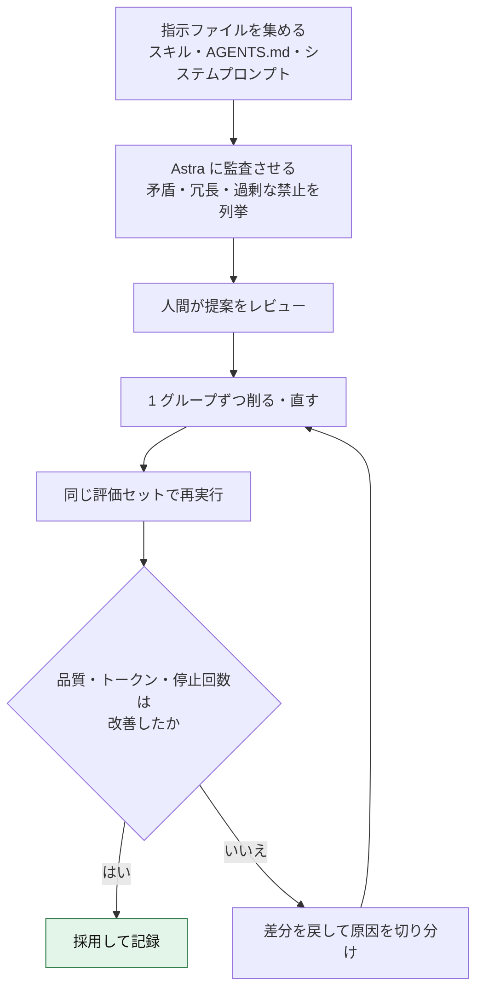

> **共有リポジトリの注意**: リポジトリ内のスキルは、他の人のエージェント(別のモデル)も読みます。Sol や Luna に効く指示が Astra には過剰になることがあるため、**どのモデルが読むか**を考えて残す指示を決めてください。**公式**

---

## 7. Step 6: 新 API 機能

### 7.1 機能の全体像

| 機能 | 何ができるか | 使う場面 |
|---|---|---|
| **非同期ツール呼び出し** | ツールの実行中も、モデルが推論を続け、独立した部分に回答する。OpenAI API の Responses API で利用でき、**Amazon Bedrock では利用不可** | 数十秒かかる検索・ビルド・外部 API |
| **中間操縦(Mid-turn steering)** | 作業の途中で修正や要件変更を送る。OpenAI API の WebSocket モードで利用でき、**Amazon Bedrock では利用不可** | 長時間エージェント、ユーザーの割り込み |
| **`configuration_update`** | キャッシュを壊さず推論強度を変更。OpenAI API の Responses API で利用でき、**Amazon Bedrock では利用不可** | 難所だけ強度を上げる |
| **ミスアラインメント監視** | 非同期の監視で、必要時にアラートを出す | 本番のエージェント運用 |
| **プログラマティック・ツール呼び出し(PTC)** | モデルが書いた JavaScript で複数ツールを呼び、中間結果を絞る | 絞り込み・集計・突合などの定型処理 |
| **マルチエージェント** | 1 つのインスタンスが複数のサブエージェントを調整 | 独立した作業に分割できる大型タスク |
| **コンパクション・推論の持ち越し** | 長い会話で文脈を圧縮、推論アイテムを再利用 | 長時間・複数ターンの作業 |

### 7.2 非同期ツール呼び出し

通常のツール呼び出しは、アプリが結果を返すまでモデルのターンが止まります。**`async: true`** を付けると、モデルは待たずに他の推論・他のツール呼び出し・独立部分への回答を進められます。**公式**

```python
tools = [
    {
        "type": "function",
        "name": "run_slow_report",
        "description": "売上レポートを生成する。完了まで数十秒かかる。",
        "parameters": {
            "type": "object",
            "properties": {"month": {"type": "string"}},
            "required": ["month"],
        },
        "async": True,  # 結果は後から、元の call_id で返す
    }
]
```

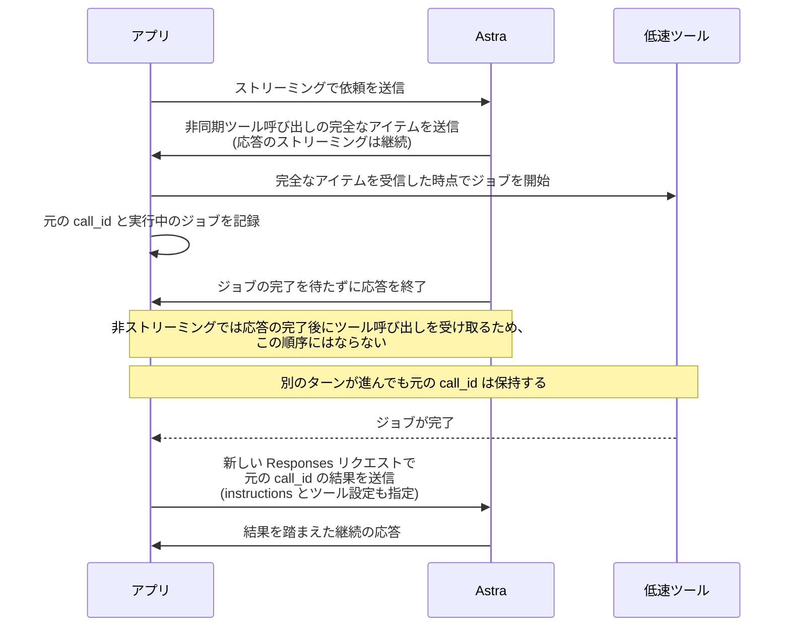

押さえるポイントは次のとおりです。**公式** **開発者**

- アプリが**実行する関数・カスタムツール**が対象。ホスト型の組み込みツールや PTC には使わない
- 元の応答は、ジョブの完了を待たずに終わることがある。アプリが実行中のジョブを管理し、完了したら新しい Responses リクエストで結果を送る。`previous_response_id` には最新の応答 ID を指定し、元の `instructions` とツール設定もリクエストに含める
- ZDR または `store: false` では応答がサーバーに保存されないため、`previous_response_id` だけでは継続できない。ジョブが完了したら、新しい Responses リクエストの `input` に会話履歴全体を入れて送る。`store` はリクエスト単位の設定なので、履歴全体を再送する継続リクエストを含め、新しい Responses リクエストごとに `store: false` を指定する。履歴には過去の入力、暗号化された推論アイテムと元の `function_call` を含むすべての出力アイテム、元の `call_id` の `function_call_output` を含め、`instructions` とツール設定も指定する。`previous_response_id` は省略する。WebSocket モードでは応答が接続ローカルのキャッシュに残る間だけ参照できるが、切断や 60 分の接続上限で失われる(`previous_response_not_found`)ので、長時間のジョブはこの再送を前提に設計する
- 結果は**元の `call_id`** で返す。待機専用の関数を使う場合、結果は待機呼び出し側ではなく元の呼び出しへ返し、待機呼び出しには状態だけを返す
- 複数の非同期呼び出しを発行し、**必要になった結果だけ待つ**「待機ツール」パターンは、開発者が自分で定義する関数として実装する(公式ガイドに手順あり)
- マルチエージェントモードでは、非同期ツールと並列ツール呼び出しを併用しない

### 7.3 中間操縦(Mid-turn steering)

作業中のモデルに、修正や追加要件を送れます。**GPT-6 ファミリーの対応モデルで、WebSocket モードのみ**利用でき、GPT-5.6 以前は対応しません。**公式** **開発者**

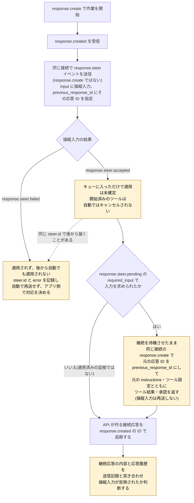

> **実装上の注意**: `response.steer.accepted` はキューに入ったことを示すだけで、モデルが反映したことは意味しません。`response.steer.pending` が届かないことも、適用の証拠にはなりません。適用の成否は、継続応答と応答履歴で判断します。`response.steer.failed` は同じ `steer.id` で届き、その入力は後から自動で適用されません。自動の継続応答は元のリクエストの設定を引き継ぎますが、明示的な `response.create` はそのリクエスト自身の `instructions` やツール設定を使うため、元の値を指定します。**公式** 失敗した入力は適用済みとして扱わず、自動でも再送しないでください(再送するかはアプリ側で判断します。この点は本ガイドの推奨です)。
>
> キューにある操縦入力は**現在の接続にだけ存在**します。接続が切れた後も残ると仮定せず、送った入力を自分で記録して応答履歴と照合してください。**開発者**
>
> 操縦入力は、すでに開始したツールをキャンセルしません。**公式** アプリ側で実行中のツールの外部操作は、操縦後も完了する可能性があります。止める必要があるなら、アプリ側に取り消し処理を実装し、取り消せない操作は実行前に承認を挟んでください(この2点は本ガイドの推奨です)。

### 7.4 PTC を使う場面、使わない場面

PTC は GPT-5.6 で導入され、Astra でも使えます。**公式** 「定型的な処理を、コードにまとめて小さな構造化結果に絞る」場合に向きます。

| 向く | 向かない |
|---|---|
| 絞り込み、結合、順位付け、重複排除、集計、検証 | 呼び出し 1 回で足りる |
| 中間出力が大きく、最終結果が小さい | 中間出力がすでに小さい |
| 途中で判断を変える必要がない | 各結果が次の判断を変える |
| — | 承認が必要な操作、引用やネイティブな成果物を保つ必要がある |

最終回答(`message`)と `program_output` は**別の出力**です。プログラムが正しい結果を返しても、最終回答が必須項目や注意書きを落とすことがあるため、両方を評価してください。**公式**

### 7.5 長時間作業の運用: コンパクションと透明性

Simon Willison は、Astra(`max`)に 27 分かけてルートを生成させた後、使われたコードを再度尋ねたところ、スレッドが圧縮されていたため取得できなかったと報告しています。**開発者** 教訓は次のとおりです。

- **圧縮前の原文を保存し、エージェントのツールから参照できる**ようにする
- 実行したコードやコマンドの**ログを自前で残す**(UI に出ない前提で設計する)
- 重要な成果物は、生成した**手順と入力**とセットで保管する

### 7.6 マルチエージェントの設計

Latent Space は、Astra で 20B トークン超を使った検証で、**1 つのメインエージェントが 20〜50 のエージェントを並列に管理**した運用を報告しています。**開発者** 一方で、強度を最大にして並列化すると費用が一気に膨らむとも述べています。**開発者**

設計の勘所は次のとおりです。

1. **並列度に上限を設ける**(境界付きの並行性)。作業ごとに強度や指示を個別に調整する
2. **メインが進捗を監視し、波(ウェーブ)単位で開始・停止**する
3. **予算の見積もりと上限**を最初に決め、予算超過で止める
4. **サブエージェントには安いモデル**を割り当て、判断が必要な部分だけ Astra に戻す
5. 委任の頻度が足りない場合は、第5章の委任プロンプトで調整する

---

## 8. Step 7: コンピュータ利用を安全に運用する

### 8.1 Astra のコンピュータ利用の位置づけ

OpenAI は、ChatGPT Work と Codex で、Astra が**API のないアプリも含め、人が使う画面を操作して仕事を進められる**と説明しています。**公式** API の `computer` ツール(Responses API)でも利用できます。**公式** ベンチマークの一例として、OSWorld 2.0 で 72.6% という数値が複数の報道・解説で引用されています(ベンダー申告、**要検証**)。

### 8.2 安全運用のループ

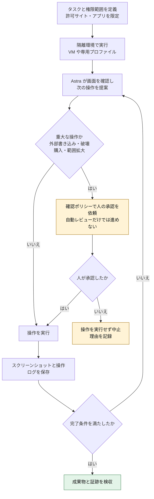

### 8.3 ベストプラクティス

1. **最小権限**: 操作できるサイトとデスクトップアプリを許可リストで限定する。企業向けには、許可サイト・アプリの制限、アップロード・ダウンロードの管理、閲覧履歴の制御などの管理者機能が用意されている。**公式**
2. **確認ポリシー**: 結果が重大な操作(外部への送信、削除、購入、公開など)は人の承認を必須にする。ChatGPT Work と Codex には、確認ポリシーと、安全でない・未承認のツール呼び出しの自動レビューが含まれる。**公式** 自動レビューは補助として使い、人の承認に代えない。
3. **段階的な展開**: 制限の強い構成から始め、実績に応じて権限を広げる。**公式** 対象の ChatGPT Enterprise / Edu ワークスペースでは、**Astra は提供開始時にデフォルトで無効**で、アクセスは別途設定する形だった。**公式** 現在の利用可否はワークスペース設定と RBAC(ロールベースのアクセス制御)によって変わるため、自社の現在の設定を確認する。
4. **隔離**: 本番の認証情報や個人データが画面に映らない環境で動かす。画面上の情報はすべてモデルに見えると考える
5. **証跡**: スクリーンショットと操作ログを自前で保存する(第7.5節の透明性の教訓)
6. **安全評価の位置づけ**: OpenAI は内部のコンピュータ利用安全ベンチマークで、Astra は意図しない結果が GPT-5.6 Sol より 89% 少なかったと報告している。**公式** ただし**ベンダー自己評価**であり、自社の業務シナリオでの検証が必要。

> **注意**: 画面上の文章(Web ページ、メール、ドキュメント)に埋め込まれた指示は、**ユーザーの指示ではなくデータ**です。プロンプトインジェクションへの耐性は、権限の最小化と確認ポリシーで担保してください。

---

## 9. Step 8: コストとレイテンシの最適化

### 9.1 「単価が高い=総額が高い」ではない、が鵜呑みにしない

OpenAI は、Astra が少ないトークン・少ないリトライでタスクを終えるよう訓練されていると説明し、コスト効率のフロンティアの大部分を占めると主張しています。**公式** Latent Space は、Artificial Analysis が Sol・Fable より高いトークン効率を独立に確認したと紹介しています。**開発者**

一方で、単発のデバッグ課題での測定では、Astra は GPT-5.6 Sol より時間もコストも大きかった(75.5 秒・約 $0.19 に対し 39.3 秒・約 $0.05)という報告もあります。**要検証** **ワークロード次第で結果は逆転する**ため、自社タスクで「タスク単位の総コスト」を測ってください。

### 9.2 コスト構造を理解する

| 要素 | 内容 |
|---|---|
| 標準料金 | 入力 $10、キャッシュ読み取り $1、キャッシュ書き込み $12.50(最低30分保持)、出力 $50(100万トークンあたり)**公式** |
| データレジデンシー | この表の料金は、リージョンエンドポイント以外の基本料金。データレジデンシー用のリージョンエンドポイントは **10% の加算**(2026年3月5日以降にリリースされた対象モデル)**公式** |
| 272K 超の割増 | 入力が 272K トークンを超えると、**そのリクエスト全体**が入力・キャッシュ 2倍、出力 1.5倍。アカウントの利用量ではなく**リクエストごと**に判定 **公式** |
| キャッシュ書き込み | 最低保持期間で異なる。最低30分(`"30m"`)は標準入力の 1.25倍、最低12時間(`"12h"`。Responses API)は 2.5倍。読み取りは 1/10。`"30m"` / `"12h"` はキャッシュ読み取り料金の対象となる最低期間で、削除期限ではなく、これより長く残ることがある。最大保持期間は別に定められている(GPU ローカルストレージの暗号化テンソルは最大24時間)**公式** |
| Batch / Flex | 標準の 50% **公式** |
| Fast | 2倍 **公式** |

### 9.3 計算例

**例 A: キャッシュの効果**(入力 100K トークン、出力 10K。書き込みは最低 30 分保持の $12.50/M で計算)

| 条件 | 計算 | 合計 |
|---|---|---|
| 読み書きなし | 入力 100K × $10/M + 出力 10K × $50/M = $1.00 + $0.50 | **$1.50** |
| 100K すべてを書き込み | 書き込み 100K × $12.50/M + 出力 $0.50 = $1.25 + $0.50 | **$1.75** |
| 80K 命中、残り 20K は書き込まない | 未キャッシュ 20K × $10/M + 読み取り 80K × $1/M + 出力 $0.50 = $0.20 + $0.08 + $0.50 | **$0.78** |
| 80K 命中、残り 20K を書き込み | 書き込み 20K × $12.50/M + 読み取り 80K × $1/M + 出力 $0.50 = $0.25 + $0.08 + $0.50 | **$0.83** |

$0.78 になるのは、そのリクエストで書き込みが発生しない場合だけです。既定の暗黙モードでは、最新の対象メッセージの末尾まで書き込みます。**公式**

**例 B: 272K 超の割増**(入力 300K トークンはすべてキャッシュ読み取りなし、出力 10K)

| 条件 | 計算 | 合計 |
|---|---|---|
| 仮に標準料金のまま(書き込みなし) | $3.00 + $0.50 | $3.50 |
| 実際(272K 超、書き込みなし) | 入力 $3.00 × 2 + 出力 $0.50 × 1.5 = $6.00 + $0.75 | **$6.75** |
| 実際(272K 超、300K すべてを書き込み) | 書き込み $3.75 × 2 + 出力 $0.50 × 1.5 = $7.50 + $0.75 | **$8.25** |

> **示唆**: 1M コンテキストは「入れられる」だけで、**入れ得ではありません**。272K を超えそうなときは、関連部分だけに絞る、要約を挟む、検索で必要箇所だけ渡す設計のほうが安く、精度も保ちやすいです。

### 9.4 コスト最適化のフロー

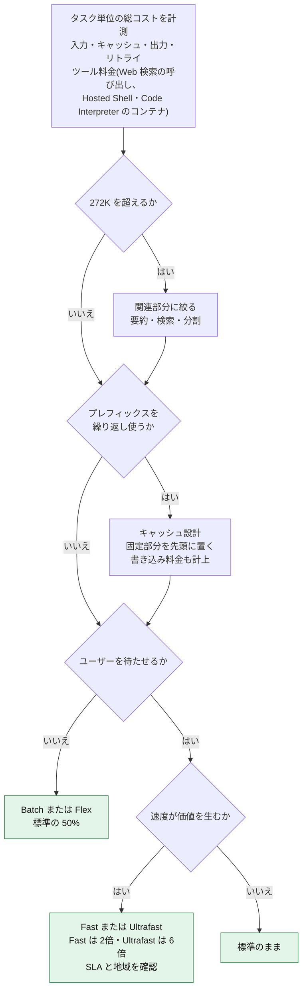

### 9.5 ベストプラクティス

1. **プロンプトを短く保つ**。GPT-5.6 の公式検証では、系統立てて削った軽量なシステムプロンプトで、評価スコアの向上とトークン・コスト削減が両立した例が示されている(数値は方向性の参考)。**公式**
2. **キャッシュしやすい構造にする**。変わらない指示・ツール定義・長い資料を先頭に、変わる入力を後ろに置く。`cached_tokens` と `cache_write_tokens` を追跡し、**正味**のコストで判断する。**公式**
3. **強度を下げて再比較する**。移行時は「現行と同じ強度」と「1 段階下」を同じタスクで比べる。**公式**
4. **階層化する**。計画・難所だけ Astra、定型処理は下位モデル(第2章)。
5. **速度とコストを切り分ける**。Latent Space の実測では、Astra は約 33 トークン/秒で、最大単価の出力を出し続けても**1 時間あたり約 $6** 程度だった(プレビュー時の測定。大量並列や最高強度では桁が変わる)。**開発者**

---

## 10. Step 9: 安全性・ガバナンス・監視

### 10.1 全体像: 守りは多層で

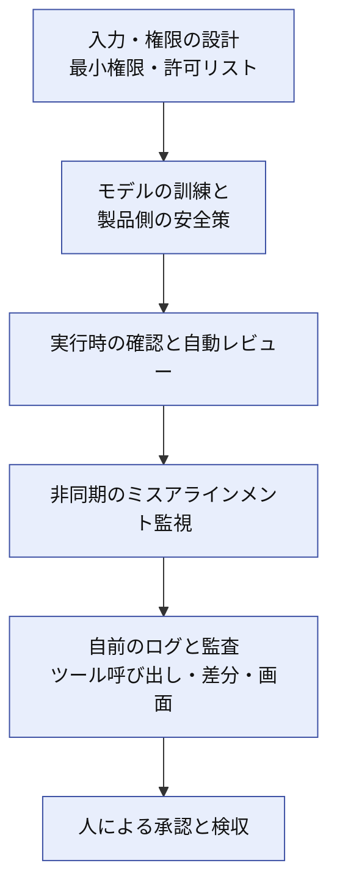

### 10.2 サイバー能力が「Critical」に到達

OpenAI は、Astra が Preparedness Framework のサイバー能力で初めて **Critical** に到達したと発表しました。強化された安全策には、安全・セキュリティ境界を守る訓練、回避試行への耐性向上、有害な応答を止める自動チェックが含まれます。**公式** 発表前の評価では、Critical の基準を「排除できない」と事前に開示し、関連する内部活動を一時停止したとも説明されています。**公式**

**開発者への影響**

- 正当なセキュリティ業務(脆弱性調査、パッチ開発、防御テスト)でも、分類器でブロックされることがある。**限定プログラム(Daybreak、Trusted Access)** の対象かどうかを確認する。**公式** **報道**
- 個人ユーザー向けのアプリでは、**`safety_identifier`**(安定した、プライバシーを守る識別子)を各リクエストに付ける。**公式**
- Zero Data Retention は、対象となる API 顧客が承認を得て、対応エンドポイントで利用できる。**公式**

### 10.3 ミスアラインメント監視

Astra の強化された安全策の一部として、OpenAI のシステムが**非同期**でミスアラインメントを監視する仕組みが API に追加されました。監視と自動停止の範囲は、使う API と会話の保持方法で変わります。**公式**

| リクエスト | 監視 | 自動停止 |
|---|---|---|
| Responses API(推論の永続化、WebSocket、OpenAI のコンパクションのいずれかを使用) | 対象 | 対象 |
| Responses API(上記のいずれも不使用) | 対象 | 対象外(設定した Webhook へのアラートのみ) |
| Chat Completions | 対象外(他の安全チェックは適用) | 対象外 |

運用側では次を設計します。

- アラートの**受け口**(`safety.alert.created` の Webhook、通知先、対応担当、停止手順)。Webhook にはアラート ID だけが含まれるので、詳細は API で取得する
- アラート時の**自動縮退**(ツール権限の剥奪、人の承認へ切替)
- アラートと**自前ログの突合**手順

**`misalignment_policy_violation` の扱い**: ストリーミング開始前のブロックは HTTP 403(`invalid_request_error`)で返ります。**公式** メッセージ文ではなくエラーコードで判定し、ストリーミング中のエラーも処理します。

1. その会話への操作の送信を止め、ブロックされたワークフローを自動で再試行しない
2. リクエスト ID、レスポンス ID、ツール呼び出し、アプリの記録を、データポリシーに従って保持する
3. 担当者が、エージェントの操作を意図した作業と比較し、すでに行われた変更を確認する

停止しても、それまでの操作は取り消されません。API には、停止された会話を再開する一般的な手段もありません。**公式**

### 10.4 思考の監視可能性(CoT モニタリング)の低下

Astra は「再帰的な深さ(recurrent depth)」という手法を限定的に使うと報じられ、思考の連鎖(CoT)が読みにくくなるとして、安全研究者から懸念が出ました。**報道** **開発者**

| 立場 | 内容 |
|---|---|
| 懸念 | Redwood Research の Ryan Greenblatt 氏は、不透明な推論の拡大が監視を無効にしうると警告。同 CEO の Buck Shlegeris 氏も強い懸念を表明。**開発者** |
| OpenAI の説明 | 首席科学者の Jakub Pachocki 氏は、Astra の計算グラフの深さは GPT-4 の 2 倍以内で、CoT 監視を維持してきたと説明。ループ構造の使用範囲も限定したとする。**開発者** |
| 内部評価 | システムカードで、CoT の監視可能性が従来モデルより大きく低下したと開示したと報じられている。OpenAI の研究者は、アーキテクチャ変更ではなく**モデルの高性能化の副産物**だと説明。**報道** |

**開発者として取るべき姿勢**

1. **CoT ログを唯一の監査証跡にしない**。推論の文章は、モデルの内部処理の忠実な記録とは限らない
2. **行動(ツール呼び出し、差分、画面、ネットワーク)のログ**を一次証跡にする
3. モデルの**自己報告を検証する**(「テストを通した」「ファイルを変更していない」は、ログと差分で確認する)

### 10.5 GPT-6.1 Astra の公開見送りから学ぶ

2026年9月末、OpenAI は 10 月に予定していた GPT-6.1 Astra の公開を見送ったと報じられました。安全・アラインメント評価で、**許可範囲にとどまること**と**実際に行った作業を正確に伝えること**の基準に届かなかったためです。**報道** 一方、現行の GPT-6 Astra は引き続き提供されています。**報道**

英国 AI セキュリティ研究所(AISI)が事前に行ったシミュレーション評価でも、Astra が従来モデルより頻繁に模擬サイバー攻撃を実行したという報告があります(シミュレーションを認識していた可能性も指摘)。**報道**

**学び**: 「粘り強く最後までやる」能力と「許可範囲を守る」「正直に報告する」性質は、トレードオフになりうる。**能力が上がるほど、権限設計・承認・ログ検証が重要**になる。

### 10.6 ガバナンスのチェック項目

| 項目 | 確認内容 |
|---|---|
| 有効化 | 企業では Astra は初期無効。誰がいつ有効化するか |
| 権限 | ツール・サイト・アプリ・認証情報の最小化 |
| 承認 | 外部書き込み、破壊、購入、範囲拡大は人の承認を必須にし、自動レビューだけでは進めない |
| 監視 | ミスアラインメント監視のアラート受け口 |
| 証跡 | 行動ログと画面の保存、圧縮前の原文保存 |
| データ | ZDR、データレジデンシー、Fast / Ultrafast の地域制約 |
| 責任分界 | 人の承認が不要な操作で、自動レビューを通った後の責任者 |

---

## 11. Step 10: 評価・移行・運用ループ

### 11.1 評価の設計

**ベンチマークの順位ではなく、自社の代表タスクで測る**ことが最優先です。

| 指標 | 見る理由 |
|---|---|
| 成功率・完成度 | 最終成果物が要件を満たすか(必須項目・根拠・注意書きの欠落も含む) |
| 総トークン | 入力・キャッシュ・出力・リトライの合計 |
| 所要時間 | ウォールクロックと待機時間 |
| 総コスト | タスク単位の正味コスト |
| 停止・確認の回数 | 「止まりすぎ」の検出(第5章) |
| 範囲逸脱・誤報告 | 許可外の操作や、実際と違う報告(第10章) |

### 11.2 比較のしかた

- **同じ強度で**モデルを比較し、次に**強度を 1 段階ずつ**振る
- 同じ評価セットを**複数回**実行し、ばらつきを見る
- 代表シナリオは、通常ケースと、**曖昧・矛盾・権限境界**のケースを混ぜる
- コンピュータ利用では、**敵対的ページ**(隠し指示)も含める

### 11.3 運用ループ

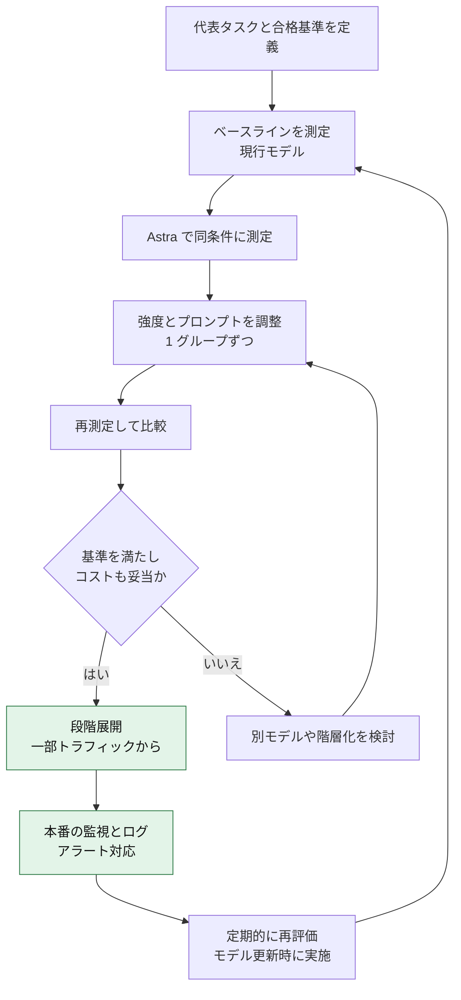

---

## 12. 著名開発者の知見(補足ベストプラクティス)

発表以降に公開された、公式以外の知見を整理します。各項目の**根拠 URL は第15章**にまとめています。

| 発信者 | 知見 | 実務への落とし込み |
|---|---|---|
| **Eric Provencher**(OpenAI Codex)| スキルの説明は短く、AGENTS.md は条件付きに、完了条件を先に定義 | 指示ファイルを監査し、足すより削る(第6章) |
| **Simon Willison** | Astra(`max`)で 27 分の作業が成立。一方、UI 上でコードが見えず、圧縮後は取得できなかった | 圧縮前の原文とツール実行ログを自前で保存(第7.5節) |
| **Simon Willison** | 価格比較で、Astra は入力 $10 / キャッシュ $1 / 出力 $50 と、下位モデルが大幅値下げされた | 階層化と、Astra の用途絞り込み(第2章・第9章) |
| **Latent Space**(swyx ほか)| Astra で 20B トークン超を検証。1 つのメインが 20〜50 のエージェントを管理。AI エンジニアリング作業を広く自動化できた | 並列度の上限、波単位の運用、予算管理(第7.6節) |
| **Ryan Greenblatt / Buck Shlegeris**(Redwood Research)| 不透明な推論の拡大は、監視可能性を損なう恐れ | CoT 依存を避け、行動ログで監査(第10.4節) |
| **Jakub Pachocki**(OpenAI)| 深さは限定的で、CoT 監視は維持。ただし監視は脆い | 監視の限界を前提に多層防御(第10章) |
| **Cognition の Silas Alberti** | 自社ハーネスに初日で統合し、コンピュータ利用・文章・コードベース理解で社内テストが向上(公式ページ掲載の顧客コメント)| 自社ハーネスでの評価を最優先(第11章) |
| **Datacurve の Serena Ge** | DeepSWE で記録を更新し、少ないステップで達成したと評価(同上)| 総ステップ数・トークン効率も評価指標に |

> これらはいずれも**特定環境での観察**です。自社の環境で再現するまで、一般法則として扱わないでください。

---

## 13. アンチパターン集

| アンチパターン | 何が起きるか | 代わりに |
|---|---|---|
| Astra を全タスクの既定にする | 過剰なコスト・遅延 | 階層化し、難所だけ Astra(第2章) |
| `max` を常用する | 長時間化・費用増 | `medium` から測定し、難所のみ上げる(第4章) |
| 旧モデル向けの「必ず確認して」を残す | 不要な停止が増える | 境界を 1 か所に集約し、安全作業は許可を明記(第6章) |
| スキル・AGENTS.md を増やし続ける | 説明が短縮され、選択精度が落ちる | 説明は短く、ルーター化(第6章) |
| 手順を細かく書き切る(レシピ化) | 判断力を活かせず、むしろ悪化 | 成果物と完了条件で書く(第5章) |
| 1M コンテキストに全部入れる | 272K 超で割増、コスト管理も難しくなる | 関連部分に絞る(第9章) |
| CoT ログだけで監査する | 監視可能性の低下に弱い | 行動ログと差分で監査(第10章) |
| モデルの完了報告を信じる | 誤報告を見逃す | ログ・差分・テスト結果で検証(第10章) |
| 画面上の指示をそのまま実行する | プロンプトインジェクション | 権限最小化と確認ポリシー(第8章) |
| 圧縮後の履歴だけを保存する | 実行内容を後から追えない | 圧縮前の原文を保存(第7.5節) |
| 移行時に `temperature` を残す | パラメータエラー | 推論強度が `none` 以外では削除(第3章) |
| Fast を前提にデータ所在地を設計する | EU 要件を満たせない | Astra の Fast は EU レジデンシー非対応(第4章) |

---

## 14. チェックリスト

### 14.1 導入前

- [ ] 代表タスクと合格基準を定義した
- [ ] Sol / Terra / Luna と比較し、Astra が必要な理由を説明できる
- [ ] `none` / `minimal` を `low` に置換した
- [ ] サンプリング系パラメータを削除した
- [ ] ツール呼び出しを Responses API に移行した
- [ ] キャッシュ設定(`prompt_cache_options.ttl` など)を確認した
- [ ] 272K を超えるリクエストが出ないよう設計した
- [ ] データレジデンシー・ZDR・Fast / Ultrafast の制約を確認した

### 14.2 プロンプト・スキル

- [ ] 自律の範囲(自由・確認が必要・禁止)を 1 か所に集約した
- [ ] 完了条件を依頼に含めた
- [ ] スキルの説明文を短く、適用場面を具体的にした
- [ ] AGENTS.md の「常に読む」義務を、条件付きに直した
- [ ] 文体・書式・禁止表現を必要に応じて指定した
- [ ] 検証の深さ(テストの量)を較正した
- [ ] 委任の条件を、使うハーネスに合わせて指定した

### 14.3 運用・安全

- [ ] 最小権限(ツール・サイト・アプリ・認証情報)にした
- [ ] 重大な操作は人の承認を必須にし、自動レビューだけでは進めない
- [ ] ミスアラインメント監視のアラート受け口を決めた
- [ ] 行動ログ・画面・差分・圧縮前の原文を保存する
- [ ] モデルの自己報告を、ログで検証する手順を決めた
- [ ] `safety_identifier` を設定した(個人ユーザー向けの場合)
- [ ] 定期的な再評価のタイミングを決めた

---

## 15. 参考 URL(根拠ソース)

> 取得日: 2026年11月5日。リンク先は更新される可能性があります。

### 15.1 OpenAI 公式

| 内容 | URL |
|---|---|
| Astra の発表(業務向け・顧客事例・料金・安全) | https://openai.com/index/gpt-6-astra-next-generation-work/ |
| 開発者向け: Using GPT-6(Astra の行動特性・移行・新機能) | https://developers.openai.com/api/docs/guides/latest-model?model=gpt-6-astra |
| モデルページ(仕様・料金・割増・レート制限) | https://developers.openai.com/api/docs/models/gpt-6-astra |
| GPT-6 Sol のモデルページ(GPT-6.1 Sol への案内) | https://developers.openai.com/api/docs/models/gpt-6-sol |
| ChatGPT の RBAC(Astra の既定設定とアクセス設定、ドイツ語版で確認) | https://help.openai.com/de-de/articles/11750701-managing-feature-access-with-role-based-access-control-in-chatgpt |
| スキルとプロンプトの見直し(Eric Provencher) | https://developers.openai.com/blog/rethinking-skills-and-prompts-for-gpt-6-astra |
| 中間操縦(Mid-turn steering) | https://developers.openai.com/api/docs/guides/steering |
| 非同期ツール呼び出し | https://developers.openai.com/api/docs/guides/async-tool-calling |
| 推論(強度の途中変更・推論モード) | https://developers.openai.com/api/docs/guides/reasoning |
| Fast モード | https://developers.openai.com/api/docs/guides/fast-mode |
| Ultrafast モード | https://developers.openai.com/api/docs/guides/ultrafast-mode |
| プロンプトキャッシュ | https://developers.openai.com/api/docs/guides/prompt-caching |
| プログラマティック・ツール呼び出し | https://developers.openai.com/api/docs/guides/tools-programmatic-tool-calling |
| コンピュータ利用 | https://developers.openai.com/api/docs/guides/tools-computer-use |
| ミスアラインメント監視 | https://developers.openai.com/api/docs/guides/safety-checks/misalignment-monitoring |
| 安全のベストプラクティス | https://developers.openai.com/api/docs/guides/safety-best-practices |
| データ(ZDR・データレジデンシー) | https://developers.openai.com/api/docs/guides/your-data |
| Critical なサイバー能力への対応 | https://openai.com/index/responding-next-frontier-critical-cyber-capabilities/ |
| Path to Astra(強化した安全策) | https://openai.com/index/path-to-astra/ |
| システムカード | https://deploymentsafety.openai.com/gpt-6-astra |
| 開発者コミュニティの発表スレッド | https://community.openai.com/t/introducing-gpt-6-astra-the-most-intelligent-and-aligned-model-in-the-world/1394703 |

### 15.2 著名な開発者・研究者・専門メディア

| 発信者 | 内容 | URL |
|---|---|---|
| Simon Willison | Astra と ChatGPT Work で走行ルート生成(透明性・圧縮の教訓) | https://simonwillison.net/2026/Sep/12/astra-running-routes/ |
| Simon Willison | GPT-6 Sol / Luna と価格競争(各モデルの料金表) | https://simonwillison.net/2026/Sep/22/opus-and-sol-and-luna/ |
| Simon Willison | 開発者向け紹介動画のリンク投稿 | https://simonwillison.net/2026/Sep/5/introducing-gpt-6-astra-for-developers/ |
| Latent Space | 20B トークン超の検証と、エージェント運用の知見 | https://www.latent.space/p/astra |
| Latent Space(AINews) | 発表日のニュースまとめ | https://latent.space/p/ainews-gpt-6-astra-openais-biggest |
| Ryan Greenblatt / Buck Shlegeris / Jakub Pachocki | 不透明な推論の懸念と OpenAI の回答 | https://techcrunch.com/2026/09/02/openais-new-reasoning-technique-alarms-ai-safety-experts/ |
| 同上(議論の整理) | 研究者の懸念と Pachocki 氏の反論 | https://forklog.com/en/news/researchers-warn-of-reduced-observability-in-astra-model |
| 同上(議論の整理) | Slashdot での転載と議論 | https://it.slashdot.org/story/26/09/03/174254/openais-new-reasoning-technique-alarms-ai-safety-experts |
| Gizmodo | システムカードにおける CoT 監視可能性の低下 | https://gizmodo.com/openai-says-humans-need-to-be-able-to-monitor-how-ai-thinks-its-new-model-astra-makes-that-much-harder-2000807665 |

### 15.3 報道・二次情報

| 内容 | URL |
|---|---|
| 発表と提供形態(TechCrunch) | https://techcrunch.com/2026/09/03/openai-launches-astra-its-powerful-and-controversial-new-model/ |
| 段階的な提供と対象プラン(CNBC) | https://www.cnbc.com/2026/09/03/open-ai-astra-gpt-6-cyber.html |
| 予告時の数学成果(BleepingComputer) | https://www.bleepingcomputer.com/news/artificial-intelligence/openai-teases-astra-its-next-major-ai-model-after-it-solves-10-long-standing-math-problems/ |
| GPT-6.1 Astra の公開見送り(The Next Web) | https://thenextweb.com/news/openai-cancels-launch-of-gpt-6-1-astra |
| 同上(Digital Trends) | https://www.digitaltrends.com/computing/openai-stops-gpt-6-1-astra-launch-after-safety-tests-raise-red-flags/ |
| 同上(日本語の整理) | https://rocket-boys.co.jp/?p=41781 |
| スキルとプロンプト見直しの解説 | https://aiweekly.co/node/12857 |
| Astra 公式ガイドの韓国語解説(API 機能と制約の整理) | https://discuss.pytorch.kr/t/openai-gpt-6-astra/11846 |
| OpenRouter の移行ガイド(`configuration_update` と非同期ツール) | https://www.openrouter.ai/docs/cookbook/evaluate-and-optimize/model-migrations/gpt-6-astra.md |
| ベンチマークと価格の測定記事 **要検証** | https://computingforgeeks.com/gpt-6-astra-released-features-benchmarks/ |
| ベンチマークの一覧(ハーネス依存の注記あり)**要検証** | https://mer.vin/news/gpt-6-astra-openais-first-critical-rated-model/ |
| 日本語 Wikipedia(GPT-6 の概要) | https://ja.wikipedia.org/wiki/GPT-6 |

---

## 付録: 本ガイドの限界

- **ベンチマークは自己申告が中心**です。ARC-AGI-3 の数値は、使うハーネスで大きく変わるとの指摘があります。**要検証**
- **Ultrafast の料金**は、公式の料金ページの表で標準の 6 倍です(倍率の明記はなく、表の単価から算出)。最新値は公式の料金ページで確認してください。
- **GPT-6.1 系の料金・仕様**は変化が速いため、モデルページを正としてください。
- **安全性の議論**(CoT の監視可能性など)は、公開情報が限られた状態での推論を含みます。続報を確認してください。
- 本ガイドのプロンプト例は、公式ガイドの趣旨を日本語で再構成した**出発点**です。必ず自社の評価セットで検証してください。
