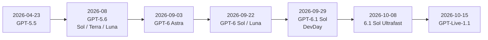
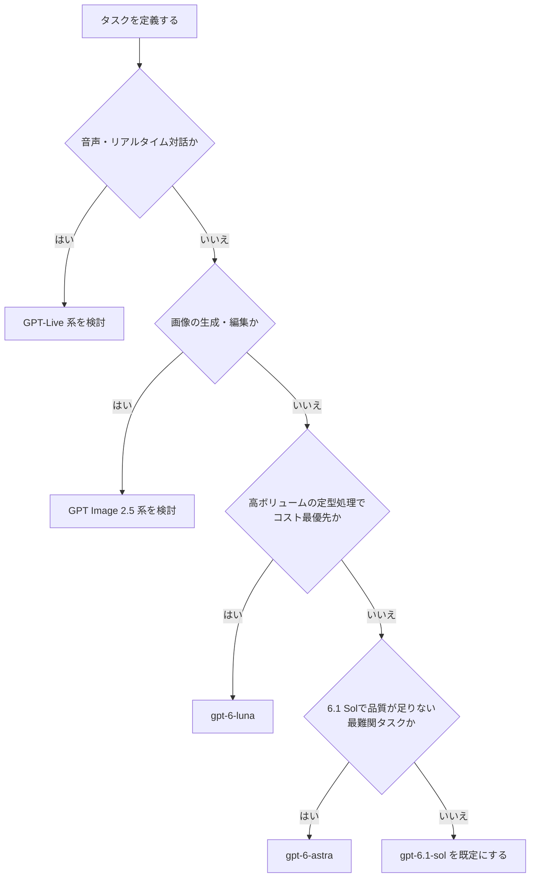
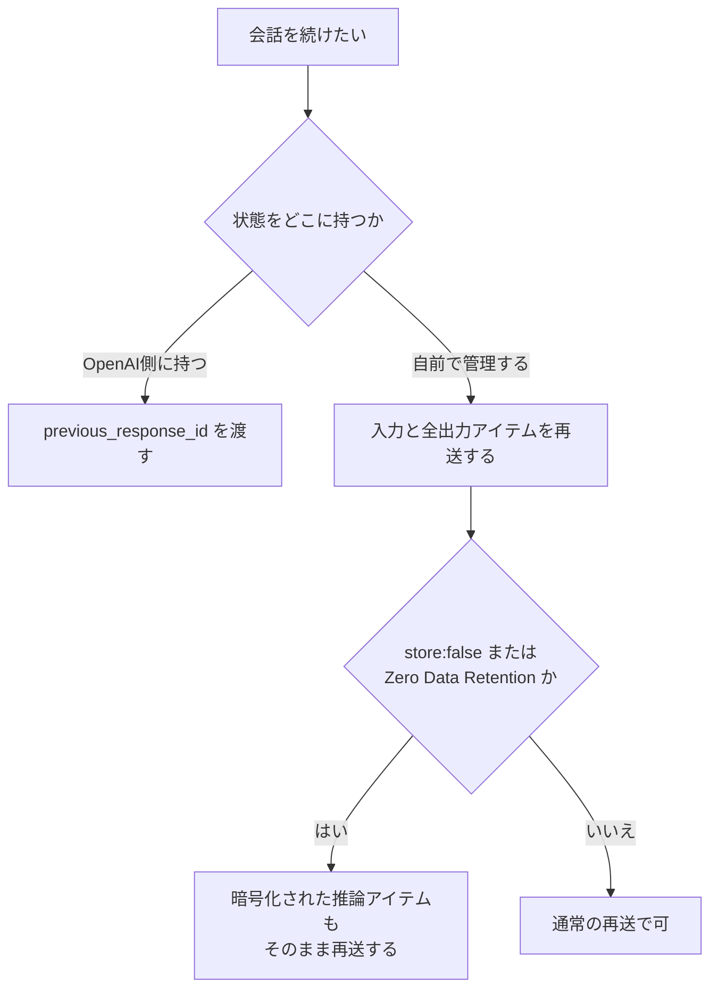
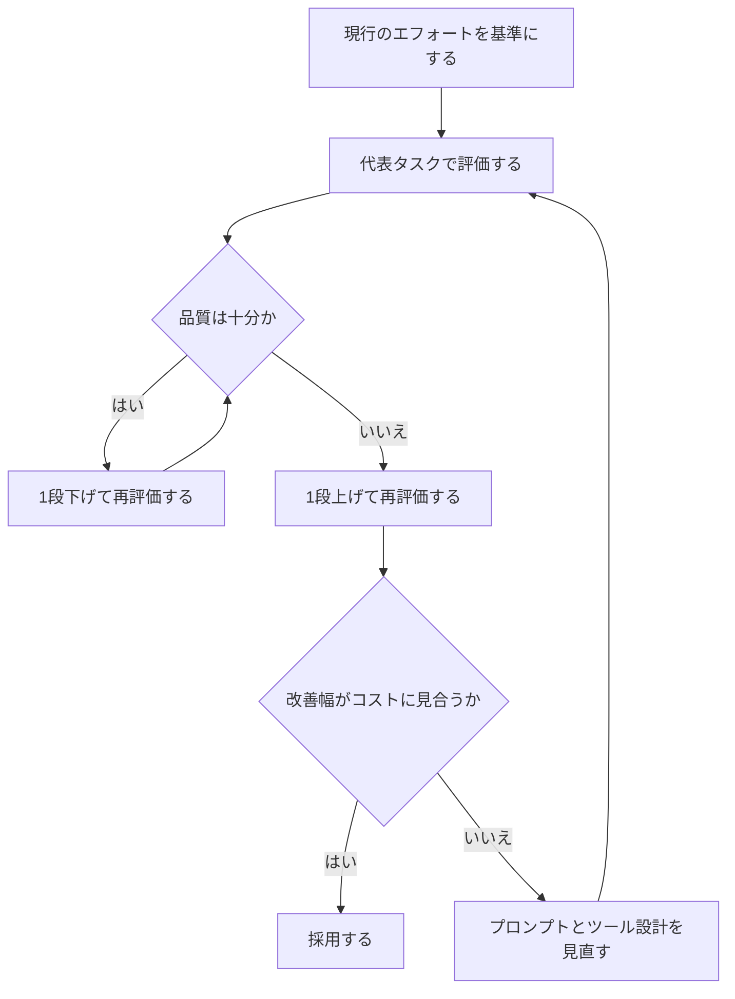
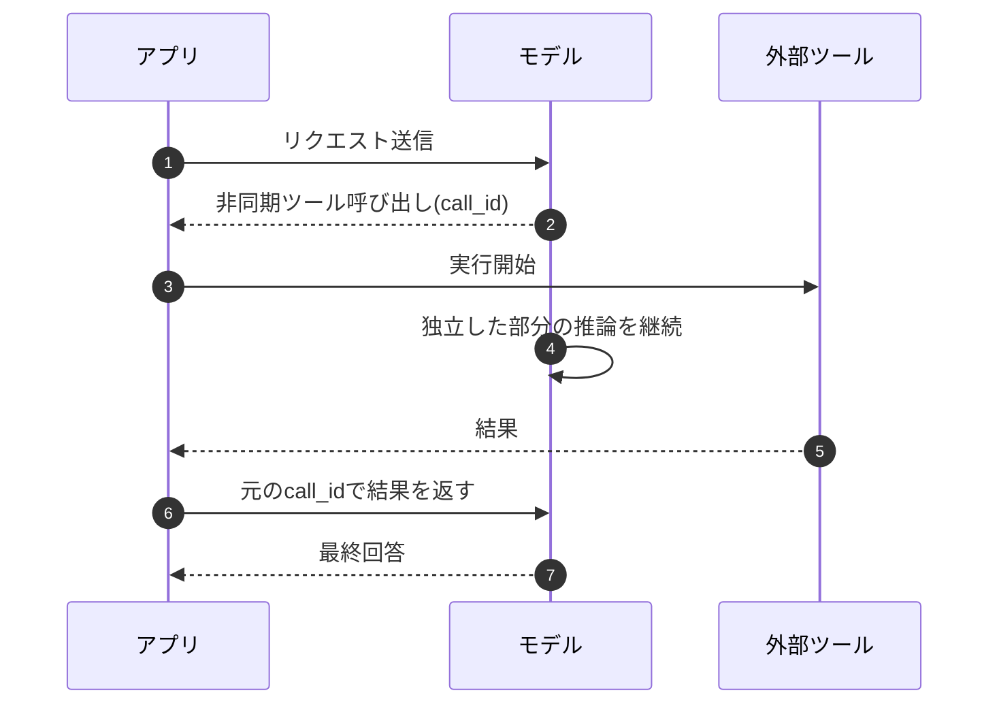
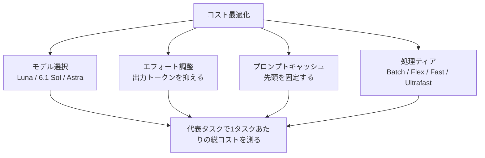
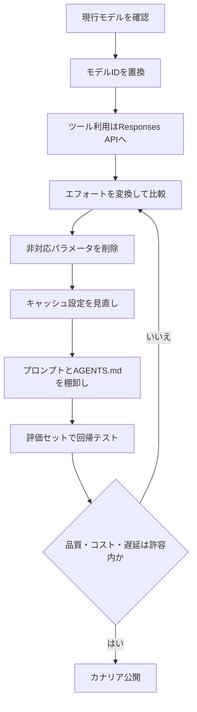
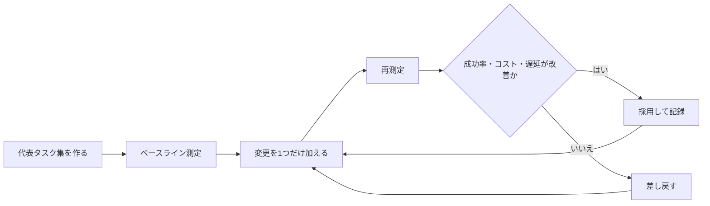

# OpenAI 最新モデル ベストプラクティス完全ガイド(中級〜上級者向け)

> **対象読者**: すでにOpenAI APIを使ったことがあり、GPT-6世代へ移行・最適化したいエンジニア
> **調査基準日**: 2026年10月23日(この日までに公開された情報をもとに作成)
> **ゴール**: 「どのモデルを選び、どう呼び、どう評価し、どうコストを抑えるか」を8ステップで身につける

---

## 目次

- [0. このガイドの読み方と前提](#0-このガイドの読み方と前提)
- [1. 全体像: 2026年のOpenAIモデル地図](#1-全体像-2026年のopenaiモデル地図)
- [Step 1. モデルを選ぶ](#step-1-モデルを選ぶ)
- [Step 2. Responses APIで最小構成を作る](#step-2-responses-apiで最小構成を作る)
- [Step 3. reasoning effortを設計する](#step-3-reasoning-effortを設計する)
- [Step 4. プロンプトを「薄く」「境界を明確に」する](#step-4-プロンプトを薄く境界を明確にする)
- [Step 5. ツール・エージェント機能を使いこなす](#step-5-ツールエージェント機能を使いこなす)
- [Step 6. コストと速度を最適化する](#step-6-コストと速度を最適化する)
- [Step 7. 移行チェックリスト](#step-7-移行チェックリスト)
- [Step 8. 評価と安全性を運用に組み込む](#step-8-評価と安全性を運用に組み込む)
- [補足A. 著名開発者・コミュニティの知見](#補足a-著名開発者コミュニティの知見)
- [補足B. よくある落とし穴 FAQ](#補足b-よくある落とし穴-faq)
- [補足C. 情報の確度と注意点](#補足c-情報の確度と注意点)
- [参考URL一覧(根拠ソース)](#参考url一覧根拠ソース)

---

## 0. このガイドの読み方と前提

### 0-1. 情報の優先順位

このガイドは次の優先順位で情報を扱います。

| 優先度 | 種別 | 例 | 扱い |
| --- | --- | --- | --- |
| 1 | OpenAI公式ドキュメント・公式ブログ | Using GPT-6、API Changelog | 仕様・パラメータの根拠として採用 |
| 2 | 著名な開発者・計測者の一次発信 | Simon Willison、OpenAI開発者ブログ著者 | 実測値・運用知見として採用 |
| 3 | ゲートウェイ・解析企業の技術ブログ | LiteLLM、Vercel、Endor Labs | 公式を補う実装情報として採用 |
| 4 | 比較サイト・まとめ記事 | 価格比較サイト | 数値は複数ソースで一致したもののみ採用 |

### 0-2. 前提

- 価格・上限値・対応状況は**頻繁に変わります**。本番投入前に必ず公式の [Pricing](https://developers.openai.com/api/docs/pricing) と各モデルページで再確認してください。
- 「補足C」に、ソース間で食い違いがあった点をまとめています。
- コードは Python(`openai` SDK)を中心に示します。

---

## 1. 全体像: 2026年のOpenAIモデル地図

### 1-1. リリースの流れ



ポイントは**わずか2か月弱で世代が一気に進んだ**ことです。モデルIDを固定しつつ、評価基盤(Step 8)を先に整えておかないと、追従コストが膨らみます。

### 1-2. 現行ラインナップ(API)

| モデル | API ID | 位置づけ | 入力 / キャッシュ入力 / 出力(100万トークン) | コンテキスト |
| --- | --- | --- | --- | --- |
| GPT-6 Astra | `gpt-6-astra` | 最高知能。最難関の推論・コーディング・コンピュータ操作 | $10 / $1 / $50 | 1.05M(最大出力128K) |
| GPT-6.1 Sol | `gpt-6.1-sol` | Astraに迫る性能を約1/5の単価で。**新規開発の既定候補** | $2 / $0.10 / $10 | 1.05M |
| GPT-6 Sol | `gpt-6-sol` | 6.1 Solの前版(同価格、キャッシュ入力は$0.20) | $2 / $0.20 / $10 | 1.05M |
| GPT-6 Luna | `gpt-6-luna` | 高ボリューム・定型・低コスト | $0.10 / $0.01 / $0.50 | 1.05M |

補足:

- 上記は**短いコンテキスト(入力272K以下)の標準料金**です。272Kを超えると、そのリクエスト全体に長文用の割増料金が掛かります(Step 6参照)。
- 知識カットオフは、Astra と 6.1 Sol が 2026年4月30日と報告されています(GPT-6 Solは4月20日との報告あり)。
- 入力は**テキストと画像**、推論エフォートは `low`〜`max`(Sol/Lunaの一部は `none` も可)です。

### 1-3. 周辺プロダクト・モデル

| 領域 | 内容 | 要点 |
| --- | --- | --- |
| 音声 | GPT-Live-1(API一般提供)、GPT-Live-1.1(10月15日、ChatGPT Voice) | 新しい音声が追加され、多言語・アクセントが改善 |
| 画像 | GPT Image 2.5(9月8日、Sunburst / Flare系) | Image APIとResponses APIの画像生成ツールで利用 |
| 高速化 | Fast mode / Ultrafast mode | `service_tier` で切替(Step 6) |
| エージェント | Multi-agent(β)、Agents API、Agents SDK | サブエージェントへの委任(Step 5) |
| ChatGPT側 | GPT-6 Proの並列エージェント(10月16日)、Slides | プロダクト機能。API設計とは分けて考える |

---

## Step 1. モデルを選ぶ

### 1-A. 選定フロー



### 1-B. 「Astraか6.1 Solか」の判断材料

OpenAIは6.1 Solを「Astraに近い性能を約1/5の価格で」と位置づけ、**自分のタスクで比較して品質とコストのトレードオフを評価する**ことを勧めています。外部の実測も同じ方向です。

| 観点 | 実測・報告 | 出典 |
| --- | --- | --- |
| タスクあたりコスト | 6.1 Solは Astra の4分の1未満(指数タスクあたり約$0.72 対 約$3.26、指数スコアは52対53) | DataCamp |
| 保守タスク(未使用コード調査) | 6.1 Sol Ultraは Astra Ultra の92%の検出数を、14%のコストで達成。1件あたりコストは Astra Ultra $0.77、6.1 Sol Ultra $0.12、6.1 Sol Medium $0.06 | OpenAI開発者ブログ |
| セキュアなコード生成 | Codex上で6.1 SolとAstraはほぼ互角(安全に解けたタスクの差は7件対6件) | Endor Labs |
| 最難関領域 | サイバー・生物・科学の最難関評価ではAstraが依然上位との報告 | DataCamp |

**実務の結論**

1. まず `gpt-6.1-sol` で全評価セットを回す。
2. 失敗が集中するタスク群だけを `gpt-6-astra` で再実行して差分を測る。
3. 差分が小さければ6.1 Solのまま、大きい領域だけAstraへ**ルーティング**する。
4. 大量・定型の前段処理(分類、抽出、要約の下書き)は `gpt-6-luna` に落とす。

### 1-C. ルーティング設計のコツ

- モデル名を直書きせず、**用途名(例: `triage` / `main_agent` / `hard_case`)から解決する設定層**を作る。世代交代が速いため、差し替えコストを下げられます。
- 6.1 Solは `none`/`minimal` エフォートに非対応です。Luna・GPT-6 Solからの置換時にエフォート設定の変換が要ります(Step 3)。
- OpenAI開発者ブログには、プロバイダ障害時のフェイルオーバー設計記事もあります(参考URL一覧)。

---

## Step 2. Responses APIで最小構成を作る

GPT-6世代では、**推論・ツール呼び出し・マルチターンはResponses APIが前提**です。Chat Completionsはツールなしのリクエストに限り使えます(Astra / 6.1 Sol)。`gpt-6-sol` と `gpt-6-luna` は `reasoning_effort: "none"` のときのみChat Completionsで関数呼び出しが可能です。

### 2-A. 最小リクエスト

```python
from openai import OpenAI

client = OpenAI()

log_text = "2026-10-23T09:12:04Z ERROR db: connection pool exhausted"  # 分析対象のログ(例)

response = client.responses.create(
    model="gpt-6.1-sol",
    input="次のログから根本原因の候補を3つ挙げ、確認手順を示してください。\n\n" + log_text,
    reasoning={"effort": "medium"},      # 既定はmedium
    text={"verbosity": "medium"},        # 詳細度の既定値
)

print(response.output_text)
```

### 2-B. サンプリングパラメータに注意

推論エフォートが `none` 以外のとき、次のパラメータは**削除**します。

| 削除するもの | API |
| --- | --- |
| `temperature`, `top_p`, `top_logprobs` | 共通 |
| `logprobs` | Chat Completions |
| `message.output_text.logprobs`(`include`内) | Responses |

```python
# NG: エフォートがnone以外で温度を指定している
client.responses.create(
    model="gpt-6.1-sol",
    input="...",
    reasoning={"effort": "high"},
    temperature=0.2,   # 非対応。削除する
)
```

### 2-C. 会話状態の持ち方



- GPT-5.6では**推論の持ち越し**(`reasoning.context`)が既定で `all_turns` です。前のターンの推論をモデルが参照できるため、マルチターンの品質とキャッシュ効率が上がります。ターンをまたぐ推論が必要なら、モデルの既定に頼らず `reasoning={"context": "all_turns"}` を明示します。
- `all_turns` を活かすには `previous_response_id` を使います。手動管理なら、過去の入力と**すべての出力アイテム**を欠落なく再送します。
- 以前の目標・前提が無関係になったら `current_turn` に切り替えます。

---

## Step 3. reasoning effortを設計する

### 3-A. 対応状況

| モデル | 指定できる値 | 既定 |
| --- | --- | --- |
| `gpt-6-astra` | low / medium / high / xhigh / max | medium |
| `gpt-6.1-sol` | low / medium / high / xhigh / max | medium |
| `gpt-6-sol` | none を含む(minimalは非対応) | medium |
| `gpt-6-luna` | none を含む(minimalは非対応) | medium |

※ Astraと6.1 Solは `none` / `minimal` 非対応。既存コードに `none` や `minimal` がある場合は、まず `low` に置き換えてレイテンシを比較します。

### 3-B. チューニング手順



運用ルール:

1. **高いほど良い、ではない**。medium起点で、上げる根拠を計測で示す。
2. `max` は最難関で品質最優先のタスクに限定する。`xhigh` との差を必ず比較する。
3. 推論トークンは**出力トークン単価で課金**されます。high / max では出力コストが跳ねます。
4. 旧世代(GPT-5.5 / 5.4)から移すときは、現行エフォートを基準に**同じ値と1段下**を比較します。GPT-5.6世代はトークン効率が高く、低いエフォートでも同等品質になることがあります。

### 3-C. 会話の途中でエフォートを変える(キャッシュを壊さない)

GPT-6世代の新機能として、`configuration_update` という入力アイテムを足すと、**プロンプトの先頭部分を書き換えずに**エフォートを上げ下げできます。難しい局面だけ上げ、定型の追い質問は下げる、といった使い分けでキャッシュを保てます。

| 守ること | 理由 |
| --- | --- |
| リクエストレベルの `reasoning.effort` は**固定のまま**にする | 先頭部分が変わるとキャッシュが外れる |
| 標準の**単一エージェント**リクエストで使う | マルチエージェントとは併用不可の制約あり |
| `truncation: "auto"` と併用しない | 互換制限(公式のReasoningガイドで確認) |

正確な入力アイテムの形は、公式の「Change reasoning mid-conversation」を参照してください(参考URL一覧)。

### 3-D. Proモード

GPT-5.6世代以降、`reasoning.mode` を `pro` にすると、モデルがより多くの作業をしてから**単一の最終回答**を返します。別のProモデルIDに切り替える方式ではありません。

- 向く: 複雑な最適化、価値の高いレビュー、評価基準が明確な深い分析
- 向かない: 低遅延が必要な処理、高ボリューム処理、評価で改善が確認できない処理
- エフォートとは独立。標準モードと同じ設定を基準に比較する

---

## Step 4. プロンプトを「薄く」「境界を明確に」する

### 4-A. 基本方針(公式の移行ガイドより)

1. **新しいベースラインから始める**。古いプロンプトの指示を全部持ち越さない。
2. 製品要件を守る**最小のプロンプト**から始め、エフォート・詳細度・ツール説明・出力形式を代表例で調整する。
3. 同じ指示を繰り返さない。**各指示は1回だけ**書く。
4. 関係するツールだけを公開し、説明は簡潔かつ正確に。

OpenAIは、社内のコーディングエージェント評価で、プロンプトを薄くした構成が**スコア約10〜15%向上、総トークン41〜66%減、コスト33〜67%減**になった例を示しています(傾向値であり、自分のワークロードで検証が必要)。

### 4-B. Astra世代の挙動と対処

| 挙動の傾向 | 症状 | 対処の方向性 |
| --- | --- | --- |
| より協調的で、重要な不明点を質問しやすい | 「ユーザーが推測して進めてほしい場面」で止まる | 権限が暗黙に与えられている依頼は実行まで進める、と明文化 |
| 指示への感度が高い | skillsや `AGENTS.md` の矛盾・曖昧さで作業が止まる | 指示の優先順位を明示。ファイル群を監査 |
| 書式が多め(箇条書き・表・Markdown) | 製品UIに合わない | 文体と構造を明示指定 |
| 委譲が控えめ | サブエージェントを使わない | いつ・どれだけ並列化するか指定 |
| テストが徹底的 | 小さな変更に広すぎるテスト | 変更規模に応じた検証範囲を指定 |

### 4-C. すぐ使えるテンプレート(自分用に書き直した版)

**(1) 自律性と承認境界**

```markdown
# 権限の考え方
- 「説明・レビュー・診断・計画」の依頼: 関連資料を調べて報告する。依頼がない限り変更は実装しない。
- 「変更・構築・修正」の依頼: 範囲内のローカル変更と、非破壊の検証を、確認なしで実行する。
- 次の場合だけ事前確認を取る: 外部への書き込み、破壊的操作、購入・課金、依頼範囲の実質的な拡大。

# 完了の定義
- 実装、起動確認、結果の検査、失敗の修正までを依頼に含める。
- 最初の実装が動いた時点で止まらず、受け入れ基準を満たすまで進める。
```

**(2) 優先順位の明示(指示ファイルが多い環境向け)**

```markdown
指示の優先順位は、実行環境の指示階層(システム・開発者の指示)と、適用されるskill・AGENTS.mdの指示に従う。
ユーザーの明示的な依頼だけでは、これらの指示を上書きしない。
skillが原因で確認を求めたり作業を中断したりする場合は、
該当ファイル名と該当箇所を示し、明示要件と自分の解釈を区別して説明する。
```

**(3) 出力スタイル(散文中心にしたい場合)**

```markdown
結論を冒頭で述べ、段落ごとに1つの論点を展開する。
箇条書きや表は、並列・手順・比較として本当に有効な場合だけ使う。
専門用語は必要最小限にし、読者の前提知識に合わせて説明の深さを調整する。
```

**(4) 検証の強度**

```markdown
可逆で影響の小さい変更には、実装をなぞるだけのテストを書かない。
変更に見合う検証を行い、通った後は、新たな失敗や懸念がない限り検証を広げず完了に向かう。
```

### 4-D. 詳細度は `text.verbosity` で一元管理

```python
user_query = "Responses APIとChat Completionsの違いを教えてください。"  # ユーザーの質問(例)

response = client.responses.create(
    model="gpt-6.1-sol",
    input=user_query,
    reasoning={"effort": "medium"},
    text={"verbosity": "low"},  # low / medium / high
)
```

- 「簡潔に」だけの指示は、必要な情報まで削る場合があります。**残すべき内容(結論・根拠・注意点・次の行動)と、削ってよい内容**を指定します。
- 「親切に」「共感的に」などの曖昧な語は避け、**書き方の選択**(結論の出し方、問題への触れ方、締めの有無)で定義します。

---

## Step 5. ツール・エージェント機能を使いこなす

### 5-A. 機能マップ

| 機能 | 何ができるか | 使いどころ |
| --- | --- | --- |
| 非同期ツール呼び出し(Async tool calling) | ツール実行中も、モデルが推論・他ツール呼び出し・独立部分の回答を続けられる | 実行が遅い外部API、並行できる調査 |
| 途中介入(Mid-turn steering) | 実行中に追加指示を送れる。完了済みの作業は保持される(WebSocket接続) | 長時間タスクの軌道修正 |
| Programmatic Tool Calling | モデルがJavaScriptで複数ツールを呼び、中間結果を処理して小さな結果だけ返す | 絞り込み・結合・集計などの定型処理 |
| Multi-agent(β) | サブエージェントに委任して並列に進める | 独立した作業に分割できる大きなタスク |
| 圧縮(Compaction) | 長い会話を圧縮して継続 | 長時間エージェント |
| ツール検索・Skills・MCP | ツール数が多い環境の整理、再利用可能な手順 | 大規模なツール群 |

### 5-B. 非同期ツール呼び出しのシーケンス



```python
tools = [
    {
        "type": "function",
        "name": "fetch_report",
        "description": "売上レポートを取得する。完了まで数十秒かかる。",
        "parameters": {
            "type": "object",
            "properties": {"quarter": {"type": "string"}},
            "required": ["quarter"],
            "additionalProperties": False,
        },
        "strict": True,
        "async": True,   # 結果がすぐ要らないツールにだけ付ける
    }
]
```

- 実行と保留中ジョブの管理は**アプリ側の責任**です。結果は必ず**元の `call_id`** で返します。
- 結果をすぐ必要とするツールに `async` を付けない。

### 5-C. Programmatic Tool Calling の使い分け

向く条件:

- 呼び出しが**境界のある**ワークフロー(絞り込み、結合、重複排除、集計、検証)
- 大きな中間出力を処理して、**はるかに小さい構造化結果**だけ返したい

直接のツール呼び出しを選ぶ条件:

- 1回の呼び出しで足りる
- 中間出力がすでに小さい
- 各結果が次の判断を変える(モデルの判断が毎回必要)
- 承認が必要な操作
- 最終出力に引用やネイティブな成果物を残す必要がある

ルーティングは**タスク固有に書く**(どの段階で使うか、使えるツール、出力スキーマ、並行数・再試行・停止条件、直接呼び出しに残す作業)。ツールの説明には返却フィールド・型・エラー挙動を書きます。返却の形が事前に分からないなら、直接呼び出しで中身を見てから判断させます。

**評価の注意**: `program_output` と最終メッセージは別物です。プログラムの結果が正しくても、最終回答で必須項目や引用が抜けることがあります。両方をテストします。

### 5-D. マルチエージェントの設計

- 委譲の頻度・条件は**プロンプトで調整**する。Astraは委譲が控えめになりやすく、逆に中規模タスクで委譲しすぎる(Sol系)という報告もあります。
- 子エージェントのコンテキストと推論も課金対象です。**サブエージェントに自分の成果物を監査させる**運用は、気づかないうちにコストと長文料金帯に入ります(Step 6)。
- エージェント間のメッセージは人間が読むこともあるため、スペースや区切りが崩れないよう指示します。

---

## Step 6. コストと速度を最適化する

### 6-A. コストの4つのてこ



**単価ではなく「1タスク完了あたりの総コスト」で比較する**のが鉄則です。Astraは単価が高くても、出力トークンが少なくて済み、タスクあたりでは安い場合があるとOpenAIは述べています。

### 6-B. プロンプトキャッシュ

| 項目 | 内容 |
| --- | --- |
| キャッシュ読み取り | 6.1 Sol: 入力の5%($0.10)。Astra: $1。Luna: $0.01 |
| キャッシュ書き込み | TTLで単価が異なる。30分(`"30m"`、既定): 通常入力の1.25倍(6.1 Sol: $2.50 / Astra: $12.50)。12時間(`"12h"`、2026-10-20追加): 通常入力の2.5倍(6.1 Sol: $5.00 / Astra: $25.00) |
| 暗黙モード | 最新の対象メッセージ末尾に1つのブレークポイントを置く |
| 明示モード | 再利用する先頭部分を**自分で指定**して不要な書き込みを避ける |
| 移行時の変更 | GPT-5.5以前の `prompt_cache_retention` は `prompt_cache_options.ttl`(例: `"30m"`)に置換 |
| 計測 | `cached_tokens` と `cache_write_tokens` を追跡して**正味コスト**を見る |
| 診断 | Prompt Cache Diagnostics が一般提供。キャッシュミスの原因を確認できる |

設計のコツ:

1. システムプロンプト、ツール定義、固定の参考資料を**先頭に固定**し、変動部分を後ろに置く。
2. ツール定義の順序や文言を毎回変えない(先頭が変わるとミスする)。
3. エフォートを途中で変えるなら `configuration_update` を使う(Step 3-C)。
4. 書き込み課金があるため、再利用されない部分にまでブレークポイントを置かない。

### 6-C. 272Kコンテキストの「崖」

1.05Mトークンのコンテキストが使えても、**入力が272Kを超えたリクエストは全体が長文料金**になります。

| モデル | 短いコンテキスト(入力 / 出力) | 長文(入力 / 出力) |
| --- | --- | --- |
| 6.1 Sol | $2 / $10 | $4 / $15 |
| GPT-6 Luna | $0.10 / $0.50 | $0.20 / $0.75 |
| GPT-6 Astra | $10 / $50 | 約$20 / 約$75(報告値) |

- 「入れられる」ことと「入れるべき」ことは別です。検索で絞る、圧縮(Compaction)を使う、不要なツール出力を落とす、で272K以下に収めます。
- 実際の課金閾値は提供元で異なる場合があります(例: GitHub Copilotは200K閾値という報告)。**API直と他社経由で料金帯の仕様が違う**前提で確認します。

### 6-D. 処理ティア

| ティア | 指定 | 特徴 | 注意 |
| --- | --- | --- | --- |
| Standard | 指定なし(`default`) | 既定 | - |
| Fast mode | `service_tier: "priority"` | 優先処理(旧Priority processingの改称) | AstraのFastにはレイテンシSLAなし。EUデータ所在地はSol/Lunaで対応、Astraは非対応 |
| Ultrafast mode | `service_tier: "ultrafast"` | 出力トークン間の時間を短縮。Responses APIで利用 | 別枠のレート上限。Astraは標準単価の約6倍課金の報告。6.1 SolのUltrafastは米国・EU・グローバル処理に対応 |
| Batch / Flex | 各ガイド参照 | 非同期・低優先で割安 | 即時性が不要な処理向け |

```python
prompt = "この関数の名前をより分かりやすく変えてください。"  # 入力(例)

fast = client.responses.create(
    model="gpt-6.1-sol",
    input=prompt,
    service_tier="ultrafast",   # 対話・高速なコーディング反復向け
)
```

- ツール呼び出しが多いワークフローは、**WebSocket上のResponses API**でターン間のオーバーヘッドを減らすことをOpenAIが推奨しています。
- Ultrafastは**生成速度**を上げるもので、モデルの推論能力は変わりません。周辺のワークフロー(ツール待ち、人の確認)がボトルネックのままだと体感は伸びません。

---

## Step 7. 移行チェックリスト

### 7-A. 移行フロー



### 7-B. 項目別チェック

| # | 項目 | やること |
| --- | --- | --- |
| 1 | モデルID | `gpt-6-astra` / `gpt-6.1-sol` / `gpt-6-luna` のいずれかに設定 |
| 2 | API | Astra / 6.1 Sol のツール呼び出しは Responses API へ(Chat Completionsは不可)。Luna は `reasoning_effort: "none"` のときのみ Chat Completions で関数呼び出し可(Step 2) |
| 3 | エフォート | 現行値を保持。Astra/6.1 Solで `none` は `low` へ、`minimal` も `low` から比較 |
| 4 | サンプリング | エフォートが `none` 以外なら `temperature` / `top_p` / `top_logprobs` を削除 |
| 5 | キャッシュ | `prompt_cache_retention` → `prompt_cache_options.ttl`。書き込み課金を確認 |
| 6 | 承認の停止 | 不要な確認で止まる場合は、自律性・承認境界のプロンプトを見直す(Step 4) |
| 7 | データ所在地 | AstraのFastはEU非対応。要件と突き合わせる |
| 8 | ユーザー識別 | エンドユーザー向けなら、安定でプライバシーに配慮した `safety_identifier` を送る |

### 7-C. GPT-6 Sol → GPT-6.1 Sol の落とし穴

「1行置換で価格も同じ」に見えますが、コミュニティの検証記事は次の点を挙げています。

- `none` / `minimal` エフォートが使えない(6 Solでは動いていたコードが落ちる)
- ツール呼び出しはResponses APIが必須
- 暗黙キャッシュの挙動(ブレークポイントの置き方)の違い
- 6.1 Solは持続性が高く、長く走る傾向がある(コストと時間の見積りを更新)
- Ultrafast・Fastとデータ所在地の組み合わせに制約がある

### 7-D. Codexでの自動移行

公式は、OpenAI Docsスキルを使ったCodexでの機械的な移行を案内しています。

Codex に入力するプロンプト例(シェルでは実行しません。OpenAI Docsスキルが必要):

```text
$openai-docs migrate this project to the GPT-6 model family
```

なお、旧世代を使い続ける場合も、**GPT-5.6には11月に価格引き上げが予定されている**(Simon Willisonの記事による)ため、コスト試算を更新してください。

---

## Step 8. 評価と安全性を運用に組み込む

### 8-A. 評価ループ



測る指標(最低限):

| 指標 | 理由 |
| --- | --- |
| タスク成功率 | 品質の主指標 |
| 完全性・必須の根拠・引用の有無 | 最終回答の抜けを検出 |
| 総トークン(入力 / 推論 / 出力 / キャッシュ) | コスト構造の把握 |
| レイテンシ(最初のトークン、総所要時間) | 体験の把握 |
| ツール呼び出し回数・再試行・ターン数 | 効率の把握 |

**「呼び出し回数やターン数が減った」は、最終回答が品質基準を満たす場合に限り改善と数える。**

### 8-B. 安全性の運用

| 論点 | 公式・報告ベースの要点 | 実装での対応 |
| --- | --- | --- |
| 指示階層 | 2026年10月更新のGPT-6 Sol/Lunaは指示階層評価でほぼ飽和(99.99% / 99.79%) | システム指示とユーザー指示の役割を分けて設計する |
| プロンプトインジェクション | 高い頑健性が報告されている | それでも外部コンテンツは**データとして扱う**境界を維持する |
| 過剰な拒否・注意書き | 無害な依頼への拒否や余計な注意書きは減少 | 製品として必要な注意だけを自前で付ける |
| 誤作動監視 | Astraは非同期でミスアラインメントを監視し、必要時にアラートを出す | 監視アラートの扱いを運用フローに組み込む |
| 高リスク領域の分類器 | サイバー・生物の誤用検知で、ブロックや生成の一時停止が起こりうる | 正当な防御・研究用途は、公式の信頼アクセス情報を確認 |
| ユーザー識別 | エンドユーザー向けは `safety_identifier` を推奨 | 安定した匿名ID(ハッシュ化など)を付与 |

### 8-C. Codex・エージェント運用の整理術(Eric Provencher / OpenAI開発者ブログ)

1. **Skillsの説明は短く**、「いつ使うか」を明確に。「データベース関連なら常に」のような広い書き方は避け、「マイグレーションを追加・変更するとき」のように限定する。
2. Skillは**段階的開示**にする。ルート文書は最小の振り分け役にして、詳細は別ファイルやスクリプトへ。
3. 手順を細かく縛る**レシピ型の指示は見直す**。高性能モデルでは過剰な制約が逆効果になりうる。
4. `AGENTS.md` は「作業前に全ドキュメントを読む」ではなく、**用途別に参照先を示す**。
5. 以前のモデルを抑えるために書いた強い禁止・確認の文言は、Astraでは**効きすぎて**止まることがある。見直す。
6. 完了の定義(起動、検査、失敗の修正まで)を依頼に含める。逆に「最初の実装後に必ずレビューで止まる」要件は、早期停止を誘発する。
7. 安全と分かっている作業(使い捨てフィクスチャのローカルテストなど)は、`AGENTS.md` で**明示的に許可**を与える。
8. 整理自体もAstraに依頼し、監査させる。

---

## 補足A. 著名開発者・コミュニティの知見

> 注意: X(旧Twitter)の投稿本体は直接取得できなかったため、ブログ本文または二次要約で確認できた内容に限って記載します。

| 発信者 | 内容 | 実務への示唆 | URL |
| --- | --- | --- | --- |
| **Simon Willison**(Django共同作者、LLM CLI作者) | 「ペリカン自転車SVG」ベンチをAstraの全エフォート(low〜max)とGPT-5.6の各階層で比較。**Astraはlowでも5.6 Solの全描画を上回る**、という観察。maxでは1枚あたり出力12,638トークンで約63セント | エフォートはコストが桁で変わる。まず低めで品質を確認する | [Pelican comparison grid for Astra](https://simonwillison.net/2026/Sep/4/astra-pelicans/) |
| **Simon Willison** | GPT-6 Sol / Lunaの価格を整理。**5.6の半額**(5.6の販促価格に対して)。AstraとClaude Fable 5.1は同じ$10 / $50 | 価格戦争が中位帯で起きている。ベンダー比較の再評価時期 | [Claude Opus 5.5, GPT-6 Sol, GPT-6 Luna, and a new price war](https://simonwillison.net/2026/Sep/22/opus-and-sol-and-luna/) |
| **Simon Willison** | ChatGPT WorkでAstra(Max)に「自宅から5K/10Kのコース」を依頼。27分でGPX・GeoJSON・HTML地図を生成。ただし**圧縮(compaction)後に実行コードが取り出せず**、これを「反機能」と批判 | 圧縮前の履歴を保存し、エージェントが読み戻せる設計にする | [二次要約: AI/TLDR](https://ai-tldr.dev/releases/simonw-astra-running-routes-sep12/) |
| **Eric Provencher**(OpenAI開発者ブログ著者) | Skills・`AGENTS.md`・タスクプロンプトの棚卸し指針(Step 8-C) | 指示の肥大化がAstraでは性能低下と停止の原因になる | [Rethinking skills and prompts for GPT-6 Astra](https://developers.openai.com/blog/rethinking-skills-and-prompts-for-gpt-6-astra) |
| **OpenAI開発者ブログ** | 保守作業での6.1 Sol対Astra比較(1件あたりコスト) | 検出漏れの種類は異なる。重要な監査は併用も検討 | [Maintaining software with the GPT-6 family](https://developers.openai.com/blog/maintaining-software-with-the-gpt-6-family) |
| **minimaxir(Hacker Newsのユーザー名)ほか**(HN上のコメント) | 6.1 Solの発表で重要なのは**キャッシュ入力が半額**になった点、という指摘。Codexでは400K・1Mのコンテキストも使えるが、一定量超過は2倍課金の指摘 | 長時間エージェントはキャッシュ単価が支配的 | [Hacker News](https://news.ycombinator.com/item?id=49896586) |
| **Latent Space(swyx)とゲスト**(Ben Davisら) | 6.1 Solは「評価が低すぎる」「価格が良い」。サブエージェントの並列実行は、キャッシュ最適化で「大幅に速く」なった(Codexチーム談) | 並列化はモデルのプロンプトで増やせる(「もっと生成して」と指示) | [Latent Space要約](https://finance.biggo.com/podcast/6d84f9c6b690be03) |
| **Latent Space AINews** | Astra発表時の整理。Responses APIの非同期関数呼び出し・途中介入・エフォート変更(@reach_vb、@nikunjhandaの発信)。外部評価でAstraは5.6 Solより**約70%トークン効率が高い**など | 公式主張と独立計測を区別して読む | [AINews](https://www.latent.space/p/ainews-gpt-6-astra-openais-biggest) |
| **Endor Labs** | Codex上のセキュリティ評価で6.1 SolはAstraとほぼ同等、約3分の1高速 | セキュアコーディング用途の根拠データ | [Endor Labs](https://www.endorlabs.com/learn/gpt-6-1-sol-on-codex-astra-level-security-a-third-faster-zero-cheating) |

---

## 補足B. よくある落とし穴 FAQ

| 症状 | 原因 | 対処 |
| --- | --- | --- |
| 6.1 Solに替えたら400エラー | `none` / `minimal` エフォートを指定している | `low` に置換して再評価 |
| 温度指定でエラー | 推論あり(`none`以外)では `temperature` 等が非対応 | パラメータを削除 |
| ツール付きでChat Completionsが失敗 | ツール呼び出しは原則Responses API必須。ただし `gpt-6-sol` / `gpt-6-luna` は `reasoning_effort: "none"` のときのみChat Completionsで関数呼び出し可 | 上記以外はResponses APIへ移行(該当モデルは `reasoning_effort` を `"none"` に設定) |
| すぐ確認を求めて止まる | Astraは必要時に質問する傾向。過去の強い禁止文言が効きすぎ | 権限と完了条件を明記し、過去の禁止文言を緩める |
| 小さな修正で大量のテストを走らせる | Astraは検証が徹底的 | 検証の強度を指示 |
| 気づくと料金が倍近くに | 入力が272Kを超え、全体が長文料金に | 圧縮・検索で絞る。サブエージェントの文脈肥大も確認 |
| キャッシュが効かない | 先頭部分が毎回変わる、エフォートをリクエストレベルで変更している | 先頭を固定し、`configuration_update` を使う。Diagnosticsで確認 |
| Fast / Ultrafastが期待通りにならない | データ所在地の制約(EUなど)でStandardに落ちる | 実際に提供されたティアの課金・速度を確認 |
| 回答が箇条書きだらけ | Astraは書式を多用する傾向 | 文体・構造の指示を明記 |
| 圧縮後に過去のコードが追えない | 圧縮で履歴が失われる | 圧縮前の記録を別に保存 |

---

## 補足C. 情報の確度と注意点

| 項目 | 状況 | 取り扱い |
| --- | --- | --- |
| Astraの価格 | 複数の情報源で $10 / $50 / キャッシュ$1 が一致。1つの比較サイトのみ別の値を表示 | 公式Pricingで確認。外れ値は不採用 |
| Astraの長文料金($20 / $75) | 1つの解説記事のみ | 公式Pricingで要確認 |
| Ultrafastの倍率(約6倍) | Vercelの更新情報(Astra向け)の記載 | 6.1 Solの倍率は公式Pricingで確認 |
| 6.1 SolのUltrafast | 発表当初は「近日」との記事がある一方、10月8日のChangelogで提供開始 | Changelogを正とする |
| GPT-5.6の価格 | ソースにより値が異なる(販促価格・通常価格の混在) | 本ガイドでは数値を採用しない |
| GPT-6 Pro(ChatGPT) | トラッカー記載。API設計にそのまま適用できるか不明 | API側の設定は未確認。公式ドキュメントで確認できるまで、APIの基準設定として扱わない |
| 「GPT-6 Luna Decisions」・Decisions API | 一覧情報とドキュメント目次で存在を確認できたが、詳細は未確認 | 利用前に公式の Decisions API ガイドを確認 |
| ベンチマークの数値 | 公式主張と独立計測が混在 | 自分の評価セットで再現してから採用 |
| ChatGPTのプラン別提供 | 情報源により更新時期が異なる | 公式の最新情報で確認 |

---

## 参考URL一覧(根拠ソース)

### 公式ドキュメント・公式ブログ

| # | タイトル | URL | 根拠にした内容 |
| --- | --- | --- | --- |
| 1 | Using GPT-6(OpenAI API) | https://developers.openai.com/api/docs/guides/latest-model | モデル構成、エフォート対応、移行手順、プロンプト指針、GPT-5.6の新機能 |
| 2 | API Changelog | https://developers.openai.com/api/docs/changelog | リリース日、Ultrafast、6.1 Sol、Multi-agent(β) |
| 3 | Rethinking skills and prompts for GPT-6 Astra | https://developers.openai.com/blog/rethinking-skills-and-prompts-for-gpt-6-astra | Skills・AGENTS.mdの棚卸し |
| 4 | Maintaining software with the GPT-6 family | https://developers.openai.com/blog/maintaining-software-with-the-gpt-6-family | 6.1 SolとAstraの1件あたりコスト比較 |
| 5 | GPT-6 Sol and GPT-6 Luna: October 2026 update | https://deploymentsafety.openai.com/gpt-6-october | 指示階層・プロンプトインジェクション・拒否傾向の評価 |
| 6 | Prompt caching | https://developers.openai.com/api/docs/guides/prompt-caching | キャッシュ設計(公式) |
| 7 | Reasoning(エフォート・Proモード・途中変更) | https://developers.openai.com/api/docs/guides/reasoning | `configuration_update` の正確な仕様 |
| 8 | Ultrafast mode | https://developers.openai.com/api/docs/guides/ultrafast-mode | 高速ティアの仕様 |
| 9 | Fast mode | https://developers.openai.com/api/docs/guides/fast-mode | Fast modeの仕様 |
| 10 | Async tool calling | https://developers.openai.com/api/docs/guides/async-tool-calling | 非同期ツール呼び出し |
| 11 | Mid-turn steering | https://developers.openai.com/api/docs/guides/steering | 途中介入 |
| 12 | Programmatic tool calling | https://developers.openai.com/api/docs/guides/tools-programmatic-tool-calling | PTCの使い分け |
| 13 | Multi-agent | https://developers.openai.com/api/docs/guides/responses-multi-agent | マルチエージェント(β) |
| 14 | Safety best practices | https://developers.openai.com/api/docs/guides/safety-best-practices | `safety_identifier` |
| 15 | Pricing | https://developers.openai.com/api/docs/pricing | 最新料金(必ず確認) |
| 16 | Evaluation best practices | https://developers.openai.com/api/docs/guides/evaluation-best-practices | 評価設計 |
| 17 | Cost optimization | https://developers.openai.com/api/docs/guides/cost-optimization | コスト最適化 |

### 著名開発者・計測者・コミュニティ

| # | 発信者 | URL | 内容 |
| --- | --- | --- | --- |
| 18 | Simon Willison | https://simonwillison.net/2026/Sep/4/astra-pelicans/ | Astraのエフォート別比較 |
| 19 | Simon Willison | https://simonwillison.net/2026/Sep/5/introducing-gpt-6-astra-for-developers/ | Astra紹介動画へのコメント |
| 20 | Simon Willison | https://simonwillison.net/2026/Sep/22/opus-and-sol-and-luna/ | 価格整理 |
| 21 | Simon Willison(二次要約) | https://ai-tldr.dev/releases/simonw-astra-running-routes-sep12/ | 圧縮でコードが失われた事例 |
| 22 | Latent Space | https://www.latent.space/p/ainews-gpt-6-astra-openais-biggest | Astra発表の整理 |
| 23 | Latent Space(ポッドキャスト要約) | https://finance.biggo.com/podcast/6d84f9c6b690be03 | 6.1 Solの評価、サブエージェント |
| 24 | Hacker News | https://news.ycombinator.com/item?id=49896586 | 6.1 Solの発表への開発者コメント |
| 25 | Endor Labs | https://www.endorlabs.com/learn/gpt-6-1-sol-on-codex-astra-level-security-a-third-faster-zero-cheating | セキュリティ評価 |

### 実装情報・価格・ベンチマーク解説(補助)

| # | 提供元 | URL | 内容 |
| --- | --- | --- | --- |
| 26 | LiteLLM | https://docs.litellm.ai/blog/gpt_6_sol_luna | Sol / Lunaの価格表(短文・長文)、1.05M・922K入力・128K出力 |
| 27 | LiteLLM | https://docs.litellm.ai/docs/providers/openai/ultrafast | Fast / Ultrafastの実装例 |
| 28 | Vercel | https://vercel.com/changelog/openai-ultrafast-mode-now-available-on-ai-gateway | Ultrafastの課金倍率・データ所在地 |
| 29 | OpenRouter | https://openrouter.ai/docs/cookbook/evaluate-and-optimize/model-migrations/gpt-6 | 移行チェックリスト、`configuration_update` |
| 30 | DataCamp | https://www.datacamp.com/blog/gpt-6-1-sol | 6.1 Solの価格・タスクあたりコスト |
| 31 | The Next Web | https://thenextweb.com/news/openai-gpt-6-1-sol-price-astra-devday | DevDay発表の価格・ベンチマーク |
| 32 | Codersera | https://codersera.com/blog/gpt-6-1-sol-complete-guide-2026/ | 長文料金の比較表 |
| 33 | DEV Community(AIHubMix) | https://dev.to/aihubmix/migrating-to-gpt-61-sol-9-things-that-can-go-wrong-1ff1 | 6 Sol→6.1 Solの落とし穴 |
| 34 | Kingy AI | https://kingy.ai/blog/gpt-6-1-sol-ultrafast-speed-pricing-value/ | Ultrafastの実測 |
| 35 | Remio | https://www.remio.ai/post/openai-gpt-6-1-sol-ultrafast-cuts-latency-but-moves-the-bottleneck | Ultrafastのボトルネック考察 |
| 36 | Requesty | https://www.requesty.ai/blog/gpt-6-sol-luna-pricing-release-api | Sol / Lunaの価格 |
| 37 | DataLearner | https://www.datalearner.com/en/ai-models/pretrained-models/gpt-6-astra | Astraの仕様(コンテキスト・カットオフ) |
| 38 | Releasebot | https://releasebot.io/updates/openai | 10月のリリースノート(GPT-Live-1.1、Codex更新) |
| 39 | GitHub(openai/codex) | https://github.com/openai/codex/issues/32486 | 長文料金帯に入りやすい事例(GPT-5.6) |

---

> **最後に**: 世代交代は速く、数値は動きます。このガイドの核は、「(1)用途ごとにモデルを分ける、(2)エフォートは計測で決める、(3)プロンプトは薄く境界は明確に、(4)キャッシュと272K境界を意識する、(5)評価ループを先に作る」の5点です。各数値は、公式Pricingと自分の評価セットで再確認してから採用してください。
