# Grok Bot(xAI)初学者向けステップバイステップ・ベストプラクティスガイド

> **対象読者**: AIエージェントを初めて業務に使う方、Grok Bot を安全に使い始めたい方
> **情報時点**: 2026年10月24日(Grok Bot は **ベータ**で、仕様は頻繁に変わります。最新は必ず公式ドキュメントで確認してください)
> **アンカー記事**: [Introducing Grok Bot(x.ai)](https://x.ai/news/introducing-grok-bot)
> **表記について**: xAI の公式サイトは現在 「SpaceXSI / SpaceXAI」表記が混在しています。本ガイドでは便宜上「xAI」と書きます。

---

## 目次

1. [このガイドの使い方と前提](#1-このガイドの使い方と前提)
2. [Grok Bot とは何か](#2-grok-bot-とは何か)
3. [全体像をつかむ](#3-全体像をつかむ)
4. [Step 0: 始める前の準備](#4-step-0-始める前の準備)
5. [Step 1: アプリをインストールする](#5-step-1-アプリをインストールする)
6. [Step 2: サインインする](#6-step-2-サインインする)
7. [Step 3: 最初の Bot を作る](#7-step-3-最初の-bot-を作る)
8. [Step 4: 良い依頼の書き方(5要素)](#8-step-4-良い依頼の書き方5要素)
9. [Step 5: ログインは自分で行う(Take over)](#9-step-5-ログインは自分で行うtake-over)
10. [Step 6: 結果をレビューして育てる](#10-step-6-結果をレビューして育てる)
11. [Step 7: Skill 化 → Routine 化](#11-step-7-skill-化--routine-化)
12. [Step 8: X から @bot でタスクを渡す](#12-step-8-x-から-bot-でタスクを渡す)
13. [承認(Approvals)と Auto Review の設計](#13-承認approvalsと-auto-review-の設計)
14. [セキュリティの境界を理解する](#14-セキュリティの境界を理解する)
15. [最小権限セットアップ・チェックリスト](#15-最小権限セットアップチェックリスト)
16. [チーム・組織で使うとき](#16-チーム組織で使うとき)
17. [トラブルシュート](#17-トラブルシュート)
18. [よくある失敗と対策(アンチパターン集)](#18-よくある失敗と対策アンチパターン集)
19. [補足: その他のベストプラクティスと根拠ソース](#19-補足-その他のベストプラクティスと根拠ソース)
20. [参考URL一覧](#20-参考url一覧)
21. [検証メモと限界](#21-検証メモと限界)

---

## 1. このガイドの使い方と前提

### 1.1 学習ゴール

このガイドを読み終えると、次のことができるようになります。

| # | できること | 対応する章 |
|---|-----------|-----------|
| 1 | Grok Bot が「何者で」「どこで動くか」を説明できる | 2〜3章 |
| 2 | インストールから最初のタスク完了までを自力で行える | 4〜10章 |
| 3 | 成功したタスクを Skill / Routine にして自動化できる | 11〜12章 |
| 4 | 承認ルールと最小権限で事故を防げる | 13〜15章 |
| 5 | 困ったときに原因を切り分けられる | 17〜18章 |

### 1.2 一次情報と二次情報の区別

本ガイドでは情報源を次のように区別しています。

| 区分 | 意味 | 例 |
|------|------|----|
| **公式(一次)** | xAI / Cursor の公式ドキュメント・発表 | `docs.x.ai`, `x.ai/news` |
| **第三者(二次)** | 解説記事、レビュー、開発者のブログや投稿 | Composio, eesel, 各種ブログ |
| **筆者の整理** | 上記をもとにした推奨(根拠を併記) | 各章の「ベストプラクティス」 |

> **重要**: 第三者の意見は参考情報です。製品の挙動・料金・制限は公式の最新ページで確認してください。

---

## 2. Grok Bot とは何か

### 2.1 ひとことで言うと

**Grok Bot は、あなた専用の「クラウド上のコンピュータ」を持ち、名前付きの役割(Bot)として継続的に仕事をしてくれる AI チームメイト**です。ブラウザ、ターミナル、ファイル、アプリ連携(MCP を含む)を使って作業し、スケジュールやイベントで自律的に動かすこともできます。

### 2.2 チャット型 AI との違い

| 観点 | 一般的なチャット AI | Grok Bot |
|------|-------------------|----------|
| 動く場所 | 会話ウィンドウの中 | **永続するクラウドコンピュータ** |
| 記憶 | 会話ごと(機能による) | Bot ごとに役割・やり方を覚えさせる |
| 操作できるもの | 主にテキスト | ブラウザ・ファイル・ターミナル・連携アプリ |
| 起動のきっかけ | あなたの発言 | 発言 + **スケジュール / イベント / X での @bot** |
| リスク | 回答の誤り中心 | **実際の操作(送信・変更・削除)による被害** |

### 2.3 用語集

| 用語 | 意味 |
|------|------|
| **Bot** | 役割を持った AI の個体。1 Bot = 1 つの主な仕事が基本 |
| **共有クラウドコンピュータ** | あなたのアカウントに 1 台割り当てられる計算環境。**あなたの個人 Bot はすべてこれを共有**する。Shared Bot は、メンバー自身のチャットではそのメンバーのコンピュータを、Slack チャンネルやグループチャットでは Shared Bot 側のコンピュータを使う |
| **Skill** | 作業手順・判断ルール・出力形式をまとめた再利用可能な指示 |
| **Routine** | 「いつ(スケジュール/イベント)」「どの Bot が」「何を」実行するかの定義 |
| **Approval(承認)** | 重要な操作の前にあなたに確認を求める仕組み |
| **Auto Review** | 実行前にモデルがツール呼び出しやPC操作を審査する機能 |
| **Take over** | パスワード入力などをあなた自身が行うための操作引き継ぎ |
| **Team Bot** | Cursor チームのメンバーが一緒に話しかけられる共有 Bot |
| **@bot** | X(旧Twitter)の投稿から自分の Grok Bot にタスクを渡す宛先 |

---

## 3. 全体像をつかむ

### 3.1 構成図

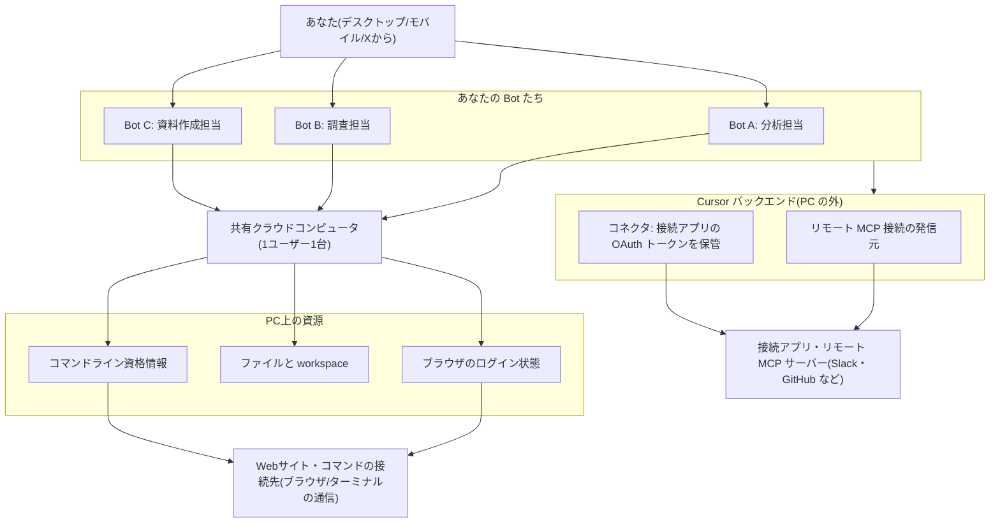

**読み取るべきポイント**

- Bot は複数作れますが、**すべて同じクラウドコンピュータを使います**。
- ブラウザとターミナルの通信は**共有クラウドコンピュータから**出ますが、リモート MCP 接続は **Cursor バックエンドから**発信され、接続アプリの OAuth トークンは**コネクタのバックエンドに留まり** PC には置かれません。
- したがって「Bot を分ければ権限も分かれる」わけでは**ありません**(公式ドキュメントも「別々の Bot をセキュリティ境界として使わない」と明記しています)。詳細は [14章](#14-セキュリティの境界を理解する)。

### 3.2 学習の道筋

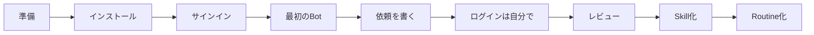

---

## 4. Step 0: 始める前の準備

### 4.1 必要なもの

公式の「Get started」によると、次が必要です。

| 項目 | 内容 |
|------|------|
| **対象プラン** | レガシー Cursor プランの有料個人プラン / Cursor Teams / The X Subscription の Premium・Super・Ultra プラン(個人シート・チームシートとも対象。Grok Bot を含み、Grok アカウントの連携は不要。Plus は対象外)/ 個人の SuperGrok・SuperGrok Plus・SuperGrok Heavy または X Premium+ をレガシーの Cursor アカウントに連携(特定の Cursor プランは不要)/ 自己登録型 Grok Business のシート(**Sign in with Grok** でサインイン)|
| **アプリ** | macOS / Windows / Linux 用の Grok Bot デスクトップアプリ(モバイルもあり) |
| **最初の題材** | Bot が実際に役に立てる「アプリやWebサイト」 |

> **料金は変わります**。最新は公式のプラン案内(Cursor の Grok Bot plans ページ)で確認してください。

### 4.2 プライバシー設定(最初に確認)

- Grok Bot は **クラウドへのデータ保存が必須**で、Cursor の **Legacy Privacy Mode は非対応**です。
- Legacy Privacy Mode のアカウントは、対応するデータ設定へ切り替えないと開始できません。
- 学習利用のオプトアウトは、該当する Cursor アカウントのプライバシー設定に従います。

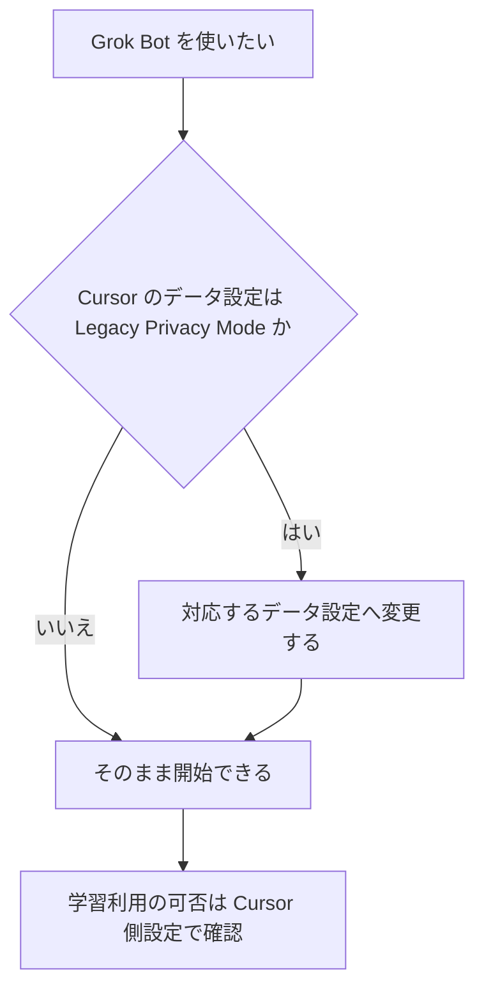

### 4.3 ベストプラクティス

1. **本番データや機密を扱う前に**、プライバシーとセキュリティの公式ページを読む。
2. 最初の1週間は「練習用の安全なデータ」だけで試す。
3. 会社で使うなら、**社内のセキュリティ部門に先に相談**する(Cursor 側にホスト、オンプレ不可という前提も確認事項)。

---

## 5. Step 1: アプリをインストールする

| OS | 手順の要点 |
|----|-----------|
| **macOS** | Apple silicon / Intel を選び、ディスクイメージから **Applications** へドラッグ。初回起動で確認が出たら **Open** |
| **Windows** | x64 / Arm64 を選びインストーラを実行。スタートメニューから起動 |
| **Linux** | `.deb`(Debian/Ubuntu)、`.rpm`(Fedora/RHEL)、AppImage(その他)から選択 |

アーキテクチャの確認コマンド(Linux):

```bash
# x86_64 なら x64、aarch64 なら Arm64 版を選ぶ
uname -m
```

- 配布元: [x.ai/bot](https://x.ai/bot)
- 自動アップデート対応。手動は **Settings → Updates → Check for Updates** を選び、更新が見つかったら通常は **Restart to Update** を選んで適用する。
- Linux の `.deb` / `.rpm` 版では、更新画面は新しいバージョンの通知のみ。更新はパッケージマネージャー(`apt` / `dnf` など)で行う。

---

## 6. Step 2: サインインする

1. ウェルカム画面で **Sign in** を選ぶ(Grok Bot は Cursor アカウントを使い、専用のログインはない)。
2. 開いたブラウザで認証を完了する。通常は Cursor アカウントで認証する。セルフサーブの Grok Business のシートで使う場合は、ブラウザで **Sign in with Grok** を選び、シートを持つ Grok アカウントで認証する。
3. アプリに戻る。
4. 契約経路に応じて、次の手順を行う。
   - **The X Subscription の Premium・Super・Ultra** の場合: Grok Bot が含まれるため、Grok アカウントの連携は不要。
   - **SuperGrok** の場合: 案内に従って Grok アカウントを連携する。
   - **X Premium+** の場合:
     - デスクトップ: **Settings → Usage & Billing → Get Access with Grok** を開き、X Premium+ の Grok アカウントでサインインする。
     - iPhone / Android: アクセス画面で **Link Grok Account** を選んで連携し、終わったら **Finished Linking? Refresh My Status** を選ぶ。
   - **セルフサーブの Grok Business** で、先に Cursor アカウントで認証してしまった場合: いったんサインアウトし、**Sign in with Grok** でシートを持つ Grok アカウントを使って認証し直す。

初回は短いイントロのあと、裏側でコンピュータのセットアップが走り、**「Grok Bot」という名前の最初の Bot** が作られてチャットが開きます。

> 組織で SSO が必須の場合は、通常の組織サインインを完了してください。

---

## 7. Step 3: 最初の Bot を作る

### 7.1 原則: 1つの Bot に 1つの主な仕事

公式ガイドは「**焦点を絞った Bot のほうが有用な文脈を蓄積する**」と述べています。万能 Bot 1体より、役割別の Bot を勧めています。

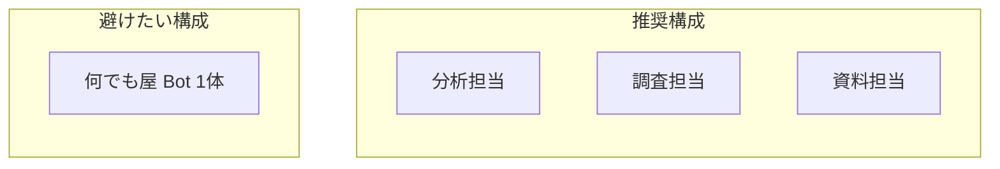

### 7.2 最初のメッセージの型

最初のメッセージで「役割」「やり方」「禁止事項」「覚えること」を伝えます。

```markdown
あなたの担当はプロダクトの性能分析です。
監視ツールを使って性能に関する質問を調べてください。
リンクとスクリーンショットを残し、「証拠」と「仮説」を分けて書き、
影響が最大の問題から先に報告してください。
本番設定は絶対に変更しないでください。
これを今後の作業のために覚えておいてください。
```

> 上記は公式ガイドの例を日本語に意訳したものです。

### 7.3 Bot を増やすタイミング

- 仕事の種類が**自然に分かれた**とき(例: 分析 / 調査 / 資料)。
- 追加はサイドバーの **+**(または **New Bot**)から。チームのユーザーはメニューから **Create a Bot** を選ぶ。
- Cursor チームでチームメイトと共有したい場合は、サイドバーの **+ → Create a Bot** で Bot を作り、チャットの Bot 名メニューにある **Share** からチームに共有します。

---

## 8. Step 4: 良い依頼の書き方(5要素)

### 8.1 5要素テンプレート

| # | 要素 | 問い | 例 |
|---|------|------|----|
| 1 | **Outcome(成果)** | 何が完了していればよいか | 「先週の新規ユーザー活性化率を過去4週と比較」 |
| 2 | **Sources(情報源)** | どのアプリ/サイト/ファイルを見るか | 「分析ダッシュボード」 |
| 3 | **Constraints(制約)** | やってはいけないこと、事前確認すること | 「ダッシュボードは変更しない」 |
| 4 | **Deliverable(成果物)** | 何を返すか | 「最大変化のステップと調査計画案」 |
| 5 | **Review point(確認点)** | どこで止まってあなたに見せるか | 「計画案の時点で一度止まる」 |

### 8.2 5分でできる最初の練習(ログイン不要)

文書を1つ添付して、次のように依頼します(公式例の意訳)。

```markdown
この文書を5つの箇条書きで要約してください。
日付・決定事項・未解決の質問は、別セクションにすべて列挙してください。
各項目にページまたはセクションを引用元として付けてください。
元ファイルは変更しないでください。
```

### 8.3 ツールを使う2つ目の練習

```markdown
分析ダッシュボードを開き、今週の新規ユーザー活性化率を
過去4週と比較してください。
最も変化が大きいステップを特定し、
関連するグラフへのリンク付きで簡単な調査計画案を作ってください。
ダッシュボードは一切変更しないでください。
必要ならログインを私に依頼してください。
```

### 8.4 悪い依頼と良い依頼

| 悪い例 | 問題 | 良い例 |
|--------|------|--------|
| 「売上を見といて」 | 成果・範囲・形式が不明 | 「先月の売上を地域別に集計し、前年同月比を表で。数値の出典リンク付き」 |
| 「メール返しといて」 | 送信までやってしまう恐れ | 「返信**案**を3パターン作成。**送信しない**。承認を求める」 |
| 「いい感じに整理して」 | 基準がない | 「ファイル名を `YYYY-MM-DD_内容` に統一。リネーム前に一覧で確認を」 |

### 8.5 音声入力

- デスクトップは `Cmd/Ctrl+D` で音声入力、**Start voice chat** でライブ会話。
- モバイルは **Start dictation**。

---

## 9. Step 5: ログインは自分で行う(Take over)

### 9.1 なぜ引き継ぐのか

Bot がログインを必要とするアプリに到達すると、まず安全な方法で処理しようとします。**個人 Bot** は **Vault、接続済みのパスワードマネージャ、または安全なシークレット入力フォーム(Secure Form)** を使います。**Shared Bot では Vault は使わず**、接続済みのパスワードマネージャまたは Secure Form で処理します。ただし、メンバー個人のチャット・チャンネル・スレッド・グループ DM・グループチャットのいずれでも、**接続済みアカウントを使う前に必ず利用者へ確認を求めます**。SSO・パスキー・CAPTCHA など、フォームでは扱えない手順がある場合にだけ、**あなたにコンピュータ操作を引き継ぐ(Take over)よう依頼**します。引き継いだときは、パスワード・パスキー・2要素コード・CAPTCHA・決済確認などの機密情報や確認事項を**自分で**入力します。

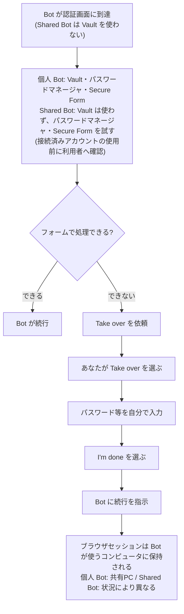

> **Shared Bot のセッション保存先**: メンバー個人のチャットでは通常そのメンバーのコンピュータ、チャンネル・スレッド・グループ DM・グループチャットでは Shared Bot のコンピュータにセッションが残ります。プライバシー設定によって別のコンピュータが選ばれる場合もあるため、常に共有PCに残るとは限りません。

### 9.2 守ること

| やる | やらない |
|------|----------|
| **Take over** で自分が入力する | チャットにパスワードやワンタイムコードを書く |
| Bot が出す**安全なシークレット入力フォーム**に入力する(値はマスクされ、トランスクリプトとモデルから除外) | Bot を汎用のパスワードマネージャとして使う |
| 不要になったらサービスから**サインアウト** | ログインしたまま放置する |

### 9.3 ハードウェアセキュリティキー

- YubiKey などは、**Settings → General → Security Key** の **Use hardware security keys** が有効なら、デスクトップに挿したキーを Bot のブラウザで使えます。
- macOS / Windows ではデフォルトでオン、Linux は未対応、使用のたびに承認が必要です。

> **注意**: ログイン済みのセッションは共有コンピュータに残り、**他の Bot も使える**可能性があります(14章)。

---

## 10. Step 6: 結果をレビューして育てる

### 10.1 レビューの観点

| 観点 | 確認すること |
|------|-------------|
| 正確性 | 数値・日付に**出典リンク**があるか |
| 範囲 | 頼んでいないことまでやっていないか |
| 形式 | 指定したフォーマットか |
| 停止位置 | 承認ポイントで止まったか |

### 10.2 「恒久的な好み」は明示して覚えさせる

```markdown
今後の週次レポートはこの形式にしてください:
箇条書き5つ、出典リンクは本文中にインライン、
最後に「要判断事項」というセクションを付ける。
```

- 一回限りの修正と、今後も守ってほしい好みを**区別して言葉にする**のがコツです。
- 手順が安定したら、**Skill 化**または **Routine 化**します(次章)。

---

## 11. Step 7: Skill 化 → Routine 化

### 11.1 自動化の正しい順番

公式ドキュメントの原則は「**まず一回限りのタスクで始め、信頼できるようにし、手順を Skill として保存し、それから自動化する**」です。

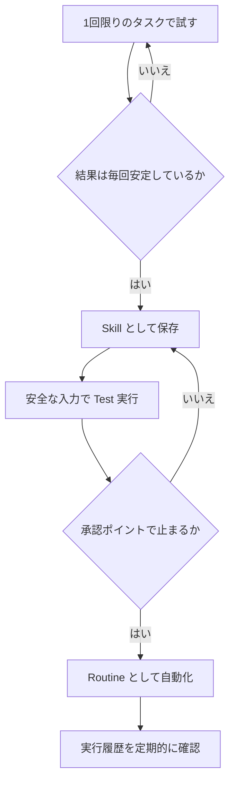

### 11.2 良い Skill に書くこと(6項目)

| # | 項目 |
|---|------|
| 1 | いつ使うか |
| 2 | 必要な入力とアクセス |
| 3 | 作業の順序 |
| 4 | 結果の検証方法 |
| 5 | 返すもの |
| 6 | 承認が必要なこと |

Skill 保存の依頼例(公式例の意訳):

```markdown
いまの手順を「Weekly account health」という Skill として保存してください。
参照するシステム、リスクの定義、出力形式、
そして「顧客への連絡は必ず承認が必要」というルールを含めてください。
```

- 保存済み Skill は、依頼文の中で **Skill 名を指定する**と呼び出せます(`/` メニューは対応しているインターフェースでのみ使えます)。`@` で Bot・グループ・Routine・アプリを参照できます。
- Skill は**全 Bot で共有されるライブラリ**ですが、Bot にそのアプリやログインがないと使えない場合があります。
- 現在の Bot で Private Skill が表示されない場合は、**Connect apps** を開き、接続済みの項目から **Private skills** を有効にします。
- 提供されている場合、**Teach a task** でブラウザ操作を一度やって見せて Skill を作れます(最大10分間の画面操作を記録。マイク音声は記録しない)。作られた Skill は**下書き**なので、判断ルール・失敗時の扱い・承認境界を必ず追記してください。

### 11.3 Routine の作り方

Routine を所有させたい Bot に頼みます(公式例の意訳)。

```markdown
平日の毎朝8時に、現在のアカウント一覧に対して
「Daily customer-risk」Skill を実行してください。
リンク付きのウォッチリストをこの会話に投稿してください。
顧客には連絡しないでください。
元データが取得できない場合は、古いデータを使わず失敗を報告してください。
```

**必ず確認する6点**: 所有 Bot / スケジュールとタイムゾーン / 入力元 / 期待する結果 / 承認境界 / ソース欠落時の動作

### 11.4 Routine の制限(公式記載)

| 項目 | 内容 |
|------|------|
| 1 Bot あたりの Routine 数 | 最大 50 |
| 実行記録 | Routine ごとに直近 20 件 |
| スケジュール間隔 | 最短 5 分 |
| 削除 | 即時・元に戻せない。Bot を削除するとその Bot の Routine も消える |
| 長期不在 | 応答がなければ Routine が一時停止されることがある |
| 1時間あたりの実行数 | 全 Routine 合計で 300 回、Routine ごとに 200 回まで。超過分の実行は失敗し、**自動では再試行されない** |

### 11.5 イベントトリガー

Slack のメッセージや GitHub の通知をきっかけに Routine を動かせます(Cursor アカウントの連携。Slack/GitHub アプリとは別の接続が必要な場合あり)。

```markdown
#customer-escalations チャンネルに、サポートチケットへのリンクと
「needs repro」という語を含むメッセージが来たら、
チケットを開き、ステージング環境で再現し、
再現パックをこの会話に投稿してください。
承認なしに Slack へ投稿し返すことは絶対にしないでください。
```

> **「新着メッセージすべて」のような広すぎるトリガーは避ける**。ノイズが増え、使用量を消費し、無関係な入力に反応するリスクが上がります。

### 11.6 Test の注意点

> **Test 実行は本物の作業を行います**(Webサイトの操作、ファイル変更、連携ツールの呼び出し)。安全な入力を使い、書き込み系は承認の後ろに置いてください。

第三者のレビュー記事(eesel)も「ドライランモードはなく、テストは実行そのもの」と指摘しています。

### 11.7 信頼できる Routine の設計7原則

1. 実行より**準備を自動化**する
2. まず**下書き・突合・推奨**を作らせる
3. 送信・購入・削除・公開・本番変更は**承認必須**
4. **データなし/古いデータ**のときの方針を書く
5. リトライは**冪等**に(二重実行しても安全に)
6. **部分完了**の報告先を指定する
7. Webサイトやデータ形式が変わったら**再テスト**

---

## 12. Step 8: X から @bot でタスクを渡す

### 12.1 何ができるか

X の投稿やリプライで [@bot](https://x.com/bot) をタグ付けすると、その投稿を**あなたの Grok Bot へのタスク**として渡せます。

```markdown
@bot このスレッドを要約して、要点を私の Slack に送って
```

- @bot は X 上では**短い受領返信のみ**。実際の作業と結果は Grok Bot アプリの Bot の会話に残ります。
- Bot が受け取るのは、あなたの投稿・返信先の投稿・それらが引用する投稿(静止画を含む)です。
- 初回は、タグ付き依頼が**自動で作業を開始し、Grok Bot の使用量を消費する**旨の通知が X から届きます。

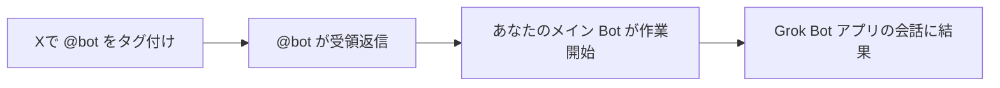

### 12.2 前提条件

| 条件 | 内容 |
|------|------|
| Grok アカウントと X の連携 | grok.com の **Settings → Account** で **𝕏 Account** を Connect |
| Grok Bot の利用権 | 同じ Grok アカウントで有効 |
| 自分の Bot | **少なくとも1体**(共有された Bot ではタグ依頼を受けられない) |
| 地域 | X に登録された国が対象地域であること |

### 12.3 利用できない地域(公式記載)

- オーストラリア、英国、EU、アイスランド、リヒテンシュタイン、ノルウェーの X アカウントでは**現時点で未対応**。
- 判定は X に登録されている国で行われ、**現在地や VPN は無関係**です。
- 国が広域(例: South Asia)や未設定の場合も未対応です。

### 12.4 セキュリティ上の注意

X の投稿は**第三者が書いた信頼できない入力**です。@bot で渡す投稿やスレッドには、プロンプトインジェクション(隠れた指示)が含まれる可能性があります。**外部送信を伴う指示(Slack送信など)は承認境界を必ず設定**してください(13〜14章)。

---

## 13. 承認(Approvals)と Auto Review の設計

### 13.1 まず「依頼文の中の境界」が最強

公式ドキュメントは「**最も強い境界は依頼そのものの中にある**」としています。

```markdown
キャンペーンデータを突合し、予算変更の推奨案を作成してください。
キャンペーンの変更や代理店へのメッセージ送信はしないでください。
現在値・提案値・想定インパクトを示したうえで承認を求めてください。
```

**明示的な境界を置くべき操作**

| 操作 | 例 |
|------|----|
| メッセージ・招待の送信 | メール、Slack、カレンダー招待 |
| コンテンツの公開 | ブログ、SNS投稿 |
| 購入・資金移動 | 決済、送金 |
| 削除・上書き | ファイル、データ |
| 権限変更 | 共有設定、ロール |
| 本番変更 | 設定、デプロイ |
| 法的条件への同意 | 利用規約、契約 |

### 13.2 承認カードの読み方

承認が必要になると、会話に**提案された操作とその入力**が表示されます。

表示されるボタンは**操作やカードによって異なり**、次の 3 つが常にそろうわけではありません。カードによっては **Allow**・**Skip**・**Not now** などのラベルで表示されます。

| ボタンの例 | 動作 |
|--------|------|
| **Allow once** / **Allow** | その操作だけ続行 |
| **Always allow** | 一致するルールを保存(カードがルールを提案している場合のみ表示。慎重に) |
| **Deny** / **Skip** / **Not now** | その操作を実行しない |

重要な性質:

- **承認は「提案された操作」を制御するもので、すでに完了した作業を元に戻すものではありません。**
- **対象や効果を特定できない操作は承認しない**。平易な言葉で説明させるか、下書きを先に作らせる。
- 承認カードの期限は**作業を起こしたきっかけ**で決まります。チャットのメッセージから始まった作業のカードは、この 30 分のタイマーでは期限切れになりません。一方、Routine・受信メッセージ・その他のバックグラウンド処理が作成したカードは**30分で期限切れ**になり、操作は実行されません。再実行は Bot に依頼し直します。

### 13.3 Auto Review の設定

ルールの追加場所はプラットフォームで異なります。デスクトップは **Settings → General** の **Bot** セクションにある **Auto-review**、iPhone と Android は **Settings → Bot** から設定します。

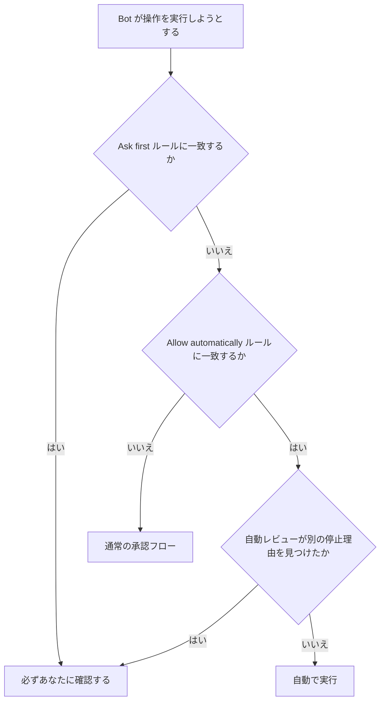

| ルール種別 | 動作 |
|-----------|------|
| **Ask first** | 一致する操作は**常に**あなたの確認で止まる |
| **Allow automatically** | 一致し、かつ自動レビューが他の停止理由を見つけない場合のみ通過 |
| 両方に一致 | **Ask first が優先** |

チーム管理者が Auto Review を強制している場合、編集不可の**チームルール**も表示されます。個人ルールは**その上に重なり、より厳しくする方向にのみ**働きます。

### 13.4 ルールの書き方

**狭く、対象とスコープを限定する**(公式の例):

| 良いルール | 理由 |
|-----------|------|
| 外部メールを送る前に必ず確認(Ask first) | 外部送信は取り消せない |
| 本番ダッシュボードを変更する前に確認(Ask first) | 影響が大きい |
| `/workspace/reports` で `git status` を実行する場合は自動許可 | 対象・コマンドが明確で読み取り中心 |

**避けるべき広いルール**: 「ブラウザ内のことはすべて許可」。Webサイトやツールの挙動は時間とともに変わるためです。

> Auto Review は**モデルによる判断**です。最小権限と明示的な承認境界を**置き換えるものではなく補完するもの**と公式も位置づけています。第三者の分析(howtoharden, eesel)は、承認がユーザーの自由記述に依存する点・自動レビューが全副作用(例: メモリ書き込み)を審査しない点を指摘しています。

### 13.5 ローカルPCへのアクセス

クラウド上の共有コンピュータとは**別の能力**として、手元の Mac/Windows での実行が設定できます。

| 設定(Settings → Computer → Your computer) | 意味 |
|------------------------------------------|------|
| **Ask every time**(デフォルト) | 毎回確認 |
| **Always allow** | 常に許可 |
| **Never allow** | 常に拒否 |

- 手元のファイルで作業させる明確な理由がなければ **Never allow** を推奨(公式)。
- チーム管理者がより厳しい上限を設定している場合は、そちらが優先されます。

---

## 14. セキュリティの境界を理解する

### 14.1 共有コンピュータの境界(最重要)

公式ドキュメントの要点:

| 事実 | 意味 |
|------|------|
| あなたの**個人 Bot はすべて 1 台のクラウドコンピュータ**を共有 | ファイル・ブラウザセッション・コマンドライン資格情報が**全個人 Bot で利用可能** |
| Shared Bot はどこで使うかで使用するコンピュータが変わる | メンバー自身のチャットでは**そのメンバーのコンピュータ**、Slack チャンネルやグループチャットでは **Shared Bot のコンピュータ**を使う |
| **別々の Bot をセキュリティ境界として使わない** | 「経理用 Bot」「公開用 Bot」で権限が分かれるわけではない |
| Bot の公開共有リンク | 設定をコピーされるだけで、あなたの PC やログインは共有されない。ただし**秘密情報・顧客データ・社内URLを共有 Bot に入れない** |
| Bot を削除しても | **共有PC上のファイルやブラウザセッションは消えない** |

### 14.2 プロンプトインジェクションとの関係

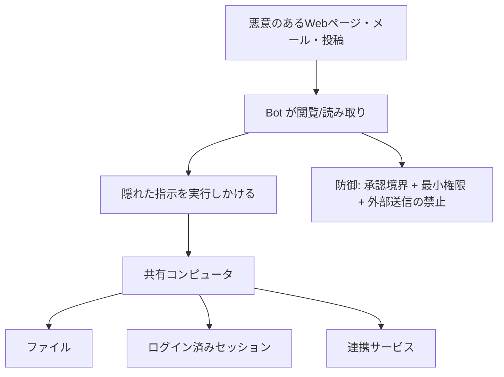

Django 共同開発者の **Simon Willison** は、AI エージェントが危険になる3条件を「**致命的な三つ組(lethal trifecta)**」と呼んでいます。

| 条件 | Grok Bot での例 |
|------|----------------|
| ① 私的データへのアクセス | メール・ドライブ・ログイン済みセッション・ファイル |
| ② 信頼できない内容への接触 | Webページ・受信メール・X の投稿・Slack メッセージ |
| ③ 外部へ送信する手段 | メール送信、Slack 投稿、ブラウザからの POST |

**3つが同時に揃うと、隠れた指示でデータが持ち出される恐れがあります。** xAI のドキュメントも、外部コンテンツを信頼できないものとして扱う層と、Auto Review・ネットワークポリシー・操作ごとの承認を重ねつつ、これらは**リスクを減らすが排除はしない**としています(第三者の整理による)。

**対策の考え方(三つ組を崩す)**

| 崩す対象 | 具体策 |
|----------|--------|
| ①を減らす | 必要なツールだけ接続。スコープ付きサービスアカウント。読み取り専用から開始 |
| ②を減らす | 信頼できないサイトを閲覧させる Routine を作らない。広いトリガーを避ける |
| ③を止める | 送信・公開・購入・削除・本番変更は**常に承認の後ろ** |

### 14.3 アクセスを撤回するとき(公式の手順)

1. 関連する Routine を一時停止/削除
2. 共有コンピュータ上のWebサイトからサインアウト
3. コネクタをアンインストールし、**元のサービス側で認可を取り消す**
4. `/workspace` から機密ファイルを削除
5. 不要な Bot を非表示/削除
6. 必要なら Cursor アカウント削除フローへ

---

## 15. 最小権限セットアップ・チェックリスト

公式の「Use a least-privilege setup」に基づく実践リストです。

### 15.1 導入時

- [ ] 必要なツールだけを接続している
- [ ] 可能なものは**スコープ付きサービスアカウント**を使っている
- [ ] 最初は**読み取り専用タスク**と**下書き出力**から始めた
- [ ] 送信・公開・購入・削除・本番変更を**承認の後ろ**に置いた
- [ ] ローカル実行を **Never allow**(または Ask every time)にしている
- [ ] パスワード・コードは **Take over** で入力している

### 15.2 運用時

- [ ] インストール済みコネクタと有効な Routine を**定期的にレビュー**している
- [ ] 連携元システムや想定フローが変わったら Routine を**一時停止**した
- [ ] 重要な判断について**出典リンクと操作ログ**を残している
- [ ] 作業完了後に、機密の一時ファイルを削除している
- [ ] 不要になったサービスからサインアウトしている

### 15.3 週次の見直し(おすすめ)

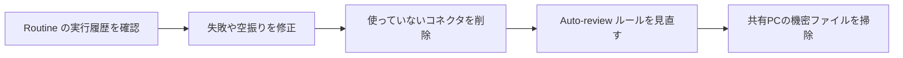

---

## 16. チーム・組織で使うとき

### 16.1 Team Bot

- Cursor チームでは、サイドバーの **+ → Create a Bot** で Bot を作り、チャットの Bot 名メニューの **Share** からチームに共有すると、メンバーが話しかけられる Bot になります。
- **チームで共有する Bot** では、オーナーまたは Manager が追加したアプリ・シークレット・スキル・ファイルが、**各メンバーのチャットでも利用可能**になります。オーナーと Manager のどちらが追加する場合も、認証情報や顧客データは追加しないでください。
- 一方、Bot の**公開テンプレート**としての共有は設定のコピーであり、**ログインの共有ではない**ことに注意。

### 16.2 管理者が知っておくこと(公式・第三者資料より)

| 項目 | 内容 |
|------|------|
| 設定の所在 | Grok Bot の主要な管理設定は **Cursor のダッシュボード**にある。一部の設定は **Team Settings・Team Marketplace・ID プロバイダー(IdP)** 側にもある。docs.x.ai はそのページを写し、Cursor に戻るリンクを持つ |
| Auto Review の強制 | **Enterprise プランのみ**。Enterprise の管理者が Enforce Auto-review とチーム全体の Auto-review ルールを設定すると、編集不可のチームルールが全員に適用される。個人ルールはより厳しくのみ可能 |
| ローカル実行の上限 | 管理者がチーム全体の上限を設定できる(厳しい方が優先) |
| Bot の ID | Bot には識別用の ID があるが、独立した認証アイデンティティや資格情報は持たず、**サインインしているメンバーとして**動く |
| 実行環境 | 第三者の調査では、Cursor がホストするマシン上でのみ動作しオンプレミスの選択肢はない(OneWave の読み込みによる) |
| 認証・準拠 | 公式のセキュリティページは **ISO/IEC 27001** と **ISO/IEC 42001** の認証取得を示している。なお、第三者(eesel)は過去に「ドキュメントが認証取得の主張をしていない」と指摘していた(調査日 2026年10月24日時点の記事。現在は公式ページで最新の認証状況を確認する) |

> 組織導入の際は、公式の「Grok Bot for Teams and Enterprises」と「Grok Bot security FAQ」から始めるよう公式が案内しています。

---

## 17. トラブルシュート

### 17.1 まず試すこと

**アプリを完全に終了して開き直す**(公式:セットアップの問題の多くはこれで解消)。解決しない場合は、公式の Troubleshooting ページと support に問い合わせます。

### 17.2 @bot が返信しない場合(公式の原因一覧)

| 原因 | 対処 |
|------|------|
| X アカウントの国が未対応 | 現時点では対処不可(対応待ち) |
| すでに @bot を含むスレッドに、自分では @bot をタグ付けせず返信した | **自分の投稿で明示的に @bot を付ける** |
| 投稿が @grok も同時にタグ付けしている | @bot のみにする |
| 投稿・返信先・引用先に**動画や GIF** がある | 静止画またはテキストにする |
| 内部モデレーションを通過しない | 内容を見直す |
| Grok Bot が Grok アカウントに未連携、または今週の使用量を使い切った | 連携・使用量を確認 |

### 17.3 @bot の返信の意味

| @bot の返信 | 意味 | 対処 |
|------------|------|------|
| 依頼を Grok Bot に送ったという短い返信 | メイン Bot が受領 | Grok Bot アプリで進捗を確認 |
| 「Sign up for Grok Bot」案内 | X アカウントに Grok アカウントが未連携 | grok.com で X を連携し、再度タグ付け |
| 「Grok Bot isn't set up yet」案内 | アカウントは連携済みだが自分の Bot がない | アプリで Bot を作成し、再度タグ付け |

### 17.4 Routine が動かない・空振りする

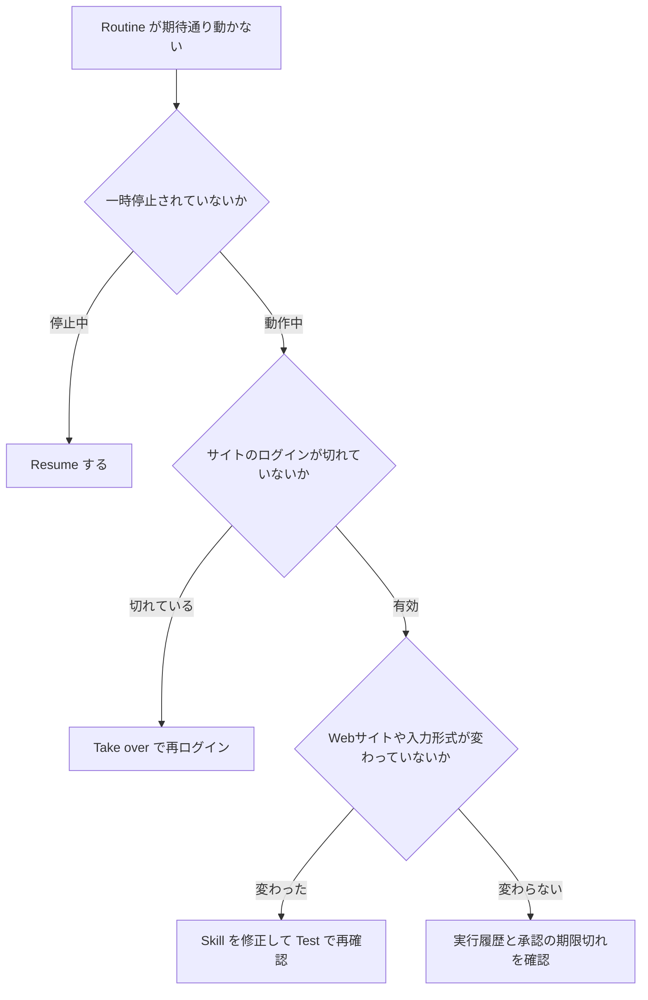

---

## 18. よくある失敗と対策(アンチパターン集)

| # | 失敗 | なぜ危険か | 対策 |
|---|------|-----------|------|
| 1 | 何でも屋 Bot を1体だけ作る | 文脈が散らかり品質が下がる | 役割ごとに Bot を分ける |
| 2 | Bot を分ければ安全だと思う | 共有コンピュータで資格情報が共有される | Bot 分割をセキュリティ境界にしない |
| 3 | 「ブラウザ内は全部許可」のルールを作る | サイトの挙動変化で想定外の操作が通る | 狭い対象・コマンドのルールにする |
| 4 | いきなり Routine 化する | 不安定な手順が毎日誤動作する | 1回限りで安定 → Skill → Test → Routine |
| 5 | Test を「安全な練習」だと思う | 本物の操作が実行される | 安全な入力+書き込みは承認の後ろ |
| 6 | 「新着メッセージすべて」で起動する | ノイズ・使用量増・無関係入力への反応 | 狭い一致条件にする |
| 7 | パスワードをチャットに貼る | 記録に残る | Take over か安全なシークレット入力 |
| 8 | 対象不明の承認を押す | 取り返しがつかない操作が走る | 説明/下書きを先に求める |
| 9 | 機密を共有 Bot に入れる | 共有リンクで設定がコピーされる | 秘密・顧客データ・社内URLを入れない |
| 10 | Bot を削除すれば痕跡が消えると思う | 共有PCのファイルとセッションは残る | 14.3 の撤回手順を実施 |
| 11 | 古いデータで定時レポートを出す | 誤判断を招く | 「ソース欠落時は失敗を報告」と明記 |
| 12 | ローカル実行を常時許可 | 手元ファイルへの影響範囲が拡大 | Never allow / Ask every time |

---

## 19. 補足: その他のベストプラクティスと根拠ソース

> **調査方針**: 2026年10月24日時点でウェブ検索を行い、公式ドキュメントを一次情報とし、国際的に知られた開発者・セキュリティ研究者の発信と、独立した第三者の分析を補足としました。
> **正直な限界**: Grok Bot に特化して著名な国際的開発者が書いた一次的な長文解説は、検索範囲では多くありませんでした。そのため、(a) Simon Willison のように**エージェント安全性の一般原則**を示す著名開発者の資料と、(b) Grok Bot を直接扱った独立した解説・開発者投稿、(c) 公式ドキュメント、を組み合わせています。

### 19.1 補足ベストプラクティス一覧(根拠付き)

| # | ベストプラクティス | 根拠・要点 | 発信元 | URL |
|---|--------------------|-----------|--------|-----|
| 1 | 「致命的な三つ組」を崩す設計にする(私的データ・信頼できない入力・外部送信を同居させない) | AIエージェントが情報を持ち出される3条件の整理。Grok Bot の第三者解説でも引用されている | **Simon Willison**(Django 共同開発者、Datasette 作者) | https://simonwillison.net/2025/Jun/16/the-lethal-trifecta/ |
| 2 | X 上の信頼できない投稿を読むエージェントは間接プロンプトインジェクションを前提に設計する | Grok 3 が X の投稿を検索して回答する構造について、間接プロンプトインジェクションへの脆弱性を指摘 | **Simon Willison**(ブログのタグ集) | https://simonwillison.net/tags/prompt-injection/?page=3 |
| 3 | Bot を分けても権限は分かれない。ログインは全個人 Bot で利用可能と考える | 共有コンピュータ上でファイル・ブラウザセッション・資格情報が共有される | xAI 公式ドキュメント | https://docs.x.ai/grok-bot/approvals-security-and-privacy |
| 4 | 承認ルールは狭く書き、広い許可を避ける | Auto Review はモデルベースで、最小権限の代替ではない | xAI 公式ドキュメント | https://docs.x.ai/grok-bot/approvals-security-and-privacy |
| 5 | 自動化は「一回限り → Skill → Test → Routine」の順 | 公式が順序を明記 | xAI 公式ドキュメント | https://docs.x.ai/grok-bot/skills-routines-and-automations |
| 6 | 最初の1回は5要素(成果・情報源・制約・成果物・確認点)で依頼する | 公式の「強い依頼」の定義 | xAI 公式ドキュメント | https://docs.x.ai/grok-bot/get-started |
| 7 | @bot 経由の依頼は地域・動画/GIF・@grok の同時タグなどの制約を先に確認する | 無反応の原因が公式に一覧化されている | xAI 公式ドキュメント | https://docs.x.ai/grok-bot/tag-on-x |
| 8 | 管理者は Auto Review 強制・ローカル実行の上限・シート割り当てなどを使い分ける | 設定の所在が Cursor ダッシュボード側にある点を整理 | How to Harden(ハードニングガイド) | https://howtoharden.com/guides/grok-bot/ |
| 9 | 承認が自由記述ルールに依存する点・ドライランがない点を理解して導入判断する(認証は公式セキュリティページで ISO/IEC 27001・ISO/IEC 42001 を確認。eesel の「認証主張がない」との指摘は調査日 2026年10月24日時点の過去の評価) | ドキュメント読み込みによる批判的レビュー | eesel AI(独立レビュー) | https://www.eesel.ai/blog/grok-bot |
| 10 | 代替製品と比較し、監査性を重視して選ぶ | プライバシーモードの扱い・承認の性質を比較 | eesel AI | https://www.eesel.ai/blog/grok-bot-alternatives |
| 11 | 導入前にセキュリティ FAQ を読み、ホスト先・オンプレの可否などを質問リスト化する | 発売直後にセキュリティドキュメントを読み込んだ企業コンサルの整理 | OneWave AI | https://www.onewave-ai.com/blog/grok-bot-explained-what-it-means-for-business |
| 12 | パーソナルエージェント(Grok Bot / Muse / Dots)の共通構造(記憶・自分のコンピュータ・自律起動)を理解し、副作用の審査範囲(例: メモリ書き込み)を確認する | 3製品の比較解説。1ユーザー1つのマイクロVM を全 Bot が共有する説明を含む | Projeckt AI | https://projecktai.substack.com/p/personal-ai-agents-explained |
| 13 | ローカル実行は「Never allow」から始める | 実践ガイドの推奨 | Vantaige | https://vantaige.io/blog/grok-bot-complete-guide-2026 |
| 14 | プライバシー設定は Cursor 側設定が支配する。Privacy Mode の挙動は公式フォーラムの回答で確認する | Cursor の Privacy Mode が Grok Bot にも適用される旨の説明 | Cursor 公式フォーラム | https://forum.cursor.com/t/privacy-and-term-of-use-of-grok-bot-with-cursor-account/168075 |
| 15 | 見えない文字による隠し指示(Unicode)を検査する OSS コネクタを併用する選択肢 | 実際のアプリ上で検証した開発者の報告(個人開発者。実績は要自己確認) | PixelRainbow(X の投稿) | https://x.com/PixelRainbowNFT/status/2112021936662270175 |
| 16 | 悪意あるWebコンテンツが共有コンピュータ上で何を可能にするか、シナリオで理解する | Web閲覧型エージェントのプロンプトインジェクション解説 | DEV Community | https://dev.to/aiza-hextyx/grok-bot-prompt-injection-how-malicious-web-content-can-hijack-an-ai-agent-2elh |
| 17 | Bot の使い方の実例を開発者の投稿から学ぶ(中身は各自で確認) | Grok Bot 関連の開発者投稿のアーカイブ(Lingxi Li 氏の投稿) | Lingxi Li(X の投稿のアーカイブ) | https://archive.codenewsletter.ai/2094493172516966781 |
| 18 | 導入ガイドと技術解説を併読する | 常時稼働型 AI チームメイトの仕組みの解説 | Composio | https://composio.dev/content/guide-to-frok-bot |

### 19.2 ソースの信頼度の目安

| 区分 | 該当 | 読み方 |
|------|------|--------|
| ★★★ 一次情報 | docs.x.ai、x.ai/news、Cursor 公式 | 仕様の根拠として使う |
| ★★☆ 著名開発者の一般原則 | Simon Willison | 設計原則の根拠(Grok Bot 固有の検証ではない) |
| ★★☆ 独立した分析 | eesel、How to Harden、OneWave、Projeckt AI | 批判的視点。数値・仕様は公式で再確認 |
| ★☆☆ 個人発信 | X の投稿、DEV Community | 事例・仮説として扱い、鵜呑みにしない |

---

## 20. 参考URL一覧

### 20.1 公式

| 名称 | URL |
|------|-----|
| Introducing Grok Bot(アンカー記事) | https://x.ai/news/introducing-grok-bot |
| Grok Bot ダウンロード/トップ | https://x.ai/bot |
| Grok Bot ガイド集 | https://x.ai/bot/guides |
| Grok Bot 101 | https://x.ai/bot/guides/grok-bot-101 |
| Templates for Grok Bot | https://x.ai/bot/guides/templates-for-grok-bot |
| Grok Bot for Work | https://x.ai/bot/guides/grok-bot-for-work |
| ドキュメント: Get started | https://docs.x.ai/grok-bot/get-started |
| ドキュメント: Skills and routines | https://docs.x.ai/grok-bot/skills-routines-and-automations |
| ドキュメント: Approvals, security, and privacy | https://docs.x.ai/grok-bot/approvals-security-and-privacy |
| ドキュメント: Tag @bot on X | https://docs.x.ai/grok-bot/tag-on-x |
| ドキュメント: FAQ | https://docs.x.ai/grok-bot/faq |
| ドキュメント: Teams and enterprises(Cursor) | https://cursor.com/docs/grok-bot/teams |
| ドキュメント: セキュリティ(Markdown 版) | https://docs.x.ai/grok-bot/security.md |
| Cursor プライバシーポリシー | https://cursor.com/privacy |
| Cursor セキュリティ情報 | https://cursor.com/security |

### 20.2 第三者・開発者

| 名称 | URL |
|------|-----|
| Simon Willison: The lethal trifecta | https://simonwillison.net/2025/Jun/16/the-lethal-trifecta/ |
| Simon Willison: prompt-injection タグ | https://simonwillison.net/tags/prompt-injection/?page=3 |
| How to Harden: Grok Bot Hardening Guide | https://howtoharden.com/guides/grok-bot/ |
| eesel: Grok Bot explained | https://www.eesel.ai/blog/grok-bot |
| eesel: Grok Bot alternatives | https://www.eesel.ai/blog/grok-bot-alternatives |
| OneWave AI: What it means for business | https://www.onewave-ai.com/blog/grok-bot-explained-what-it-means-for-business |
| Projeckt AI: Personal AI Agents Explained | https://projecktai.substack.com/p/personal-ai-agents-explained |
| Vantaige: Grok Bot Complete Guide | https://vantaige.io/blog/grok-bot-complete-guide-2026 |
| Cursor フォーラム: Privacy and Terms | https://forum.cursor.com/t/privacy-and-term-of-use-of-grok-bot-with-cursor-account/168075 |
| Composio: Guide to Grok Bot | https://composio.dev/content/guide-to-frok-bot |
| DEV Community: Grok Bot Prompt Injection | https://dev.to/aiza-hextyx/grok-bot-prompt-injection-how-malicious-web-content-can-hijack-an-ai-agent-2elh |
| Lingxi Li 氏の投稿(アーカイブ) | https://archive.codenewsletter.ai/2094493172516966781 |
| PixelRainbow: VeilBreaker 投稿 | https://x.com/PixelRainbowNFT/status/2112021936662270175 |

---

## 21. 検証メモと限界

| 項目 | 内容 |
|------|------|
| 調査日 | 2026年10月24日 |
| 一次確認できたページ | Get started / Skills and routines / Approvals, security, and privacy / Tag @bot on X(いずれも公式ドキュメント。最終更新は 2026年10月7日〜22日と記載) |
| アンカー記事・ガイド集 | 取得は行ったが、本ガイドの数値・仕様の根拠は主に `docs.x.ai` の確認済みページに置いた |
| 取得できなかったもの | 公式 changelog(`x.ai/changelog/bot`)はボット検知でブロックされ内容を確認できていない |
| 第三者資料の扱い | 見出し・要旨レベルで参照。仕様の断定は公式側の記述に限定 |
| Grok Bot 固有の著名開発者による詳細解説 | 検索範囲では限定的。Simon Willison の記事は**一般原則**であり、Grok Bot の個別検証ではない |
| 料金・対応プラン・地域 | 変更が速い。**必ず公式の最新ページで確認** |

> **免責**: 本ガイドは情報提供を目的とし、製品の動作を保証しません。業務での本格導入前に、公式ドキュメントと組織のセキュリティ要件を確認してください。
